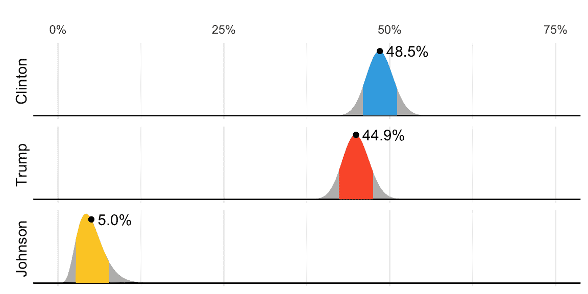

# 11 贝叶斯统计

> 原文：[`rafalab.dfci.harvard.edu/dsbook-part-2/inference/bayes.html`](https://rafalab.dfci.harvard.edu/dsbook-part-2/inference/bayes.html)

1.  统计推断

1.  11 贝叶斯统计

在 2016 年，FiveThirtyEight 展示了这张图表，描绘了每位候选人的得票率分布：



彩色区域表示根据 FiveThirtyEight 模型，有 80%的概率包含实际结果。

但在我们之前讨论的理论背景下，这些百分比被认为是固定的，这又意味着什么呢？此外，选举预测者会做出概率性陈述，例如“奥巴马有 90%的胜选概率。”请注意，在抽屉模型中，这相当于说$p>0.5$的概率是 90%。然而，在抽屉模型中$p$是一个固定参数，谈论概率是没有意义的。在贝叶斯统计中，我们假设$p$是一个随机变量，因此，“90%的胜选概率”与数学方法是一致的。预测者还使用模型来描述不同层面的变异性。例如，抽样变异性、民意调查员之间的变异性、日日变异性以及选举之间的变异性。用于此目的的最成功的方法之一是层次模型，这可以在贝叶斯统计的背景下进行解释。

在本章中，我们将简要介绍贝叶斯统计。我们使用三个案例研究：1）解释罕见疾病的诊断测试，2）使用选举前的民意调查数据估计希拉里·克林顿在 2016 年赢得普选票的概率。

前几章中描述的方法，其中参数被视为固定，被称为频率派方法。频率派这个术语来源于概率被解释为事件长期频率的思想。参数被认为是固定和未知的，而数据被视为随机的。频率派方法依赖于如果实验重复多次，结果出现的频率，关注观察到的结果的频率，而不是对参数本身分配概率。*  *## 11.1 贝叶斯定理

我们首先通过一个假设的囊性纤维化测试的例子来描述贝叶斯定理。

假设一项囊性纤维化测试的准确率为 99%。我们将使用以下符号：

$$ \mathrm{Pr}(+ \mid D=1)=0.99, \mathrm{Pr}(- \mid D=0)=0.99 $$

其中“+”表示阳性测试，“D”表示你是否真的患有疾病（1）或不是（0）。

假设我们随机选择一个人，他们测试呈阳性。他们患有疾病的概率是多少？我们把这个概率写成$\mathrm{Pr}(D=1 \mid +)$。

为了回答这个问题，我们将使用贝叶斯定理，它告诉我们：

$$ \mathrm{Pr}(A \mid B) = \frac{\mathrm{Pr}(B \mid A)\mathrm{Pr}(A)}{\mathrm{Pr}(B)} $$

当将此方程应用于我们的问题时，它变为：

$$ \begin{aligned} \mathrm{Pr}(D=1 \mid +) & = \frac{ \mathrm{Pr}(+ \mid D=1) \, \mathrm{Pr}(D=1)} {\mathrm{Pr}(+)} \\ & = \frac{\mathrm{Pr}(+ \mid D=1) \, \mathrm{Pr}(D=1)} {\mathrm{Pr}(+ \mid D=1) \, \mathrm{Pr}(D=1) + \mathrm{Pr}(+ \mid D=0) \mathrm{Pr}( D=0)} \end{aligned} $$

胆囊纤维症的患病率为 3900 人中有 1 人，这意味着 $\mathrm{Pr}(D=1)\approx0.00025$。将数字代入，我们得到：

$$ \mathrm{Pr}(D=1 \mid +) = \frac{0.99 \cdot 0.00025}{0.99 \cdot 0.00025 + 0.01 \cdot (.99975)} \approx 0.02 $$

根据上述内容，尽管测试的准确率为 0.99，但在测试结果为阳性时，患病概率仅为 0.02。这可能会让一些人感到反直觉，但这是因为我们必须考虑随机选择的人患病的非常罕见的概率。为了说明这一点，我们运行了一个蒙特卡洛模拟。

我们首先从患病率约为 1/4000 的人群中随机选择 100,000 人。

```r
p <- 0.00025
N <- 100000
D <- sample(c(1, 0), N, replace = TRUE, prob = c(p, 1 - p))
```

正如预期的那样，患病人数很少，而未患病人数很多，

```r
N_1 <- sum(D == 1)
N_0 <- sum(D == 0)
cat(N_1, "with disease, and", N_0, "without.")
#> 23 with disease, and 99977 without.
```

这使得在测试不完美的情况下，我们更有可能看到一些假阳性。现在，每个人都会接受测试，测试正确率为 99%：

```r
acc <- 0.99
test <- vector("character", N)
testD == 1] <- [sample(c("+", "-"), N_1, replace = TRUE, prob = c(acc, 1 - acc))
testD == 0] <- [sample(c("-", "+"), N_0, replace = TRUE, prob = c(acc, 1 - acc))
```

由于健康个体的人数远多于患病个体的人数，即使低误报率也会导致比实际病例更多的健康个体测试呈阳性。

```r
table(D, test)
#>    test
#> D       -     +
#>   0 99012   965
#>   1     0    23
```

从这张表中，我们可以看到有疾病的阳性测试比例是 988 个中的 23 个。我们可以反复运行这个程序，以看到实际上，概率收敛到大约 0.02。****

## ***11.2 先验和后验***

**在前一章中，我们计算了希拉里·克林顿和唐纳德·特朗普之间普选票差异的估计值和误差范围。我们用 $\theta$ 表示参数，即普选票差异。估计值在 2%到 4%之间，置信区间不包括 0。预报员会使用这个结果预测希拉里·克林顿将赢得普选票。但为了对选举胜利做出概率性陈述，我们需要使用贝叶斯方法。

我们在看到任何数据之前，通过量化我们的知识来开始贝叶斯方法。这是通过使用称为**先验**的概率分布来完成的。对于我们的例子，我们可以写成：

$$ \theta \sim N(\theta_0, \tau) $$

我们可以将 $\theta_0$ 视为我们没有看到任何调查数据时对普选票差异的最佳猜测，我们可以将 $\tau$ 视为量化我们对这个猜测的确定性。一般来说，如果我们有与 $\theta$ 相关的*专业知识*，我们可以尝试使用先验分布来量化它。在选举调查的情况下，专家使用*基本面*，例如经济状况，来开发先验分布。

数据被用来更新我们的初始猜测或*先验信念*。如果我们为任何给定的 $\theta$ 定义观察数据的分布，这可以数学上进行。在我们的特定例子中，我们会写下我们调查平均的模型。如果我们固定 $\theta$，这个模型与我们在上一章中使用的是相同的：

$$ \bar{Y} \mid \theta \sim N(\theta, \sigma/\sqrt{N}) $$

如前所述，$\sigma$ 描述了由于抽样和调查员效应而产生的随机性。在贝叶斯框架中，这被称为抽样分布。注意，我们写 $\bar{Y} \mid \theta$ 是因为 $\theta$ 现在被视为一个随机变量。

我们在这里不展示推导过程，但现在我们可以使用微积分和贝叶斯定理的一个版本来推导给定观察数据的 $\theta$ 的条件分布，这被称为后验分布。具体来说，我们可以证明 $\theta \mid \bar{Y}$ 服从期望值为：

$$ \mathrm{E}[\theta \mid \bar{Y}] = B \theta_0 + (1-B) \,\bar{Y} \mbox{ with } B = \frac{\sigma²/N}{\sigma²/N+\tau²} $$

以及标准误差：

$$ \mathrm{SE}[\mu \mid \bar{Y}] = \sqrt{\frac{1}{N/\sigma²+1/\tau²}}. $$

注意，期望值是我们先验猜测 $\theta_0$ 和观察数据 $\bar{Y}$ 的加权平均。权重取决于我们对先验信念的确定性，这由 $\tau²$ 来量化，以及我们观察数据汇总的方差 $\sigma²/N$。

这种加权平均有时被称为*收缩*，因为它会将估计值向先验值收缩。为了理解这一点，请注意我们可以将加权平均重写为：

$$ B \theta_0 + (1-B) \bar{Y}= \theta_0 + (1-B)(\bar{Y}-\theta_0)\\ $$ 随着 $B$ 越接近 1，我们越会将我们的估计值向 $\theta_0$ 收敛。

这些公式是量化我们如何更新信念的有用方法。***

## ***11.3 信任区间***

**我们还可以报告给定我们的模型具有高发生概率的区间。具体来说，对于任何概率值 $\alpha$，我们可以使用后验分布来构建以我们的后验均值为中心，具有 $\alpha$ 发生概率的区间。这些被称为*信任区间*。

例如，我们计算一个后验分布，并在定义了均值为 0%和标准误差为 5%的先验分布后，为流行票差构建一个可信区间。这个先验分布可以这样解释：在看到投票数据之前，我们不相信任何候选人具有优势，并且任何方向的 10%的差异都是可能的。

```r
theta_0 <- 0
tau <- 0.05
```

然后我们可以通过将上述方程应用于第十章中定义的`one_poll_per_pollster`数据来计算后验分布：

```r
res <- one_poll_per_pollster |> 
 summarise(y_bar = mean(spread), sigma = sd(spread), n = n())
B <- with(res, sigma²/n / (sigma²/n + tau²))
posterior_mean <- B*theta_0 + (1 - B)*res$y_bar
posterior_se <- with(res, sqrt(1/(n/sigma² + 1/tau²)))
posterior_mean + c(-1, 1)*qnorm(0.975)*posterior_se
#> [1] 0.0203 0.0397
```

此外，我们现在可以做出频率主义者方法无法做出的概率性陈述。具体来说，$\mathrm{Pr}(\mu>0 \mid \bar{X})$可以按照以下方式计算：

```r
1 - pnorm(0, posterior_mean, posterior_se)
#> [1] 1
```

根据上述计算，我们几乎可以 100%确定克林顿将赢得普选票，这个估计感觉过于自信。此外，它并不符合 FiveThirtyEight 报道的 81.4%的概率。是什么导致了这种差异？我们当前模型尚未捕捉到所有的不确定性来源。我们将在第十二章章节链接中重新审视这个问题，并解决缺失的变异性。******

## ***11.4 练习***

**1. 在 1999 年，在英国，萨莉·克拉克¹被判定犯有谋杀她两个儿子的罪行。两个婴儿都在早上被发现死亡，一个是在 1996 年，另一个是在 1998 年。在两种情况下，她都声称死亡原因是婴儿猝死综合症（SIDS）。在两个婴儿身上都没有发现身体伤害的证据，因此对她不利的证据主要是罗伊·梅多爵士教授的证词，他作证说两个婴儿死于 SIDS 的概率是 1/7300 万。他是通过发现 SIDS 的比率是 1/8500，然后计算出两个 SIDS 病例的概率是 8500 $\times$ 8500 $\approx$ 7300 万。以下哪个是你同意的？

1.  梅多爵士假设第二个儿子受到 SIDS 影响的可能性与第一个儿子受到影响的可能性是独立的，因此忽略了可能的遗传原因。如果遗传起作用，那么：$\mathrm{Pr}(\mbox{second case of SIDS} \mid \mbox{first case of SIDS}) > \mathrm{Pr}(\mbox{first case of SIDS})$。

1.  没有东西。乘法法则总是以这种方式适用：$\mathrm{Pr}(A \mbox{ and } B) =\mathrm{Pr}(A)\mathrm{Pr}(B)$

1.  梅多爵士是一位专家，我们应该相信他的计算。

1.  数字不会说谎。

2. 假设确实存在婴儿猝死综合症（SIDS）的遗传因素，且在第一个 SIDS 病例发生后，第二个 SIDS 病例发生的概率 $\mathrm{Pr}(\mbox{second case of SIDS} \mid \mbox{first case of SIDS}) = 1/100$，这个概率远高于 1/8,500。那么，她两个儿子都死于 SIDS 的概率是多少？

3. 许多新闻报道称，专家声称莎莉·克拉克无辜的概率是 7300 万分之一。也许陪审团和法官也是这样解读证词的。这个概率可以写成在“两个孩子被发现死亡，没有身体伤害的证据”的条件下，“母亲是谋杀儿子的心理变态者”的概率。根据贝叶斯规则，这是什么？

4. 假设一个谋杀儿子的心理变态母亲找到一种方法杀害她的孩子，而不留下身体伤害的证据的概率是：

$$ \mathrm{Pr}(A \mid B) = 0.50 $$

假设 A = 发现她的两个孩子死亡，没有身体伤害的证据，和 B = 母亲是谋杀儿子的心理变态者 = 0.50。假设谋杀儿子的心理变态母亲的比率是每百万分之一。根据贝叶斯定理，$\mathrm{Pr}(B \mid A)$ 的概率是多少？

5. 在莎莉·克拉克被判有罪后，皇家统计学会发表声明称，专家的“没有统计依据”。他们表示对“法庭中统计学的误用”表示担忧。最终，莎莉·克拉克在 2003 年 6 月被宣判无罪。专家错过了什么？

1.  他犯了一个算术错误。

1.  他犯了两个错误。首先，他误用了乘法规则，没有考虑到母亲谋杀孩子的罕见性。在使用贝叶斯规则后，我们发现概率更接近于 7300 万分之一，而不是 0.5。

1.  他混淆了贝叶斯规则的分子和分母。

1.  他没有使用 R。

6. 佛罗里达是美国选举中最受关注的几个州之一，因为它拥有许多选举人票，对最终结果有重大影响。在 2016 年之前，佛罗里达是一个摇摆州，共和党和民主党都曾获胜，这意味着它可能影响一场紧绷的选举。

创建以下表格，包含过去两周内进行的投票：

```r
library(tidyverse
library(dslabs)
polls <- polls_us_election_2016 |> 
 filter(state == "Florida" & enddate >= "2016-11-04" ) |> 
 mutate(spread = rawpoll_clinton/100 - rawpoll_trump/100)
```

取这些投票的平均差值。中心极限定理告诉我们这个平均值大约是正态分布的。计算平均值并提供标准误的估计。将结果保存在名为 `results` 的对象中。

7. 现在假设一个贝叶斯模型，将佛罗里达选举夜分布的先验分布 $\theta$ 设定为服从期望值为 $\theta_0$ 和标准差 $\tau$ 的正态分布。$\theta$ 和 $\tau$ 的解释是什么？

1.  $\theta_0$ 和 $\tau$ 是任意数字，让我们可以对 $\theta$ 进行概率陈述。

1.  $\theta_0$ 和 $\tau$ 总结了我们希望在看到任何投票之前对佛罗里达的预测。根据过去的选举，我们会将 $\theta$ 设置得接近于 0，因为共和党和民主党都曾获胜，而 $\tau$ 大约是 $0.02$，因为这些选举往往很接近。

1.  $\theta_0$ 和 $\tau$ 总结了我们想要成为真实的。因此，我们将 $\theta_0$ 设置为 $0.10$，将 $\tau$ 设置为 $0.01$。

1.  先验的选择对贝叶斯分析没有影响。

8. CLT 告诉我们，我们对扩散 $\hat{\theta}$ 的估计具有期望值为 $\theta$ 和标准差 $\sigma$ 的正态分布，这些值是在第 6 个练习中计算的。使用我们提供的后验分布公式，如果我们将 $\theta_0 = 0$ 和 $\tau = 0.01$，来计算后验分布的期望值。

9. 现在计算后验分布的标准差。

10. 利用后验分布是正态分布的事实，创建一个以后验期望值为中心，发生概率为 95%的区间。请注意，我们把这些区间称为可信区间。

11. 根据这一分析，特朗普赢得佛罗里达州的可能性是多少？

12. 现在请使用 `sapply` 函数将先验方差从 `seq(0.005, 0.05, len = 100)` 改变，并通过绘制图表来观察概率如何变化。****

* * *

**1.  https://en.wikipedia.org/wiki/Sally_Clark↩︎****
