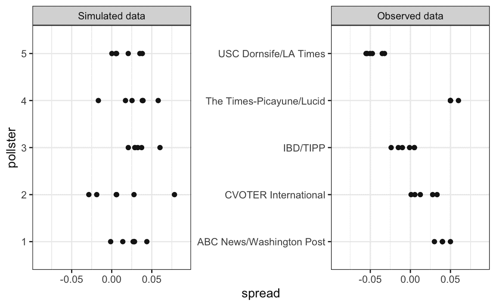
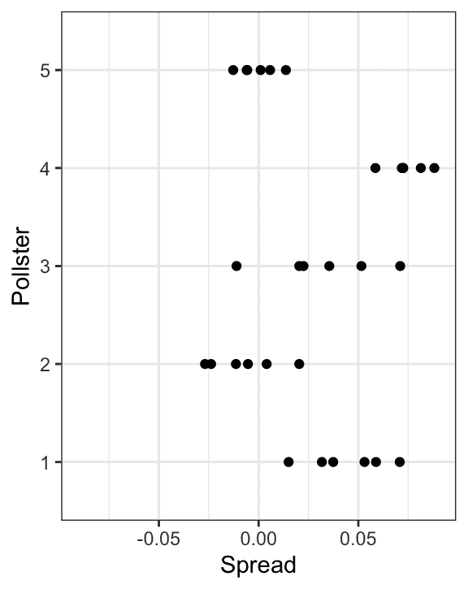
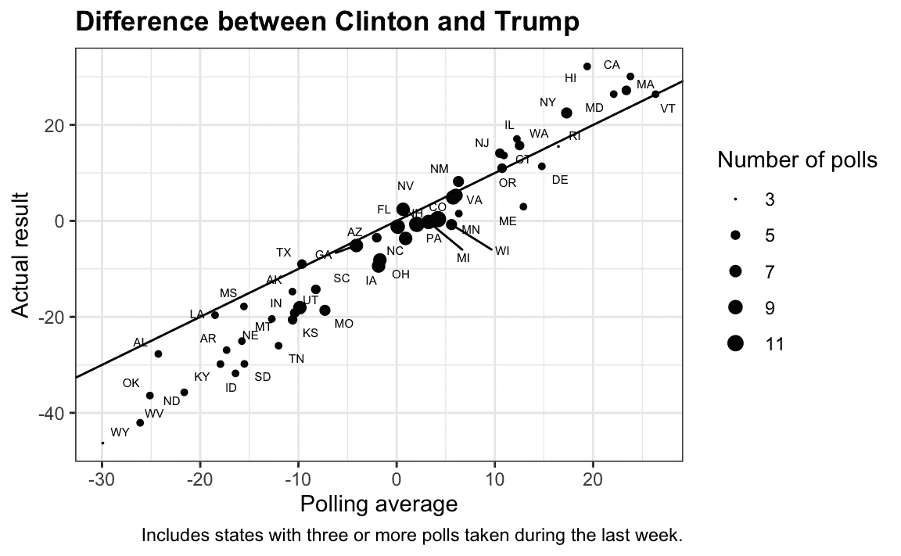
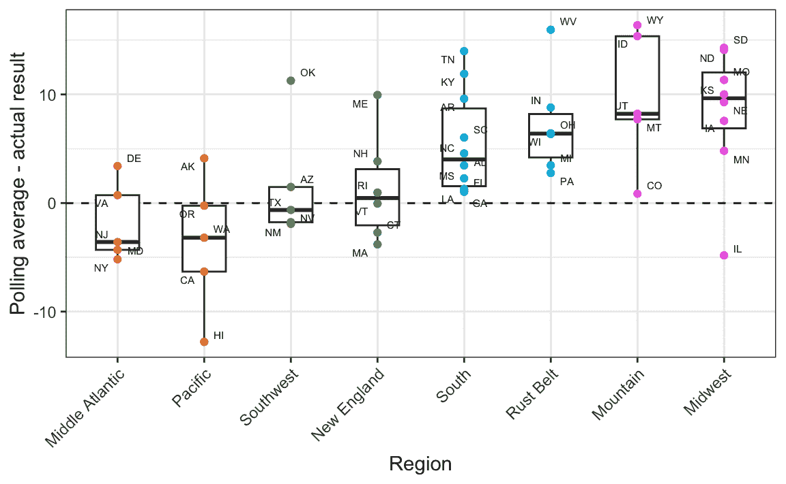
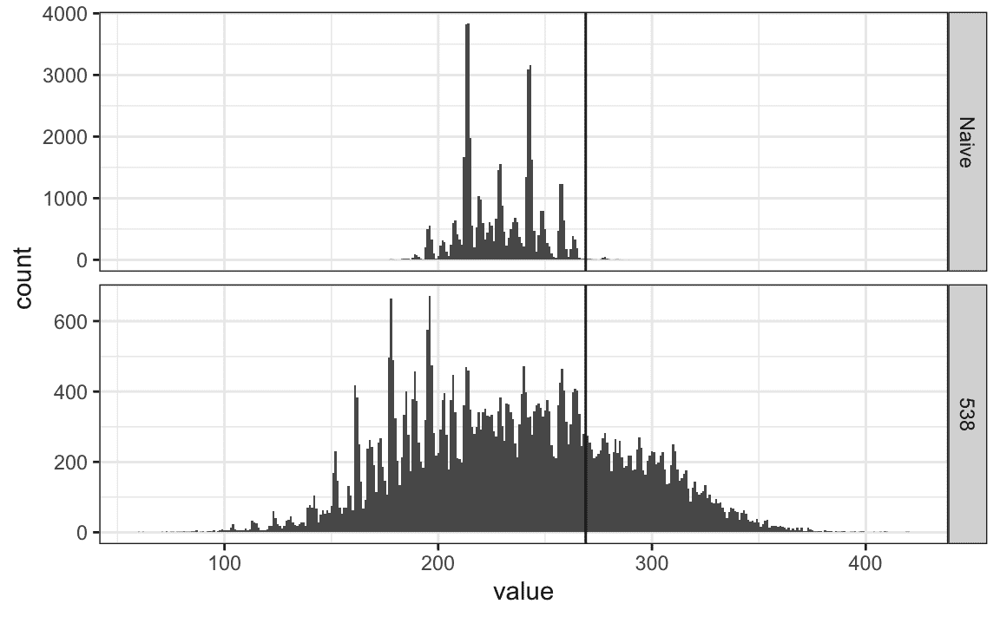
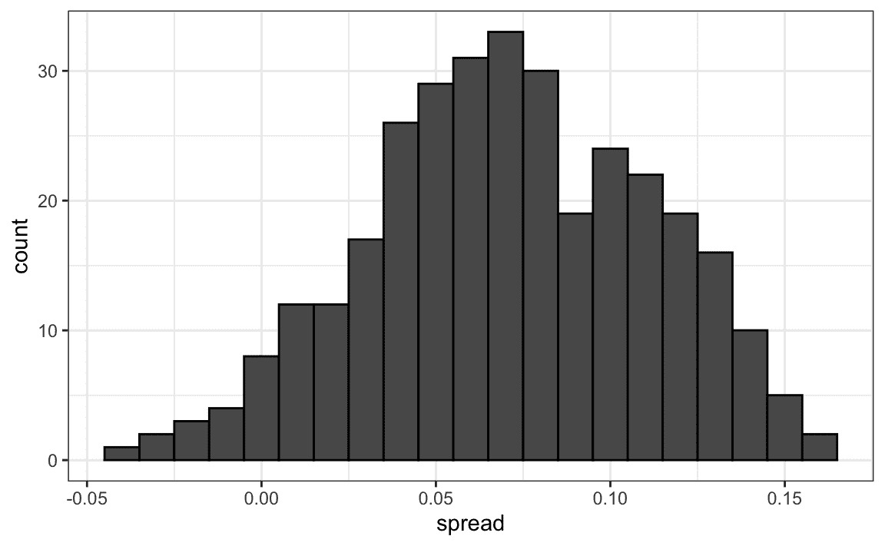
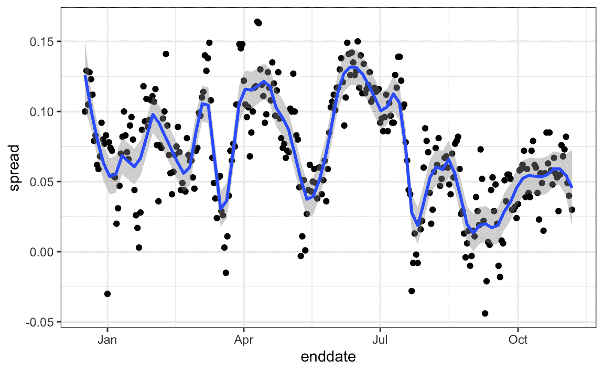

# 12  分层模型

> 原文：[`rafalab.dfci.harvard.edu/dsbook-part-2/inference/hierarchical-models.html`](https://rafalab.dfci.harvard.edu/dsbook-part-2/inference/hierarchical-models.html)

1.  统计推断

1.  12  分层模型

分层模型用于量化不同级别的变异或不确定性。可以使用贝叶斯或频率主义框架来使用它们。然而，因为在频率主义框架中，它们通常通过假设参数实际上是随机的来扩展具有固定参数的模型，模型描述包括两个看起来像先验分布和贝叶斯框架中使用的抽样分布的分布。这使得得到的总结非常相似，甚至等于在贝叶斯背景下获得的结果。贝叶斯和频率主义分层模型方法之间的一个关键区别是，在后者中，我们使用数据来构建先验，而不是将先验视为先前专家知识的量化。在本节中，我们将通过描述 FiveThirtyEight 用于预测 2016 年选举的方法的简化版本来说明分层模型的使用。

## 12.1 案例研究：选举预测

在 2008 年选举之后，除了 FiveThirtyEight 之外，几个组织也启动了自己的选举预测团队，这些团队汇总了民意调查数据并使用统计模型进行预测。然而，在 2016 年，许多预测者大大低估了特朗普获胜的机会。在大选前一天，*《纽约时报》*报道了以下希拉里·克林顿赢得总统职位的概率：

|  | NYT | 538 | HuffPost | PW | PEC | DK | Cook | Roth |
| --- | --- | --- | --- | --- | --- | --- | --- | --- |
| 胜率 | 85% | 71% | 98% | 89% | >99% | 92% | 倾向民主党 | 倾向民主党 |

注意，普林斯顿选举联盟（PEC）给特朗普的获胜机会不到 1%，而 Huffington Post 给了他 2%的机会。相比之下，FiveThirtyEight 将特朗普获胜的概率定为 29%，这比其他人高得多。事实上，在大选前四天，FiveThirtyEight 发表了一篇题为*特朗普只是克林顿的正常民意调查误差背后*²的文章。

那么为什么 FiveThirtyEight 的模型比其他模型表现得更好呢？如果 PEC 和 Huffington Post 使用的是相同的数据，他们怎么会犯这么大的错误呢？在本章中，我们将描述 FiveThirtyEight 如何使用分层模型正确地考虑关键变异来源，并超越所有其他预测者。为了说明目的，我们将继续研究我们流行的选票示例。在最后一节中，我们将描述用于预测选举人团结果的更复杂方法。

## 12.2 系统性民意调查误差

在上一章中，我们使用标准贝叶斯分析计算了希拉里·克林顿赢得普选票的后验概率，并发现其非常接近 100%。然而，FiveThirtyEight 给了她 81.4% 的机会³。是什么解释了这种差异？下面，我们描述了 FiveThirtyEight 模型中包含的另一种变异来源，即 *系统性民意调查误差*，它解释了这种差异。

选举结束后，人们可以查看民意调查平均值与实际结果之间的差异。一个重要的观察结果是，我们最初的模型没有考虑到这一点，那就是通常可以看到一种影响大多数民意调查员的系统性民意调查误差。统计学家将此称为 *偏差*。这种偏差的原因尚不清楚，但历史数据显示其波动。在一次选举中，民意调查可能使民主党获得 2% 的优势，下一次使共和党获得 1% 的优势，然后没有偏差，后来使共和党获得 3% 的优势。在 2016 年，民意调查使民主党获得 1-2% 的优势。

虽然我们知道这种系统性民意调查误差会影响我们的民意调查，但我们无法知道这种偏差是什么，直到选举之夜。因此，我们无法相应地纠正我们的民意调查。我们可以做的是在我们的模型中包含一个考虑变异性的项。

## 12.3 层级模型的数学表示

假设我们从一位民意调查员那里收集数据，并且我们假设没有系统性误差。该民意调查员收集了多个样本量为 $N$ 的民意调查，因此我们观察到了多个关于分布的测量值 $Y_1, \dots, Y_J$。假设希拉里的真实比例是 $p$，分布是 $\theta$。尿壶模型理论告诉我们，这些随机变量大约服从正态分布，期望值为 $\theta$，标准误差为 $2 \sqrt{p(1-p)/N}$：

$$ Y_j \sim \mbox{N}\left(\theta, \, 2\sqrt{p(1-p)/N}\right) $$

我们使用 $j$ 作为指标来标记民意调查，因此第 $j$ 次民意调查对应于第 $j$ 次民意调查报告的结果。

下面是一个模拟六个民意调查的例子，假设分布为 2.1，$N$ 为 2,000：

[PRE0]

现在，假设我们有 $J=6$ 个来自 $I=5$ 位不同民意调查员的民意调查。为了简单起见，让我们假设所有民意调查都有相同的样本量 $N$。尿壶模型告诉我们，对于所有民意调查员，分布都是相同的，因此为了模拟数据，我们为每个民意调查员使用相同的模型：

[PRE1]

正如预期的那样，模拟数据并没有真正捕捉到实际数据的特征，因为它没有考虑到民意调查员之间的变异：

为了解决这个问题，我们需要表示两种变异水平，并且我们需要两个指标，一个用于民意调查员，一个用于每位民意调查员进行的每个民意调查。我们使用 $Y_{ij}$ 来表示，其中 $i$ 代表民意调查员，$j$ 代表该民意调查员进行的第 $j$ 次民意调查。现在模型已经扩展，包括民意调查员效应 $h_i$，FiveThirtyEight 称其为 *house effects*，标准差为 $\sigma_h$：

$$ \begin{aligned} h_i &\sim \mbox{N}\left(0, \sigma_h\right)\\ Y_{ij} \mid h_i &\sim \mbox{N}\left(\theta + h_i, \, 2\sqrt{p(1-p)/N}\right) \end{aligned} $$

为了模拟特定调查员的数据，我们首先需要抽取一个 $h_i$，然后在此效果添加后生成单个调查数据。在下面的模拟中，我们假设 $\sigma_h$ 为 0.025，并使用 `rnorm` 生成 $h$：

[PRE2]

模拟数据现在看起来更接近观察数据：

注意，$h_i$ 对所有观察到的调查员 $i$ 的扩散都是共同的。不同的调查员有不同的 $h_i$，这解释了为什么我们可以看到点群在调查员之间上下移动。

现在，在上面的模型中，我们假设平均 house effect 为 0：我们用 `rnorm(I, 0, 0.025)` 生成它。我们认为，对于每个偏向某一党派的调查员，都有一个偏向另一党派的调查员，这样在计算所有调查的平均值时误差会*平均化*。在这种情况下，调查平均是*无偏的*。然而，如上所述，当我们研究过去选举时，观察到系统性调查误差。

仅凭 2016 年的数据，我们无法观察到这种偏差，但如果我们收集历史数据，我们会看到调查的平均值与实际结果相比，偏差超过了上述模型等预测的偏差。我们在此不展示数据，但如果我们将每次过去选举的调查平均值与实际选举之夜的结果进行比较，我们会观察到 2-4%的标准差差异。

虽然我们无法观察到偏差，但我们可以定义一个模型来解释其变异性。我们通过在模型中添加另一个层次来实现这一点：

$$ \begin{aligned} b &\sim \mbox{N}\left(0, \sigma_b\right)\\ h_j \mid \, b &\sim \mbox{N}\left(b, \sigma_h\right)\\ Y_{ij} | \, h_j, b &\sim \mbox{N}\left(\theta + h_j, \, 2\sqrt{p(1-p)/N}\right) \end{aligned} $$ 这个模型捕捉到三种不同的变异性来源：

1.  **选举中的系统性误差**，由随机变量 $b$ 表示，其变异性由 $\sigma_b$ 衡量。

1.  **调查员之间的变异性**，通常称为*house effect*，由 $\sigma_h$ 衡量。

1.  **每个调查中的抽样变异性**，由选民随机抽样引起，其值为 $2\sqrt{p(1-p)/N}$，其中 $p = (\theta + 1)/2$。

没有包括像 $b$ 这样的选举级偏差项，导致许多预测者对自己的预测过于自信。关键点是 $b$ 在一次选举到另一次选举之间会变化，但在一次选举内的所有调查员和调查中保持不变。因为 $b$ 没有索引，我们不能仅使用一次选举的数据来估计 $\sigma_b$。此外，这个共享的 $b$ 意味着同一选举内的所有随机变量 $Y_{ij}$ 都是相关的，因为它们受到相同的基本选举级偏差的影响。***

## ***12.4 计算后验概率***

*现在，让我们将上述模型拟合到数据中。我们将使用第十章中定义的`one_poll_per_pollster`数据**：

[PRE3]

*在这里，我们只有一个民意调查员的一个民意调查，所以我们将去掉 $j$ 索引，并像以前一样用 $Y_1, \dots, Y_I$ 表示数据。作为提醒，我们有来自 $I=$20 个民意调查员的数据。根据上述模型假设，我们可以从数学上证明平均 $\bar{Y}$

[PRE4]

*具有期望值 $\theta$；因此，从长远来看，它提供了一个对感兴趣结果的非偏估计。但这个估计有多精确？我们能用观察到的样本标准差来构建对 $\bar{Y}$ 标准误差的估计吗？**

结果表明，由于 $Y_i$ 是相关的，估计标准误差比我们之前描述的要复杂。具体来说，我们可以证明标准误差可以用以下方式估计： 

[PRE5]

*如前所述，估计 $\sigma_b$ 需要过去选举的数据。然而，收集这些数据是一个复杂的过程，超出了本书的范围。为了提供一个实用的例子，我们将 $\sigma_b$ 设置为 3%。**

我们现在可以重新进行贝叶斯计算，以考虑这种额外的变异性。这种调整得到的结果与 FiveThirtyEight 的估计非常接近：

[PRE6]******

## **12.5 预测选举人团**

*到目前为止，我们一直关注普选票。然而，在美国，选举并不是由普选票决定的，而是由所谓的*选举人团*决定的。每个州根据其人口规模以某种复杂的方式获得一定数量的选举人票。在 2016 年，最大的州加利福尼亚州有 55 张选举人票，而最小的七个州和哥伦比亚特区有 3 张。**

除了两个州，缅因州和内布拉斯加州，美国总统选举中的选举人票是以全胜为基础分配的。这意味着如果一个候选人在一个州的普选票中只多了一票，他们就会获得该州所有的选举人票。例如，2016 年只要在加利福尼亚州赢得一票，就能确保其全部 55 张选举人票。

这个系统可能导致出现这样的情况：候选人赢得了全国普选票，但在选举人团中却输了，就像 1876 年、1888 年、2000 年和 2016 年发生的那样。

*选举人团的设计是为了平衡人口众多州的影響力，并保护较小州在总统选举中的利益。作为一个联邦制国家，美国包括了担心失去对较大州权力的州。在 1787 年的宪法会议上，较小的州协商了这个系统，以确保他们的声音仍然重要，根据他们的参议员和代表获得选举人。这个妥协有助于确保他们在联邦中的地位。**  **### 组织数据**

现在我们已经准备好预测 2016 年的选举人团结果。我们首先创建一个包含每个州选举人票数的数据框：

[PRE7]

然后我们汇总选举前最后几周进行的民意调查的结果，并仅包括在注册和可能投票的选民中进行的调查。我们定义 `spread` 为估计的比例差异：

[PRE8]

如果一个民意调查员在这个时期进行了不止一次的调查，我们只保留最新的。

[PRE9]**

### ***加权平均值***

**而不是简单地平均民意调查，FiveThirtyEight 根据字母等级给民意调查员分配权重，该等级存储在 `grade` 列中。这个等级反映了民意调查员过去的准确性和可靠性。我们生成一个包含等级和权重的表格，以供将来使用：

[PRE10]

*FiveThirtyEight 在确定每个民意调查的权重时考虑了各种因素，包括选举日的接近程度。然而，为了简化，这次分析仅关注民意调查员的等级。* 等级较高的民意调查员在模型中分配更多的权重，使他们的结果具有更大的影响力，而等级较低或可靠性较低的民意调查员贡献较少。这通过加权平均在数学上实现：

$$ \bar{Y}_w = \frac{\sum_{i=1}^N w_i Y_i}{\sum_{i=1}^N w_i} $$

其中 $Y_i$ 代表民意调查员 $i$ 的结果，$w_i$ 是分配给民意调查员 $i$ 的权重，

和 $N$ 是民意调查员的总数。我们在 $\bar{Y}_w$ 上添加 $w$ 下标来表示它是一个加权平均值。

为了直观理解，可以将权重视为完整数据点的分数。例如，如果最大权重是 1，则权重为 $0.5$ 的民意调查员对完全信任的民意调查员的贡献减半，而权重为 $0.25$ 可以解释为贡献了四分之一的民意调查。

我们使用类似的方程来估计标准差：

$$ s_w = \sqrt{\frac{\sum_{i=1}^N w_i (Y_i - \bar{Y}_w)}{\frac{N-1}{N}\sum_{i=1}^N w_i}} $$

我们可以使用在第 7.4 节中学到的公式来推导我们加权估计的标准误差：

$$ \mathrm{SE}[\bar{Y}_w] = \frac{\sigma_h}{\sqrt{N_{\mbox{eff}}}} \mbox{ with } N_{\mbox{eff}} = \frac{\left(\sum_{i=1}^N w_i\right)²}{\sum_{i=1}^N w_i²} $$

因为它在样本平均的方程中占据相同的位置，$N_{\mbox{eff}}$ 被称为*有效*样本量。请注意，当所有权重都是 1 时，它等于 $N$，而当权重接近 0 时，它变得更小。

我们现在使用这些方程来计算加权平均值：

[PRE11]

我们假设民意调查员或*house effect*标准差 $\sigma_h$ 在各州之间是相同的，并取基于有效样本量大于或等于 5 的这些值的中间值：

[PRE12]

*在本书的线性模型部分，我们探讨了估计标准差的一种更严格的统计方法。* 接下来我们使用 `left_join` 命令将包含每个州的选举人票的 `results` 数据框和包含汇总统计数据的 `polls` 数据框合并：

[PRE13]********

### *****构建先验概率*****

****为了进行概率论证，我们将使用贝叶斯模型。为此，我们需要每个州先验分布的均值和标准差。我们将假设先验分布为正态分布，并使用 2012 年选举结果来构建先验均值。具体来说，我们计算民主党（奥巴马）和共和党（罗姆尼）候选人之间的差异：*

[PRE14]

与对普选票先验的处理一样，我们为先验标准差分配 5%或 $\tau=0.05$。

[PRE15]**

### *****计算后验分布*****

****在建立先验分布后，我们可以计算每个州的后验分布。在某些州，结果被认为是高度可预测的，一个政党（共和党或民主党）几乎肯定能赢。因此，在这些州没有进行民意调查。在这种情况下，后验分布保持与先验分布相同。

[PRE16]*****

### **蒙特卡洛模拟**

*然后我们使用蒙特卡洛方法为每个州生成 50,000 个选举日结果 $\theta$。对于每次迭代，我们检查每个迭代的 $\theta$。如果 $\theta<0$，则在该迭代中特朗普获得该州的全部选举人票。我们假设每个州的投票结果是独立的**。

[PRE17]

这个模型给特朗普赢得选举的机会不到 1%，这与普林斯顿选举联合会的预测相似。我们现在知道这相当不准确。发生了什么？*

上面的模型忽略了系统性投票误差的可能性，并且错误地假设不同州的投票结果是独立的。为了纠正这一点，我们假设系统性误差项的标准差为 3%。对于每次迭代，我们为所有州随机生成系统性误差并将其添加到结果中。

[PRE18]

这给特朗普赢得选举的机会接近 25%，这最终证明是一个更合理的估计，并且更接近 FiveThirtyEight 预测的 29%。******

### **区域相关性**

*投票在 2016 年选举后因“预测失误”而受到严重批评**。然而，投票平均实际上以显著的准确性预测了最终结果，这通常是情况。

事实上，只有 5 个州中，投票平均在差异的符号上犯了错误。

[PRE19]

然而，请注意，所有误差都在同一方向，这表明存在系统性的投票误差。然而，散点图显示有几个点高于身份线，这表明所有州均匀偏差的假设存在偏差。更仔细的检查表明，偏差因地理区域而异，有些地区的效应比其他地区更强。这种模式通过直接绘制区域间的差异也得到了进一步证实：*

***高级预测模型，如 FiveThirtyEight 的，认识到系统性的调查误差通常按地区变化。为了在模型中反映这一点，我们可以将州分为地区，并引入一个区域误差项。由于同一地区的州共享这个误差，它会在它们的成果之间创建相关性。*****

### ****最终结果****

***更复杂的模型也通过使用允许比正态分布更极端事件的分布来考虑变异性。例如，具有少量自由度的 t 分布可以捕捉这些罕见但具有影响力的结果。

通过纳入这些调整，区域误差和重尾分布——我们的模型产生的特朗普的概率与 FiveThirtyEight 报道的 29%相似。模拟显示，考虑区域调查误差和相关性会增加结果的总体变异性。

********

## ****12.6 预测****

***预测者旨在在选举日之前很久就预测选举结果，随着新调查的发布更新他们的预测。然而，一个关键问题仍然存在：选举几周前的调查对最终结果有多大的信息量？为了解决这个问题，我们考察了调查结果随时间的变化以及这种变异性如何影响预测准确性。

为了确保我们观察到的变异性不是由于调查员效应，让我们研究一个调查员的数据：

[PRE20]

由于没有调查员效应，那么理论上的标准误差可能与数据得出的标准差相匹配。但经验标准差高于可能的理论估计的最高值：

[PRE21]

此外，数据的分布并不像理论预测的那样正常：

我们所描述的模型包括调查员之间的变异性以及抽样误差。但这个图表是针对一个调查员的，我们看到的变异性肯定不是由抽样误差解释的。额外的变异性从何而来？以下图表强烈表明，这种变异性来自理论未考虑的时间波动，该理论假设$p$是固定的：

数据中的一些峰值和谷值与重大事件（如政党大会）相吻合，这些事件通常会暂时提升候选人的支持率。如果我们为其他调查员生成相同的图表，我们会发现这些模式在几个调查员中是一致的。这表明任何预测模型都应该包含一个术语来解释时间效应。这个术语的变化本身也会随时间而变化，因为随着选举日的临近，其标准差应该减小并接近零。

调查员试图从这些数据中估计趋势并将它们纳入他们的预测中。我们可以使用*平滑函数*来模拟时间趋势，然后使用这个趋势来改进预测。书中机器学习部分第 28.3 节讨论了多种估计趋势的方法。******

## ****12.7 练习****

***1. 创建以下表格：*

[PRE22]

现在，对于每一项调查，使用中心极限定理（CLT）为每项调查报告的分布创建一个 95%置信区间。将得到的对象命名为 cis，其中包含置信区间的下限和上限的列。使用`select`函数保留`state, startdate, enddate, pollster, grade, spread, lower, upper`这些列。*

2. 您可以使用`left_join`函数将最终结果添加到您刚刚创建的`cis`表中，如下所示：

[PRE23]

现在，确定 95%置信区间包含存储在`actual_spread`中的选举之夜结果的频率。*

3. 重复此操作，但显示每个调查员的命中比例。仅考虑拥有超过 5 项调查的调查员，并按从好到坏的顺序排序。显示每个调查员进行的调查数量以及每个调查员的 FiveThirtyEight 等级。提示：在调用`summarize`时使用`n=n(), grade = grade[1]`。

4. 重复练习 3，但不是按调查员分层，而是按州分层。注意，在这里我们无法显示等级。

5. 基于练习 4 的结果制作一个条形图。使用`coord_flip`。

6. 在`cis`表中添加两列，通过计算每个调查预测分布与实际分布之间的差异，并定义一个名为`hit`的列，如果符号相同则为真。命名为`resids`。提示：使用`sign`函数。

7. 创建一个类似于练习 5 的图表，但用于显示分布符号与选举之夜结果一致的次数比例。

8. 在练习 7 中，我们看到对于大多数州，调查 100%正确。只有 9 个州的调查超过 25%的时间出错。特别是，注意在威斯康星州，每个调查都错了。在宾夕法尼亚州和密歇根州，超过 90%的调查符号错误。制作一个误差的直方图。这些误差的中位数是多少？

9. 我们看到在州一级，中误差为 3%，有利于克林顿。分布不是以 0 为中心，而是以 0.03 为中心。这与第 12.2 节中描述的*一般偏差*有关。创建一个箱形图来查看偏差是否影响所有州，或者是否影响了某些州的差异。使用`filter(grade %in% c("A+","A","A-","B+") | is.na(grade)))`仅包括等级高的调查员。

10. 在 2013 年 4 月，职业棒球运动员何塞·伊格莱西亚斯开始了他的职业生涯。他表现异常出色，拥有优秀的*击球率*（AVG）为.450。击球率统计是衡量成功的一种方式。粗略地说，它告诉我们击球时的成功率。何塞在 20 次尝试中有 9 次成功。.450 的击球率意味着何塞在击球时成功的比例相当高，这在历史上是相当罕见的。事实上，自从 1941 年泰德·威廉姆斯完成这一壮举以来，没有人完成过赛季的`AVG`达到或超过.400！我们希望在球员大约有 500 次尝试或*击球*之后预测何塞赛季结束时的击球率。使用频率派技术，我们别无选择，只能预测他的 AVG 将在赛季结束时为.450。计算成功率的置信区间。

12. 尽管频率派预测为.450，但没有任何一个棒球爱好者会做出这样的预测。为什么？一个原因是他们知道这个估计有很大的不确定性。然而，主要原因是他们隐含地使用了一个考虑了多年跟踪棒球的层次模型。使用以下代码探索 2013 年之前三个赛季的击球率分布，并描述这告诉我们什么。

[PRE24]

13. 所以是何塞幸运，还是他是过去 50 年中见过的最佳击球手？或许这是运气和天赋的结合。但各占多少呢？如果我们确信他是幸运的，我们应该将他交易到一个信任.450 观察结果并且可能高估他潜力的球队。层次模型为我们提供了如何看到.450 观察结果的数学描述。首先，我们随机选择一个球员，其内在能力由例如$\theta$这样的指标总结。然后，我们观察 20 次随机结果，成功概率为$\theta$。你会在层次模型的第一级使用什么模型？*

14. 描述层次模型的第二级。

15. 将层次模型应用于何塞的数据。假设我们想要预测他的内在能力，即他的*真实*击球率$\theta$。写下层次模型的分布。

16. 我们现在准备计算$\theta$在观察到的数据$\bar{Y}$条件下的分布。计算给定当前平均$\bar{Y}$的$\theta$的期望值，并给出数学公式的直观解释。

17. 我们从一个频率派 95%置信区间开始，该区间忽略了其他球员的数据，仅总结了何塞的数据：.450 $\pm$ 0.220。根据层次模型构建$\theta$的置信区间。

18. 可信区间表明，如果另一支球队对.450 的观察印象深刻，我们应该考虑交易 José，因为我们预测他只会略高于平均水平。有趣的是，红袜队在七月将 José Iglesias 交易给了底特律老虎队。以下是 José Iglesias 接下来五个月的击球平均分： 

| 月份 | 打击数 | 安打数 | 平均分 |
| --- | --- | --- | --- |
| 四月 | 20 | 9 | .450 |
| 五月 | 26 | 11 | .423 |
| 六月 | 86 | 34 | .395 |
| 七月 | 83 | 17 | .205 |
| 八月 | 85 | 25 | .294 |
| 九月 | 50 | 10 | .200 |
| 总计（不含四月） | 330 | 97 | .293 |

哪种方法提供了更好的预测？*******

* * *

***1.  https://www.nytimes.com/interactive/2016/upshot/presidential-polls-forecast.html↩︎

1.  https://fivethirtyeight.com/features/trump-is-just-a-normal-polling-error-behind-clinton/↩︎

1.  https://projects.fivethirtyeight.com/2016-election-forecast/↩︎****
