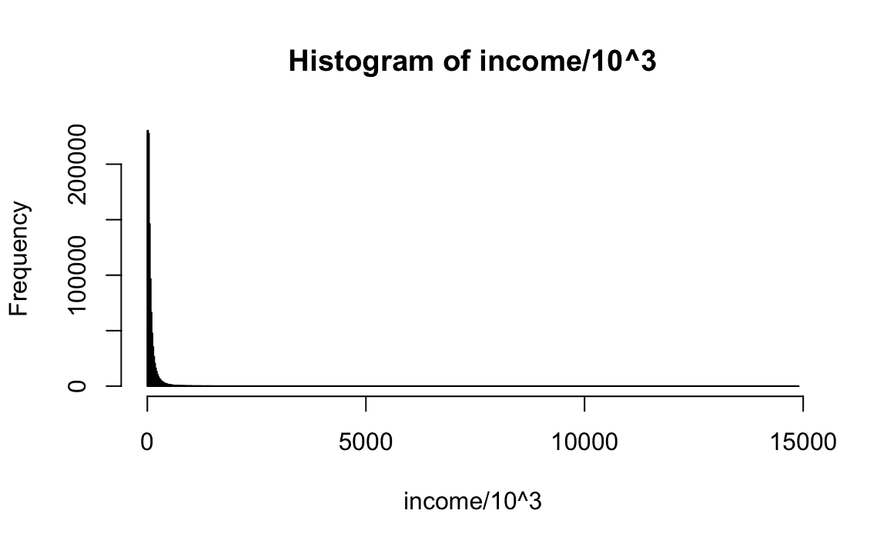
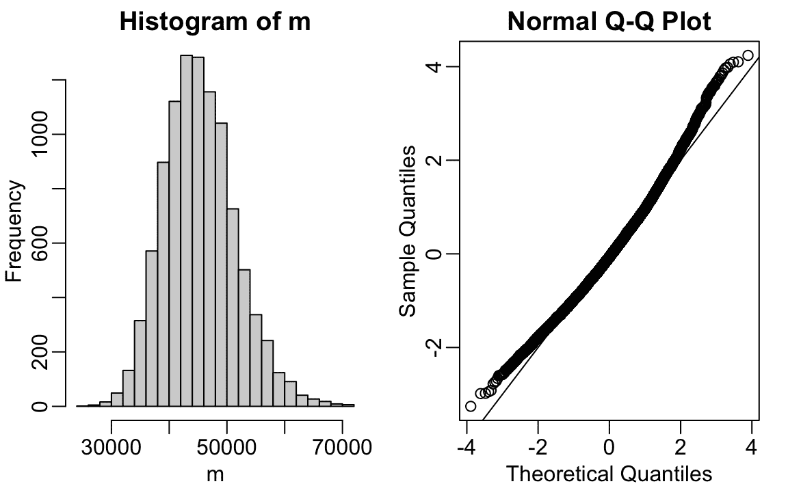

# 14  自助法

> 原文：[`rafalab.dfci.harvard.edu/dsbook-part-2/inference/bootstrap.html`](https://rafalab.dfci.harvard.edu/dsbook-part-2/inference/bootstrap.html)

1.  统计推断

1.  14  自助法

CLT 提供了一种构建置信区间和进行假设检验的有用方法。然而，它并不总是适用。在这里，我们提供了一个不依赖于 CLT 的估计分布的替代方法的简要介绍。

## 14.1 示例：中位数收入

假设你的人口收入分布如下：

```r
[set.seed](https://rdrr.io/r/base/Random.html)(1995)
n <- 10⁶
income <- 10^([rnorm](https://rdrr.io/r/stats/Normal.html)(n, [log10](https://rdrr.io/r/base/Log.html)(45000), [log10](https://rdrr.io/r/base/Log.html)(3)))
[hist](https://rdrr.io/r/graphics/hist.html)(income/10³, nclass = 1000)
```

**  *总体中位数是：

```r
[median](https://rdrr.io/r/stats/median.html)(income)
#> [1] 44939
```

*假设我们无法访问整个总体，但想估计总体中位数，记为\(m\)。我们随机抽取 100 个观测值，并使用样本中位数\(M\)作为\(m\)的估计：

```r
N <- 100
x <- [sample](https://rdrr.io/r/base/sample.html)(income, N)
[median](https://rdrr.io/r/stats/median.html)(x)
#> [1] 38461
```

*现在的问题变成了：我们如何评估这个估计的不确定性？换句话说，我们如何根据我们的样本计算标准误差并构建\(m\)的置信区间？

在以下章节中，我们介绍了一种强大的重采样方法——**自助法**，它允许我们在不依赖强分布假设的情况下估计变异性并构建置信区间。

## ***14.2 中位数置信区间***

***我们能否构建一个置信区间？\(M\)的分布是什么？***

因为我们在模拟数据，我们可以使用蒙特卡洛模拟来了解\(M\)的实际分布。

```r
m <- [replicate](https://rdrr.io/r/base/lapply.html)(10⁴, {
 x <- [sample](https://rdrr.io/r/base/sample.html)(income, N)
 [median](https://rdrr.io/r/stats/median.html)(x)
})
[hist](https://rdrr.io/r/graphics/hist.html)(m, nclass = 30)
[qqnorm](https://rdrr.io/r/stats/qqnorm.html)([scale](https://rdrr.io/r/base/scale.html)(m)); [abline](https://rdrr.io/r/graphics/abline.html)(0,1)
```

**

如果我们知道这个分布，我们可以构建一个置信区间。问题在于，正如我们之前所描述的，在实践中，我们无法访问这个分布。在之前的章节中，我们使用了 CLT，但我们学到的东西适用于平均值，而这里我们感兴趣的是中位数。我们可以看到，基于 CLT 的 95%置信区间

```r
[median](https://rdrr.io/r/stats/median.html)(x) + 1.96*[sd](https://rdrr.io/r/stats/sd.html)(x)/[sqrt](https://rdrr.io/r/base/MathFun.html)(N)*[c](https://rdrr.io/r/base/c.html)(-1, 1)
#> [1] 21018 55905
```

*与我们已知\(M\)的实际分布所生成的置信区间**有很大不同**：

```r
[quantile](https://rdrr.io/r/stats/quantile.html)(m, [c](https://rdrr.io/r/base/c.html)(0.025, 0.975))
#>  2.5% 97.5% 
#> 34438 59050
```

*自助法允许我们在无法访问完整总体分布的情况下近似蒙特卡洛模拟。其思路很简单：我们将观察到的样本视为总体。从这个样本中，我们抽取相同大小的新的数据集，进行有放回的抽取，并计算感兴趣的统计量，在这种情况下，是中位数，对于每个重新抽样的数据集。这些重新抽样的数据集被称为自助样本。

在许多实际情况下，从自助样本计算出的统计量的分布提供了对原始统计量抽样分布的良好近似。这种近似允许我们估计变异性，计算标准误差，并构建置信区间，而无需知道真实的潜在分布。

以下代码演示了如何生成自助样本并近似中位数的抽样分布：

```r
m_star <- [replicate](https://rdrr.io/r/base/lapply.html)(10⁴, {
 x_star <- [sample](https://rdrr.io/r/base/sample.html)(x, N, replace = TRUE)
 [median](https://rdrr.io/r/stats/median.html)(x_star)
})
```

*注意使用自助法构建的置信区间与使用理论分布构建的置信区间非常接近：

```r
[quantile](https://rdrr.io/r/stats/quantile.html)(m_star, [c](https://rdrr.io/r/base/c.html)(0.025, 0.975))
#>  2.5% 97.5% 
#> 30253 56909
```*******

## ***14.3 练习***

***1. 生成一个类似这样的随机数据集：

```r
y <- [rnorm](https://rdrr.io/r/stats/Normal.html)(100, 0, 1)
```

*估计第 75 百分位数，我们知道它是：

```r
[qnorm](https://rdrr.io/r/stats/Normal.html)(0.75)
```

*使用样本分位数：

```r
[quantile](https://rdrr.io/r/stats/quantile.html)(y, 0.75)
```

*运行蒙特卡洛模拟以学习这个随机变量的期望值和标准误差。

2. 在实践中，我们无法运行蒙特卡洛模拟，因为我们不知道是否使用了`rnorm`来模拟数据。使用自助法仅使用初始样本`y`来估计标准误差。使用 10 个自助样本。

3. 重新做练习 2，但使用 10,000 个自助样本。******
