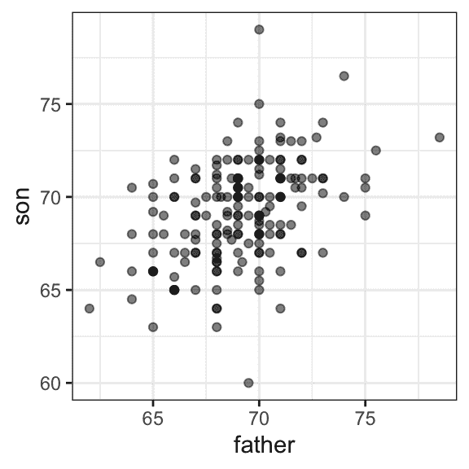
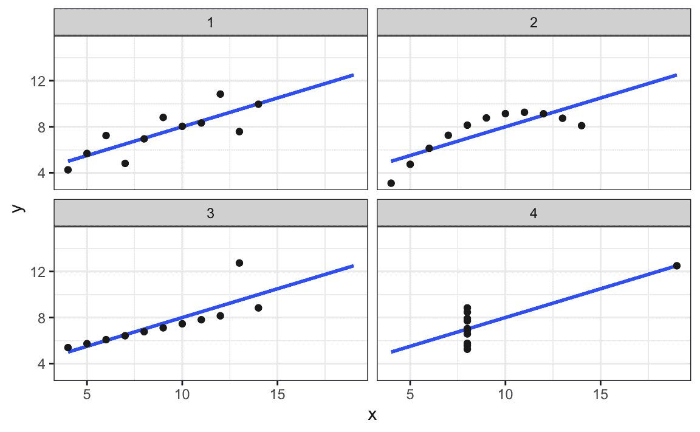
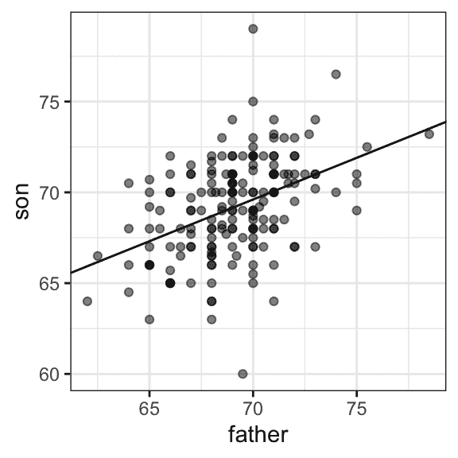
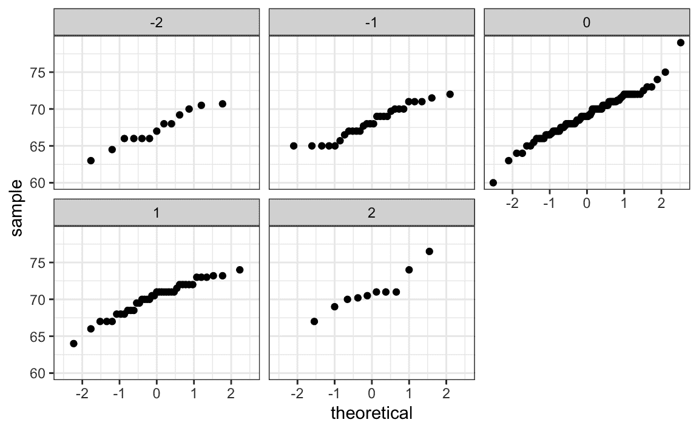
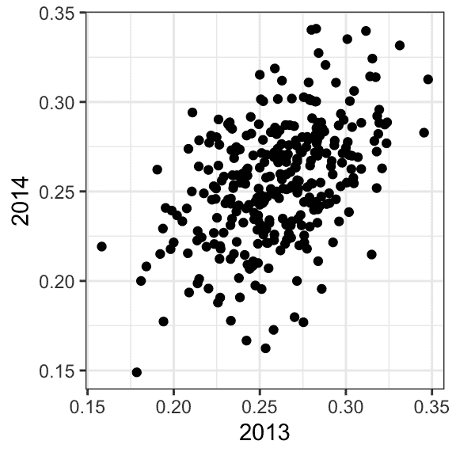

# 15  回归简介

> 原文：[`rafalab.dfci.harvard.edu/dsbook-part-2/linear-models/regression.html`](https://rafalab.dfci.harvard.edu/dsbook-part-2/linear-models/regression.html)

1.  线性模型

1.  15  回归简介

为了理解相关性和简单回归的概念，我们转向孕育回归本身的那个数据集。这个例子来自遗传学。弗朗西斯·高尔顿¹研究了人类特征中的变异和遗传，从家庭收集数据以研究特征是如何从父母传递给孩子的。通过这项工作，他引入了相关性和回归的概念，并探讨了遵循正态分布的变量对之间的关系。当然，当高尔顿收集他的数据时，我们对遗传学的理解远不如今天这么深入。他试图回答的一个核心问题是：我们能在多大程度上根据父母的身高预测孩子的身高？他为了回答这个问题而开发的统计工具仍然是基础性的，并且现在被广泛应用于各种应用中。我们通过讨论一个称为回归谬误的概念来结束本章，这是一个在解释回归结果时出现的常见误解，我们用一个来自体育界的真实数据示例来说明它。

## 15.1 案例研究：身高是否遗传？

我们可以通过**HistData**包访问高尔顿家族的身高数据。这些数据包含几十个家庭的高度：母亲、父亲、女儿和儿子。为了模仿高尔顿的分析，我们将创建一个包含父亲和每个家庭随机选择的一个儿子的身高的数据集。在这里我们使用**data.table**包，因为它允许编写更简洁的代码：

```r
library(data.table)
library(HistData)
 set.seed(1983)
galton <- as.data.table(GaltonFamilies)
galton <- galtongender == "male", .SD[[sample(.N, 1)], by = family]
galton <- galton[, .(father, son = childHeight)]
```

假设我们被要求总结父亲和儿子的数据。由于这两个分布都很好地被正态分布所近似，我们可以使用两个平均值和两个标准差作为总结：

```r
galton, .(f_avg=[mean(father), f_sd=sd(father), s_avg=mean(son), s_sd=sd(son))]
#>    f_avg  f_sd s_avg  s_sd
#>    <num> <num> <num> <num>
#> 1:  69.1  2.55  69.2  2.72
```

然而，这个总结未能描述数据的一个重要特征：父亲越高，儿子也越高。

```r
galton |> ggplot(aes(father, son)) + geom_point(alpha = 0.5)
```

*  *我们将了解到相关系数是两个变量如何一起移动的有信息量的总结，然后通过注意到如何使用另一个变量来预测一个变量来激励简单的回归。

## 15.2 相关系数

相关系数**定义为一系列成对值 $(x_1, y_1), \dots, (x_n,y_n)$ 的标准化值乘积的平均值：

$$ \rho = \frac{1}{n} \sum_{i=1}^n \left( \frac{x_i-\mu_x}{\sigma_x} \right)\left( \frac{y_i-\mu_y}{\sigma_y} \right) $$

其中 $\mu_x, \mu_y$ 分别是 $x_1,\dots, x_n$ 和 $y_1, \dots, y_n$ 的平均值，$\sigma_x, \sigma_y$ 是标准差。统计学书籍中常用希腊字母 $\rho$ 表示 $r$，即相关性。$r$ 是 *回归* 的第一个字母并非巧合。很快我们就会了解到相关性和回归之间的联系。

我们可以使用 R 代码表示上面的公式：

```r
rho <- mean(scale(x) * scale(y))
```

为了了解这个方程如何捕捉两个变量一起移动的方式，请注意，每个项 $\frac{x_i - \mu_x}{\sigma_x}$ 表示 $x_i$ 的值与 $x$ 的平均值相差多少个标准差，而 $\frac{y_i - \mu_y}{\sigma_y}$ 对 $y_i$ 相对于 $y$ 的平均值做同样的处理。如果 $x$ 和 $y$ 没有关系，这些标准化值的乘积 $\left(\frac{x_i - \mu_x}{\sigma_x}\right)\left(\frac{y_i - \mu_y}{\sigma_y}\right)$ 将会正（正乘正或负乘负）的次数与负（正乘负或负乘正）的次数大致相同。当平均时，这些乘积会相互抵消，得到接近零的相关性。如果 $x$ 和 $y$ 倾向于同时增加或减少，大多数乘积将是正的，从而得到正相关。如果其中一个增加而另一个减少，大多数乘积将是负的，从而得到负相关。

相关系数始终介于 -1 和 1 之间。我们可以用数学方法证明这一点，并将其作为练习留给你们去证明。

对于其他成对数据，相关性介于 -1 和 1 之间。使用 `cor` 函数计算的父亲和儿子身高之间的相关性约为 0.5：

```r
galton, [cor(father, son)]
#> [1] 0.43
```

函数 `cor(x, y)` 计算样本相关性，它将乘积之和除以 `length(x)-1` 而不是 `length(x)`。这种做法的理由与我们在计算样本标准差 `sd(x)` 时除以 `length(x)-1` 的理由相似。也就是说，这种调整有助于考虑样本的自由度，这对于无偏估计是必要的。* *为了了解不同 $\rho$ 值的数据看起来是什么样子，以下是六个相关系数从 -0.9 到 0.99 的成对示例：


### 样本相关性是一个随机变量

在我们继续将相关性连接到回归之前，让我们先回顾一下随机变异性。

在大多数数据分析项目中，我们观察到包含随机变化的数据。例如，在许多情况下，我们观察到的不是感兴趣的整体人群的数据，而是随机样本的数据。与平均值和标准差一样，*样本相关性* 是最常用的总体相关性的估计。这意味着我们计算并用作总结的相关性是一个随机变量。

为了说明，让我们假设 179 对父亲和儿子构成了我们的整个种群。一个不幸的遗传学家只能负担得起 25 对随机样本的测量。样本相关系数可以通过以下方式计算：

```r
r <- galton[sample(.N, 25, replace = TRUE), cor(father, son)]
```

`r` 是一个随机变量。我们可以运行蒙特卡洛模拟来查看其分布：

```r
N <- 25
r <- replicate(1000, galton[sample(.N, N, replace = TRUE), cor(father, son)])
hist(r, breaks = 20)
```


```r
mean(r)
#> [1] 0.427
```

并且它相对于 `r` 可以取的值范围的标准误差相对较高：

```r
sd(r)
#> [1] 0.161
```

因此，在解释相关性时，请记住，从样本中得出的相关性是包含不确定性的估计。

此外，请注意，由于样本相关系数是独立抽取的平均值，中心极限定理实际上适用：对于足够大的 $N$，`r` 的分布近似正态，期望值为 $\rho$，标准差为 $\frac{1-r²}{\sqrt{N}}$。请注意，这个标准差的推导很复杂，这里没有展示。

在我们的例子中，下面的 qqplot 显示 $N=25$ 并不足以使正态近似很好地工作。观察到的分布的尾部始终低于理论正态分布的预测：


如果你增加 $N$，你会看到分布收敛到正态分布。

### 相关性并不总是有用的汇总

相关性并不总是两个变量之间关系的良好汇总。以下四个被称为安斯康姆四重奏的人工数据集，著名地说明了这一点。所有这些对的相关系数都是 0.82：



为了理解相关性作为汇总统计量何时有意义，我们回到使用父亲身高预测儿子身高的例子。这个例子将有助于激发并定义线性回归。我们首先演示相关性如何对预测有用。

## 15.3 条件期望

高尔顿想了解我们如何从父母的身高预测孩子的身高。首先，我们将这个问题框架化为一个预测问题。

假设我们被要求猜测一个随机选取的儿子的高度，但我们没有被告知父亲的身高。由于儿子身高的分布近似正态分布，最合理的单一数值预测是总体均值，$\mu_y$，因为数据最集中的值就在这个值周围。稍后，在第二十八章中，我们将解释均值在预测中也有理想的数学性质：它最小化了期望平方误差。

因此，如果没有关于父亲的信息，我们对儿子身高的最佳预测就是该人群中儿子的平均身高。在实践中，我们使用样本平均数来近似这个值，$\hat{\mu}_y =$ 69.2。

但如果我们被告知父亲比平均水平高，比如说 72 英寸高，我们是否仍然猜测 $\mu_y$ = 69.2 作为儿子的身高？

结果表明，如果我们能够收集到大量身高为 72 英寸的父亲的数据，他们儿子的身高分布将是正态分布。这意味着在这个子集上计算的分布的平均值将是我们最好的预测。

通常，我们称这种方法为 *条件化*。其思想是将总体划分为基于一个变量值的组或层，然后在每个组内计算另一个变量的汇总。

为了从数学上描述这一点，假设我们有一个包含对 $(x_1, y_1), \dots, (x_n, y_n)$ 的总体，例如英格兰所有父亲和儿子的身高对。我们了解到，如果我们从这个总体中随机选择一对 $(X, Y)$，$Y$ 的期望值和最佳预测器是 $\mathrm{E}[Y] = \mu_y$。

现在，我们不再关注整个总体，而是专注于由 $X$ 的固定值定义的特定子群体。在我们的例子中，这是所有父亲身高为 72 英寸的父子对。这个子群体本身就是一个总体，因此同样的想法适用。在这个子群体中，$y_i$ 的值遵循一个称为 *条件分布* 的分布，而这个分布有一个称为 *条件期望* 的期望值。在我们的例子中，条件期望是所有父亲身高为 72 英寸的儿子们的平均身高。

我们写 $Y \mid X = x$ 来表示只从事件 $X = x$ 发生的对中选择的 $Y$ 的随机值。换句话说，$Y \mid X = 72$ 代表从那些父亲身高为 72 英寸的儿子中随机选择的身高。

条件期望的表示法是：

$$ \mathrm{E}[Y \mid X = x] $$

其中 $x$ 是定义子集的固定值。同样，我们表示该子集或层的标准差为：

$$ \mathrm{SD}[Y \mid X = x] = \sqrt{\mathrm{Var}(Y \mid X = x)} $$

因为条件期望 $\mathrm{E}[Y \mid X = x]$ 是由 $X = x$ 定义的组中个体的 $Y$ 的最佳预测器，许多数据科学问题可以被视为估计这个量。条件标准差，$\mathrm{SD}[Y \mid X = x]$，描述了预测的精确度。

因此，为了获得预测，我们希望使用高尔顿收集的样本来估计 $E[Y|X=72]$。当使用连续数据时，我们常常面临这样的挑战：在 $X = 72$ 的数据点并不多：

```r
sum(galton$father == 72)
#> [1] 8
```

如果我们把数字改为 72.5，我们将得到更少的数据点：

```r
sum(galton$father == 72.5)
#> [1] 1
```

一种提高条件期望估计的实用方法是定义具有相似 $x$ 值的观察层。在我们的例子中，我们可以将父亲身高四舍五入到最接近的英寸，并假设它们都是 72 英寸。如果我们这样做，我们最终会得到以下预测：一个父亲身高为 72 英寸的儿子：

```r
mean(galton[round(father) == 72]$son)
#> [1] 70.5
```

请注意，身高为 72 英寸的父亲高于平均水平，具体来说（72.0 - 69.1）/ 2.5 = 1.1 个标准差高于平均水平父亲。我们的预测 70.5 也高于平均水平，但仅比平均水平儿子高出 0.48 个标准差。72 英寸父亲儿子的预测身高有*回归*到平均身高。我们注意到身高比标准差减少的数量约为 0.5，这恰好接近样本相关系数。正如我们将在后面的章节中看到的，这并非巧合。

如果我们想要预测任何身高，而不仅仅是 72 英寸，我们可以将相同的方法应用于每个层。分层后跟随箱线图让我们看到每个组的分布：

```r
galton, .(father_strata = [factor(round(father)), son)] |>
ggplot(aes(father_strata, son)) + 
 geom_boxplot() + 
 geom_point()
```


注意，虽然我们将数据分成了每英寸一个组，但每个组中的样本量仍然很小，并且并不相同。对应于更高父亲的组要小得多，这使得它们的平均值变化更大。

这些条件平均值遵循直线并非巧合。在下一节中，我们将解释这条被称为*回归线*的线如何提高我们估计的精度。然而，并不总是适合用回归线来估计条件期望，因此我们还描述了高尔顿的理论依据，这有助于我们理解何时可以使用它。

条件期望不仅在变量之间关系线性时有用。事实上，我们所说的许多机器学习都可以理解为估计复杂关系的条件期望的任务，这些关系远远超出了直线。我们在本书的机器学习部分更详细地探讨了这一想法，包括第二十八章，该章节涵盖了条件期望和概率。

## 15.4 回归线

如果我们使用回归线预测随机变量 $Y$，已知另一个 $X=x$ 的值，那么对于每个标准差 $\sigma_X$，$x$ 相对于平均值 $\mu_X$ 增加，我们的预测 $\hat{y}$ 将增加 $\rho$ 个标准差 $\sigma_Y$，其中 $\rho$ 是 $X$ 和 $Y$ 之间的相关系数。因此，回归的公式如下：

$$ \left( \frac{\hat{y}-\mu_Y}{\sigma_Y} \right) = \rho \left( \frac{x-\mu_X}{\sigma_X} \right) $$

我们可以这样重写：

$$ \hat{y} = \mu_Y + \rho \left( \frac{x-\mu_X}{\sigma_X} \right) \sigma_Y $$

如果存在完全相关，回归线预测的增量与标准差相同的数量。如果相关系数为 0，则完全不使用 $x$ 进行预测，而是简单地预测平均值 $\mu_Y$。对于介于 0 和 1 之间的值，预测值位于两者之间。如果相关系数为负，我们预测减少而不是增加。

注意，如果相关系数为正且小于 1，我们的预测在标准单位上比用于预测的值 $x$ 更接近平均值。这就是为什么我们称之为 *回归*：儿子们回归到平均身高。事实上，高尔顿论文的标题是：*遗传身高的回归到中等水平*。

我们可以通过将上述公式转换为 $\hat{y} = m + bx$ 的形式来向图表添加回归线，这给出了斜率 $m = \rho \frac{\sigma_y}{\sigma_x}$ 和截距 $b = \mu_y - m \mu_x$：

```r
params <- galton, .(mu_x = [mean(father), mu_y = mean(son),
 s_x  = sd(father), s_y  = sd(son),
 r    = cor(father, son))]
 galton |> ggplot(aes(father, son)) + 
 geom_point(alpha = 0.5) +
 geom_abline(slope = with(params, r*s_y/s_x), 
 intercept = with(params, mu_y - r*s_y/s_x*mu_x))
```

*  **使用 **ggplot** 我们不需要计算所有这些汇总，可以很容易地使用 `geom_smooth` 函数添加回归线：

```r
galton |> ggplot(aes(father, son)) + geom_point() + geom_smooth(method = "lm") 
```

在第 16.3 节 中，我们解释了这里的 `lm` 代表什么。**  **注意，回归公式意味着如果我们首先对变量进行标准化，即减去平均值并除以标准差，那么回归线的截距为 0，斜率等于相关系数 $\rho$。你可以绘制相同的图表，但使用这样的标准单位：

```r
galton |> ggplot(aes(scale(father), scale(son))) + 
 geom_point(alpha = 0.5) +
 geom_abline(intercept = 0, slope = r) 
```

### 线性回归提高精度

我们现在比较我们介绍的两个预测方法：

1.  将父亲的身高四舍五入到最接近的英寸，分层，并在每个组内取平均值。

1.  计算回归线并使用它进行预测。

我们的目标是估计使用每种方法获得的预测的期望值和标准误差。我们希望期望值非常接近真实总体平均值，而标准误差要尽可能小。为了做到这一点，我们使用蒙特卡洛模拟。具体来说，我们从总体中反复抽取大小为 $N = 50$ 的家庭随机样本，对每个样本计算这两种预测，然后检查这些重复估计的分布。该分布的平均值提供了每种方法期望值的估计，其标准差提供了标准误差的估计，这反映了预测在随机样本之间的变化程度。

```r
B <- 1000
N <- 50
 conditional_avg <- replicate(B, {
 dat <- galton[sample(.N, N, replace = TRUE)]
 dat[round(father) == 72, if (.N) mean(son) else NA]
})
 linear_regression_prediction <- replicate(B, {
 dat <- galton[sample(.N, N, replace = TRUE)]
 dat, [mean(son) + cor(father, son)*(72 - mean(father))/sd(son)*sd(father)]
})
```

尽管两种方法得到的期望值几乎相同：

```r
mean(conditional_avg, na.rm = TRUE)
#> [1] 70.5
mean(linear_regression_prediction)
#> [1] 70.4
```

线性回归预测的标准误差要小得多：

```r
sd(conditional_avg, na.rm = TRUE)
#> [1] 1.08
sd(linear_regression_prediction)
#> [1] 0.534
```

这意味着基于线性回归的预测在重复样本中具有更高的稳定性。原因很直观：条件平均值基于相对较小的数据子集，即身高约为 72 英寸的父亲，因此其估计值变化更大。在某些样本中，我们甚至可能在该组中几乎没有或没有观察值，这就是为什么我们使用 `na.rm=TRUE` 的原因。另一方面，回归线是使用整个数据集的信息进行估计的，这使得其预测更加精确。

那么为什么我们总是使用回归线进行预测呢？因为并不总是合适的。例如，Anscombe 提供了一些数据没有线性关系的案例。那么我们使用回归线进行预测是否合理呢？Galton 对身高数据给出了肯定的回答。下一节将提供合理的解释。

### 双变量正态分布的合理性

相关性和回归斜率是广泛使用的总结统计量，但它们经常被误用或误解。Anscombe 的例子提供了相关性不是有用总结的过度简化案例。但现实生活中有很多例子。

我们主要通过涉及**双变量正态分布**来激励适当使用相关性作为总结。

当一对随机变量被双变量正态分布近似时，散点图看起来像椭圆形。正如我们在第 15.2 节中看到的，它们可以是细长的（高相关性）或圆形的（无相关性）。

定义双变量正态分布的一个更技术性的方法是以下内容：如果

+   $X$ 是一个正态分布的随机变量，

+   $Y$ 也是一个正态分布的随机变量，并且

+   对于任何 $X=x$，$Y$ 的条件分布近似于正态分布，

然后，这对数据点就近似于双变量正态分布。

当三个或更多变量具有每个对都是双变量正态分布的性质时，我们说这些变量遵循**多元**正态分布，或者它们是**联合**正态分布。

如果我们认为身高数据很好地被双变量正态分布近似，那么我们应该在每个层中看到正态近似的成立。在这里，我们通过标准化的父亲身高对儿子身高进行分层，并看到这个假设似乎成立：

```r
galton, .(son, z = [round((father - mean(father))/sd(father)))]z [%in% -2:2] |>
 ggplot() + 
 stat_qq(aes(sample = son)) +
 facet_wrap( ~ z) 
```

*  *Galton 使用数学统计学证明了，当两个变量遵循双变量正态分布时，计算回归线等同于计算条件期望。这里我们不展示推导过程，但我们可以证明，在这个假设下，对于任何给定的 $x$ 值，$X=x$ 的 $Y$ 对的期望值是：

$$ \mathrm{E}[Y | X=x] = \mu_Y + \rho \frac{x-\mu_X}{\sigma_X}\sigma_Y $$

这就是回归线，斜率为 $\rho \frac{\sigma_Y}{\sigma_X}$，截距为 $\mu_y - \rho\mu_X\frac{\sigma_Y}{\sigma_X}$。它与我们之前展示的回归方程等价，可以写成如下形式：

$$ \frac{\mathrm{E}[Y \mid X=x] - \mu_Y}{\sigma_Y} = \rho \frac{x-\mu_X}{\sigma_X} $$

这意味着，如果我们的数据近似为双变量，回归线给出了条件概率。因此，我们可以通过找到回归线并使用它来预测，从而获得条件期望的一个更稳定的估计。

总结来说，如果我们的数据近似为双变量，那么在已知 $X$ 的值的情况下，对 $Y$ 的最佳预测，即条件期望，由回归线给出。

### 方差解释

上述条件分布的标准差由双变量正态理论告诉我们是：

$$ \mathrm{SD}[Y \mid X=x ] = \sigma_Y \sqrt{1-\rho²} $$

为了理解为什么这是直观的，请注意，在没有条件的情况下，我们正在查看所有儿子的变异性：$\mathrm{SD}(Y) = \sigma_Y$。但一旦我们进行条件限制，我们只关注那些身高为 72 英寸的父亲的儿子们的变异性。这个群体都会倾向于相对较高，因此标准差会降低。

具体来说，它减少到 $\sqrt{1-\rho²} = \sqrt{1 - 0.25}$ = 0.87 原始值的多少。我们可以说，父亲的高度“解释”了观察到的儿子身高变异性的 13%。

学术论文中常用“$X$ 解释了这样的百分比变异性”的陈述。在这种情况下，这个百分比实际上指的是方差（即标准差的平方）。因此，如果数据是双变量的，方差会减少 $1-\rho²$，所以我们说 $X$ 解释了 $1- (1-\rho²)=\rho²$（相关系数的平方）的方差。

但重要的是要记住，“解释的方差”这一说法只有当数据近似为双变量正态分布时才有这种明确的解释。

### 存在两条回归线

我们计算了一条回归线来预测儿子的身高与父亲身高。我们使用了以下计算：

```r
m_1 <- with(params, r*s_y/s_x)
b_1 <- with(params, mu_y - m_1*mu_x)
```

这给出了函数 $\mathrm{E}[Y\mid X=x] =$ 37.5 + 0.46 $x$。

如果我们想根据儿子的身高预测父亲的高度，重要的是要知道这并不是通过计算逆函数来确定的：$x = \{ \mathrm{E}[Y\mid X=x] -$ 37.5 $\} /$ 0.46。

我们需要计算 $\mathrm{E}[X \mid Y=y]$。由于数据近似为双变量正态，之前描述的理论告诉我们这个条件期望将遵循具有斜率和截距的直线：

```r
m_2 <- with(params, r*s_x/s_y)
b_2 <- with(params, mu_x - m_2*mu_y)
```

使用这些计算我们得到 $\mathrm{E}[X \mid Y=y] =$ 41.2 + 0.4y。再次，我们看到回归到平均值：对父亲的预测比儿子身高 $y$ 对儿子平均值的预测更接近。

这里有一个显示两条回归线的图，蓝色用于预测儿子身高与父亲身高，红色用于预测父亲身高与儿子身高：


## 15.5 回归谬误

维基百科将“二年级下滑”定义为：

> “二年级下滑”或“二年级霉运”或“二年级紧张”指的是第二次或二年级的努力未能达到第一次努力的标准。它通常用来指代学生（高中、大学或大学的第二年）、运动员（第二个赛季的表现）、歌手/乐队（第二张专辑）、电视节目（第二季）和电影（续集/前传）的冷漠。

在美国职业棒球大联盟中，最佳新秀奖（ROY）授予第一年表现最佳的球员。“二年级下滑”这个短语用来描述最佳新秀奖得主在第二年表现不佳的情况。例如，一篇 Fox Sports 的文章问道：“MLB 2015 年令人惊叹的新秀班能否避免二年级下滑？”

数据是否证实了“二年级下滑”的存在？让我们来看看。通过检查一个广泛使用的成功衡量标准——击球率，我们发现这一观察结果对于表现最好的最佳新秀（ROY）来说也是成立的：

| nameFirst | nameLast | rookie_year | rookie | sophomore |
| --- | --- | --- | --- | --- |
| Willie | McCovey | 1959 | 0.354 | 0.238 |
| Ichiro | Suzuki | 2001 | 0.350 | 0.321 |
| Al | Bumbry | 1973 | 0.337 | 0.233 |
| Fred | Lynn | 1975 | 0.331 | 0.314 |
| Albert | Pujols | 2001 | 0.329 | 0.314 |

所以是“紧张”还是“霉运”？为了回答这个问题，让我们将注意力转向所有在 2013 年和 2014 赛季中出场超过 130 次（至少要赢得最佳新秀奖）的所有球员。

当我们查看顶尖表现者时，同样的模式出现：大多数顶尖表现者的击球率都在下降。

| nameFirst | nameLast | 2013 | 2014 |
| --- | --- | --- | --- |
| Miguel | Cabrera | 0.348 | 0.313 |
| Hanley | Ramirez | 0.345 | 0.283 |
| Michael | Cuddyer | 0.331 | 0.332 |
| Scooter | Gennett | 0.324 | 0.289 |
| Joe | Mauer | 0.324 | 0.277 |

但这些不是新秀！也看看 2013 年最差表现者的表现：

| nameFirst | nameLast | 2013 | 2014 |
| --- | --- | --- | --- |
| Danny | Espinosa | 0.158 | 0.219 |
| Dan | Uggla | 0.179 | 0.149 |
| Jeff | Mathis | 0.181 | 0.200 |
| B. J. | Upton | 0.184 | 0.208 |
| Adam | Rosales | 0.190 | 0.262 |

他们的击球率大多在上升！这是否是一种“反向二年级下滑”？不是的。根本不存在“二年级下滑”。这一切都可以用一个简单的统计事实来解释：两年表现的相关性很高，但并不完美：



相关系数为 0.46，数据看起来非常像双变量正态分布，这意味着我们预测任何给定球员在 2013 年的击球率 $x$ 下，2014 年的预测击球率 $\hat{y}$ 为：

$$ \frac{\hat{y} - .255}{.032} = 0.46 \left( \frac{x - .261}{.031}\right) $$

由于相关性不是完美的，回归分析告诉我们，平均而言，2013 年的高表现者 2014 年可能会稍微表现差一些。这并不是一个诅咒；这只是由于偶然。ROY 是从 $x$ 的最高值中选出的，因此预期 $y$ 将回归到平均值。

## 15.6 练习

1. 证明相关系数必须小于或等于 1。提示：相关系数不能高于完全线性关系的情况。考虑 $y_i = a + b x_i$ 其中 $b > 0$。将 $a + b x_i$ 替换为 $y_i$ 在相关公式中，并进行简化。

2. 证明相关系数必须大于或等于-1。提示：相关系数不能比完全递减线性关系的情况更负。考虑 $y_i = a - b x_i$ 其中 $b > 0$。将 $a - b x_i$ 替换为 $y_i$ 在相关公式中，并像练习 1 中那样进行简化。

3. 我们进行了一次蒙特卡洛模拟，发现当 $N=25$ 时，中心极限定理（CLT）对于样本相关性的分布并不是一个好的近似。使用来自 **MASS** 包的 `mvrnorm` 函数生成相关数据：

```r
library(MASS)
N <- 25
dat <- mvrnorm](https://rdrr.io/pkg/MASS/man/mvrnorm.html)(N, [c(0, 0), matrix(c(1, 0.9, 0.9, 1), 2, 2))
cor(dat[,1], dat[,2])
```

对 $N <- c(25, 50, 100, 250, 500, 1000)$ 进行 10,000 次蒙特卡洛模拟，以确定 CLT 何时开始成为一个有用的近似。

4. 重复练习 3，但将相关性改为 0.9 而不是 0.5。

5. 重复练习 3，但将相关性改为 0.1 而不是 0.5。

6. 从 **HistData** 包中加载 `GaltonFamilies` 数据。每个家庭中的孩子按性别和身高顺序列出。通过随机选择一个男性和一个女性来创建一个名为 `galton` 的数据集。

7. 为母亲与女儿、母亲与儿子、父亲与女儿、父亲与儿子之间的高度制作散点图。

8. 计算母亲与女儿、母亲与儿子、父亲与女儿、父亲与儿子之间的高度相关性。

* * *

1.  https://en.wikipedia.org/wiki/Francis_Galton↩︎
