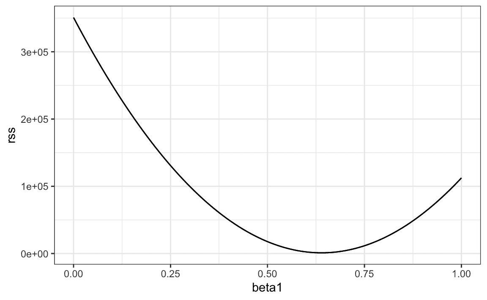
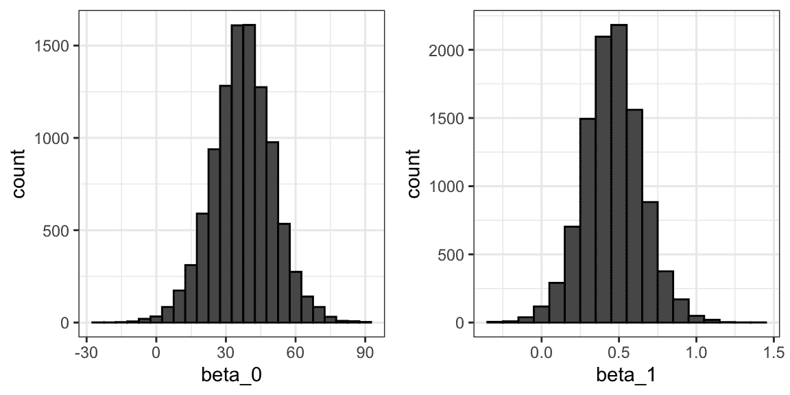
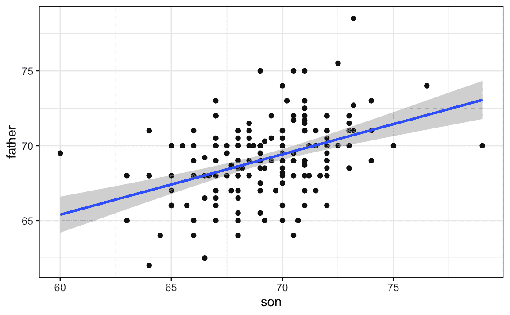
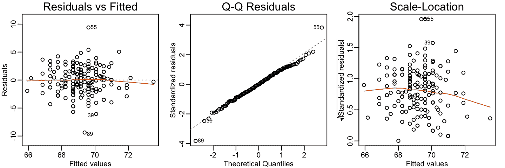
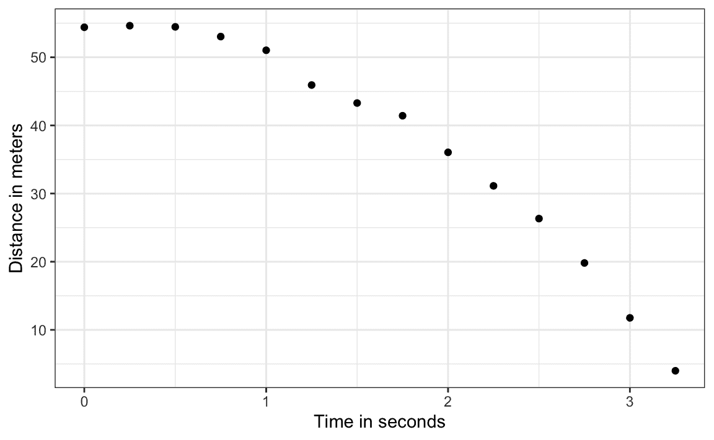
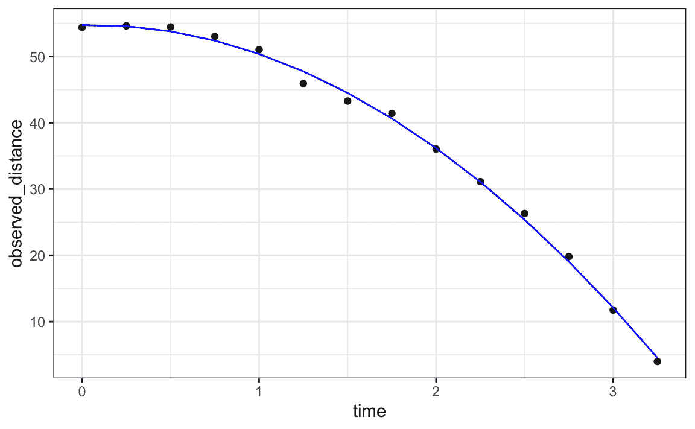
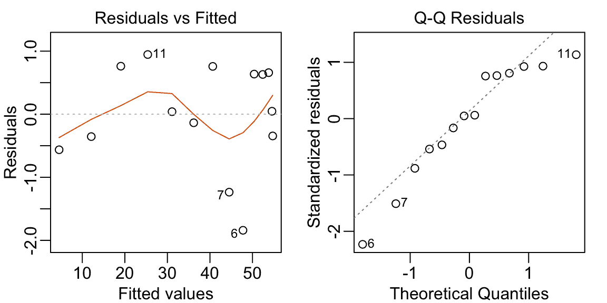

# 16 线性模型框架

> 原文：[`rafalab.dfci.harvard.edu/dsbook-part-2/linear-models/linear-model-framework.html`](https://rafalab.dfci.harvard.edu/dsbook-part-2/linear-models/linear-model-framework.html)

1.  线性模型

1.  16 线性模型框架

我们现在可以理解这本书这一部分标题的含义，特别是回归与**线性模型**之间的联系。在前一章中，我们展示了如果两个变量遵循二元正态分布，那么一个变量给定另一个变量的条件期望位于一条直线上，即**回归线**。在那个情况下，线性关系不是一个假设，而是概率模型的一个数学结果。

然而，在实际应用中，我们通常将线性关系作为建模策略，即使基础分布并非完全的二元正态分布。为了处理这样的模型，我们需要一个通用的数学方法来估计未知系数。在本章中，我们介绍了**最小二乘估计器**（LSE），这是用来估计这些参数的标准方法。LSE 提供了一种统一的方式来拟合广泛应用中的线性模型。

我们在本章的最后通过一个例子展示了线性模型在历史上是如何被激发出来的：**测量误差模型**。这个例子与我们之前研究的高度数据不同，但相同的线性模型框架、相同的平方最小数学方法，甚至相同的 R 函数都可以用来拟合它。后面的章节将介绍更多线性模型扮演核心角色的例子。

## 16.1 线性模型表示

我们注意到这里的**线性**并不特指直线，而是指条件期望是变量的线性组合。在数学中，当我们把每个变量乘以一个常数然后相加，我们说我们形成了变量的**线性组合**。例如，$3x - 4y + 5z$ 是 $x$、$y$ 和 $z$ 的线性组合。我们也可以添加一个常数，例如 $2 + 3x - 4y + 5z$ 也是 $x$、$y$ 和 $z$ 的线性组合。

我们之前描述了如果 $X$ 和 $Y$ 是二元正态分布，那么如果我们只观察 $X=x$ 的那些对，那么 $Y \mid X=x$ 就符合期望值为 $\mu_Y + \rho \frac{x-\mu_X}{\sigma_X}\sigma_Y$ 的正态分布，这是一个 $x$ 的线性函数。注意，标准差 $\sigma_Y \sqrt{1-\rho²}$ 也不依赖于 $x$。这意味着我们可以写出：

$$ Y = \beta_0 + \beta_1 x + \varepsilon $$

假设 $\varepsilon$ 符合期望值为 0 和固定标准差的正态分布，那么 $Y$ 就具有与回归设置给出的相同性质：$Y$ 符合正态分布，期望值是 $x$ 的线性函数，且标准差不依赖于 $x$。

在统计教科书中，$\varepsilon$ 项被称为**误差**。从历史上看，这反映了这样一个观点，即模型偏离是由于测量不准确造成的。今天，这个术语的使用更加广泛：$\varepsilon$s 代表了模型中预测因子无法解释的所有结果变异性。这种变异性可能与错误无关。例如，如果某人的身高比根据其父母的身高预测的身高高出两英寸，那么这增加的两英寸不是错误；这只是自然变异。尽管在这个意义上，“误差”这个术语并不理想，但它仍然是标准术语，我们将用它来表示模型中的未解释变异性。*如果我们为盖尔顿的数据指定一个线性模型，我们将用 $x_1, \dots, x_n$ 表示 $N$ 个观察到的父亲身高，然后我们用以下方式来预测我们试图预测的 $N$ 个儿子的身高：*

$$ Y_i = \beta_0 + \beta_1 x_i + \varepsilon_i, \, i=1,\dots,N. $$

在这里 $x_i$ 是父亲的身高，由于条件限制，它是固定的（非随机的），而 $Y_i$ 是我们想要预测的随机儿子身高。我们可以进一步假设 $\varepsilon_i$ 之间相互独立，并且都具有相同的标准差。

在线性模型框架中，$x_i$ 被称为**解释变量**、**协变量**或**预测变量**。

在上述模型中，我们知道 $x_i$，但为了有一个有用的预测模型，我们需要 $\beta_0$ 和 $\beta_1$。我们从数据中估计这些值。一旦我们这样做，我们就可以预测任何父亲身高 $x$ 的儿子的身高。我们将在下一节中展示如何做到这一点。

虽然这个模型与我们之前通过假设双变量正态数据推导出的模型完全相同，但有一点细微的差别是，在第一种方法中，我们假设数据是双变量正态的，而线性模型是通过推导而不是假设得出的。在实践中，线性模型只是被假设，而不一定假设正态性：$\varepsilon$s 的分布不一定被指定。尽管如此，如果你的数据是双变量正态的，上述线性模型仍然成立。如果你的数据不是双变量正态的，那么你需要有其他方法来证明模型的合理性。

线性模型受欢迎的一个原因是它们易于**解释**。在盖尔顿的数据情况下，我们可以这样解释数据：由于遗传基因，父亲的身高每增加一英寸，儿子的身高预测值就增加 $\beta_1$。因为并非所有身高为 $x$ 的儿子身高都相同，我们需要 $\varepsilon$ 这个项来解释剩余的变异性。这种剩余的变异性包括母亲的遗传效应、环境因素以及其他生物学上的随机性。

根据我们上面写的模型，截距$\beta_0$的解释性不是很强，因为它代表了一个没有身高的父亲儿子的预测身高。为了使斜率参数更具解释性，我们可以稍微修改模型：

$$ Y_i = \beta_0 + \beta_1 (x_i - \bar{x}) + \varepsilon_i, \, i=1,\dots,N $$

其中$\bar{x} = 1/N \sum_{i=1}^N x_i$是$x$的平均值。在这种情况下，$\beta_0$代表当$x_i = \bar{x}$时的高度，即平均父亲儿子的高度。

在后面的章节 17 和 20 中，我们将看到线性模型表示如何使我们能够在其他上下文中使用相同的数学框架，并实现比从另一个变量预测一个变量更复杂的目标。

## *16.2 最小二乘估计*

为了使线性模型有用，我们必须估计未知参数$\beta$。标准方法是找到使拟合模型与数据之间的距离最小的值。具体来说，我们找到使以下最小二乘（LS）方程最小的$\beta$值。对于 Galton 的数据，LS 方程看起来是这样的：

$$ RSS = \sum_{i=1}^n \left\{ y_i - \left(\beta_0 + \beta_1 x_i \right)\right\}² $$

我们试图最小化的量被称为残差平方和（RSS）。

一旦我们找到使 RSS 最小化的值，我们将这些值称为最小二乘估计（LSE），并用参数上方放置的*帽子*来表示。在我们的例子中，我们使用$\hat{\beta}_0$和$\hat{\beta}_1$。

我们将演示如何使用先前定义的`galton`数据集来找到这些值：

[PRE0]

让我们先编写一个函数来计算任何一对值$\beta_0$和$\beta_1$的 RSS。

[PRE1]

因此，对于任何一对值，我们都会得到一个 RSS。以下是 RSS 作为$\beta_1$函数的图表，当我们保持$\beta_0$固定在 25 时。

[PRE2]

*  *我们可以看到$\beta_1$在约 0.65 处有一个明显的最小值。然而，这个$\beta_1$的最小值是在$\beta_0 = 25$时，这是我们任意选择的值。我们不知道(25, 0.65)是否是使所有可能对中的方程最小化的对。

在这个情况下，试错法是行不通的。我们可以在$\beta_0$和$\beta_1$值的精细网格中搜索最小值，但这样做是不必要的，因为我们可以使用微积分。具体来说，我们取偏导数，将它们设为 0，并求解$\beta_0$和$\beta_1$。当然，如果我们有很多参数，这些方程可能会相当复杂。但在 R 中，有一些函数会为我们做这些计算。我们将在下一节学习这些函数。要了解背后的数学，你可以查阅推荐阅读部分中关于线性模型的书籍。****

## ****16.3 `lm`函数****

***在 R 中，我们可以使用`lm`函数获得线性模型的最小二乘估计。为了拟合模型：

$$ Y_i = \beta_0 + \beta_1 x_i + \varepsilon_i $$

以$Y_i$代表儿子的身高，$x_i$代表父亲的身高，我们可以使用以下代码：

[PRE3]

我们最常用的`lm`方法是使用字符`~`来让`lm`知道哪个是我们预测的变量（`~`的左边）以及我们用来预测的变量（`~`的右边）。截距会自动添加到将要拟合的模型中。

对象`fit`包含了关于拟合的信息。我们可以使用`summary`函数来提取这些信息的摘要：

[PRE4]

为了理解这个摘要中包含的一些术语，我们需要记住 LSE 是随机变量。数学统计学给我们一些关于这些随机变量分布的想法。

在第二十章中，在描述了一个更复杂的案例研究之后，我们进一步了解了回归在 R 中的应用。

### LSE 是随机变量

最小二乘估计（LSE）是从数据$y_1,\dots,y_N$中导出的，这些数据是随机变量$Y_1, \dots, Y_N$的一个实现。这意味着我们的估计值是随机变量。为了看到这一点，我们可以运行一个蒙特卡洛模拟，其中我们假设儿子和父亲的身高数据定义了一个总体，随机抽取一个大小为$N=50$的样本，并计算每个样本的回归斜率系数：

[PRE5]

我们可以通过绘制它们的分布图来看到估计值的变异性：

这些看起来是正态分布的原因是因为中心极限定理在这里同样适用：对于足够大的$N$，最小二乘估计将大约呈正态分布，其期望值分别为$\beta_0$和$\beta_1$。

计算标准误差有点复杂，但数学理论确实允许我们计算它们，并且它们包含在`lm`函数提供的摘要中。`summary`函数显示了标准误差估计：

[PRE6]

你可以看到上面报告的标准误差估计与模拟中的标准误差非常接近：

[PRE7]

`summary`函数还报告了 t 统计量（`t value`）和 p 值（`Pr(>|t|)`）。t 统计量实际上并不是基于中心极限定理，而是基于$\varepsilon$s 服从正态分布的假设。在这个假设下，数学理论告诉我们，LSE 除以其标准误差，$\hat{\beta}_0 / \widehat{\mathrm{SE}}[\hat{\beta}_0]$和$\hat{\beta}_1 / \widehat{\mathrm{SE}}[\hat{\beta}_1]$，将遵循具有$N-p$自由度的 t 分布，其中$p$是我们模型中的参数数量。在我们的例子中$p=2$，两个 p 值分别来自于检验$\beta_0 = 0$和$\beta_1=0$的零假设。

记住，正如我们在第 10.2.3 节中描述的，对于足够大的 $N$，中心极限定理（CLT）是有效的，t 分布几乎与正态分布相同。此外，请注意，我们可以使用 `confint` 函数构建置信区间：

[PRE8]

尽管我们在这本书中没有展示示例，但回归模型的假设检验在流行病学和经济学中很常见，用于做出诸如“在调整 X、Y 和 Z 后，A 对 B 的影响在统计上显著”的陈述。然而，为了使这些陈述成立，必须满足几个假设。****

### ***预测值是随机变量***

**一旦我们拟合了模型，我们可以通过将估计值代入回归模型来获得 $Y$ 的预测值。例如，如果父亲的身高是 $x$，那么我们对儿子身高的预测 $\hat{y}$ 将会是：

$$\hat{y} = \hat{\beta}_0 + \hat{\beta}_1 x$$

当我们绘制 $\hat{y}$ 与 $x$ 的关系图时，我们看到回归线。

请记住，预测值 $\hat{y}$ 也是一个随机变量，数学理论告诉我们标准误差是什么。如果我们假设误差是正态分布的，或者样本量足够大，我们可以使用理论来构建置信区间。事实上，**ggplot2** 层的 `geom_smooth(method = "lm")` 使用这些置信区间包围回归线：

[PRE9]

*  *R 函数 `predict` 接收一个 `lm` 对象作为输入并返回预测值。如果需要，它还会提供构建置信区间所需的标准误差和其他信息：

[PRE10]**********

## ****16.4 模型诊断****

***当我们假设线性模型而不是从理论推导它时，所有解释都取决于模型如何代表数据。即使模型指定不当，`lm` 函数也会拟合模型并产生系数估计、标准误差和 p 值。在没有验证假设的情况下解释这些结果可能导致误导性的结论。

因此，检查模型假设是统计建模中的**关键要求**。诊断图提供了视觉工具来评估模型是否捕捉了数据的主要结构，残差是否表现如预期，以及潜在的异常值或影响点是否扭曲了拟合。当没有强有力的理论依据支持假设模型时，这些检查尤为重要——例如，当数据生成过程未知或复杂时。在这些情况下，诊断是我们对抗得出错误或过度自信结论的主要防御手段。

通过视觉检查残差，定义为观测值与预测值之间的差异：

$$ r = y - \hat{y} = y- \left(\hat{\beta}_0 - \hat{\beta}_1 x_i\right), $$ 以及残差的摘要，是诊断模型是否有效的一种强大方式。请注意，残差可以被视为误差的估计，因为：

$$ \varepsilon = Y - \left(\beta_0 + \beta_1 x_i \right). $$ 实际上，残差通常表示为 $\hat{\varepsilon}$。这促使我们进行几个 *诊断* 图表。因为我们观察到 $r$，但无法观察到 $\varepsilon$，所以我们基于残差来构建图表。

1.  由于假设误差不依赖于 $Y$ 的期望值，$r$ 与拟合值 $\hat{y}$ 的关系图应该没有关联。

1.  在我们假设误差遵循正态分布的情况下，当标准化 $r$ 与理论分位数绘制时，qqplot 应该落在一条直线上。

1.  由于我们假设误差的标准差是恒定的，如果我们绘制残差的绝对值，它应该看起来是恒定的。

我们更倾向于图表而不是基于例如相关性的总结，因为，如第 15.2.2 节所述，相关性并不总是关联性的最佳总结。将 `plot` 函数应用于 `lm` 对象会自动绘制这些图表。

[PRE11]

*  *此函数可以生成六种不同的图表，`which` 参数允许你指定要查看的图表。你可以通过阅读 `plot.lm` 帮助文件来了解更多信息。然而，一些图表基于更高级的概念，超出了本书的范围。要了解更多信息，我们建议阅读推荐阅读部分中包含的关于回归分析的进阶书籍。

在第十七章和第二十章中，我们介绍了数据分析挑战，在这些挑战中，我们可能决定不在模型中包含某些变量。在这些情况下，一个重要的诊断测试是检查残差是否与模型中未包含的变量相关。***** 

## ****16.5 测量误差模型****

***历史上，将线性模型写成 $Y = \beta_0 + \beta_1 x + \varepsilon$ 的形式起源于 $\varepsilon$ 项代表 *测量误差* 的上下文。早期科学家使用最小二乘法从受仪器噪声影响的重复测量中估计物理常数。后来，高尔顿和皮尔逊扩展了这一框架来研究变量之间的关系，例如我们之前考察的高度示例。

在本节中，我们简要介绍了一个适合测量误差解释的设置，并展示我们可以使用相同的数学方法和相同的 R 函数来拟合相应的模型。这说明了线性模型框架的一个关键优势：一套工具可以应用于许多看似不同的情况。

### 示例：建模下落物体

要理解这些模型，想象一下你是 16 世纪的伽利略，试图描述一个下落物体的速度。一个助手爬上比萨斜塔并扔下一个球，而其他几个助手在不同时间记录位置。让我们使用我们目前所知的方程模拟一些数据，并添加一些测量误差。`dslabs`函数`rfalling_object`生成这些模拟：

[PRE12]

助手将数据交给伽利略，这就是他看到的情况：

伽利略不知道确切的方程，但通过观察上面的图表，他推断出位置应该遵循抛物线，我们可以写成这样：

$$ f(x) = \beta_0 + \beta_1 x + \beta_2 x² $$

数据并不完全落在抛物线上。伽利略知道这是由于测量误差造成的。他的助手在测量距离时犯了错误。为了解决这个问题，他用以下模型来模拟数据：

$$ Y_i = \beta_0 + \beta_1 x_i + \beta_2 x_i² + \varepsilon_i, i=1,\dots,n $$

其中$Y_i$代表米，$x_i$代表秒，$\varepsilon_i$代表测量误差。假设测量误差是随机的，彼此独立，并且对于每个$i$具有相同的分布。我们还假设没有偏差，这意味着误差项的期望值为 0：$\mathrm{E}[\varepsilon] = 0$。

注意，这是一个线性模型，因为它是由已知量（$x$和$x²$是已知的）和未知参数（$\beta$是伽利略不知道的参数）的线性组合。与我们的前几个例子不同，这里$x$是一个固定量；我们不是在条件化。

模型预测与观察之间的微小差异通常归因于测量误差，就像我们的例子中那样。在许多情况下，这是一个有用且实用的近似。然而，这种差异也可能揭示模型本身的局限性。伽利略关于重力的实验显示了他预测的均匀加速度的微小偏差，这主要是由于空气阻力而不是测量错误。同样，牛顿的万有引力定律准确地描述了行星运动，但水星轨道中的微小差异，一度被认为是观测误差，最终导致了爱因斯坦的广义相对论。虽然假设测量误差通常是合理的，但认识到差异信号模型局限性是至关重要的。第 16.4 节中讨论的诊断图可以帮助评估这种局限性。**

### **使用最小二乘法估计参数**

*为了提出一个新的物理理论并开始预测其他下落物体的行为，伽利略需要实际的数字，而不是未知参数。使用最小二乘法似乎是一个合理的途径。我们如何找到最小二乘法？

最小二乘法计算不需要误差近似为正态分布。`lm`函数将找到$\beta$，以最小化残差平方和：

[PRE13]

让我们检查估计的抛物线是否适合数据。**broom**函数`augment`使我们能够轻松地做到这一点：

[PRE14]

*  *残差证实了误差的正态近似是合理的：

[PRE15]

*  *感谢我的高中物理老师，我知道下落物体的轨迹方程是：

$$ d(t) = h_0 + v_0 t - 0.5 \times 9.8 \, t² $$

其中$h_0$和$v_0$分别是起始高度和速度。我们上面模拟的数据遵循这个方程，添加测量误差以模拟从比萨斜塔（$h_0=55.86$）掉落球体（$v_0=0$）的$n$个观测值。

这些与参数估计一致：

[PRE16]

比萨斜塔的高度在$\beta_0$的置信区间内，初始速度 0 在$\beta_1$的置信区间内（注意 p 值大于 0.05），加速度常数在$-2 \times \beta_2$的置信区间内。**********

## ****16.6 练习****

***1\. `co2`数据集是一个包含 468 个 CO2 观测值的时间序列对象，从 1959 年到 1997 年每月一次。绘制前 12 个月的 CO2 水平，并注意它似乎遵循每年 1 个周期的正弦波。这意味着可能工作的测量误差模型是

$$ y_i = \mu + A \sin(2\pi \,t_i / 12 + \phi) + \varepsilon_i $$ 其中$t_i$是观测$i$的月份编号。这是参数$\mu$、$A$和$\phi$的线性模型吗？

2\. 使用三角学，我们可以证明我们可以将此模型重写为：

$$ y_i = \beta_0 + \beta_1 \sin(2\pi t_i/12) + \beta_2 \cos(2\pi t_i/12) + \varepsilon_i $$

这是一个线性模型吗？

3\. 使用`lm`找到$\beta$的最小二乘估计。展示$y_i$与$t_i$的对比图，并在同一图上显示$\hat{y}_i$与$t_i$的曲线。

4\. 现在将测量误差模型拟合到包含趋势项的整个`co2`数据集，该趋势项是一个抛物线以及正弦波模型。

5\. 对拟合模型运行诊断图并描述结果。

9\. 将回归模型拟合到 Anscombe 四重奏中的每个数据集，并检查诊断图。****
