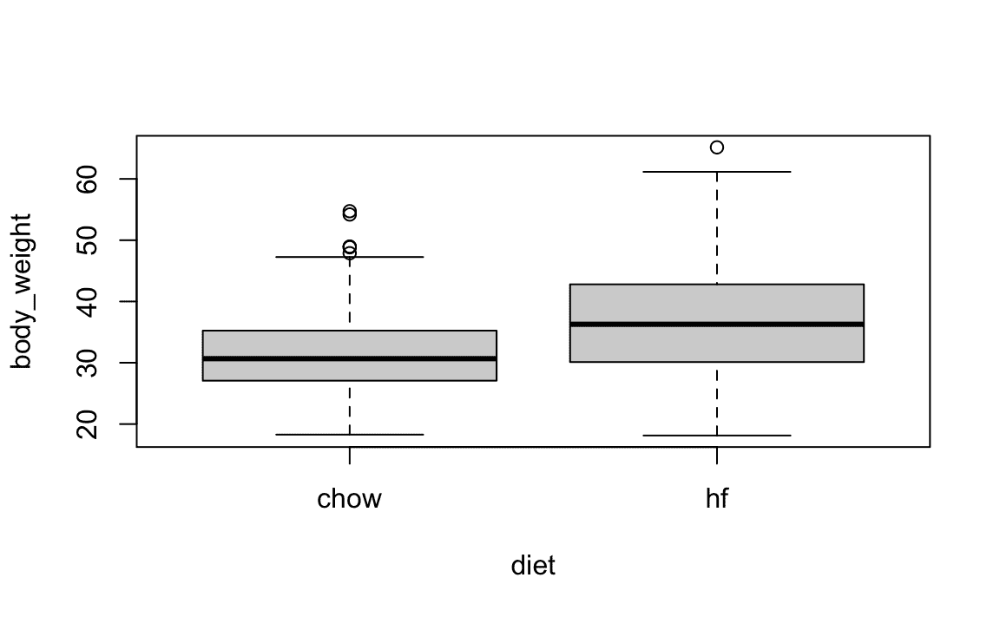
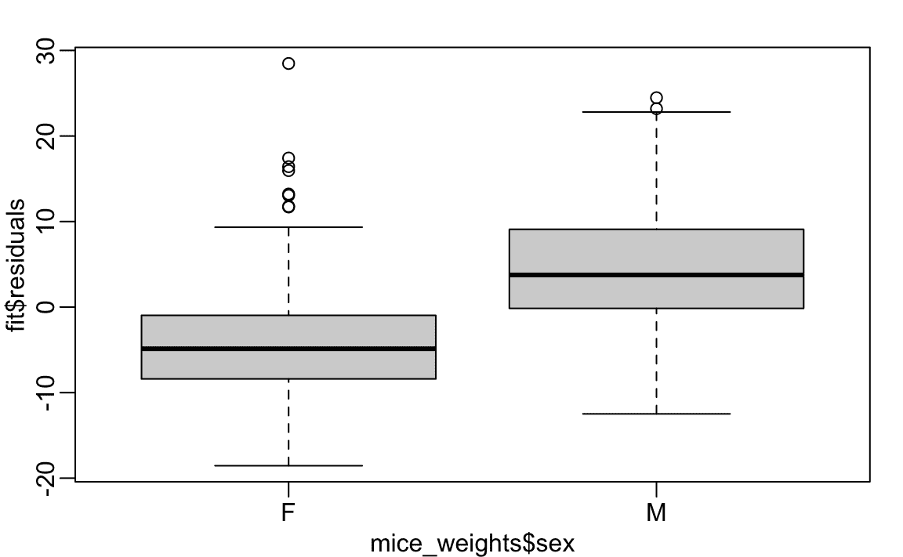
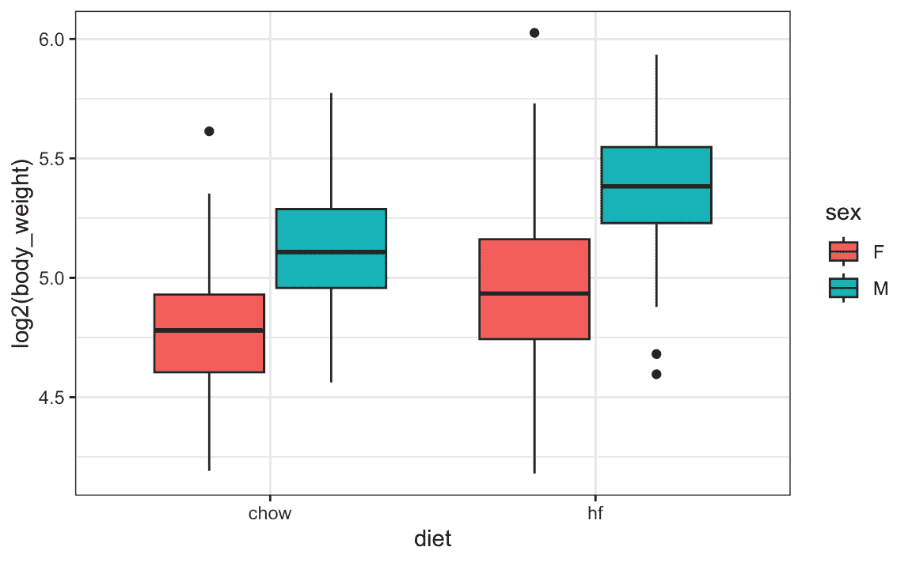
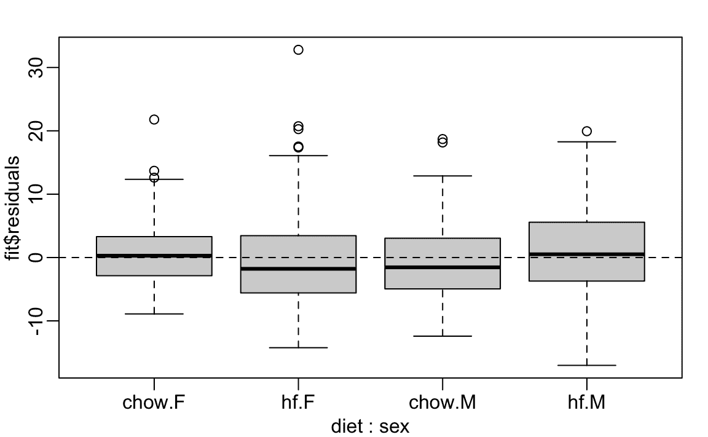

# 17 治疗效果模型

> 原文：[`rafalab.dfci.harvard.edu/dsbook-part-2/linear-models/treatment-effect-models.html`](https://rafalab.dfci.harvard.edu/dsbook-part-2/linear-models/treatment-effect-models.html)

1.  线性模型

1.  17 治疗效果模型

到目前为止，我们使用线性模型来描述连续变量之间的关系。我们通过假设多元正态性来激发这些模型，并展示了条件期望如何呈现线性形式。这涵盖了回归的许多常见应用。

然而，线性模型并不仅限于描述连续测量中的自然变异。线性模型最重要的用途之一是量化干预或治疗的效果。这一框架起源于农业，研究人员比较了接受不同肥料或种植策略的田地上的作物产量。结果变量是产量，而治疗是肥料。现在，相同的数学思想构成了分析医学、经济学、公共卫生、教育和社会科学中随机对照试验的基础。互联网公司使用的现代 A/B 测试，用于评估网站更改或产品特性，也遵循这一治疗效果框架。

关键思想是治疗定义了组别，我们使用线性模型来估计这些组别之间结果差异。在随机实验中，比较是直接的，因为随机化有助于确保组别具有可比性。在观察性研究中，目标相同，但分析人员必须考虑由于治疗本身之外的原因导致的组间差异。例如，如果我们想估计富含水果和蔬菜的饮食对血压的影响，我们必须调整年龄、性别或吸烟状况等因素。

## 17.1 案例研究：高脂肪饮食和鼠标体重

在本章中，我们考虑了一个旨在测试高脂肪饮食对小鼠生理影响的实验。小鼠被随机选择并分为两组：一组接受高脂肪饮食，被视为*治疗*，而另一组作为对照组，接受常规*饲料*。数据包含在**dslabs**包中：

```r
[library](https://rdrr.io/r/base/library.html)(dslabs)
[table](https://rdrr.io/r/base/table.html)(mice_weights$diet)
#> 
#> chow   hf 
#>  394  386
```

*箱线图显示，高脂肪饮食的小鼠平均体重较重。

```r
[with](https://rdrr.io/r/base/with.html)(mice_weights, [boxplot](https://rdrr.io/r/graphics/boxplot.html)(body_weight ~ diet))
```

**  *然而，鉴于我们是随机划分小鼠的，观察到的差异是否仅仅是由于偶然？

在将线性模型联系起来之前，在下一节中，我们使用第十三章中描述的方法对这两个均值的差异进行统计分析。**

## **17.2 比较组均值**

**两组样本平均值，高脂肪饮食和常规饲料，是不同的：

```r
[library](https://rdrr.io/r/base/library.html)([tidyverse](https://tidyverse.tidyverse.org))
mice_weights |> [group_by](https://dplyr.tidyverse.org/reference/group_by.html)(diet) |> [summarize](https://dplyr.tidyverse.org/reference/summarise.html)(average = [mean](https://rdrr.io/r/base/mean.html)(body_weight))
#> # A tibble: 2 × 2
#>   diet  average
#>   <fct>   <dbl>
#> 1 chow     31.5
#> 2 hf       36.7
```

然而，这是一个随机抽取的小鼠样本，分配到饮食组也是随机进行的。那么这种差异是由于偶然吗？我们将使用假设检验来回答这个问题，假设检验首先在第十三章中描述。

让\(\mu_1\)和\(\sigma_1\)分别代表如果整个小鼠群体都处于高脂肪饮食下，我们会观察到的平均体重和标准差。类似地，定义\(\mu_0\)和\(\sigma_0\)，但针对的是谷物饮食。定义\(N_1\)和\(N_0\)为样本大小，\(\bar{X}_1\)和\(\bar{X}_0\)分别为高脂肪和谷物饮食的样本平均值。

由于数据来自随机样本，中心极限定理告诉我们，如果样本足够大，平均差值\(\bar{X}_1 - \bar{X}_0\)的分布可以被近似为一个标准正态分布，期望值为\(\mu_1-\mu_0\)，标准误差为\(\sqrt{\frac{\sigma_1²}{N_1} + \frac{\sigma_0²}{N_0}}\)。

如果我们将零假设定义为高脂肪饮食没有效果，即\(\mu_1 - \mu_0 = 0\)，这意味着

\[ \frac{\bar{X}_1 - \bar{X}_0}{\sqrt{\frac{\sigma_1²}{N_1} + \frac{\sigma_0²}{N_0}}} \]

具有期望值 0 和标准误差 1，因此近似服从标准正态分布。

注意，我们实际上无法计算这个量，因为\(\sigma_1\)和\(\sigma_0\)是未知的。然而，如果我们用样本标准差来估计它们，分别用\(s_1\)和\(s_0\)表示高脂肪和谷物饮食，中心极限定理仍然成立，并告诉我们

\[ t = \frac{\bar{X}_1 - \bar{X}_0}{\sqrt{\frac{s_1²}{N_1} + \frac{s_0²}{N_0}}} \]

当零假设为真时，服从标准正态分布。这意味着我们可以轻松地计算观察到与我们获得值一样大的值的概率：

```r
stats <- mice_weights |> 
 [group_by](https://dplyr.tidyverse.org/reference/group_by.html)(diet) |> 
 [summarize](https://dplyr.tidyverse.org/reference/summarise.html)(xbar = [mean](https://rdrr.io/r/base/mean.html)(body_weight), s = [sd](https://rdrr.io/r/stats/sd.html)(body_weight), n = [n](https://dplyr.tidyverse.org/reference/context.html)()) 
t_stat <- [with](https://rdrr.io/r/base/with.html)(stats, (xbar[2] - xbar[1])/[sqrt](https://rdrr.io/r/base/MathFun.html)(s[2]²/n[2] + s[1]²/n[1]))
t_stat
#> [1] 9.34
```

*我们也可以使用 R 函数在一行内完成计算：

```r
[with](https://rdrr.io/r/base/with.html)(mice_weights, [t.test](https://rdrr.io/r/stats/t.test.html)(body_weight[diet == "hf"], body_weight[diet == "chow"]))
```

*在这里，t 值远远超过 3，所以我们实际上不需要计算 p 值`1-pnorm(t_stat)`，因为我们知道它将会非常小。

注意，当\(N_0\)和\(N_1\)不够大时，中心极限定理不适用。然而，正如我们在第 10.2.3 节中解释的，如果结果数据（在这种情况下是体重）近似服从正态分布，那么上面定义的\(t\)服从自由度为\(N_1+N_2-2\)的 t 分布。因此，p 值的计算方法相同，只是我们使用`pt`而不是`pnorm`。具体来说，我们使用`1-pt(t_stat, with(stats, n[2]+n[1]-2))`。

在科学研究中，通常检查均值差异。因此，*t 统计量*是最广泛报道的总结之一。当用来确定观察到的差异是否具有*统计学意义*时，我们称这个过程为“执行*t 检验*”。

*在上面的计算中，我们计算了观察到与所获得 \(t\) 值一样大的概率。然而，当我们的兴趣包括两个方向上的偏差时，例如，体重的增加或减少——我们必须考虑获得与观察到的 \(t\) 值一样极端的值的概率，无论符号如何。在这种情况下，我们使用 \(t\) 的绝对值并加倍单侧概率：`2*(1 - pnorm(abs(t_stat)))` 或 `2*(1-pt(abs(t_stat), with(stats, n[2]+n[1]-2)))`。******

## ****17.3 单因素设计****

****尽管 t 检验在比较两种治疗方法时很有用，但通常会有其他变量影响我们的结果。线性模型允许在这些更一般的情况下进行假设检验。我们通过演示如何使用线性模型进行 t 检验来开始描述使用线性模型估计治疗效果的方法。

如果我们假设标准饮食和高脂肪饮食中老鼠的体重分布都是正态分布的，我们可以写出以下线性模型来表示数据：

\[ Y_i = \beta_0 + \beta_1 x_i + \varepsilon_i \]

当 \(x_i = 1\) 时，如果第 \(i\) 只老鼠被喂食高脂肪饮食，否则为 0，并且误差 \(\varepsilon_i\) 独立，并再次假设它们服从正态分布，期望值为 0，标准差为 \(\sigma\)。

注意，这个数学公式看起来与我们为父子身高所写出的模型完全一样。然而，\(x_i\) 现在是 0 或 1 而不是连续变量，这使得我们能够在这个不同的环境中使用它。特别是，请注意现在 \(\beta_0\) 代表了啮齿动物在标准饮食中的平均体重，而 \(\beta_0 + \beta_1\) 代表了啮齿动物在高脂肪饮食中的平均体重。

这个模型的一个优点是 \(\beta_1\) 代表了接受高脂肪饮食的 *治疗效果*。高脂肪饮食没有效果的零假设可以量化为 \(\beta_1 = 0\)。我们估计 \(\beta_1\)，然后询问真实值是否可能为零。

那么，我们如何估计 \(\beta_1\) 并计算这个概率？线性模型的一个强大特性是我们可以使用相同的 LSE 机制来估计 \(\beta\) 及其标准误差：

```r
fit <- [lm](https://rdrr.io/r/stats/lm.html)(body_weight ~ diet, data = mice_weights)
```

*因为 `diet` 是一个有两个条目的因子，`lm` 函数知道要使用 \(x_i\)，一个指示变量来拟合上面的线性模型。`summary` 函数显示给我们结果估计、标准误差和 p 值：

```r
[coefficients](https://rdrr.io/r/stats/coef.html)([summary](https://rdrr.io/r/base/summary.html)(fit))
#>             Estimate Std. Error t value Pr(>|t|)
#> (Intercept)    31.54      0.386   81.74 0.00e+00
#> diethf          5.14      0.548    9.36 8.02e-20
```

*如果我们查看 `diethf` 行，这里计算出的 `t 值` 是估计值除以其估计的标准误差：\(\hat{\beta}_1 / \widehat{\mathrm{SE}}[\hat{\beta}_1]\)。`Pr(>|t|)` 是在检验 \(\beta_1=0\) 的零假设时的 p 值。

在简单单因素模型的情况下，我们可以证明这个统计量几乎等同于上一节中计算的 t 统计量`t_stat`。直观上看，这是有道理的，因为\(\hat{\beta}_1\)和 t 检验的分子都是处理效果的估计。唯一的细微差别是线性模型并不假设每个群体的标准差不同。相反，两个群体共享\(\mathrm{SD}[\varepsilon]\)作为标准差。请注意，尽管我们在这里没有用 R 来证明，但我们可以将线性模型重新定义为每个组有不同的标准误差。另外，请注意，您可以将`t.test`函数中的`var.equal`设置为`TRUE`，以获得完全相同的结果。

*在本节提供的线性模型描述中，我们假设\(\varepsilon\)遵循正态分布。这个假设允许我们证明由估计值除以其估计标准误差形成的统计量遵循 t 分布，这反过来又允许我们估计 p 值或置信区间。然而，请注意，我们不需要这个假设来计算最小二乘估计的期望值和标准误差。此外，如果观察数足够多，那么中心极限定理适用，我们可以在不假设误差为正态分布的情况下获得 p 值和置信区间。

## *****17.4 双因素设计*****

*****我们现在可以描述线性模型方法相对于直接比较平均值的重大优势。

注意，这个实验包括了雄性和雌性小鼠，并且已知雄性小鼠更重。这解释了为什么残差依赖于性别变量：

```r
[boxplot](https://rdrr.io/r/graphics/boxplot.html)(fit$residuals ~ mice_weights$sex)
```

**  *这种误设可能具有实际影响；例如，如果接受高脂肪饮食的雄性小鼠更多，那么这可以解释这种增加。相反，如果接受较少，我们可能会低估饮食效果。性别可能是一个混杂因素，表明我们的模型肯定可以改进。

From examining the data:

```r
mice_weights |> [ggplot](https://ggplot2.tidyverse.org/reference/ggplot.html)([aes](https://ggplot2.tidyverse.org/reference/aes.html)(diet, [log2](https://rdrr.io/r/base/Log.html)(body_weight), fill = sex)) + [geom_boxplot](https://ggplot2.tidyverse.org/reference/geom_boxplot.html)()
```

**  *我们看到饮食效果在两种性别中都存在，并且雄性比雌性重。尽管并不那么明显，饮食效果在雄性中似乎也更强烈。

一个允许以下四个组有不同的期望值的线性模型，1) 雌性啄食饲料，2) 雌性高脂肪饮食，3) 雄性啄食饲料，和 4) 雄性高脂肪饮食，可以写成这样：

\[ Y_i = \beta_1 x_{i1} + \beta_2 x_{i2} + \beta_3 x_{i3} + \beta_4 x_{i4} + \varepsilon_i \]

其中\(x_{i1},\dots,x_{i4}\)是四个组中的每个组的指示变量。通过这种表示，我们允许饮食效果在雄性和雌性中不同。

然而，在原始表示中，没有一个 \(\beta\) 参数直接对应于感兴趣的待遇效应（高脂肪饮食的效果）。线性模型的一个有用特性是我们可以重新参数化模型，使得拟合的均值保持不变，但系数的解释与科学问题相一致。

例如，考虑以下模型

\[ Y_i = \beta_0 + \beta_1 \, x_{i1} + \beta_2 \, x_{i2} + \beta_3 \,x_{i1} x_{i2} + \varepsilon_i\,, \]

其中

+   \(x_{i1} = 1\) 如果老鼠 \(i\) 接受了高脂肪饮食，否则为 \(0\)

+   \(x_{i2} = 1\) 如果老鼠 \(i\) 是雄性，如果是雌性则为 \(0\)

然后，我们按照以下方式解释参数：

+   \(\beta_0\) 是雌性在普通饮食中的基线平均体重

+   \(\beta_1\) 是雌性的饮食效应

+   \(\beta_2\) 是在普通饮食下雄性和雌性之间的平均差异

+   \(\beta_3\) 是雄性和雌性之间饮食效应的差异，通常称为 *交互* 效应

为了了解为什么这有效，让我们将 \(x_{1i}\) 和 \(x_{2i}\) 的四种选项插入到上面的线性组合中，看看我们会得到什么：

\[ \begin{aligned} \mbox{雌性在普通饮食中} \implies x_{1i} = 0, \,x_{2i} = 0 \implies \mathrm{E}[Y_i] &= \beta_0 \\ \mbox{雌性在高脂肪饮食中} \implies x_{1i} = 1, \,x_{2i} = 0 \implies \mathrm{E}[Y_i] &= \beta_0 + \beta_1\\ \mbox{雄性在普通饮食中} \implies x_{1i} = 0, \,x_{2i} = 1 \implies \mathrm{E}[Y_i] &= \beta_0 + \beta_2\\ \mbox{雄性在普通饮食中} \implies x_{1i} = 1, \,x_{2i} = 1 \implies \mathrm{E}[Y_i] &= \beta_0 +\beta_1 + \beta_2\\ \end{aligned} \]

这种参数化不会改变预测值。它只是改变了我们对系数的解释方式，以便每个系数都对应一个有意义的比较。

统计教材描述了其他几种重写模型的方法，以获得其他类型的解释。例如，我们可能希望 \(\beta_2\) 代表整体饮食效应（雌性和雄性效应的平均值），而不是对雌性的饮食效应。这是通过定义我们感兴趣的 *对比* 来实现的。

在 R 中，我们可以使用以下方式指定上述线性模型：

```r
fit <- [lm](https://rdrr.io/r/stats/lm.html)(body_weight ~ diet*sex, data = mice_weights)
```

*在这里，`*` 表示 *因子交叉*，而不是乘法：`diet*sex` 是 `diet+sex+diet:sex` 的简写，表示在模型中分别包含饮食、性别和饮食/性别的交互作用。

```r
[summary](https://rdrr.io/r/base/summary.html)(fit)$coef
#>             Estimate Std. Error t value  Pr(>|t|)
#> (Intercept)    27.83      0.440   63.27 1.48e-308
#> diethf          3.88      0.624    6.22  8.02e-10
#> sexM            7.53      0.627   12.02  1.27e-30
#> diethf:sexM     2.66      0.891    2.99  2.91e-03
```

*请注意，雄性效应大于饮食效应，饮食效应对两种性别都具有统计学意义，饮食对雄性的影响在 1 到 4.5 克之间。

当认为多个因素会影响测量时，常用的方法是为每个因素简单地包含一个加性效应，如下所示：

\[ Y_i = \beta_0 + \beta_1 x_{i1} + \beta_2 x_{i2} + \varepsilon_i \]

在此模型中，\(\beta_1\) 是一个通用的饮食效应，无论性别如何都适用。在 R 中，我们使用以下代码，使用 `+` 而不是 `*`：

```r
fit <- [lm](https://rdrr.io/r/stats/lm.html)(body_weight ~ diet + sex, data = mice_weights)
```

*请注意，此模型没有考虑男性和女性之间饮食效应的差异。诊断图将揭示这一缺陷，通过显示残差是有偏的：对于饮食的女性，平均而言是负的，而对于饮食的男性，平均而言是正的，而不是围绕 0 中心。

```r
[boxplot](https://rdrr.io/r/graphics/boxplot.html)(fit$residuals ~ diet + sex, data = mice_weights) 
[abline](https://rdrr.io/r/graphics/abline.html)(h = 0, lty = 2)
```

**  *科学研究表明，尤其是在流行病学和社会科学领域，由于变量数量众多，经常从模型中省略交互项。添加交互项需要众多参数，在极端情况下可能会阻止模型拟合。然而，省略交互项隐含地假设它们为 0，这可能导致无法很好地描述数据的模型，因此不适合使用。相反，当我们能够捍卫没有交互效应的假设时，排除交互项的模型更容易解释，因为参数通常被视为结果随着分配的治疗程度增加的幅度。

*线性模型在许多场景中都非常灵活且适用。例如，我们不仅可以包含超过两个的因素。我们仅仅只是触及了线性模型在估计治疗效果方面的应用表面。我们强烈建议通过探索涵盖`lm`、`contrasts`和`model.matrix`等函数的线性模型教科书和 R 手册来了解更多关于这方面的知识。************

## *****17.5 对比*****

*****在我们在例子中检查的例子中，每种治疗只有两组：饮食有 chow/高脂肪，性别有女性/男性。然而，感兴趣的变量通常有多个水平。例如，我们可能在老鼠身上测试了第三种饮食。在统计学教科书中，这些变量被称为*因素*，每个因素中的组被称为其*水平*。

当一个因素被包含在公式中时，`lm`的默认行为是将截距项定义为第一水平的期望值，其他系数则表示与其他水平与第一水平之间的差异，或称为*对比*。我们可以通过以下方式使用`lm`来估计性别效应：

```r
fit <- [lm](https://rdrr.io/r/stats/lm.html)(body_weight ~ sex, data = mice_weights)
[coefficients](https://rdrr.io/r/stats/coef.html)(fit)
#> (Intercept)        sexM 
#>       29.76        8.82
```

*为了恢复男性的期望均值，我们可以简单地添加两个系数：

```r
[sum](https://rdrr.io/r/base/sum.html)(fit$coefficients[1:2])
#> [1] 38.6
```

*`emmeans`包简化了计算，并计算标准误差：

```r
[library](https://rdrr.io/r/base/library.html)([emmeans](https://rvlenth.github.io/emmeans/))
[emmeans](https://rvlenth.github.io/emmeans/reference/emmeans.html)(fit, ~sex)
#>  sex emmean    SE  df lower.CL upper.CL
#>  F     29.8 0.339 778     29.1     30.4
#>  M     38.6 0.346 778     37.9     39.3
#> 
#> Confidence level used: 0.95
```

*现在，如果我们真的不想定义参考水平怎么办？如果我们想有一个参数来表示每个组与总体均值之间的差异怎么办？我们能写出一个这样的模型吗：

\[ Y_i = \beta_0 + \beta_1 x_{i1} + \beta_2 x_{i2} + \varepsilon_i \] 其中 \(x_{i1} = 1\)，如果观察 \(i\) 是女性否则为 0，\(x_{i2}=1\)，如果观察 \(i\) 是男性否则为 0？

不幸的是，这种表示有问题。注意，女性和男性的均值分别用 \(\beta_0 + \beta_1\) 和 \(\beta_0 + \beta_2\) 表示。这是一个问题，因为每个组的期望值只是一个数字，比如说 \(\mu_f\) 和 \(\mu_m\)，而 \(\beta_0 + \beta_1 = \mu_f\) 和 \(\beta_0 +\beta_2 = \mu_m\) 有无限多种方式（三个未知数，两个方程）。这意味着我们无法获得唯一的平方最小估计。当这种情况发生时，我们说模型或参数是不可识别的。R 的默认行为通过要求 \(\beta_1 = 0\) 来解决这个问题，迫使 \(\beta_0 = \mu_m\)，这允许我们解这个方程组。

请记住，这并不是允许估计参数的唯一约束。任何线性约束都可以，因为它为我们系统添加了第三个方程。广泛使用的约束是要求 \(\beta_1 + \beta_2 = 0\)。在 R 中，我们可以使用以下方式使用 `contrasts` 参数来实现这一点：

```r
fit <- [lm](https://rdrr.io/r/stats/lm.html)(body_weight ~ sex, data = mice_weights, contrasts = [list](https://rdrr.io/r/base/list.html)(sex=contr.sum))
[coefficients](https://rdrr.io/r/stats/coef.html)(fit)
#> (Intercept)        sex1 
#>       34.17       -4.41
```

*我们看到截距现在更大，反映了整体均值而不是仅女性的均值。另一个系数，\(\beta_1\)，代表模型中女性与整体均值之间的对比。男性的系数没有显示，因为它冗余：\(\beta_1= -\beta_2\).

如果我们想查看所有估计值，**emmeans** 包也为我们进行了计算：

```r
[contrast](https://rvlenth.github.io/emmeans/reference/contrast.html)([emmeans](https://rvlenth.github.io/emmeans/reference/emmeans.html)(fit, ~sex))
#>  contrast estimate    SE  df t.ratio p.value
#>  F effect    -4.41 0.242 778 -18.200  <.0001
#>  M effect     4.41 0.242 778  18.200  <.0001
#> 
#> P value adjustment: fdr method for 2 tests
```

*当因素有多个水平时，使用这种替代约束更为实用，选择基线变得不那么方便。此外，我们可能对系数的方差比对组间和参考水平之间的对比更感兴趣。

作为例子，考虑我们的数据集中的老鼠实际上来自几个代：

```r
[table](https://rdrr.io/r/base/table.html)(mice_weights$gen)
#> 
#>   4   7   8   9  11 
#>  97 195 193  97 198
```

*为了估计不同代际引起的可变性，一个方便的模型是：

\[ Y_i = \beta_0 + \sum_{j=1}^J \beta_j x_{ij} + \varepsilon_i \]

使用 \(x_{ij}\) 指示变量：\(x_{ij}=1\) 如果老鼠 \(i\) 在水平 \(j\) 上，否则为 0，\(J\) 代表水平数量，在我们的例子中是 5 代，并且使用以下方式对水平效应进行约束：

\[ \frac{1}{J} \sum_{j=1}^J \beta_j = 0 \implies \sum_{j=1}^J \beta_j = 0. \]

这个约束使得模型可识别，同时也允许我们量化由于代际差异引起的可变性：

\[ \sigma²_{\text{gen}} \equiv \frac{1}{J}\sum_{j=1}^J \beta_j² \]

我们可以使用以下方法查看估计的系数：

```r
fit <- [lm](https://rdrr.io/r/stats/lm.html)(body_weight ~ gen,  data = mice_weights, contrasts = [list](https://rdrr.io/r/base/list.html)(gen=contr.sum))
[contrast](https://rvlenth.github.io/emmeans/reference/contrast.html)([emmeans](https://rvlenth.github.io/emmeans/reference/emmeans.html)(fit, ~gen)) 
#>  contrast     estimate    SE  df t.ratio p.value
#>  gen4 effect    -0.122 0.705 775  -0.174  0.8620
#>  gen7 effect    -0.812 0.542 775  -1.497  0.3370
#>  gen8 effect    -0.113 0.544 775  -0.207  0.8620
#>  gen9 effect     0.149 0.705 775   0.212  0.8620
#>  gen11 effect    0.897 0.540 775   1.663  0.3370
#> 
#> P value adjustment: fdr method for 5 tests
```

*在下一节中，我们将简要描述一种用于研究与该因素相关的可变性的有用技术。************

## ****17.6 方差分析（ANOVA）****

****当因素有多个水平时，通常希望确定是否存在水平间的显著可变性，而不是任何给定水平对的特定差异。方差分析（ANOVA）提供了进行这种分析的工具。

ANOVA（方差分析）提供了对\(\sigma²_{\text{gen}}\)的估计，并对原假设进行统计检验，即该因素不贡献任何变异性：\(\sigma²_{\text{gen}} =0\)。

一旦使用一个或多个因素拟合了线性模型，就可以使用`aov`函数进行方差分析。具体来说，计算因素变异性估计的同时，还会计算一个可用于假设检验的统计量：

```r
[summary](https://rdrr.io/r/base/summary.html)([aov](https://rdrr.io/r/stats/aov.html)(fit))
#>              Df Sum Sq Mean Sq F value Pr(>F)
#> gen           4    294    73.5    1.13   0.34
#> Residuals   775  50479    65.1
```

*记住，如果给出一个模型公式，`aov`将拟合该模型：

```r
[summary](https://rdrr.io/r/base/summary.html)([aov](https://rdrr.io/r/stats/aov.html)(body_weight ~ gen, data = mice_weights))
```

*我们不需要指定约束条件，因为 ANOVA 需要将总和约束为 0，以便结果可解释。

这项分析表明，代际效应在统计上并不显著。

*我们不包括许多细节，例如，关于`aov`显示的汇总统计量和 p 值的定义和动机。有几本书专门讨论方差分析，线性模型的教科书通常包括关于这个主题的章节。对学习这些主题感兴趣的人可以查阅推荐阅读部分列出的教科书。*  *### 多个因素

方差分析最初是为了分析农业数据而开发的，这些数据通常包括几个因素，如肥料、地块和植物品种。

注意，我们可以对多个因素进行方差分析：

```r
[summary](https://rdrr.io/r/base/summary.html)([aov](https://rdrr.io/r/stats/aov.html)(body_weight ~ sex + diet + gen,  data = mice_weights))
#>              Df Sum Sq Mean Sq F value Pr(>F) 
#> sex           1  15165   15165  389.80 <2e-16 ***
#> diet          1   5238    5238  134.64 <2e-16 ***
#> gen           4    295      74    1.89   0.11 
#> Residuals   773  30074      39 
#> ---
#> Signif. codes:  0 '***' 0.001 '**' 0.01 '*' 0.05 '.' 0.1 ' ' 1
```

*这项分析表明，性别是最大的变异性来源，这与之前做出的探索性绘图一致。

*方差分析（ANOVA）的一个关键方面是其将数据中的总方差分解为每个因素在研究中的个别贡献的能力，这由\(\sum_{i=1}^N y_i²\)表示。然而，为了使方差分析的数学基础有效，实验设计必须是平衡的。这意味着对于任何给定因素的每个水平，都必须有其他所有因素水平的相等代表性。在我们的涉及老鼠的研究中，设计是不平衡的，因此在解释方差分析结果时需要谨慎。**

### **数组表示**

**当模型包括多个因素时，写下线性模型可能会变得繁琐。例如，在我们的二因素模型中，我们必须包括两个因素的指示变量：**

\[ Y_i = \beta_0 + \sum_{j=1}^J \beta_j x_{i,j} + \sum_{k=1}^K \beta_{J+k} x_{i,J+k} + \varepsilon_i \mbox{ with }\sum_{j=1}^J \beta_j=0 \mbox{ and } \sum_{k=1}^K \beta_{J+k} = 0, \]

第一因素中\(J\)个水平的\(x_{i,1},\dots,x_{i,J}\)指示函数和第二因素中\(K\)个水平的\(x_{i,J+1},\dots,x_{i,J+K}\)指示函数。

在方差分析中广泛使用的一种替代方法，以避免指示变量，是将数据保存在一个数组中，使用不同的希腊字母表示因素，用索引表示水平：

\[ Y_{ijk} = \mu + \alpha_j + \beta_k + \varepsilon_{ijk}, \mbox{ with } i = 1,\dots,I, \, j = 1,\dots,J, \mbox{ and } k= 1,\dots,K \]

以 \(\mu\) 表示总体均值，\(\alpha_j\) 表示第一个因素中 \(j\) 级别的效应，\(\beta_k\) 表示第二个因素中 \(k\) 级别的效应。约束条件现在可以写成如下形式：

\[ \sum_{j=1}^J \alpha_j = 0 \text{ 和 } \sum_{k=1}^K \beta_k = 0 \]

这种数组表示法自然导致通过计算数组维度的平均值来估计效应。

注意，在这里，我们隐含地假设了一个 *平衡设计*，这意味着对于每一个因素级别 \(j\) 和 \(k\) 的组合，我们观察到的重复次数 \(i\) 是相同的。例如，如果因素是性别和饮食，平衡设计将包括每个性别-饮食组合中相同数量的老鼠。在这种情况下，对于每个三元组 \((i,j,k)\) 都有一个值 \(Y_{ijk}\)，并且设计中的每个单元格具有相同的样本量。这确保了组均值定义良好，并且可以使用简单平均值直接估计模型参数。

如果设计是 *不平衡的*，即某些级别组合的观察值多于其他组合，我们仍然可以用相同的形式写出模型，但重复次数 \(I_{jk}\) 会根据级别对变化。在这种情况下，一些方便的 ANOVA 总结解释不再直接适用，因为单元格均值对估计的贡献不平等。*********

## *****17.7 练习*****

*****1\. 一旦拟合了模型，标准误差 \(\sigma\) 的估计值可以按以下方式获得：

```r
fit <- [lm](https://rdrr.io/r/stats/lm.html)(body_weight ~ diet, data = mice_weights)
[summary](https://rdrr.io/r/base/summary.html)(fit)$sigma
```

*使用只包括饮食和考虑性别的模型来计算 \(\sigma\) 的估计值。这些估计值是否相同？如果不相同，原因是什么？

2\. `lm` 拟合线性模型的一个假设是，误差 \(\varepsilon_i\) 的标准差对所有 \(i\) 是相同的。这意味着它不依赖于期望值。像这样按老鼠的重量分组：

```r
breaks <- [with](https://rdrr.io/r/base/with.html)(mice_weights, [seq](https://rdrr.io/r/base/seq.html)([min](https://rdrr.io/r/base/Extremes.html)(body_weight), [max](https://rdrr.io/r/base/Extremes.html)(body_weight), 1))
dat <- [mutate](https://dplyr.tidyverse.org/reference/mutate.html)(mice_weights, group = [cut](https://rdrr.io/r/base/cut.html)(body_weight, breaks, include_lowest=TRUE))
```

*计算具有超过 10 个观察值的组的 `body_weight` 的平均值和标准差，并使用数据探索来验证此假设是否成立。

3\. 数据集还包括一个变量，表示老鼠来自哪个窝。创建一个按窝展示重量的箱线图。使用分面图来为每个饮食和性别组合创建单独的图表。

4\. 使用线性模型测试窝效应，同时考虑性别和饮食。使用 ANOVA 比较窝解释的变异性与其他因素的变异性。

5\. `mice_weights` 数据还包括两个其他结果：骨密度和脂肪百分比。创建一个箱线图，按性别和饮食展示骨密度。比较可视化揭示的饮食效应与性别之间的关系。

6\. 拟合线性模型并对每个性别进行单独的饮食效应对骨密度的测试。注意，饮食效应对女性具有统计学意义，但对男性没有。然后将模型拟合到包含饮食、性别及其交互作用的整个数据集。注意，饮食效应是显著的，但交互效应不是。解释这种情况是如何发生的。提示：要拟合包含男性和女性单独效应的整个数据集的模型，可以使用公式 `~ sex + diet:sex`

7\. 在 第十章 中，我们讨论了调查员偏差并使用可视化来激发这种偏差的存在。在这里，我们将对其进行更严格的处理。我们将考虑进行了每日调查的两个调查员。我们将查看选举前一个月的全国调查：

```r
[library](https://rdrr.io/r/base/library.html)(dslabs)
polls <- polls_us_election_2016 |> 
 [filter](https://dplyr.tidyverse.org/reference/filter.html)(pollster [%in%](https://rdrr.io/r/base/match.html) [c](https://rdrr.io/r/base/c.html)("Rasmussen Reports/Pulse Opinion Research",
 "The Times-Picayune/Lucid") &
 enddate >= "2016-10-15" &
 state == "U.S.") |> 
 [mutate](https://dplyr.tidyverse.org/reference/mutate.html)(spread = rawpoll_clinton/100 - rawpoll_trump/100) 
```

*我们想要回答的问题是：是否存在调查员偏差？绘制每个调查员的分布图。

8\. 数据似乎确实表明存在差异。然而，这些数据受到变异性影响。也许我们观察到的差异是由于偶然性造成的。

灶模型理论没有提及调查员效应。在灶模型下，两位调查员都有相同的期望值：选举日差异，我们称之为 \(\mu\)。

要回答“是否存在灶模型？”的问题，我们将以以下方式对观察到的数据 \(Y_{ij}\) 进行建模：

\[ Y_{ij} = \mu + b_i + \varepsilon_{ij} \]

其中 \(i=1,2\) 表示两位调查员，\(b_i\) 是调查员 \(i\) 的偏差，\(\varepsilon_{ij}\) 是调查之间的随机变化。我们假设 \(\varepsilon\) 之间相互独立，期望值为 \(0\)，标准差为 \(\sigma_i\)，无论 \(j\) 如何。

以下哪个选项最能代表我们的问题？

1.  \(\varepsilon_{ij}\) 是否等于 0？

1.  \(Y_{ij}\) 与 \(\mu\) 的接近程度如何？

1.  \(b_1 \neq b_2\) 吗？

1.  \(b_1 = 0\) 和 \(b_2 = 0\) 吗？

9\. 在此模型的右侧，只有 \(\varepsilon_{ij}\) 是随机变量；其他两个是常数。\(Y_{1,j}\) 的期望值是多少？

10\. 假设我们将 \(\bar{Y}_1\) 定义为第一个调查员进行的调查结果的平均值，\(Y_{1,1},\dots,Y_{1,N_1}\)，其中 \(N_1\) 是第一个调查员进行的调查数量：

```r
polls |> 
 [filter](https://dplyr.tidyverse.org/reference/filter.html)(pollster=="Rasmussen Reports/Pulse Opinion Research") |> 
 [summarize](https://dplyr.tidyverse.org/reference/summarise.html)(N_1 = [n](https://dplyr.tidyverse.org/reference/context.html)())
```

*\(\bar{Y}_1\) 的期望值是多少？

11\. \(\bar{Y}_1\) 的标准误差是多少？

12\. 假设我们将 \(\bar{Y}_2\) 定义为第二个调查员进行的调查结果的平均值，\(Y_{2,1},\dots,Y_{2,N_2}\)，其中 \(N_2\) 是第二个调查员进行的调查数量。\(\bar{Y}_2\) 的期望值是多少？

13\. \(\bar{Y}_2\) 的标准误差是多少？

14\. 通过回答上述问题所学的知识，\(\bar{Y}_{2} - \bar{Y}_1\) 的期望值是多少？

15\. 通过回答上述问题所学的知识，\(\bar{Y}_{2} - \bar{Y}_1\) 的标准误差是多少？

16. 上述问题的答案取决于 \(\sigma_1\) 和 \(\sigma_2\)，这些我们不知道。我们了解到我们可以用样本标准差来估计这些值。编写代码来计算这两个估计值。

17. CLT 告诉我们关于 \(\bar{Y}_2 - \bar{Y}_1\) 分布的什么信息？

1.  没有因为这不是样本的平均值。

1.  因为 \(Y_{ij}\) 大约服从正态分布，所以平均值也服从正态分布。

1.  注意到 \(\bar{Y}_2\) 和 \(\bar{Y}_1\) 是样本平均值，所以如果我们假设 \(N_2\) 和 \(N_1\) 足够大，每个都是近似正态分布的。正态分布变量的差也是正态分布的。

1.  数据不是 0 或 1，所以中心极限定理不适用。

18. 我们构造了一个期望值为 \(b_2 - b_1\) 的随机变量，表示民意调查偏差的差异。如果我们的模型成立，那么这个随机变量将具有近似正态分布，并且我们知道其标准误差。标准误差取决于 \(\sigma_1\) 和 \(\sigma_2\)，但我们可以插入我们上面计算出的样本标准差。我们最初的问题是：\(b_2 - b_1\) 是否与 0 不同？使用我们上面收集到的所有信息，构建 \(b_2 - b_1\) 差异的 95% 置信区间。

19. 置信区间告诉我们存在相对较强的民意调查员效应，导致差异约为 5%。随机变异性似乎不能解释这一点。我们可以计算一个 p 值来传达事实，即偶然性不能解释这一点。p 值是多少？

20. 将 \(b_2-b_1\) 的估计值除以其估计的标准误差得到的统计量是 t 统计量：

\[ \frac{\bar{Y}_2 - \bar{Y}_1}{\sqrt{s_2²/N_2 + s_1²/N_1}} \]

现在请注意，我们不止有两个民意调查员。我们还可以使用所有民意调查员来测试民意调查员效应，而不仅仅是两个。想法是比较调查之间的变异性与调查内部的变异性。

对于这个练习，创建一个新的表格：

```r
polls <- polls_us_election_2016 |> 
 [filter](https://dplyr.tidyverse.org/reference/filter.html)(enddate >= "2016-10-15" &
 state == "U.S.") |>
 [group_by](https://dplyr.tidyverse.org/reference/group_by.html)(pollster) |>
 [filter](https://dplyr.tidyverse.org/reference/filter.html)([n](https://dplyr.tidyverse.org/reference/context.html)() >= 5) |> 
 [mutate](https://dplyr.tidyverse.org/reference/mutate.html)(spread = rawpoll_clinton/100 - rawpoll_trump/100) |>
 [ungroup](https://dplyr.tidyverse.org/reference/group_by.html)()
```

*计算每个民意调查员的平均值和标准差，并检查平均值之间的变异性。将其与民意调查员内部的标准差总结的变异性进行比较。**********
