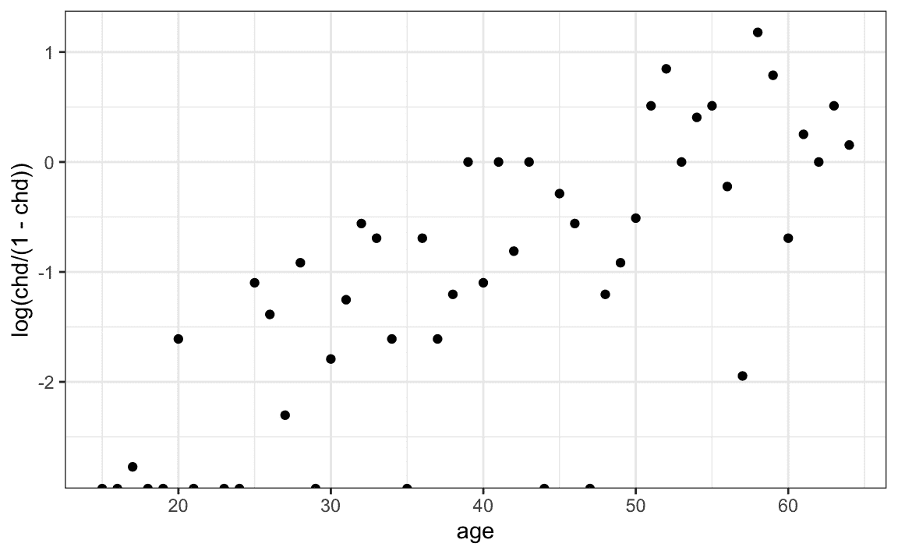
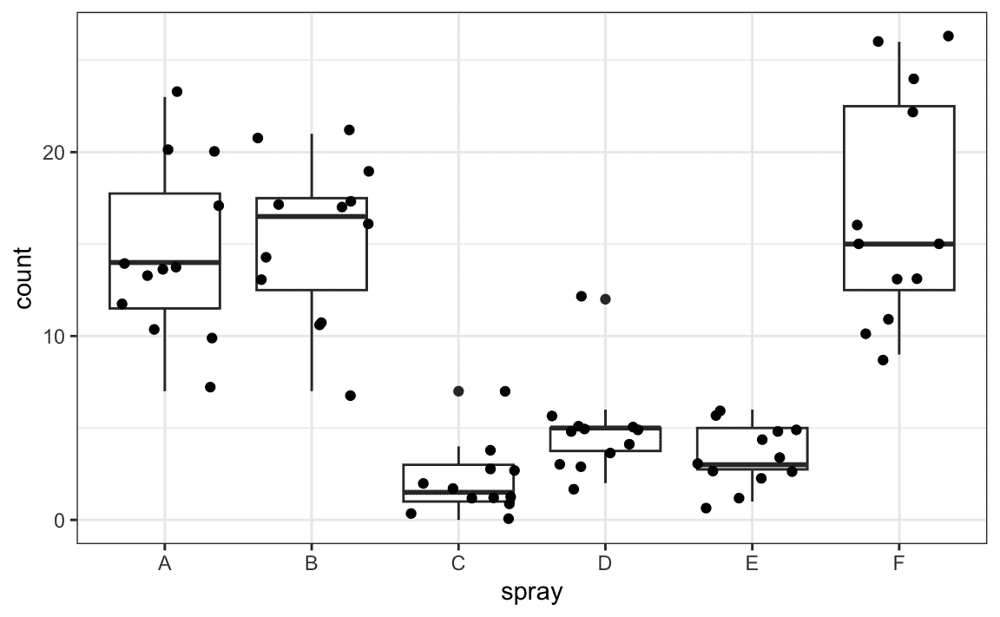

# 18  广义线性模型

> 原文：[`rafalab.dfci.harvard.edu/dsbook-part-2/linear-models/glm.html`](https://rafalab.dfci.harvard.edu/dsbook-part-2/linear-models/glm.html)

1.  线性模型

1.  18  广义线性模型

我们迄今为止使用的统计模型都假设感兴趣的结果是连续的。然而，在许多实际应用中，结果可能是二元的、分类的或计数的。在这些情况下，我们通常对结果如何随着一个或多个解释变量而变化感兴趣。

例如，我们可能想要研究冠心病发病概率如何随年龄、收缩压或其他临床测量值变化；泰坦尼克号沉没事件中生存机会如何取决于乘客特征；或者不同杀虫剂如何影响农业田地观测到的昆虫数量。

虽然这些结果不再是连续的，但线性模型框架中引入的许多想法仍然适用。通过稍作调整，我们可以扩展用于线性模型的数学方法，使其适用于所有这些情况，同时继续在 R 中使用相同的建模工具。

这些扩展模型被称为*广义*线性模型。为了激发它们，我们以两个分类变量的关联性检验开始本章。然后我们展示这些检验如何自然地从逻辑回归中产生，这是我们的第一个二元结果广义线性模型示例。最后，我们通过例子说明相同的框架可以应用于各种情境，包括结果为二元或计数的情况。

## 18.1 关联性检验

我们从最简单的情况开始：评估两个分类变量是否相关。这些方法在 GLM 之前就已经开发出来，但它们可以被理解为逻辑回归的特殊情况。一旦我们建立了这种联系，通用的 GLM 框架就会自然而然地出现。

### 案例研究：资助成功率

2014 年 PNAS 论文¹分析了荷兰资助机构的成功率，并得出结论，他们的

> 结果揭示在“研究者质量”（但不是“提案质量”）评估和成功率以及教学和评估材料中的语言使用上存在性别偏见，有利于男性申请者而非女性申请者。

支持这一结论的主要证据是基于百分比的比较，我们可以使用论文中提供的数据来计算这些百分比：

```r
[library](https://rdrr.io/r/base/library.html)([tidyverse](https://tidyverse.tidyverse.org))
[library](https://rdrr.io/r/base/library.html)(dslabs)
totals <- research_funding_rates |> [select](https://dplyr.tidyverse.org/reference/select.html)(-discipline) |> 
 [summarize_all](https://dplyr.tidyverse.org/reference/summarise_all.html)(sum) |>
 [summarize](https://dplyr.tidyverse.org/reference/summarise.html)(yes_men = awards_men, 
 no_men = applications_men - awards_men, 
 yes_women = awards_women, 
 no_women = applications_women - awards_women) 
 totals |> [summarize](https://dplyr.tidyverse.org/reference/summarise.html)(percent_men = yes_men/(yes_men + no_men),
 percent_women = yes_women/(yes_women + no_women))
#>   percent_men percent_women
#> 1       0.177         0.149
```

*但这仅仅是因为随机变异性吗？在这里，我们学习如何对这类数据进行推断。

在第 18.1.3 节中，我们介绍了允许我们回答这个问题的关联性检验。在这样做之前，我们提供了一个具有历史意义的例子，说明了这种方法的必要性。

### *《女士品茶》*

*关联检验的经典激励例子是 R.A.费舍尔设计的*女士品茶*实验。罗瑟姆斯特德实验站的同事声称她能判断牛奶是在倒入杯子之前还是之后倒入的。费舍尔提出了一种随机测试，并推导出在假设她只是在猜测的情况下，每种可能结果的概率。这导致了现在所知的基于超几何分布的*费舍尔精确检验*。

例如，假设她正确地识别出了 4 个杯子中的 3 个：

```r
tab <- [table](https://rdrr.io/r/base/table.html)(guess =  [c](https://rdrr.io/r/base/c.html)("m", "t", "m", "t", "t", "m", "t", "m"),
 actual = [c](https://rdrr.io/r/base/c.html)("m", "t", "m", "t", "t", "t", "m", "m"))
tab
#>      actual
#> guess m t
#>     m 3 1
#>     t 1 3
```

*为了评估这是否提供了真实能力的证据，我们考虑她是在猜测的*零假设。因为她知道每种类型的杯子都有四个，猜测相当于从包含 4 个*先加牛奶*和 4 个*先加茶*的杯子中随机抽取 4 个杯子。

正确猜测\(k\)个杯子的概率由超几何公式给出：

\[ \frac{\binom{4}{k}\binom{4}{4-k}}{\binom{8}{4}}. \]

因此，偶然正确猜测 3 个或更多的概率是：\[ \frac{\binom{4}{3}\binom{4}{1}}{\binom{8}{4}} + \frac{\binom{4}{4}\binom{4}{0}}{\binom{8}{4}} = \frac{16}{70} \approx 0.24. \] 因此，正确识别 3 个杯子可能很容易是偶然发生的，并不是所声称能力的有力证据。

这个计算正是*费舍尔精确检验*所执行的。在 R 中，我们可以输入：

```r
[fisher.test](https://rdrr.io/r/stats/fisher.test.html)(tab, alternative = "greater")$p.value
#> [1] 0.243
```

**历史记录表明，这位女士在原始演示中确实表现良好。费舍尔的目标不是确认或反驳她的能力，而是说明如何设计一个公平的实验，以及如何用概率评估证据。****

### ****二列联表和卡方检验****

****注意，我们的资金分配例子与女士品茶类似：在零假设下，资金的分配是随机的，无论性别如何，正如费舍尔的例子中，杯子是随机猜测的，无论牛奶是在什么时候倒入的。

然而，在女士品茶例子中，我们能够使用超几何分布，因为设计*固定*了每种类型的杯子数量和每个类别的选择数量。换句话说，`tab`的行总数和列总数是由实验预先确定的。

在资金分配的例子中，以及大多数现实世界的数据中，情况并非如此。资助申请的数量以及男性和女性申请者的数量都不是预先固定的；这些总数是从我们观察到的数据中产生的。因为行和列的总数不是固定的，超几何模型就不再适用，也很少在实际中应用。

在这种情况下，我们使用的是*卡方检验*，它提供了一种测试两个分类变量之间关联的方法，而不需要固定的边缘。让我们将其应用于资金率例子。

卡方检验的第一步是创建观察到的*二列联表*：

```r
o <- [with](https://rdrr.io/r/base/with.html)(totals, [data.frame](https://rdrr.io/r/base/data.frame.html)(men = [c](https://rdrr.io/r/base/c.html)(no_men, yes_men), 
 women = [c](https://rdrr.io/r/base/c.html)(no_women, yes_women),
 row.names = [c](https://rdrr.io/r/base/c.html)("no", "yes")))
```

*然后我们估计整体资助率，我们将用它来确定如果成功资助独立于性别分配，我们会期望看到什么：

```r
rate <- [with](https://rdrr.io/r/base/with.html)(totals, (yes_men + yes_women))/[sum](https://rdrr.io/r/base/sum.html)(totals)
```

*我们使用这个来计算我们期望偶然看到的结果：

```r
e <- [with](https://rdrr.io/r/base/with.html)(totals, [data.frame](https://rdrr.io/r/base/data.frame.html)(men = (no_men + yes_men)*[c](https://rdrr.io/r/base/c.html)(1 - rate, rate),
 women = (no_women + yes_women)*[c](https://rdrr.io/r/base/c.html)(1 - rate, rate),
 row.names = [c](https://rdrr.io/r/base/c.html)("no", "yes")))
```

*我们可以看到，比预期更多的男性获得了资助，而比预期更少的女性获得了资助：

```r
[cbind](https://rdrr.io/r/base/cbind.html)(o, e)
#>      men women  men women
#> no  1345  1011 1365   991
#> yes  290   177  270   197
```

*然而，在零假设下，这些观察值是随机变量。卡方统计量量化了观察表与期望表之间的差异，通过：

1.  计算每个观察值和期望值单元格值的差值。

1.  将这个差值平方。

1.  将每个平方差值除以期望值。

1.  将所有这些值相加得到最终统计量。

```r
[sum](https://rdrr.io/r/base/sum.html)((o - e)²/e)
#> [1] 4.01
```

*我们使用这个汇总统计量，因为它的抽样分布可以被一个已知的参数分布所近似：卡方分布。

R 函数`chisq.test`接受一个二乘二表，并返回测试结果：

```r
chisq_test <- [chisq.test](https://rdrr.io/r/stats/chisq.test.html)(o, correct = FALSE)
```

*我们看到 p 值是 0.045：

```r
chisq_test$p.value
#> [1] 0.0451
```

**默认情况下，`chisq.test`函数应用了一个*连续性校正*。这种校正从观察值和期望值之间的绝对偏差中减去 0.5：

```r
[sum](https://rdrr.io/r/base/sum.html)(([abs](https://rdrr.io/r/base/MathFun.html)(o - e) - 0.5)² / e)
#> [1] 3.81
```

*这符合默认行为：

```r
[chisq.test](https://rdrr.io/r/stats/chisq.test.html)(o)$statistic
#> X-squared 
#>      3.81
```

*这种调整的原因是，卡方检验基于一个*连续*概率分布，而二乘二表计数是*离散*的。当样本量较小时，连续近似和离散分布之间的差异可能是明显的。连续性校正稍微降低了测试统计量，以考虑到这种不匹配，使近似更加保守（也就是说，不太可能偶然产生小的 p 值）。

我们之前使用`correct = FALSE`参数来避免这种调整，因为在中等到大样本中，这种调整不是必需的，并且可能会稍微降低测试的效力。**************

### *****优势比*****

*****卡方检验提供了一个 p 值，但它并不量化效应的大小。如第十三章 Chapter 13 中讨论的，我们通常更喜欢置信区间而不是 p 值，因为它们传达了效应大小和不确定性。那么我们在这里如何量化效应呢？

对于两个分类组，我们的数据可以总结在一个二乘二表中：

|  | 女性 | 男性 |
| --- | --- | --- |
| 资助 | a | b |
| 未资助 | c | d |

一个选择是比较比例的差异：

\[ \frac{a}{a+c} - \frac{b}{b+d}. \]

然而，比例的差异在基线水平上并不直接可比。例如，从 1%到 2%的变化在概率尺度上与从 49%到 50%的变化一样大，但实际解释却非常不同。

因此，在我们这个环境中量化关联的更常见方式是*优势比*：

\[ \text{优势比} = \frac{a/c}{b/d} = \frac{ad}{bc} \] 这个量度比较了女性获得资助的优势与男性获得资助的优势。

*对数*几率比经常被使用，因为它在 0 周围是对称的：

\[ \log\left(\frac{ad}{bc}\right) = 0 \quad \text{当组间没有差异时。} \]

此外，对数几率比有一个方便的近似标准误差：

\[ \mathrm{SE}\left[\log\left(\frac{ad}{bc}\right)\right] \approx\sqrt{\frac{1}{a} + \frac{1}{b} + \frac{1}{c} + \frac{1}{d}}. \]

并且可以证明其渐近正态。这使我们能够构建置信区间。95% 的置信区间将是：

\[ \log\left(\frac{ad}{bc}\right) \pm 1.96 \sqrt{\frac{1}{a} + \frac{1}{b} + \frac{1}{c} + \frac{1}{d}} \] 一旦我们构建了对数几率比的置信区间，我们可以通过对两个端点进行指数运算来获得几率比的置信区间。

在这里，我们计算我们的资助数据的几率比并构建一个 95% 的置信区间：

```r
or <- o[1,1]*o[2,2]/(o[2,1]*o[1,2])
se <- [sqrt](https://rdrr.io/r/base/MathFun.html)([sum](https://rdrr.io/r/base/sum.html)(1/o))
[exp](https://rdrr.io/r/base/Log.html)([log](https://rdrr.io/r/base/Log.html)(or) + [c](https://rdrr.io/r/base/c.html)(-1,1) * [qnorm](https://rdrr.io/r/stats/Normal.html)(0.975) * se)
#> [1] 0.662 0.996
```

*这使我们能够评估关联的幅度及其不确定性。估计的几率比小于 1，表明在这个数据集中，女性的获得资助的几率低于男性。95% 的置信区间不包括 1，这意味着 p 值小于 0.05。*

*对数几率比在 2x2 表的任何单元格为 0 时未定义。这是因为如果 \(a\)、\(b\)、\(c\) 或 \(d\) 为 0，\(\log(\frac{ad}{bc})\) 要么是 0 的对数，要么分母中有 0。对于这种情况，通常的做法是通过向每个单元格加 0.5 来避免 0。这被称为 *Haldane-Anscombe 修正*，并且在实践和理论中都已证明其有效性。*******

## *****18.2 逻辑回归*****

*****我们现在将上述关联测试与第十七章（treatment-effect-models.html）中引入的线性模型框架联系起来。一旦我们建立这种联系，同样的想法可以自然地扩展到更复杂的设置，包括具有连续预测器和多个解释变量的模型。

如果我们将 \(Y_i\) 定义为申请者 \(i\) 获得资助时为 1，否则为 0，并将 \(x_i = 1\) 设定为女性，\(x_i = 0\) 设定为男性，我们可能会倾向于编写一个线性模型：

\[ Y_i = \beta_0 + \beta_1 x_i + \varepsilon_i. \]

然而，这个模型不合适，因为左侧只取 0 或 1 的值，而右侧可以取任何实数值。特别是，隐含的期望值

\[ \mathrm{E}[Y_i] = \Pr(Y_1=1) = \beta_0 + \beta_1 x_i \]

可能小于 0 或大于 1，这对于概率来说是不可能的。

如果我们用 \(x_i\) 的线性函数来建模对数几率

\[ \log\left\{\frac{\Pr(Y_i=1)}{1 - \Pr(Y_i=1)}\right\}= \beta_0 + \beta_1 x_i. \]

我们可以得到以下有用的参数解释：

+   \(e^{\beta_0}\) 是男性获得资助的几率，

+   \(e^{\beta_0} e^{\beta_1}\) 是女性获得资助的几率。

+   \(e^{\beta_1}\) 是比较女性和男性的几率比。

因此，参数 \(\beta_1\) 是 *对数几率比*。

*“逻辑回归”这个名字来源于这样一个事实，

\[ g(p) = \log\frac{p}{1-p} \] 被称为*逻辑函数*或*logit 变换*。* 注意，我们可以通过使用 logit 变换的逆来将概率 \(p_i = Pr(Y_i = 1)\) 写成参数 \(\beta_0+\beta_1x_i\) 的函数，对于任何 \(x_i\)：

\[ \Pr(Y_i=1) = g^{-1}(g(p_i)) = g^{-1}\left(\beta_0+\beta_1x_i\right) = \frac{e^{\beta_0+\beta_1x_i}}{1 + e^{\beta_0+\beta_1x_i}} = \frac{1}{1 + e^{-\beta_0-\beta_1x_i}} \]

### 估计

与线性回归不同，最小二乘法在这里不是最优的，因为结果的方差取决于其均值，而期望值的模型是非线性的。相反，参数是通过*最大似然估计*（MLE）来估计的。MLE 的基本思想是选择使观察数据最可能符合假设的统计模型的参数值。对于逻辑回归，这意味着找到使数据中零和一的特定模式出现的概率最大化的\(\beta_0\)和\(\beta_1\)的值。

我们分析两行两列表的例子是一个特殊情况，其中估计值可以直接写成观察比例的函数。但一般来说，对于逻辑回归模型，估计值不能写成简单的封闭形式表达式。相反，使用数值优化算法来找到最大化似然值的值。在标准条件下，中心极限定理的一个版本适用于这些估计值。这意味着对于大样本量，估计值近似正态分布，并且可以从似然函数在最大值附近的曲率计算其标准误差。这反过来又允许构建置信区间和假设检验。

对 MLE 和逻辑回归有更深入和更广泛了解的读者可以参考推荐阅读部分，其中我们指向那些更详细地发展似然框架、渐近结果和数值算法的教科书。

### 在 R 中拟合模型

我们可以使用 R 中的`glm`函数，通过设置`family = binomial`来拟合逻辑回归模型。

尽管我们没有个体层面的记录，但我们*确实*有每个组的总数。这是足够的，因为男性的结果总和是一个具有\(N_0\)次试验（男性申请人的数量）和成功概率\(p_0\)的二项随机变量，它满足

\[ \log\left(\frac{p_0}{1-p_0}\right) = \beta_0. \]

同样，女性的结果总和是二项分布，有\(N_1\)次试验和成功概率\(p_1\)，其中

\[ \log\left(\frac{p_1}{1-p_1}\right) = \beta_0 + \beta_1. \]

`glm`函数可以通过使用成功和失败的两列矩阵直接处理分组计数：

```r
success <- [with](https://rdrr.io/r/base/with.html)(totals, [c](https://rdrr.io/r/base/c.html)(yes_men, yes_women))
failure <- [with](https://rdrr.io/r/base/with.html)(totals, [c](https://rdrr.io/r/base/c.html)(no_men, no_women))
y <- [cbind](https://rdrr.io/r/base/cbind.html)(success, failure)
```

*并编码组指示符：

```r
x <- [factor](https://rdrr.io/r/base/factor.html)([c](https://rdrr.io/r/base/c.html)("men", "women"))
```

*然后我们使用`glm`拟合模型：

```r
fit <- [glm](https://rdrr.io/r/stats/glm.html)(y ~ x, family = binomial)
[coefficients](https://rdrr.io/r/stats/coef.html)([summary](https://rdrr.io/r/base/summary.html)(fit))
#>             Estimate Std. Error z value  Pr(>|z|)
#> (Intercept)   -1.534     0.0647   -23.7 3.83e-124
#> xwomen        -0.208     0.1041    -2.0  4.54e-02
```

*为了获得估计的比值比，我们对方程系数进行指数化：

```r
[exp](https://rdrr.io/r/base/Log.html)(fit$coef[2])
#> xwomen 
#>  0.812
```

*这个值表示女性相对于男性的获得资助几率的乘性变化。

通过对 \(\beta_1\) 的对应置信区间进行指数化，可以得到这个比率的 95% 置信区间：

```r
[exp](https://rdrr.io/r/base/Log.html)([confint](https://rdrr.io/r/stats/confint.html)(fit, 2))
#>  2.5 % 97.5 % 
#>  0.661  0.995
```

*这个区间提供了效应大小和不确定性的度量。*****

### ***与先前方法的关系***

***我们可以确认，逻辑回归得到的比率估计值与简单二乘表（保存在 `o` 中）的计算结果相同：并保存在 `or` 和 `se` 中：

```r
or <- o[1,1]*o[2,2]/(o[2,1]*o[1,2])
se <- [sqrt](https://rdrr.io/r/base/MathFun.html)([sum](https://rdrr.io/r/base/sum.html)(1/o))
[c](https://rdrr.io/r/base/c.html)([log](https://rdrr.io/r/base/Log.html)(or),se)
#> [1] -0.208  0.104
 [c](https://rdrr.io/r/base/c.html)(tidy(fit)$estimate[2], tidy(fit)$std.error[2])
#> [1] -0.208  0.104
```

**从 `chisq.test` 和逻辑回归得到 p 值

```r
[chisq.test](https://rdrr.io/r/stats/chisq.test.html)(o, correct = FALSE)$p.value
#> [1] 0.0451
tidy(fit)$p.value[2]
#> [1] 0.0454
```

*略有不同，因为它们基于不同的近似。************

## *****18.3 模型推广*****

*****乍一看，逻辑回归可能看起来是一种不必要的复杂方法，用以获得我们使用比率及标准误差近似所得到的结果。那么为什么引入这个更通用的框架呢？

当解释变量不仅仅是两个类别时，关键优势变得明显。例如，回到冠心病的问题，年龄是一个连续变量。没有简单的方法为每个可能的年龄值形成二乘二表。同样，如果我们希望同时调整几个解释变量（如我们在第十七章治疗效应模型中所做的那样），我们需要一个基于模型的方法，而不是基于表的方法。

通用策略是假设 \(Y_i\) 遵循一个已知的分布，例如二项分布或指数分布，并使用预测因子的线性组合来建模结果的期望值的**转换**：

\[ g\left(\mathrm{E}[Y_i]\right) = \beta_0 + \sum_{j=1}^J \beta_j x_{ij} \]

这里 \(x_{ij}\) 是个体 \(i\) 的第 \(j\) 个解释变量的值，而 \(g(\cdot)\) 被称为**连接函数**。对于二元结果，我们使用了逻辑函数，因为它将概率（必须在 0 和 1 之间）映射到所有实数。对于计数数据，我们通常使用泊松分布来建模，期望值 \(\mathrm{E}[Y_i]\) 可以超过 1，因此对数连接函数不适用。相反，通常使用**对数**连接函数：\(g(\lambda) = \log(\lambda)\)。这个连接函数将正值（如比率）映射到实数轴，并提供了一个可解释的乘性形式：如果 \(\exp(\beta_1)= 1.10\)，那么 \(x_{i1}\) 的一个单位增加对应于比率的 10% 增加。

这个框架被称为**广义线性模型**（GLM）。逻辑回归是其一个特例；泊松回归是另一个。

### 逻辑回归示例：冠心病

`SAheart` 数据集包含来自南非高风险地区成年男性的回顾性样本观察结果：

```r
[data](https://rdrr.io/r/utils/data.html)("SAheart", package = "bestglm")
```

*如果我们计算每个年龄层中心脏病患者的比例，并检查对数几率，关系看起来大约是线性的：

```r
SAheart |> 
 [group_by](https://dplyr.tidyverse.org/reference/group_by.html)(age) |>
 [summarize](https://dplyr.tidyverse.org/reference/summarise.html)(chd = [mean](https://rdrr.io/r/base/mean.html)(chd)) |>
 [ggplot](https://ggplot2.tidyverse.org/reference/ggplot.html)([aes](https://ggplot2.tidyverse.org/reference/aes.html)(age, [log](https://rdrr.io/r/base/Log.html)(chd/(1 - chd)))) + 
 [geom_point](https://ggplot2.tidyverse.org/reference/geom_point.html)()
```

**  *这表明逻辑回归模型：

\[ \log\left\{\frac{\Pr(Y_i=1)}{1 - \Pr(Y_i=1)}\right\} = \beta_0 + \beta_1 x_i \] 其中 \(Y_i\) 是冠心病的一个指标，\(x_i\) 代表个体 \(i\) 的年龄。\(\beta_1\) 的估计值转换为 *优势比*。\(\exp(\beta_1)\) 表示年龄每增加一岁，心脏病优势增加的乘性因子。

拟合可以使用以下方法拟合模型：

```r
fit <- [glm](https://rdrr.io/r/stats/glm.html)(chd ~ age, family = binomial, data = SAheart)
tidy(fit)[2,]
#> # A tibble: 1 × 5
#>   term  estimate std.error statistic  p.value
#>   <chr>    <dbl>     <dbl>     <dbl>    <dbl>
#> 1 age     0.0641   0.00853      7.51 5.76e-14
```

*然后我们可以使用广义线性模型（GLM）理论来构建一个 95%置信区间的优势比：

```r
[exp](https://rdrr.io/r/base/Log.html)([confint](https://rdrr.io/r/stats/confint.html)(fit))[2, ]
#> Waiting for profiling to be done...
#>  2.5 % 97.5 % 
#>   1.05   1.08
```

*我们还可以使用拟合的模型来计算特定年龄的预测概率：

```r
[predict](https://rdrr.io/r/stats/predict.html)(fit, [data.frame](https://rdrr.io/r/base/data.frame.html)(age = [seq](https://rdrr.io/r/base/seq.html)(20, 80, 10)), type = "response")
#>      1      2      3      4      5      6      7 
#> 0.0963 0.1682 0.2774 0.4216 0.5805 0.7243 0.8330
```

*当`type = response`时，`predict`函数使用逆对数变换将\(\hat{\beta}_0 + \hat{\beta}_1 x_i\)转换为估计概率。

注意，`SAheart`数据集包括一些可能关联到心脏病风险的额外解释变量，例如吸烟、胆固醇水平和家族病史。使用`glm`函数，我们可以通过将它们添加到公式的右侧来简单地将这些预测变量包含在模型中。然而，在解释结果系数时我们必须谨慎。逻辑回归模型总是会返回参数估计、p 值和置信区间，但这些数字只有在模型是数据生成机制的合理近似时才有意义。在许多生物医学环境中，没有保证预测变量与疾病对数优势之间关系线性的潜在生理理论。因此，应批判性地检查模型假设。这包括探索性数据分析、考虑可能的混杂变量，以及通过诊断工具评估模型拟合度，而不是简单地接受拟合模型。*****

### ***泊松回归示例：昆虫喷雾的效果***

***`InsectSprays`数据集记录了使用不同喷雾处理后农业田地单位中发现的昆虫数量：

```r
InsectSprays |>  [ggplot](https://ggplot2.tidyverse.org/reference/ggplot.html)([aes](https://ggplot2.tidyverse.org/reference/aes.html)(spray, count)) + [geom_boxplot](https://ggplot2.tidyverse.org/reference/geom_boxplot.html)() + [geom_jitter](https://ggplot2.tidyverse.org/reference/geom_jitter.html)()
```

**  *喷雾 C 效果最为显著。我们可以比较不同喷雾的平均昆虫数量：

```r
[with](https://rdrr.io/r/base/with.html)(InsectSprays, [tapply](https://rdrr.io/r/base/tapply.html)(count, spray, mean))
```

*但是，我们如何评估不确定性？我们能构建置信区间吗？请注意，计数很小（通常小于 10），每组样本量仅为 12，因此正态近似可能不可靠。

泊松回归提供了一个替代方案。首先，我们将 C 作为参照组，然后拟合模型：

```r
InsectSprays$spray <- [relevel](https://rdrr.io/r/stats/relevel.html)(InsectSprays$spray, ref = "C") 
fit <- [glm](https://rdrr.io/r/stats/glm.html)(count ~ spray, family = poisson, data = InsectSprays)
tidy(fit, conf.int = TRUE)
#> # A tibble: 6 × 7
#>   term        estimate std.error statistic  p.value conf.low conf.high
#>   <chr>          <dbl>     <dbl>     <dbl>    <dbl>    <dbl>     <dbl>
#> 1 (Intercept)    0.734     0.200      3.67 2.43e- 4   0.315       1.10
#> 2 sprayA         1.94      0.214      9.07 1.18e-19   1.54        2.38
#> 3 sprayB         2.00      0.213      9.36 7.65e-21   1.60        2.44
#> 4 sprayD         0.859     0.239      3.60 3.20e- 4   0.404       1.34
#> 5 sprayE         0.519     0.253      2.05 4.00e- 2   0.0315      1.03
#> # ℹ 1 more row
```

*在这里，参数衡量的是相对于喷雾 C 的预期计数的乘性变化的对数。如果一个喷雾的效果与喷雾 C 相同，其相应的参数估计将是 0。估计的系数及其置信区间表明，几种喷雾与喷雾 C 有显著差异，这些差异太大，不能仅用泊松抽样变异性来解释。换句话说，喷雾 C 的卓越性能不太可能是偶然的。

推理依赖于类似于中心极限定理的渐近近似，但通常在计数较小时比直接将中心极限定理应用于均值表现更好。

*在这个例子中，简单地比较组均值也会有效。当解释变量是连续的时，泊松回归的优势变得更加明显，例如，将计数建模为暴露时间或浓度水平的函数，在这种情况下，按组平均是不实际的。*******

### ****除了逻辑回归和泊松回归****

****逻辑回归和泊松回归是最广泛使用的广义线性模型，因为二进制和计数结果在科学应用中很常见。然而，广义线性模型框架更通用：

+   *负二项回归*处理变异性大于泊松模型预测的计数数据。

+   *伽马回归*对正的连续结果很有用，例如反应时间或保险索赔规模。

+   *准似然广义线性模型*允许在不完全指定分布的情况下建模均值-方差关系。

在实践中，广义线性模型需要仔细的模型检查。诊断图和残差分析在这里特别重要，因为我们明确假设了一个特定的结果分布，这与普通最小二乘法不同。

要进一步了解，请参阅章节末尾列出的推荐阅读。它们详细介绍了链接函数、似然理论、诊断和扩展。

## *****18.4 大样本，小 p 值*****

*****如前所述，仅报告 p 值并不总是报告数据分析结果的有用方式。在科学期刊中，一些研究似乎过分强调 p 值。其中一些研究样本量很大，并报告了令人印象深刻的非常小的 p 值。然而，通过仔细观察结果，我们发现优势比相当适度：略大于 1。在这种情况下，差异可能不是*实际显著*或*科学显著*。

注意，优势比和 p 值之间的关系不是一对一的；它取决于样本大小。因此，一个非常小的 p 值并不一定意味着一个很大的优势比。观察如果我们将我们的二乘二表乘以 10 会发生什么，这不会改变优势比：

```r
ox10 <- o |> [mutate](https://dplyr.tidyverse.org/reference/mutate.html)(men = men*10, women = women*10) 
[c](https://rdrr.io/r/base/c.html)([chisq.test](https://rdrr.io/r/stats/chisq.test.html)(o)$p.value, [chisq.test](https://rdrr.io/r/stats/chisq.test.html)(ox10)$p.value)
#> [1] 5.09e-02 2.63e-10
```*****

## *****18.5 练习*****

*****1. 一位著名的运动员拥有令人印象深刻的职业生涯，赢得了她 500 场比赛中的 70%。然而，这位运动员因在重要赛事中，如奥运会，有 8 胜 9 负的失利记录而受到批评。进行卡方检验以确定这种失利记录是否可以简单地归因于偶然，而不是在压力下表现不佳。

2. 为什么我们在前面的练习中使用了卡方检验而不是费舍尔的精确检验？

1.  实际上这并不重要，因为它们给出了完全相同的 p 值。

1.  费舍尔的精确检验和卡方检验是同一测试的不同名称。

1.  因为二维表的行和列之和不是固定的，所以超几何分布不是对零假设的适当假设。因此，Fisher 精确检验很少适用于观察数据。

1.  因为卡方检验运行得更快。

3. 现在计算“在压力下失败”的几率比，并使用我们学到的近似值构建 95%置信区间。你对那些批评运动员的人有什么看法？这种批评公平吗？

4. 重复练习 3，但使用`glm`函数。比较结果。

5. 使用`research_funding_rates`数据估计每个学科中女性与男性的对数几率比和标准误差。为每个学科计算置信区间。绘制对数几率比，并使用误差线表示 95%置信区间

6. 报告所有似乎有一方性别比另一方更受青睐的学科。

7. 将对数几率比估计值除以其相应的标准误差，并生成一个与标准正态分布比较的 qq 图。是否有任何学科明显偏离了随机预期的结果？

8. 在 2016 年美国总统选举期间，当时的候选人唐纳德·J·特朗普使用他的推特账户作为与潜在选民沟通的方式。Todd Vaziri 假设“每个非夸张的推文都来自 iPhone（他的工作人员）。每个夸张的推文都来自 Android（他本人）。”我们将使用关联检验来测试这个假设。**dslabs**对象`sentiment_counts`提供了一个表格，其中包含来自每个来源（Android 或 iPhone）的几个情感计数：

```r
[library](https://rdrr.io/r/base/library.html)([tidyverse](https://tidyverse.tidyverse.org))
[library](https://rdrr.io/r/base/library.html)(dslabs)
sentiment_counts
```

*计算每个情感与 Android 和 iPhone 相比的几率比，并将其添加到表中。

9. 为每个几率比计算 95%置信区间。

10. 生成一个显示估计几率比及其置信区间的图表。

11. 对于每个情感，测试没有差异的零假设，即来自 Android 和 iPhone 的推文之间没有差异，并报告 p 值小于 0.05 且更有可能来自 Android 的情感。

12. 对于每个情感，找出分配给该情感的单词，保留至少出现 25 次的单词，计算每个的几率比，并显示几率比大于 2 或小于 1/2 的条形图。

13. **titanic**包中的`titanic_train`数据集包含 891 名乘客的数据，他们曾在泰坦尼克号上：

```r
[library](https://rdrr.io/r/base/library.html)([titanic](https://github.com/paulhendricks/titanic))
titanic_train
```

*在此数据集中：

+   `Survived`是一个二元变量（`是` / `否`）

+   `性别`、`年龄`和`舱位`是解释变量

拟合一个以生存为结果、性别为预测因子的逻辑回归模型。

```r
fit_gender <- [glm](https://rdrr.io/r/stats/glm.html)(Survived ~ Sex, family = binomial, data = titanic_train)
[summary](https://rdrr.io/r/base/summary.html)(fit_gender)
```

*1.  解释`性别`系数的符号。

1.  计算并解释*几率比*。

1.  为几率比构建 95%置信区间。

14. 现在拟合一个同时包含`性别`和`舱位`的模型：

```r
titanic_train$Pclass <- [factor](https://rdrr.io/r/base/factor.html)(titanic_train$Pclass)
fit_class <- [glm](https://rdrr.io/r/stats/glm.html)(Survived ~ Sex + Pclass, family = binomial, data = titanic_train)
[summary](https://rdrr.io/r/base/summary.html)(fit_class)
```

*1.  根据估计，哪个乘客舱的生存几率最高？

1.  在调整舱位后，性别估计的影响如何变化？解释原因。

15\. 拟合一个包含交互项的模型：

```r
fit_interaction <- [glm](https://rdrr.io/r/stats/glm.html)(Survived ~ Sex * Pclass, family = binomial, data = titanic_train)
[summary](https://rdrr.io/r/base/summary.html)(fit_interaction)
```

*1.  性别效应是否随班级而变化？

1.  使用 `exp(coef(fit_interaction))` 来解释交互模式，以优势比的形式。

16\. `InsectSprays` 数据集记录了六种喷雾类型的昆虫数量。

回忆一下泊松回归模型：

```r
fit_glm <- [glm](https://rdrr.io/r/stats/glm.html)(count ~ spray, family = poisson, data = InsectSprays)
[summary](https://rdrr.io/r/base/summary.html)(fit_glm)
```

*将线性回归模型拟合到对数转换后的计数（我们必须添加 0.5，因为有些计数为 0）：

```r
InsectSprays$log_count <- [log](https://rdrr.io/r/base/Log.html)(InsectSprays$count + 0.5)
fit_lm <- [lm](https://rdrr.io/r/stats/lm.html)(log_count ~ spray, data = InsectSprays)
[summary](https://rdrr.io/r/base/summary.html)(fit_lm)
```

*1.  比较 `fit_glm` 和 `fit_lm` 估计的喷雾效应。

1.  讨论一个模型相对于另一个模型的优点。

17\. 在 GLM 中没有单独的误差项 \(\varepsilon\)。然而，我们仍然可以通过比较观察到的结果 \(y_i\) 与拟合值 \(\hat{y}_i\) 来定义 *残差*。但是，与标准线性回归不同，\(Y_i\) 的方差不是常数。例如：

+   在逻辑回归中，\(\mathrm{Var}[Y_i] = p_i(1 - p_i)\)，这取决于拟合的概率 \(p_i=\Pr(Y_i=1)\)。

+   在泊松回归中，\(\mathrm{Var}[Y_i]= \mathrm{E}[Y_i]\)，因此标准误可以用 \(\sqrt{\hat{y}_i}\) 来估计。

因为可变性在观测之间变化，所以原始残差 \(y_i - \hat{y}_i\) 不能直接比较。*皮尔逊残差* 通过除以它们标准差的估计来解决此问题：

\[ r_i = \frac{y_i - \hat{y}_i}{\sqrt{\widehat{\mathrm{Var}}(Y_i)}}. \]

对于具有拟合均值 \(\hat{\mu}_i = \exp(\hat{\beta}_0 + \hat{\beta}_1 x_i)\) 的泊松回归模型，皮尔逊残差是：

\[ r_i = \frac{y_i - \hat{\mu}_i}{\sqrt{\hat{\mu}_i}}. \]

这些残差被缩放，使得它们大约集中在 0，方差为 1，这使得它们对诊断图很有用。

您可以使用以下方法在 R 中绘制皮尔逊残差：

```r
[plot](https://rdrr.io/r/graphics/plot.default.html)(fit_glm, which = 1)
```

*为了将此与拟合对数转换后的计数线性模型进行比较：

```r
[plot](https://rdrr.io/r/graphics/plot.default.html)(fit_lm, which = 1)
```

*1.  哪个模型看起来更好地描述了数据？

1.  在什么情况下对数转换方法可能失败，而泊松回归仍然有效？

18\. 用你自己的话解释：

+   为什么在建模二元或计数数据时，逻辑回归和泊松回归是有用的。

+   为什么不总是适合将这些标准线性回归应用于这些结果。

+   为什么在使用 GLM 时检查模型假设（例如，绘图，拟合诊断）是至关重要的。**************

* * *

****1.  http://www.pnas.org/content/112/40/12349.abstract↩︎****
