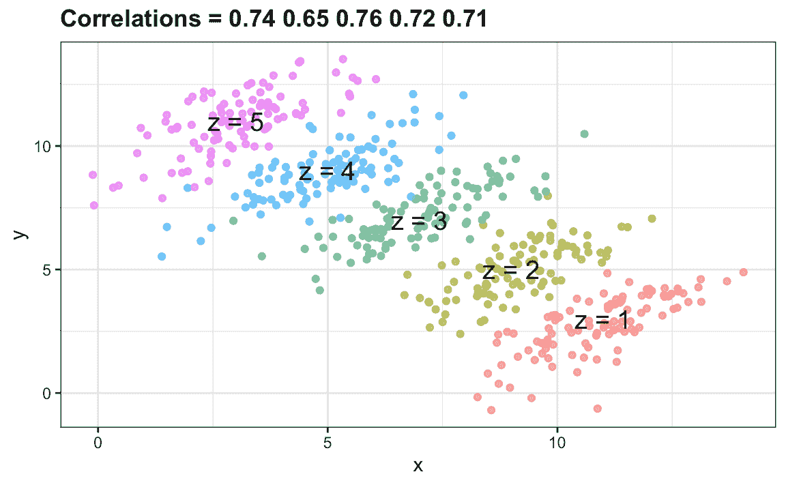

# 19  关联并非因果关系

> 原文：[`rafalab.dfci.harvard.edu/dsbook-part-2/linear-models/association-not-causation.html`](https://rafalab.dfci.harvard.edu/dsbook-part-2/linear-models/association-not-causation.html)

1.  线性模型

1.  19  关联并非因果关系

在本书的这一部分，我们专注于量化变量之间的*关联*的方法，即一个变量的变化如何与另一个变量的变化相关。线性模型、相关系数和假设检验都提供了正式描述和评估这些关系的方法。将此类结果解释为因果关系证据是诱人的，尤其是当发现似乎直观或符合我们的预期时。然而，这是一个严重的错误：*关联并非因果关系*。

统计工具可以揭示模式，但它们本身并不能确定这些模式存在的原因。确定因果关系需要观察到的经验关系之外的因素。至少，必须满足以下条件：

+   *经验关联:* 必须存在感兴趣变量之间的关系。

+   *时间优先性:* 原因必须在效果之前发生。

+   *剂量-反应关系:* 原因的*剂量*变化应导致效果的变化。

+   *可能性:* 必须有一个可信的机制来解释原因如何产生效果。

+   *排除其他解释:* 必须考虑并排除其他潜在原因，例如混杂因素。

本章的一个主要重点是*混杂因素*，这是两个变量即使没有因果关系也可能看起来相关的原因中最常见且最具欺骗性的原因之一。我们还讨论了其他可能产生误导性关联的几种情况，强调了谨慎解释的重要性。

最后，我们指出，随机对照试验，其中受试者随机分配到治疗，是推断数据因果关系的最可靠方式，因为随机化最小化了其他解释。然而，科学、医学和社会科学中的大多数分析都依赖于*观察性*或*现实世界*数据，在这些数据中不可能进行随机化，因果推断必须依赖于通常难以或无法验证的假设。理解这些限制对于负责任的数据分析至关重要。

## 19.1 假相关

以下这个滑稽的例子强调了相关性不等于因果关系的概念。它显示了离婚率和人造黄油消费之间非常强的相关性。


这是否意味着人造黄油消费导致离婚？或者离婚导致人们消费更多人造黄油？当然不是。这只是一个我们称之为*假相关*的例子。

你可以在 Spurious Correlations 网站上看到更多荒谬的例子¹。

网站上展示的案例都是通常被称为数据挖掘、数据钓鱼或数据窥探的实例。这基本上是美国所说的“挑拣樱桃”的一种形式。数据挖掘的一个例子可能是，如果你通过随机过程产生的许多结果中寻找，并挑选出那些显示支持你想要捍卫的理论的关联性的一个。

可以使用蒙特卡洛模拟来展示数据挖掘如何导致在非相关变量中找到高相关性。我们将把我们的模拟结果保存到 tibble 中：

```r
library(data.table)
library(ggplot2
N <- 25
g <- 1000000
sim_data <- data.table(group = rep(1:g, each = N), x = rnorm(N*g), y = rnorm(N*g))
```

注意我们创建了组，并为每个组生成了一对独立的向量，$X$和$Y$，每个向量有 25 个观测值。因为我们构建了模拟，所以我们知道$X$和$Y$是不相关的。

接下来，我们计算每个组中$X$和$Y$之间的相关性并寻找最大值：

```r
res <- sim_data, .(r = [cor(x, y)), by = group][order(-r)]
max(res$r)
#> [1] 0.814
```

我们看到了最大相关性为 0.81。如果你只绘制实现这一相关性的组的数据，它将显示一个令人信服的图表，表明$X$和$Y$实际上相关：

```r
sim_datagroup == res[[which.max(r), group]] |>
 ggplot(aes(x, y)) +
 geom_point() + 
 geom_smooth(formula = 'y ~ x', method = "lm")
```


```r
res |> ggplot(aes(x = r)) + geom_histogram(binwidth = 0.1, color = "black")
```


如果我们对这个组进行回归并解释 p 值，我们会错误地声称这是一个具有统计学意义的关联：

```r
library(broom)
sim_datagroup == res[which.max(r), group], broom::tidy([lm(y ~ x))][2,]
#> # A tibble: 1 × 5
#>   term  estimate std.error statistic     p.value
#>   <chr>    <dbl>     <dbl>     <dbl>       <dbl>
#> 1 x        0.794     0.118      6.73 0.000000732
```

这种被称为 p-hacking 的实践被广泛讨论，因为它可能会损害科学发现的可靠性。由于期刊通常更倾向于统计显著的结果而非无结果，研究人员有动力强调显著性。例如，在流行病学和社会科学等领域，分析师可能会探索结果与许多暴露之间的关联，但只报告那些具有较小 p 值的一个。同样，他们可能会尝试几种模型规格来调整混杂因素并选择给出最强结果的一个。在实验设置中，一项研究可能会重复多次，但只报告“成功”的运行。这些做法并不总是故意的违规行为；它们通常源于有限的统计理解或一厢情愿的思考。更高级的统计学课程涵盖了调整分析以考虑这些多重比较的方法。

## 19.2 个异常值

假设我们测量两个独立的结果，$X$和$Y$，并对每一组测量进行标准化。现在想象一下，我们犯了一个错误，忘记对其中一个值进行标准化，比如说第 23 个条目。我们可以通过以下模拟数据来展示这种情况：

```r
set.seed(1985)
x <- rnorm(100, 100, 1)
y <- rnorm(100, 84, 1)
x-23] <- [scale(x[-23])
y-23] <- [scale(y[-23])
```

数据看起来是这样的：

```r
plot(x, y)
```


```r
cor(x,y)
#> [1] 0.988
```

但是，这是由一个异常值驱动的。如果我们移除这个异常值，相关性会大大降低，几乎接近于 0，这正是它应有的样子：

```r
cor(x[-23], y[-23])
#> [1] -0.0442
```

对于估计对异常值稳健的总体相关性，存在一种不同于样本相关性的方法。它被称为*斯皮尔曼相关系数*。其思想很简单：计算值的排名之间的相关性。以下是排名相互之间绘制的图：

```r
plot(rank(x), rank(y))
```


```r
cor(rank(x), rank(y))
#> [1] 0.00251
```

斯皮尔曼相关系数也可以这样计算：

```r
cor(x, y, method = "spearman")
#> [1] 0.00251
```

虽然斯皮尔曼相关系数受异常值的影响较小，但这种稳健性是有代价的。因为它依赖于排名而不是实际值，所以对变量之间细微的线性关系不太敏感。因此，当确实存在但程度适中的相关性时，斯皮尔曼估计可能比皮尔逊相关系数更接近于零。在实践中，皮尔逊相关系数在检测没有异常值的数据中的真实线性关联时更有效，而斯皮尔曼相关系数在存在异常值或非线性单调关系时更受欢迎。** * *在推荐阅读部分，我们包括了关于对异常值稳健且适用于广泛情况的估计技术的参考文献。

## 19.3 因果倒置

另一种将关联与因果混淆的方式是当因果关系被倒置时。这种情况的一个例子是声称辅导使学生的表现更差，因为他们测试成绩低于未接受辅导的同伴。在这种情况下，辅导并不是导致低测试成绩的原因，而是相反。

这种说法实际上被一篇发表在《纽约时报》的社论中，标题为《家长的参与被高估了》²。考虑以下文章中的引用：

> > 当我们检查定期帮助做作业是否对儿童的学业表现有积极影响时，我们发现的结果让我们非常震惊。无论家庭的社会阶层、种族或民族背景，或孩子的年级水平如何，一致的作业帮助几乎从未提高过测试分数或成绩… 更令我们惊讶的是，当父母定期帮助做作业时，孩子们通常表现得更差。

一个非常可能的情况是，需要定期家长帮助的孩子，正是因为他们在学校表现不佳才得到这种帮助。

我们可以通过拟合回归

$$ X = \beta_0 + \beta_1 y + \varepsilon $$

到父亲-儿子身高数据中，其中 $X$ 和 $y$ 分别代表父亲和儿子的身高。在这里因果性地解释 $\beta_1$ 是倒退的，因为它会暗示儿子的身高决定了父亲的身高。使用先前定义的 `galton` 数据集，我们确实得到了一个具有统计学意义的斜率，这表明统计显著性并不等同于因果关系或正确的效应方向。

```r
tidy](https://generics.r-lib.org/reference/tidy.html)([lm(father ~ son, data = galton))[2,]
#> # A tibble: 1 × 5
#>   term  estimate std.error statistic       p.value
#>   <chr>    <dbl>     <dbl>     <dbl>         <dbl>
#> 1 son      0.407    0.0636      6.40 0.00000000136
```

该模型与数据拟合得非常好，估计值、标准误差和 p 值都正确地显示了儿子身高与父亲身高之间存在关联。然而，如果我们只看其数学公式，它很容易被误解为暗示儿子的身高导致了父亲的身高。根据我们对遗传学和生物学的了解，我们知道影响的方向是相反的。统计模型本身并没有错误，我们也没有编码错误。这里误导的是解释，而不是模型或计算。

## 19.4 混杂因子

混杂因子可能是导致关联被误解的最常见原因。

如果 $X$ 和 $Y$ 相关，我们称 $Z$ 为 *混杂因子*，如果它或与之相关的某个因素是 $X$ 和 $Y$ 的原因，从而在没有正确考虑 $Z$ 的情况下，在它们之间产生虚假的关联。

由于混杂因子导致的错误解释在大众媒体中普遍存在，并且它们往往很难检测。在这里，我们提供了一个与大学入学相关广泛使用的例子。

### 示例：加州大学伯克利分校的入学情况

1973 年从加州大学伯克利分校六个专业的入学数据中显示，男性被录取的人数多于女性：男性录取率为 44%，女性为 30%³。我们可以加载数据并计算一个统计检验，这明显拒绝了性别和录取独立性的假设：

```r
library(dplyr
two_by_two <- admissions |> group_by(gender) |> 
 summarize(total_admitted = round(sum(admitted / 100 * applicants)), 
 not_admitted = sum(applicants) - sum(total_admitted)) |>
 select(-gender) 
chisq.test(two_by_two)$p.value
#> [1] 1.06e-21
```

但更仔细的检查显示了一个矛盾的结果。以下是按专业划分的入学百分比：

```r
admissions |> select(major, gender, admitted) |>
 pivot_wider(names_from = "gender", values_from = "admitted") |>
 mutate(women_minus_men = women - men) |> print(n = 6)
#> # A tibble: 6 × 4
#>   major   men women women_minus_men
#>   <chr> <dbl> <dbl>           <dbl>
#> 1 A        62    82              20
#> 2 B        63    68               5
#> 3 C        37    34              -3
#> 4 D        33    35               2
#> 5 E        28    24              -4
#> 6 F         6     7               1
```

对于六个专业中的五个，差异很小，专业 A 倾向于女性。更重要的是，这些差异都远远小于在查看总体总数时观察到的男性 14.2 分的优势。

矛盾之处在于，分析总数似乎表明录取和性别之间存在依赖关系，但当数据按专业分组时，这种依赖关系似乎消失了。这是怎么回事？实际上，如果未计数的混杂因子驱动了大部分的变异性，这种情况就会发生。

发现混杂因子，以及理解它们如何导致误导性结论，通常需要探索性数据分析和分析性思维。查看上表，我们注意到不同专业之间的入学率存在很大的差异。这会不会影响整体结果？为了调查，我们在入学表中添加了一个 *选择性* 列，即每个专业内的整体入学率。

```r
admissions <- group_by(admissions, major) |>
 summarize(selectivity = sum(admitted*applicants/100)/sum(applicants)) |>
 right_join(admissions, by = "major")
```

接下来，我们考察申请人数与专业选择性之间的关系。如果选择性是一个混杂因素，那么不同选择性的专业之间可能存在性别差异的模式。

```r
admissions |>
 ggplot(aes(selectivity, applicants, label = major)) +
 geom_text() +
 facet_wrap(~gender) 
```


### 分层

对整体录取率的解释出现偏差的第一个迹象来自按专业进行分层。按已知或潜在的混杂因素进行分层是检查两个其他变量之间关系的一种强大技术。在探索性数据分析中，分层可以帮助我们检测混杂因素如何扭曲分析，并提供如何调整它的想法。

这里有一个例子，我们按专业进行分层绘制录取情况，并显示女性倾向于申请更选择性的专业：

```r
admissions |> ggplot(aes(major, admitted, col = gender, size = applicants)) + 
 geom_point()
```


### 辛普森悖论

我们刚刚讨论的案例是辛普森悖论的一个例子。它被称为悖论，因为我们发现在将整个出版物与特定层进行比较时，相关性的符号发生了翻转。作为一个说明性的例子，假设你有三个随机变量 $X$、$Y$ 和 $Z$，并且我们观察了这些变量的实现。以下是 $X$ 和 $Y$ 的模拟观察结果以及样本相关性的图表：


您可以看到 $X$ 和 $Y$ 是负相关的。然而，一旦我们按 $Z$ 进行分层（如下所示的不同颜色），另一种模式就会出现：



实际上，是 $Z$ 与 $X$ 负相关。如果我们按 $Z$ 进行分层，$X$ 和 $Y$ 实际上是正相关的，如上图所示。

## 19.5 其他偏差来源

我们讨论了混杂和反向因果关系，但还有许多其他机制可以产生非因果关联。例如，**碰撞偏差**发生在我们对受两个或更多其他变量影响的变量进行条件设定时，无意中诱导了它们之间虚假的关系。一个经典的例子是，在精英大学的学生中，有时观察到的学术能力和运动技能之间的负相关。在普通人群中，这些特征可能是独立的，但它们都增加了被录取的可能性。在录取这一碰撞条件下进行条件设定，可以创建一个虚假的负相关：在录取的学生中，那些不太擅长运动的人可能学术能力更强，反之亦然。在医院中也可能发生类似的效果，其中两种无关的健康状况，如糖尿病和心脏病，在患者中可能表现出负相关，仅仅是因为它们都增加了住院的可能性。

选择偏差**是另一个常见的虚假关联来源。它发生在确定谁或什么进入数据集的过程依赖于与暴露/治疗和结果都相关的因素时。例如，比较两家医院的死亡率可能会表明医院 A 提供的护理比医院 B 差。然而，如果医院 A 是一个主要创伤中心，治疗更严重病患，而医院 B 主要处理常规病例，那么这种比较是误导性的。这种差异反映了谁被接纳，而不是护理质量的差异。

测量偏差**（或称*误分类*）发生在变量测量出现误差时，尤其是在这些误差在不同群体之间存在差异时。考虑一项关于吸烟和肺癌的研究：如果一些参与者由于耻辱感而低估吸烟，吸烟者可能会被错误地归类为非吸烟者。如果这种低估在各个群体中均匀发生，那么偏差是*非差异性的*，往往会减弱观察到的关联。如果它在各个群体之间存在差异，例如，肺癌患者更有可能承认吸烟，那么偏差是*差异性的*，可能会夸大或甚至逆转关联。

对探索这些偏差来源（包括它们如何在因果图中表示）感兴趣并希望深入了解的读者，可以在*推荐阅读*部分找到推荐的参考文献。这些作品提供了识别和避免此类偏差的清晰解释和实用指导。

## 19.6 练习

对于下一组练习，我们检查了 2014 年 PNAS 论文⁴中的数据，该论文分析了荷兰资助机构的成功率，并得出以下结论：

> 我们的结果揭示了性别偏差，这种偏差在评估“研究人员的质量”（但不是“提案的质量”）以及成功率方面，以及在教学和评估材料中使用的语言上，都倾向于男性申请人而非女性申请人。

几个月后，一篇名为《在荷兰，性别对个人研究资金成功没有贡献：对 Van der Lee 和 Ellemers 的回应》的回应⁵被发表，其结论是：

> 然而，尽管样本量很大，整体性别效应几乎达到统计显著性。此外，他们的结论可能是辛普森悖论的典型例子；如果女性在更具竞争力的科学学科（即男女申请成功率都很低）中申请资助的比例更高，那么跨所有学科的分析可能会错误地显示出性别不平等的证据。

谁是正确的，原始论文还是回应？下面，你将检查数据并得出自己的结论。

1. 原始论文结论的主要证据依赖于百分比的比较。论文中的表 S1 包含了我们需要的信息：

```r
library(dslabs)
research_funding_rates
```

构建用于关于性别奖项差异结论的二维表。

2. 计算二维表中的百分比差异。

3. 在之前的练习中，我们注意到女性的成功率较低。但这是否具有统计学意义？使用卡方检验计算 p 值。

4. 我们看到 p 值大约是 0.05。因此，似乎有一些关联的证据。但在这里我们可以推断因果关系吗？性别偏见是否导致了这种观察到的差异？对原始论文的回应声称，我们在这里看到的是与加州大学伯克利分校招生例子相似的情况。具体来说，他们表示这“可能是辛普森悖论的典型例子；如果女性在更具竞争力的科学学科中申请资助的比例更高，那么跨所有学科的分析可能会错误地显示出性别不平等的证据。”为了解决这一争议，创建一个包含每个性别申请数量、奖项和成功率的数据库。按整体成功率重新排序学科。提示：首先使用`reorder`函数重新排序学科，然后使用`pivot_longer`、`separate`和`pivot_wider`创建所需的表格。

5. 为了检查这是否是辛普森悖论的情况，绘制成功率和学科的关系图，这些学科已经按整体成功率排序，颜色表示性别，大小表示申请数量。

6. 我们在加州大学伯克利分校的例子中并没有看到相同程度的混杂因素。很难说这里有一个明显的混杂因素。然而，我们确实看到，根据观察到的比率，某些领域可能更倾向于男性，而其他领域可能更倾向于女性。我们还看到，两个在男性偏好方面差异最大的领域也是申请最多的领域。但与加州大学伯克利分校的例子不同，女性不太可能申请难度较大的科目。是否有可能一些选拔委员会存在偏见，而另一些则没有？

为了回答这个问题，我们首先检查上述观察到的任何差异是否具有统计学意义。记住，即使没有偏差，我们也会因为审查过程中的随机变异性以及候选人之间的随机变异性而看到差异。对每个学科进行卡方检验。提示：定义一个函数，该函数接收一个 2x2 表的总量，并返回一个包含 p 值的 data frame。使用 0.5 校正。然后使用`summarize`函数。

7. 在医学科学中，似乎存在统计学上的显著差异，但这可能是虚假相关性吗？我们进行了 9 次测试。仅报告 p 值小于 0.05 的一个案例可能被认为是 cherry picking 的例子。重复上述练习，但用对数优势比除以其标准误差代替 p 值。然后使用 qq-plot 来查看这些对数优势比偏离我们预期标准正态分布的程度：一个标准正态分布。

* * *

1.  [虚假相关性](http://tylervigen.com/spurious-correlations)↩︎

1.  [家长参与被高估了](https://opinionator.blogs.nytimes.com/2014/04/12/parental-involvement-is-overrated)↩︎

1.  [`pubmed.ncbi.nlm.nih.gov/17835295/`](https://pubmed.ncbi.nlm.nih.gov/17835295/)↩︎

1.  [PNAS 112/40/12349 摘要](http://www.pnas.org/content/112/40/12349.abstract)↩︎

1.  [PNAS 112/51/E7036 提取](http://www.pnas.org/content/112/51/E7036.extract)↩︎
