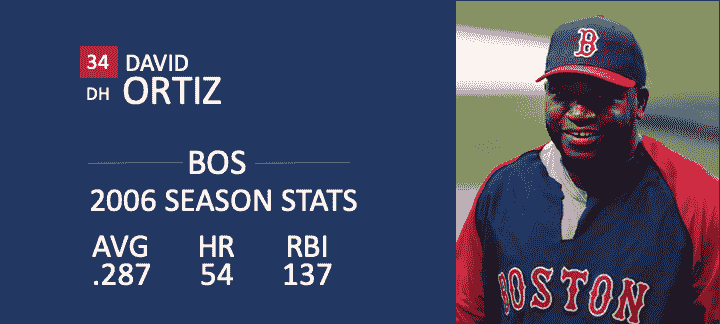
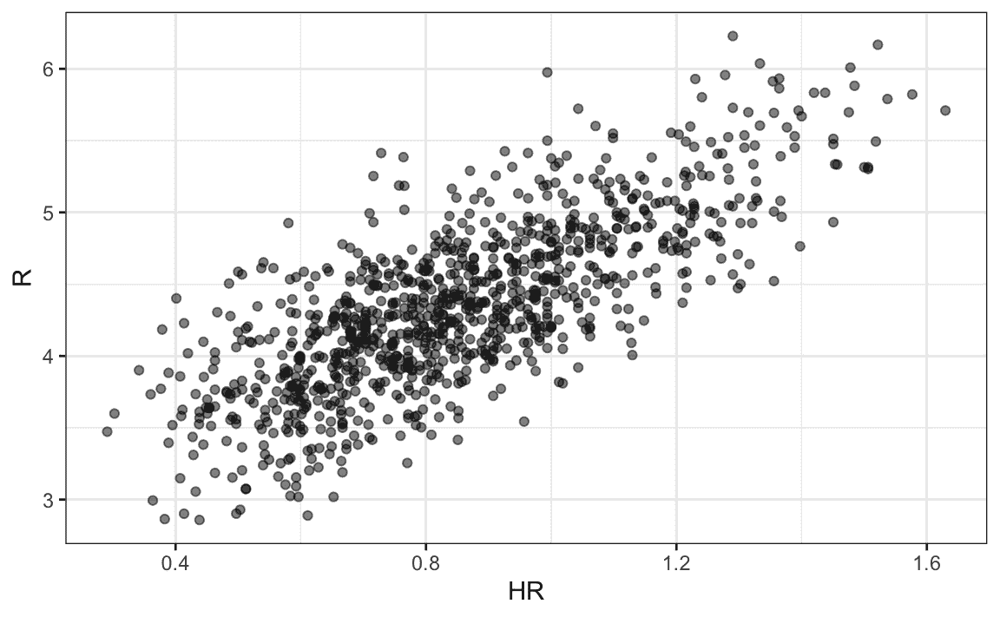
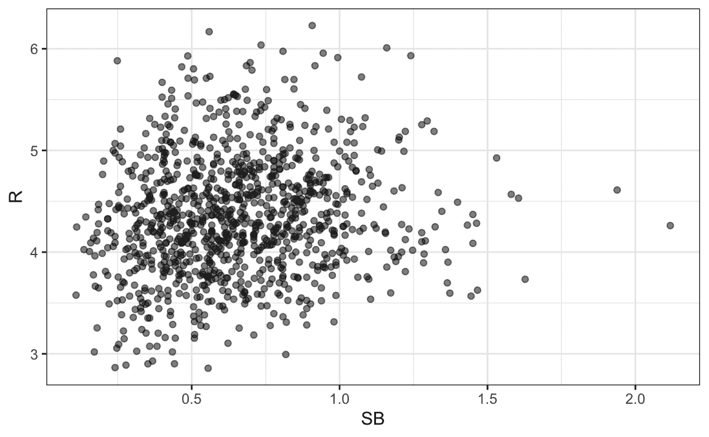
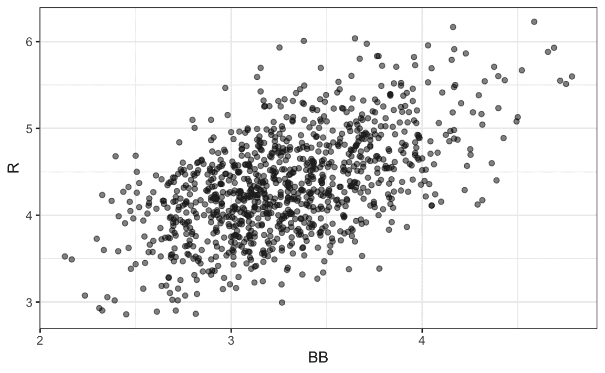
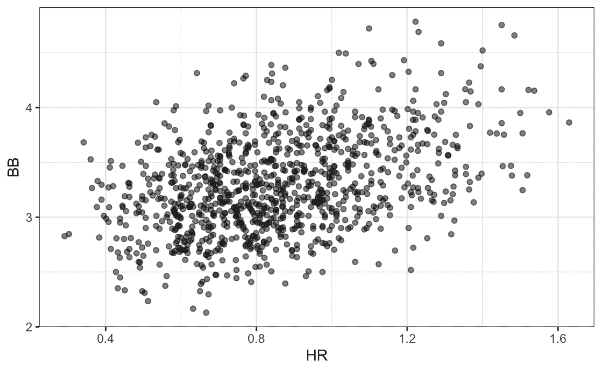
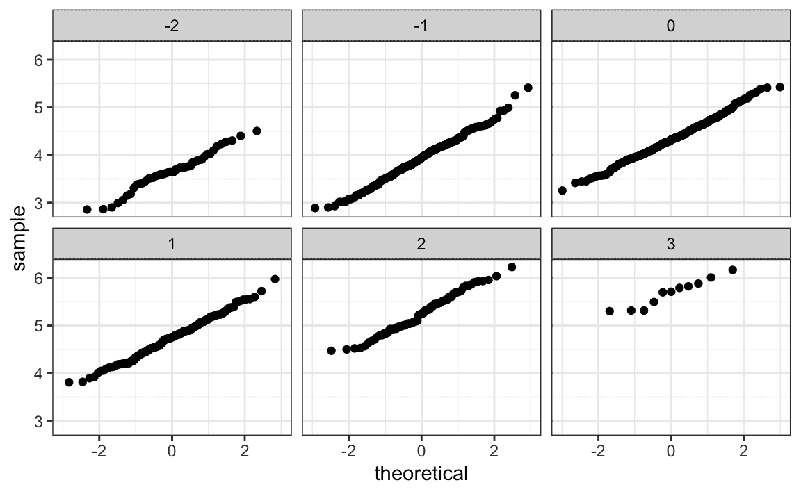
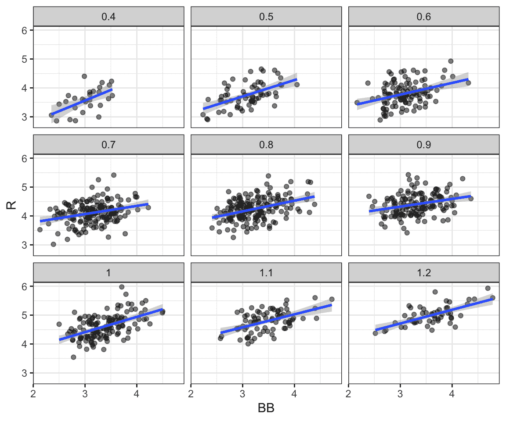
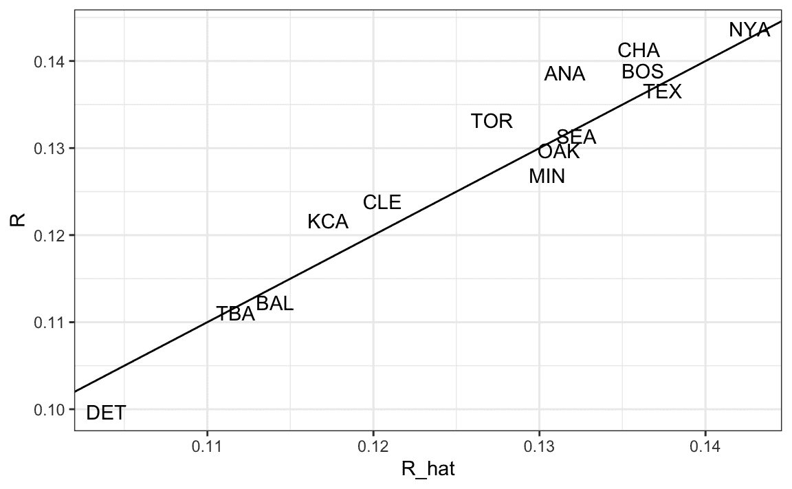
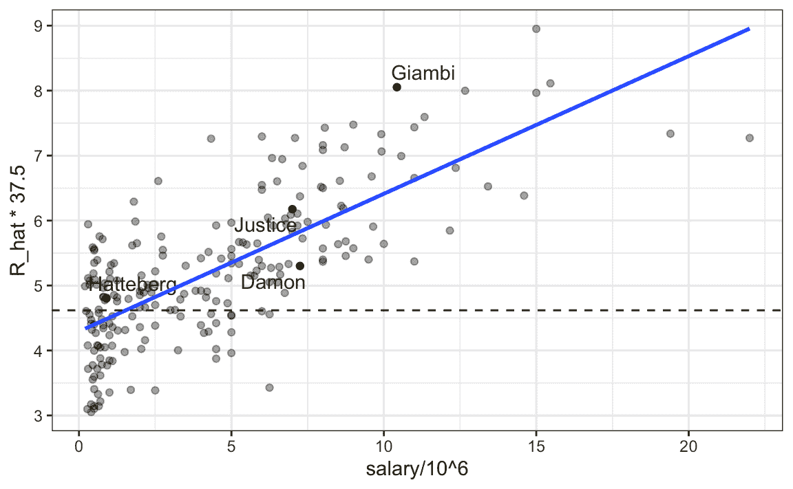

# 20 多元回归

> 原文：[`rafalab.dfci.harvard.edu/dsbook-part-2/linear-models/multivariable-regression.html`](https://rafalab.dfci.harvard.edu/dsbook-part-2/linear-models/multivariable-regression.html)

1.  线性模型

1.  20 多元回归

自从高尔顿最初的发展以来，回归分析已经成为数据分析中最广泛使用的工具之一。一个原因是基于线性模型的原始回归方法的改编，使我们能够找到两个变量之间的关系，同时考虑到影响这两个变量的其他变量的影响。这在随机实验难以进行的领域尤其受欢迎，如经济学和流行病学。

当我们无法随机将每个人分配到治疗组或对照组时，混杂因素变得尤为普遍。例如，考虑使用从纽约市随机抽样的人群收集的数据来估计吃快餐对预期寿命的影响。快餐消费者更有可能吸烟、饮酒，并且收入较低。因此，一个简单的回归模型可能会导致对快餐负面健康影响的过度估计。那么，我们在实践中如何考虑混杂因素呢？在本章中，我们学习如何使用 *多元回归* 来帮助处理这种情况，并可以用来描述一个或多个变量如何影响结果变量。我们通过一个现实世界的例子来说明，其中数据被用来帮助挑选被低估的球员，以改善资源有限的运动队。

## 20.1 案例研究：点球成金

*《点球成金：不公平游戏的胜利艺术》* 由迈克尔·刘易斯所著，聚焦于奥克兰运动家队（A's）及其总经理比利·比恩，他负责组建球队。

传统上，棒球队伍会使用 *球探* 来帮助他们决定聘请哪些球员。这些球探通过观察球员的表现来评估他们，往往更倾向于那些具有可观察的身体能力的运动员。因此，球探们通常对谁是最佳球员达成一致意见，结果这些球员往往需求量大。这反过来又推高了他们的薪水。

从 1989 年到 1991 年，奥克兰运动队（A's）拥有棒球界最高的薪资之一。他们能够雇佣最好的球员，在那段时间里，他们是最好的球队之一。然而，在 1995 年，A 队的所有者发生了变化，新管理层大幅削减了预算，当时的主管桑迪·阿尔德森（Sandy Alderson）成为了棒球界薪资最低的球队之一：例如，在 2002 年，纽约洋基队的薪资 125,928,583 美元是奥克兰运动队薪资 39,679,746 美元的三倍多。A 队再也负担不起最抢手的球员。因此，阿尔德森开始使用统计方法来寻找市场中的低效之处。阿尔德森是比利·比恩的导师，比恩在 1998 年接替了他的位置，并完全接受了数据科学，而不是仅仅依赖球探，作为寻找低成本球员的方法，这些球员的数据预测将有助于球队获胜。如今，这种策略已被大多数棒球球队采用。正如我们将看到的，回归在这一方法中发挥着重要作用。在本节中，我们将展示如何使用数据来支持这一方法。

### 棒球数据

自棒球诞生以来，统计数据就已经被记录。我们将使用的数据库，包含在**Lahman**库中，可以追溯到 19 世纪。例如，我们很快将要描述的汇总统计量，*打击率*（AVG），几十年来一直被用来总结球员的成功。其他统计数据¹，如本垒打（HR）和跑垒得分（RBI），在新闻媒体体育版块的游戏总结中为每位球员报告，高数值的球员会得到奖励。尽管像这样的汇总统计数据在棒球中得到了广泛应用，但数据分析本身并没有。这些统计数据是随意选择的，没有充分考虑它们是否真的预测了任何事情，或者是否与帮助球队获胜有关。

这种情况随着比尔·詹姆斯²的出现而改变。在 20 世纪 70 年代末，他开始发表文章，描述对棒球数据的更深入分析。他将使用数据来确定哪些结果最能预测一支球队是否会获胜的方法命名为 *sabermetrics*³。然而，直到比利·比恩将 sabermetrics 作为其棒球运营的核心，比尔·詹姆斯的工作在棒球界基本上被忽视。如今，sabermetrics 已不再局限于棒球；其原则已扩展到其他运动，现在被称为 *体育分析*。

在本章中，我们将进行数据分析，以评估比利·比恩的关键策略之一，即雇佣“上垒”的球员，在统计上是否有效。我们将分解这一概念的含义，并通过多元回归的视角，证明这不仅从统计上是有效的，而且是一种经济上有效的方法。为了理解这一分析，我们需要了解一些棒球运作的基本知识。

### 棒球基础

要理解回归如何帮助我们找到被低估的球员，我们不需要深入了解棒球这项拥有超过 100 条规则的运动的全部细节。在这里，我们提炼出有效应对数据科学挑战所需的基本知识。

棒球的目标很简单：比对方得分更多（得分）。球员通过从称为*本垒板*的位置开始，依次通过三个*垒*（一垒、二垒和三垒），然后返回本垒板来得分。比赛开始于对方队伍的*投手*将球投向站在本垒板上的*打击手*，打击手试图击球。如果打击手一击中的球足够远，可以在一次击球中跑遍所有三个垒并回到本垒板，这被称为*全垒打*。如果打击手没有击出全垒打，他们将停在某个垒上。从那里，他们等待队友击球，以便他们可以移动到下一个垒。如果投手投球不佳，打击手将作为惩罚走到一垒，这被称为保送（BB）。在垒上的球员可以尝试在不等待队友击球的情况下跑向下一个垒。这被称为*偷垒*（SB）。

打击手也可能未能到达垒，导致出局。另一种出局的方式是偷垒失败。每个队伍继续打击，直到累积三个出局。一旦发生这种情况，另一队将轮到打击。每个队伍有九次打击机会，称为局，以得分。

每次打击手尝试到达垒，目标是最终得分，这被称为*击球上垒*（PA）。在罕见的情况下，有五种成功的方式：

1.  *单打* – 打击手到达一垒。

1.  *双打* – 打击手到达二垒。

1.  *三垒打* – 打击手到达三垒。

1.  *全垒打（HR）* – 打击手绕过所有垒并回到本垒板。

1.  *保送（BB）* – 投手投球不佳，打击手被允许走到一垒以惩罚投手。

前四种结果（单打、双打、三打和全垒打）都被认为是*击球*，而保送不是。这种区别对于理解后续的数据和分析非常重要。

### 没有基于球的奖项

从历史上看，*打击率*（AVG）一直被认为是进攻统计中最重要的一项。为了定义这个平均数，我们将总击数（H）除以总打击数（AB），定义为获得击球或出局的总次数；保送除外。今天，这个成功率在 20%到 38%之间。



比尔·詹姆斯的第一个重要洞察之一是，击球平均数忽略了保送（BB），但保送也是一种成功。詹姆斯没有使用击球平均数，而是提出了使用*上垒率*（OBP），他将其定义为（H+BB）/PA，或者简单地说是没有导致出局的上垒次数的比例，这是一个非常直观的度量。他指出，如果一个球员的保送次数远多于平均水平，那么如果击球手在击球平均数上没有表现出色，他可能会被忽视。

但是，这位球员不是在帮助产生得分吗？虽然最高的平均数获得了*击球冠军*奖项，但获得最多保送数的球员没有获得任何奖项。然而，坏习惯很难改掉，棒球并没有立即将 OBP 视为一个重要的统计数据。我们可以使用数据来尝试证明保送确实有助于产生得分，并且应该被重视。

### 使用棒球数据

为了说明数据如何用于回答棒球中的问题，我们从一个简单的例子开始。我们将比较保送和盗垒（SB）。与保送不同，总盗垒数被认为很重要，并且授予了获得最多盗垒数的球员奖项⁶。但是，拥有高盗垒总数的球员也做出了更多的出局，因为他们并不总是成功。拥有高盗垒总数的球员是否有助于产生得分？我们能否使用数据来确定支付高保送或高盗垒球员是否更好？

在这项分析中，一个挑战是，确定一个球员是否产生得分并不明显，因为这很大程度上取决于他的队友。虽然我们记录了球员得分的次数，但请记住，如果球员 X 在击出很多全垒打的球员之前击球，球员 X 将获得很多得分。注意，这些得分并不一定会在我们雇佣球员 X 而不是他的全垒打击球队友时发生。

然而，我们可以考察团队层面的统计数据。拥有许多盗垒的球队与拥有很少盗垒的球队相比如何？保送呢？让我们看看一些数据！我们首先创建一个包含从 1962 年（所有球队首次像今天一样打 162 场比赛的第一年）到 2001 年（Money Ball 中球队组建的前一年）的统计数据的数据框。我们将数据转换为*每场比赛*的比率，因为由于罢工，一小部分赛季的比赛少于平常，而一些球队由于平局决定者而进行了额外的比赛。我们还定义了一个`单打`列，以供以后使用。

```r
[library](https://rdrr.io/r/base/library.html)([tidyverse](https://tidyverse.tidyverse.org))
[library](https://rdrr.io/r/base/library.html)([Lahman](https://cdalzell.github.io/Lahman/))
dat <- Teams |> [filter](https://dplyr.tidyverse.org/reference/filter.html)(yearID [%in%](https://rdrr.io/r/base/match.html) 1962:2001) |>
 [mutate](https://dplyr.tidyverse.org/reference/mutate.html)(singles = H - X2B - X3B - HR) |>
 [select](https://dplyr.tidyverse.org/reference/select.html)(teamID, yearID, G, R, SB, singles, BB, HR) |>
 [mutate](https://dplyr.tidyverse.org/reference/mutate.html)([across](https://dplyr.tidyverse.org/reference/across.html)(-[c](https://rdrr.io/r/base/c.html)(teamID, yearID), ~ ./G)) |> [select](https://dplyr.tidyverse.org/reference/select.html)(-G)
```

*现在让我们从一个问题开始：击出更多全垒打的球队是否得分更多？

```r
dat |> [ggplot](https://ggplot2.tidyverse.org/reference/ggplot.html)([aes](https://ggplot2.tidyverse.org/reference/aes.html)(HR, R)) + [geom_point](https://ggplot2.tidyverse.org/reference/geom_point.html)(alpha = 0.5)
```

**  *这个图显示了强烈的关联：拥有更多全垒打的球队往往得分更多。现在让我们考察盗垒和得分之间的关系：

```r
dat |> [ggplot](https://ggplot2.tidyverse.org/reference/ggplot.html)([aes](https://ggplot2.tidyverse.org/reference/aes.html)(SB, R)) + [geom_point](https://ggplot2.tidyverse.org/reference/geom_point.html)(alpha = 0.5)
```

**  *这里的关系并不那么明显。

最后，让我们考察保送和得分之间的关系：

```r
dat |> [ggplot](https://ggplot2.tidyverse.org/reference/ggplot.html)([aes](https://ggplot2.tidyverse.org/reference/aes.html)(BB, R)) + [geom_point](https://ggplot2.tidyverse.org/reference/geom_point.html)(alpha = 0.5)
```

**  *在这里，我们再次看到了明显的关联。但这是否意味着增加一支球队的保送数会导致得分增加？正如我们在第十九章中学到的，关联并不等同于因果关系。实际上，保送和全垒打之间似乎也存在关联：

```r
dat |> [ggplot](https://ggplot2.tidyverse.org/reference/ggplot.html)([aes](https://ggplot2.tidyverse.org/reference/aes.html)(HR, BB)) + [geom_point](https://ggplot2.tidyverse.org/reference/geom_point.html)(alpha = 0.5)
```

**  *我们知道全垒打会导致得分，因为当一名球员击出全垒打时，他们至少能保证得到一分。这可能意味着全垒打也会导致保送，这使得保送看起来像是导致得分的原因？保送和全垒打是*共同原因*吗？线性回归可以帮助我们解析信息并量化关联。这反过来又可以帮助我们确定要招募哪些球员。具体来说，我们将尝试预测如果我们增加保送数但保持全垒打数不变，球队将多得分？*****

### ***应用于棒球统计的回归分析***

***我们可以使用这些数据进行回归分析吗？首先，注意上面显示的全垒打和得分数据似乎呈双变量正态分布。具体来说，qq 图确认正态分布是每个全垒打层得分分布的有用近似：

```r
dat |> [mutate](https://dplyr.tidyverse.org/reference/mutate.html)(hr_strata = [round](https://rdrr.io/r/base/Round.html)([scale](https://rdrr.io/r/base/scale.html)(HR))) |>
 [filter](https://dplyr.tidyverse.org/reference/filter.html)(hr_strata [%in%](https://rdrr.io/r/base/match.html) -2:3) |>
 [ggplot](https://ggplot2.tidyverse.org/reference/ggplot.html)() + 
 [stat_qq](https://ggplot2.tidyverse.org/reference/geom_qq.html)([aes](https://ggplot2.tidyverse.org/reference/aes.html)(sample = R)) +
 [facet_wrap](https://ggplot2.tidyverse.org/reference/facet_wrap.html)(~hr_strata) 
```

**  *因此，我们准备使用线性回归来预测一支球队将得多少分，如果我们知道球队使用回归击出的全垒打数：

```r
hr_fit  <- [lm](https://rdrr.io/r/stats/lm.html)(R ~ HR, data = dat)
[summary](https://rdrr.io/r/base/summary.html)(hr_fit)$coef[2,]
#>   Estimate Std. Error    t value   Pr(>|t|) 
#>   1.86e+00   4.97e-02   3.74e+01  8.90e-193
```

*估计斜率为 1.86。这意味着，平均而言，每场比赛多击出一支全垒打的球队，比同样比赛数但全垒打数少的球队每场比赛多得 1.86 分。考虑到许多比赛仅由一分决定，这种差异可以转化为大幅增加胜利。不出所料，全垒打打者非常昂贵。因为亚特兰大勇士队正在预算限制下工作，他们需要找到其他方法来增加胜利。在下一节中，我们将更仔细地考察这一点。*****

## ***20.2 混淆***

***之前，我们注意到得分和保送之间存在强烈的关联。如果我们找到从保送预测得分的回归线，我们得到斜率为：

```r
bb_slope <- [lm](https://rdrr.io/r/stats/lm.html)(R ~ BB, data = dat)$coef[2]
bb_slope 
#>    BB 
#> 0.743
```

*这意味着如果我们去雇佣低薪但保送数多的球员，并且每场比赛增加两次保送，我们的球队每场比赛将多得 1.5 分吗？关联并不等同于因果关系：尽管数据显示，一支每场比赛比平均球队多两个保送数的球队，每场比赛多得 1.5 分，但这并不意味着保送是原因。

注意，如果我们计算单打的回归线斜率，我们得到：

```r
[lm](https://rdrr.io/r/stats/lm.html)(R ~ singles, data = dat)$coef[2]
#> singles 
#>   0.452
```

*这个值比我们得到的保送数要低。记住，单打和保送一样，都能让你上到一垒。棒球迷会指出，与保送相比，有跑者的单打有更好的得分机会。那么，为什么保送能更好地预测得分呢？原因在于混淆。

这里我们展示了全垒打、保送和单打之间的相关性：

```r
dat |> [select](https://dplyr.tidyverse.org/reference/select.html)(singles, BB, HR) |> [cor](https://rdrr.io/r/stats/cor.html)()
#>         singles      BB     HR
#> singles  1.0000 -0.0495 -0.171
#> BB      -0.0495  1.0000  0.406
#> HR      -0.1714  0.4064  1.000
```

*打击率（HR）和保送（BB）高度相关！专家们会指出，投手会被擅长打击 HR 的球员吓倒，这导致投手的表现不佳，从而获得保送。因此，打击 HR 的球员往往会有更多的保送，拥有许多 HR 的球队也会有更多的保送。尽管看起来保送会导致得分，但实际上是 HR 导致了这些得分的大部分。保送和 HR 是*混淆*的。尽管如此，保送是否仍然有帮助？为了找出答案，我们必须要调整 HR 的影响。多元回归可以帮助我们做到这一点。

一种方法是保持 HR 在某个固定值，然后检查 BB 和得分之间的关系。就像我们按最接近的英寸对父亲进行分层时做的那样，这里我们可以按每场比赛最接近的十分之一对 HR 进行分层。我们过滤掉点数很少的分层，以避免高度可变的估计，然后为每个分层制作散点图：

```r
dat |> [mutate](https://dplyr.tidyverse.org/reference/mutate.html)(hr_strata = [round](https://rdrr.io/r/base/Round.html)(HR, 1)) |> 
 [filter](https://dplyr.tidyverse.org/reference/filter.html)(hr_strata >= 0.4 & hr_strata <= 1.2) |>
 [ggplot](https://ggplot2.tidyverse.org/reference/ggplot.html)([aes](https://ggplot2.tidyverse.org/reference/aes.html)(BB, R)) + 
 [geom_point](https://ggplot2.tidyverse.org/reference/geom_point.html)(alpha = 0.5) +
 [geom_smooth](https://ggplot2.tidyverse.org/reference/geom_smooth.html)(formula = "y~x", method = "lm") +
 [facet_wrap](https://ggplot2.tidyverse.org/reference/facet_wrap.html)(~hr_strata) 
```

**  *一旦我们根据 HR 进行分层，这些斜率就会显著降低：

```r
dat |> [mutate](https://dplyr.tidyverse.org/reference/mutate.html)(hr_strata = [round](https://rdrr.io/r/base/Round.html)(HR, 1)) |> 
 [filter](https://dplyr.tidyverse.org/reference/filter.html)(hr_strata >= 0.5 & hr_strata <= 1.2) |> 
 [group_by](https://dplyr.tidyverse.org/reference/group_by.html)(hr_strata) |>
 [summarize](https://dplyr.tidyverse.org/reference/summarise.html)(coef = [lm](https://rdrr.io/r/stats/lm.html)(R ~ BB)$coef[2])
#> # A tibble: 8 × 2
#>   hr_strata  coef
#>       <dbl> <dbl>
#> 1       0.5 0.566
#> 2       0.6 0.405
#> 3       0.7 0.284
#> 4       0.8 0.370
#> 5       0.9 0.266
#> # ℹ 3 more rows
```

*记住，用保送预测得分的回归斜率是 0.7。

斜率降低了，但不是 0，这表明 BB 对于产生得分是有帮助的，只是没有单变量分析所暗示的那么多。事实上，上面的值更接近我们从单打中获得的斜率，0.5，这与我们的直觉更一致。由于单打和保送都能让我们到达一垒，它们应该具有大约相同的预测能力。

虽然我们的应用理解告诉我们 HR 会导致保送，而不是反过来，我们仍然可以检查按 BB 分层是否会使 BB 的效果降低。为此，我们使用相同的代码，只是交换了 HR 和 BB。在这种情况下，斜率与原始值变化不大：

```r
dat |> [mutate](https://dplyr.tidyverse.org/reference/mutate.html)(bb_strata = [round](https://rdrr.io/r/base/Round.html)(BB, 1)) |> 
 [filter](https://dplyr.tidyverse.org/reference/filter.html)(bb_strata >= 2.5 & bb_strata <= 3.2) |> 
 [group_by](https://dplyr.tidyverse.org/reference/group_by.html)(bb_strata) |>
 [summarize](https://dplyr.tidyverse.org/reference/summarise.html)(coef = [lm](https://rdrr.io/r/stats/lm.html)(R ~ HR)$coef[2])
#> # A tibble: 8 × 2
#>   bb_strata  coef
#>       <dbl> <dbl>
#> 1       2.5  1.98
#> 2       2.6  1.07
#> 3       2.7  1.61
#> 4       2.8  1.50
#> 5       2.9  1.57
#> # ℹ 3 more rows
```

*它们从 1.86 略微降低，这与保送确实会导致一些得分的事实一致。

不论如何，如果我们按 HR 分层，我们就有得分与 BB 的双变量分布。同样，如果我们按 BB 分层，我们就有 HR 与得分的大致双变量正态分布。*********

## ***20.3 多元回归***

***计算每个分层的回归线有些复杂。我们实际上是在拟合如下模型：

\[ \mathrm{E}[R \mid BB = x_1, \, HR = x_2] = \beta_0 + \beta_1(x_2) x_1 + \beta_2(x_1) x_2 \]

对于不同的 \(x_2\) 值，\(x_1\) 的斜率会发生变化，反之亦然。但是，有没有更简单的方法呢？

如果我们考虑随机变异性，分层中的斜率似乎没有太大变化。如果这些斜率实际上相同，这表明 \(\beta_1(x_2)\) 和 \(\beta_2(x_1)\) 是常数。这反过来又表明，在 HR 和 BB 条件下的得分期望可以写成以下形式：

\[ \mathrm{E}[R \mid BB = x_1, \, HR = x_2] = \beta_0 + \beta_1 x_1 + \beta_2 x_2 \]

该模型表明，如果 HR 的数量固定在\(x_2\)，我们观察到得分和 BB 之间存在线性关系，截距为\(\beta_0 + \beta_2 x_2\)。我们的探索性数据分析表明情况确实如此。该模型还表明，随着 HR 数量的增加，截距的增长也是线性的，并由\(\beta_1\)决定。在这项分析中，被称为*多元回归*，你经常会听到人们说 BB 斜率\(\beta_1\)是针对 HR 效应进行调整的。

由于数据近似正态分布，并且条件分布也是正态的，因此我们使用线性模型是合理的：

\[ Y_i = \beta_0 + \beta_1 x_{i1} + \beta_2 x_{i2} + \varepsilon_i \]

以\(Y_i\)表示球队\(i\)每场比赛的得分，\(x_{i,1}\)表示每场比赛的 BB，\(x_{i,2}\)表示每场比赛的 HR，以及\(\varepsilon_i\)假设是独立同分布的。这符合我们的线性模型框架，这意味着我们可以使用`lm`来拟合模型。

要在这里使用`lm`，我们需要让函数知道我们有两个预测变量。我们使用以下`+`符号：

```r
fit <- [lm](https://rdrr.io/r/stats/lm.html)(R ~ BB + HR, data = dat)
[summary](https://rdrr.io/r/base/summary.html)(fit)$coef[2:3,]
#>    Estimate Std. Error t value  Pr(>|t|)
#> BB    0.391     0.0273    14.3  1.55e-42
#> HR    1.570     0.0495    31.7 2.39e-153
```

*当我们只使用一个变量拟合模型时，估计的斜率分别为 BB 的 0.74 和 HR 的 1.86。请注意，在拟合多元模型时，这两个斜率都会下降，其中 BB 效应下降得更多。

*如果你想在继续之前练习，请完成练习 1-12。*****

## ****20.4 案例研究继续：点球大战****

在上一节中，我们使用了多元回归来确认步行（BB）是得分的重要预测因子。在本节中，我们将采用数据驱动的方法来开发一个用于评估棒球运动员进攻产出的指标。具体来说，我们将构建一个回归模型，根据运动员的进攻统计数据预测其贡献的得分数量。通过将薪资信息纳入这一分析，我们可以识别出 2002 年那些预计能产生得分但薪酬不足的球员。重要的是，这一分析使用的数据排除了 2002 赛季的数据，以模拟为即将到来的赛季组建球队时的挑战。

在个人球员层面，区分*得分*和*产出*对于准确评估进攻贡献至关重要。虽然*得分*是直接记录的，但它们并不能完全捕捉到球员的影响程度。例如，如果球员 X 击出一垒打并在队友的轰出本垒打后得分，这个得分会被归功于球员 X，但队友的努力对于这一得分的发生是至关重要的。这种重叠突出了进攻产出的共享性质，使得个人表现分析变得复杂。

### 建模球队得分产出

为了解决这个问题，我们首先将在*团队层面*拟合模型，这样个人层面的细微差别就会平均化，不会影响整体结果。一旦模型在团队层面得到验证，我们就会将其应用于估计球员层面的贡献。

*球队被分为两个联盟，美国联盟和国家联盟。由于在所讨论的时期内它们有略微不同的规则，我们将模型仅拟合到美国联盟（AL），在那里奥克兰运动家队比赛。* *由于球队累积的击球次数远多于个人球员，我们将以每击球次数（PA）的比率来建模。这使我们能够将模型拟合到球队并应用于球员。此外，由于三垒打相对较少，我们将它们与二垒打合并为一个单独的分类，*额外垒（XB）*，以简化模型。由于先前分析表明它们与得分增加的相关性不可靠，我们将排除盗垒。因此，模型中的预测因子包括：全垒打（BB）、单打、额外垒（XB）和本垒打（HR）。以下是该模型的数据准备步骤：

```r
dat <- Teams |> 
 [filter](https://dplyr.tidyverse.org/reference/filter.html)(yearID [%in%](https://rdrr.io/r/base/match.html) 1962:2002 & lgID == "AL") |>
 [mutate](https://dplyr.tidyverse.org/reference/mutate.html)(XB = X2B + X3B, singles = H - XB - HR, PA = AB + BB) |>
 [select](https://dplyr.tidyverse.org/reference/select.html)(yearID, teamID, R, BB, singles, XB, HR, PA) |>
 [mutate](https://dplyr.tidyverse.org/reference/mutate.html)([across](https://dplyr.tidyverse.org/reference/across.html)(-[c](https://rdrr.io/r/base/c.html)(yearID, teamID, PA), ~ ./PA)) 
```

*为了构建模型，我们做出一个合理的假设，即我们的结果变量（每击球次数的得分）和四个预测变量（BB、单打、额外垒和本垒打）是*联合正态分布的*。这意味着对于任何单个预测变量，当其他预测变量保持不变时，它与结果之间的关系是线性的。在这个假设下，线性回归模型可以表示为：*

\[ Y_i = \beta_0 + \beta_1 x_{i1} + \beta_2 x_{i2} + \beta_3 x_{i3}+ \beta_4 x_{i4} + \varepsilon_i \]

其中 \(Y_i\) 代表每击球次数产生的得分，\(x_{i1}, x_{i2}, x_{i3}, x_{i4}\) 分别代表每击球次数的全垒打、单打、额外垒和本垒打。

我们可以在 2002 赛季之前拟合模型，因为我们是在赛季开始之前用我们拥有的信息为 2002 年组建球队的：

```r
fit <- dat |> [filter](https://dplyr.tidyverse.org/reference/filter.html)(yearID < 2002) |> [lm](https://rdrr.io/r/stats/lm.html)(R ~ BB + singles + XB + HR, data = _)
```

*我们注意到拟合的模型对全垒打（BB）和单打赋予了相似的权重：*

```r
fit$coefficients[-1]
#>      BB singles      XB      HR 
#>   0.454   0.586   0.914   1.452
```

*这证实了我们的怀疑，即步行得分在为球队产生得分方面几乎与单打一样有价值。****

### ****模型诊断****

****由于此模型并非源自任何基本物理定律，因此检查它是否充分拟合数据并且可用于预测是至关重要的。我们将完整的诊断评估留作练习，但在此我们展示一个关键评估：测试在 2002 年之前拟合到数据中的模型是否可以成功预测 2002 年的球队表现。*

*为了做到这一点，我们使用拟合的模型来估计每个球队在 2002 赛季的预期得分次数：*

```r
R_hat <- dat |> [filter](https://dplyr.tidyverse.org/reference/filter.html)(yearID == 2002) |> [predict](https://rdrr.io/r/stats/predict.html)(fit, newdata = _)
```

*结果显示，该模型在 1962-2001 年的数据上训练得非常好，可以预测 2002 年球队的得分：*

*****

### ****基于模型的球员指标****

现在让我们将模型应用于球员。`Batting`数据框包括球员特定的统计数据。我们准备数据，以便保存模型拟合时的相同每 PA（每击球机会）率。由于球员的能力会随时间变化，我们只使用接近 2002 年的数据，但为了提高估计的精确度，我们使用 2002 年之前的三年数据，而不是仅仅使用 2001 年的数据。我们还排除了击球机会少于 100 次的球员，以避免不精确的总结：

```r
players <- Batting |> 
 [filter](https://dplyr.tidyverse.org/reference/filter.html)(yearID [%in%](https://rdrr.io/r/base/match.html) 1999:2001) |> 
 [group_by](https://dplyr.tidyverse.org/reference/group_by.html)(playerID) |>
 [summarize](https://dplyr.tidyverse.org/reference/summarise.html)(XB = [sum](https://rdrr.io/r/base/sum.html)(X2B + X3B), PA = [sum](https://rdrr.io/r/base/sum.html)(AB + BB), HR = [sum](https://rdrr.io/r/base/sum.html)(HR), H = [sum](https://rdrr.io/r/base/sum.html)(H), 
 singles = H - XB - HR, BB = [sum](https://rdrr.io/r/base/sum.html)(BB), AVG = [sum](https://rdrr.io/r/base/sum.html)(H)/[sum](https://rdrr.io/r/base/sum.html)(AB)) |>
 [filter](https://dplyr.tidyverse.org/reference/filter.html)(PA >= 100) |>
 [mutate](https://dplyr.tidyverse.org/reference/mutate.html)([across](https://dplyr.tidyverse.org/reference/across.html)(-[c](https://rdrr.io/r/base/c.html)(playerID, PA, AVG), ~ ./PA)) 
```

现在统计数据是每 PA（每击球机会）率，我们可以使用拟合到团队级数据的模型来预测每位球员将产生多少每 PA（每击球机会）跑动：

```r
players$R_hat <- [predict](https://rdrr.io/r/stats/predict.html)(fit, players)
```*****

### 实践中的《点球成金》

在之前显示预测和观察到的跑动的散点图中，我们看到尽管奥克兰的工资支出在联盟中属于最低之一，但他们的表现却是一个高于平均水平的进攻球队。在这里，我们描述了他们如何实现这一点的细节。

在构建了一个模型来估算每位球员预期跑动贡献之后，我们现在可以将其应用于现实世界的决策中，就像 2002 赛季的奥克兰运动队所做的那样。为了将我们的预测置于适当的背景中，我们需要将性能指标与关于球员的额外信息相结合，包括他们的薪水和使用状态。这使我们能够不仅确定谁是最有生产力的，而且谁能为球队有限的预算提供最大的*价值*。

为了做到这一点，我们将我们的球员级性能估计与来自`Salary`（薪水）、`People`（人员）和`Appearances`（出场）表的数据合并。这些数据集包括合同信息、传记细节和位置数据，这些数据共同为在现实团队组建场景中评估和比较球员提供了基础。

我们首先添加了球员在 2002 年获得的薪水，并排除了在那个赛季没有出场的球员：

```r
players <-  Salaries |> 
 [filter](https://dplyr.tidyverse.org/reference/filter.html)(yearID == 2002) |> 
 [select](https://dplyr.tidyverse.org/reference/select.html)(playerID, salary) |>
 [right_join](https://dplyr.tidyverse.org/reference/mutate-joins.html)(players, by = "playerID") |>
 [filter](https://dplyr.tidyverse.org/reference/filter.html)((salary))
```

然后，我们添加他们的名字和姓氏以提供背景信息。此外，由于美国职业棒球大联盟的球员在积累了六年的比赛时间并成为自由球员之前不能谈判合同或选择他们要为哪个球队效力，因此我们包括他们的首次亮相年份，因为在我们的分析中需要考虑这一点。

```r
players <- People |> 
 [select](https://dplyr.tidyverse.org/reference/select.html)(playerID, nameFirst, nameLast, debut) |>
 [mutate](https://dplyr.tidyverse.org/reference/mutate.html)(debut = [year](https://lubridate.tidyverse.org/reference/year.html)([as.Date](https://rdrr.io/r/base/as.Date.html)(debut))) |>
 [right_join](https://dplyr.tidyverse.org/reference/mutate-joins.html)(players, by = "playerID")
```

最后，我们移除了投手，因为我们只对击球手感兴趣。

```r
players <- Appearances |> [filter](https://dplyr.tidyverse.org/reference/filter.html)(yearID == 2002) |> 
 [group_by](https://dplyr.tidyverse.org/reference/group_by.html)(playerID) |>
 [summarize](https://dplyr.tidyverse.org/reference/summarise.html)(G_p = [sum](https://rdrr.io/r/base/sum.html)(G_p)) |>
 [right_join](https://dplyr.tidyverse.org/reference/mutate-joins.html)(players, by = "playerID") |>
 [filter](https://dplyr.tidyverse.org/reference/filter.html)(G_p == 0) |> [select](https://dplyr.tidyverse.org/reference/select.html)(-G_p)
```

如果你关注了那个时代的棒球，你会认出顶尖的跑动产生者，并且不会对那些获得高薪感到惊讶：

```r
players |> [select](https://dplyr.tidyverse.org/reference/select.html)(nameFirst, nameLast, R_hat, salary) |> 
 [arrange](https://dplyr.tidyverse.org/reference/arrange.html)([desc](https://dplyr.tidyverse.org/reference/desc.html)(R_hat)) |> [head](https://rdrr.io/r/utils/head.html)()
#> # A tibble: 6 × 4
#>   nameFirst nameLast R_hat   salary
#>   <chr>     <chr>    <dbl>    <int>
#> 1 Barry     Bonds    0.239 15000000
#> 2 Todd      Helton   0.218  5000000
#> 3 Manny     Ramirez  0.216 15462727
#> 4 Jason     Giambi   0.215 10428571
#> 5 Larry     Walker   0.213 12666667
#> # ℹ 1 more row
```

注意，由于每个球队平均每场比赛有 37.5 次击球机会，每次击球机会产生 0.24 个跑动，这意味着每场比赛产生 9 个跑动，几乎是联盟平均水平的两倍！

如果我们将预测的跑动次数与薪水进行对比，我们可以看到在预测产生的跑动次数上，球员之间存在很大的差异，并且不出所料，产生跑动的球员获得了更高的薪水。



该图还突出了四位球员。在 2002 赛季之前，奥克兰队失去了他们最好的得分者贾森·贾姆比，因为他们无法与纽约洋基队提供的超过 1000 万美元的报价竞争。另一位表现良好的得分者约翰尼·达蒙（虚线表示平均水平）也离开了奥克兰队，因为奥克兰队不愿意支付波士顿红袜队提供的 725 万美元的薪水。奥克兰队必须弥补这种得分损失，但预算非常有限。为此，他们的第一个补充是斯科特·哈特伯格，他的薪水仅为 90 万美元，是联盟中最低的之一，但预计将产生超过平均水平的得分。请注意，在我们的数据框中，哈特伯格虽然平均击球率（AVG）低于联盟平均水平，但在每打一次球时的保送（BB）排名接近前 10%。同样，大卫·贾斯蒂斯的平均击球率接近联盟平均水平，但在每打一次球时的保送排名接近前 5%。这些节省下来的资金使阿斯队能够将他们的球员弗兰克·梅内奇诺升级为雷·达灵厄姆。

```r
[filter](https://dplyr.tidyverse.org/reference/filter.html)(players, playerID [%in%](https://rdrr.io/r/base/match.html) [c](https://rdrr.io/r/base/c.html)("damonjo01", "giambja01", "menecfr01")) |> 
 [bind_rows](https://dplyr.tidyverse.org/reference/bind_rows.html)([filter](https://dplyr.tidyverse.org/reference/filter.html)(players, playerID [%in%](https://rdrr.io/r/base/match.html) [c](https://rdrr.io/r/base/c.html)("justida01", "durhara01", "hattesc01"))) |> 
 [select](https://dplyr.tidyverse.org/reference/select.html)(nameFirst, nameLast, AVG, BB,  R_hat) 
#> # A tibble: 6 × 5
#>   nameFirst nameLast    AVG     BB R_hat
#>   <chr>     <chr>     <dbl>  <dbl> <dbl>
#> 1 Johnny    Damon     0.296 0.0930 0.141
#> 2 Jason     Giambi    0.330 0.188  0.215
#> 3 Frank     Menechino 0.245 0.137  0.126
#> 4 Ray       Durham    0.281 0.103  0.141
#> 5 Scott     Hatteberg 0.257 0.131  0.128
#> # ℹ 1 more row
```

*尽管失去了两名明星球员，奥克兰队的每场比赛预测得分（`R_hat`）仅略有下降，从 0.482 降至 0.431，节省下来的资金使他们能够收购投手比利·科奇，这有助于降低对手的得分。*********

### ****总结****

****通过金钱球案例，我们看到了多变量回归如何使我们能够解开相关变量之间的关系，并在保持其他变量不变的情况下估计一个因素的影响。这种方法使我们能够识别出那些即使传统统计数据未能捕捉到其价值的、对球队有实质性贡献的低估值球员。更广泛地说，多变量回归是调整混杂因素并揭示在复杂、现实世界数据中否则可能隐藏的模式的常用工具。

然而，正如我们之前讨论的，尽管回归模型非常强大，但它们只能描述关联，并不能证明因果关系。两个变量之间的统计显著关系并不一定意味着一个变量导致另一个变量。金钱球的故事很好地说明了这一点：虽然数据分析揭示了新的见解，但这些结论之所以可信，仅仅是因为它们得到了棒球基本机制的支撑。

钱球理论的成功不仅仅在于认识到高上垒率的球员被低估了。他们的团队收集、清洗和分析了大量数据，不仅来自职业比赛，还包括大学和低级别联赛的球员，以发现被低估的球员。他们使用统计模型来预测未来的表现，数据整理将分散的记录组织成可用的格式，以及定量分析来指导球员招募和策略。数据分析甚至影响了教练决策，例如偏好哪种投球或如何调整击球策略。最初作为棒球实验的它，现在已经几乎蔓延到所有主要运动，改变了球队如何做决策和评估表现。

这个案例研究展示了多元回归的强大和多功能性。通过扩展简单的线性模型框架，我们能够调整混杂变量并估计在保持其他变量不变的情况下每个因素的贡献。之前介绍过的相同数学思想，期望、标准差、条件分布，是这个分析的基础，R 中的相同 `lm` 函数提供了拟合这些模型的计算工具。简而言之，钱球理论的例子展示了我们在这本书的这一部分开发出的线性建模工具如何应用于现实世界数据，以做出基于证据的明智决策。********

## ****20.5 练习****

****我们已经展示了全垒打和单打在得分方面具有相似的预测能力。另一种比较这些棒球指标有用性的方法是评估它们在多年间的稳定性。由于我们必须根据球员之前的成绩来挑选球员，我们更喜欢更稳定的指标。在这些练习中，我们将比较单打和全垒打的稳定性。

1. 在我们开始之前，我们想要生成两张表格。一张是 2002 年的表格，另一张是 1999-2001 赛季平均值的表格。我们想要定义每局出场的统计数据。以下是创建 2002 年表格的方法，仅保留出场次数超过 100 次的球员：

```r
[library](https://rdrr.io/r/base/library.html)([Lahman](https://cdalzell.github.io/Lahman/))
dat <- Batting |> [filter](https://dplyr.tidyverse.org/reference/filter.html)(yearID == 2002) |>
 [mutate](https://dplyr.tidyverse.org/reference/mutate.html)(pa = AB + BB, 
 singles = (H - X2B - X3B - HR)/pa, bb = BB/pa) |>
 [filter](https://dplyr.tidyverse.org/reference/filter.html)(pa >= 100) |>
 [select](https://dplyr.tidyverse.org/reference/select.html)(playerID, singles, bb)
```

*现在，计算一个类似的表格，称为 `avg`，但计算的是 1999-2001 年的比率。

2. 您可以使用 `inner_join` 函数将 2002 年的数据和平均值合并到同一张表中：

```r
dat <- [inner_join](https://dplyr.tidyverse.org/reference/mutate-joins.html)(dat, avg, by = "playerID")
```

*计算 2002 年和之前赛季的单打和全垒打之间的相关性。

3. 注意，全垒打的相关性更高。为了快速了解与这个相关性估计相关的不确定性，我们将拟合一个线性模型并计算斜率系数的置信区间。然而，首先绘制散点图以确认拟合线性模型是合适的。

4. 现在为每个指标拟合一个线性模型，并使用 `confint` 函数来比较估计值。

5. 在前面的部分中，我们计算了母亲和女儿、母亲和儿子、父亲和女儿以及父亲和儿子之间的相关性。我们注意到，父亲和儿子之间的相关性最高，而母亲和儿子之间的相关性最低。我们可以使用以下方法来计算这些相关性：

```r
[library](https://rdrr.io/r/base/library.html)([HistData](https://friendly.github.io/HistData/))
[set.seed](https://rdrr.io/r/base/Random.html)(1)
galton <- GaltonFamilies |>
 [group_by](https://dplyr.tidyverse.org/reference/group_by.html)(family, gender) |>
 [sample_n](https://dplyr.tidyverse.org/reference/sample_n.html)(1) |>
 [ungroup](https://dplyr.tidyverse.org/reference/group_by.html)()
 cors <- galton |> 
 [pivot_longer](https://tidyr.tidyverse.org/reference/pivot_longer.html)(father:mother, names_to = "parent", values_to = "parentHeight") |>
 [mutate](https://dplyr.tidyverse.org/reference/mutate.html)(child = [ifelse](https://rdrr.io/r/base/ifelse.html)(gender == "female", "daughter", "son")) |>
 [unite](https://tidyr.tidyverse.org/reference/unite.html)(pair, [c](https://rdrr.io/r/base/c.html)("parent", "child")) |> 
 [group_by](https://dplyr.tidyverse.org/reference/group_by.html)(pair) |>
 [summarize](https://dplyr.tidyverse.org/reference/summarise.html)(cor = [cor](https://rdrr.io/r/stats/cor.html)(parentHeight, childHeight))
```

*这些差异在统计上是否显著？为了回答这个问题，我们将计算回归线的斜率和标准误差。首先使用`lm`计算斜率 LSE 和标准误差。

6. 重复练习 5，但也要计算置信区间。

7. 绘制置信区间，并注意它们有重叠，这意味着数据支持身高遗传与性别无关的假设。

8. 由于我们是随机选择儿童，我们实际上可以进行一种类似于排列检验的操作。重复计算相关性 100 次，每次取不同的样本。提示：使用与我们在模拟中使用的类似代码。

9. 在 1971 年使用线性回归模型来获取 BB 和 HR 对跑动次数（在团队层面）的影响。使用**broom**包中的`tidy`函数将结果输出到数据框中。

10. 现在让我们对自 1962 年以来每年的数据进行重复上述操作，并绘制一个图表。使用`summarize`和**broom**包来为自 1962 年以来每年的数据拟合此模型。

11. 使用前一个练习的结果来绘制 BB 对跑动次数的估计效应图。

12. 编写一个函数，该函数接受 R、HR 和 BB 作为参数，并拟合两个线性模型：`R ~ BB`和`R~BB+HR`。然后使用`summary`函数获取自 1962 年以来每年两个模型的`BB`。然后将这些数据作为时间函数绘制出来。

13. 自 1980 年代以来，统计学家使用与击球率不同的汇总统计量来评估球员。他们意识到步行很重要，并且双打、三打和本垒打应该比单打更重要。因此，他们提出了以下指标：

\[ \frac{\mbox{BB}}{\mbox{PA}} + \frac{\mbox{Singles} + 2 \mbox{Doubles} + 3 \mbox{Triples} + 4\mbox{HR}}{\mbox{AB}} \]

他们称之为上垒率加长打率（OPS）。尽管统计学家可能没有使用回归，但在这里我们展示了这个指标如何与回归结果紧密相关。

计算每个队在 2001 赛季的 OPS。然后绘制每场比赛的跑动次数与 OPS 之间的关系图。

14. 对于自 1962 年以来每年的数据，计算每场比赛的跑动次数与 OPS 之间的相关性。然后将这些相关性作为年份的函数绘制出来。

15. 请记住，我们可以将 OPS 重写为 BB、单打、双打、三打和本垒打的加权平均值。我们知道双打、三打和本垒打的权重是单打的 2 倍、3 倍和 4 倍。那么 BB 呢？BB 相对于单打的权重是多少？提示：BB 相对于单打的权重将是 AB 和 PA 的函数。

16. 考虑到 BB（全垒打）的权重 \(\frac{\mbox{AB}}{\mbox{PA}}\) 会因队伍而异。为了评估其变异性，计算并绘制自 1962 年以来每个队伍每年的这个量值。然后再次绘制，但这次不是为每个队伍计算，而是计算并绘制整个年份的比率。一旦你确信没有太多时间或队伍趋势，报告整体平均值。

17. 现在我们知道 OPS（总打击率）的公式与 \(0.91 \times \mbox{BB} + \mbox{singles} + 2 \times \mbox{doubles} + 3 \times \mbox{triples} + 4 \times \mbox{HR}\) 成正比。让我们看看这些系数与回归分析得到的系数相比如何。在 1962 年之后的数据上拟合一个回归模型，就像之前做的那样：使用每个队伍每年每场比赛的统计数据。拟合这个模型后，报告系数作为单打系数的权重。

18. 我们看到我们的线性回归模型系数与 OPS 使用的趋势相同，但除了单打以外的指标权重略低。在 1962 年之后的每年，计算每个队伍的 OPS、回归模型预测的得分，并计算这两个量值之间的相关性，以及与每场比赛得分的相关性。

19. 我们看到使用回归方法预测得分略优于 OPS，但并不太多。然而，请注意，我们一直在计算 OPS 和预测队伍得分，当这些指标被用来评估球员时。让我们展示 OPS 在球员层面与回归分析得到的值相当相似。从 1962 赛季开始，计算每个球员的 OPS 和模型预测的得分，并绘制它们。使用我们在上一章中使用的每场比赛 PA（击球数）校正：

20. 哪些球员在预测得分和 OPS 之间的排名差异最大？

21. 对第 20.4.1 节中描述的模型进行仔细的诊断，以评估模型。

* * *

****1.  https://www.mlb.com/stats/↩︎

1.  https://en.wikipedia.org/wiki/Bill_James↩︎

1.  https://en.wikipedia.org/wiki/Sabermetrics↩︎

1.  https://www.youtube.com/watch?v=JSE5kfxkzfk↩︎

1.  https://www.youtube.com/watch?v=JSE5kfxkzfk↩︎

1.  http://www.baseball-almanac.com/awards/lou_brock_award.shtml↩︎****
