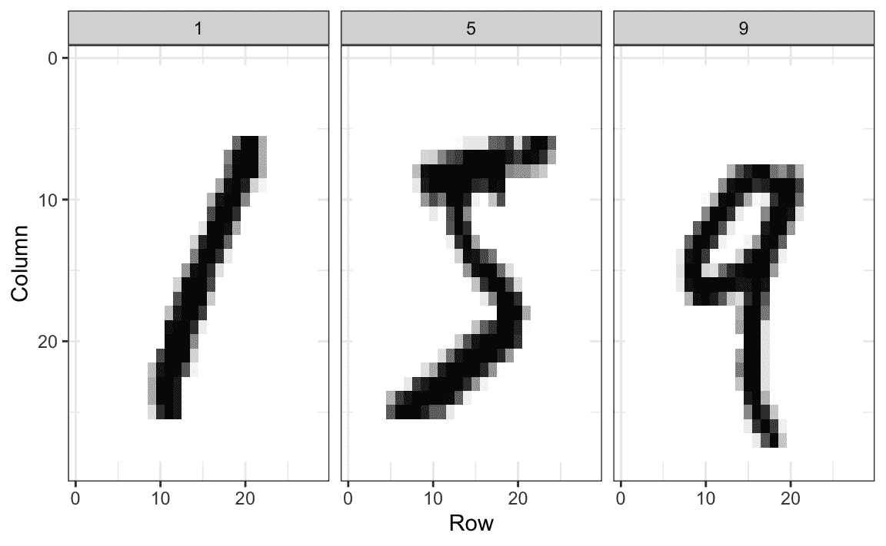
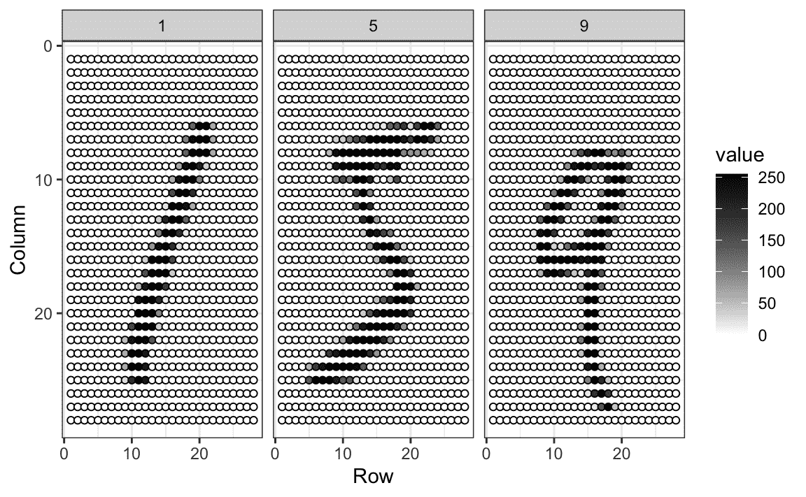
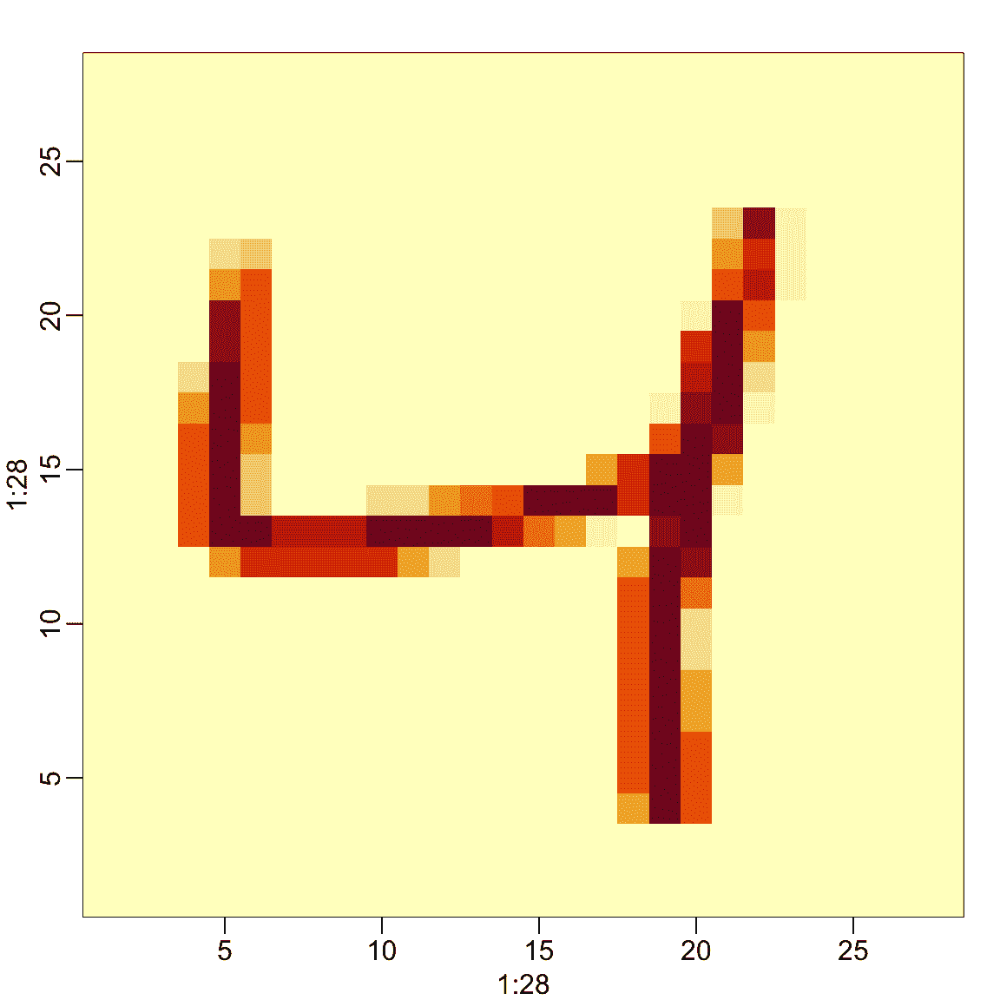
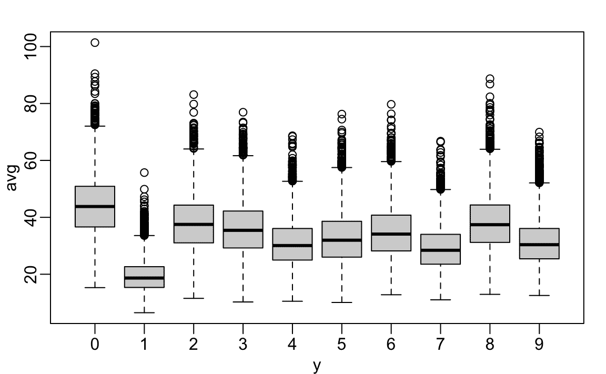
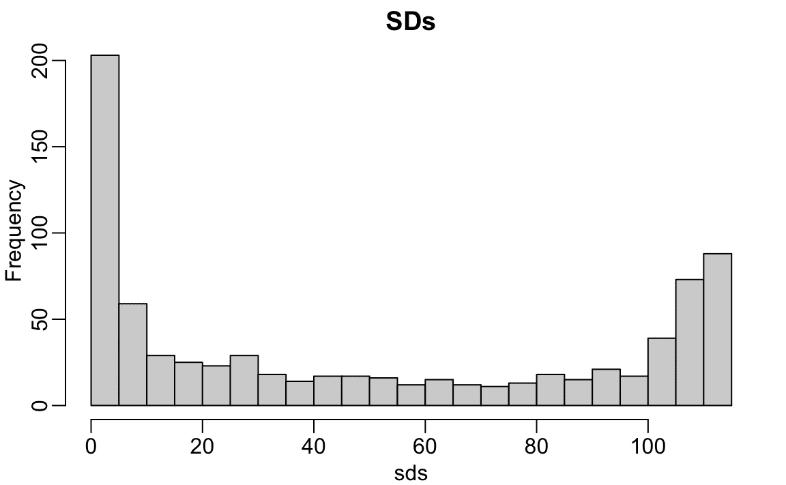
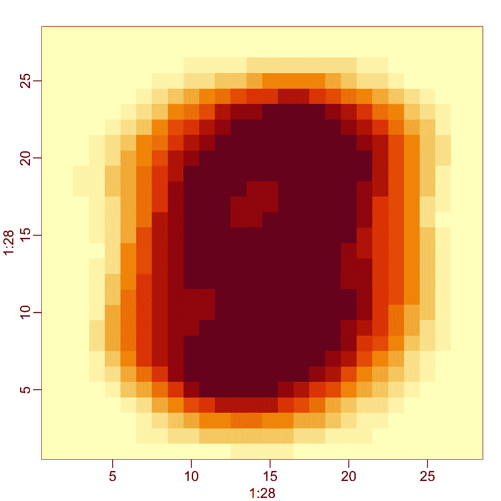
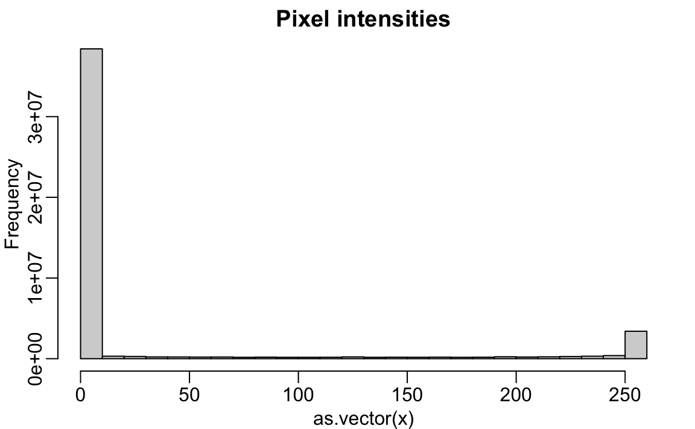

# 21 在 R 中操作矩阵

> 原文：[`rafalab.dfci.harvard.edu/dsbook-part-2/highdim/matrices-in-R.html`](https://rafalab.dfci.harvard.edu/dsbook-part-2/highdim/matrices-in-R.html)

1.  高维数据

1.  21 在 R 中操作矩阵

当与每个观测值相关的变量数量很大且它们都可以表示为数字时，将数据存储在矩阵中并使用线性代数运算进行分析通常更方便，而不是将数据存储在数据框中并使用 **tidyverse** 或 **data.table** 函数。矩阵运算构成了数据分析中线性代数应用的计算基础。

事实上，许多最广泛使用的机器学习算法，包括线性回归、主成分分析、神经网络和深度学习，都是围绕线性代数概念构建的，它们的实现高度依赖于高效的矩阵运算。在 R 中熟练地创建、操作和解释矩阵将使您更容易理解和实现这些方法。

尽管我们在下一章介绍了线性代数的数学框架，但我们在那里使用的例子依赖于能够在 R 中操作矩阵。因此，在深入数学概念之前，我们首先介绍在 R 中创建和操作矩阵所需的工具。

在 第 21.5 节 中，本章末尾，我们展示了激励性的示例和机器学习工作流程中常见的具体实际任务，例如变量中心化和缩放、计算距离以及应用线性变换。这些任务可以通过矩阵运算高效完成，而本章前面部分开发的技能将帮助您解决这些问题。如果您想了解前面部分介绍的矩阵运算的学习动机，您可能首先阅读 第 21.5 节 会很有帮助。

## 21.1 符号表示

矩阵是由其行数和列数定义的两个维度的对象。在数据分析中，通常将数据组织成每行代表一个观测值，每列代表在这些观测值上测量的变量。这种结构使我们能够通过矩阵运算在观测值或变量之间进行计算，这些运算既高效又与下一章中介绍的线性代数技术概念上相一致。

注意，矩阵是 `array` 的特例，可以具有超过两个维度。对于本书涵盖的概念和应用，矩阵是足够的。然而，在更高级的设置中，如基于张量的计算，数据通常具有三个或更多维度时，数组是有用的。

在机器学习中，变量通常被称为 *特征*，而在统计学中，它们通常被称为 *协变量*。无论术语如何，当与矩阵一起工作时，特征通常由矩阵的列表示，每一列对应于在所有观察中测量的一个变量。在数学符号中，矩阵通常用粗体大写字母表示：

$$ \mathbf{X} = \begin{bmatrix} x_{11}&x_{12}&\dots & x_{1p}\\ x_{21}&x_{22}&\dots & x_{2p}\\ \vdots & \vdots & \ddots & \vdots\\ x_{n1}&x_{n2}&\dots&x_{np}\\ \end{bmatrix} $$

其中 $x_{ij}$ 代表第 $i$ 个观察的第 $j$ 个变量。矩阵的维度被称为 $n \times p$，意味着它有 $n$ 行和 $p$ 列。

我们用小写粗体字母表示向量，并将它们表示为一列矩阵，通常称为 *列向量*。R 在将向量转换为矩阵时遵循此约定。例如 `as.matrix(1:n)` 将具有维度 `n` `1`。

然而，*列向量*不应与矩阵的列混淆。它们之所以被称为这个名字，仅仅是因为它们有一列。

机器学习的数学描述经常引用表示 $p$ 个变量的向量：

$$ \mathbf{x} = \begin{bmatrix} x_1\\\ x_2\\\ \vdots\\\ x_p \end{bmatrix} $$

为了区分与观察 $i=1,\dots,n$ 相关的变量，我们添加一个索引：

$$ \mathbf{x}_i = \begin{bmatrix} x_{i1}\\ x_{i2}\\ \vdots\\ x_{ip} \end{bmatrix} $$

粗体小写字母也常用来表示矩阵的列而不是行。这可能会造成混淆，因为 $\mathbf{x}_1$ 可以代表 $\mathbf{X}$ 的第一行或第一列。一种区分的方法是使用类似于计算机代码的符号。具体来说，使用冒号 $:$ 来表示 *所有*。所以 $\mathbf{X}_{1,:}$ 表示第一行，而 $\mathbf{X}_{:,1}$ 是第一列。另一种方法是使用索引字母来区分，其中 $i$ 用于行，$j$ 用于列。所以 $\mathbf{x}_i$ 是第 $i$ 行，而 $\mathbf{x}_j$ 是第 $j$ 列。使用这种方法时，重要的是要明确表示的是哪个维度，行还是列。进一步的混淆可能源于，如前所述，通常将所有向量，包括矩阵的行，都表示为一列矩阵。**

## **21.2 案例研究：MNIST**

*处理邮局收到的邮件的第一步是按邮编对信件进行分类：**


在本书的机器学习部分，我们将描述如何构建计算机算法来读取手写数字，然后机器人使用这些数字来分类信件。为此，我们首先需要收集数据，在这种情况下是一个高维数据集，最好以矩阵的形式存储。

MNIST 数据集是通过数字化数千个手写数字生成的，这些数字已经被人类读取并标注¹。以下是三个手写数字的图像。



图像被转换为 $28 \times 28 = 784$ 像素，对于每个像素，我们获得一个介于 0（白色）和 255（黑色）之间的灰度强度。以下图显示了每个图像的单独变量：



每个数字化的图像，通过索引 $i$ 来标识，由 784 个数值变量表示，对应于像素强度，以及一个分类结果或标签，指定图像中描绘的数字 ($0$-$9$)。

使用 **dslabs** 包加载数据：

```r
library(tidyverse
library(dslabs)
mnist <- read_mnist()
```

像素强度被保存在一个矩阵中：

```r
class(mnist$train$images)
#> [1] "matrix" "array"
```

每个图像的标签包含在一个向量中：

```r
table(mnist$train$labels)
#> 
#>    0    1    2    3    4    5    6    7    8    9 
#> 5923 6742 5958 6131 5842 5421 5918 6265 5851 5949
```

为了简化下面的代码，我们将分别将这些 `x` 和 `y` 重命名：

```r
x <- mnist$train$images
y <- mnist$train$labels
```*****

## ****21.3 R 中的矩阵运算****

***在我们定义并完成旨在教授矩阵运算的任务之前，我们首先回顾 R 中一些基本的矩阵功能。

### 创建矩阵

标量、向量和矩阵是线性代数的基本构建块。我们在前面的章节中已经遇到了向量，在 R 中，标量被表示为长度为 1 的向量。我们现在将这种理解扩展到矩阵，从如何在 R 中创建它们开始。

我们可以使用 `matrix` 函数创建矩阵。第一个参数是一个包含将填充矩阵的元素的向量的参数。第二个和第三个参数分别确定行数和列数。因此，创建矩阵的典型方法是将包含矩阵元素的数字向量获取并传递给 `matrix` 函数。例如，要创建一个 $100 \times 2$ 的正态分布随机变量矩阵，我们写：

```r
mat <- matrix(rnorm(100*2), 100, 2)
```

请注意，默认情况下矩阵是按列填充的：

```r
matrix(1:15, 3, 5)
#>      [,1] [,2] [,3] [,4] [,5]
#> [1,]    1    4    7   10   13
#> [2,]    2    5    8   11   14
#> [3,]    3    6    9   12   15
```

要按行填充矩阵，我们可以使用 `byrow` 参数：

```r
matrix(1:15, 3, 5, byrow = TRUE)
#>      [,1] [,2] [,3] [,4] [,5]
#> [1,]    1    2    3    4    5
#> [2,]    6    7    8    9   10
#> [3,]   11   12   13   14   15
```

函数 `as.vector` 将矩阵转换回向量：

```r
as.vector(matrix(1:15, 3, 5))
#>  [1]  1  2  3  4  5  6  7  8  9 10 11 12 13 14 15
```

*如果列数和行数的乘积与第一个参数提供的向量长度不匹配，`matrix` 函数会循环使用值。如果向量的长度是行数的子倍数或倍数，这会发生 **而不会发出警告**：

```r
matrix(1:3, 3, 5)
#>      [,1] [,2] [,3] [,4] [,5]
#> [1,]    1    1    1    1    1
#> [2,]    2    2    2    2    2
#> [3,]    3    3    3    3    3
```*  **函数 `as.matrix()` 尝试将输入强制转换为矩阵：

```r
df <- data.frame(a = 1:2, b = 3:4, c = 5:6)
as.matrix(df)
#>      a b c
#> [1,] 1 3 5
#> [2,] 2 4 6
```******

### ****矩阵的维度****

***矩阵的维度是确保可以执行某些线性代数运算的重要特征。维度是一个由行数 $\times$ 列数定义的两个数字摘要。

函数 `nrow` 告诉我们该矩阵有多少行。以下是之前定义的用于存储 MNIST 训练数据的行数 `x`：

```r
nrow(x)
#> [1] 60000
```

函数 `ncol` 告诉我们有多少列：

```r
ncol(x)
#> [1] 784
```

*我们了解到我们的数据集包含 60,000 个观察值（图像）和 784 个变量（像素）。**

`dim` 函数返回行和列：

```r
dim(x)
#> [1] 60000   784
```

*现在我们可以确认 R 遵循定义长度为 $n$ 的向量作为 $n\times 1$ 矩阵或 *列向量* 的惯例：**

```r
vec <- 1:10
dim(matrix(vec))
#> [1] 10  1
```*******

### ****子集操作****

*要从矩阵中提取特定条目，例如第 100 列的第 300 行，我们这样写：**

```r
x[300, 100]
```

*我们可以通过使用索引向量来提取矩阵的子集。例如，我们可以这样提取前 300 个观察值的前 100 个像素：**

```r
x[1:300, 1:100]
```

*要提取整个行或行子集，我们留出列维度为空。所以以下代码返回了前 300 个观察值的所有像素：**

```r
x[1:300,]
```

*同样，我们可以通过保持第一个维度为空来子集任意数量的列。以下是提取前 100 个像素的代码：**

```r
x[,1:100]
```

*如果我们只对一行或一列进行子集操作，结果对象就不再是矩阵了。例如，注意这里发生了什么：**

```r
dim(x[300,])
#> NULL
```

*为了避免这种情况，我们可以使用 `drop` 参数：**

```r
dim(x[100,,drop = FALSE])
#> [1]   1 784
```**********

### *****转置*****

****在处理矩阵时，一个常见的操作是 *转置*。我们使用转置来理解下一节中描述的几个概念。这个操作简单地将矩阵的行转换为列。我们在粗体大写字母旁边使用符号 $\top$ 或 $'$ 来表示转置：

$$ \text{如果 } \, \mathbf{X} = \begin{bmatrix} x_{11}&\dots & x_{1p} \\ x_{21}&\dots & x_{2p} \\ \vdots & \ddots & \vdots & \\ x_{n1}&\dots & x_{np} \end{bmatrix} \text{ then }\, \mathbf{X}^\top = \begin{bmatrix} x_{11}&x_{21}&\dots & x_{n1} \\ \vdots & \vdots & \ddots & \vdots \\ x_{1p}&x_{2p}&\dots & x_{np} \end{bmatrix} $$

在 R 中，我们使用函数 `t` 来计算转置

```r
dim(x)
#> [1] 60000   784
dim(t(x))
#> [1]   784 60000
```

*转置的一个用途是我们可以将矩阵 $\mathbf{X}$ 写成以下方式表示每个个体观察值的变量的列向量的行：**

$$ \mathbf{X} = \begin{bmatrix} \mathbf{x}_1^\top\\ \mathbf{x}_2^\top\\ \vdots\\ \mathbf{x}_n^\top \end{bmatrix} $$******

### *****行和列摘要*****

****与矩阵一起执行的一个常见操作是将相同的函数应用于每一行或每一列。例如，我们可能想要计算行平均值和标准差。`apply` 函数允许你这样做。第一个参数是矩阵，第二个参数是维度，1 表示行，2 表示列，第三个是要应用的函数。**

因此，例如，要计算每行的平均值和标准差，我们这样写：

```r
avgs <- apply(x, 1, mean)
sds <- apply(x, 1, sd)
```

*要计算列的这些值，我们只需将 1 改为 2：**

```r
avgs <- apply(x, 2, mean)
sds <- apply(x, 2, sd)
```

*因为这些操作非常常见，所以有特殊函数来执行它们。所以，例如，函数 `rowMeans` 计算每行的平均值：**

```r
avg <- rowMeans(x)
```

*并且 `rowSds` 函数来自 **matrixStats** 包，它计算每行的标准差：**

```r
library(matrixStats)
sds <- rowSds(x)
```

*函数 `colMeans` 和 `colSds` 提供了列的版本。**

对于其他常见操作的快速实现，请查看 **matrixStats** 包中可用的内容。*********

### ****条件过滤****

***矩阵操作相对于 **tidyverse** 操作的一个优点是我们可以根据列的摘要轻松选择列。

注意，逻辑过滤器可以以类似的方式用于矩阵的子集，就像它们可以用于向量的子集一样。以下是一个简单的示例，使用逻辑子集列：

```r
matrix(1:15, 3, 5),[c(FALSE, TRUE, TRUE, FALSE, TRUE)]
#>      [,1] [,2] [,3]
#> [1,]    4    7   13
#> [2,]    5    8   14
#> [3,]    6    9   15
```

这意味着我们可以使用条件表达式选择行。在以下示例中，我们删除包含至少一个 `NA` 的所有观测值：

```r
x[apply(!is.na(x), 1, all),]
```

这是一个常见的操作，我们有一个 **matrixStats** 函数来更快地完成它：

```r
x![rowAnyNAs(x),]
```******

### ****使用矩阵进行索引****

***一种便于高效编码的操作是，我们可以根据应用于同一矩阵的条件来更改矩阵的条目。以下是一个简单的示例：

```r
mat <- matrix(1:15, 3, 5)
mat[mat > 6 & mat < 12] <- 0
mat
#>      [,1] [,2] [,3] [,4] [,5]
#> [1,]    1    4    0    0   13
#> [2,]    2    5    0    0   14
#> [3,]    3    6    0   12   15
```

这种方法的实用应用之一是，我们可以将矩阵中所有的 `NA` 条目更改为其他值：

```r
x[is.na(x)] <- 0
```*********

## ****21.4 矩阵的向量化****

***向量化是 R 在数值计算中如此高效的主要原因之一。许多原本需要显式循环的操作可以直接应用于整个矩阵或向量，这使得代码既更快又更容易阅读。

### 矩阵-向量操作

矩阵向量化的一个常见例子是行中心化：从每行的对应元素中减去该行的平均值。尽管这可以通过 `scale()` 函数来完成

```r
scale(x, scale = FALSE)
```

R 的向量化规则使得我们可以更直接、更高效地实现这一点。我们以行中心化为例，但这种方法适用于本章讨论的许多操作。

在 R 中，如果我们从矩阵 `x` 中减去向量 `a`：`x-a`，则 `a` 的第一个元素从第一行减去，第二个元素从第二行减去，依此类推。从数学上讲，这个操作可以写成：

$$ \begin{bmatrix} X_{11}&\dots & X_{1p} \\ X_{21}&\dots & X_{2p} \\ \vdots & \ddots & \vdots \\ X_{n1}&\dots & X_{np} \end{bmatrix} - \begin{bmatrix} a_1\\ a_2\\ \vdots \\ a_n \end{bmatrix} = \begin{bmatrix} X_{11}-a_1&\dots & X_{1p}-a_1\\ X_{21}-a_2&\dots & X_{2p}-a_2\\ \vdots & \ddots & \vdots\\ X_{n1}-a_n&\dots & X_{np}-a_n \end{bmatrix} $$

这意味着我们可以用这一行代码来对 `x` 的每一行进行中心化：

```r
x - rowMeans(x)
```

相同的向量化也适用于其他算术操作，例如除法。例如，我们可以使用以下方法同时中心化和缩放行：

```r
(x - rowMeans(x))/rowSds(x)
```

这相当于 `scale(x)`，但这里显式地执行以展示底层的向量化操作。***

### ***`sweep` 函数***

**如果我们想缩放列，以下代码将不会按预期工作，因为减法是按行应用的：

```r
x - colMeans(x)
```

一种解决方案是将矩阵转置，应用操作，然后再转置回来：

```r
t(t(x) - colMeans(x))
```

这可行，但对于大型矩阵来说，由于重复转置，操作繁琐且效率低下。

`sweep` 函数为在矩阵上执行矢量化操作提供了一个更清晰、更通用的解决方案。它与 `apply` 类似，但专门为类似数组的数据和逐元素算术设计。

当与矩阵 `x` 一起使用时，`sweep` 函数有三个主要参数：

+   `MARGIN` - 要操作的维度（`1` 表示行，`2` 表示列）

+   `STATS` - 用于*扫除*（例如，均值或标准差）的值向量

+   `FUN` - 要应用的运算（默认为减法 `"-"`)

例如，要减去每一列的均值，我们编写：

```r
sweep(x, MARGIN = 2, STATS = colMeans(x), FUN = "-")
```

这使每一列居中，使其平均值为零。因为 R 允许在默认值明确时省略参数名称，所以一个简洁且常见的缩写是：

```r
sweep(x, 2, colMeans(x))
```

同样，为了居中行，我们编写：

```r
sweep(x, 1, rowMeans(x))
```

(尽管请注意，对于这个特定操作，`x - rowMeans(x)` 通常更快。)

要进行缩放而不是居中，只需更改操作：

```r
sweep(x, 2, colSds(x), "/")
```

`sweep` 函数也超越了矩阵的范畴，它可以处理超过两个维度的数组以及匹配维度的统计向量 (`STATS`)。*********

### ***矩阵-矩阵运算***

**在 R 中，如果你对两个矩阵进行加、减、乘或除运算，操作是逐元素进行的。例如，如果两个矩阵存储在 `x` 和 `y` 中，那么 `x*y` 并不导致 第 22.1 节 中定义的矩阵乘法。相反，这个乘积的行 $i$ 和列 $j$ 的条目是 `x` 中行 $i$ 和列 $j$ 的条目与 `y` 中相应条目的乘积。*******

## ****21.5 激励任务****

***为了激励在 R 中使用矩阵，我们将提出六个任务，说明矩阵运算如何帮助探索手写数字数据集。每个任务突出显示了一个在 R 中常用的基本矩阵运算。通过看到这些操作如何以快速简单的方式实现，你将获得在处理高维数据分析中经常出现的计算的实际经验。这些任务的主要目标是帮助你了解矩阵运算在实际中的工作方式。

### 可视化原始图像

像素强度以矩阵的行提供。使用我们在第 21.3.1 节中学到的知识，我们可以将每一行转换成一个 $28 \times 28$ 的矩阵，我们可以将其可视化为图像。作为一个例子，我们将使用第三个观测值。从标签中，我们知道这是一个：

```r
y[3]
#> [1] 4
```

矩阵 `x[3,]` 的第三行包含 784 个像素强度。如果我们假设这些是按顺序输入的，我们可以使用以下方式将它们转换回一个 $28 \times 28$ 的矩阵：

```r
grid <- matrix(x[3,], 28, 28)
```

为了可视化数据，我们可以使用以下方式 `image`：

```r
image(1:28, 1:28, grid)
```

然而，因为 `image` 中的 y 轴是从下到上，而 `x` 存储像素是从上到下，上面的代码显示了翻转的图像。要将其翻转回来，我们可以使用：

```r
image(1:28, 1:28, grid[, 28:1])
```

****

### ***有些数字需要比其他数字更多的墨水来书写吗？***

**让我们研究总像素黑暗度的分布以及它如何随数字而变化。***

我们可以使用我们在第 21.3.5 节中学到的知识计算每个像素的平均值，并使用箱线图显示每个数字的值：

```r
avg <- rowMeans(x)
boxplot(avg ~ y)
```

*  *从这个图中我们可以看到，不出所料，1s 使用的墨水比其他数字少。****

### ***有些像素是无信息的吗？***

**我们现在将检查每个像素在数字之间的变异性，以识别和移除那些对分类提供很少信息的像素。在图像之间变异性小的像素无法帮助区分数字，可以安全地排除。在许多情况下，移除无信息特征不仅简化了分析，而且大大减少了数据集的大小，提高了计算速度。

使用我们在第 21.3.5 节和第 21.3.6 节中学到的知识，我们可以有效地计算和过滤出这样的列。为了量化每个像素的可变性，我们使用**matrixStats**包中的`colSds`函数计算其在所有图像中的标准差：

```r
sds <- colSds(x)
```

快速查看这些值的分布显示，一些像素的逐个值变异性非常低：

```r
hist(sds, breaks = 30, main = "SDs")
```

*  *这很合理，因为我们不写盒子的某些部分。这里是我们使用我们在第 21.3.1 节中学到的知识创建的 $28 \times 28$ 矩阵后按位置绘制的方差：

```r
image(1:28, 1:28, matrix(sds, 28, 28)[, 28:1])
```

*  *我们看到角落的变异性很小。

我们可以移除没有变化的特征，因为这些特征无法帮助我们预测。

因此，如果我们想从矩阵中移除无信息预测因子，我们可以写这一行代码：

```r
new_x <- x,[colSds(x) > 60]
dim(new_x)
#> [1] 60000   322
```

只有标准差高于 60 的列被保留，这移除了超过一半的预测因子。*******

### ***我们可以移除模糊吗？***

**我们将首先查看所有像素值的分布。

```r
hist(as.vector(x), breaks = 30, main = "Pixel intensities")
```

*  *这显示了一个明显的二分法，它被解释为有墨水的图像部分和无墨水的图像部分。如果我们认为低于，比如说，50 的值是模糊的，我们可以快速将它们设置为 0，使用我们在第 21.3.7 节中学到的知识：

```r
new_x <- x
new_x[new_x < 50] <- 0
```****

### ***二值化数据***

**上面的直方图似乎表明这些数据大多是二进制的。一个像素要么有墨水，要么没有。应用我们在第 21.3.7 节中学到的知识，我们可以仅使用矩阵运算来二值化数据：

```r
bin_x <- x
bin_x[bin_x < 255/2] <- 0 
bin_x[bin_x > 255/2] <- 1
```

我们还可以将它们转换为逻辑矩阵，然后使用我们在第 21.4 节中学到的知识将它们强制转换为数字：

```r
bin_X <- (x > 255/2)*1
```****

### ***标准化数字***

**最后，我们将对每一列进行缩放，使其具有相同的平均值和标准差。

使用我们在第 21.4 节中学到的知识意味着我们可以按如下方式缩放矩阵的每一行：

```r
(x - rowMeans(x))/rowSds(x)
```

对于列，我们可以组合两次调用`sweep`：*

```r
sweep(sweep(x, 2, colMeans(x)), 2, colSds(x), FUN = "/")
```

注意我们可以通过将`2`替换为`1`并使用`rowMeans`和`rowSds`来标准化行。*

最后，请注意，通常可以通过以下方式实现等效功能：

```r
t(scale(t(x)))
```

这种版本对于大型矩阵可能更快，尽管它对正在发生的事情的描述不够明确。*

## ****21.6 练习****

***1. 创建一个 100 行 10 列的随机正态数矩阵。将结果放入`x`中。*

2. 应用三个 R 函数，分别给出`x`的维度、`x`的行数和`x`的列数。

3. 将标量 1 加到矩阵`x`的第一行，标量 2 加到第二行，依此类推。

4. 将标量 1 加到矩阵`x`的第一列，标量 2 加到第二列，依此类推。提示：使用`sweep`函数，`FUN = "+"`。

5. 计算`x`每一行的平均值。

6. 计算`x`每一列的平均值。

7. 对于 MNIST 训练数据中的每个数字，计算处于*灰色区域*的像素比例，定义为介于 50 和 205 之间的值。按数字类别制作箱线图。提示：使用逻辑运算符和`rowMeans`。

* * *

***1.  http://yann.lecun.com/exdb/mnist/↩︎****
