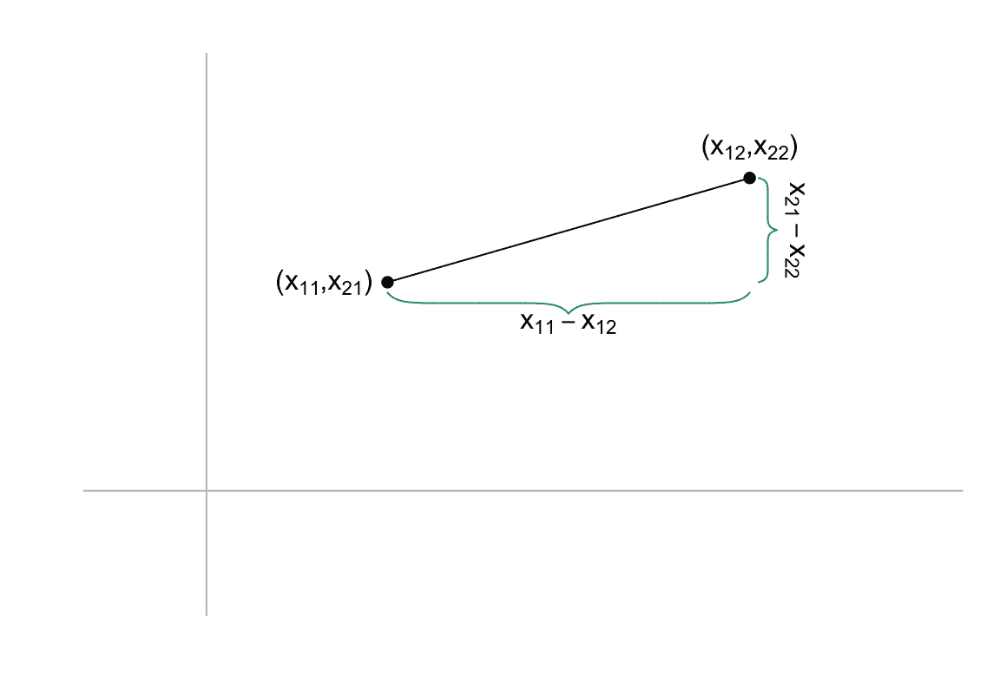
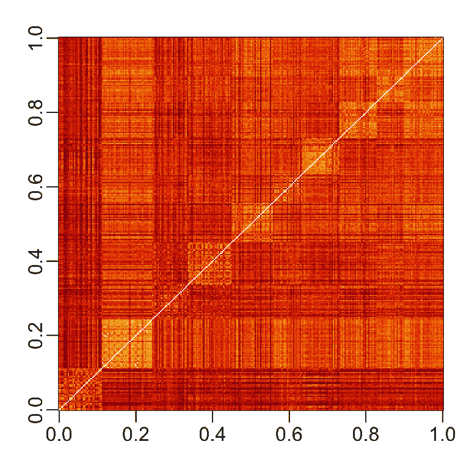

# 22  应用线性代数

> 原文：[`rafalab.dfci.harvard.edu/dsbook-part-2/highdim/linear-algebra.html`](https://rafalab.dfci.harvard.edu/dsbook-part-2/highdim/linear-algebra.html)

1.  高维数据

1.  22  应用线性代数

线性代数是描述和启发统计方法和机器学习方法的数学技术的主要技术。在本章中，我们介绍了理解这些技术所需的一些数学概念。我们将在本书的其余部分使用这些概念和技术。

## 22.1 矩阵乘法

数据分析中常用的操作之一是矩阵乘法。在这里，我们定义并解释这个操作。

线性代数起源于数学家们发展出系统化解决线性方程组的方法。例如：

$$ \begin{aligned} x + 3 y - 2 z &= 5\\ 3x + 5y + 6z &= 7\\ 2x + 4y + 3z &= 8 \end{aligned} $$

数学家们发现，通过使用矩阵和向量表示这些线性方程组，可以设计预定义的算法来解决任何线性方程组。基本的线性代数课程将教授一些这些算法，例如高斯消元法、高斯-若尔当消元法以及 LU 和 QR 分解。这些方法通常在大学水平的线性代数课程中详细讲解。

为了解释矩阵乘法，定义两个矩阵：$\mathbf{A}$ 和 $\mathbf{B}$

$$ \mathbf{A} = \begin{pmatrix} a_{11}&a_{12}&\dots&a_{1n}\\ a_{21}&a_{22}&\dots&a_{2n}\\ \vdots&\vdots&\ddots&\vdots\\ a_{m1}&a_{m2}&\dots&a_{mn} \end{pmatrix}, \, \mathbf{B} = \begin{pmatrix} b_{11}&b_{12}&\dots&b_{1p}\\ b_{21}&b_{22}&\dots&b_{2p}\\ \vdots&\vdots&\ddots&\vdots\\ b_{n1}&b_{n2}&\dots&b_{np} \end{pmatrix} $$

并定义矩阵 $\mathbf{A}$ 和 $\mathbf{B}$ 的乘积为矩阵 $\mathbf{C} = \mathbf{A}\mathbf{B}$，其元素 $c_{ij}$ 等于 $\mathbf{A}$ 的第 $i$ 行与 $\mathbf{B}$ 的第 $j$ 列分量乘积之和。

我们可以定义矩阵乘法 $\mathbf{C}= \mathbf{A}\mathbf{B}$ 对于任何两个矩阵，比如

```r
A <- matrix(1:12, 4, 3); B <- matrix(1:18, 3, 6)
```

使用以下 R 代码：

```r
m <- nrow(A)
p <- ncol(B)
C <- matrix(0, m, p)
for(i in 1:m){
 for(j in 1:p){
 Ci,j] <- [sum(A[i,] * B[,j])
 }
}
```

因为这个操作非常常见，R 包含一个用于矩阵乘法的数学运算符 `%*%`：

```r
C <- A %*% B
```

使用数学符号 $\mathbf{C} = \mathbf{A}\mathbf{B}$ 看起来是这样的：

$$ \begin{pmatrix} a_{11}b_{11} + \dots + a_{1n}b_{n1}& a_{11}b_{12} + \dots + a_{1n}b_{n2}& \dots& a_{11}b_{1p} + \dots + a_{1n}b_{np}\\ a_{21}b_{11} + \dots + a_{2n}b_{n1}& a_{21}b_{12} + \dots + a_{2n}b_{n2}& \dots& a_{21}b_{1p} + \dots + a_{2n}b_{np}\\ \vdots&\vdots&\ddots&\vdots\\ a_{m1}b_{11} + \dots +a_{mn}b_{n1}& a_{m1}b_{12} + \dots + a_{mn}b_{n2}& \dots& a_{m1}b_{1p} + \dots + a_{mn}b_{np}\\ \end{pmatrix} $$

注意这个定义意味着矩阵乘法 $\mathbf{A}\mathbf{B}$ 只在 $\mathbf{A}$ 的行数与 $\mathbf{B}$ 的列数相匹配时才可能进行。当这种情况发生时，我们说这两个矩阵是*兼容的*。

那么，这个矩阵乘法定义是如何帮助我们解决方程组的？

要理解这一点，可以考虑以下带有未知数 $x_1, \dots x_n$ 的方程组：

$$ \begin{aligned} a_{11} x_1 + a_{12} x_2 \dots + a_{1n}x_n &= b_1\\ a_{21} x_1 + a_{22} x_2 \dots + a_{2n}x_n &= b_2\\ \vdots\\ a_{n1} x_1 + a_{n2} x_2 \dots + a_{nn}x_n &= b_n\\ \end{aligned} $$

我们可以通过定义以下矩阵来表示这种矩阵乘法，

$$ \mathbf{A} =\begin{pmatrix} a_{11}&a_{12}&\dots&a_{1n}\\ a_{21}&a_{22}&\dots&a_{2n}\\ \vdots&\vdots&\ddots&\vdots\\ a_{n1}&a_{n2}&\dots&a_{nn} \end{pmatrix} ,\, \mathbf{b} = \begin{pmatrix} b_1\\ b_2\\ \vdots\\ b_n \end{pmatrix} ,\, \mbox{ and } \mathbf{x} = \begin{pmatrix} x_1\\ x_2\\ \vdots\\ x_n \end{pmatrix} $$

重新写这个方程就是：

$$ \mathbf{A}\mathbf{x} = \mathbf{b} $$

列出的线性代数算法，如高斯消元法，提供了一种计算解方程 $\mathbf{x}$ 的逆矩阵 $\mathbf{A}^{-1}$ 的方法：

$$ \mathbf{A}^{-1}\mathbf{A}\mathbf{x} = \mathbf{x} = \mathbf{A}^{-1} \mathbf{b} $$

要解决我们在 R 中写出的第一个方程，我们可以使用`solve`函数：

```r
A <- matrix(c(1, 3, -2, 3, 5, 6, 2, 4, 3), 3, 3, byrow = TRUE)
b <- matrix(c(5, 7, 8))
solve(A, b)
```

当处理小到中等大小的矩阵，并且每列的范围相似且 0 的数量不多时，`solve`函数表现良好。当这种情况不成立时，可以使用`qr.solve`函数。

## 22.2 单位矩阵

用粗体 $\mathbf{I}$ 表示的单位矩阵就像数字 1，但对于矩阵来说：如果你将一个矩阵乘以单位矩阵，你将得到原来的矩阵。

$$ \mathbf{I}\mathbf{X} = \mathbf{X} $$

如果你将 $\mathbf{I}$ 定义为具有相同行数和列数（称为方阵）的矩阵，除了对角线上的数字为 1 外，其余均为 0，

$$ \mathbf{I}=\begin{pmatrix} 1&0&\dots&0\\ 0&1&\dots&0\\ \vdots&\vdots&\ddots&\vdots\\ 0&0&\dots&1 \end{pmatrix}, $$

你将获得所需属性。

注意，逆矩阵的定义意味着：

$$ \mathbf{A}^{-1}\mathbf{A} = \mathbf{1} $$

因为`solve`函数中第二个参数的默认值是单位矩阵，如果我们简单地输入`solve(A)`，我们将得到逆矩阵 $\mathbf{A}^{-1}$。这意味着我们也可以用以下方式得到方程组的解：

```r
solve(A) %*% b
```

## 22.3 距离

我们在处理高维数据时进行的许多分析直接或间接与距离相关。例如，大多数机器学习技术都依赖于能够定义观测之间的距离，使用特征或预测因子。例如，聚类算法寻找的是*相似的*观测。但在数学上这又意味着什么呢？

为了定义距离，我们引入另一个线性代数概念：**范数**。回想一下，二维空间中的一个点可以用极坐标表示：


其中 $\theta = \arctan{\frac{x2}{x1}}$ 和 $r = \sqrt{x_1² + x_2²}$。如果我们把点看作二维列向量 $\mathbf{x} = (x_1, x_2)^\top$，$r$ 定义了 $\mathbf{x}$ 的范数。范数可以看作是二维向量的**大小**，不考虑方向：如果我们改变角度，向量会改变，但大小不会变。定义范数的目的是我们可以将**大小**的概念推广到高维。具体来说，我们为任何向量 $\mathbf{x}$ 写出范数如下：

$$ \|\mathbf{x}\| = \sqrt{x_1² + x_2² + \dots + x_p²} $$

注意，我们可以使用我们学到的线性代数概念来定义范数，如下所示：

$$ \|\mathbf{x}\|² = \mathbf{x}^\top\mathbf{x} $$

为了定义距离，假设我们有两个二维点：$\mathbf{x}_1$ 和 $\mathbf{x}_2$。我们可以通过简单地使用欧几里得距离来定义它们之间的相似性：



我们知道距离等于斜边的长度：

$$ \sqrt{(x_{11} - x_{12})² + (x_{21} - x_{22})²} $$

我们引入范数的原因是因为这个距离是两点之间向量的长度，并且这可以推广到任何维度。两点之间的距离，无论维度如何，都定义为差分的范数

$$ \| \mathbf{x}_1 - \mathbf{x}_2\|. $$

如果我们使用数字数据，第一和第二次观察之间的距离将使用所有 784 个特征来计算：

$$ \| \mathbf{x}_1 - \mathbf{x}_2 \| = \sqrt{ \sum_{j=1}^{784} (x_{1j}-x_{2j })² } $$

为了演示，让我们选择三个数字的特征：

```r
x_1 <- x[6,]
x_2 <- x[17,]
x_3 <- x[16,]
```

我们可以使用我们刚刚学到的定义来计算每对之间的距离：

```r
c(sum((x_1 - x_2)²), sum((x_1 - x_3)²), sum((x_2 - x_3)²)) |> sqrt()
#> [1] 2320 2331 2519
```

在 R 中，函数 `crossprod(x)` 对于计算范数来说很方便。它将 `t(x)` 乘以 `x`：

```r
c(crossprod(x_1 - x_2), crossprod(x_1 - x_3), crossprod(x_2 - x_3)) |> sqrt()
#> [1] 2320 2331 2519
```

注意** `crossprod` 函数接受一个矩阵作为第一个参数。因此，这里使用的向量被强制转换为单列矩阵。另外，注意 `crossprod(x,y)` 将 `t(x)` 乘以 `y`。

我们可以看到，前两个之间的距离更小。这与前两个是 2，第三个是 7 的事实相符。

```r
y[c(6, 17, 16)]
#> [1] 2 2 7
```

我们也可以使用函数 `dist` 来一次性相对快速地计算所有距离，该函数接受一个矩阵作为输入，并计算每行之间的距离，生成一个 `dist` 类型的对象：

```r
d <- dist(x[c(6,17,16),])
class(d)
#> [1] "dist"
```

这很方便，因为 R 中有几个机器学习相关的函数接受 `dist` 类型的对象作为输入。

我们可以像这样查看我们计算出的距离：

```r
d
#>      1    2
#> 2 2320 
#> 3 2331 2519
```

请注意，对角线被省略，因为所有自距离都是零，并且由于距离矩阵的对称性（这是由距离的可交换性得出的），上三角形也被排除。

要使用行和列索引访问条目，我们需要将其强制转换为矩阵。

`image` 函数允许我们快速查看观察之间的距离图像。例如，我们这样计算前 300 个观察值之间的距离：

```r
d <- dist(x[1:300,])
```

要查看图像，我们只需将 `d` 转换为矩阵并发送到函数：`image(as.matrix(d))`。

如果我们按标签排序这个距离，我们可以在对角线附近看到黄色的正方形。这是因为来自相同数字的观察值往往比来自不同数字的观察值更接近：

```r
image(as.matrix(d)[order(y1:300]), [order(y[1:300])])
```



## 22.4 空间

预测空间* 是一个常用于描述机器学习算法的概念。术语 *空间* 指的是一个高级数学定义，我们提供了一种简化的解释，以帮助理解在机器学习算法的上下文中使用预测空间时的术语。

我们可以将所有观察到的预测因子 $(x_{i1}, \dots, x_{ip})^\top$ 对于所有观察 $i=1,\dots,n$ 视为 $n$ 个 $p$ 维的点。一个**空间**可以被视为所有可能点的集合，这些点应该被考虑用于相关数据分析。这包括我们可以看到但尚未观察到的点。在处理手写数字的情况下，我们可以将预测空间视为任何点 $(x_{1}, \dots, x_{p})^\top$，只要每个条目 $x_i, \, i = 1, \dots, p$ 都在 0 到 255 之间。

一些机器学习算法也定义子空间。在机器学习中常见的一个子空间是由接近预定 *中心* 的点组成的 *邻域*。我们通过选择一个中心 $\mathbf{x}_0$、一个最小距离 $r$，并将子空间定义为满足以下条件的点 $\mathbf{x}$ 的集合来完成此操作：

$$ \| \mathbf{x} - \mathbf{x}_0 \| \leq r. $$

我们可以将这个子空间视为一个多维球体，因为每个点到中心的距离都是相同的。

其他机器学习算法将预测空间划分为非重叠的区域，然后使用该区域的数据对每个区域进行不同的预测。我们将在 第 30.4 节 中了解这些内容。

## 22.5 练习

1\. 生成两个矩阵 `A` 和 `B`，包含随机生成的正态分布数字。这两个矩阵的维度应分别为 $4 \times 3$ 和 $3 \times 6$。确认 `C <- A %*% B` 产生与以下相同的结果：

```r
m <- nrow(A)
p <- ncol(B)
C <- matrix(0, m, p)
for(i in 1:m){
 for(j in 1:p){
 Ci,j] <- [sum(A[i,] * B[,j])
 }
}
```

2\. 使用 R 解以下方程组：

$$ \begin{aligned} x + y + z + w &= 10\\ 2x + 3y - z - w &= 5\\ 3x - y + 4z - 2w &= 15\\ 2x + 2y - 2z - 2w &= 20\\ \end{aligned} $$

3\. 定义 `x` 和 `y`：

```r
mnist <- read_mnist()
x <- mnist$train$images[1:300,] 
y <- mnist$train$labels[1:300]
```

并计算距离矩阵：

```r
d <- dist(x)
class(d)
```

生成一个箱线图，显示`d`的第二行的距离，按数字分层。不要包括到自身的距离，我们知道这个距离是 0。你能预测出`x`的第二行代表哪个数字吗？

4. 使用`apply`函数和矩阵代数来计算第四个数字`mnist$train$images[4,]`与其他在`mnist$train$images`中表示的数字之间的距离。然后生成与练习 2 中类似的箱线图，并预测第四行代表的数字是什么。

5. 计算每个特征与代表中间像素（第 14 行第 14 列）的特征之间的距离。创建一个图像，用颜色显示距离在像素位置上的显示。
