# 23  降维

> 原文：[`rafalab.dfci.harvard.edu/dsbook-part-2/highdim/dimension-reduction.html`](https://rafalab.dfci.harvard.edu/dsbook-part-2/highdim/dimension-reduction.html)

1.  高维数据

1.  23  降维

高维数据可以使数据分析变得具有挑战性，尤其是在可视化和模式发现方面。例如，在 MNIST 数据集中，每个图像由 784 个像素表示。为了探索所有像素对之间的关系，我们需要检查超过 300,000 个散点图。这很快变得不切实际。

在本章中，我们介绍了一组被称为**降维**的强大技术。其核心思想是在保留重要特征，如观测之间的距离的同时，减少数据集中的变量数量。维度减少后，可视化变得更加可行，数据中的模式也更容易被发现。

我们主要关注的技术是**主成分分析（PCA**），这是一种广泛用于无监督学习和探索性数据分析的方法。PCA 基于一个称为**奇异值分解（SVD**）的数学工具，它在降维之外也有应用。

我们从一个简单的示例开始，以建立直观感受，然后介绍理解主成分分析（PCA）所需的数学概念。我们通过将 PCA 应用于两个更复杂、真实世界的数据集来展示其实际价值，以此结束本章。

## 23.1 动机：保留距离

为了说明目的，我们考虑一个简单的双胞胎身高示例。一些对是成年人，其他的是儿童。在这里，我们模拟了 100 个二维点，每个点代表一对双胞胎。我们使用**MASS**包中的`mvrnorm`函数来模拟双变量正态数据。

[PRE0]

*散点图迅速揭示出相关性很高，并且存在两组双胞胎，成年人（右上角的点）和儿童（左下角的点）：

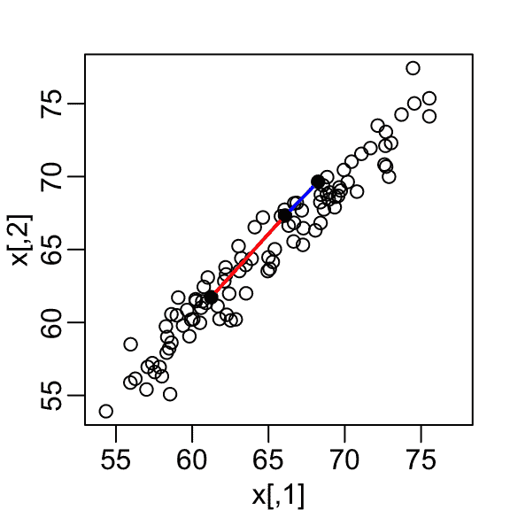

我们的特征是$n$个二维点，即两个身高。为了说明目的，我们将假设可视化二维过于困难，我们希望通过一维变量的直方图来探索数据。因此，我们希望**降低维度**从二维到一维，但仍然能够理解数据的重要特征，特别是观测会聚成两组：成年人和儿童。

为了表明这里提出的思想具有普遍的实用性，我们将标准化数据，使观测值处于标准单位而不是英寸：

[PRE1]

*在上面的散点图中，我们还显示了观测 1 和 2 之间的距离（蓝色），以及观测 1 和 51 之间的距离（红色）。注意，蓝色线较短，这意味着 1 和 2 更接近。

我们可以使用`dist`来计算这些距离：

[PRE2]

这种距离基于两个维度，我们需要一个仅基于一个维度的距离近似。*

如果我们回顾上面的高度散点图，并想象在任意两点之间画一条线，这条线的长度就代表了这两点之间的距离。许多这些线倾向于沿着对角线方向对齐，这表明数据中的大部分变异性并不是纯粹的水平或垂直，而是在两个轴上呈对角线分布。

现在想象一下，我们将整个点云旋转，使得之前沿对角线的变异性现在与水平轴对齐。在这个旋转视图中，点之间的最大差异将出现在第一个（水平）维度上。这将使得仅使用一个变量来描述数据变得更容易，这个变量能够捕捉到最有意义的变异性。

在下一节中，我们介绍了一种数学方法，使这种直觉变得精确。它允许我们找到一个旋转数据的方法，在重新定位轴以突出显示最重要的变化方向的同时，保持点之间的距离。这是称为*主成分分析（PCA）*的方法的基础，这是最广泛使用的降维技术。***

## ***23.2 旋转***

**任何二维点 $(x_1, x_2)^\top$ 可以写成从 $(0,0)^\top$ 到 $(x_1, x_2)^\top$ 的斜边为底边和高的三角形的底边和高度：*

$$ x_1 = r \cos\phi, \,\, x_2 = r \sin\phi $$

其中 $r$ 是斜边的长度，$\phi$ 是斜边与 x 轴之间的角度。

要将点 $(x_1, x_2)^\top$ 围绕中心 $(0,0)^\top$ 和半径 $r$ 的圆旋转一个角度 $\theta$，我们只需将前面方程中的角度改为 $\phi + \theta$：

$$ z_1 = r \cos(\phi+ \theta), \,\, z_2 = r \sin(\phi + \theta) $$

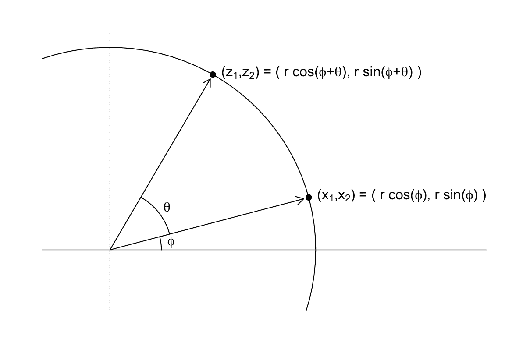

我们可以使用三角恒等式将 $(z_1, z_2)$ 重写如下：

$$ \begin{aligned} z_1 = r \cos(\phi + \theta) = r \cos \phi \cos\theta - r \sin\phi \sin\theta = x_1 \cos(\theta) - x_2 \sin(\theta)\\ z_2 = r \sin(\phi + \theta) = r \cos\phi \sin\theta + r \sin\phi \cos\theta = x_1 \sin(\theta) + x_2 \cos(\theta) \end{aligned} $$

现在，我们可以通过将上述公式应用于每个对 $(x_{i1}, x_{i2})^\top$ 来旋转数据集中的每个点。

在将每个点旋转 $-45$ 度后，双标准高度看起来是这样的：

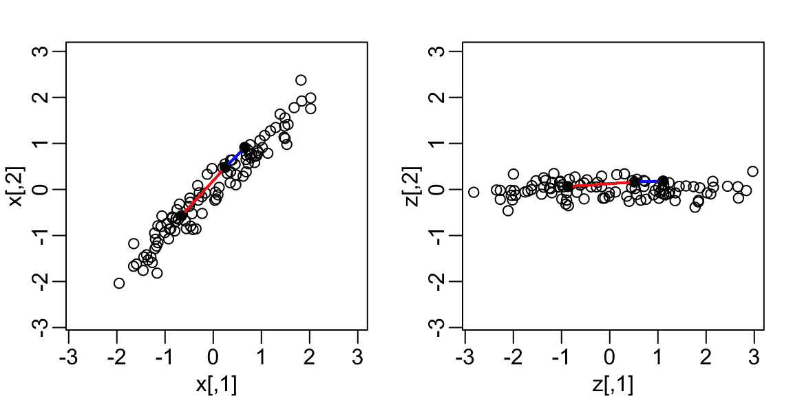

注意，虽然 $x_1$ 和 $x_2$ 的变异性相似，但 $z_1$ 的变异性远大于 $z_2$ 的变异性。此外，请注意，点之间的距离似乎得到了保留。在下一节中，我们将从数学上证明这一点。***

## ***23.3 线性变换***

**每次矩阵 $\mathbf{X}$ 与另一个矩阵 $\mathbf{A}$ 相乘时，我们称乘积 $\mathbf{Z} = \mathbf{X}\mathbf{A}$ 为 $\mathbf{X}$ 的线性变换。下面，我们展示了上述旋转是线性变换。为了看到这一点，请注意，对于任何行 $i$，第一个条目是：

$$ z_{i1} = a_{11} x_{i1} + a_{21} x_{i2} $$

其中 $a_{11} = \cos\theta$ 和 $a_{21} = -\sin\theta$.

第二个条目也是一个线性变换：

$$z_{i2} = a_{12} x_{i1} + a_{22} x_{i2}$$

其中 $a_{12} = \sin\theta$ 和 $a_{22} = \cos\theta$.

我们可以使用矩阵符号来编写这些方程：

$$ \begin{pmatrix} z_1\\z_2 \end{pmatrix} = \begin{pmatrix} a_{11}&a_{12}\\ a_{21}&a_{22} \end{pmatrix}^\top \begin{pmatrix} x_1\\x_2 \end{pmatrix} $$

使用线性代数的优点之一是我们可以通过将所有观测值保存在一个 $N \times 2$ 矩阵中来为整个数据集编写转换：

$$ \mathbf{X} \equiv \begin{bmatrix} \mathbf{x}_1^\top\\ \vdots\\ \mathbf{x}_n^\top \end{bmatrix} = \begin{bmatrix} x_{11}&x_{12}\\ \vdots&\vdots\\ x_{n1}&x_{n2} \end{bmatrix} $$

然后，我们可以通过应用 $X$ 的 *线性变换* 来获得每个行 $i$ 的旋转值 $\mathbf{z}_i$：

$$ \mathbf{Z} = \mathbf{X} \mathbf{A} \mbox{ with } \mathbf{A} = \, \begin{pmatrix} a_{11}&a_{12}\\ a_{21}&a_{22} \end{pmatrix} = \begin{pmatrix} \cos \theta&\sin \theta\\ -\sin \theta&\cos \theta \end{pmatrix} . $$

如果我们定义：

[PRE3]

我们可以使用线性代数编写任何角度 $\theta$ 的旋转代码：

[PRE4]

$\mathbf{A}$ 的列被称为 *方向*，因为如果我们从 $(0,0)$ 画一个向量到 $(a_{1j}, a_{2j})$，它指向将成为第 $j$ 维度的直线方向。

线性代数的另一个优点是，如果我们能找到 $\mathbf{A}^{-1}$ 的逆矩阵，我们可以通过线性变换将 $\mathbf{Z}$ 转换回 $\mathbf{X}$，再次使用线性变换。

在这个特定情况下，我们可以使用三角学来证明：

$$ \begin{aligned} x_{i1} = b_{11} z_{i1} + b_{21} z_{i2}\\ x_{i2} = b_{12} z_{i1} + b_{22} z_{i2} \end{aligned} $$

其中 $b_{21} = \cos\theta$，$b_{21} = \sin\theta$，$b_{12} = -\sin\theta$，和 $b_{22} = \cos\theta$。

这意味着：

$$ \mathbf{X} = \mathbf{Z} \begin{pmatrix} \cos \theta&-\sin \theta\\ \sin \theta&\cos \theta \end{pmatrix}. $$

注意，上面使用的转换实际上是 $\mathbf{A}^\top$，这意味着

$$ \mathbf{Z} \mathbf{A}^\top = \mathbf{X} \mathbf{A}\mathbf{A}^\top\ = \mathbf{X} $$

因此，在这个特定情况下，$\mathbf{A}^\top$ 是 $\mathbf{A}$ 的逆。这也意味着 $\mathbf{X}$ 中的所有信息都包含在旋转 $\mathbf{Z}$ 中，并且可以通过线性变换检索。一个结果是，对于任何旋转，距离都得到保留。以下是一个 30 度旋转的例子，尽管它适用于任何角度：

[PRE5]

下一节将解释为什么会发生这种情况。******

## ***23.4 正交变换***

**回想一下，两点之间的距离，比如说变换 $\mathbf{Z}$ 的行 $h$ 和 $i$，可以写成这样：

$$ \|\mathbf{z}_h - \mathbf{z}_i\| = (\mathbf{z}_h - \mathbf{z}_i)^\top(\mathbf{z}_h - \mathbf{z}_i) $$

其中，$\mathbf{z}_h$ 和 $\mathbf{z}_i$ 分别是存储在 $\mathbf{X}$ 的第 $h$ 行和第 $i$ 行的 $p \times 1$ 列向量。

记住，我们用列向量表示矩阵的行。这就是为什么在展示矩阵 $\mathbf{Z}=\mathbf{X}\mathbf{A}$ 的乘法时使用 $\mathbf{A}$，但在展示单个观察值的变换时进行转置操作：$\mathbf{z}_i = \mathbf{A}^\top\mathbf{x}_i$* 使用线性代数，我们可以将上述量重写为：

$$ \|\mathbf{z}_h - \mathbf{z}_i\| = \|\mathbf{A}^\top \mathbf{x}_h - \mathbf{A}^\top\mathbf{x}_i\|² = (\mathbf{x}_h - \mathbf{x}_i)^\top \mathbf{A} \mathbf{A}^\top (\mathbf{x}_h - \mathbf{x}_i) $$

注意，如果 $\mathbf{A} \mathbf{A} ^\top= \mathbf{I}$，则原始数据和转换数据中第 $h$ 行和第 $i$ 行之间的距离是相同的。

我们将具有性质 $\mathbf{A} \mathbf{A}^\top = \mathbf{I}$ 的变换称为 *正交变换*。这些变换保证保持任意两点之间的距离。

我们之前已经证明了我们的旋转具有这种性质。我们可以使用 R 来确认：

[PRE6]

要了解这个名称的由来，请回忆在线性代数中，如果两个向量，比如说 **x** 和 **y**，被称为 *正交*，那么

$$ \mathbf{x}^\top \mathbf{y} = 0. $$

如果一个矩阵 $\mathbf{A}$ 满足 $\mathbf{A}\mathbf{A}^\top = \mathbf{I}$，那么 $\mathbf{A}$ 的每一行都与每一行正交。

“正交”一词源于希腊语中的“orthós”，意为“直”或“正确”，以及“gōnía”，意为“角”。在二维和三维空间中，可以证明内积为零的向量在直角相交——即它们是垂直的。该术语被推广到更高维，其中“直角”是通过内积而不是空间直觉来定义的。* 注意，$\mathbf{A}$ 是正交的也保证了 $\mathbf{X}$ 的总平方和（TSS），定义为 $$ \mbox{TSS} = \sum_{i=1}^n \sum_{j=1}^p x_{ij}² $$

等于旋转 $\mathbf{Z} = \mathbf{X}\mathbf{A}^\top$ 的总平方和。为了说明这一点，观察如果我们用 $\mathbf{z}_1, \dots, \mathbf{z}_n$ 表示 $\mathbf{Z}$ 的行，那么平方和可以写成：

$$ \sum_{1=1}^n \|\mathbf{z}_i\|² = \sum_{i=1}^n \|\mathbf{A}^\top\mathbf{x}_i\|² = \sum_{i=1}^n \mathbf{x}_i^\top \mathbf{A}\mathbf{A}^\top \mathbf{x}_i = \sum_{i=1}^n \mathbf{x}_i^\top\mathbf{x}_i = \sum_{i=1}^n\|\mathbf{x}_i\|² $$

我们可以使用 R 来确认：

[PRE7]

这可以解释为正交变换保证所有信息都得到保留的事实。

然而，尽管总和保持不变，但各个列的平方和发生了变化。在这里，我们计算了分配给每个列的 TSS 比例，称为 $\mathbf{X}$ 的 *解释方差* 或 *捕获方差*：

[PRE8]

和 $\mathbf{Z}$：

[PRE9]

在下一节中，我们描述了如何利用这个最后的数学结果。*********

## *****23.5 主成分分析 (PCA)*****

****我们已经证明正交变换既保留了观测之间的距离，也保留了总平方和 (TSS)。然而，虽然 TSS 保持不变，但它在列之间的分布方式可能因变换而异。

主成分分析 (PCA) 的主要思想是找到一个正交变换，尽可能地将方差集中在前几个列上。这允许我们通过仅关注那些捕获数据中大部分变化性的列来降低问题的维度。

在我们的例子中，我们旨在找到一个旋转，以最大化第一列的解释方差。以下代码在 -90 到 0 度的旋转范围内进行网格搜索，以识别这种变换：

[PRE10]

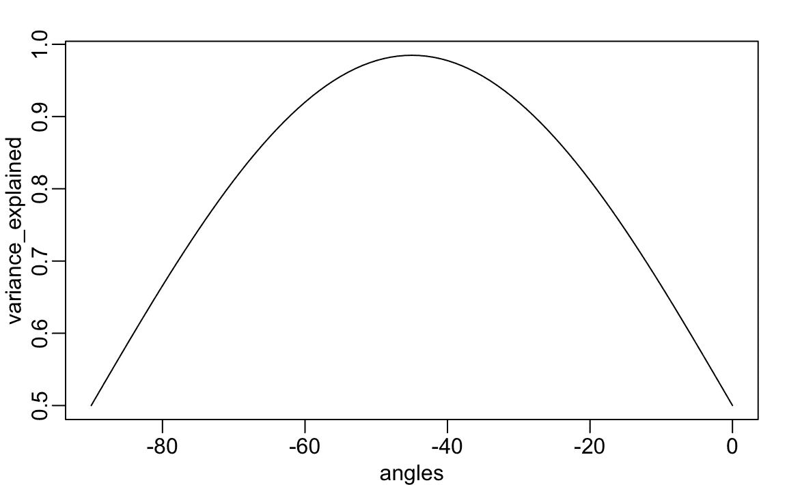*  *我们发现 -45 度的旋转似乎达到了最大值，第一维解释了超过 98% 的总可变性。我们用 $\mathbf{V}$ 表示这个旋转矩阵：

[PRE11]

我们可以使用以下方法旋转整个数据集：

$$ \mathbf{Z} = \mathbf{X}\mathbf{V} $$

[PRE12]

以下动画进一步说明了不同旋转如何影响旋转数据维度的可变性：

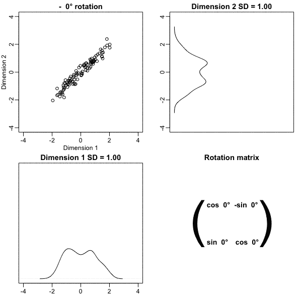

`z` 的第一维被称为 *第一主成分 (PC)*。因为几乎所有变化都可以由这个第一主成分解释，所以 `x` 中行之间的距离可以用仅用 `z[,1]` 计算的距离很好地近似。

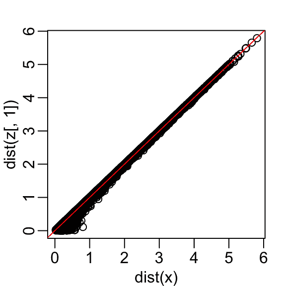

我们还注意到，两组，成人和儿童，可以通过一个数字摘要清楚地观察到，比任何两个原始维度都要好。

[PRE13]

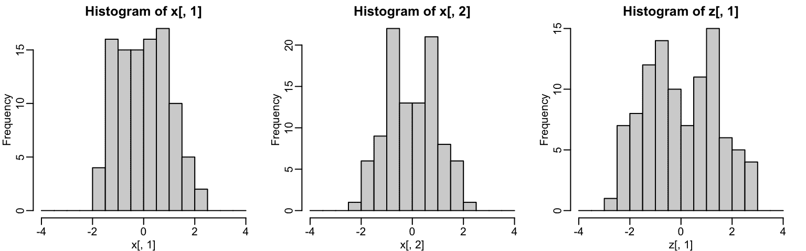*  *我们可以可视化这些，以了解第一成分如何总结数据。在下面的图中，红色代表高值，蓝色代表负值：

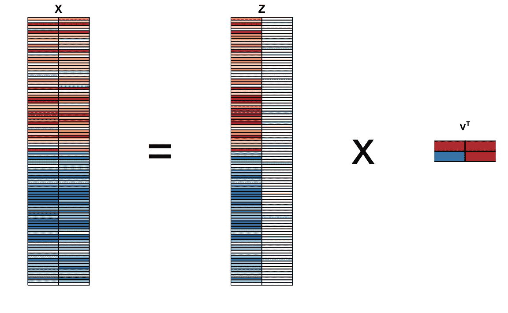

这个想法自然地扩展到超过两个维度。与二维情况一样，我们首先找到一个 $p \times 1$ 的向量 $\mathbf{v}_1$，其 $\|\mathbf{v}_1\| = 1$，并使它最大化

$$ |\mathbf{X}\mathbf{v}_1|. $$

投影 $\mathbf{X}\mathbf{v}_1$ 定义了第一个主成分（PC1）；方向 $\mathbf{v}_1$ 捕获了数据中可能的最大变化。

为了定义第二个主成分，我们寻找另一个与 $\mathbf{v}_1$ 正交的单位向量 $\mathbf{v}_2$，并最大化

$$ |\mathbf{X}\mathbf{v}_2|. $$

投影 $\mathbf{X}\mathbf{v}_2$ 是 PC2，它捕捉了在移除由 PC1 解释的任何变化后的最大剩余变化。

此过程继续：对于每个 $k$，$\mathbf{v}_k$ 是一个单位向量，与 $\mathbf{v}_1, \dots, \mathbf{v}_{k-1}$ 正交，并且最大化投影 $\mathbf{X}\mathbf{v}_k$ 的方差。

一旦找到所有 $p$ 个方向，我们就构建完整的 *旋转矩阵* $\mathbf{V}$ 和相应的 *主成分矩阵* $\mathbf{Z}$：

$$ \mathbf{V} = \begin{bmatrix} \mathbf{v}_1 & \dots & \mathbf{v}_p \end{bmatrix}, \quad \mathbf{Z} = \mathbf{X}\mathbf{V} $$

$\mathbf{Z}$ 的每一列都是一个主成分，而 $\mathbf{V}$ 的列定义了新的旋转坐标系。

距离保持的概念自然地扩展到高维空间。对于一个有 $p$ 列的矩阵 $\mathbf{X}$，变换 $\mathbf{Z} = \mathbf{X}\mathbf{V}$ 保持行之间的成对距离，同时重新定位数据，使得 $\mathbf{Z}$ 的每一列所解释的方差按从大到小的顺序排列。如果 $\mathbf{Z}_j$ 列的方差对于 $j > k$ 非常小，那么这些维度对数据的整体变化以及观测之间的距离的贡献很小。

在这种情况下，我们可以仅使用 $\mathbf{Z}$ 的前 $k$ 列来近似原始行之间的距离。如果 $k \ll p$，这将得到一个维度更低的数据表示，同时仍然保留了数据的本质结构。这是主成分分析（PCA）的关键优势：它允许我们有效地总结高维数据，使得可视化、计算和建模变得更加容易，同时不丢失数据中的主要模式。

PCA 最大化问题的解不是唯一的。例如，$\|\mathbf{X} \mathbf{v}\| = \|-\mathbf{X} \mathbf{v}\|$，所以 $\mathbf{v}$ 和 $-\mathbf{v}$ 都产生相同的主成分方向。同样，如果我们翻转 $\mathbf{Z}$（主成分）中任何列的符号，只要我们也翻转 $\mathbf{V}$（旋转矩阵）中相应的列的符号，我们就可以保持等式 $\mathbf{X} = \mathbf{Z} \mathbf{V}^\top$ 的相等性。这意味着我们可以自由地改变 $\mathbf{Z}$ 和 $\mathbf{V}$ 中任何列的符号，而不会影响 PCA 的结果。* 在 R 中，我们可以使用 `prcomp` 函数找到任何矩阵的主成分：

[PRE14]

请注意，默认行为是在计算主成分之前将 `x` 的列居中，在我们的例子中我们不需要这个操作，因为我们的矩阵已经缩放。

对象 `pca` 包含旋转后的数据 $Z$ 在 `pca$x` 中，以及旋转 $\mathbf{V}$ 在 `pca$rotation` 中。

我们可以看到，`pca$rotation` 的列确实是获得 -45 度旋转的结果（记住符号是任意的）：

[PRE15]

每个列的变化量的平方根包含在 `pca$sdev` 组件中。这意味着我们可以使用以下方法计算每个主成分解释的方差：

[PRE16]

`summary` 函数执行此计算：

[PRE17]

我们还可以看到，我们可以像上面所解释的那样旋转 `x` ($\mathbf{X}$) 和 `pca$x` ($\mathbf{Z}$)：

[PRE18]**************

## ****23.6 示例****

***### 鸢尾花示例

`iris` 数据集是数据分析课程中广泛使用的示例。它包含四个植物测量值，即花瓣长度、花瓣宽度、花萼长度和花萼宽度，来自三个不同物种的花：

[PRE19]

如果你使用 `iris$Species` 检查物种列，你会看到观察结果按物种分组。

当我们可视化观察之间的成对距离时，一个清晰的模式出现：数据似乎聚集成三个不同的组，其中一个物种与其他两个物种明显分离。这种结构与已知的物种标签一致：

[PRE20]

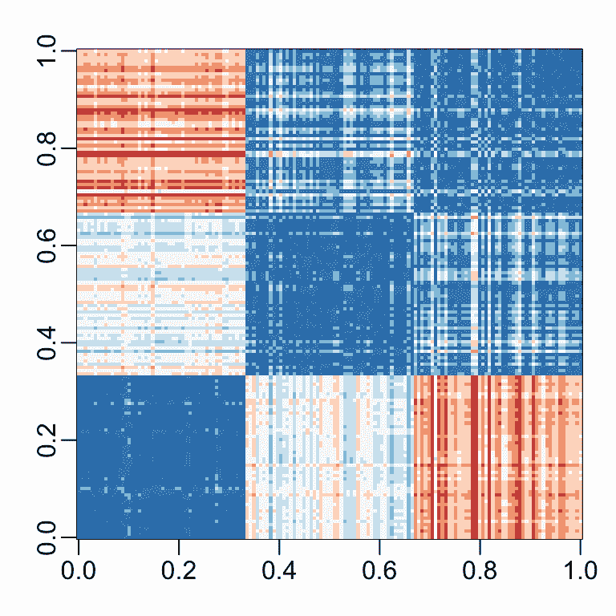*  *我们的特征矩阵有四个维度，但其中三个维度高度相关：

[PRE21]

如果我们对 `iris` 数据集应用 PCA，我们预计前几个主成分将捕捉到数据中的大部分变化。由于原始变量高度相关，PCA 应该允许我们仅使用两个维度来近似观察之间的距离，从而有效地压缩数据同时保留其结构。

我们使用 `summary` 函数来检查每个主成分解释了多少方差：

[PRE22]

前两个维度解释了几乎 98% 的变异性。因此，我们应该能够用两个维度很好地近似距离。我们通过仅使用前两个维度计算距离并与原始数据进行比较来确认这一点：

[PRE23]

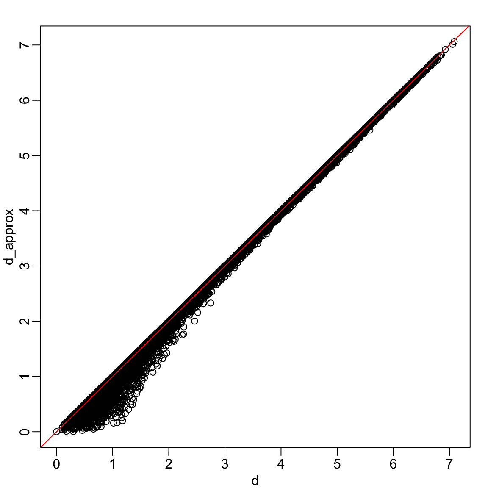*  *这个结果的一个有用应用是，我们现在可以在二维图中可视化观察之间的距离。在这个图中，任何一对点之间的距离近似于原始高维空间中相应观察之间的实际距离。

[PRE24]

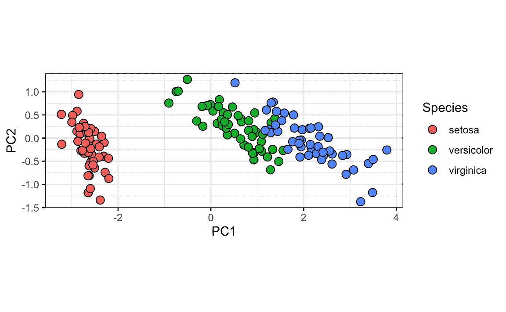*  *我们根据标签给观察结果着色，并注意到，使用这两个维度，我们几乎实现了完美的分离。

更仔细地观察生成的主成分和旋转：

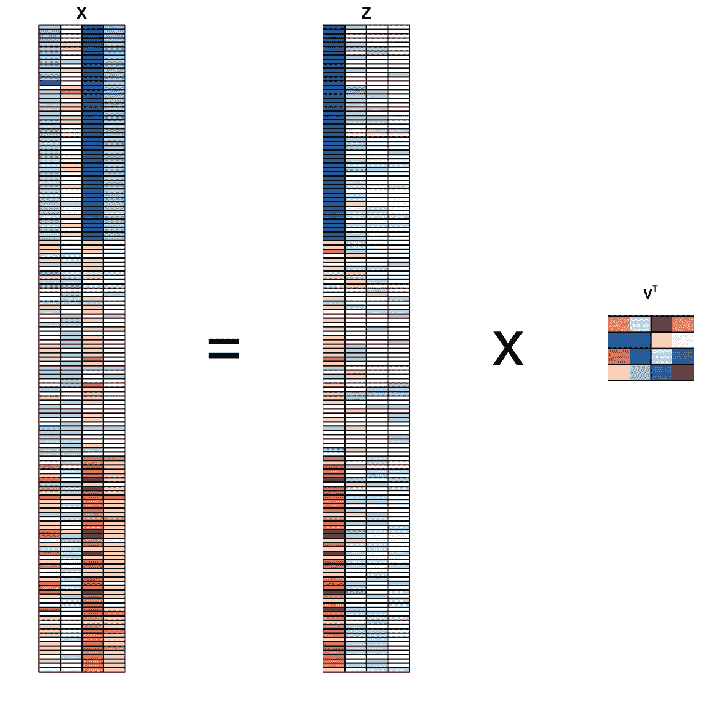

我们了解到第一个 PC 是通过取花萼长度、花瓣长度和花瓣宽度（第一列中的红色）的加权平均值，并减去与花萼宽度成比例的量（第一列中的蓝色）得到的。第二个 PC 是花瓣长度和花瓣宽度的加权平均值，减去花萼长度和花萼宽度的加权平均值。******

### ***MNIST 示例***

**手写数字示例有 784 个特征。是否有数据降维的空间？我们将使用 PCA 来回答这个问题。

如果尚未加载，让我们先加载数据：

[PRE25]

由于像素非常小，我们预计网格上彼此靠近的像素是相关的，这意味着可以进行降维。

让我们计算主成分（PCs）（这需要几秒钟，因为这个矩阵相当大）并检查每个 PC 解释的方差：

[PRE26]

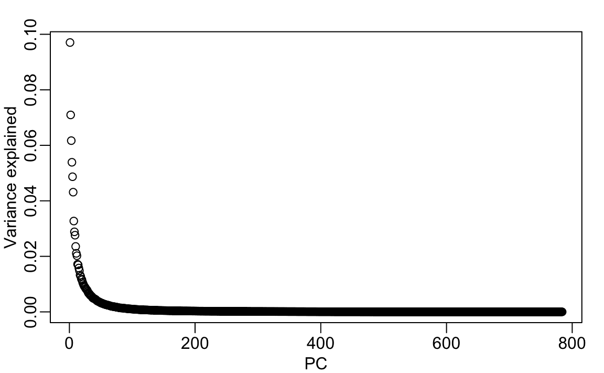*  *我们可以看到前几个 PC 已经解释了大部分的变异性。此外，仅通过查看前两个 PC，我们已看到有关标签的信息。这里是一个 500 个数字的随机样本：

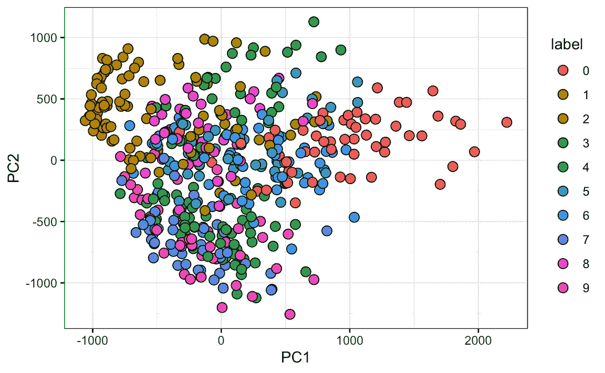

我们还可以*看到*28 $\times$ 28 网格上的旋转值，以了解像素在导致 PCs 的变换中的加权情况：

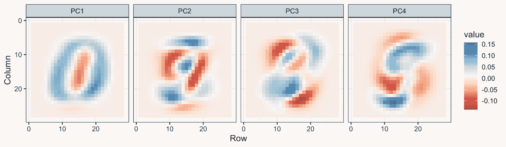

我们可以清楚地看到第一个 PC 似乎将 1（红色）和 0（蓝色）分开。我们还可以在其他三个 PC 中模糊地辨认出数字或数字的部分。通过按数字分层查看 PC，我们获得更深入的见解。例如，我们看到第二个 PC 将 4、7 和 9 与其他数字分开：

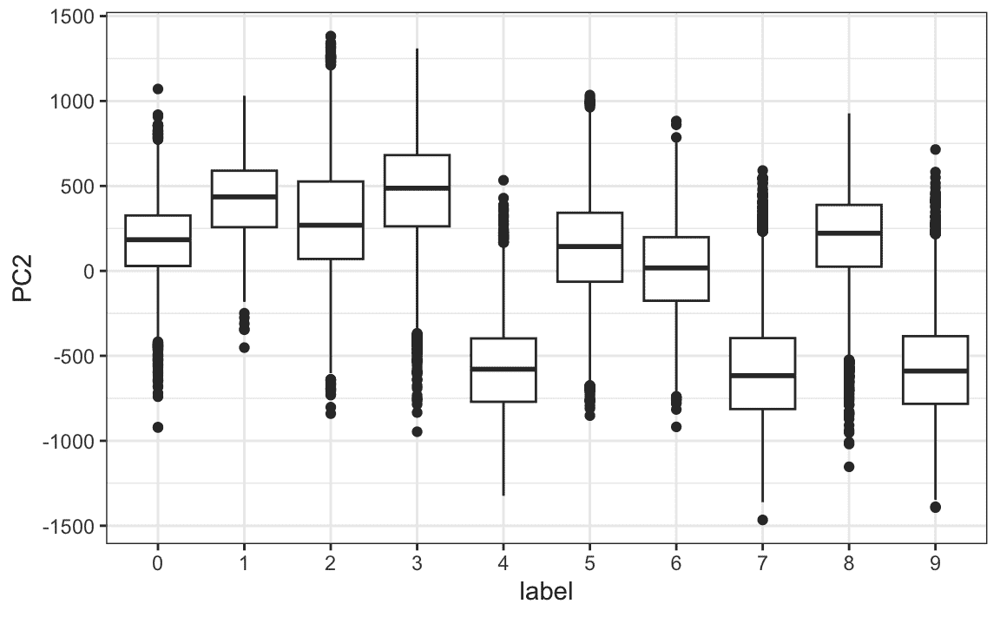

我们还可以确认，具有较低方差的 PCs 似乎与不重要的变异性相关，主要是角落的污迹：

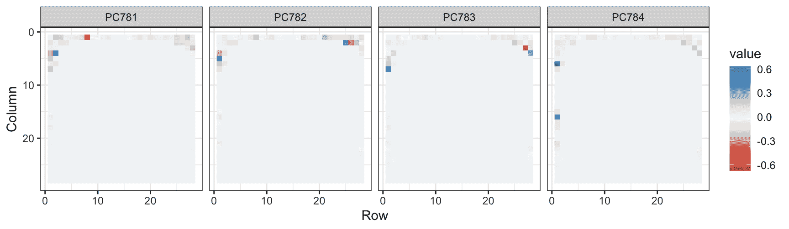*********

## ****23.7 练习****

***1. 我们想通过绘图来探索`tissue_gene_expression`预测值。

[PRE27]

我们希望了解哪些观察值彼此接近，但预测值是 500 维的，因此绘图很困难。用表示组织类型的颜色绘制前两个主成分。

2. 每个观察值的预测值是在相同的测量设备（基因表达微阵列）上通过实验程序测量的。每个观察值使用不同的设备和程序。这可能会引入影响每个观察值所有预测值的偏差。为了探索这种潜在偏差的影响，对于每个观察值，计算所有预测者的平均值，然后将其与第一个 PC 用颜色表示的组织类型进行绘图。报告相关性。

3. 我们看到第一个 PC 与观察值平均值之间存在关联。重新进行 PCA，但先去除中心。

4. 对于前 10 个 PC，制作一个箱线图，显示每个组织的值。

5. 绘制由 PC 编号解释的百分比方差。提示：使用`summary`函数。*****
