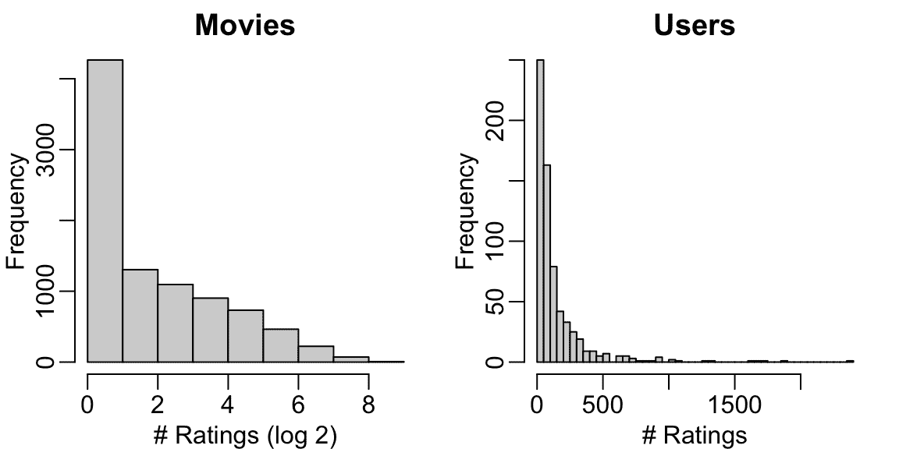
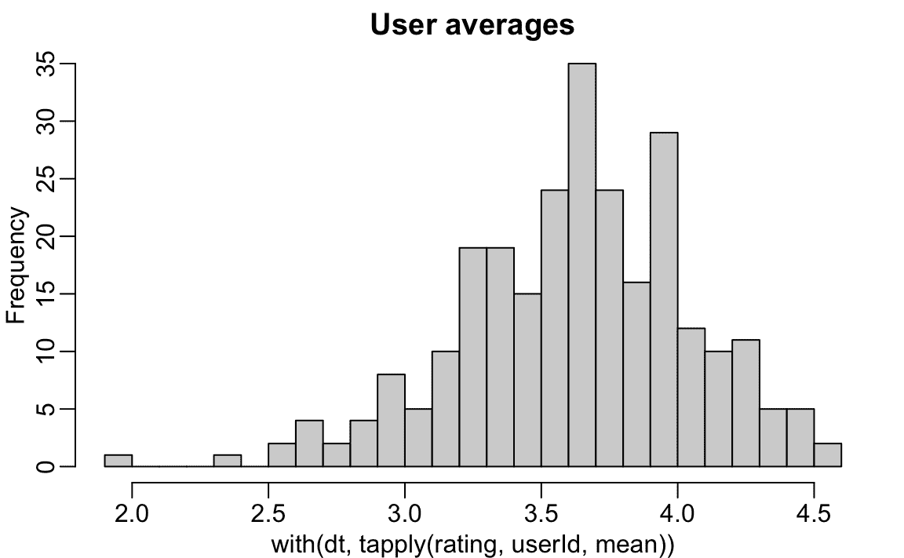
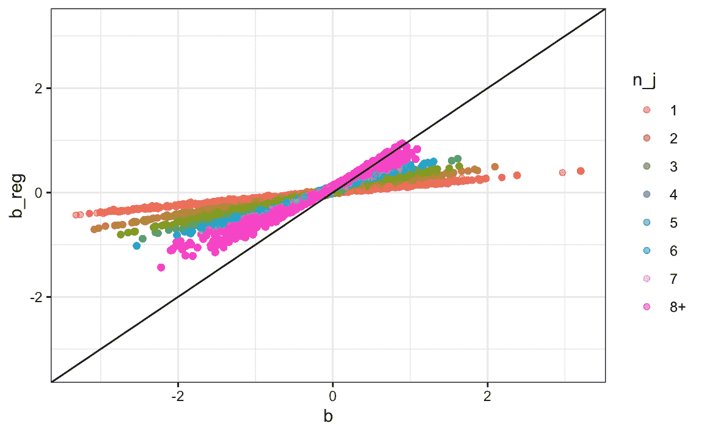
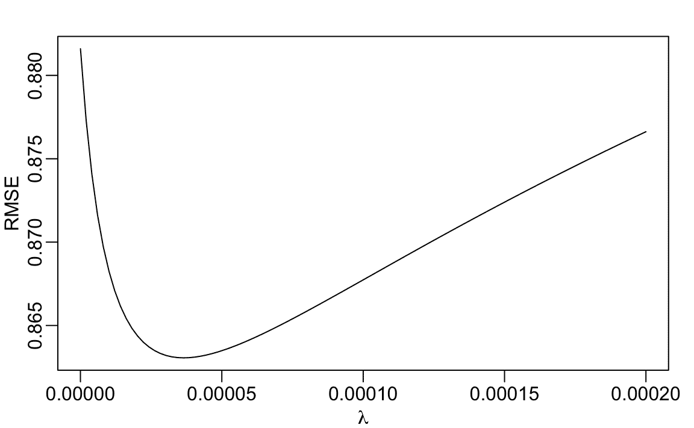

# 24  正则化

> 原文：[`rafalab.dfci.harvard.edu/dsbook-part-2/highdim/regularization.html`](https://rafalab.dfci.harvard.edu/dsbook-part-2/highdim/regularization.html)

1.  高维数据

1.  24  正则化

统计模型旨在捕捉数据中的有意义结构。然而，当模型包含许多参数，或者当某些参数仅由少量观测值提供信息时，拟合值可能会变得不稳定。在这些情况下，最小二乘估计值可能远大于潜在的真实效应。这种现象是一种过拟合形式，可能会导致误导性的解释。

当我们使用拟合模型对新数据进行预测时，这些数据在模型拟合过程中并未使用，此时问题变得尤为明显。一个过拟合的模型通常会生成样本间差异过大的估计值。在本书的下一部分，我们将更详细地描述过拟合，并介绍诊断和防止过拟合的工具。

正则化提供了减少过拟合的最有效通用策略之一。其思路是修改拟合过程，使得大的参数估计值受到惩罚。在实践中，这是通过向我们要最小化的量添加一个惩罚项来实现的，例如平方误差之和。惩罚项会阻止极端估计，尤其是在它们仅由有限数据支持时。结果是得到一个更稳定的模型，其参数估计值在幅度上更小，并且对于训练数据之外的用途更加可靠。

在本章中，我们以电影评分推荐系统为背景介绍正则化。我们从用户和电影特定效应开始，观察最小二乘如何产生不切实际的估计，特别是对于评分非常少的电影。正则化通过将这些不稳定的估计值缩小到零来帮助解决这个问题。在下一章中，我们将在此基础上构建，并展示如何通过潜在因子模型扩展这一思想，这些模型是现代推荐系统的基础。

## 24.1 案例研究：推荐系统

推荐系统，如亚马逊所使用的，通过分析客户对各种产品的评分来运行。这些评分形成了一个大型数据集。系统使用这些数据来预测特定用户对特定产品给予好评的可能性。例如，如果系统预测用户可能会给某本书或小工具一个高评分，它就会向用户推荐该商品。本质上，系统试图根据用户和其他客户对各种商品的评分来猜测用户可能会喜欢的商品。这种方法有助于根据个人偏好个性化推荐。

在其运营的最初几年，Netflix 使用了一个 5 星推荐系统。一颗星表示用户不喜欢这部电影，而五颗星则表示用户非常喜欢它。在这里，我们提供这些推荐是如何做出的基本原理，这受到了*Netflix 挑战*获胜者采取的一些方法的启发。

2006 年 10 月，Netflix 向数据科学界提出了一个挑战：将我们的推荐算法提高 10%，赢得 10 万美元。2009 年 9 月，获胜者揭晓¹。在本章中，我们将展示正则化是如何成为获胜团队策略的重要组成部分²³。

### Movielens 数据

Netflix 数据不是公开可用的，但 GroupLens 研究实验室⁴使用超过 138,000 个用户对 27,000 多部电影进行的超过 2000 万次评分生成了自己的数据库。我们通过**dslabs**包提供这些数据的一个小子集：

```r
library(data.table)
library(dslabs)
movielens |> tibble:::tibble](https://tibble.tidyverse.org/reference/tibble.html)() |> [head(5)
#> # A tibble: 5 × 7
#>   movieId title                      year genres userId rating timestamp
#>     <int> <chr>                     <int> <fct>   <int>  <dbl>     <int>
#> 1      31 Dangerous Minds            1995 Drama       1    2.5    1.26e9
#> 2    1029 Dumbo                      1941 Anima…      1    3      1.26e9
#> 3    1061 Sleepers                   1996 Thril…      1    3      1.26e9
#> 4    1129 Escape from New York       1981 Actio…      1    2      1.26e9
#> 5    1172 Cinema Paradiso (Nuovo c…  1989 Drama       1    4      1.26e9
```

每一行代表一个用户对一部电影给出的评分。

由于我们正在处理一个相对较大的数据集，我们将数据框转换为`data.table`对象，以利用更高效的数据处理。

```r
dt <- as.data.table(movielens)
```

我们可以看到提供了评分的唯一用户数量以及被评分的唯一电影数量：

```r
dt, .(n_users = [uniqueN(userId), n_movies = uniqueN(movieId))]
#>    n_users n_movies
#>      <int>    <int>
#> 1:     671     9066
```

如果我们把这两个数字相乘，得到的数字超过 500 万，但我们的数据集只有大约 10 万行。这告诉我们，并非每个用户都对每部电影进行了评分。事实上，每个用户平均评分的电影数量是 71 部。我们可以将数据视为一个非常大的矩阵，其中用户是行，电影是列，其中包含许多缺失项。电影推荐系统的目标是准确预测这些缺失值。

### 数据探索

让我们来看看数据的一些一般特性，以便通过检查电影评分数量和用户评分数量的直方图来更好地了解挑战：

```r
hist(log2(table(dt$movieId)), 0:9, xlab = "# Ratings (log 2)", main = "Movies")
hist(table(dt$userId), seq(0, 2400, 50), xlab = "# Ratings", main = "Users")
```

*  *我们首先注意到，一些电影的评分远多于其他电影。大多数电影只被评分几次，而少数电影则积累了数百次评分。这种模式并不令人惊讶。流行的、广泛发行的电影往往被许多用户观看和评分，而小众或独立电影则吸引着更小的观众群体。

我们还看到用户之间存在差异，尽管这种差异并不极端。一些用户只对大约 10 部电影进行评分，而其他人则对数十部甚至数百部电影进行评分。

这些不平衡在我们构建模型时将非常重要，因为基于非常少观察的估计本身就不太可靠。

### 准备数据

在我们可以拟合模型或做出预测之前，我们需要将数据塑造成适合分析的形式。我们的目标是开发一个使用历史评分的算法，然后评估它对未用于训练的评分的预测效果有多好。

我们首先关注那些为我们提供了足够信息以便从他们的行为中学习到的用户。在这种情况下，我们只保留至少有 100 个评分的用户：

```r
dt <- as.data.table(movielens)[, if (.N >= 100) .SD, by = userId]
```

为了方便起见，我们将`userId`和`movieId`都转换为字符字符串。这样我们就可以在向量中使用它们作为名称。我们还只保留与这次分析相关的列，以保持打印输出的可管理性：

```r
dt, `:=`(userId = [as.character(userId), movieId = as.character(movieId))]
dt <- dt, [c("userId", "movieId", "title", "rating")]
```

电影标题不一定唯一。例如，这个数据集中包含三部不同的电影，标题都是《金刚》。因此，我们保留`movieId`作为唯一标识符，只保留`title`用于解释和可视化**。为了评估我们的模型，我们将数据分为两部分：

+   一个**训练集**，用于估计参数

+   一个**测试集**，仅用于评估预测准确性

我们在用户级别创建分割，将每个用户的 80%的评分分配给训练集，20%分配给测试集：

```r
set.seed(2006)
indexes <- split(1:nrow(dt), dt$userId)
test_ind <- sapply(indexes, function(i) sample(i, ceiling(length(i) * 0.2)))
test_ind <- sort(unlist(test_ind))
```

然后我们构建两个数据集**：

```r
test_set  <- dt[test_ind,]
train_set <- dt[-test_ind,]
```

由于模型无法对它从未见过的电影做出预测，我们从测试集中移除了不在训练集中的任何电影**：

```r
test_set <- test_setmovieId [%in% train_set$movieId]
```

这为我们提供了一个一致的训练和测试框架，我们将在本章中一直使用**。

### 损失函数

为了描述我们的模型及其估计，我们使用在第 17.6 节中引入的数组表示法。我们用$y_{ij}$表示用户$i$对电影$j$给出的评分**。

虽然符号$y_{ij}$暗示了一个完整的$I \times J$评分矩阵，但在实践中，我们并没有观察到这些值中的大多数。如果有$I$个用户和$J$部电影，完整的评分矩阵将包含$I \times J$个条目。然而，观察到的评分数量，我们用$N$表示，要小得多，因为大多数用户只对所有电影中的一小部分进行评分。以下，一个写成$\sum_{i,j}$的求和是理解在$N$个观察到的对$(i,j)$上运行，而不是在所有可能的组合上运行**。

注意，我们以`data.table`而不是矩阵的形式存储数据，因为完整的矩阵表示几乎完全是`NA`**。*Netflix 挑战定义了获胜的条目为在测试集上最小化均方根误差（RMSE）的条目。如果$y_{ij}$是测试集中的观察评分，$\hat{y}_{ij}$是仅使用训练集做出的相应预测，则 RMSE 为**：

$$ \mbox{RMSE} = \sqrt{\frac{1}{N} \sum_{i,j} (y_{ij} - \hat{y}_{ij})²} $$

在这里，$N$是测试集中的评分数量，求和是针对这些评分进行的。

我们可以将 RMSE 解释为与评分相同的单位。它的行为很像标准差：它代表我们预测中的典型误差大小。大于 1 的值意味着，平均而言，我们的预测评分偏离了一个以上的星级，这是不希望的。

为了方便计算任何残差向量的 RMSE，我们定义：

```r
rmse <- function(r) sqrt(mean(r²))
```

我们在第二十九章更正式地讨论了均方误差**。

### 最简单的模型

我们开始于最简单的推荐系统。假设我们忽略所有关于用户和电影的信息，并为每个用户-电影对预测相同的评分。在这种情况下，唯一的问题是：我们应该使用哪个单一数字？

我们可以使用一个模型来回答这个问题。假设所有评分都来自相同的潜在值 $\mu$，随机变化解释了我们观察到的差异：

$$ Y_{ij} = \mu + \varepsilon_{ij} $$

这里 $\varepsilon_{ij}$ 代表具有均值为 0 的独立误差，而 $\mu$ 是所有用户和电影的真实平均评分。

使 RMSE 最小的 $\mu$ 值是最小二乘估计，在这种情况下，它只是训练集中所有评分的平均值：

```r
mu <- mean(train_set$rating)
```

如果我们用这个单一值预测测试集中的每个评分，得到的 RMSE 是：

```r
rmse(test_set$rating - mu)
#> [1] 1.04
```

从数学上讲，这个选择对这个模型是最优的。任何其他数字都会导致更大的 RMSE。例如：

```r
rmse(test_set$rating - 3)
#> [1] 1.17
```

这种简单的方法提供了一个有用的基线。然而，它远远达不到赢得 Netflix 挑战赛所需的性能，该挑战要求 RMSE 大约为 0.857 才能赢得一百万美元的奖金。我们应该通过将更多结构纳入模型来做得更好**。

### 用户效应

一个自然的问题是所有用户是否都以相同的方式评分电影。一些用户倾向于给出非常高的评分，而其他人很少给出超过三个星级的评分。为了看到这一点，我们计算每个用户的平均评分：

```r
hist(with(dt, tapply(rating, userId, mean)), nclass = 30, main = "User averages")
```

*  *直方图显示了显著的变化。这表明，评分之间的某些差异可以通过用户对评分的慷慨程度或严格程度来解释，而不管被评分的电影是什么。

为了解决这个问题，我们将我们的模型扩展到包括用户特定的效应 $\alpha_i$：

$$ Y_{ij} = \mu + \alpha_i + \varepsilon_{ij} $$

在这里，$\mu$ 代表整体平均评分，而 $\alpha_i$ 捕捉用户 $i$ 偏离该平均程度的大小。统计学教科书通常将 $\alpha_i$ 称为处理效应。在 Netflix 奖项文献中，它们通常被称为 *偏差项*。

这是一个线性模型，因此我们可以使用 `lm()` 来拟合模型：

```r
fit <- lm(rating ~ userId, data = train_set)
```

然而，在这个数据集中，用户效应参数的数量是：

```r
uniqueN(train_set$userId)
#> [1] 263
```

因此，我们需要数百个虚拟变量，这使得拟合模型在计算上效率低下。

幸运的是，对于这个模型，我们可以直接推导出最小二乘估计。估计 $\hat{\alpha}_i$ 简单地是用户 $i$ 的 $y_{ij} - \hat{\mu}$ 的平均值：

```r
mu <- mean(train_set$rating)
user_avgs <- train_set, .(avg = [mean(rating - mu)), by = userId]
```

我们将这些值存储在一个命名向量中，这使得我们可以轻松地查找每个用户的效应**：

```r
a <- setNames(user_avgs$avg, user_avgs$userId)
```

从这一点开始，我们使用`a`来表示用户效果估计向量$\hat{\alpha}_i$，稍后我们将使用`b`来表示电影效果估计。在代码中，为了方便，我们省略了帽子符号，但在数学表达式中，我们将继续写$\hat{\alpha}_i$和$\hat{\beta}_j$以明确这些是估计值。

在$\hat{\alpha}$的估计到位后，我们使用以下方法预测评分：

$$ \hat{y}_{ij} = \hat{\mu} + \hat{\alpha}_i $$

由于评分总是在 0.5 到 5 之间，我们定义一个辅助函数来强制执行此约束：

```r
clamp <- function(x, lower = 0.5, upper = 5) pmax(pmin(x, upper), lower)
```

我们使用在训练集上获得的估计值来预测测试集，然后评估 RMSE：

```r
resid <- with(test_set, rating - clamp(mu + a[userId]))
rmse(resid)
#> [1] 0.949
```

RMSE 下降，这证实了用户效果提高了我们的预测。但用户并不是唯一的变量来源。有些电影比其他电影更受欢迎。我们接下来解决这个问题。

### 电影效果

用户在评分电影方面存在差异，但电影本身在接收方面也存在差异。有些电影广受欢迎，而有些电影则始终收到低评分。为了捕捉这种变量来源，我们通过添加一个特定于电影的效应$\beta_j$来扩展我们的模型：

$$ Y_{ij} = \mu + \alpha_i + \beta_j + \varepsilon_{ij} $$

这里，$\beta_j$表示电影$j$在考虑用户倾向后，偏离整体平均评分$\mu$的程度。

在原则上，我们可以使用最小二乘法一次性估计所有用户和电影效果：

```r
fit <- lm(rating ~ userId + movieId, data = train_set)
```

然而，这需要创建数千个指示变量，每个用户和一个电影。结果的设计矩阵很大且稀疏，使得`lm()`对于这个目的效率低下。

相反，我们使用一个*交替最小二乘法（ALS）*算法。这是一个依赖于两个事实的迭代方法：

+   如果$\mu$和$\alpha_i$是已知的，$\beta_j$的最小二乘估计是用户评分电影$j$上$y_{ij} - \mu - \alpha_i$的平均值。

+   如果$\mu$和$\beta_j$是已知的，$\alpha_i$的最小二乘估计是用户$i$评分的电影上$y_{ij} - \mu - \beta_j$的平均值。

通过交替这些更新，估计值收敛到最小二乘解。

```r
fit <- copy(train_set)
mu <- mean(fit$rating)
fit[, `:=`(a = 0, b = 0)]  # starting values
 for (iter in 1:100) {
 a_old <- copy(fit$a)
 b_old <- copy(fit$b)

 fit, a := [mean(rating - mu - b), by = userId]
 fit, b := [mean(rating - mu - a), by = movieId]

 if (max(c(abs(fit$a - a_old), abs(fit$b - b_old))) < 1e-6) break
}
```

然后我们将用户和电影效果提取到一个命名向量中：

```r
a <- setNames(fit$a, fit$userId)
b <- setNames(fit$b, fit$movieId)
```

当用户和电影效果都到位时，我们的预测为：

$$ \hat{y}_{ij} = \hat{\mu} + \hat{\alpha}_i + \hat{\beta}_j $$

测试集预测的 RMSE 结果为：

```r
resid <- with(test_set, rating - clamp(mu + a[userId] + b[movieId]))
rmse(resid)
#> [1] 0.882
```

这进一步减少了误差，证实了包括用户和电影效果可以提高预测准确性。然而，这些估计仍然可能不稳定，特别是对于只有少数评分的电影。

### 过度拟合

如果我们检查具有最大估计电影效果$\hat{\beta}_j$的电影，我们会发现它们都是冷门电影，只有单一评分：

```r
top_movies <- names(bb == [max(b)])
train_set, .(n = .N), by = .(movieId, title)][movieId [%in% top_movies]
#>    movieId                                         title     n
#>     <char>                                        <char> <int>
#> 1:    1450 Prisoner of the Mountains (Kavkazsky plennik)     1
#> 2:    4076                                     Two Ninas     1
#> 3:    4591                               Erik the Viking     1
#> 4:    4930                             Funeral in Berlin     1
#> 5:    5427                                       Caveman     1
```

我们真的相信这些是数据库中最好的电影吗？这些所谓的顶级评分电影都没有出现在测试集中。为了进一步调查，让我们检查所有估计效应 $\hat{\beta}_j \ge 2$ 的电影：

```r
top_movies <- names(b[b > 2])
length(top_movies)
#> [1] 16
```

这 16 部电影中所有电影的评分最多只有两次：

```r
range(table(train_setmovieId [%in% top_movies]$movieId))
#> [1] 1 2
```

我们在测试集中对这些电影的每一个预测都是一个高估：

```r
range(resid[with(test_set, which(movieId %in% top_movies))])
#> [1] -1.41 -0.50
```

这是一个明显的 *过拟合* 例子。仅被评分一次或两次的电影可以通过偶然的机会获得非常大的正（或负）估计。支持的观察结果越少，估计的变异性就越大。这些不稳定的估计导致预测误差很大，进而增加了 RMSE。

在本书的早期，当我们面临不确定性时，我们依赖于标准误差或置信区间来传达它。但在进行预测时，我们无法提供一个范围。我们必须选择一个单一的数字，即使估计是不可靠的。

这就是 *正则化* 变得至关重要的地方。正则化在基于小样本时将极端估计缩小到零，从而产生更稳定和可靠的预测。在下一节中，我们将介绍惩罚最小二乘法，这是一种实现这种缩放的原则性方法。

## 24.2 惩罚最小二乘法

在前一节中，我们看到了最大的电影效应估计来自只有一两个评分的电影。这些估计是不稳定的，由此产生的预测可能非常不准确。这是一个经典的 *过拟合* 例子，其中估计变得过大，因为它们依赖于太少的样本数据。

在线性模型中解决过拟合的一个常见方法是添加一个将大系数缩小到零的 *惩罚*。这种方法被称为 *惩罚最小二乘法*，当惩罚是二次的时，也称为 *岭回归*。

### 一个通用的公式

为了在一个更熟悉的环境中描述这个想法，我们暂时从推荐问题中使用的矩阵符号 $y_{ij}$ 切换到具有结果 $y_i$ 和协变量 $x_{i1}, \dots, x_{ip}$ 的标准线性模型：

$$ Y_i = \beta_0 + \sum_{j=1}^p x_{ij}\beta_j + \varepsilon_i, \quad i = 1, \dots, N $$

如果 $p$ 很大，普通最小二乘法可能会过拟合。惩罚最小二乘法通过最小化来解决此问题：

$$ \frac{1}{N}\sum_{i=1}^N \left[ y_i - \left(\beta_0 + \sum_{j=1}^p x_{ij}\beta_j\right)\right]² + \lambda \sum_{j=1}^p \beta_j² $$

第一个项是通常的均方误差。第二个项通过调整参数 $\lambda$ 控制我们如何强烈地惩罚它们，来阻止大系数。截距 $\beta_0$ 通常不受惩罚，因为我们通常知道数据不是以 0 为中心的。

这种方法被称为 *岭回归*。R 中的 `MASS` 包提供了 `lm.ridge` 函数，用于使用惩罚最小二乘法拟合模型：

```r
library(MASS)
fit <- lm.ridge(y ~ x, lambda = 0.001)
```

然而，这个函数对于有数千个指示变量的模型效率不高，就像我们在电影评分应用中那样。在下面的章节中，我们使用受罚最小二乘法，但为了找到估计值，我们实现了 第 24.1.7 节 中描述的 ALS 算法。

你可能注意到，一些受罚最小二乘的定义包括未除以 $N$ 的残差平方和（RSS），而另一些则除以 $N$ 以形成均方误差（MSE）。两种公式在数学上是有效的，并且如果 $\lambda$ 被适当缩放，它们会导致相同的极小化值。

然而，除以 $N$ 有一个重要的实际优势。它使得第一项的规模对数据集大小不那么依赖，因此相同的 $\lambda$ 值在不同的数据集大小中具有类似的解释。MASS 包中的 `lm.ridge` 函数使用这个约定，我们在这里遵循它以保持一致性。

### 对电影效应应用罚则

回到我们的设置，我们希望将电影效应 $\beta_j$ 收缩到零，尤其是当它们只基于少量评分时。我们不是最小化：

$$ \sum_{i,j} \left[y_{ij} - (\mu + \alpha_i + \beta_j) \right]², $$

我们最小化受罚版本：

$$ \frac{1}{N}\sum_{i,j} \left[y_{ij} - (\mu + \alpha_i + \beta_j) \right]² + \lambda \left( \sum_i \alpha_i² + \sum_j \beta_j²\right) $$

对于这个模型，如果我们知道 $\mu$ 和 $\beta_j$，我们可以推导出一个闭式解，以最小化受罚的平方和：

$$ \hat{\alpha}_i(\lambda) = \frac{1}{n_i + N\lambda} \sum_{j=1}^{n_i} \left(y_{ij} - \mu - \beta_j\right) $$ 其中 $n_i$ 是用户 $i$ 的评分数量，$N$ 是总的评分数量。

类似地，如果我们知道 $\mu$ 和 $\alpha_i$，我们可以推导出 $\beta_j$ 的解：

$$ \hat{\beta}_j(\lambda) = \frac{1}{n_j + N\lambda} \sum_{i=1}^{n_j} \left(y_{ij} - \mu - \alpha_i\right) $$

其中 $n_j$ 是电影 $j$ 的评分数量。

罚款的效果是明显的。如果 $n_j$ 很大，$n_j + N\lambda \approx n_j$，收缩最小，$\hat{\beta}_j(\lambda)$ 实质上成为一个平均值。如果 $n_j$ 很小，估计值会被强烈地拉向 0。$\lambda$ 越大，拉力越大。

### 通过 ALS 估计参数

由于 `lm.ridge` 在我们的设置中效率不高，我们有数千个指示变量和一个非常稀疏的设计，所以我们改用之前介绍过的相同交替最小二乘（ALS）策略。关键的区别在于，我们现在用受罚版本替换电影效应更新，当电影只有少量评分时，这种更新会更强地收缩估计值。

为了方便起见，我们定义了一个辅助函数 `fit_als`，它接受一个 `lambda` 值并返回一个包含用户和电影效果的正规化估计值的 `train_set` 的副本。这个函数专门针对我们的电影评分示例。它假设 `train_set` 在环境中可用。

```r
fit_als <- function(lambda, tol = 1e-6, max_iter = 100) {
 fit <- copy(train_set)
 N <- nrow(fit)
 mu <- mean(fit$rating)
 fit[, `:=`(a = 0, b = 0)]  # starting values
 for (iter in 1:max_iter) {
 a_old <- copy(fit$a)
 b_old <- copy(fit$b)

 fit, a := [sum(rating - mu - b)/(.N + N*lambda) , by = userId]
 fit, b := [sum(rating - mu - a)/(.N + N*lambda), by = movieId]

 delta <- max(c(abs(fit$a - a_old), abs(fit$b - b_old)))
 if (delta < tol) break
 }
 return(with(fit, list(mu = mu, a = setNames(a, userId), b = setNames(b, movieId))))
}
```

这种实现交替更新用户效果 `a` 和电影效果 `b` 的惩罚估计，直到更新小于 `tol` 或我们达到 `max_iter`。最终结果是每个电影的正规化电影效果：

```r
fit <- fit_als(lambda = 0.0001)
mu <- fit$mu; a_reg <- fit$a; b_reg <- fit$b
```

注意，在这个例子中我们使用 $\lambda = 0.0001$。在 第 24.3 节 中，我们描述了一种数据驱动的方法来选择 $\lambda$，以优化预测精度。

### 收缩行为

我们可以通过将它们相互绘制来比较惩罚估计和未惩罚估计：



我们注意到评分较少的电影被大幅缩小：正则化版本比原始版本更接近于 0。评分较多的电影基本保持不变：点接近于身份线。

### 改进的结果

让我们看看在惩罚模型下的前 5 部电影：

```r
top_movies <- names(sort(-b_reg[unique(names(b_reg))])[1:5])
train_set, .(n = .N), by = .(movieId, title)][movieId [%in% top_movies]
#>    movieId                     title     n
#>     <char>                    <char> <int>
#> 1:     296              Pulp Fiction   155
#> 2:     858            Godfather, The   112
#> 3:      50       Usual Suspects, The   111
#> 4:     318 Shawshank Redemption, The   131
#> 5:    1252                 Chinatown    49
```

这些比之前的一评级电影列表更有说服力。

最后，我们评估了 RMSE：

```r
resid <- with(test_set, rating - clamp(mu + a_reg[userId] + b_reg[movieId]))
rmse(resid)
#> [1] 0.868
```

RMSE 有所提高，证实了正则化稳定了估计并减少了过度

## 24.3 选择惩罚项

正则化参数 $\lambda$ 控制我们缩小电影效果的程度。如果 $\lambda$ 太小，我们不会减少过度拟合。如果它太大，我们会缩小太多，从而失去有用的信号。

在 第二十九章 中，我们介绍了选择调整参数的正式方法。在这里，为了说明目的，我们采取了一种简单的方法：我们计算了一系列 $\lambda$ 值的 RMSE，并选择在测试集上表现最好的一个。

我们考虑了 0 到 0.0002 之间的 100 个值：

```r
lambdas <- seq(0, 0.0002, length.out = 100)
rmses <- sapply(lambdas, function(lambda) { 
 fit <- fit_als(lambda)
 resid <- with(test_set, rating - clamp(fit$mu + fit$a[userId] + fit$b[movieId]))
 rmse(resid)
})
```

然后我们将 RMSE 作为 $\lambda$ 的函数绘制出来：

```r
plot(lambdas, rmses, type = "l", xlab = expression(lambda), ylab = "RMSE")
```

*  *我们看到一个明显的最小值。最佳值是：

```r
best_lambda <- lambdas[which.min(rmses)]
best_lambda
#> [1] 3.64e-05
```

我们现在使用这个值重新拟合模型：

```r
fit <- fit_als(best_lambda)
```

并计算最终的 RMSE：

```r
resid <- with(test_set, rating - clamp(fit$mu + fit$a[userId] + fit$b[movieId]))
rmse(resid)
#> [1] 0.863
```

这个结果证实了正则化提高了我们的预测精度。下表比较了这一 RMSE 与早期模型获得的值。

| 模型 | RMSE |
| --- | --- |
| 仅平均值 | 1.040 |
| 用户效果 | 0.949 |
| 用户 + 电影效果 | 0.882 |

| 正规化 | 0.863 |

## 24.4 练习

对于练习 1-8，我们将使用以下模拟：一位教育专家正在倡导建立较小的学校。这位专家的推荐基于这样一个事实：在表现最好的学校中，许多都是小规模的。让我们为 1000 所学校模拟一个数据集。首先，让我们模拟每所学校的学生人数。

```r
set.seed(1986)
n <- round(2^rnorm(1000, 8, 1))
```

现在让我们为每所学校分配一个*真实*的质量，这个质量完全独立于规模。这是我们想要估计的参数，它代表了该校平均学生在能力测试中会得到的分数。我们模拟这个值如下：

```r
mu <- round(80 + 2 * rt(1000, 5))
```

现在让我们构建一个数据集：

```r
schools <- data.frame(id = sprintf("PS%03d", 0:999), size = n, quality = mu, 
 rank = rank(-mu))
```

我们可以看到，前 10 所学校是：

```r
library(dplyr
schools |> top_n(10, quality) |> arrange(desc(quality))
```

现在让该校的学生参加考试。每个学校的学生之间存在差异，因此考试分数也会有随机性，所以我们将模拟考试分数，使其呈正态分布，平均成绩由学校质量决定，标准差为 30 个百分比点：

```r
scores <- sapply(1:nrow(schools), function(i)
 rnorm(schools$size[i], schools$quality[i], 30))
schools <- schools |> mutate(score = sapply(scores, mean))
```

1. 根据平均分数，哪些是顶尖学校？只显示 ID、规模和平均分数。

2. 将中等学校规模与基于分数的前 10 所学校的平均学校规模进行比较。

3. 根据这次测试，看起来小学校比大学校好。前 10 所学校中有 5 所学生人数在 100 人或以下。但这怎么可能呢？我们构建的模拟使得质量和规模是独立的。重复进行最差的 10 所学校的练习。

4. 对于最差的学校也是如此：它们也很小。绘制平均分数与学校规模的关系图，看看发生了什么。突出显示基于*真实*质量的前 10 所学校。使用对数尺度转换规模。

5. 我们可以看到，当学校规模较小时，分数的标准误差变异性更大。这是我们学习概率和推理部分的基本统计现实。

让我们使用正则化来挑选最好的学校。记住，正则化会将偏离平均值的差异缩小到 0。因此，为了应用正则化，我们首先需要将我们要缩小的值居中。让我们称它为`theta`：

```r
schools <- mutate(schools, theta = score - mean(score))
```

使用本章中显示的惩罚最小二乘估计的封闭形式解来证明我们可以通过将`theta`乘以`size/(size + 1000*lambda)`来找到正则化估计。尝试`lambda = 0.05`并检查基于此正则化估计的前 10 所学校。

6. 注意这略微提高了我们的结果：错误地高度排名的小学校数量减少了。但是，是否有更好的`lambda`？找到使 RMSE = $1/100 \sum_{i=1}^{100} (\mbox{school quality} - \mbox{estimate})²$最小化的`lambda`。

7. 根据最佳平均成绩对学校进行排名。请注意，没有小学校被错误地包含在内。

8. 使用正则化时常见的错误是将不围绕 0 的值缩小到 0。例如，如果我们不先减去整体平均值，实际上并没有改善结果。通过重新运行练习 5、6 和 7 中的代码来确认这一点，但不移除整体平均值。

剩余的练习使用`movielens`数据。请注意，并非所有这些练习都需要正则化来解决，一些练习侧重于数据探索或使用本章中介绍的其他想法构建模型。

9. 在本章中给出的示例中，我们移除了评分少于 100 的用户。现在重新进行分析，不要过滤掉这些用户。实现一个同时惩罚用户和电影效果的分析：

$$ \frac{1}{N}\sum_{i,j} \left[y_{ij} - (\mu + \alpha_i + \beta_j) \right]² + \lambda \left( \sum_i \alpha_i² + \sum_j \beta_j²\right). $$

注意，您将不得不编辑`fit_als`函数。

10. 重复练习 9，但现在使用具有*两个*单独惩罚项的模型：

$$ \frac{1}{N}\sum_{i,j} \left[y_{ij} - (\mu + \alpha_i + \beta_j)\right]² + \lambda_1 \sum_i \alpha_i² + \lambda_2 \sum_j \beta_j². $$

在这里，$\lambda_1$控制应用于用户效果$\alpha_i$的收缩量，而$\lambda_2$控制应用于电影效果$\beta_j$的收缩量。

为了优化两个调整参数，在合理的$(\lambda_1, \lambda_2)$对范围内进行网格搜索，并选择在测试集上最小化 RMSE 的组合。

我们建议在开发解决方案时降低你的 ALS 实现中的`tol`参数，因为这将在网格搜索期间加快计算速度。

11. 使用`movielens`数据集来探索评分如何随三个关键因素变化：*评分数量*上映年份*类型

执行以下操作：

+   计算每部电影的评分数量，并将其与电影的上映年份进行比较。对计数使用平方根转换。

+   只保留 1993 年或之后上映的电影。在这些电影中，计算自上映以来的*每年评分数量*。报告评分数量最高的 25 部电影及其平均评分。

+   按每年评分数量（例如，20 个区间或分位数）对这些相同的电影进行分层，并计算每个分层的平均评分。

+   绘制平均评分与每年评分数量的关系图。

12. `movielens`数据还包括一个时间戳。*将时间戳转换为日期（提示：使用lubridate::as_datetime）。* 计算每周的平均评分（提示：使用`round_date`和`group_by`）。在 x 轴上绘制时间，在 y 轴上绘制每周平均评分。* 解释趋势。时间效应看起来合理吗？

13. `movielens`数据还包括一个`genres`。*将`genres`中的每个*唯一组合*视为一个类别。*计算每个类别的平均评分及其标准误差。*制作误差条形图。

14. 根据你在练习 12 中的探索，以下哪个模型看起来最合适？

1.  $Y_{ij} = \mu + \alpha_i + \beta_j + t_{ij} + \varepsilon_{ij}$

1.  $Y_{ij} = \mu + \alpha_i + \beta_j + \gamma , t_{ij} + \varepsilon_{ij}$

1.  $Y_{ij} = \mu + \alpha_i + \beta_j + \gamma , t_{ij} + \delta_{g(j)} + \varepsilon_{ij}$

1.  $Y_{ij} = \mu + \alpha_i + \beta_j + f(t_{ij}) + \delta_{g(j)} + \varepsilon_{ij}$

其中 $g(j)$ 是电影 $j$ 的类型类别，$f(t)$ 是 $t$ 的平滑函数。

15. 使用你上面学到的知识，至少拟合一个比本章中展示的最佳模型（用户+电影效果模型，带有正则化）改进的模型：

你可以选择（可选）包括：

+   a. 类型效应

+   a. 时间效应

+   年度评分作为电影级别的协变量

+   或者你发现的任何其他内容

使用 RMSE 评估你的模型在保留的测试集上的表现。

将你的结果与本章前面报告的 RMSE 值进行比较。

简短地反思以下内容：

+   哪些变量帮助最大？

+   是否有任何添加了噪声而不是信号？

+   你取得了多少改进？

* * *

1.  http://bits.blogs.nytimes.com/2009/09/21/netflix-awards-1-million-prize-and-starts-a-new-contest/↩︎

1.  http://blog.echen.me/2011/10/24/winning-the-netflix-prize-a-summary/↩︎

1.  https://www2.seas.gwu.edu/~simhaweb/champalg/cf/papers/KorenBellKor2009.pdf↩︎

1.  https://grouplens.org/↩︎
