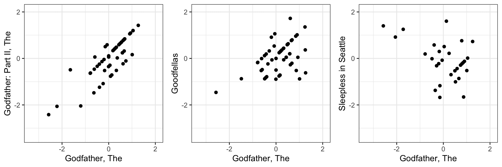
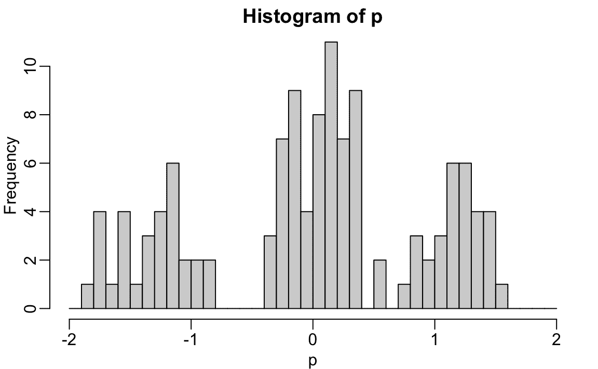
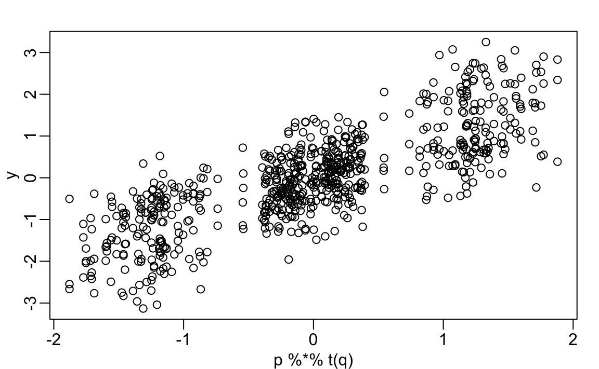
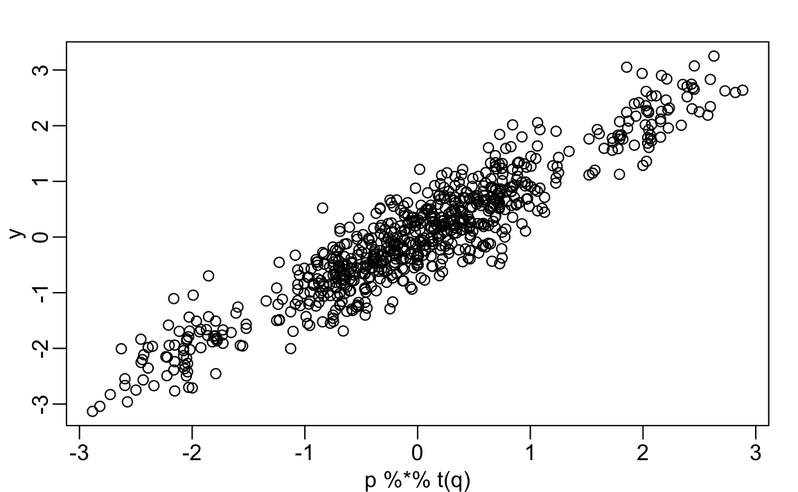
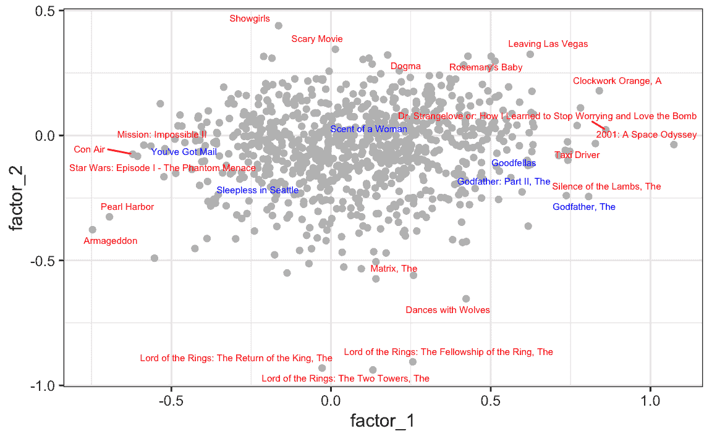

# 25  隐含因子模型

> 原文：[`rafalab.dfci.harvard.edu/dsbook-part-2/highdim/latent-factor-models.html`](https://rafalab.dfci.harvard.edu/dsbook-part-2/highdim/latent-factor-models.html)

1.  高维数据

1.  25  隐含因子模型

许多数据问题涉及我们无法直接看到结构的大型矩阵。隐含因子模型提供了一种强大的方法来揭示这种隐藏结构。关键思想是，观察到的数据通常反映了少量未观察（潜在）特征的影响。这些潜在因素捕捉到诸如相似个体群体、相似物品群体或驱动观察值共享的潜在属性的模式。

在上一章中，我们介绍了该模型

$$ Y_{ij} = \mu + \alpha_i + \beta_j + \varepsilon_{ij} $$

用于描述电影评分。此模型通过 $\alpha_i$ 考虑用户之间的差异，通过 $\beta_j$ 考虑电影之间的差异。然而，它将所有电影和所有用户视为在这些简单平均值之外无关。在实践中，我们知道电影群体往往受到相同类型用户的喜爱，用户群体也倾向于对相同类型的电影给出相似的评分。这种共享结构仅由用户和电影效应本身无法捕捉。

为了看到这一点，我们计算残差

$$ r_{ij} = y_{ij} - (\hat{\mu} + \hat{\alpha}_i + \hat{\beta}_j) $$

通过使用上一章中定义的 `fit_als` 函数，将模型拟合到 `train_set` 数据集，

```r
fit <- fit_als(lambda = 3.636364e-05)
train_set[, resid := rating - clamp(fit$mu + fit$a[userId] + fit$b[movieId])]
```

并与三部其他电影的残差进行比较：*



这些相关性从强正相关到负相关不等。具体来说，*教父*与*教父续集*、*好家伙*和*西雅图未眠夜*的相关性分别为 0.84、0.49 和-0.42。喜欢*教父*的用户也倾向于喜欢*教父续集*和*好家伙*，但通常不喜欢*西雅图未眠夜*。这类关系是因为电影共享潜在特征：类型、风格、时代或受众吸引力。同样，用户也有潜在特质，使他们更倾向于某些类型的电影而不是其他类型的电影。

隐含因子模型旨在捕捉这种类型的结构。它们不是估计数千个单独的参数，而是通过少量潜在特征定义的低维空间来表示用户和电影。Netflix Prize 竞赛获胜团队在很大程度上依赖于这一想法，使用隐含因子模型提高了预测准确性。

尽管推荐系统是最著名的应用之一，但隐含因子模型在许多其他领域也有广泛的应用，例如基因组学（建模隐藏的生物结构）、文本分析（文档中的主题）、市场营销（客户细分）和金融（资产回报背后的风险因素）。

在本章中，我们在推荐系统的背景下介绍潜在因素模型，将其与主成分分析（PCA）联系起来，并展示奇异值分解（SVD）如何提供一个统一的数学基础。我们将构建捕捉评分数据中隐藏结构的模型，并展示这些模型如何进一步提高预测精度。

## 25.1 因子分析

我们从一个简单的模拟例子开始。具体来说，我们模拟了六部电影和 120 个用户的评分 $Y_{ij}$。为了简单起见，我们假设这些评分已经根据第二十四章中描述的电影和用户效应进行了调整。我们将 120 个用户和 6 个电影效应的结果存储在对象 `y` 中：

```r
dim(y)
#> [1] 120   6
```

如果我们检查基于用户评分的电影之间的相关性，我们会注意到一个模式：

```r
cor(y)
#>                      Godfather Godfather 2 Goodfellas Scent of a Woman You've Got Mail Sleepless in Seattle
#> Godfather                1.000       0.671      0.558           -0.527          -0.734               -0.721
#> Godfather 2              0.671       1.000      0.471           -0.450          -0.649               -0.739
#> Goodfellas               0.558       0.471      1.000           -0.888          -0.487               -0.505
#> Scent of a Woman        -0.527      -0.450     -0.888            1.000           0.451                0.475
#> You've Got Mail         -0.734      -0.649     -0.487            0.451           1.000                0.756
#> Sleepless in Seattle    -0.721      -0.739     -0.505            0.475           0.756                1.000
```

似乎评分在类型内呈正相关，例如，在动作片或浪漫片中，而在两个类型之间呈负相关。在统计学中，这种模式通常由因素来解释：未观察到的或潜在的变量，这些变量解释了观察变量之间的相关性或关联。在一定的假设下，我们将在下面描述，这些潜在因素可以从数据中估计出来，并用于捕捉驱动相关性的潜在结构。

一种方法是利用我们对电影类型的了解来定义一个因素，以区分动作片和浪漫片：

```r
q <- c(1, 1, 1, -1, -1, -1)
```

我们将动作片编码为`-1`，将浪漫片编码为`1`。

为了量化每个用户的类型偏好，我们为每个用户 $i$（`y` 的行）拟合一个单独的线性模型，使用 `apply`：

```r
p <- apply(y, 1, function(y_i) lm(y_i ~ q - 1)$coef)
```

我们在公式中包含`-1`，因为残差被构建为具有均值为 0，因此不需要截距。

每次调用`lm`都会返回一个估计系数，表示动作片和浪漫片之间的平均评分差异。正值表示偏好动作片，负值表示偏好浪漫片，而接近 0 的值表示没有强烈的偏好。

将这些跨用户收集起来，我们得到 `p`，一个向量，每个用户有一个条目。下面的直方图显示用户聚类成这三种类型：

```r
hist(p, breaks = seq(-2, 2, 0.1))
```

*  *我们现在表明，我们可以仅使用两个向量的乘积来近似每个评分 $Y_{ij}$：一个描述用户偏好（$p$），另一个描述电影特征（$q$）。为了与矩阵代数一起工作，我们将向量转换为矩阵并相乘：

```r
p <- matrix(p)
q <- matrix(q)
plot(p %*% t(q), y)
```

*  *点大致沿着对角线分布，这意味着模型捕捉到了数据中相当多的结构。然而，仍然存在大量的未解释变异。即使在移除了“动作片与浪漫片”效应之后，我们仍然看到相关性模式：

```r
cor(y - p %*% t(q))
#>                      Godfather Godfather 2 Goodfellas Scent of a Woman You've Got Mail Sleepless in Seattle
#> Godfather                1.000       0.185     -0.545            0.557          -0.280               -0.198
#> Godfather 2              0.185       1.000     -0.618            0.594          -0.186               -0.364
#> Goodfellas              -0.545      -0.618      1.000           -0.671           0.619                0.650
#> Scent of a Woman         0.557       0.594     -0.671            1.000          -0.641               -0.656
#> You've Got Mail         -0.280      -0.186      0.619           -0.641           1.000                0.353
#> Sleepless in Seattle    -0.198      -0.364      0.650           -0.656           0.353                1.000
```

仔细观察，这种结构似乎来自于阿尔·帕西诺是否出现在电影中。这表明我们可以通过添加一个第二个潜在因素来改进模型，这个因素可以区分帕西诺电影和非帕西诺电影。我们通过在 `q` 中添加第二个列来实现这一点：

```r
q <- cbind(c(1, 1, 1, -1, -1, -1),
 c(1, 1, -1, 1, -1, -1))
```

现在每部电影都由*两个潜在因素*来描述：

1.  暴力 vs. 浪漫

1.  阿尔·帕西诺 vs. 非阿尔·帕西诺

然后，我们为每个用户拟合一个模型来估计他们对每个因素的偏好：

```r
p <- t(apply(y, 1, function(y_i) lm(y_i ~ q-1)$coef))
```

因为 `q` 现在有两组列，`lm` 为每个用户返回两个系数。第一个系数捕捉群体/浪漫偏好，第二个系数捕捉用户是否倾向于喜欢阿尔·帕西诺的电影。

我们使用 `t`（转置）是因为 `apply` 将结果堆叠为列，但我们希望每行有一个用户。

使用两个因素，我们的预测能力提高了：

```r
plot(p %*% t(q), y)
```

*  *现在，如果我们看看残差相关性

```r
cor(y - p %*% t(q))
#>                      Godfather Godfather 2 Goodfellas Scent of a Woman You've Got Mail Sleepless in Seattle
#> Godfather              1.00000     -0.3597    0.00716          0.00716          0.2412              0.41857
#> Godfather 2           -0.35970      1.0000   -0.04429         -0.04429          0.4955              0.20741
#> Goodfellas             0.00716     -0.0443    1.00000          1.00000         -0.0339             -0.00554
#> Scent of a Woman       0.00716     -0.0443    1.00000          1.00000         -0.0339             -0.00554
#> You've Got Mail        0.24118      0.4955   -0.03395         -0.03395          1.0000             -0.27145
#> Sleepless in Seattle   0.41857      0.2074   -0.00554         -0.00554         -0.2714              1.00000
```

现在没有明显的模式了。这两个潜在因素现在解释了数据中的主要结构。

这个包含两个因素的近似可以写成：

$$ Y_{ij} \approx p_{i1}q_{j1} + p_{i2}q_{j2}, i = 1 \dots, I \mbox{ 和 } j = 1, \dots, J $$ 其中 $I$ 是用户数量，$J$ 是电影数量。

使用矩阵表示，我们可以将上述问题重写如下：

$$ \mathbf{Y} \approx \mathbf{P}\mathbf{Q}^\top $$ 其中 $\mathbf{Y}$ 是一个 $I\times J$ 矩阵，其条目为 $Y_{ij}$，$\mathbf{P}$ 是一个 $I\times K$ 矩阵，其条目为 $p_{ik}$，而 $\mathbf{Q}$ 是一个 $J\times K$ 矩阵，其条目为 $q_{jk}$。

这种分析揭示了生成我们数据的过程的见解，因为 $\mathbf{P}$ 包含用户特定的参数，而 $\mathbf{Q}$ 包含电影特定的参数。这种方法通常被称为 *矩阵分解*，因为评分矩阵已经被 *分解* 成两个低维、可解释的矩阵。

注意，这种方法还提供了压缩，因为 $120 \times 6 = 720$ 个观测值可以被一个 $120 \times 2$ 矩阵 $\mathbf{P}$ 和一个 $6 \times 2$ 矩阵 $\mathbf{Q}$ 的矩阵乘积很好地近似，总共 $252$ 个参数。

在我们使用模拟数据的例子中，我们从样本相关性和我们对电影的了解中推导出了因素 $\mathbf{q}_1$ 和 $\mathbf{q}_2$。这些因素最终表现良好。然而，一般来说，推导因素并不那么简单。此外，提供良好近似的因素可能比只包含两个值更复杂。例如，*《教父 III》* 有一个浪漫副线，所以我们可能不知道在 `q_1` 中给它分配什么值。

那么，我们能否估计这些因素？一个挑战是，如果 $\mathbf{P}$ 是未知的，我们的模型就不再是线性的：我们无法使用 `lm` 来估计 $\mathbf{P}$ 和 $\mathbf{Q}$。在下一节中，我们将描述如何使用 PCA 来估计 $\mathbf{P}$ 和 $\mathbf{Q}$。

我们使用了 `apply` 和 `lm` 来估计 `p`。但有一种更快的方法来使用线性代数计算这些估计。

`lm` 函数通过最小化残差的平方和来工作。在矩阵形式中，这导致正则方程：

$$ (\mathbf{q}^\top\mathbf{q}) \, \hat{\mathbf{p}}_i = \mathbf{q}^\top \mathbf{y}_i $$

其中 $\mathbf{y}_i$ 是表示传递给 `apply` 调用的 `y` 的第 $i$ 行的列向量。

关键观察结果是 $\mathbf{q}$ 对每个用户都是相同的，因此反复运行 `lm` 是浪费的：它每次都重新计算相同的矩阵运算。相反，我们可以通过使用矩阵运算一次求解系统，然后高效地将其应用于所有用户：

```r
p <- t(qr.solve(crossprod(q)) %*% t(q) %*% t(y))
```

这同时计算所有 $\hat{\mathbf{p}}_i$ 值，避免了数千个单独的模型拟合。*************

## ****25.2 与 PCA 的联系****

***注意，在第 23.5 节中我们了解到，如果我们对矩阵 $\mathbf{Y}$ 执行 PCA，我们得到一个变换 $\mathbf{V}$，它允许我们重新编写：* 

$$ \mathbf{Y} = \mathbf{Z} \mathbf{V}^\top $$

其中 $\mathbf{Z}$ 是主成分矩阵。

让我们在前一部分构建的 $\mathbf{Y}$ 上执行主成分分析（PCA）并检查结果：

```r
pca <- prcomp(y, center = FALSE)
```

首先，请注意，前两个主成分解释了超过 85% 的变异性*：

```r
pca$sdev²/sum(pca$sdev²)
#> [1] 0.6939 0.1790 0.0402 0.0313 0.0303 0.0253
```

接下来，请注意 $\mathbf{V}$ 的第一列*：

```r
pca$rotation[,1]
#>            Godfather          Godfather 2           Goodfellas 
#>                0.306                0.261                0.581 
#>     Scent of a Woman      You've Got Mail Sleepless in Seattle 
#>               -0.570               -0.294               -0.300
```

将正值分配给动作电影，将负值分配给浪漫电影*。

第二列：

```r
pca$rotation[,2]
#>            Godfather          Godfather 2           Goodfellas 
#>                0.354                0.377               -0.382 
#>     Scent of a Woman      You've Got Mail Sleepless in Seattle 
#>                0.437               -0.448               -0.442
```

这是为阿尔·帕西诺的电影编码*。

PCA 自动发现了我们使用对电影的知识推断出的结构。这不是巧合，存在一个数学联系，解释了为什么 PCA 与这些潜在模式相一致。

为了看到这一点，假设数据 $\mathbf{Y}$ 遵循以下模型：

$$ Y_{ij} = \sum_{k=1}^K p_{ik}q_{jk} + \varepsilon_{ij}, i=1,\dots,I, \, j = 1,\dots J \mbox{ 或 } \mathbf{Y} = \mathbf{P}\mathbf{Q} ^\top + \boldsymbol{\varepsilon} $$ 带有约束条件

$$ \mathbf{Q}^\top\mathbf{Q} = \mathbf{I} $$

为了理解为什么我们需要这个约束条件，请注意，如果没有这个约束条件，模型不是唯一确定的，它是*不可识别的*。例如，我们可以将 $\mathbf{P}$ 的任何列乘以一个常数 $c > 0$，并将 $\mathbf{Q}$ 的相应列除以相同的常数，而 $\mathbf{P}\mathbf{Q}^\top$ 的乘积保持不变。这个约束条件消除了缩放的不确定性，并确保了分解有明确的格式。*  *主成分的前 $K$ 列和相关的旋转矩阵分别提供了 $\mathbf{P}$ 和 $\mathbf{Q}$ 的估计。换句话说，PCA 可以被视为一个潜在因子模型的特例，其中潜在因子被选择为正交的，并按它们解释的方差进行排序。这解释了为什么 PCA 可以自然地恢复可解释的模式，例如类型偏好或特定演员的影响，而无需我们将其显式地编码到模型中*。

另一种看到这种联系的方法是通过优化。主成分分析（PCA）可以表述为最小二乘问题的解：在所有可能的 $K$ 维数据投影中，PCA 找到最小化重建误差的那个，即原始数据 $\mathbf{Y}$ 和其近似 $\mathbf{P}\mathbf{Q}^\top$ 之间平方差的和。从这个意义上讲，PCA 在最小二乘意义上提供了 $\mathbf{Y}$ 的最佳 $K$ 阶近似。

这种双重解释，即作为因子模型和最小二乘优化器，突出了为什么 PCA 是揭示高维数据中隐藏结构如此强大的工具：它有效地压缩了数据，同时提供了捕捉主要变异来源的因子。

即使有正交约束，PCA 的解也不是完全唯一的。

还存在一个*符号不确定性*：我们可以翻转 $\mathbf{P}$ 中任何列和 $\mathbf{Q}$ 中相应列的符号（一个乘以 $-1$，另一个也乘以 $-1$），而不会改变乘积 $\mathbf{P}\mathbf{Q}^\top$。

因此，因式分解只能识别到这些符号变化为止。**********

## *****25.3 案例研究：推荐系统*****

****我们现在从小的模拟示例回到真实的 Movielens 数据集。在上一节中，我们使用一个玩具设置来说明潜在因子如何捕捉“黑帮 vs. 爱情片”或“阿尔·帕西诺 vs. 非阿尔·帕西诺”等模式。在这里，我们展示真实的电影评分中也存在类似的潜在结构，并且我们可以利用它来进一步提高预测。

从我们正则化的用户 + 电影模型（在第二十四章中介绍）的残差开始，我们可以检查在考虑整体平均值和用户及电影效应后，电影评分的相关性。我们关注一小部分知名标题，计算这些残差的相关矩阵：

```r
#>                      Godfather Godfather II Goodfellas Scent of a Woman You've Got Mail Sleepless in Seattle
#> Godfather                 1.00         0.84       0.49             0.46           -0.36                -0.42
#> Godfather II              0.84         1.00       0.47             0.21           -0.25                -0.43
#> Goodfellas                0.49         0.47       1.00             0.04           -0.27                -0.45
#> Scent of a Woman          0.46         0.21       0.04             1.00           -0.37                -0.50
#> You've Got Mail          -0.36        -0.25      -0.27            -0.37            1.00                 0.43
#> Sleepless in Seattle     -0.42        -0.43      -0.45            -0.50            0.43                 1.00
```

正如模拟示例中所示，我们看到了明显的相关性模式。例如，*教父*，*教父续集*和*好家伙*具有相似的残差，而浪漫喜剧则表现出不同的行为。这表明评分受到影响*潜在特征*，这些特征以有意义的方式将电影和用户分组。

### 电影评分的潜在因子模型

这促使我们扩展早期的模型。我们现在纳入了捕捉电影和用户之间相似性的潜在因子。这使我们采用了获奖 Netflix 奖团队使用的方法的简化版本，该团队结合了潜在因子模型和在第二十四章中开发的正则化方法。

为了考虑这些交互作用，我们使用一个潜在因子模型。具体来说，我们将模型从第二十四章扩展到包括捕捉电影之间相似性的因子：

$$ Y_{ij} = \mu + \alpha_i + \beta_j + \sum_{k=1}^K p_{ik}q_{jk} + \varepsilon_{ij} $$

回想一下，正如前一章所解释的，我们并没有观察到所有 $(i,j)$ 组合。将数据表示为一个 $I \times J$ 矩阵 $\mathbf{Y}$，其中 $I$ 是用户，$J$ 是电影，会产生许多缺失值。

然而，求和 $\sum_{k=1}^K p_{ik}q_{jk}$ 可以表示为 $I \times J$ 矩阵乘积 $\mathbf{P}\mathbf{Q}^\top$，其中 $\mathbf{P}$ 是一个 $I \times K$ 矩阵，$\mathbf{Q}$ 是一个 $J \times K$ 矩阵。估计所有参数实际上是在 $I \times J$ 矩阵的每个单元格中填充，为所有 $(i,j)$ 对提供预测。

因此，如果这个潜在因子模型是一个好的近似，我们实际上不需要观察每个用户-电影评分来做出预测。相反，我们只需要足够的观察评分来估计潜在因子矩阵 $\mathbf{P}$（用于用户）和 $\mathbf{Q}$（用于电影）。一旦我们有了这些矩阵，我们就可以通过计算来预测任何用户-电影组合，即使这些组合在训练数据中没有出现过：

$$ \hat{y}_{ij} \approx \hat{\mu} + \hat{\alpha}_i + \hat{\beta}_j + \hat{p}_i^\top \hat{q}_j $$

### 正则化

由于参数数量众多且数据稀疏，特别是对于评分较少的电影，使用惩罚最小二乘法是合适的。因此，我们最小化：

$$ \frac{1}{N} \sum_{i,j} \left[Y_{ij} - \left(\mu + \alpha_i + \beta_j + \sum_{k=1}^K p_{ik}q_{jk}\right)\right]² + \lambda_1 \left( \|\boldsymbol{\alpha}\|² + \|\boldsymbol{\beta}\|² \right) + \lambda_2 \sum_{k=1}^K \left( \|\mathbf{p}_k\|²+ \|\mathbf{q}_k\|² \right) $$

在这里，$N$ 表示观察到的评分数量，$I$ 表示用户数量，$J$ 表示电影数量。向量 $\boldsymbol{\alpha}$ 和 $\boldsymbol{\beta}$ 分别是用户和电影效应，$\boldsymbol{\alpha} = (\alpha_1,\dots,\alpha_I)^\top$ 和 $\boldsymbol{\beta} = (\beta_1,\dots,\beta_J)^\top$。向量 $\mathbf{p}_k = (p_{1k}, \dots, p_{Ik})^\top$ 和 $\mathbf{q}_k = (q_{1k}, \dots, q_{Jk})^\top$ 是第 $k$ 个潜在因子成分。回想一下，$|\boldsymbol{\alpha}|²$ 表示平方和，$\sum_{i=1}^I \alpha_i²$。

我们使用两种惩罚：$\lambda_1$ 用于线性效应（$\alpha$ 和 $\beta$），$\lambda_2$ 用于潜在因子。这使我们能够对两个组件进行不同的正则化，反映了它们在模型中的不同角色。

我们如何估计这个模型中的参数？挑战来自于 $p$ 和 $q$ 都是未知的，并且它们以乘积的形式出现，使得模型在参数上是非线性的。在前面几节中，我们强调了因子分析与主成分分析（PCA）之间的联系，并展示了在完整数据的情况下，PCA 可以用来估计因子分析模型的潜在因子。

然而，推荐系统提出了一个关键复杂性：评分矩阵非常稀疏。大多数用户只对一小部分电影进行评分，因此数据矩阵有许多缺失项。PCA 和相关方法需要完全观察的矩阵，因此它们不能直接应用于此上下文。此外，虽然 PCA 提供了最小二乘估计，但在这里我们想使用 *惩罚最小二乘法*，这允许我们对参数进行正则化，并在某些用户或电影的数据有限时避免过拟合。

为了解决这些挑战，我们再次转向 第 24.1.7 节 中描述的 *交替最小二乘法 (ALS)* 算法。关键思想是交替估计 $\mathbf{P}$ 和 $\mathbf{Q}$ 的每一列：固定所有列除了一个，使用惩罚最小二乘法求解那一列，然后切换到所有列。这种交替方法也自然地扩展到模型的惩罚版本，其中用户和电影效应以及潜在因子分别进行正则化。因此，ALS 已成为推荐系统中拟合潜在因子模型的标准方法之一，因为在推荐系统中，稀疏性使得直接应用 PCA 不可行。

*dslabs** 包提供了 `fit_recommender_model` 函数，该函数实现了一个带有正则化的潜在因子模型：

```r
fit <- with(train_set, fit_recommender_model(rating, userId, movieId, reltol=1e-6))
```

您可以通过运行 `?fit_recommender_model` 并检查源代码来了解更多关于该函数的信息。*

一旦我们有一个拟合的模型，我们就可以为测试集构建预测并计算 RMSE：

```r
i <- test_set$userId
j <- test_set$movieId
resid <- test_set$rating - with(fit, mu + ai] + b[j] + [rowSums(p[i,]*q[j,]))
rmse(resid)
#> [1] 0.859
```

这提高了准确性，超过了 第二十四章 中的正则化用户 + 电影效应模型。它以简化的形式说明了 Netflix 奖获奖者如何改进预测：通过结合正则化与学习用户-电影交互中隐藏结构的潜在因子模型。*

*重要的是，这种改进是在没有调整惩罚项 $\lambda_1$ 和 $\lambda_2$、潜在因子数量 $K$ 或其他后续讨论的模型设置的情况下实现的。**

### **可视化因子**

*检查估计的电影因子 $\mathbf{q}_k$ 可以发现它们是可解释的。**

这些因子的估计包含在 `fit$q` 中。由于一些电影没有足够的评分来稳定估计潜在因子，`fit_recommender_model` 函数将这些电影排除在估计之外。因此，我们使用以下方法获得估计的电影因子 $\mathbf{q}_k$：

```r
factors <- fit$q[fit$n_item >= fit$min_ratings,] 
```

为了使解释更容易，我们用电影标题替换了行名（即电影 ID）：*

```r
rownames(factors) <- movielens[match(rownames(factors), movieId)]$title
```

绘制前两个因子可以揭示几个见解。首先注意，我们早期示例中的六部电影用蓝色突出显示：我们可以看到这两个因子开始解释我们之前看到的关联，动作电影聚集在一起，爱情电影远离这些电影，而阿尔·帕西诺则位于中间某个位置：*



观察具有最极端因子值（红色）的电影提供了对因子的明确解释。

第一个因子区分标志性黑暗经典

```r
names(sort(factors[,1], decreasing = TRUE)[1:5])
#> [1] "2001: A Space Odyssey" 
#> [2] "Dr. Strangelove or: How I Learned to Stop Worrying and Love the Bomb"
#> [3] "Clockwork Orange, A" 
#> [4] "Taxi Driver" 
#> [5] "Silence of the Lambs, The"
```

来自好莱坞大片

```r
names(sort(factors[,1])[1:5])
#> [1] "Armageddon" 
#> [2] "Pearl Harbor" 
#> [3] "Con Air" 
#> [4] "Star Wars: Episode I - The Phantom Menace"
#> [5] "Mission: Impossible II"
```

第二个因子区分奇怪的文化电影

```r
names(sort(factors[,2], decreasing = TRUE)[1:5])
#> [1] "Showgirls"         "Scary Movie"       "Leaving Las Vegas"
#> [4] "Dogma"             "Rosemary's Baby"
```

来自大预算史诗历史和奇幻史诗

```r
names(sort(factors[,2])[1:5])
#> [1] "Lord of the Rings: The Two Towers, The" 
#> [2] "Lord of the Rings: The Return of the King, The" 
#> [3] "Lord of the Rings: The Fellowship of the Ring, The"
#> [4] "Dances with Wolves" 
#> [5] "Matrix, The"
```

这些结果表明，潜在因子捕捉到了电影类型和风格中的有意义区别，展示了潜在因子模型如何从稀疏评分数据中揭示可解释的结构。********

### ***实际考虑***

**`fit_recommender_model` 函数包括几个可调整的参数：

+   惩罚项：默认情况下，$\lambda_1 = 0.00005$ 和 $\lambda_2 = 0.0001$。与 第 24.3 节 中的网格搜索一样，可以识别更好的选择。

+   潜在因子的数量：默认值是 $K = 8$，但这可能不是最优的。如果 $K$ 太小，模型可能会错过结构。如果 $K$ 太大，模型可能会过拟合且不稳定。

+   每部电影的最小评分：该函数仅估计至少有 20 个评分的电影的潜在因子。这有助于避免 $q$ 向量的不稳定估计。然而，20 可能太高或太低，这取决于数据集。

+   收敛容忍度：默认的停止规则要求模型改进低于 `reltol`。降低容忍度会使结果更好，但提高容忍度通常会加快计算速度，而精度损失很小。

通过添加更多预测因子，如评分时间戳或电影类型，可以进行进一步的改进。

最后，获胜团队的突破在于认识到缺失的评分是有信息的。用户倾向于避免他们预期会不喜欢的电影，这意味着评分的缺失不是随机的。通过建模这种结构，他们实现了最先进的性能，最终导致了胜利。********

## ****25.4 奇异值分解****

***在潜在因子分析中常用的一种相关技术是奇异值分解（SVD）。它表明任何 $N \times p$ 矩阵都可以写成：

$$ \mathbf{Y} = \mathbf{U}\mathbf{D}\mathbf{V}^\top $$

其中 $\mathbf{U}$ 是一个正交的 $N \times p$ 矩阵，$\mathbf{V}$ 是一个正交的 $p \times p$ 矩阵，而 $\mathbf{D}$ 是对角线上的 $d_{1,1} \geq d_{2,2} \geq \dots \geq d_{p,p}$。SVD 与 PCA 相关联，因为 $\mathbf{V}$ 提供了主成分的旋转，而 $\mathbf{U}\mathbf{D}$ 本身就是主成分。对 $\mathbf{D}$ 的对角线元素进行平方得到平方和：

$$ \mathbf{U}^\top \mathbf{D} \mathbf{U} = \mathbf{D}² $$

在 R 中，我们可以使用 `svd` 来计算 SVD 并确认其与 PCA 的关系：

```r
x <- matrix(rnorm(1000), 100, 10)
pca <- prcomp(x, center = FALSE)
s <- svd(x)
 all.equal(pca$rotation, s$v, check.attributes = FALSE)
#> [1] TRUE
all.equal(pca$sdev², s$d²/(nrow(x) - 1))
#> [1] TRUE
all.equal(pca$x, s$u %*% diag(s$d), check.attributes = FALSE)
#> [1] TRUE
```

作为一个优化点，请注意 `s$u %*% diag(s$d)` 可以更高效地写成：

```r
sweep(s$u, 2, s$d, "*")
```

奇异值分解是现代数据分析中最广泛使用的工具之一，它出现在信号处理、基因组学、图像压缩、自然语言处理、协同过滤和数值优化等众多领域。每次我们想要降低维度、揭示隐藏结构或处理大型、噪声矩阵时，SVD 都提供了一个原则性的基础。事实上，许多最成功的机器学习算法，包括 Netflix Prize 中使用的潜在因素方法，都是直接建立在它之上的。******

## ****25.5 练习****

***1. 检查因素 3、4、5、6、7 和 8 的极端值中的电影名称。描述你观察到的任何有趣模式。

2. 使用几个不同的值拟合推荐模型

```r
lambdas <- expand.grid(lambda_1 = 10^-(3:6), lambda_2 = 10^-c(2:5))
```

哪一对在验证集上给出了最低的 RMSE？简要解释为什么过少的或过多的惩罚会损害性能。

3. 使用 $K = 2, 4, 8, 16, 32$ 来拟合模型。绘制验证 RMSE 与 $K$ 的关系图。在什么点上收益趋于平稳？根据图表，你推荐哪个 $K$ 值？

4. 使用练习 2 和 3 的结果，对每个参数 $\lambda_1$、$\lambda_2$ 和 $K$ 的三个值进行网格搜索，总共有 $3 \times 3 \times 3 = 27$ 种组合。报告最低的 RMSE。

5. 默认模型仅对至少有 20 个评分的电影估计电影因素。尝试阈值 5、10、20 和 50。RMSE 如何变化？哪个阈值似乎在稳定性和覆盖范围之间取得了最佳平衡？

6. 使用 `reltol = 10^-seq(1, 8, 0.5)` 作为停止规则运行 ALS 算法。记录迭代的次数和最终的 RMSE。更紧密的收敛是否值得额外的计算？

在接下来的练习中，我们使用奇异值分解（SVD）来估计学校表现示例中的潜在因素。

我们模拟了 100 名学生在 24 门不同课程中的成绩，这些课程分为三个学科领域：数学、科学和艺术。列表示单个课程（例如，微积分、线性代数、物理、化学、音乐理论、绘画），标记为 `Math_1` …, `Math_k`，`Science_1` …, `Science_k`，和 `Arts_1` …, `Arts_k`。

每个条目代表该测试的整体平均分之上/之下：

+   0 = 平均（C），

+   25 = 非常高（A+），

+   −25 = 非常低（F）。

我们假设以下模型成立：

$$ Y_{ij} = \mu_{ij} + \varepsilon_{ij} $$ 其中 $\mu_{ij}$ 是学生在班级 $j$ 的预期成绩，$\varepsilon_{ij}$ 是由于随机机会在回答考试问题（例如猜测或愚蠢的错误）而产生的随机变化。我们假设 $\varepsilon_{ij}$ 之间相互独立。我们将使用以下方式模拟数据：

```r
set.seed(1987)
n <- 100; k <- 8
s <- 64*matrix(c(1, .85, .5,
 .85, 1, .5,
 .5, .5, 1), 3, 3) 
m <- MASS::mvrnorm](https://rdrr.io/pkg/MASS/man/mvrnorm.html)(n, [rep(0, 3), s)
m <- m[order(rowMeans(m), decreasing = TRUE), ] %x% matrix(rep(1, k), nrow = 1)
y <- m + matrix(rnorm(n * k * 3, 0, 3), n, k * 3)
colnames(y) <- paste(rep(c("Math", "Science", "Arts"), each = k), 1:k, sep = "_")
```

我们希望尽可能简单地总结每个学生的 24 个测试分数。学生在所有科目中是否表现相同，或者我们看到了哪些模式？在某一科目中表现良好是否预示着在另一科目中也表现良好？SVD 如何帮助我们看到这种结构？

我们将展示只有三对向量可以解释这个 $100 \times 24$ 矩阵的大部分变化。

首先定义一个辅助函数来可视化矩阵：

```r
nice_image <- function(x, zlim = range(x), cex.axis = 0.5, ...) {
 cols <- seq_len(ncol(x))
 rows <- seq_len(nrow(x))
 image(cols, rows, t(x[rev(rows), , drop = FALSE]),
 col  = rev(colorRampPalette(RColorBrewer::brewer.pal(9, "RdBu"))(500)),
 xaxt = "n", yaxt = "n", xlab = "", ylab = "",
 zlim = zlim, ...)
 abline(h = rows + 0.5, v = cols + 0.5)
 axis(1, at = cols, labels = colnames(x), las = 2, cex.axis = cex.axis)
}
```

7. 使用 `nice_image(y)` 可视化 100 名学生的 24 个测试分数。以下哪个选项最能描述你所看到的内容？

1.  测试分数彼此独立。

1.  最强的学生出现在图像的顶部，24 个测试似乎分为三个科目块。

1.  数学好的学生显然在科学方面表现不佳。

1.  数学好的学生在艺术方面显然表现不佳。

8. 现在查看 24 个测试的相关矩阵：

```r
nice_image(cor(y), zlim = c(-1, 1))
axis(side = 2, at = 1:ncol(y), labels = rev(colnames(y)), las = 2, cex.axis = 0.5)
```

哪个选项最能描述相关性模式？

1.  测试分数是独立的。

1.  数学与科学高度相关，但艺术与任何事物都不相关。

1.  同一科目内的测试是相关的，但科目之间没有相关性。

1.  所有测试之间都有相关性，每个科目内部的相关性更强，数学与科学之间的相关性比与艺术之间的相关性更强。

9. 首先计算 `y` 中的总平方和：

```r
tss_y <- sum(colSums(y²))
```

现在计算 SVD

$$ \mathbf{Y} = \mathbf{U}\mathbf{D}\mathbf{V}^\top. $$

使用 SVD 在 R 中验证：

+   $\mathbf{Y}\mathbf{V} = \mathbf{U}\mathbf{D}$ 中所有元素的平方和与 $\mathbf{Y}$ 中的相同。

+   奇异值的平方和（$\mathbf{D}$ 的对角线元素）也等于 `tss_y`。

在 R 中检查这些等式，并确保你理解为什么它们必须成立（提示：$\mathbf{V}$ 是正交的，SVD 保持总平方和）。

10. 令 $\mathbf{Z} = \mathbf{Y}\mathbf{V} = \mathbf{U}\mathbf{D}$。

+   绘制 $\mathbf{Y}$ 的每一列平方和的平方根与列索引的对比图。

+   在相同的尺度上，绘制 $\mathbf{Z}$ 的每一列平方和的平方根。

对你所看到的内容进行评论。列之间的变异性是否在 $\mathbf{Z}$ 的前几列变得更加集中？

11. 在练习 10 中，你使用了 `colSums` 计算了 $\mathbf{Z} = \mathbf{Y}\mathbf{V} = \mathbf{U}\mathbf{D}$ 的列平方和。然而，我们实际上已经从 SVD 中知道了这些数字：

+   在 R 中展示，奇异值的平方 $(d_{kk}²)$ 等于 $\mathbf{Z}$ 的列平方和。

+   通过绘制 $\mathbf{Z}$ 的列平方和的平方根与 $\mathbf{D}$ 的对角线元素之间的对比来数值上确认这一点。

12. $\mathbf{Z} = \mathbf{Y}\mathbf{V} = \mathbf{U}\mathbf{D}$ 的列是 $\mathbf{Y}$ 的主成分（PCs）。$\mathbf{D}$ 的对角线告诉我们每个 PC 解释了多少变异性。

计算每个 PC 解释的方差百分比：

```r
s <- svd(y)
plot(1:ncol(y), s$d²/sum(s$d²)*100, xlab = "PC", ylab = "Variance explained (%)")
```

你应该看到第一个 PC 解释了超过 60% 的变异性。将第一个 PC 与每个学生的平均成绩进行比较：

```r
pc1 <- s$u[, 1]*s$d[1]
plot(rowMeans(y), pc1)
```

*你将如何用通俗易懂的语言解释第一个主成分？（记住符号是任意的，所以高 PC1 可以对应于优秀学生或差学生，取决于符号。）

13. SVD 可以表示为

$$ \mathbf{Y} = \mathbf{u}_1 d_{1,1} \mathbf{v}_1^\top + \mathbf{u}_2 d_{2,2} \mathbf{v}_2^\top + \dots + \mathbf{u}_p d_{p,p} \mathbf{v}_p^\top, $$

其中 $\mathbf{u}_k$ 是 $\mathbf{U}$ 的第 $k$ 列，$d_{k,k}$ 是 $\mathbf{D}$ 的第 $k$ 个对角线元素，$\mathbf{v}_k$ 是 $\mathbf{V}$ 的第 $k$ 列。

仅使用第一项来近似所有学生成绩 $\mu_{ij}$：

$$ \hat{\mu}_{ij} = \mathbf{u}_1 d_{1,1} \mathbf{v}_1^\top. $$ 计算残差矩阵 $\mathbf{r} = \mathbf{y} - \mathbf{u}_1 d_{1,1} \mathbf{v}_1^\top$，并使用 `nice_image` 可视化残差及其与相关性的关系。你还在残差中看到科目级别的相关性结构吗？

14. 现在用前两个成分来近似成绩：

$$ \hat{\mu}_{ij} = \sum_{k=1}² \mathbf{u}_k d_{k,k} \mathbf{v}_k^\top. $$

并重复第 13 题中生成的探索性绘图。大部分的相关性结构已经消失，还是仍然存在个体内的模式？

15. 现在重复第 14 题但使用前三个成分：

$$ \hat{\mu}_{ij} = \sum_{k=1}³ \mathbf{u}_k d_{k,k} \mathbf{v}_k^\top. $$

现在的相关性几乎消失了？为了捕捉这 24 门课程的主结构 $\mu_{ij}$，似乎我们需要多少个因子？

16. 最后，检查前三个右奇异向量（$\mathbf{V}$ 的列）：

```r
v <- s$v
rownames(v) <- colnames(y)
nice_image(t(v[, 1:3]))
```

*每一行对应一门课程（例如，`Math_1`，`Science_3`，`Arts_5`），每一列对应一个因子（PC1，PC2，PC3）。你将如何解释 $\mathbf{V}$ 的前三列？请用通俗易懂的语言为这三个因子各写一个简短的解释。

17. 基于第 16 题中观察到的模式，你将如何解释学生 $i$ 的值 $u_{i1}$，，$u_{ip}$：

+   是在粗略量化**整体学术能力**吗？

+   是在量化学生**STEM 与艺术**方面的进步程度吗？

+   是在量化学生**数学与科学**方面的进步程度吗？

+   其中一些只是随机噪声吗？*************
