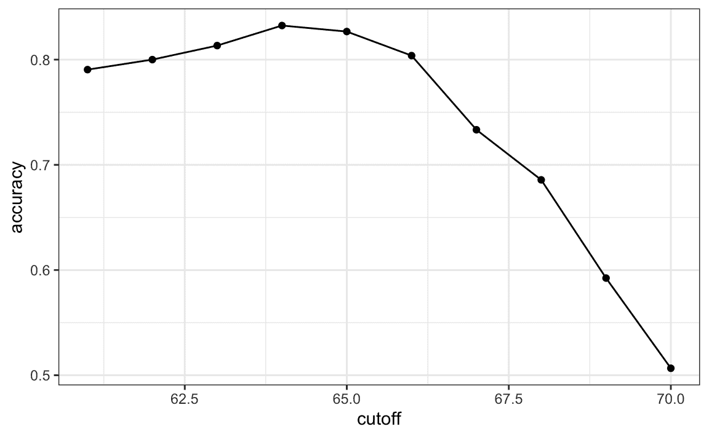
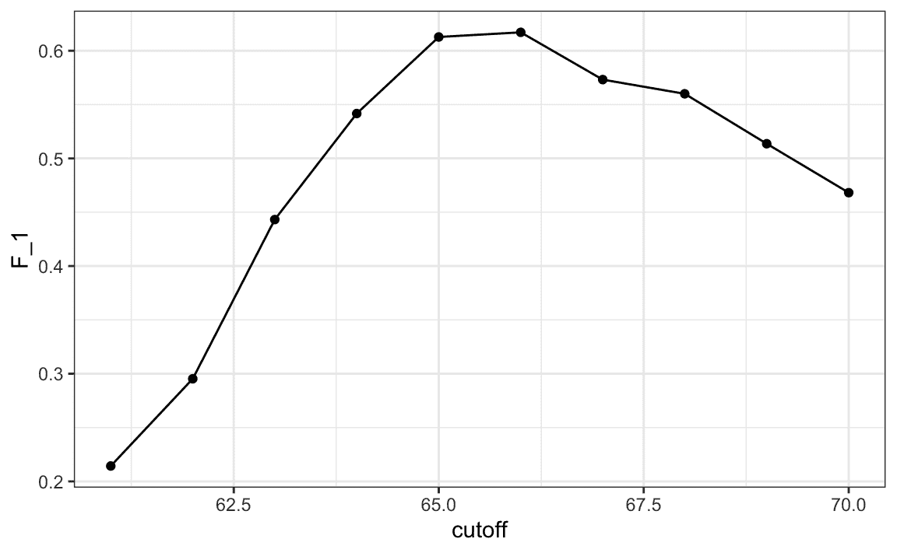
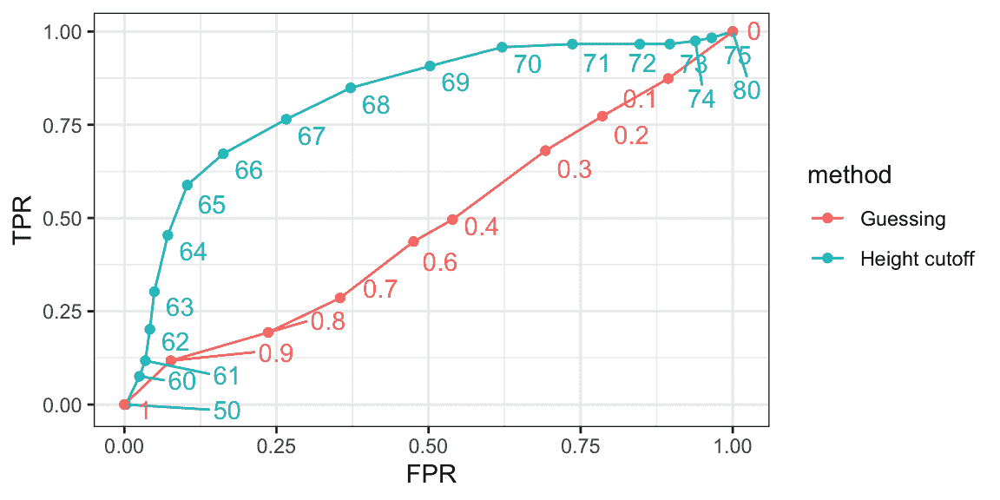
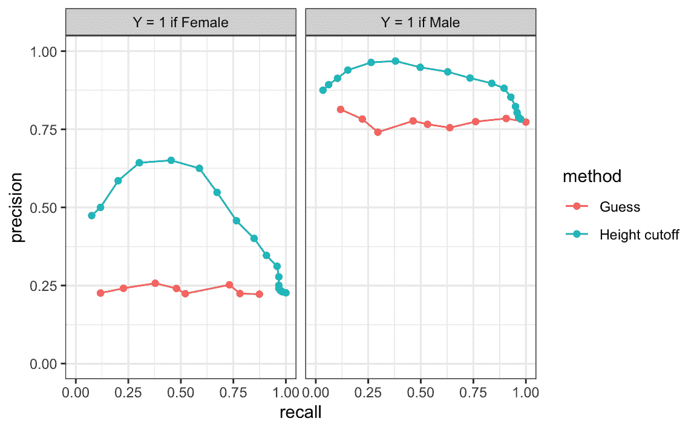
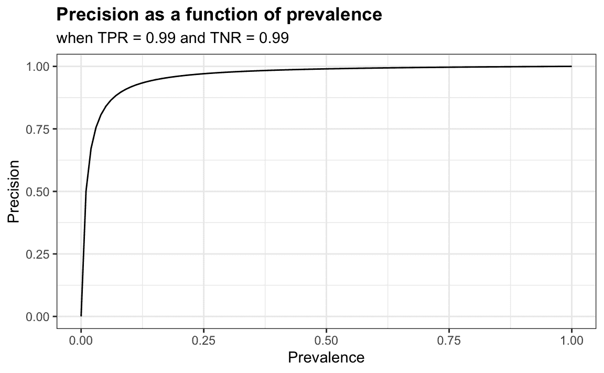

# 27 性能指标

> 原文：[`rafalab.dfci.harvard.edu/dsbook-part-2/ml/evaluation-metrics.html`](https://rafalab.dfci.harvard.edu/dsbook-part-2/ml/evaluation-metrics.html)

1.  机器学习

1.  27 性能指标

在我们开始描述优化算法构建方式的方法之前，我们首先需要定义当我们说一种方法比另一种方法更好时，我们指的是什么。在本节中，我们专注于描述评估机器学习算法的方式。具体来说，我们需要量化我们所说的“更好”的含义。

对于我们对机器学习概念的第一次介绍，我们将从一个无聊且简单的例子开始：如何使用身高预测性别。随着我们解释如何使用这个例子构建预测算法，我们将开始奠定理解机器学习所需的第一块基石。不久，我们将面对更有趣的挑战。

我们介绍了**caret**包，它提供了有用的函数来促进 R 中的机器学习，我们将在第 31.2 节中更详细地描述它。在我们的第一个例子中，我们使用**dslabs**包提供的高度数据。

```r
library([caret](https://github.com/topepo/caret/))
library(dslabs)
```

我们首先指出，`heights$sex`提供了结果（Y），而`heights$height`是我们的预测变量（X）。为了简化本章中使用的代码，我们重命名了变量：

```r
names(heights) <- c("y", "x")
```

在这个例子中，我们有一个单一的预测变量，结果为分类：每个观测值要么是`Male`，要么是`Female`。由于男性和女性之间的平均身高差异相对于每个组内的变异性是适度的，我们不应期望用非常高的准确性预测$Y$。但我们能否比随机猜测做得更好？为了回答这个问题，我们首先需要一个量化的方法来定义“更好”的含义。

在 R 中的机器学习应用中，尤其是在使用**caret**包时，分类结果应存储为因子。这样做可以确保它们被视为标签而不是数值，从而防止将数值代码错误地解释为定量值时出现的错误。

对于二元结果，**caret**将第一个因子级别视为$Y=1$，第二个级别视为$Y=0$。因为 R 默认按字母顺序分配因子级别，在我们的例子中这意味着女性编码为$Y=1$，男性编码为$Y=0$。*## 27.1 训练集和测试集

最终，机器学习算法的评估标准是它在现实世界中使用全新的数据集时的表现。然而，在开发算法时，我们通常有一个已知结果的数据集，就像我们对身高那样：我们知道数据集中每个学生的性别。因此，为了模仿最终的评估过程，我们通常将数据分成两部分，并假装我们不知道其中一部分的结果。我们在完成算法构建后停止假装不知道结果来评估算法，但只有在构建完成后。我们将我们知道结果并用于开发算法的那组数据称为*训练集*。我们将假装不知道结果的那组数据称为*测试集*。

生成训练集和测试集的标准方法是通过随机分割数据。**caret**包包括一个名为`createDataPartition`的函数，它帮助我们生成用于将数据随机分割成训练集和测试集的索引：

```r
set.seed(2010)
train_index <- [createDataPartition](https://rdrr.io/pkg/caret/man/createDataPartition.html)(heights$y, times = 1, p = 0.5, list = FALSE)
```

`times`参数用于定义要返回多少个随机索引样本，`p`参数用于定义索引代表数据集的比例，而`list`参数用于决定我们是否希望返回索引列表。

我们可以使用`createDataPartition`函数调用的结果来定义训练集和测试集，如下所示：

```r
train_set <- heights[train_index, ]
test_set <- heights[-train_index, ]
```

我们现在将使用*仅*训练集开发一个算法。一旦我们完成算法的开发，我们将*冻结*它，并使用测试集来评估它。当结果为分类时，评估算法的最简单方法就是简单地报告在测试集中正确预测的案例比例。这个指标通常被称为*总体准确率*。**

## **27.2 总体准确率**

*为了演示总体准确率的使用，我们将构建两个相互竞争的算法并比较它们。

让我们先开发最简单的机器算法：猜测结果。

```r
y_hat <- factor(sample(c("Female", "Male"), nrow(test_set), replace = TRUE))
```

请注意，我们完全忽略了预测变量，只是在猜测性别。

总体准确率*简单地定义为预测正确的总体比例：

```r
mean(y_hat == test_set$y)
#> [1] 0.482
```

不出所料，我们的准确率大约是 50%。我们只是在猜测！

我们能做得更好吗？探索性数据分析表明我们可以，因为平均而言，男性的身高略高于女性。但我们如何利用这个洞察力呢？让我们尝试另一种简单的方法：如果身高低于平均男性身高两个标准差，则预测 1（女性）：

```r
cutoff <- with(train_set, mean(x) - 2*sd(x))
y_hat <- factor(ifelse(test_set$x <= cutoff, "Female", "Male"))
```

准确率从 0.5 上升到大约 0.8：

```r
mean(test_set$y == y_hat)
#> [1] 0.771
```

但我们能否做得更好？在上面的例子中，我们使用了 62 的截止值，但我们可以检查其他截止值所获得的准确性，然后选择提供最佳结果的那个值。但请记住，**我们只应使用训练集来优化截止值**：测试集仅用于评估。尽管对于这个简单的例子来说这不是一个大问题，但稍后我们将了解到，在训练集上评估算法可能会导致*过拟合*，这通常会导致过于乐观的评估。

在这里，我们检查了 10 个不同截止值的准确性，并选择了产生最佳结果的那个：

```r
cutoffs <- seq(61, 70)
accuracy <- sapply(cutoffs, function(cutoff){
 y_hat <- factor(ifelse(train_set$x <= cutoff, "Female", "Male"))
 mean(y_hat == train_set$y)
})
```

我们可以绘制一个图，显示训练集上男性和女性的准确性：



我们看到最大值是：

```r
max(accuracy)
#> [1] 0.832
```

这个值远高于 0.5。产生这个准确性的截止值是：

```r
best_cutoff <- cutoffs[which.max(accuracy)]
best_cutoff
#> [1] 64
```

现在我们可以将这个截止值测试在我们的测试集上，以确保我们的准确性不是过于乐观的：

```r
y_hat <- factor(ifelse(test_set$x <= best_cutoff, "Female", "Male"))
mean(y_hat == test_set$y)
#> [1] 0.821
```

我们发现它略低于训练集观察到的准确性。这是因为我们使用了训练集来选择截止值，所以存在一些过度训练。然而，我们的基于截止值的方法仍然比猜测要好。而且通过在一个我们没有训练过的数据集上进行测试，我们知道我们的改进不是由于过度训练。**********

## ***27.3 混淆矩阵***

**我们在上一节中开发的预测规则预测如果学生的身高低于 64 英寸，则为女性。鉴于平均女性的身高约为 64 英寸，这个预测规则似乎是不正确的。发生了什么？如果一个学生的身高与平均女性相同，我们不应该预测为女性吗？

一般而言，整体准确性可能会误导。为了理解原因，我们首先构建一个*混淆矩阵*，这是一个表格，它统计了每种预测和真实结果的组合出现的频率。在 R 中，我们可以使用`table`创建这个表格，但**caret**包提供了一个方便的函数`confusionMatrix`，它不仅计算混淆矩阵，还报告了我们将稍后使用的几个额外的性能指标：

```r
cm <- [confusionMatrix](https://rdrr.io/pkg/caret/man/confusionMatrix.html)(data = y_hat, reference = test_set$y)
cm$table
#>           Reference
#> Prediction Female Male
#>     Female     54   29
#>     Male       65  377
```

如果我们仔细研究这个表格，就会发现一个问题。如果我们分别计算每个性别的准确性（在下一节中，我们将解释，在这个上下文中，*灵敏度*和*特异性*分别等同于女性和男性的准确性），我们得到：

```r
cm$byClass[c("Sensitivity", "Specificity")]
#> Sensitivity Specificity 
#>       0.454       0.929
```

我们注意到一个不平衡：预测为男性的女性太多。我们几乎将一半的女性错误地标记为男性！那么我们的整体准确性怎么会这么高呢？这是因为*患病率*，定义为数据中$Y=1$的比例，很低。这些身高是从三个数据科学课程中收集的，其中两个课程的男性入学率更高：

```r
cm$byClass["Prevalence"]
#> Prevalence 
#>      0.227
```

因此，在计算整体准确性时，对女性犯的错误的高比例被对男性正确预测的收益所抵消。

这种类型的偏差在实践中实际上可能是一个大问题。如果你的训练数据以某种方式存在偏差，你很可能会开发出同样存在偏差的算法。我们使用了测试集的事实并不重要，因为它也是从原始的偏差数据集中推导出来的。这就是我们在评估机器学习算法时除了整体准确率之外还要查看其他指标的原因之一。

有几种指标我们可以用来评估算法，这样流行度就不会影响我们的评估，并且这些都可以从混淆矩阵中推导出来。使用整体准确率的一般改进是分别研究 *敏感性* 和 *特异性*。******

## ***27.4 敏感性和特异性***

**为了定义敏感性和特异性，我们需要一个二元结果。当结果为分类时，我们可以通过关注一个感兴趣的特定类别来使用这些术语。例如，在一个数字识别任务中，我们可能会问：正确识别数字 2 而不是其他任何数字的特异性是什么？一旦我们选择了一个特定类别，我们就将那个类别中的观察值视为阳性案例 ($Y=1$)，而所有其他观察值视为阴性案例 ($Y=0$)。这种二元框架使我们能够以通常的方式计算敏感性和特异性。***

通常，*敏感性* 定义为算法在实际结果为正时预测阳性结果的能力：$\hat{Y}=1$ 当 $Y=1$。因为一个将所有东西都称为阳性的算法 ($\hat{Y}=1$ 不论什么情况) 具有完美的敏感性，这个指标本身不足以判断一个算法。

因此，我们也考察 *特异性*，这通常定义为算法在实际结果为负 $Y=0$ 时预测负 $\hat{Y}=0$ 的能力。我们可以以下述方式总结：

+   高敏感性：$Y=1 \implies \hat{Y}=1$

+   高特异性：$Y=0 \implies \hat{Y} = 0$

虽然上述内容通常被认为是特异性的定义，但另一种思考特异性的方式是考虑实际为正的阳性呼叫的比例：

+   高特异性：$\hat{Y}=1 \implies Y=1$

为了提供精确的定义，我们命名混淆矩阵的四个条目：

|  | 实际为阳性 | 实际为阴性 |
| --- | --- | --- |
| 预测为阳性 | 真阳性 (TP) | 假阳性 (FP) |
| 预测为阴性 | 假阴性 (FN) | 真阴性 (TN) |

敏感性* 通常通过 $TP/(TP+FN)$ 来量化，这是实际阳性（第一列 = $TP+FN$)的比例，被称为阳性 ($TP$)。这个量被称为 *真正的阳性率* (TPR) 或 *召回率*。

特异性定义为 $TN/(TN+FP)$ 或称为负例的比例（第二列 = $FP+TN$)，这些被称为负例 ($TN$)。这个量也称为真正的负例率 (TNR)。

另一种量化 *特异度* 的方法是 $TP/(TP+FP)$ 或实际为正例（$TP$）的预测结果（第一行或 $TP+FP$）的比例。这个量被称为 *阳性预测值（PPV）*，也称为 *精确度*。请注意，与 TPR 和 TNR 不同，精确度取决于发病率，因为高发病率意味着即使猜测也能获得更高的精确度。

多种名称可能会令人困惑，因此我们包括一个表格来帮助我们记住这些术语。该表格包括一个列，如果我们将比例视为概率，则显示定义。

| 衡量指标 | 名称 1 | 名称 2 | 定义 | 概率表示 |
| --- | --- | --- | --- | --- |
| 灵敏度 | 真阳性率 | 召回率 | $\frac{\mbox{TP}}{\mbox{TP} + \mbox{FN}}$ | $\mathrm{Pr}(\hat{Y}=1 \mid Y=1)$ |
| 特异度 | 真阴性率 | 1-假阳性率 | $\frac{\mbox{TN}}{\mbox{TN}+\mbox{FP}}$ | $\mathrm{Pr}(\hat{Y}=0 \mid Y=0)$ |
| 特异度 | 阳性预测值 | 精确度 | $\frac{\mbox{TP}}{\mbox{TP}+\mbox{FP}}$ | $\mathrm{Pr}(Y=1 \mid \hat{Y}=1)$ |

*caret** 函数 `confusionMatrix` 在我们定义哪个类别是正类（$Y=1$）后为我们计算所有这些指标。该函数期望输入因子，第一级被视为正结果，尽管可以通过 `positive` 参数重新定义。

如果你将此输入 R：

```r
cm <- [confusionMatrix](https://rdrr.io/pkg/caret/man/confusionMatrix.html)(data = y_hat, reference = test_set$sex)
print(cm)
```

你将看到几个指标，包括准确率、灵敏度、特异性和阳性预测值（PPV）。

你可以直接访问这些指标，例如，像这样：

```r
cm$overall["Accuracy"]
#> Accuracy 
#>    0.821
cm$byClass[c("Sensitivity","Specificity", "Prevalence", "Pos Pred Value")]
#>    Sensitivity    Specificity     Prevalence Pos Pred Value 
#>          0.454          0.929          0.227          0.651
```

我们可以看到，尽管灵敏度相对较低，但仍然可能实现较高的整体准确率。正如我们上面所暗示的，这种情况发生的原因是由于低发病率（0.23）：女性的比例较低。由于发病率低，未能正确预测女性（灵敏度低）并不会像未能正确预测男性（特异度低）那样大幅降低整体准确率。这是一个为什么检查灵敏度和特异度而不仅仅是准确率很重要的例子。*

在将此算法应用于通用数据集之前，我们需要问自己，总体人群中的发病率是否会与我们的训练数据集相同。*****

## ***27.5 平衡准确率和 $F_1$ 分数***

**尽管我们通常推荐研究特异度和灵敏度，但有时有一个数字总结是有用的，例如，用于优化目的。一个比整体准确率更受欢迎的指标是特异度和灵敏度的平均值，称为 *平衡准确率*。由于特异度和灵敏度是比率，因此计算 *调和平均数* 更为合适。事实上，*$F_1$-分数*，一个广泛使用的数字总结，是精确度和召回率的调和平均数：

$$ \frac{1}{\frac{1}{2}\left(\frac{1}{\mbox{召回率}} + \frac{1}{\mbox{精确度}}\right) } = 2 \times \frac{\mbox{精确度} \cdot \mbox{召回率}} {\mbox{精确度} + \mbox{召回率}}. $$

$F_1$ 分数可以调整以不同方式权衡特异性和灵敏度。这在实践中很有用，因为根据上下文，某些类型的错误可能比其他类型的错误代价更高。例如，在飞机安全的情况下，最大化灵敏度比最大化特异性更重要：未能预测飞机在坠毁前发生故障是一个代价更高的错误，而实际上飞机处于完美状态时将飞机停飞。在一个死刑刑事案件中，情况正好相反，因为假阳性可能导致无辜的人被处决。

为了适应 $F_1$，我们定义一个权重 $\beta$ 来表示灵敏度相对于特异性的重要性，并考虑加权调和平均：

$$ \frac{1}{\frac{\beta²}{1+\beta²}\frac{1}{\mbox{召回率}} + \frac{1}{1+\beta²}\frac{1}{\mbox{精确率}} } $$

*caret** 包中的 `F_meas` 函数使用默认的 $\beta$ 值为 1 来计算这个摘要。

让我们重新构建我们的预测算法，但这次是最大化 F 分数而不是整体准确性：

```r
cutoffs <- seq(61, 70)
F_1 <- sapply(cutoffs, function(cutoff){
 y_hat <- factor(ifelse(train_set$x <= cutoff, "Female", "Male"))
 [F_meas](https://rdrr.io/pkg/caret/man/recall.html)(y_hat, train_set$y)
})
```

与之前一样，我们可以绘制这些 $F_1$ 衡量值与截止值的对比图：



我们看到它在 $F_1$ 值最大化时：

```r
max(F_1)
#> [1] 0.617
```

这个最大值是在我们使用以下截止值时达到的：

```r
best_cutoff <- cutoffs[which.max(F_1)]
best_cutoff
#> [1] 66
```

66 的截止值比 64 更有意义，因为它更接近男性和女性平均身高的中点。此外，它还在结果混淆矩阵中提供了灵敏度和特异性之间的更好平衡。

```r
y_hat <- factor(ifelse(test_set$x <= best_cutoff, "Female", "Male"))
[sensitivity](https://rdrr.io/pkg/caret/man/sensitivity.html)(y_hat, test_set$y)
#> [1] 0.672
[specificity](https://rdrr.io/pkg/caret/man/sensitivity.html)(y_hat, test_set$y)
#> [1] 0.837
```

现在我们可以看到，我们的表现比猜测要好得多，灵敏度和特异性都相对较高。*******

## ***27.6 ROC 和精确率-召回率曲线***

**当我们比较两种方法（猜测和使用身高截止值）时，我们考虑了准确性和 $F_1$。第二种方法明显优于第一种。然而，虽然我们考虑了第二种方法的几个截止值，但对于第一种，我们只考虑了一种方法：以等概率猜测。请注意，以更高的概率猜测“男性”会由于样本中的偏差而提高准确性，但如上所述，这将以降低灵敏度为代价。本节中描述的曲线将帮助我们看到这一点。

记住，对于每个截止值，我们都可以得到不同的灵敏度和特异性。因此，评估方法的一个非常常见的方法是通过绘制两者来图形化比较。

做这件事的一个广泛使用的图是 *接收者操作特征*（ROC）曲线。如果你对这个名字感到好奇，可以查阅 ROC 维基百科页面¹。

ROC 曲线绘制了灵敏度（表示为 TPR）与 1 - 特异性（表示为假阳性率 FPR）的对比。在这里，我们计算了不同猜测男性概率所需的 TPR 和 FPR：

```r
probs <- seq(0, 1, length.out = 10)
guessing <- sapply(probs, function(p){
 y_hat <- sample(c("Male", "Female"), nrow(test_set), TRUE, c(p, 1 - p)) 
 y_hat <- factor(y_hat, levels = c("Female", "Male"))
 c(FPR = 1 - [specificity](https://rdrr.io/pkg/caret/man/sensitivity.html)(y_hat, test_set$y),
 TPR = [sensitivity](https://rdrr.io/pkg/caret/man/sensitivity.html)(y_hat, test_set$y))
})
```

我们可以使用类似的代码来计算我们第二种方法的这些值。通过同时绘制两条曲线，我们能够比较不同特异性值下的灵敏度：



我们可以看到，对于所有特异性值，我们通过截止方法获得了更高的灵敏度，这意味着它实际上是一个比猜测更好的方法。记住，猜测的 ROC 曲线总是落在身份线上。此外，请注意，在制作 ROC 曲线时，通常很好添加每个点的截止值。

*pROC**和**plotROC**包对于生成这些图表很有用。

ROC 曲线有一个弱点，那就是图中绘制的两个指标都不依赖于发病率。在发病率很重要的情况下，我们可能需要制作一个精度-召回率图。想法是相似的，但我们绘制的是精度对召回率的图：



从左边的图表中，我们立即可以看出猜测的精度并不高。这是因为发病率低。从右边的图表中，我们看到如果我们把$Y=1$改为表示“男性”而不是“女性”，精度就会提高。请注意，ROC 曲线将保持不变。****

## ***27.7 发病率在实践中很重要***

**一个具有非常高的 TPR 和 TNR 的机器学习算法，当发病率接近 0 或 1 时，在实践上可能并不有用。为了看到这一点，考虑一个专注于罕见疾病并希望开发预测疾病患者的算法的医生的情况。***

医生与大约一半的病例和一半的对照组以及一些预测因子共享数据。然后你开发了一个算法，其 TPR 为 0.99，TNR 为 0.99。你兴奋地向医生解释说，这意味着如果一个患者患有该疾病，算法很可能预测正确。医生并不感到印象深刻，并解释说你的 TNR 对于这个算法在实际应用中来说太低了。

这是因为，尽管研究数据集是按照病例和对照组数量相等构建的，但在普通人群中，该疾病的发病率非常低，只有大约 0.5%。

我们可以使用贝叶斯定理来计算你算法在真实人群中的预期精度：$$ \begin{aligned} &\mathrm{Pr}(Y = 1\mid \hat{Y}=1) = \mathrm{Pr}(\hat{Y}=1 \mid Y=1) \frac{\mathrm{Pr}(Y=1)}{\mathrm{Pr}(\hat{Y}=1)} \implies\\ &\text{Precision} = \text{TPR} \times \frac{\text{Prevalence}}{\text{TPR}\times \text{Prevalence} + \text{FPR}\times(1-\text{Prevalence})} \approx 0.33 \end{aligned} $$

这里是精度作为发病率函数的图表，其中 TPR 和 TNR 都等于 99%：



虽然你的算法在平衡的训练数据（50%的患病率）上实现了大约 99% 的精确度，但当应用于一般人群时，其精确度会下降到大约 33%，其中疾病患病率仅为 0.5%。医生不能依赖于三分之二阳性结果为假阳性的测试。即使具有完美的灵敏度，在这些条件下精确度仍然大约为 33%。为了使算法在临床上有用，你需要大幅降低假阳性率（FPR）。

## ***27.8 均方误差***

**到目前为止，我们已描述了仅适用于分类数据的评估指标。具体来说，对于二元结果，我们已描述了如何使用灵敏度、特异性、准确性和 $F_1$ 来量化性能。然而，这些指标对于连续结果来说并不适用。***

在本节中，我们描述了在机器学习中定义“最佳”的一般方法，即定义一个 *损失函数*，该函数可以应用于分类和连续数据。

最常用的损失函数是平方损失函数。如果 $\hat{y}$ 是我们的预测值，$y$ 是观察到的结果，则平方损失函数简单地为：$(\hat{y} - y)²$。

因为我们通常将 $y$ 模型化为一个随机过程的输出，从理论上讲，基于 $(\hat{y} - y)²$ 来比较算法是没有意义的，因为最小值可能从样本到样本而变化。因此，我们最小化均方误差（MSE）：

$$ \text{MSE} \equiv \mathrm{E}[(\hat{Y} - Y)² ] $$

假设结果为二元，MSE 等于 1 减去预期准确率，因为如果预测正确，$(\hat{y} - y)²$ 为 0，否则为 1。

不同的算法会导致不同的预测 $\hat{Y}$，因此不同的 MSE。一般来说，我们的目标是构建一个算法，使其损失最小化，尽可能接近 0。

然而，请注意，均方误差（MSE）是一个理论量，它依赖于未知的数据生成过程。我们在实践中如何估计它？因为我们通常有一个由许多独立观察值 $y_1, \dots, y_N$ 组成的测试集，一个自然且广泛使用的 MSE 估计是基于测试集中平方误差的平均值：

$$ \hat{\mbox{MSE}} = \frac{1}{N}\sum_{i=1}^N (\hat{y}_i - y_i)² $$

使用完全独立于 $y_i$ 的 $\hat{y}_i$ 生成。

然而，估计值 $\hat{\text{MSE}}$ 是一个随机变量。实际上，$\text{MSE}$ 和 $\hat{\text{MSE}}$ 通常分别被称为真实误差和表面误差。由于某些机器学习算法的复杂性，很难推导出表面误差如何估计真实误差的统计特性。在第二十九章中，我们介绍了交叉验证，这是一种估计 MSE 的方法。

我们通过指出平方损失不是唯一可能的损失函数选择来结束本章。例如，*平均绝对误差（MAE）* 将平方误差 $(\hat{Y}_i - Y_i)²$ 替换为其绝对值 $|\hat{Y}_i - Y_i|$。根据上下文和分析目标，还有其他可能的损失函数。然而，在这本书中，我们专注于平方损失，因为它是最广泛使用的，并且提供了简化理论和计算的重要数学便利。

在实践中，我们经常报告均方根误差（RMSE），它只是 $\sqrt{\mbox{MSE}}$，因为它与结果具有相同的单位。**

## ****27.9 练习****

***在以下练习中，我们使用 Titanic 数据集来探索使用基于连续预测因子的简单决策规则进行分类的评价指标。我们的目标不是构建一个复杂的模型，而是了解准确率、敏感性、特异性、精确率和患病率如何取决于截止值的选择。我们将使用票价（票价）、年龄和乘客等级（`Pclass`）等变量来预测生存，将生存（`Survived`）视为二元结果。

```r
library([tidyverse](https://tidyverse.tidyverse.org))
library([caret](https://github.com/topepo/caret/))
library([titanic](https://github.com/paulhendricks/titanic))
 titanic <- titanic_train |> select(Survived, Pclass, Sex, Age, Fare) |> drop_na() |>
 mutate(Survived = factor(Survived, levels = c(1,0)), 
 Pclass = factor(Pclass), Sex = factor(Sex))
```

请注意，我们将级别定义为 `c(1,0)` 以避免由于 **caret** 将正 $Y=1$ 定义为第一个级别而导致的默认行为。**

1. 将 `titanic` 数据集分为 `train_set`（80% 的数据）和 `test_set`（剩余的 20%）。

2. 使用 `Fare`（票价）作为连续得分来预测生存。创建一个简单的规则：如果 `Fare > cutoff`，则预测 `1`（生存），否则预测 `0`。取 `cutoff = median(train_set$Fare)`。在 `test_set` 上计算准确率。提示：当使用 `factor()` 时，R 默认按字母顺序对级别进行排序。这意味着`0`将排在`1`之前，所以如果你在未指定级别的情况下将预测转换为因子，正类可能会被错误地分配。然而，在这个数据集中，Survived 的第一个级别是 1。确保你的预测因子的级别与 test_set$Survived 的级别相匹配，在计算准确率或混淆矩阵之前。

3. 练习 2 中实现的准确率与简单地预测每个人为 `0`（未生存）相比如何？

4. 对于相同的规则（如果 `Fare > cutoff`，则预测 `1`），计算 `cutoff = median(Fare)` 时的 *敏感性*、*特异性* 和 *患病率*。使用 **caret** 中的 `sensitivity`、`specificity` 和 `posPredValue`。在仅基于票价预测谁会生存的上下文中解释每个量。

5. 现在重复练习 3，但使用不同的截止值：

```r
cutoffs <- quantile(train_set$Fare, probs = seq(0.05, 0.95, 0.1))
```

对于每个截止值，使用 `Fare > cutoff` 将乘客分类为生存/未生存，并绘制在 `train_set` 上计算的准确率与截止值的关系图。

6. 使用练习 5 的结果，找到最佳截止值，并在 `train_set` 和 `test_set` 上将准确率与练习 4 中选择的规则进行比较。

7. 根据在测试集上计算出的特异性和灵敏度生成一个 ROC 曲线。对于曲线上的每个点，显示与该点相关的截止值。简要描述当你移动截止值时看到的权衡：当你提高截止值时，灵敏度和特异性会发生什么变化，为什么这在评估谁倾向于在泰坦尼克号上购买昂贵的票时是有意义的？

8. 现在用一个逻辑回归模型作为更精细的连续得分。拟合模型：

```r
fit <- glm(Survived == "1" ~ ., family = binomial, data = train_set)
```

我们可以使用`predict`函数从训练集和测试集中为每个个体获得生存的预测概率：

```r
p_hat_train <- predict(fit, newdata = train_set, type = "response")
p_hat_test <- predict(fit, newdata = test_set, type = "response")
```

如果这个概率大于 0.5，则将乘客分类为生存。当在训练集和测试集上计算准确率时，这种比较与我们在第 2 题和第 3 题中的比较有何不同？请评论为什么差异比我们之前的比较更大。

9. 考虑`cutofs <- seq(0.05, 0.95, 0.05)`这个概率的不同截止值，并在测试集上生成一个 ROC 曲线。基于这个 ROC 曲线和第 7 题计算出的 ROC 曲线，你认为哪种方法表现更好？

10. 该数据集中生存的整体普及率是：

```r
mean(titanic$Survived == "1")
```

假设你在生存普及率仅为 20%的新环境中部署你的基于 glm 的规则（第 8 题）。无需代码，定性解释这种普及率的变化会如何影响*精确度*（阳性预测值），即使灵敏度和特异性保持不变。为什么在评估模型时考虑普及率很重要？*********

* * *

***1.  https://en.wikipedia.org/wiki/Receiver_operating_characteristic↩︎*******
