# 28 条件期望与平滑

> 原文：[`rafalab.dfci.harvard.edu/dsbook-part-2/ml/conditionals-and-smoothing.html`](https://rafalab.dfci.harvard.edu/dsbook-part-2/ml/conditionals-and-smoothing.html)

1.  机器学习

1.  28 条件期望与平滑

在机器学习应用中，我们很少能够完美地预测结果。垃圾邮件过滤器错过了明显的垃圾邮件，Siri 误听了单词，有时你的银行错误地将合法购买标记为欺诈。这些错误发生的主要原因通常是*完美预测往往是不可能的*。在大多数真实数据集中，我们发现一些观察值组具有相同的预测值但有不同的结果。因为预测规则是一个函数，相同的输入必须产生相同的输出。所以当相同的预测值与不同的结果同时出现时，就像前一章中提到的，男性和女性的身高可以完全相同，没有任何算法可以适用于所有这些情况。

但这并不意味着我们不能构建有用的算法，这些算法比猜测要好得多，有时甚至比人类专家还要好。为了做到这一点，我们使用在第 15.3 节中引入的概率框架。即使个别结果不同，我们也假设具有相同预测值的观察值属于每个类别的*相同潜在概率*。对于分类结果，这自然导致对诸如

$$ \Pr(Y=1 \mid X=x), $$

这总结了我们可以希望做出的最佳预测。

这引出了*平滑*的概念。在实践中，这些条件概率是未知的，必须从噪声数据中估计。平滑，也称为*曲线拟合*或*低通滤波*，是一种在趋势的确切形状未知时揭示潜在趋势的通用技术。其思想是，虽然预测变量和结果之间的真实关系变化平滑，但数据本身包括随机波动。平滑方法利用这种平滑性来估计潜在模式，为我们依赖的机器学习算法提供稳定且可解释的近似，例如 $\Pr(Y=1 \mid X=x)$。事实上，许多最广泛使用的机器学习算法可以直接或间接地被视为平滑过程，这就是为什么平滑是这个领域的基础概念。

## 28.1 条件概率与期望

我们使用符号 $(X_1 = x_1,\dots,X_p=x_p)$ 来表示我们已观察到协变量 $X_1, \dots, X_p$ 的值 $x_1,\dots,x_p$。这并不暗示结果 $Y$ 将取特定的值。相反，它暗示了一个特定的概率。特别是，我们用以下方式表示每个类别 $k$ 的*条件概率*：

$$ \mathrm{Pr}(Y=k \mid X_1 = x_1,\dots,X_p=x_p), \, \mbox{for}\,k=1,\dots,K. $$

为了避免写出所有的预测器，我们将使用粗体字母，例如：$\mathbf{X} \equiv (X_1,\dots,X_p)^\top$ 和 $\mathbf{x} \equiv (x_1,\dots,x_p)^\top$。我们还将使用以下符号表示属于类别 $k$ 的条件概率：

$$ p_k(\mathbf{x}) = \mathrm{Pr}(Y=k \mid \mathbf{X}=\mathbf{x}), \, \mbox{for}\, k=1,\dots,K. $$ 注意到 $p_k(\mathbf{x})$ 必须对于每个 $\mathbf{x}$ 相加等于 1，所以一旦我们知道 $K-1$，我们就知道所有 $K$。

当结果为二元时，我们只需要知道 1，所以我们省略 $k$ 并使用符号 $p(\mathbf{x}) = \mathrm{Pr}(Y=1 \mid \mathbf{X}=\mathbf{x})$。

*不要被我们用字母 $p$ 表示两件不同的事情所困惑：条件概率 $p(\mathbf{x})$ 和预测器的数量 $p$。** 这些概率指导着构建一个做出最佳预测的算法：对于任何给定的 $\mathbf{x}$，我们将预测在 $p_1(\mathbf{x}), p_2(\mathbf{x}), \dots p_K(\mathbf{x})$ 中概率最大的类别 $k$。用数学符号表示，我们写成这样：

$$\hat{y}(\mathbf{x}) = \max_k p_k(\mathbf{x})$$

在机器学习中，我们称之为**贝叶斯定理**。但这是一个理论规则，因为在实践中，我们不知道 $p_k(\mathbf{x}), k=1,\dots,K$。实际上，估计这些条件概率可以被认为是机器学习的主要挑战。我们的概率估计 $\hat{p}_k(\mathbf{x})$ 越好，我们的预测器就越准确。

因此，我们的预测能力取决于两个因素：1) $\max_k p_k(\mathbf{x})$ 与 1 或 0（完美确定性）的距离有多近，2) 我们的估计 $\hat{p}_k(\mathbf{x})$ 与 $p_k(\mathbf{x})$ 的距离有多近。我们无法改变第一个限制，因为它由问题的本质决定，所以我们把精力投入到寻找最佳估计条件概率的方法上。

第一个限制确实意味着我们对于最佳算法的性能有极限。你应该习惯这样的想法：在某些挑战中，例如使用数字阅读器，我们几乎可以达到完美的准确性，但在其他情况下，我们的成功受到过程随机性的限制，比如从生物特征数据中进行医疗诊断。

请记住，通过最大化概率来定义我们的预测在实践上并不总是最优的，这取决于上下文。正如在第二十七章评估指标中讨论的那样，敏感度和特异性可能在不同情况下具有不同的重要性。但即使在这些情况下，只要我们有一个关于 $p_k(x), k=1,\dots,K$ 的良好估计，就足以构建最优的预测模型，因为我们可以在任何我们希望的情况下控制特异性和敏感度之间的平衡。例如，我们可以简单地改变用于预测一个结果或另一个结果的截止值。在平面示例中，我们可以在故障概率低于一百万分之一时接地飞机，而不是在错误类型同样不受欢迎时使用的默认值 1/2。

对于二元数据，你可以将概率 $\mathrm{Pr}(Y=1 \mid \mathbf{X}=\mathbf{x})$ 视为总体中 $\mathbf{X}=\mathbf{x}$ 层次中 1 的比例。我们将学习的许多算法都可以应用于分类和连续数据，这得益于条件概率和条件期望之间的联系。

因为期望值是总体中值 $y_1,\dots,y_n$ 的平均值，在 $y$ 值为 0 或 1 的情况下，期望值等同于随机抽取一个 1 的概率，因为平均值仅仅是 1 的比例：

$$ \mathrm{E}[Y \mid \mathbf{X}=\mathbf{x}]=\mathrm{Pr}(Y=1 \mid \mathbf{X}=\mathbf{x}). $$

这意味着条件概率是条件期望。因此，我们通常只使用期望来表示条件概率和条件期望。

就像分类结果一样，在大多数应用中，相同的观察预测因子并不保证相同的连续结果。相反，我们假设结果遵循相同的条件分布。现在我们将解释为什么我们使用条件期望来定义我们的预测因子。

## *28.2 条件期望最小化平方损失函数*

我们为什么在机器学习中关心条件期望？这是因为期望值具有一个吸引人的数学特性：它最小化均方误差（MSE）。具体来说，在所有可能的预测 $\hat{Y}$ 中，

$$ \hat{Y} = \mathrm{E}[Y \mid \mathbf{X}=\mathbf{x}] \, \mbox{ minimizes } \, \mathrm{E}[ (\hat{Y} - Y)² \mid \mathbf{X}=\mathbf{x}] $$

由于这一特性，机器学习的主要任务可以简洁地描述为：我们使用数据来估计：

$$ f(\mathbf{x}) \equiv \mathrm{E}[Y \mid \mathbf{X}=\mathbf{x} ] $$

对于任何一组特征 $\mathbf{x} = (x_1, \dots, x_p)^\top$。

这比说起来容易，因为这个函数可以采取任何形状，而 $p$ 可能非常大。考虑一个我们只有一个预测变量 $x$ 的情况。期望 $\mathrm{E}[Y \mid X=x]$ 可以是 $x$ 的任何函数：一条线，一个抛物线，一个正弦波，一个阶梯函数，任何东西。当我们考虑具有大 $p$ 的实例时，事情变得更加复杂，在这种情况下，$f(\mathbf{x})$ 是一个多维向量 $\mathbf{x}$ 的函数。例如，在我们的数字识别器示例中 $p = 784$！

竞争的机器学习算法之间的主要区别在于它们估计这种条件期望的方法。因为我们必须从噪声的、有限的数据中估计这样一个灵活且可能高维的函数，我们需要策略来提取底层信号，而不会被随机性所淹没。一个常见且强大的想法是假设尽管数据本身可能看起来分散，但*真实*函数 $f(\mathbf{x})$ 随着 $\mathbf{x}$ 的变化而平滑变化。这个假设允许我们从附近的点借用力量，即使在精确预测值很少重复的情况下也能产生稳定的估计。这把我们带到了*平滑*的概念，这是机器学习中最基本工具之一，支撑着我们将要研究的许多算法。*

## *28.3 平滑*

平滑是机器学习和统计建模中的一个核心思想：当数据有噪声时，我们通常假设潜在的趋势是逐渐变化的，而不是从一点跳到另一点。平滑的目标是从数据中恢复这种隐藏的结构。*

为了激发这个想法，请考虑下面的图表：噪声掩盖了趋势，但并没有破坏它，我们的任务是揭示从噪声数据中的趋势。

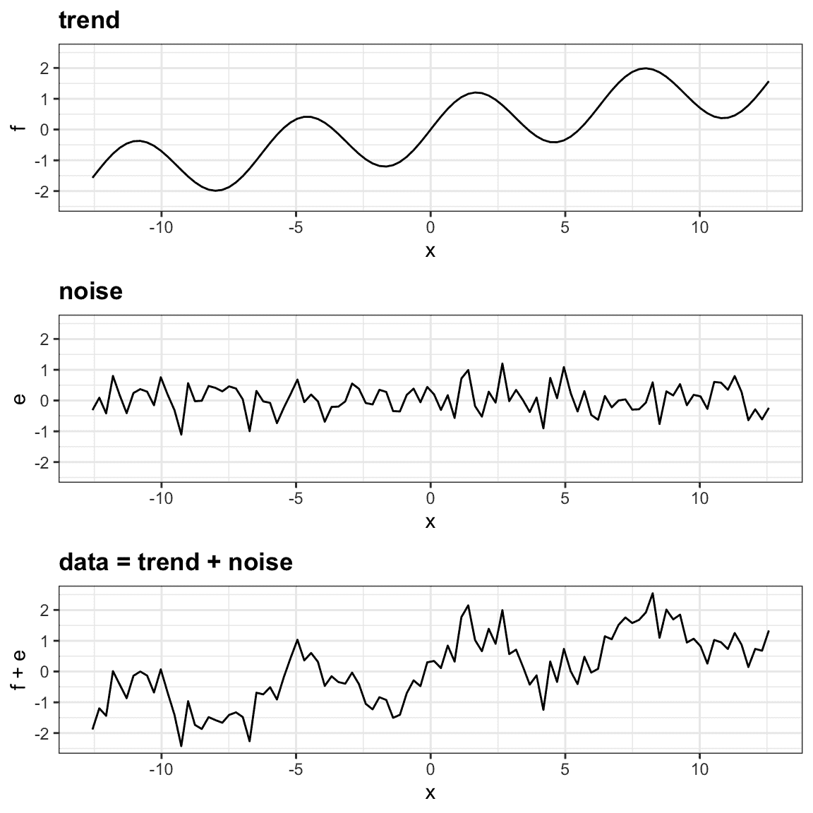

在接下来的章节中，我们将探讨平滑技术是如何实现这一点的，从一个简单的案例研究开始，该研究说明了方法背后的挑战和直觉。

### 示例：这是一个 2 还是 7？

为了激发平滑的需求并与机器学习建立联系，我们将构建 MNIST 数据集的简化版本，其中结果有两个类别，预测变量也有两个。具体来说，我们将挑战定义为构建一个算法，该算法可以从左上象限（$X_1$）和右下象限（$X_2$）中暗像素的比例确定一个数字是 2 还是 7。我们还选择了一个包含 1,000 个数字的随机样本，分为训练集和测试集。这两个集合几乎均匀地分布着 2 和 7。

*dslabs** 包含了这个例子在对象 `mnist_27` 中。在训练集中，我们有 800 个观察值，在测试集中我们有 200 个观察值。每个观察值都有：

+   一个结果 $y_i$，指示数字是 2 还是 7，以及

+   一个特征向量 $\mathbf{x}_i = (x_{i,1}, x_{i,2})^\top$，这是从图像中提取出的二维空间中的一个点。

因此，数据集由成对的 $(\mathbf{x}_i, y_i)$ 组成，其中每个 $\mathbf{x}_i$ 是一个二维特征，每个 $y_i$ 是相应的数字标签。

为了说明如何解释 $X_1$ 和 $X_2$，我们包括四个示例图像。左边是两个数字中 $X_1$ 最大和最小值的原始图像，右边是对应于 $X_2$ 最大和最小值的图像：

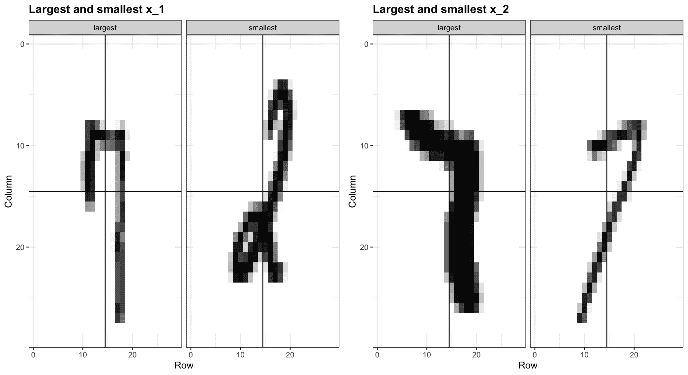

下面是观察到的 $X_2$ 与观察到的 $X_1$ 的关系图，颜色表示 $y$ 是 2（红色）还是 7（蓝色）：

```r
library([caret](https://github.com/topepo/caret/))
library(dslabs)
mnist_27$train |> ggplot(aes(x_1, x_2, color = y)) + geom_point()
```

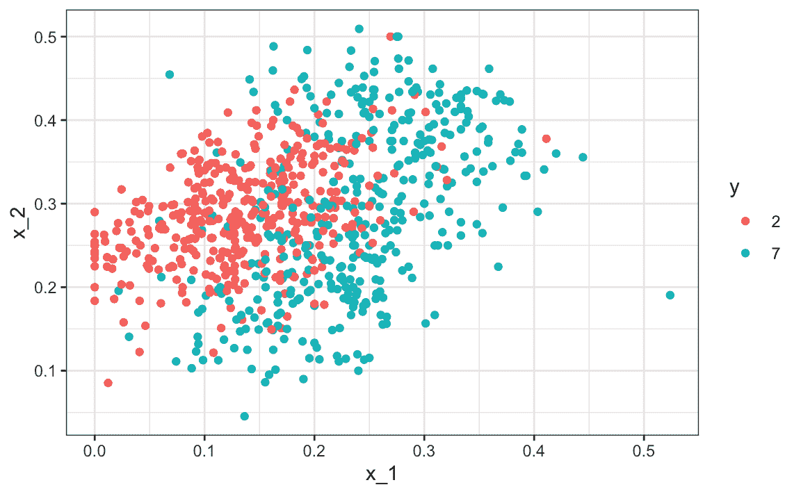*  *我们可以立即看到一些模式。例如，如果 $x_1$ 很大（图像的左上角有大量的墨水），那么这个数字很可能是 7。另外，对于 $x_1$ 较小的值，2 似乎出现在 $x_2$ 的中间值范围内。

我们可以开始了解为什么这些预测因子是有用的，但同时也为什么这个问题将具有一定的挑战性。

我们还没有真正学习任何算法，所以让我们尝试使用 GLM 构建一个算法。模型很简单：

$$ \log\frac{p(\mathbf{x})}{1-p(\mathbf{x})} = \beta_0 + \beta_1 x_1 + \beta_2 x_2 $$

我们可以使用`glm`函数来拟合此模型，从而获得一个估计 $\hat{p}(\mathbf{x})$。我们通过预测 $\hat{y}(\mathbf{x})=1$ 如果 $\hat{p}(\mathbf{x})>0.5$，否则为 0 来定义一个决策规则。

如果我们这样做，我们得到的准确率为 0.775，远高于 50%。对于我们第一次尝试来说，还不错。但我们能做得更好吗？

因为我们已经构建了`mnist_27`示例，并且我们仅使用 MNIST 数据集就拥有了 60,000 个数字，所以我们利用这些数据来构建**真实**的条件分布 $p(\mathbf{x})$。请记住，在实践中，我们无法访问真实的条件分布。我们将其包含在这个教育示例中，因为它允许我们将 $\hat{p}(\mathbf{x})$ 与真实的 $p(\mathbf{x})$ 进行比较。这种比较教会了我们不同算法的局限性。

我们已经将真实的 $p(\mathbf{x})$ 存储在`mnist_27`中，可以将其作为图像绘制。我们绘制一条曲线，将 $p(\mathbf{x}) > 0.5$ 的 $\mathbf{x}$ 值与 $p(\mathbf{x}) < 0.5$ 的 $\mathbf{x}$ 值分开：

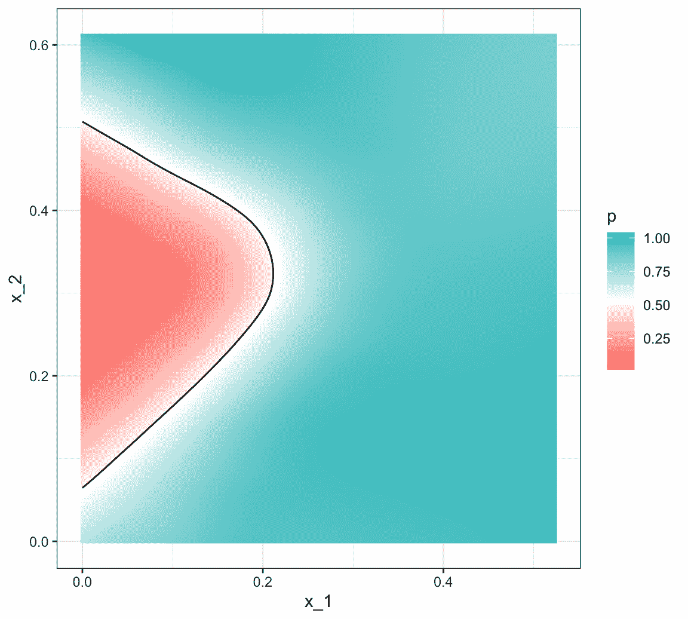

要开始理解回归的局限性，首先要注意，因为 $p(\mathbf{x}) = 0.5 \iff \log p(\mathbf{x})/(1-p(\mathbf{x})) = 0$，使用 GLM $\hat{p}(\mathbf{x})$，由 $p(\mathbf{x}) = 0.5$ 定义的边界必须满足：

$$ \hat{\beta}_0 + \hat{\beta}_1 x_1 + \hat{\beta}_2 x_2 = 0 \implies x_2 = -\hat{\beta}_0/\hat{\beta}_2 -\hat{\beta}_1/\hat{\beta}_2 x_1 $$

这意味着 $x_2$ 必须是 $x_1$ 的线性函数。

*这表明我们的 GLM 方法没有机会捕捉到真实 $p(\mathbf{x})$ 的非线性性质。以下是 $\hat{p}(\mathbf{x})$ 的可视化表示，它清楚地显示了它如何未能捕捉到 $p(\mathbf{x})$ 的形状：**

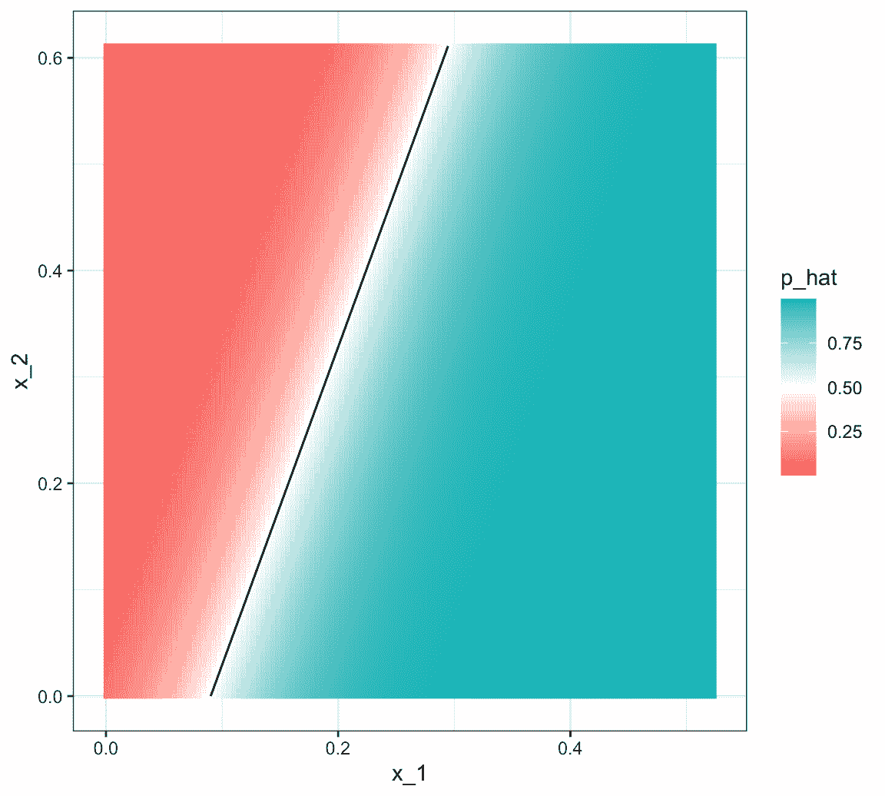

*我们需要更灵活的东西：一种允许估计形状不是平面的方法。平滑技术允许这种灵活性。我们将首先描述最近邻和核方法。为了理解为什么我们要涵盖这个主题，请记住，平滑技术背后的概念在机器学习中非常有用，因为条件期望/概率可以被视为未知形状的** **趋势** **，我们需要在存在不确定性的情况下估计它。**

## **28.4 局部平滑方法**

*为了解释平滑概念背后的主要思想，我们首先关注一个只有一个预测因子的问题。我们选择一个具有明显趋势但非线性的例子：2008 年美国总统选举中奥巴马和麦凯恩之间的民调差距。**

```r
polls_2008 |> ggplot(aes(day, margin)) + geom_point()
```

*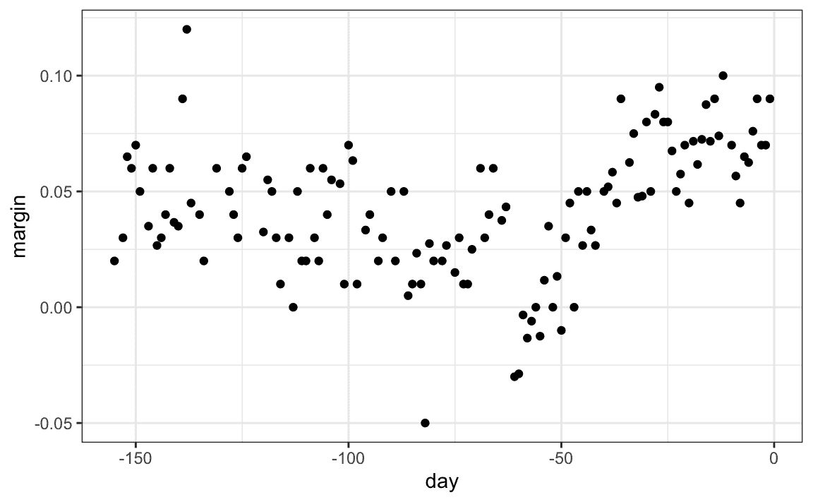**  **稍后我们将学习如何将平滑思想扩展到更高维度。**

在民调示例中，不要将其视为预测问题。相反，我们只是对学习趋势的形状感兴趣，一旦我们有了所有数据。

*我们假设对于任何给定的一天 $x$，选民中存在一个真实的偏好 $f(x)$，但由于民调引入的不确定性，每个数据点都伴随着一个误差 $\varepsilon$。观察到的民调差距的数学模型是：**

$$ Y_i = f(x_i) + \varepsilon_i $$

*将这个问题视为一个机器学习问题，考虑我们想要根据一天 $x$ 预测 $Y$。我们感兴趣的是找到真实趋势 $f(x) = \mathrm{E}[Y \mid X=x]$，但由于我们不知道这个条件期望，我们必须估计它。**

*让我们首先使用回归，因为这是我们迄今为止学到的唯一适用于此类数据的方法。以下是我们的估计：**

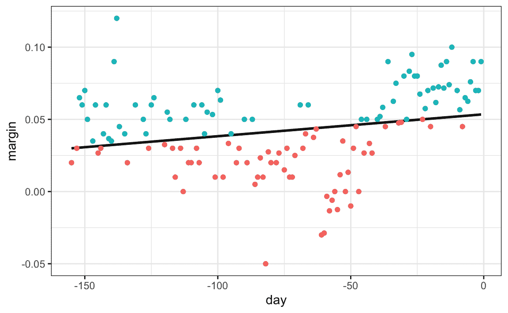

*拟合的回归线似乎并不能很好地描述趋势。例如，在 9 月 4 日（第-62 天），共和党全国代表大会举行，数据表明这给了约翰·麦凯恩在民调中的提升。然而，回归线并没有捕捉到这种潜在的趋势。为了更清楚地看到** **拟合不足** **，我们注意到位于拟合线（蓝色）上方的点以及位于下方的点（红色）在每天并不是均匀分布的。因此，我们需要一个替代的、更灵活的方法。**

*接下来，我们将描述可以克服这种局限性的平滑技术。**

### **箱式平滑**

*箱式平滑的一般思想是将数据点分组到层中，其中 $f(x)$ 的值可以假设是恒定的。当我们认为 $f(x)$ 变化缓慢，并且因此 $f(x)$ 在 $x$ 的小窗口中几乎恒定时，我们可以做出这个假设。**

对于 `poll_2008` 数据，平滑假设意味着相信公众舆论不会在一天之内发生剧烈变化。例如，我们可能会假设支持在一周内大致保持恒定。有了这个假设，连续几天的大约相同的预期值会给我们提供多个观察结果，帮助我们估计该点的潜在趋势。

如果我们将一周中的某一天设为中心，称之为 $x_0$，那么对于任何其他满足 $|x - x_0| \leq h$ 的日子 $x$，其中 $h = 3.5$，我们假设 $f(x)$ 是一个常数 $f(x) = \mu$。这个假设意味着：

$$ E[Y_i | X_i = x_i ] \approx \mu \mbox{ if } |x_i - x_0| \leq 3.5 $$

在平滑过程中，我们将 $h$ 称为 *带宽*。满足 $|x_i - x_0| \le h$ 的点的区间称为 *窗口大小* 或 *跨度*。

术语 *带宽*、*核半径*、*窗口大小* 和 *跨度* 有时可以互换使用，但它们的精确含义取决于惯例。根据上述定义，窗口大小是 *带宽的两倍*。

一些 R 函数，如 `ksmooth()`，使用 *完整窗口大小* 作为带宽。按照这个惯例，带宽为 7 对应于我们记法中的 $h = 3.5$。*这个假设意味着 $f(x_0)$ 的良好估计是窗口中 $y_i$ 值的平均值。如果我们定义 $A_0$ 为满足 $|x_i - x_0| \leq 3.5$ 的索引 $i$ 的集合，并且 $N_0$ 为 $A_0$ 中的索引数量，那么我们的估计是：

$$ \hat{f}(x_0) = \frac{1}{N_0} \sum_{i \in A_0} y_i $$

我们用 $x$ 的每个值作为中心进行这个计算。

在民意调查的例子中，对于每一天，我们会计算以那天为中心的一周内数值的平均值。这里有两个例子：$x_0 = -125$ 和 $x_0 = -55$。蓝色部分代表结果平均值。

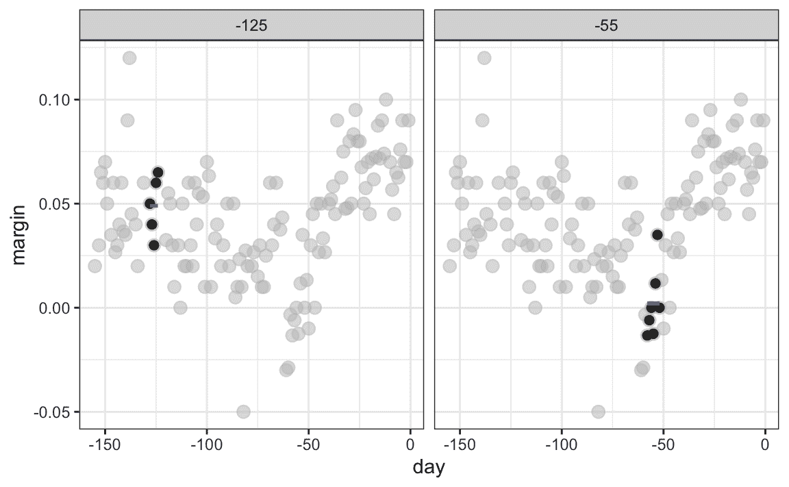

通过计算每个点的这个平均值，我们形成对潜在曲线 $f(x)$ 的估计。以下是我们从 -155 移动到 0 的过程。在 $x_0$ 的每个值上，我们保持估计 $\hat{f}(x_0)$ 并移动到下一个点：

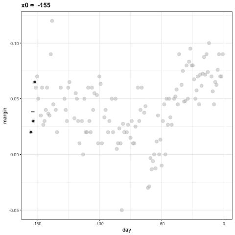

最终的代码和估计结果如下所示：

```r
span <- 7 
fit <- with(polls_2008, ksmooth(day, margin, kernel = "box", bandwidth = span))
 polls_2008 |> mutate(fit = fit$y) |>
 ggplot(aes(x = day)) +
 geom_point(aes(y = margin), size = 3, alpha = .5, color = "grey") + 
 geom_line(aes(y = fit), color = "red")
```

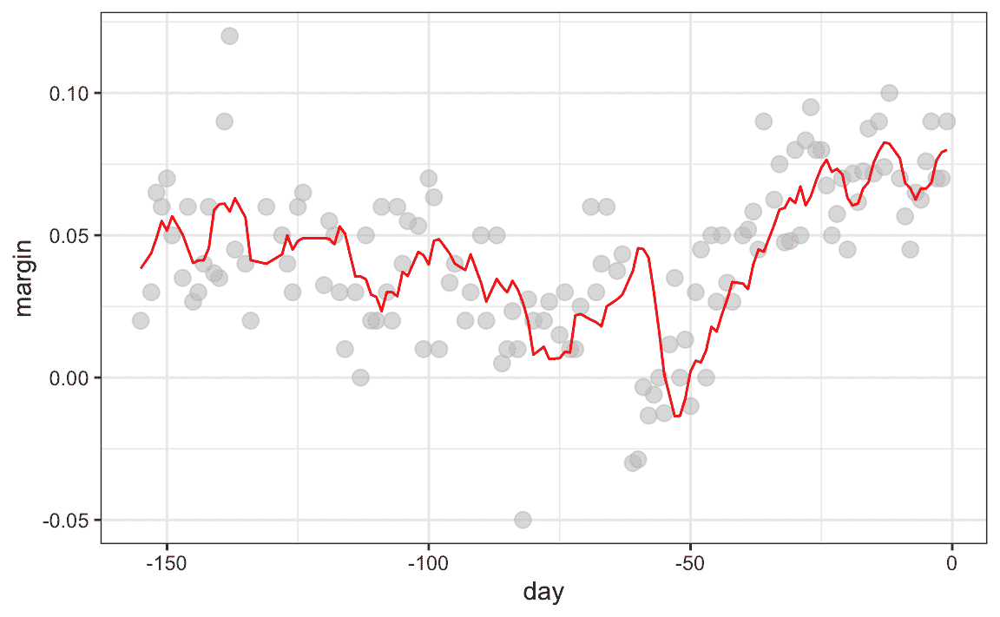*

### **核平滑器**

*“箱子灭火器”的估计看起来可能相当曲折。一个原因是，当窗口滑动时，点会突然进入或离开箱子，导致平均值的跳跃。我们可以通过一个 *核平滑器* 来减少这些不连续性。核平滑器根据数据点与目标位置 $x_0$ 的距离分配一个 *权重*，然后形成一个加权平均值**。

形式上，设 $K$ 为一个非负核函数，设 $h>0$ 为 *带宽*。定义权重

$$ w_{x_0}(x_i) = K\!\left(\frac{x_i - x_0}{h}\right), $$

并用此估计 $x_0$ 处的趋势

$$ \hat{f}(x_0) \;=\; \frac{\sum_{i=1}^N w_{x_0}(x_i)\,y_i}{\sum_{i=1}^N w_{x_0}(x_i)}. $$

箱平滑器是一个特殊情况，具有 *箱形*（或 *均匀*）核 $K(u) = 1$ 如果 $|u| \leq 1$ 否则为 0，这对应于在窗口内分配权重 1，在窗口外分配权重 0。这就是为什么在上面的代码中，我们使用 `ksmooth` 时的 `kernel = "box"`。为了减少由于点突然进入和退出而产生的波动，我们可以使用一个平滑核，该核对 $x_0$ 附近的点给予更多权重，并对远离 $x_0$ 的点快速衰减。`ksmooth` 中的 `kernel = "normal"` 选项正是通过使用标准正态密度 $K$ 来做到这一点。

在下面，我们可视化 $x_0 = -125$ 和 $h = 3.5$ 时的箱形核和正态核，展示了箱形核如何使所有箱内点等权重，而正态核则降低边缘附近点的权重。

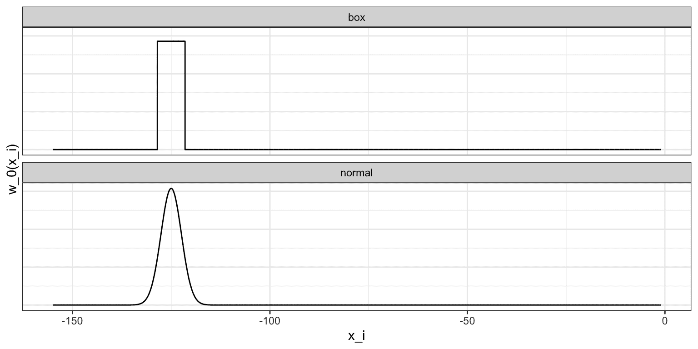

正态核的最终代码和结果图看起来像这样：

```r
fit <- with(polls_2008, ksmooth(day, margin, kernel = "normal", bandwidth = 7))
 polls_2008 |> mutate(smooth = fit$y) |>
 ggplot(aes(day, margin)) +
 geom_point(size = 3, alpha = .5, color = "grey") + 
 geom_line(aes(day, smooth), color = "red")
```

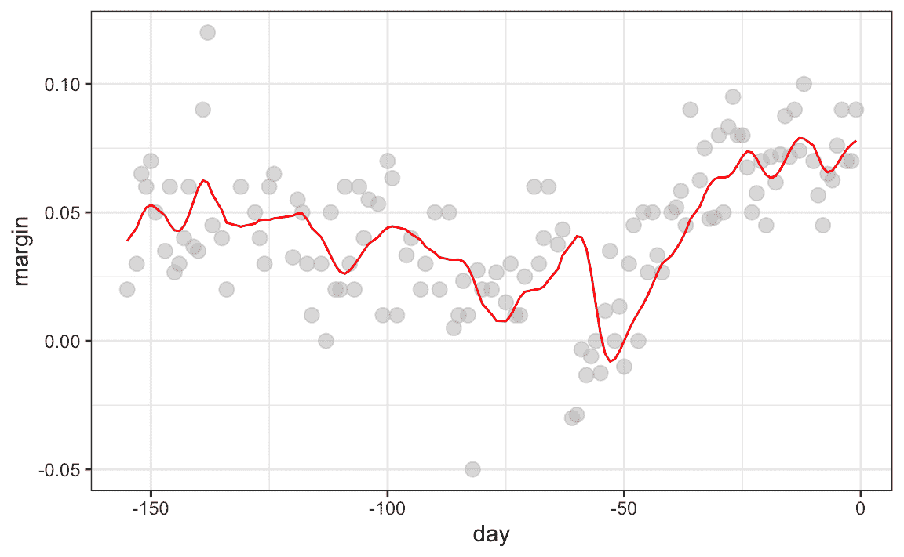*  *注意这个版本看起来更平滑。

R 中有几个函数实现了箱平滑器。一个例子是上面显示的 `ksmooth`。然而，在实践中，我们通常更喜欢使用比拟合常数稍微复杂一些的模型的方法。例如，上面的最终结果在预期不会出现波动的部分仍然有些许波动（例如在 -125 和 -75 之间）。我们接下来要解释的 `loess` 方法可以改进这一点。

### ***局部加权回归（loess）***

**所描述的箱平滑器方法的一个局限性是，我们需要小窗口来保持近似常数的假设。因此，我们最终得到的数据点数量很少，得到的 $\hat{f}(x)$ 估计值不够精确。在这里，我们描述如何通过 *局部加权回归*（loess）来考虑更大的窗口大小。为此，我们将使用一个称为泰勒定理的数学结果，它告诉我们，如果你足够仔细地观察任何光滑函数 $f(x)$，它将看起来像一条线。为了理解这一点，考虑园艺师用直边铲子做的弯曲边缘：


（由 Flickr 用户 Number 10 拍摄的“Downing Street garden path edge”¹。CC-BY 2.0 许可证²。）

我们不是假设函数在窗口内近似为常数，而是假设函数是局部线性的。与常数假设相比，我们可以考虑更大的窗口大小。我们不再考虑一周的窗口，而是考虑一个趋势近似线性的更大窗口。我们从一个三周的窗口开始，后来考虑并评估其他选项：

$$ E[Y_i | X_i = x_i ] = \beta_0 + \beta_1 (x_i-x_0) \mbox{ if } |x_i - x_0| \leq 10.5 $$

对于每个点 $x_0$，loess 定义一个窗口并在该窗口内拟合一条线。以下是一个示例，展示了 $x_0=-125$ 和 $x_0 = -55$ 的拟合情况：

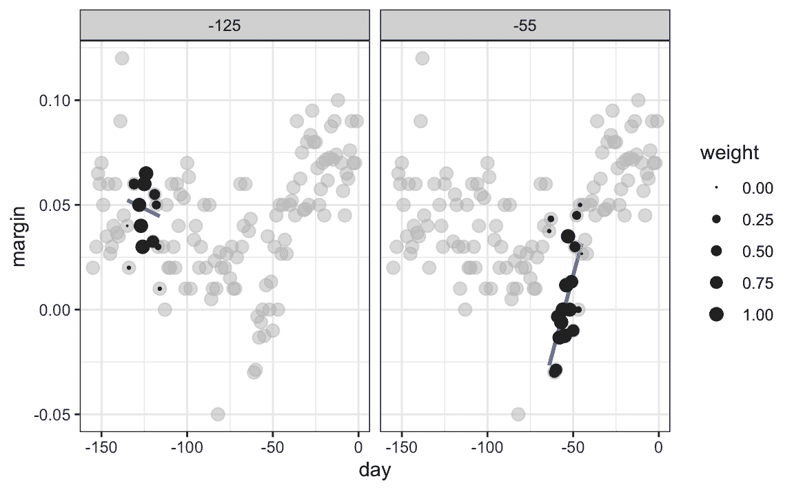

在 $x_0$ 处的拟合值成为我们的估计 $\hat{f}(x_0)$。以下是我们从 -155 移动到 0 的过程中发生的步骤：

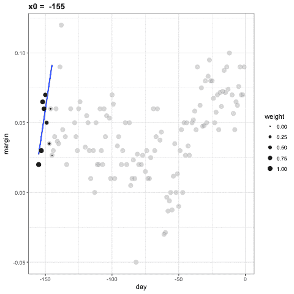

由于我们使用更大的样本量来估计局部参数，最终结果比箱式平滑器更平滑：

```r
total_days <- diff(range(polls_2008$day))
span <- 21/total_days
fit <- loess(margin ~ day, degree = 1, span = span, data = polls_2008)
polls_2008 |> mutate(smooth = fit$fitted) |>
 ggplot(aes(day, margin)) +
 geom_point(size = 3, alpha = .5, color = "grey") +
 geom_line(aes(day, smooth), color = "red")
```

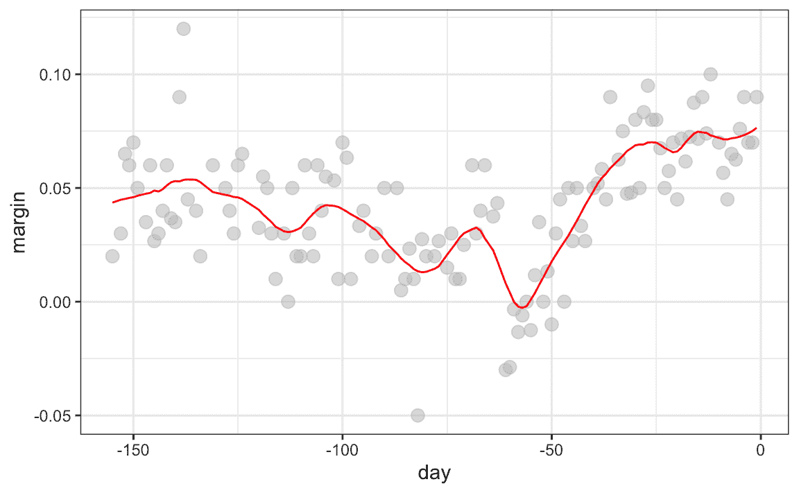*  *不同的跨度给出了不同的估计。我们可以看到不同的窗口大小如何导致不同的估计：

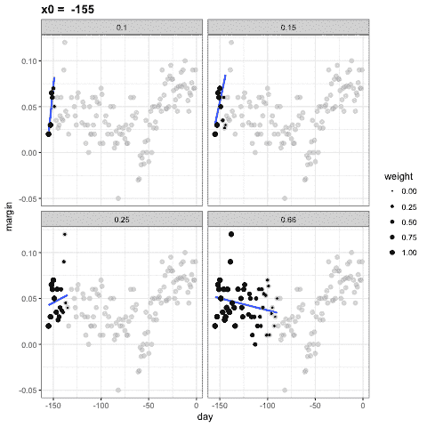

这里是最终的估计：

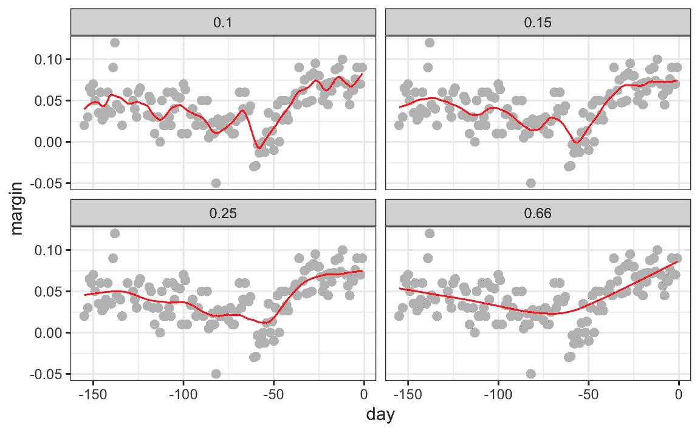

`loess` 与典型的箱式平滑器之间有三个其他的不同点。

1. 与保持箱式大小相同不同，`loess` 保持局部拟合中使用的点数相同。这个数字通过 `span` 参数来控制，它期望一个比例。例如，如果 `N` 是数据点的数量，且 `span=0.5`，那么对于给定的 $x$，`loess` 将使用 $0.5*N$ 个最接近 $x$ 的点来进行拟合。

2. 当局部拟合直线时，`loess` 使用一个 *加权* 方法。基本上，我们不是最小化残差平方和，而是最小化一个加权的版本：

$$ \sum_{i=1}^N w_0(x_i) \left[y_i - \left\{\beta_0 + \beta_1 (x_i-x_0)\right\}\right]² $$

3. 与高斯核函数不同，loess 使用一个称为 Tukey 三重权重的函数：

$$ K(u)= \left( 1 - |u|³\right)³ \mbox{ if } |u| \leq 1 \mbox{ and } K(u) = 0 \mbox{ if } |u| > 1 $$

为了定义权重，我们表示 $2h$ 为窗口大小，并定义 $w_0(x_i)$ 如上所示：$w_0(x_i) = K\left(\frac{x_i - x_0}{h}\right)$。

这个核函数与高斯核函数的不同之处在于，更多的点会得到接近最大值的值：

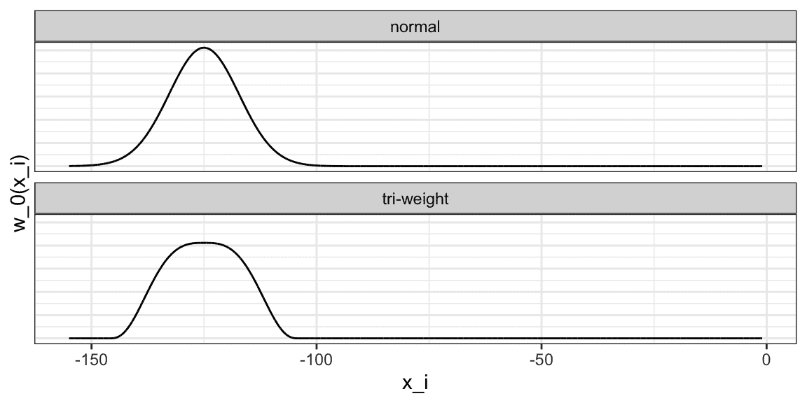

4. `loess` 有一个选项可以 *稳健地* 拟合局部模型。实现了一个迭代算法，在该算法中，在每次迭代中拟合一个模型后，会检测异常值并将它们在下次迭代中降权。要使用此选项，我们使用参数 `family="symmetric"`。

`loess` 也可以拟合局部抛物线而不是直线。泰勒定理也告诉我们，如果你足够仔细地观察任何数学函数，它看起来就像一个抛物线。该定理还指出，在用抛物线近似时，你不需要像用直线近似时那样仔细观察。这意味着我们可以使窗口更大，并拟合抛物线而不是直线。

$$ E[Y_i | X_i = x_i ] = \beta_0 + \beta_1 (x_i-x_0) + \beta_2 (x_i-x_0)² \mbox{ if } |x_i - x_0| \leq h $$

你可能已经注意到，当我们展示使用 loess 的代码时，我们设置了`degree = 1`。这告诉 loess 拟合一阶多项式，也就是线的花哨名称。如果你阅读 loess 的帮助页面，你会看到参数`degree`默认为 2。默认情况下，loess 拟合抛物线而不是线。以下是拟合线（红色虚线）和拟合抛物线（橙色实线）的比较：

```r
total_days <- diff(range(polls_2008$day))
span <- 28/total_days
fit_1 <- loess(margin ~ day, degree = 1, span = span, data = polls_2008)
fit_2 <- loess(margin ~ day, span = span, data = polls_2008)
 polls_2008 |> mutate(smooth_1 = fit_1$fitted, smooth_2 = fit_2$fitted) |>
 ggplot(aes(day, margin)) +
 geom_point(size = 3, alpha = .5, color = "grey") +
 geom_line(aes(day, smooth_1), color = "red", lty = 2) +
 geom_line(aes(day, smooth_2), color = "orange", lty = 1) 
```

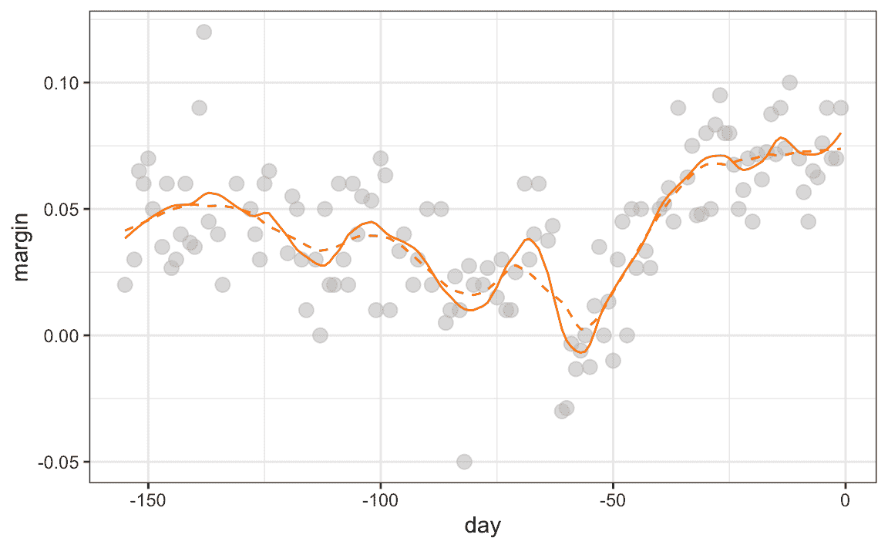*  *`degree = 2`给我们带来了更多波动的结果。一般来说，我们实际上更喜欢`degree = 1`，因为它不太容易受到这种噪声的影响。*****

### ****注意默认平滑参数****

***`ggplot2`包中的`geom_smooth`函数支持多种平滑方法。默认情况下，它使用 loess 或相关方法，即广义加性模型，如果任何数据窗口超过 1000 个观测值时使用后者。我们可以通过`method`函数请求使用 loess：

```r
polls_2008 |> ggplot(aes(day, margin)) +
 geom_point() + 
 geom_smooth(method = loess, formula = y ~ x)
```

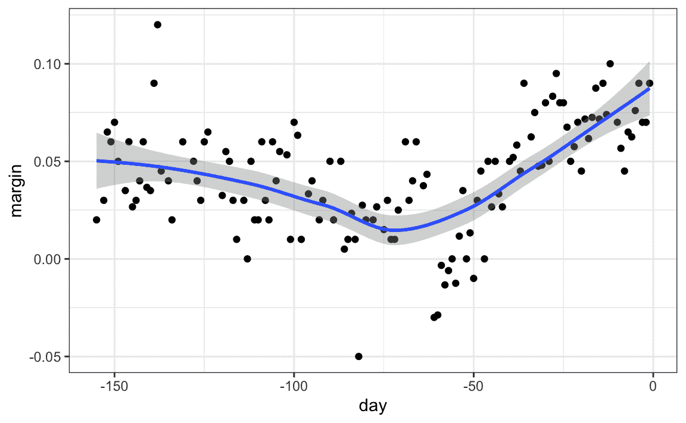*  *但是要注意默认参数，因为它们很少是最优的。然而，你可以方便地更改。例如，使用`loess`你可以使用以下代码：

```r
polls_2008 |> ggplot(aes(day, margin)) +
 geom_point() + 
 geom_smooth](https://ggplot2.tidyverse.org/reference/geom_smooth.html)(method = loess, formulat = y ~ x, method.args = [list(span = 0.15, degree = 1))
```

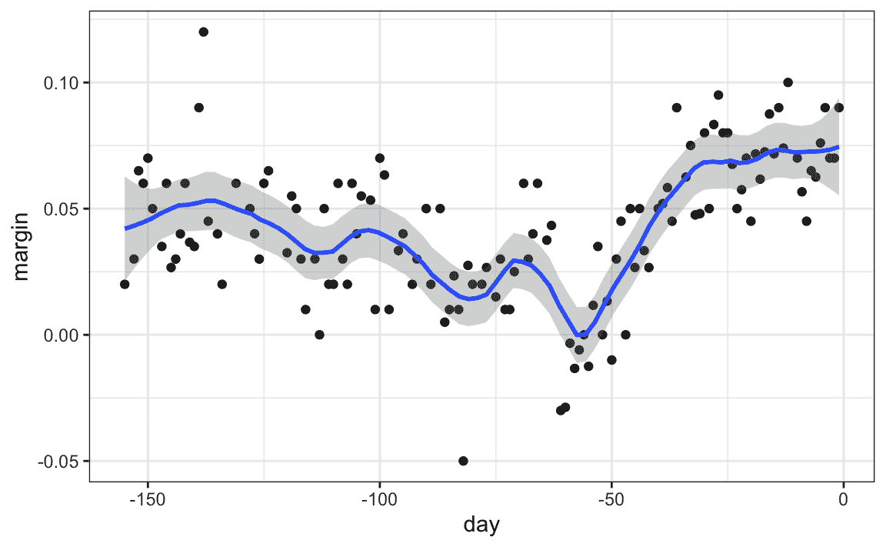*********

## ****28.5 将平滑与机器学习联系起来****

***为了具体了解平滑如何与机器学习相关，再次考虑第 28.3.1 节中的例子。如果我们定义结果$Y = 1$为数字 7，$Y=0$为数字 2，那么我们感兴趣的估计条件概率是：

$$ p(\mathbf{x}) = \mathrm{Pr}(Y=1 \mid X_1=x_1 , X_2 = x_2). $$

使用$x_1$和$x_2$作为在第 28.3.1 节中定义的两个预测因子。在这个例子中，我们观察到的 0 和 1 是“噪声”，因为对于某些区域，概率$p(\mathbf{x})$并不接近 0 或 1。因此，我们需要估计$p(\mathbf{x})$。平滑是完成这一目标的另一种方法。在第 28.3.1 节中，我们看到线性回归不足以捕捉$p(\mathbf{x})$的非线性性质，因此平滑方法提供了改进。在第 29.1 节中，我们描述了一种流行的机器学习算法，即 k 最近邻算法，它基于平滑的概念。

## ****28.6 练习****

***1. 为`heights`数据集计算男性条件的概率。将身高四舍五入到最接近的英寸。为每个$x$绘制估计的条件概率 $P(x) = \mathrm{Pr}(\mbox{Male} | \mbox{height}=x)$。

2. 在我们刚刚制作的图中，我们看到身高低值时存在高变异性。这是因为在这些层中我们的数据点很少。这次使用`quantile`函数来计算分位数 $0.1,0.2,\dots,0.9$ 和`cut`函数来确保每个组有相同数量的点。提示：对于任何数值向量`x`，你可以根据以下示例创建基于分位数的组。

```r
cut(x, quantile(x, seq(0, 1, 0.1)), include.lowest = TRUE)
```

3. 使用**MASS**包生成来自双变量正态分布的数据，如下所示：

```r
Sigma <- 9*matrix(c(1,0.5,0.5,1), 2, 2)
dat <- MASS::mvrnorm](https://rdrr.io/pkg/MASS/man/mvrnorm.html)(n = 10000, [c(69, 69), Sigma) |>
 data.frame() |> setNames(c("x", "y"))
```

你可以使用`plot(dat)`快速绘制数据。使用与上一个练习类似的方法来估计条件期望并绘制图形。

4. **dslabs**包提供了以下数据集，其中包含 2015-2018 年波多黎各的死亡计数。

```r
library(dslabs)
head(pr_death_counts)
```

从 2018 年 5 月之前的数据中移除，然后使用`loess`函数获取预期死亡人数作为日期函数的平滑估计。绘制这个结果平滑函数。使跨度大约为两个月。

5. 将平滑估计值与一年中的天数绘制在同一张图上，但使用不同的颜色。

6. 假设我们只想使用第二个协变量来预测`mnist_27`数据集中的 2s 和 7s。我们能这样做吗？初步观察似乎数据没有多少预测能力。实际上，如果我们拟合一个常规逻辑回归，`x_2`的系数并不显著！

```r
library(dslabs)
glm(y ~ x_2, family = "binomial", data = mnist_27) 
```

在这里绘制散点图没有用，因为`y`是二元的：

```r
with(mnist_27$train, plot(x_2, y)
```

将一个局部加权回归线拟合到上面的数据，并绘制结果。注意，这里存在预测能力，但条件概率不是线性的。*********

* * *

***1.  https://www.flickr.com/photos/49707497@N06/7361631644↩︎

1.  https://www.flickr.com/photos/number10gov/↩︎

1.  https://creativecommons.org/licenses/by/2.0/↩︎****
