# 29 重采样与模型评估

> 原文：[`rafalab.dfci.harvard.edu/dsbook-part-2/ml/resampling-methods.html`](https://rafalab.dfci.harvard.edu/dsbook-part-2/ml/resampling-methods.html)

1.  机器学习

1.  29 重采样与模型评估

在本章中，我们介绍了重采样，这是机器学习中最重要思想之一。在这里，我们关注概念和数学方面。我们将在第 31.2 节中稍后描述如何在实践中实现重采样方法。为了激发这个概念，我们将使用第 28.3.1 节中提出的两个预测数字数据，并介绍 k 近邻（kNN），以展示这些思想。

## 29.1 使用 k 近邻的动机

我们感兴趣的是估计条件概率函数：

$$ p(\mathbf{x}) = \mathrm{Pr}(Y = 1 \mid X_1 = x_1 , X_2 = x_2). $$

如在第 28.5 节中定义。

在 k 近邻（kNN）中，我们以与箱式平滑类似的方式估计 $p(\mathbf{x})$。首先，我们根据特征定义所有观察值之间的距离。然后，对于任何点 $\mathbf{x}_0$，我们通过识别 $\mathbf{x}_0$ 的 $k$ 个最近点并取这些点相关的 $y$ 值的平均值来估计 $p(\mathbf{x}_0)$。我们将用于计算平均值的点集称为 *邻域*。

由于我们之前描述的关于条件期望和条件概率之间的联系，这给我们提供了 $\hat{p}(\mathbf{x}_0)$，就像箱式平滑器给我们提供了一个趋势的估计。与箱式平滑器一样，我们可以通过一个参数来控制我们估计的灵活性，在这种情况下是邻居的数量 $k$：较大的 $k$ 值会导致更平滑的估计，而较小的 $k$ 值会导致更灵活和波动的估计。

为了拟合 $k$ 近邻模型，我们使用来自 **caret** 包的 `knn3` 函数。帮助文件显示了调用此函数的两种方式；我们将使用 *公式接口*，它允许我们将模型写成以下形式

```r
outcome ~ predictor_1 + predictor_2 + ...
```

由于我们的训练集存储在数据框中，我们可以使用缩写 `y ~ .` 来表示“使用 `y` 作为结果，所有其他列作为预测变量。”

我们还必须选择邻居的数量 $k$。默认值是 `k = 5`，我们将在这里使用。将这一点结合起来，我们的调用看起来像：

```r
library(dslabs)
library([caret](https://github.com/topepo/caret/))
#> Loading required package: lattice
knn_fit <- [knn3](https://rdrr.io/pkg/caret/man/knn3.html)(y ~ ., data = mnist_27$train, k = 5)
```

在这种情况下，由于我们的数据集是平衡的，我们同样关心敏感性和特异性，我们将使用准确率来量化性能。

`knn3` 的 `predict` 函数返回 $p(\mathbf{x})$ 的估计（`type = "prob"`）或预测（`type = "class"`）：

```r
y_hat_knn <- predict(knn_fit, mnist_27$test, type = "class")
```

我们看到，默认参数的 kNN 已经击败了 GLM：

```r
mean(y_hat_knn == mnist_27$test$y)
#> [1] 0.815
```

为了了解为什么是这样，我们绘制 $\hat{p}(\mathbf{x})$ 并将其与真实的条件概率 $p(\mathbf{x})$ 进行比较：

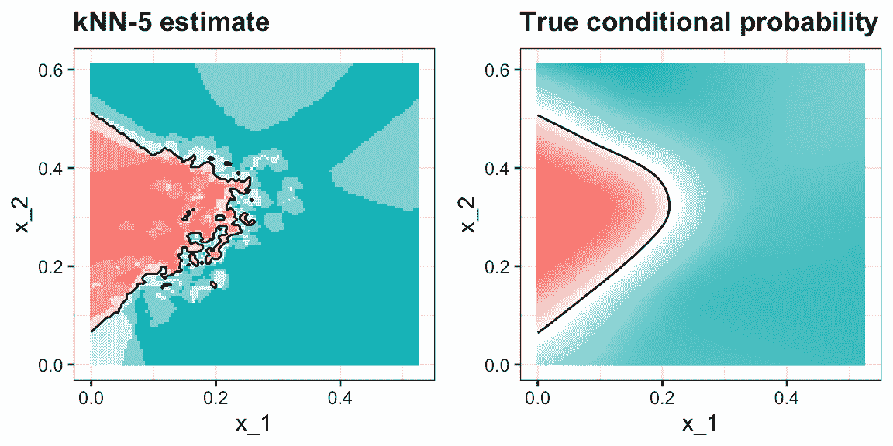

我们看到 kNN 更好地适应了$p(\mathbf{x})$的非线性形状。然而，我们的估计在红色区域中有一些蓝色的孤岛，这在直观上并不合理。我们注意到，与测试集相比，我们在训练集中有更高的准确率：

```r
y_hat_knn <- predict(knn_fit, mnist_27$train, type = "class")
mean(y_hat_knn == mnist_27$train$y)
#> [1] 0.858
 y_hat_knn <- predict(knn_fit, mnist_27$test, type = "class")
mean(y_hat_knn == mnist_27$test$y)
#> [1] 0.815
```

这是由于我们所说的*过拟合*。****

## ***29.2 过拟合***

**使用 kNN 时，当我们将$k$设置为 1 时，过拟合问题最为严重。当$k = 1$时，训练集中每个$\mathbf{x}$的估计值仅通过该点的$y$值获得。在这种情况下，如果$x_1$和$x_2$是唯一的，我们将在训练集中获得完美的准确率，因为每个点都用于预测自身（如果预测因子不是唯一的，并且至少有一组预测因子有不同的结果，那么无法完美预测）。

在这里，我们使用$k = 1$拟合 kNN 模型，并确认我们在训练集中获得了接近完美的准确率：

```r
knn_fit_1 <- [knn3](https://rdrr.io/pkg/caret/man/knn3.html)(y ~ ., data = mnist_27$train, k = 1)
y_hat_knn_1 <- predict(knn_fit_1, mnist_27$train, type = "class")
mean(y_hat_knn_1 == mnist_27$train$y)
#> [1] 0.994
```

但在测试集中，准确率实际上比我们使用回归得到的准确率还要差：

```r
y_hat_knn_1 <- predict(knn_fit_1, mnist_27$test, type = "class")
mean(y_hat_knn_1 == mnist_27$test$y)
#> [1] 0.81
```

我们可以通过绘制$\hat{p}(\mathbf{x})$产生的决策规则边界来看到过拟合问题：

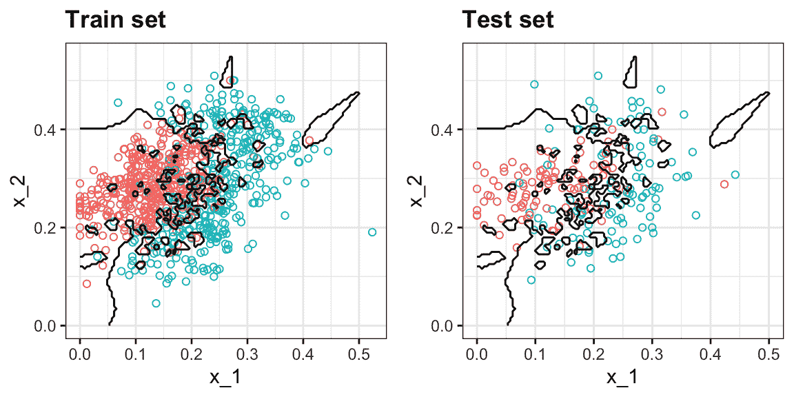

估计$\hat{p}(\mathbf{x})$与训练数据过于接近（左）。您可以看到，在训练集中，边界被绘制以完美地包围蓝色海洋中的单个红色点。由于大多数点$\mathbf{x}$是唯一的，预测结果要么是 1 要么是 0，该点的预测就是其关联的标签。然而，一旦我们引入测试集（右），我们会看到许多这些小岛现在具有相反的颜色，我们最终做出了几个错误的预测。*****

## ***29.3 过平滑***

**尽管不如$k=1$时严重，但我们看到当$k = 5$时，我们也出现了过拟合。因此，我们应该考虑一个更大的$k$。让我们尝试一个更大的数字，例如$k = 401$。

```r
knn_fit_401 <- [knn3](https://rdrr.io/pkg/caret/man/knn3.html)(y ~ ., data = mnist_27$train, k = 401)
y_hat_knn_401 <- predict(knn_fit_401, mnist_27$test, type = "class")
mean(y_hat_knn_401 == mnist_27$test$y)
#> [1] 0.76
```

估计结果与使用回归得到的估计相似：

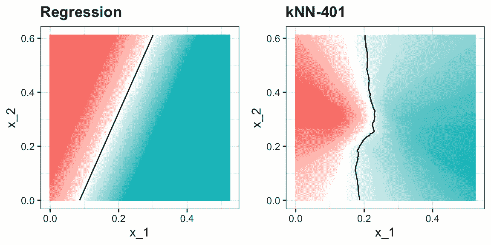

在这种情况下，$k$值太大，不允许足够的灵活性。我们称之为*过平滑*。****

## ***29.4 调参参数***

**机器学习算法通常需要我们在拟合模型之前设置一个或多个值。一个简单的例子是在 k-Nearest Neighbors (kNN)中选择$k$。在第三十章中，我们将看到更多的例子。这些值被称为*调参参数*，将机器学习应用于实践的一个重要部分是选择它们，通常称为*调参模型*。

那么，我们如何选择调整参数呢？例如，我们如何决定 kNN 中的最佳 $k$ 值？原则上，我们希望 $k$ 的值最大化准确率，或者等价地，最小化第 27.8 节中定义的预期均方误差。挑战在于我们不知道真正的预期误差。*重采样方法*的目标是估计任何给定算法和调整参数集（如 $k$）的此误差。

为了了解为什么我们需要重采样，让我们重复我们之前所做的事情：比较训练集和测试集的准确率，但现在对于一系列的 $k$ 值。然后我们可以绘制每个 $k$ 值选择的准确率估计：

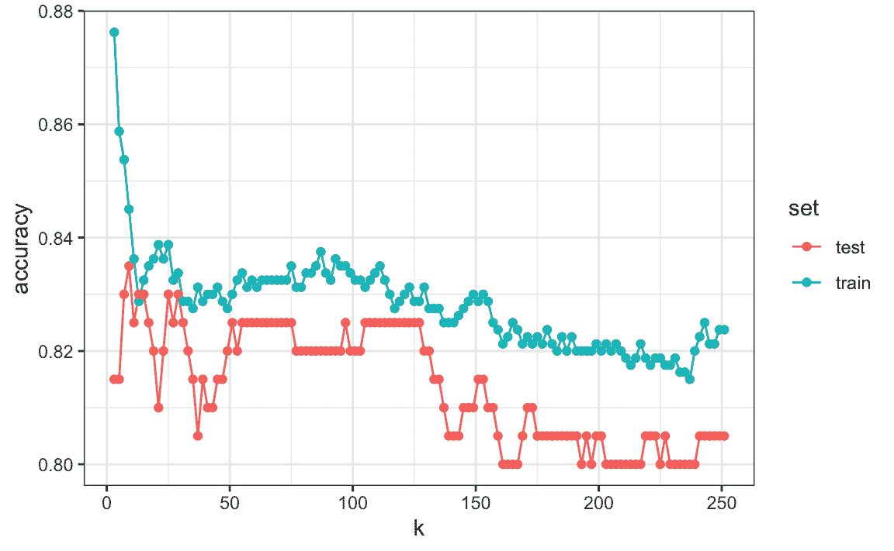

首先，请注意，从训练集获得的估计通常比测试集的估计更乐观，准确率更高，对于较小的 $k$ 值，差距更大。这是*过拟合*的经典症状。

我们是否应该简单地选择在测试集上给出最高准确率的 $k$ 值并报告其准确率？这种方法有两个重要的缺点：

1.  **准确率与（k）曲线是嘈杂的。** 我们不期望 $k$ 的小幅度变化会导致准确率或 MSE 的大幅度变化。锯齿状模式发生是因为每个准确率估计都是基于有限的测试样本，因此由于随机变化而波动。因此，“最佳” $k$ 可能只是偶然看起来最好。

1.  **我们正在两次使用测试集。** 虽然我们没有在测试集上拟合模型，但我们*正在*使用它来选择 $k$，然后再次使用它来报告准确率。这会导致对性能的乐观估计，通常在真正新的数据上不会成立。

重采样方法*通过减少变异性并确保测试数据不重复使用（一次用于评估，一次用于调整）来提供解决这两个问题的原则性解决方案。***

## ***29.5 重采样方法的数学描述***

**在第 29.1 节第 29.1 节中，我们介绍了 $k$-最近邻（kNN）作为本章的一个简单示例，以激发对该章节的兴趣。在那个设置中，算法只依赖于一个调整参数 $k$，它直接影响性能。更一般地，机器学习算法通常涉及*多个*调整参数。在这里，我们使用符号 $\lambda$ 来表示定义算法的全部参数集。***

为了跟踪这些选择如何影响性能，我们将给定参数集对观测 $i$ 生成的预测写成 $\hat{y}_i(\lambda)$，相应的均方误差为 $\mathrm{MSE}(\lambda)$。我们的目标是找到使 $\mathrm{MSE}(\lambda)$ 最小的 $\lambda$ 值。

重采样方法提供了估计 $\mathrm{MSE}(\lambda)$ 的实用方法，因此引导我们找到最佳的调整参数。

直观的第一种尝试是第 27.8 节中定义的明显误差，并在上一节中使用：

$$ \hat{\mbox{MSE}}(\lambda) = \frac{1}{N}\sum_{i = 1}^N \left\{\hat{y}_i(\lambda) - y_i\right\}² $$

如前节所述，这个估计是一个随机变量，基于仅一个测试集，具有足够的变异性，可以显著影响最佳 $\lambda$ 的选择。

现在想象一个我们可以反复获取数据的世界，比如来自新的随机样本。我们可以获取一个非常大的新样本数量 $B$，将每个样本分成训练集和测试集，并定义：

$$ \frac{1}{B} \sum_{b=1}^B \frac{1}{N}\sum_{i=1}^N \left\{\hat{y}_i^b(\lambda) - y_i^b\right\}² $$

其中 $y_i^b$ 是测试样本 $b$ 中的第 $i$ 个观测值，$\hat{y}_{i}^b(\lambda)$ 是使用参数 $\lambda$ 定义并由训练集 $b$ 训练的算法获得的预测。大数定律告诉我们，随着 $B$ 的增大，这个量越来越接近 $\mbox{MSE}(\lambda)$。这当然是一个理论上的考虑，因为我们很少能接触到超过一个数据集来开发算法，但这个概念启发了重采样方法。

重采样方法背后的基本思想是从现有数据生成一系列不同的随机样本。有几种实现这种方法的方法，但所有方法都是随机生成几个较小的数据集，这些数据集不用于训练，而是用于估计 MSE。接下来，我们将描述 *交叉验证*，这是最广泛使用的重采样方法之一。

## ***29.6 交叉验证***

**总体而言，我们得到了一个数据集（蓝色）并需要构建一个算法，使用这个数据集，该算法最终将用于完全独立的（黄色）数据集，我们甚至可能看不到。

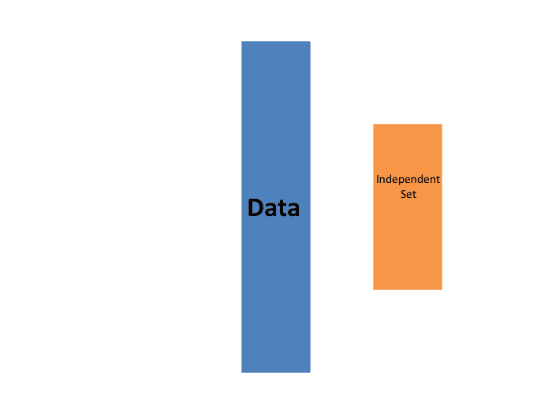

因此，为了模仿这种情况，我们首先从我们的数据集中划分出一部分，并假装它是一个独立的数据集：我们将数据集划分为一个 *训练集*（蓝色）和一个 *测试集*（红色）。我们将完全在训练集上训练我们的算法，包括参数 $\lambda$ 的选择，并仅将测试集用于评估目的。

我们通常尝试选择数据集的一小部分，以便尽可能多地拥有数据来训练。然而，我们还想让测试集足够大，以便在不拟合不切实际数量的模型的情况下获得稳定的 MSE 估计。典型的选择是使用 10%-20% 的数据用于测试。

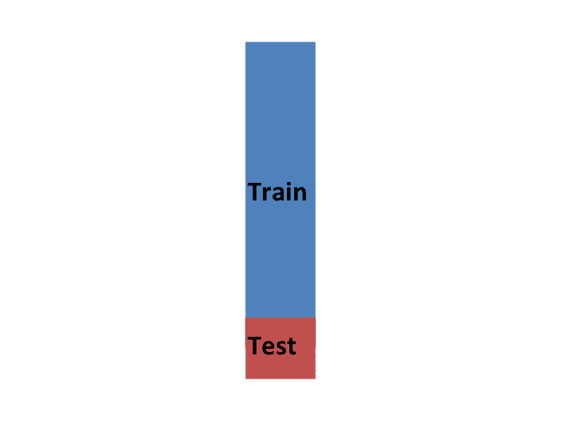

让我们重申，我们绝对不能使用测试集：无论是用于过滤行、选择特征还是用于任何其他目的！

但然后我们如何优化 $\lambda$？在交叉验证中，我们通过将训练集分成两部分：训练集和验证集来实现这一点。

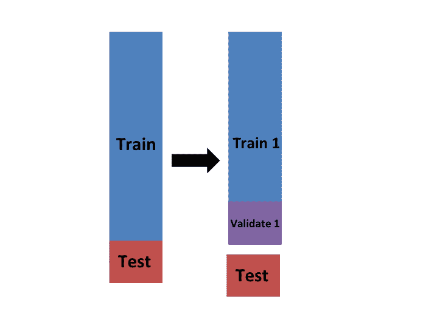

我们将多次进行此操作，以确保每个数据集中获得的多项式均方误差（MSE）估计相互独立。为此，已经提出了几种方法。在这里，我们详细描述其中一种方法，即 K 折交叉验证，以提供所有方法中使用的通用思路。

### K 折交叉验证

作为提醒，我们将模仿在介绍这种 MSE 版本时所使用的概念：

$$ \mbox{MSE}(\lambda) \approx\frac{1}{B} \sum_{b = 1}^B \frac{1}{N}\sum_{i = 1}^N \left(\hat{y}_i^b(\lambda) - y_i^b\right)² $$

我们希望生成一个可以被视为独立随机样本的数据集，并重复此操作$B$次。K 折交叉验证中的 K 代表$B$的次数。在下面的示例中，我们展示了使用$B = 5$的例子。

我们最终将得到$B$个样本，但让我们先描述如何构建第一个：我们简单地随机选择$M = N/B$个观察值（如果$M$不是整数，则进行四舍五入），并将这些视为一个随机样本$y_1^b, \dots, y_M^b$，其中$b = 1$。我们称这为验证集。

现在我们可以将模型拟合到训练集中，然后在独立集上计算明显的误差：

$$ \hat{\mbox{MSE}}_b(\lambda) = \frac{1}{M}\sum_{i = 1}^M \left(\hat{y}_i^b(\lambda) - y_i^b\right)² $$

作为提醒，这只是一个样本，因此将返回一个关于真实错误的噪声估计。在 K 折交叉验证中，我们将观察随机分成$B$个非重叠集：

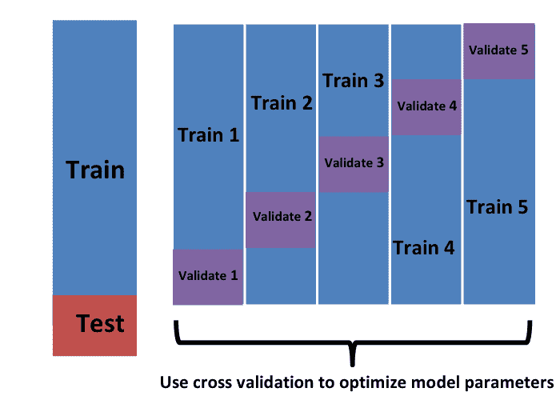

现在，我们为这些集合中的每一个重复上述计算$b = 1,\dots,B$，并得到$\hat{\mbox{MSE}}_1(\lambda),\dots, \hat{\mbox{MSE}}_B(\lambda)$。然后，为了我们的最终估计，我们计算平均值：

$$ \hat{\mbox{MSE}}(\lambda) = \frac{1}{B} \sum_{b = 1}^B \hat{\mbox{MSE}}_b(\lambda) $$

并获得我们损失的估计。最后一步将是选择使 MSE 最小的$\lambda$。

### 有多少折？

现在如何选择交叉验证的折数？较大的$B$值更可取，因为训练数据更好地模仿原始数据集。然而，较大的$B$值将导致计算时间大大减慢：例如，100 折交叉验证将比 10 折交叉验证慢 10 倍。因此，$B = 5$和$B = 10$的选择很受欢迎。

### 估计优化算法的 MSE

我们已经描述了如何使用交叉验证来优化参数。然而，我们现在必须考虑优化是在训练数据上进行的，因此我们需要基于未用于优化选择的数据来估计我们的最终算法。这就是我们使用早期分离的测试集的地方：

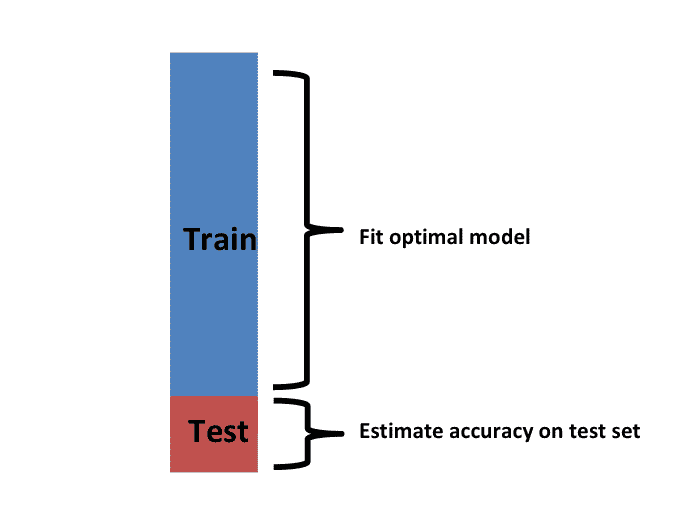

实际上，我们可以再次进行交叉验证，比如五次：

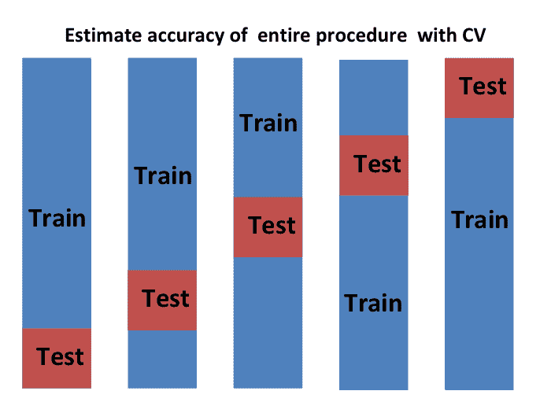

通过平均五个 MSE 估计值，我们获得我们预期损失的最终估计。然而，请注意，最后一个交叉验证迭代意味着我们的整个计算时间乘以重复次数。你很快就会了解到，拟合每个算法都需要时间，因为我们正在执行许多复杂的计算。因此，我们总是在寻找减少这种时间的方法。对于最终评估，我们通常只使用一个测试集。

一旦我们对这个模型感到满意并希望将其提供给他人，我们可以在不改变优化参数的情况下，在整个数据集上重新拟合模型。

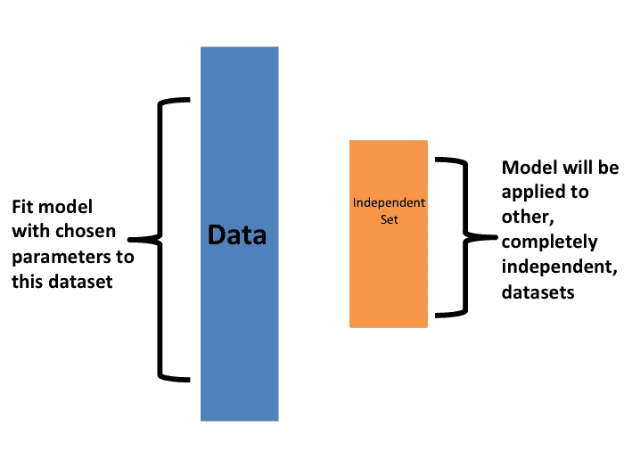*

## **29.7 自助重采样**

*通常，交叉验证涉及将原始数据集划分为训练集以训练模型和测试集以评估它。根据第十四章中描述的思想，使用自助方法可以创建多个不同的训练数据集。这种方法有时被称为自助聚合或袋装。**

在自助重采样中，我们从原始训练数据集中创建大量自助样本。每个自助样本是通过随机选择观察值并替换它们创建的，通常与原始训练数据集的大小相同。对于每个自助样本，我们在随机采样中未选择的观察值上拟合模型并计算 MSE 估计值，这些观察值被称为*袋外观察值*。这些袋外观察值在标准交叉验证中起着类似验证集的作用。

我们然后将从每个自助样本中获得的袋外观察到的均方误差（MSEs）进行平均，以估计模型的表现。

这种方法实际上是**caret**包中的默认方法。我们将在第三十一章 Chapter 31 中描述如何使用**caret**包实现重采样方法。

## **29.8 MSE 估计比较**

*在第 29.1 节 Section 29.1 中，我们仅基于提供的测试集（在下面的图中以红色显示）计算了 MSE 的估计值。这里我们展示了上述交叉验证技术如何帮助减少变异性。下面的绿色曲线显示了应用 10 折交叉验证的结果，留出 10%的数据用于验证。我们可以看到，方差显著降低。蓝色曲线是使用 100 个自助样本估计 MSE 的结果。变异性进一步降低，但代价是计算时间增加了 10 倍。**

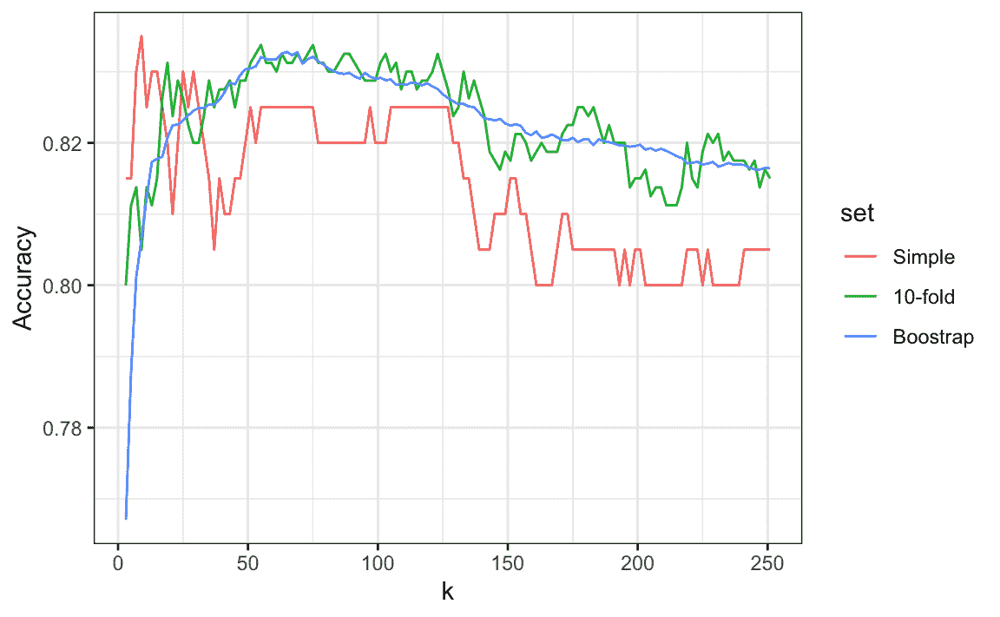

注意，三种重采样方法导致不同的$\lambda$选择。使用准确度曲线：

+   简单方法选择 $\lambda =$ 9。

+   10 折交叉验证方法选择 $\lambda =$ 55。

+   自助方法选择 $\lambda =$ 65。

这些差异突出了一个重要观点：你选择的$\lambda$的好坏取决于你对测试误差的估计。可靠的重采样方法是找到真正泛化良好的调整参数所必需的。***

## ***29.9 练习***

**以下是练习集的**更清晰、更易于学生理解**的版本，扩展到总共**10 个练习**，语言更加严谨，动机更佳，并对学生期望完成的内容进行了仔细的解释。

我还增加了一个额外的练习（现在是练习 7），使得整个练习集逻辑连贯，达到总共 10 个练习。

* * ****

# ***30 **练习：过度拟合、特征选择和重采样***** 

**我们将处理一个**预测因子和结果完全无关**的数据集。这种设置有助于我们理解当我们意外地“窥视”测试集或使用完整数据集进行特征选择时，误导性结果是如何产生的。

生成数据集：

```r
set.seed(1996)
n <- 1000
p <- 10000
x <- matrix(rnorm(n * p), n, p)
colnames(x) <- paste0("x_", 1:p)
y <- factor(rbinom(n, 1, 0.5))   # completely random binary outcome
 # smaller subset for initial exercises
x_subset <- x, [sample(p, 100)]
```

因为`x`和`y`是独立的，没有分类器应该达到比 0.5 大得多的精度。

1. 使用仅`x_subset`，随机将数据分割为 80%训练和 20%测试。

在训练集上拟合逻辑回归模型（`glm`，family = “binomial”），并计算测试集的精度。

重复此整个程序**五次**，使用新的随机分割，并报告**平均测试精度**。

2. 我们现在使用 t 检验来选择预测因子，尽管所有预测因子都是噪声。对于`x`的每一列，计算一个 t 检验，比较`y = 1`组中的值与`y = 0`组中的值，并提取 p 值：

```r
pvals <- apply(x, 2, function(col) t.test(col ~ y)$p.value)
```

创建一个索引`ind`，包含 p 值小于 0.01 的预测因子。有多少个预测因子通过了这个截止值？

3. 定义：

```r
x_subset <- x[, ind]
```

重复练习 1，但使用这个新的`x_subset`。

现在的**平均测试精度**是多少？它是否高于 0.5？

4. 为什么数据独立时精度大于 0.5？

选择**最佳**的解释：

1.  函数`train`估计模型训练数据上的精度。

1.  我们过度拟合，因为模型使用了 100 个预测因子。

1.  我们使用了**整个数据集**进行特征选择，但在选择预测因子后进行了交叉验证。

1.  高精度仅仅是随机变化。

5. 重新进行分析，但这次在每个重采样分割中进行**特征选择**。

这意味着：

+   对于每个折或重采样，

+   仅使用训练部分选择预测因子，

+   使用所选预测因子拟合模型，

+   在相应的测试/验证部分进行评估。

你现在应该获得接近 0.5 的精度。解释原因。

6. 加载`tissue_gene_expression`数据集。

分割数据：

+   80%训练

+   20%测试

然后，在训练集中，反复分割为：

+   90%训练

+   10%验证

使用这些验证分割来选择 kNN 分类器中最佳的**k**值（使用`train`）。

报告表现最佳的`k`值。

7. 使用在练习 6 中找到的最佳`k`值，在整个训练集上重新训练 kNN 模型，并在保留的测试集上评估其精度。

与你在验证集上观察到的准确性相比，是差得多、好得多，还是大致相同？请解释为什么这个比较很重要。

8. 我们可以使用 `createResample` 创建重采样样本。

```r
set.seed(1995)
indexes <- [createResample](https://rdrr.io/pkg/caret/man/createDataPartition.html)(mnist_27$train$y, 10)
```

在第一个重采样样本中，索引 3、4 和 7 出现了多少次？

9. 对所有 10 个重采样样本重复之前的练习。

哪些索引在每个样本中根本不会出现？平均有多少个观察结果被省略？

10. 用你自己的话解释为什么重采样样本（带替换的抽样）：

+   必须包含一些观察结果多次出现，

+   必须完全省略其他所有内容，并且

+   仍然被认为是一个有效的“重采样数据集”。

将这个解释与使用重采样样本来估计预测误差的想法联系起来。*******
