# 30  监督学习方法

> 原文：[`rafalab.dfci.harvard.edu/dsbook-part-2/ml/algorithms.html`](https://rafalab.dfci.harvard.edu/dsbook-part-2/ml/algorithms.html)

1.  机器学习

1.  30  监督学习方法

机器学习包括大量算法，超过一百种常用的方法，每种方法都有其独特的优势、假设和调整参数。在本章中，我们介绍了一小部分但具有代表性的算法，这些算法展示了监督学习背后的主要思想。我们的目标不是全面覆盖，而是建立对不同方法如何从数据中学习以及为什么它们会做出不同预测的直觉。

为了使示例具体且易于理解，我们使用第 28.3.1 节中引入的两个预测者数字数据集作为我们的示例。这个数据集足够小以进行可视化，同时足够丰富以揭示真实算法的行为。所有代码示例都依赖于**dslabs**包中的函数。稍后，在第三十一章中，我们将展示如何使用提供统一接口进行拟合和调整许多不同机器学习方法的**caret**包来有效地实现这些想法。

```r
library(caret)
library(dslabs)
```

## 30.1 线性和逻辑回归

我们在书的线性模型部分介绍了线性回归和逻辑回归作为量化变量之间关联的工具。然而，这些模型也可以被视为**预测算法**。一旦我们从训练数据中估计了它们的参数，我们就可以通过评估拟合模型在该点来对新预测变量值 $\mathbf{x}$ 进行预测。这种预测视角将线性回归和逻辑回归明确地纳入监督学习方法的范畴中。

### 线性回归

线性回归可以被视为用于连续结果的监督学习方法。给定一个数值结果 $Y$ 和预测变量 $\mathbf{X} = (X_1,\dots,X_p)^\top$，我们建模条件期望如下：

$$ \mathrm{E}[Y \mid \mathbf{X} = \mathbf{x}] = \beta_0 + \sum_{j=1}^p \beta_j x_j, $$ 这是一个预测变量的线性函数。线性回归提供了一个简单、可解释的基线，许多监督学习算法可以被视为这一想法的扩展或修改。

然而，当结果为分类时，线性回归是不合适的。在第 28.3.1 节中，我们介绍了**逻辑回归**作为一种专门为建模二元分类问题中的类别概率而设计的方法。

### 逻辑回归

对于第 28.3.1 节中提到的两类，我们可以使用逻辑函数来建模类别 1 的概率：

$$ \log\frac{p(\mathbf{x})}{1 - p(\mathbf{x})} = \beta_0 + \beta_1 x_1 + \beta_2 x_2, \,\, p(\mathbf{x}) = \Pr(Y = 1 \mid X_1 = x_1, X_2 = x_2), $$

这估计了观察属于类别 1 的概率。这是二元逻辑回归模型。

对于超过两个类别 ($K > 2$)，逻辑回归可以通过两种常见方式扩展：*一对多* (OvR) 和 *多项式逻辑回归*。

在一对多方法中，我们拟合 $K$ 个独立的二元逻辑回归模型。对于每个类别 $k$，我们建模：

$$ \log\frac{q_k(\mathbf{x})}{1 - q_k(\mathbf{x})} = \beta_{k,0} + \sum_{j=1}^p \beta_{k,j} x_j, \qquad k = 1,\dots,K. $$

在这里，$q_k(\mathbf{x})$ 估计观察属于类别 $k$ *相对于其他类别* 的概率，但这些量不一定总和为 1，也不一定相互一致。

在拟合所有 $K$ 个模型后，对于新的观察 $\mathbf{x}$ 的预测类别是

$$ \hat{y}(\mathbf{x}) = \arg\max_k q_k(\mathbf{x}). $$

OvR 简单，但不产生连贯的概率分布。

多项式方法通过联合建模所有类别概率来解决这个问题的不一致性。我们选择一个类别，例如类别 $K$，作为参考，并拟合：

$$ \log\frac{p_k(\mathbf{x})}{p_K(\mathbf{x})} = \beta_{k,0} + \sum_{j=1}^p \beta_{k,j} x_j, \qquad k = 1,\dots,K-1. $$

让

$$ \eta_k(\mathbf{x}) = \beta_{k,0} + \sum_{j=1}^p \beta_{k,j} x_j, \qquad \eta_K(\mathbf{x}) = 0. $$

类别概率是通过 *softmax* 函数计算的：

$$ p_k(\mathbf{x}) = \frac{\exp(\eta_k(\mathbf{x}))} {\sum_{j=1}^K \exp(\eta_j(\mathbf{x}))}, \qquad k=1,\dots,K. $$

这些概率自动满足

$$ \sum_{k=1}^K p_k(\mathbf{x}) = 1. $$

预测的类别是

$$ \hat{y}(\mathbf{x}) = \arg\max_k p_k(\mathbf{x}). $$

多项式逻辑回归通常更受欢迎，因为它产生总和为 1 的连贯概率，并联合建模类别之间的关系。一对多方法在 $K$ 较大时计算上更简单，并且通常产生相似的 *类别预测*，即使相应的概率估计不同。

在 第二十八章 中，我们看到了逻辑回归在近似 $p(\mathbf{x})$ 方面不够灵活，对于两位数的例子来说，其准确率仅为 0.775。在接下来的几节中，我们将介绍一些算法，通过提供所需的灵活性来改进这一点，每个算法都使用不同的方法来估计条件类别概率。

## 30.2 k-最近邻

我们在第 29.1 节中介绍了 kNN 算法。在第 29.8 节中，我们指出 $k=65$ 提供了最高的估计准确率。使用 $k=65$，我们获得准确率 0.825，超过了回归。估计条件概率的图表明，kNN 估计足够灵活，确实捕捉到了真实条件概率的形状。

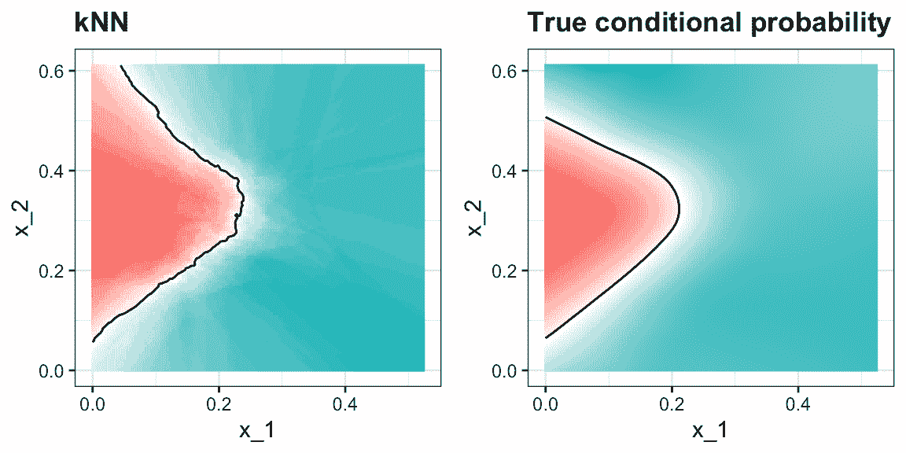

你准备好做练习 1 - 13 了。

## 30.3 概率分类模型

我们已经描述了当使用平方损失时，条件期望提供了制定决策规则的最佳方法。在二元情况下，我们可以达到的最小真实错误是由贝叶斯定理决定的，这是一个基于真实条件概率的决策规则：

$$ p(\mathbf{x}) = \mathrm{Pr}(Y = 1 \mid \mathbf{X}=\mathbf{x}) $$

我们已经描述了几种估计 $p(\mathbf{x})$ 的方法。在这些方法中，我们直接估计条件概率，不考虑预测因子的分布。在机器学习中，这些被称为*判别性*方法。

然而，贝叶斯定理告诉我们，了解预测因子 $\mathbf{X}$ 的分布可能是有用的。建模 $Y$ 和 $\mathbf{X}$ 联合分布的方法通常被称为*生成模型*（我们建模整个数据，$\mathbf{X}$ 和 $Y$ 的生成方式）。我们首先描述最一般的生成模型，朴素贝叶斯，然后继续描述两个具体案例，二次判别分析（QDA）和线性判别分析（LDA）。

### 朴素贝叶斯

回想一下，贝叶斯定理告诉我们我们可以将 $p(\mathbf{x})$ 重新写为以下形式：

$$ p(\mathbf{x}) = \mathrm{Pr}(Y = 1|\mathbf{X}=\mathbf{x}) = \frac{f_{\mathbf{X}|Y = 1}(\mathbf{x}) \mathrm{Pr}(Y = 1)} { f_{\mathbf{X}|Y = 0}(\mathbf{x})\mathrm{Pr}(Y = 0) + f_{\mathbf{X}|Y = 1}(\mathbf{x})\mathrm{Pr}(Y = 1) } $$

其中 $f_{\mathbf{X}|Y = 1}$ 和 $f_{\mathbf{X}|Y = 0}$ 分别代表预测因子 $\mathbf{X}$ 在两个类别 $Y = 1$ 和 $Y = 0$ 下的分布函数。该公式意味着如果我们能够估计这些条件分布，我们就可以制定一个强大的决策规则。然而，这是一个很大的“如果”。

随着我们继续前进，我们将遇到 $\mathbf{X}$ 具有许多维度而我们对其分布知之甚少的情况。在这些情况下，朴素贝叶斯将实际上无法实现。然而，也有一些情况，我们只有少数几个预测因子（不超过 2 个）和许多类别，在这些情况下，生成模型可以非常强大。我们描述了两个具体的例子，并使用我们之前描述的案例研究来展示它们。

让我们从一个非常简单且无趣，但具有说明性的案例开始：与预测身高相关的例子。

```r
set.seed(1995)
y <- heights$height
train_index <- createDataPartition(y, times = 1, p = 0.5, list = FALSE)
train_set <- heights[train_index,]
test_set <- heights[-train_index,]
```

在这种情况下，朴素贝叶斯方法特别合适，因为我们知道正态分布是性别对身高条件分布的良好近似，对于两个类别 $Y = 1$（女性）和 $Y = 0$（男性）。这意味着我们可以通过简单地从数据中估计平均值和标准差来近似条件分布 $f_{X|Y = 1}$ 和 $f_{X|Y = 0}$：

```r
param <- train_set |> group_by(sex) |> summarize(m = mean(height), s = sd(height))
```

发病率，我们将用 $\pi = \mathrm{Pr}(Y = 1)$ 表示，可以从数据中估计出来：

```r
pi <- mean(train_set$sex == "Female")
```

现在我们可以使用我们对平均值和标准差的估计来得到一个实际的规则：

```r
x <- test_set$height
f0 <- dnorm(x, param$m[2], param$s[2])
f1 <- dnorm(x, param$m[1], param$s[1])
p_hat_bayes <- f1*pi / (f1*pi + f0*(1 - pi))
```

我们的朴素贝叶斯估计 $\hat{p}(x)$ 与逻辑回归估计非常相似：


事实上，我们可以证明朴素贝叶斯方法在数学上与逻辑回归预测相似。然而，我们将证明留给更高级的文本，如《统计学习基础》¹。我们可以通过比较两个结果曲线来经验性地看到它们是相似的。

### 控制发病率

朴素贝叶斯方法的一个有用特性是它包含一个参数来考虑发病率的不同。使用我们的样本，我们估计了 $f_{X|Y = 1}$，$f_{X|Y = 0}$ 和 $\pi$。如果我们用帽子表示估计值，我们可以将 $\hat{p}(x)$ 写作：

$$ \hat{p}(x)= \frac{\hat{f}_{X|Y = 1}(x) \hat{\pi}} { \hat{f}_{X|Y = 0}(x)(1-\hat{\pi}) + \hat{f}_{X|Y = 1}(x)\hat{\pi} } $$

如我们之前讨论的，我们的样本发病率远低于一般人群，仅为 0.24。因此，如果我们使用规则 $\hat{p}(x) > 0.5$ 来预测女性，我们的准确率将因低敏感性而受到影响：

```r
y_hat_bayes <- ifelse(p_hat_bayes > 0.5, "Female", "Male")
sensitivity](https://rdrr.io/pkg/caret/man/sensitivity.html)(data = [factor(y_hat_bayes), reference = factor(test_set$sex))
#> [1] 0.324
```

再次强调，这是因为算法更重视特异性以应对低发病率：

```r
specificity](https://rdrr.io/pkg/caret/man/sensitivity.html)(data = [factor(y_hat_bayes), reference = factor(test_set$sex))
#> [1] 0.947
```

这主要是因为 $\hat{\pi}$ 大大低于 0.5，所以我们更倾向于预测 `男性`。在我们的样本中，这样做是有道理的，因为我们确实有较高的男性比例。但如果我们将这一结果外推到一般人群，我们的整体准确率将受到低敏感性的影响。

朴素贝叶斯方法为我们提供了一种直接纠正这一问题的方法，因为我们只需简单地将 $\hat{\pi}$ 设置为我们想要的任何值。因此，为了平衡特异性和敏感性，我们不必改变决策规则中的截止值，而可以简单地像这样将 $\hat{\pi}$ 设置为 0.5：

```r
p_hat_bayes_unbiased <- f1 * 0.5 / (f1 * 0.5 + f0 * (1 - 0.5)) 
y_hat_bayes_unbiased <- ifelse(p_hat_bayes_unbiased > 0.5, "Female", "Male")
```

注意敏感性的差异，平衡得更好：

```r
sensitivity](https://rdrr.io/pkg/caret/man/sensitivity.html)([factor(y_hat_bayes_unbiased), factor(test_set$sex))
#> [1] 0.775
specificity](https://rdrr.io/pkg/caret/man/sensitivity.html)([factor(y_hat_bayes_unbiased), factor(test_set$sex))
#> [1] 0.717
```

新的规则还给我们提供了一个非常直观的 66-67 之间的截止值，这大约是女性和男性平均身高的中间值：


### 二次判别分析

二次判别分析（QDA）是朴素贝叶斯的一种版本，其中我们假设分布 $f_{\mathbf{X}|Y = 1}(x)$ 和 $f_{\mathbf{X}|Y = 0}(\mathbf{x})$ 是多元正态分布。我们在上一节中描述的简单例子实际上是 QDA。现在让我们看看一个稍微复杂一些的情况：2 或 7 的例子。

在这个例子中，我们有两个预测变量，所以我们假设每个都是二元正态分布。这意味着我们需要为每个案例 $Y = 1$ 和 $Y = 0$ 估计两个平均值、两个标准差和一个相关系数。一旦我们有了这些，我们就可以近似分布 $f_{X_1,X_2|Y = 1}$ 和 $f_{X_1, X_2|Y = 0}$。我们可以轻松地从数据中估计参数，并且有了这些估计，我们只需要 prevalence $\hat{\pi}$ 来计算：

$$ \hat{p}(\mathbf{x})= \frac{\hat{f}_{\mathbf{X}|Y = 1}(\mathbf{x}) \hat{\pi}} { \hat{f}_{\mathbf{X}|Y = 0}(x)(1-\hat{\pi}) + \hat{f}_{\mathbf{X}|Y = 1}(\mathbf{x})\hat{\pi} } $$

注意，密度 $f$ 是二元正态分布。这里我们提供了一种直观的方法来展示这种方法。我们绘制数据并使用等高线图来给出两个估计的正态密度看起来是什么样的（我们显示代表包含 95%点的区域的曲线）：

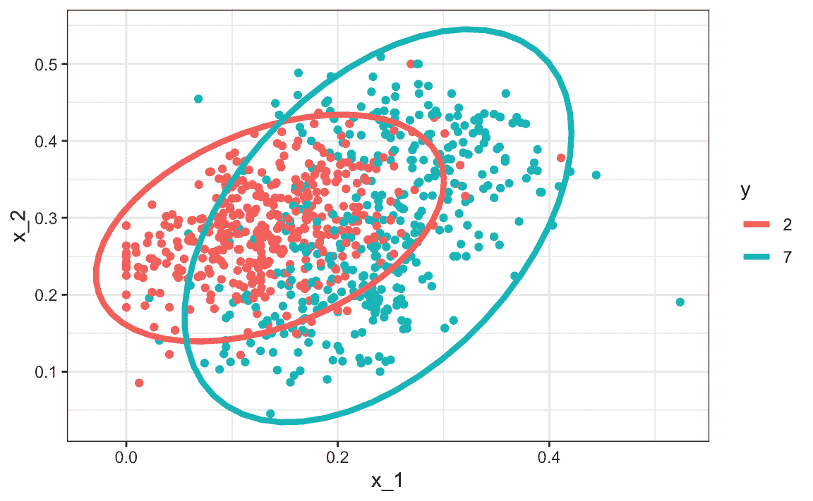

我们可以使用**MASS**包中的`qda`函数来拟合 QDA：

```r
train_qda <- MASS::qda(y ~ ., data = mnist_27$train)
y_hat <- predict(train_qda, mnist_27$test)$class
```

我们发现我们获得了相对较好的准确率：

```r
confusionMatrix(y_hat, mnist_27$test$y)$overall["Accuracy"] 
#> Accuracy 
#>    0.815
```

条件概率看起来相对较好，尽管它不如核平滑器拟合得那么好：


QDA 不如核方法表现好的一个原因是正态性的假设并不完全成立。尽管对于 2s 来说似乎是合理的，但对于 7s 来说似乎并不准确。注意 7s 点的轻微曲率：

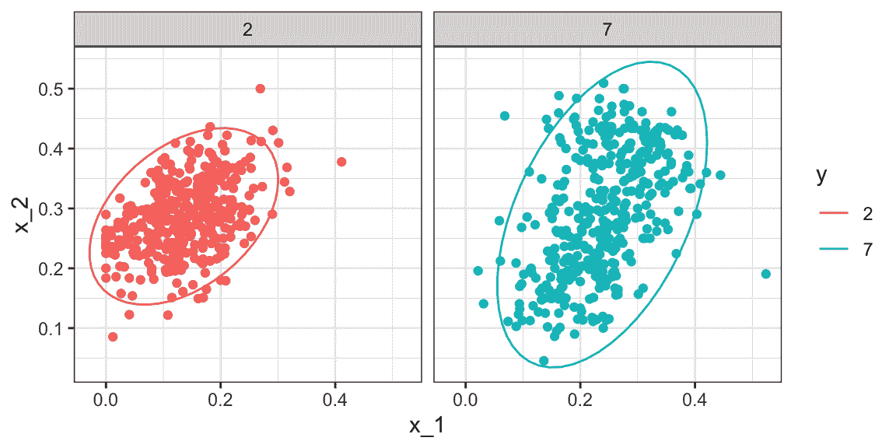

QDA 在这里可以工作得很好，但随着预测变量数量的增加，它变得难以使用。这里我们有 2 个预测变量，不得不计算 4 个均值、4 个标准差和 2 个相关系数。请注意，如果我们有 10 个预测变量，我们需要为每个类别估计 45 个相关系数。一般来说，我们需要估计的相关系数的数量是每个类别的 $p(p-1)/2$，这会很快变得很大。一旦参数的数量接近数据的大小，由于过拟合，该方法变得不切实际。

### 线性判别分析

为了解决 QDA 参数过多的问题，一个相对简单的解决方案是假设所有类别的相关结构相同，这减少了我们需要估计的参数数量。在这种情况下，分布看起来是这样的：

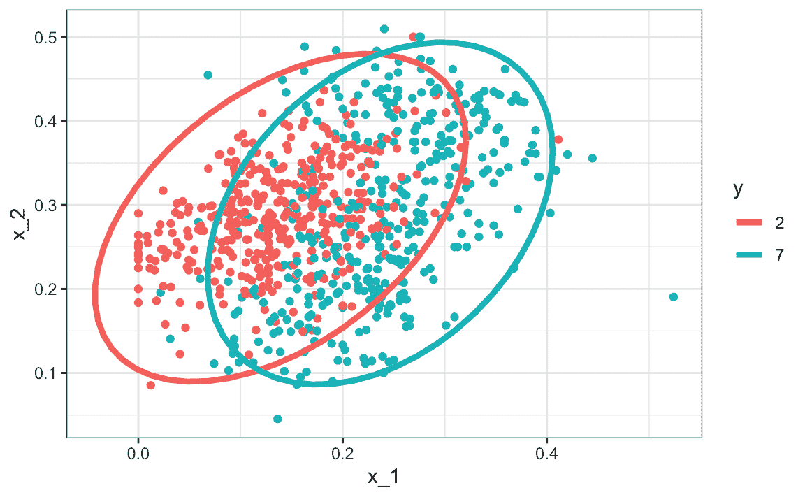

我们可以使用**MASS**包的`lda`函数来拟合 LDA：

```r
train_lda <- MASS::lda(y ~ ., data = mnist_27$train)
y_hat <- predict(train_lda, mnist_27$test)$class
```

现在椭圆的大小以及角度都是相同的。这是因为它们被假定为具有相同的标准差和相关性。尽管这个附加约束降低了参数的数量，但刚性降低了我们的准确性：

```r
confusionMatrix(y_hat, mnist_27$test$y)$overall["Accuracy"]
#> Accuracy 
#>    0.775
```

当我们强制这个假设时，我们可以从数学上证明边界是一条线，就像逻辑回归一样。因此，我们称这种方法为 *线性* 判别分析（LDA）。同样，对于 QDA，我们可以证明边界必须是一个二次函数。

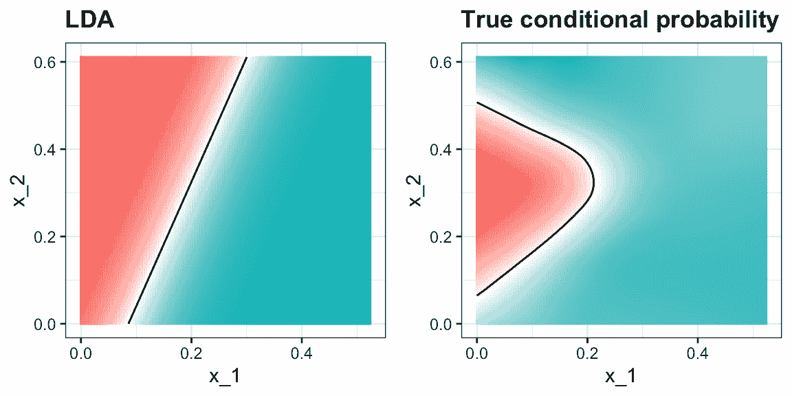

尽管 LDA 对于简单的数据集通常表现良好，但在这种情况下，缺乏灵活性不允许我们捕捉真实条件概率函数中的非线性。

### 扩展到多个类别

上述双类情况中引入的思想可以自然地扩展到多于两个类别的情形。对于 $K$ 个类别，贝叶斯定理给出

$$ p_k(\mathbf{x}) = \Pr(Y = k \mid \mathbf{X} = \mathbf{x}) = \frac{f_{\mathbf{X}\mid Y=k}(\mathbf{x}),\Pr(Y=k)}{ \sum_{l=1}^K f_{\mathbf{X}\mid Y=l}(\mathbf{x})\Pr(Y=l) }, \qquad k = 1,\dots,K. $$

构建分类器**，我们只需从训练数据中估计这个表达式中的量。对于朴素贝叶斯、LDA 或 QDA：

+   我们使用假设的模型（朴素贝叶斯中的独立性，LDA 中的共享协方差的正态分布，或 QDA 中的类别特定协方差的正态分布）来估计类条件密度 $f_{\mathbf{X}\mid Y=k}(\mathbf{x})$，

+   我们使用经验频率 $\hat{\pi}_k = \frac{1}{n}\sum_{i=1}^n \mathbf{1}(y_i = k)$ 来估计类比例 $\Pr(Y = k)$。

一旦这些成分被估计，我们计算所有 $k$ 的 $\hat{p}_k(\mathbf{x})$，并将 $\mathbf{x}$ 分配给后验概率最大的类别。

这种泛化不需要超出双类情况的新想法，唯一的区别是我们为所有 $K$ 个类别重复相同的估计。

### 与距离的关系

在 LDA 和 QDA 中，我们假设每个类别都来自从 *训练数据* 中估计的多变量正态分布。当我们对一个新观测 $\mathbf{x}$ 进行分类时，算法为每个类别 $k$ 计算：

$$ f_{\mathbf{X}\mid Y=k}(\mathbf{x}),\Pr(Y=k) $$

并预测具有最大值的类别。

因此，理解正态密度如何变化有助于解释为什么 LDA 和 QDA 表现得像基于距离的分类器。为了简化，我们考虑类别平衡的情况：$\Pr(Y=k) = 1/K$ 对于所有 $k$：

让我们先考察一维正态密度和

$$ f(x) = \frac{1}{\sqrt{2\pi}\sigma} \exp\left\{-\frac{1}{2}\left(\frac{x-\mu}{\sigma}\right)²\right\}. $$

如果我们忽略乘法常数 $1/(\sqrt{2\pi}\sigma)$ 并取对数，我们得到：

$$ \log f(x) \propto -\frac{1}{2}\left(\frac{x-\mu}{\sigma}\right)² $$

关键点是：

$$ \log f(x) \text{ 随着 } (x-\mu)² \text{ 的增加而减少。} $$

换句话说，密度最高的类就是均值最接近（x）的类（在 $\sigma$，即类内标准差缩放后）。

对于多元高斯类，同样的想法适用，但涉及更一般的距离概念。对数密度变为：

$$ \log f(\mathbf{x}) \propto (\mathbf{x} - \boldsymbol{\mu})^\top\Sigma^{-1}(\mathbf{x} - \boldsymbol{\mu}), $$

这是对马氏距离平方的负值。

+   在 LDA 中，所有类使用相同的协方差 $\Sigma$。因此，每个类通过其（缩放后的）平方距离到类均值来给 $\mathbf{x}$ 打分。

+   在 QDA 中，每个类都有自己的协方差，因此每个类使用不同的距离度量。

因此，LDA 和 QDA 都可以被视为基于距离的分类器：一个新观测值被分配给其高斯模型在马氏距离上最接近的类。

你现在可以开始做 14-17 题练习了*****。

## 30.4 分类和回归树（CART）

分类和回归树（CART）通过反复将预测空间分割成更小、更均匀的区域，提供了一种灵活、直观的预测方法。CART 不是拟合一个全局模型，而是构建一个树形决策规则集，以适应数据中的复杂模式。在本节中，我们将阐述这一想法，并提供一些关于其实现的细节。

### 维度灾难

我们描述了为什么 LDA 和 QDA 等方法不适用于许多预测因子 $p$，因为我们需要估计的参数数量变得过大。例如，在数字示例中 $p = 784$，我们会有超过 600,000 个参数使用 LDA，而对于 QDA，这个数字会乘以类的数量。核方法，如 kNN 或局部回归，没有模型参数需要估计。然而，由于所谓的“维度灾难”，当使用多个预测因子时，它们也面临挑战。这里的“维度”指的是当我们有 $p$ 个预测因子时，两个观测值之间的距离是在 $p$ 维空间中计算的。

理解维度灾难的一个有用方法是考虑为了包含给定百分比的样本，我们需要将跨度/邻域/窗口做得有多大。记住，随着邻域的增大，我们的方法会失去灵活性，而为了保持灵活性，我们需要保持邻域较小。

为了看到这如何成为高维问题，假设我们有一个在[0,1]区间内等间距的连续预测因子，我们想要创建包含 1/10th 数据的窗口。那么很容易看出我们的窗口大小必须是 0.1：


现在对于两个预测因子，如果我们决定保持邻域大小不变，每个维度 10%，我们只包含 1 个点。如果我们想包含 10%的数据，那么我们需要将正方形的每一边的长度增加到$\sqrt{.10} \approx .316$：

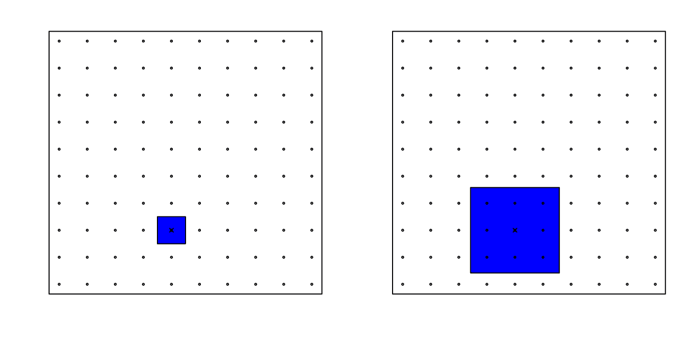

使用相同的逻辑，如果我们想在三维空间中包含 10%的数据，那么每个立方体的边长是$\sqrt[3]{.10} \approx 0.464$。一般来说，为了在$p$维的情况下包含 10%的数据，我们需要一个边长为$\sqrt[p]{.10}$的区间，这是总体的 10%。这个比例很快就会接近 1，如果比例是 1，这意味着我们包含了所有数据，并且不再进行平滑处理。

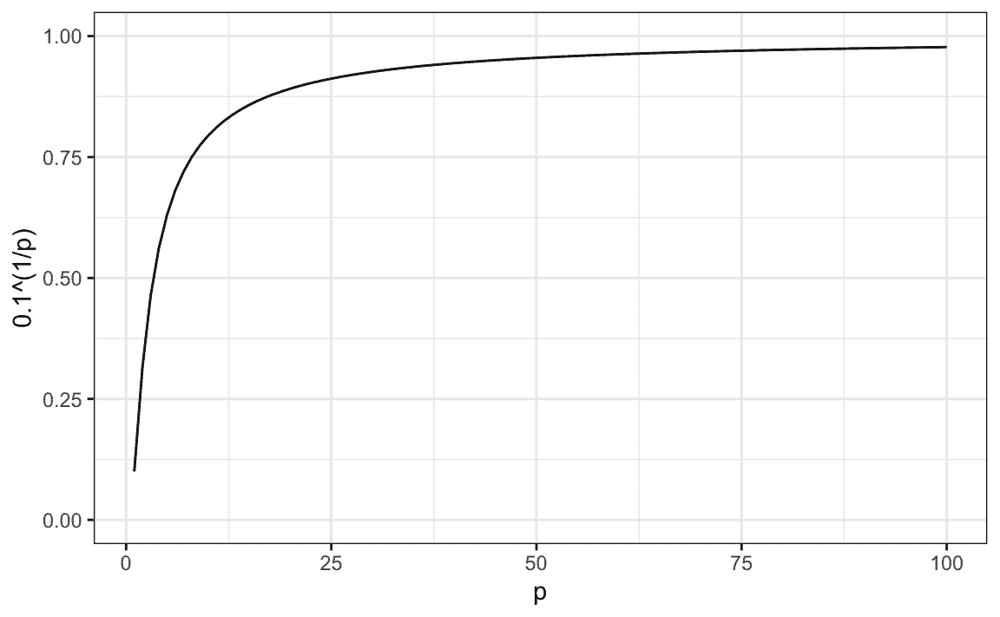

当我们达到 100 个预测因子时，邻域就不再非常局部了，因为每一侧几乎覆盖了整个数据集。

在这里，我们探讨一系列优雅且多功能的算法，这些算法适用于高维空间，并允许这些区域采取更复杂的形状，同时仍然产生可解释的模型。这些方法非常流行，广为人知，并且得到了广泛的研究。我们将专注于回归和决策树，以及它们在随机森林中的扩展。

### CART 动机

为了激励本节，我们将使用一个新的数据集，该数据集包括橄榄油成分分解为 8 种脂肪酸的详细情况：

```r
names(olive)
#>  [1] "region"      "area"        "palmitic"    "palmitoleic"
#>  [5] "stearic"     "oleic"       "linoleic"    "linolenic" 
#>  [9] "arachidic"   "eicosenoic"
```

为了说明目的，我们将尝试使用脂肪酸成分值作为预测因子来预测区域。

```r
table(olive$region)
#> 
#> Northern Italy       Sardinia Southern Italy 
#>            151             98            323
```

我们移除了`area`列，因为我们不会将其用作预测因子。

```r
olive <- select(olive, -area)
```

使用 kNN，我们可以达到测试集准确率 0.97。然而，一些数据探索揭示，我们应该能够做得更好。例如，如果我们按地区对每个预测因子的分布进行分层，我们会看到 eicosenoic 仅在意大利南部存在，而 linoleic 将北意大利与撒丁岛分开。

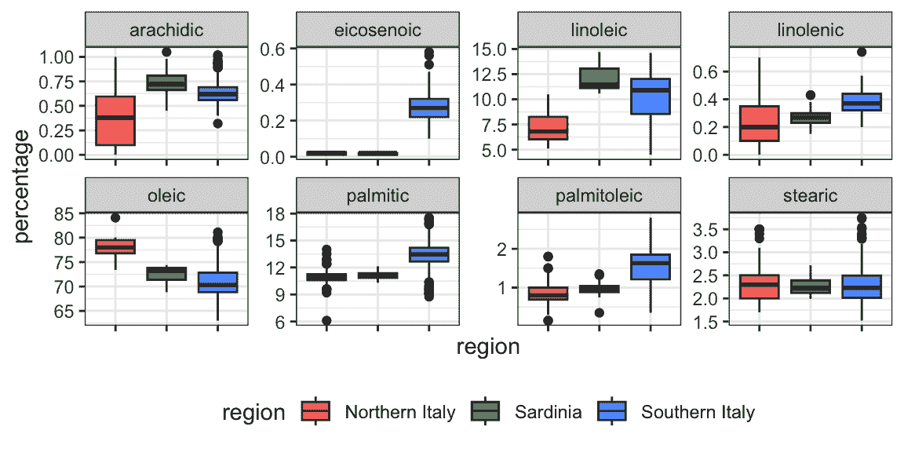

这意味着我们应该能够构建一个完美预测的算法！我们可以通过绘制 eicosenoic 和 linoleic 的值来清楚地看到这一点。

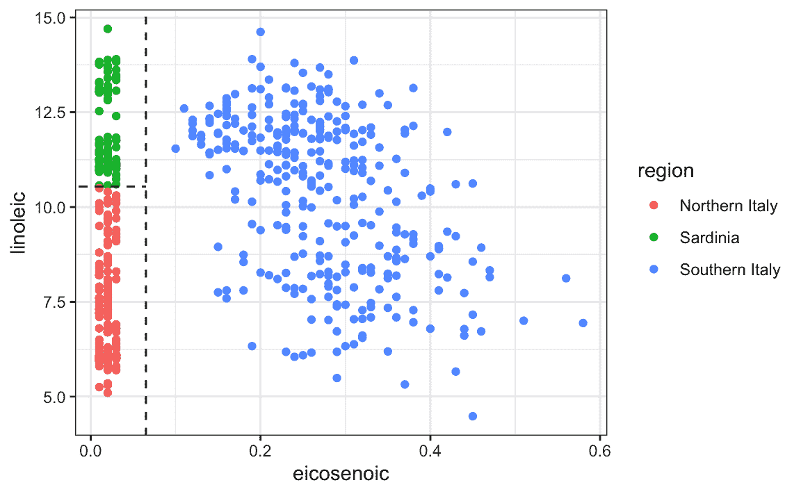

在第 22.4 节中，我们定义了*预测空间*，在这种情况下，它由八个维度上的点组成，这些点的值在 0 到 100 之间。在上面的图中，我们展示了由两个预测因子 eicosenoic 和 linoleic 定义的空间，并且通过目测，我们可以构建一个预测规则，将预测空间划分为每个部分只包含一个类别的结果。

这反过来可以用来定义一个具有完美准确性的算法。具体来说，我们定义以下决策规则：如果 eicosenoic 大于 0.065，预测南意大利。如果不是，那么如果 linoleic 大于$10.535$，预测撒丁岛，如果更低，预测北意大利。我们可以如下绘制这个决策树：

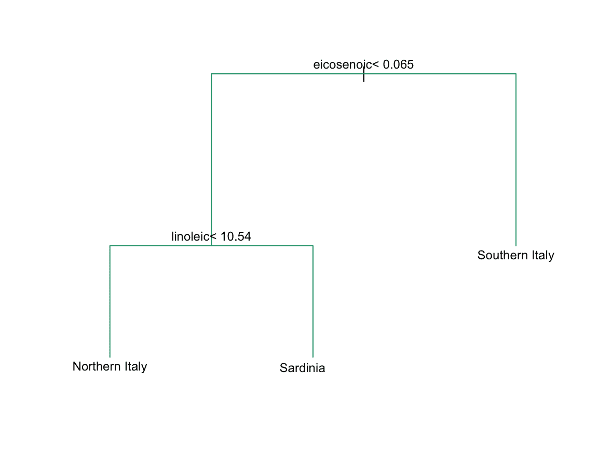

这种决策树在实践中的应用很常见。例如，为了决定心脏病发作后一个人的不良结果风险，医生会使用以下方法：

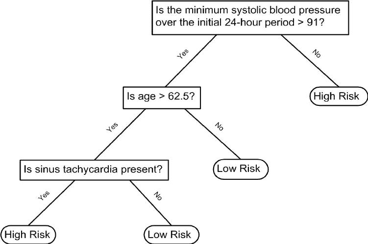

(来源：Walton 2010 非正式逻辑，第 30 卷，第 2 期，第 159-184 页²。)

树形图本质上是一个是或否的问题流程图。我们描述的方法的总体思路是定义一个算法，使用数据来创建这些带有预测结果的树，这些结果被称为*节点*。回归树和决策树通过通过划分预测变量来预测结果变量 $y$。

### 回归树

当使用树形图，并且结果为连续时，我们称这种方法为*回归*树。为了介绍回归树，我们将使用 2008 年的民意调查数据，这些数据在 @ec-smoothing 中使用，来描述我们构建这些算法的基本思想。与其他机器学习算法一样，我们将尝试估计条件期望 $f(x) = \mathrm{E}(Y | X = x)$，其中 $Y$ 是投票差额，$x$ 是日期。

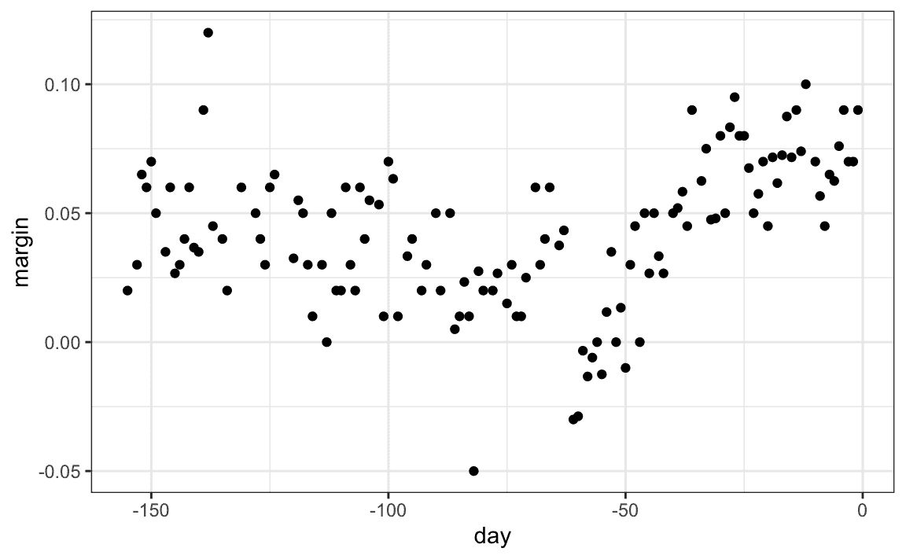

这里的基本思路是构建一个决策树，并在每个 *节点* 的末尾获得一个预测变量 $\hat{y}$。用数学方式描述就是：我们将预测空间划分为 $J$ 个非重叠区域，$R_1, R_2, \ldots, R_J$，然后对于任何位于区域 $R_j$ 内的预测变量 $x$，我们使用与相关预测变量 $x_i$ 也在 $R_j$ 内的训练观察值 $y_i$ 的平均值来估计 $f(x)$。

但我们如何决定分区 $R_1, R_2, \ldots, R_J$ 以及如何选择 $J$？这正是算法变得复杂的地方。

回归树递归地创建分区。我们以一个分区开始算法，即整个预测空间。在我们简单的第一个例子中，这个空间是区间 [-155, 1]。但在第一步之后，我们将有两个分区。第二步后，我们将其中一个分区分成两个，并将有三个分区，然后是四个，以此类推。稍后我们将描述如何选择分区以及何时停止。

对于每个现有的分区，我们找到一个预测变量 $j$ 和值 $s$，定义两个新的分区，我们将它们称为 $R_1(j,s)$ 和 $R_2(j,s)$，通过询问 $x_j$ 是否大于 $s$ 来分割当前分区：

$$ R_1(j,s) = \{\mathbf{x} \mid x_j < s\} \mbox{ 和 } R_2(j,s) = \{\mathbf{x} \mid x_j \geq s\} $$

在我们当前的例子中，我们只有一个预测变量，所以我们总是选择 $j = 1$，但在一般情况下，情况并非如此。现在，在我们定义了新的分区 $R_1$ 和 $R_2$ 并决定停止分区后，我们将通过取所有相关 $\mathbf{x}$ 在 $R_1$ 或 $R_2$ 中的观察值 $y$ 的平均值来计算预测变量。我们分别将这些称为 $\hat{y}_{R_1}$ 和 $\hat{y}_{R_2}$。

但我们如何选择 $j$ 和 $s$ 呢？基本上，我们要找到使残差平方和（RSS）最小的那一对：

$$ \sum_{i:\, x_i \in R_1(j,s)} (y_i - \hat{y}_{R_1})² + \sum_{i:\, x_i \in R_2(j,s)} (y_i - \hat{y}_{R_2})² $$

然后将此递归应用于新的区域 $R_1$ 和 $R_2$。我们稍后会描述如何停止，但一旦我们将预测空间分割成区域，在每个区域中，我们使用该区域的观测值进行预测。

让我们看看这个算法在 2008 年总统选举民意调查数据上的表现。我们将使用 **rpart** 包中的 `rpart` 函数。

```r
library(rpart)
fit <- rpart(margin ~ ., data = polls_2008)
```

在这种情况下，只有一个预测器。因此我们不需要决定通过哪个预测器 $j$ 进行分割，我们只需要决定使用什么值 $s$ 进行分割。我们可以直观地看到分割的位置：

```r
plot(fit, margin = 0.1)
text(fit, cex = 0.75)
```

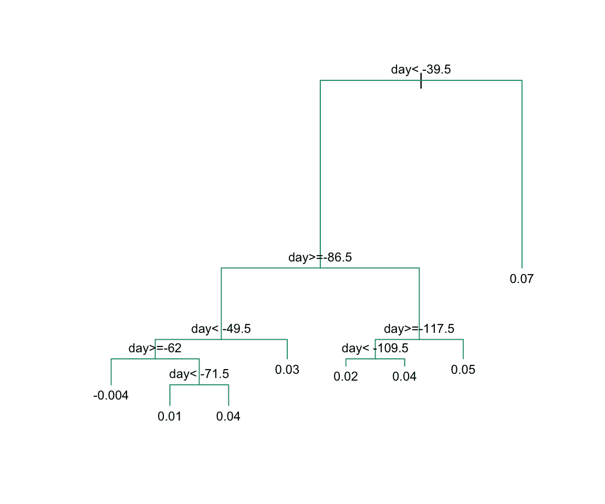*  *第一次分割发生在第 39.5 天。然后其中一个区域在第 86.5 天被分割。这两个新的分区分别在第 49.5 天和第 117.5 天进行分割，以此类推。我们最终得到 8 个分区。

您也可以通过输入以下命令来查看分区：

```r
summary(fit)
```

最终的估计 $\hat{f}(x)$ 看起来是这样的：

```r
polls_2008 |> 
 mutate(y_hat = predict(fit)) |> 
 ggplot() +
 geom_point(aes(day, margin)) +
 geom_step(aes(day, y_hat), col = "red")
```


然而，cp 不是控制分割的唯一因素。另一个重要的参数是在节点可以分割之前所需的最小观测数，由 rpart 中的 minsplit 参数设置（默认：20）。此外，rpart 允许用户指定终端节点（叶子）中允许的最小观测数，由 `minbucket` 参数控制。默认情况下，`minbucket = round(minsplit / 3)`。

如预期的那样，如果我们设置 `cp = 0` 和 `minsplit = 2`，那么我们的预测将尽可能灵活，我们的预测器就是我们的原始数据：


直观上我们知道这不是一个好的方法，因为它通常会导致过度训练。这些 `cp`、`minsplit` 和 `minbucket` 参数可以用来控制最终预测器的变异性。这些值越大，用于计算预测器的数据平均就越多，从而减少变异性。缺点是它限制了灵活性。

那么，我们如何选择这些参数呢？我们可以使用交叉验证，就像任何调整参数一样。以下是使用交叉验证选择 cp 值的结果树：

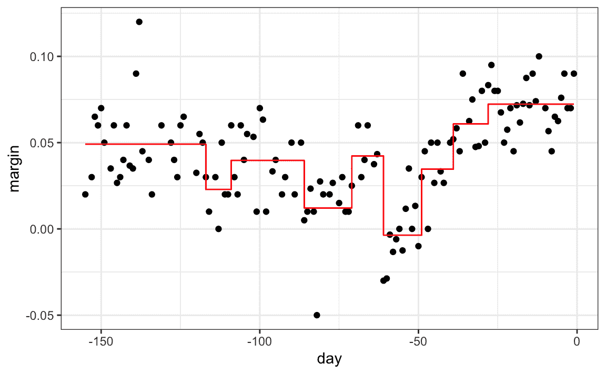

注意，如果我们已经有一个树并且想要应用更高的 cp 值，我们可以使用`prune`函数。我们称这种操作为*剪枝*，因为我们正在剪掉不符合`cp`标准的分区。以下是一个例子，我们创建了一个使用`cp = 0`的树，然后将其剪枝回来：

```r
fit <- rpart(margin ~ ., data = polls_2008, control = rpart.control(cp = 0))
pruned_fit <- prune(fit, cp = 0.01)
```

### 分类（决策）树

分类树，或决策树，用于预测问题，其中结果为分类。我们使用相同的分区原则，但有一些不同，以解释我们现在处理的是分类结果**。

第一个不同之处在于，我们通过计算分区中训练集观测值中最常见的类别来形成预测，而不是在每个分区中取平均值（因为我们不能对类别取平均值）。

第二个限制是我们不能再使用 RSS 来选择分区。虽然我们可以使用寻找最小化训练错误的朴素方法来寻找分区，但更好的方法使用更复杂的指标。其中两个更受欢迎的指标是*基尼指数*和*熵*。

在一个完美的场景中，我们每个分区中的结果都属于同一类别，因为这将允许达到完美的准确性。在这种情况下，*基尼指数*将为 0，并且随着我们偏离这个场景的程度增加而变大。为了定义基尼指数，我们定义 $\hat{p}_{j,k}$ 为分区 $j$ 中属于类别 $k$ 的观测值的比例。基尼指数定义为：

$$ \mbox{Gini}(j) = \sum_{k = 1}^K \hat{p}_{j,k}(1-\hat{p}_{j,k}) $$

如果你仔细研究这个公式，你会看到在上述描述的完美场景中，它实际上为 0。

熵*是一个相关的量，定义为：

$$ \mbox{entropy}(j) = -\sum_{k = 1}^K \hat{p}_{j,k}\log(\hat{p}_{j,k}), \mbox{ with } 0 \times \log(0) \mbox{ defined as }0 $$

如果我们在 2 或 7 的例子上使用分类树，我们达到了 0.81 的准确率，这比回归更好，但不如我们使用核方法达到的好。

估计条件概率的图示向我们展示了分类树的限制：

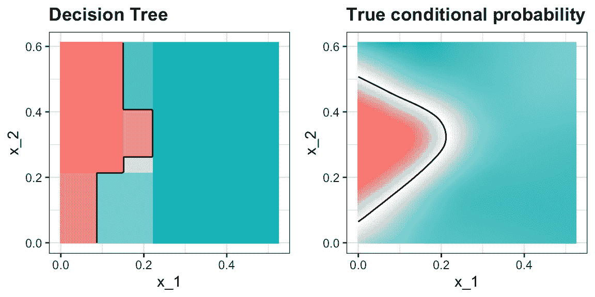

注意，在使用决策树时，由于每个分区都会产生不连续性，因此很难使边界平滑。

分类树具有某些优势，使它们非常有用。它们高度可解释，甚至比线性模型更可解释。它们也容易可视化（如果足够小）。最后，它们可以模拟人类决策过程，并且不需要为分类变量使用虚拟预测器。另一方面，通过递归划分的方法很容易过拟合，因此比线性回归或 kNN 更难训练。此外，在准确性方面，它很少是表现最好的方法，因为它不太灵活，并且对训练数据的变化高度不稳定。接下来解释的随机森林改进了这些不足之处。

## 30.5 随机森林

随机森林是一种 **非常流行** 的机器学习方法，它通过一个巧妙的思想来解决决策树的不足。目标是通过对多个决策树进行 **平均** 来提高预测性能和减少不稳定性：一个由 **随机性** 构建的 *森林*。它有两个有助于实现这一目标的特点。

第一步是 **自助聚集** 或 **袋装法**。一般思路是生成许多预测器，每个预测器使用回归或分类树，然后根据所有这些树的平均预测形成最终预测。为了确保单个树不相同，我们使用自助法来引入随机性。这两个特点结合起来解释了名称：自助法使单个树 **随机** 不同，而树的组合就是 **森林**。具体步骤如下。

1. 使用训练集构建 $B$ 个决策树。我们将拟合的模型称为 $T_1, T_2, \dots, T_B$。

2. 对于测试集中的每个观测值，使用树 $T_j$ 形成预测 $\hat{y}_j$。

3. 对于连续结果，使用平均 $\hat{y} = \frac{1}{B} \sum_{j = 1}^B \hat{y}_j$ 形成最终预测。对于分类数据分类，使用多数投票（$\hat{y}_1, \dots, \hat{y}_B$ 中最频繁的类别）来预测 $\hat{y}$。

那么，我们如何从一个单个训练集中得到不同的决策树？为此，我们使用两种方式来引入随机性，以下步骤中会进行解释。设 $N$ 为训练集中的观测数。为了从训练集中创建 $T_j, \, j = 1,\ldots,B$，我们执行以下操作：

1. 通过从训练集中有放回地抽取 $N$ 个观测值来创建一个自助训练集。这是引入随机性的第一种方式。

2. 在机器学习挑战中，通常有许多特征。通常，许多特征可能是有信息的，但将它们全部包含在模型中可能会导致过拟合。随机森林引入随机性的第二种方式是通过随机选择要包含在每个树构建中的特征。每个树选择一个不同的随机子集。这减少了森林中树之间的相关性，从而提高了预测精度。

为了说明第一步如何导致更平滑的估计，我们将对 2008 年的民意调查数据进行随机森林拟合。我们将使用**randomForest**包中的`randomForest`函数：

```r
library(randomForest)
fit <- randomForest(margin ~ ., data = polls_2008) 
```

注意，如果我们将`plot`函数应用于结果对象，我们可以看到随着我们添加树，我们算法的错误率如何变化：

```r
plot(fit)
```


在这种情况下，随着我们添加更多的树，准确率提高，直到我们使用了大约 300 棵树之后，准确率稳定下来。

使用这种方法得到的随机森林估计结果，如上所示：

```r
y_hat <-  predict(fit, newdata = polls_2008)
```

如以下红色曲线所示：

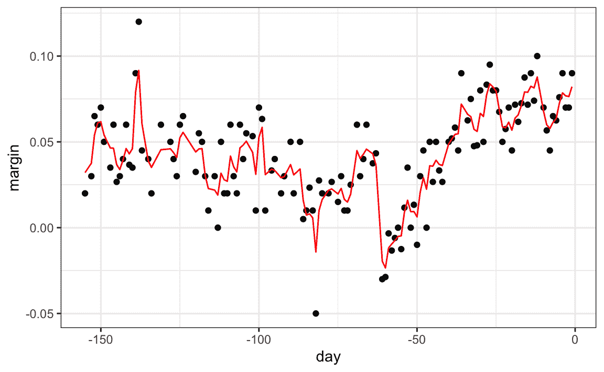

注意，随机森林的估计比我们在上一节中使用的回归树要平滑得多。这是因为许多阶梯函数的平均值可以是平滑的。我们可以通过观察随着我们添加更多树时估计如何变化来看到这一点。在下面的图中，你可以看到每个$b$值的多个自助样本，对于每一个，我们看到用灰色拟合的树，用较浅灰色拟合的前面的树，以及到那个点为止所有估计的树的平均值。

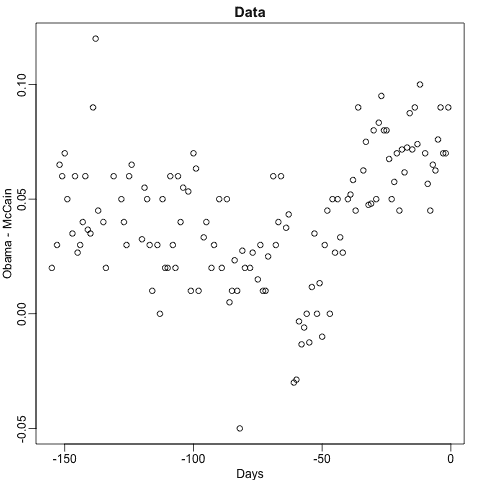

```r
library(randomForest)
train_rf <- randomForest(y ~ ., data = mnist_27$train)
```

对于我们的 2 或 7 个示例，随机森林拟合的准确率为 0.825。以下是条件概率的图示：


可视化估计显示，尽管我们获得了高精度，但似乎通过使估计更平滑，仍有改进的空间。这可以通过改变控制树节点中数据点最小数量的参数来实现。这个最小值越大，最终的估计就越平滑。如果我们使用 65 个节点的节点大小，使用 kNN 时使用的邻居数量，我们得到 0.815 的准确率。所选模型提高了准确率，并提供了更平滑的估计：

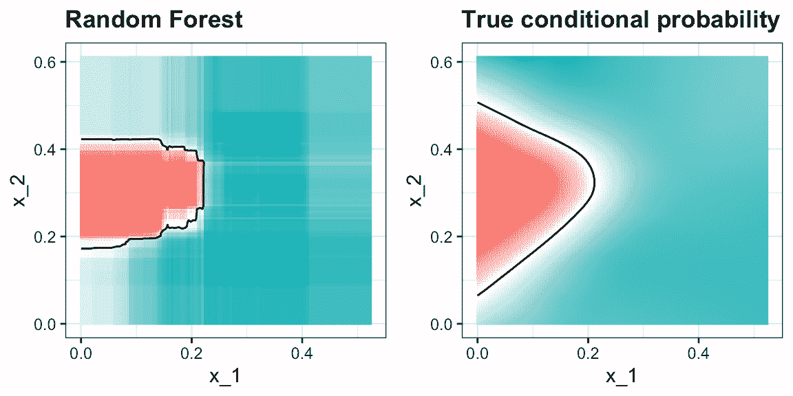

### 变量重要性

随机森林在所有我们考虑的例子中都优于树。然而，随机森林的一个缺点是我们失去了可解释性。有助于提高可解释性的方法之一是检查*变量重要性*。为了定义*变量重要性*，我们计算预测器在单个树中使用的频率。你可以在高级机器学习书中了解更多关于*变量重要性*的信息³。**randomForest**包包括一个名为`importance`的函数，可以从拟合的随机森林模型中提取变量重要性。**caret**包包括一个名为`varImp`的函数，可以从任何实现了计算的模型中提取变量重要性。我们将在下一节中给出如何使用变量重要性的示例。

## 30.6 练习

1. 使用以下代码创建数据集：

```r
n <- 100
Sigma <- 9*matrix(c(1.0, 0.5, 0.5, 1.0), 2, 2)
dat <- MASS::mvrnorm](https://rdrr.io/pkg/MASS/man/mvrnorm.html)(n = 100, [c(69, 69), Sigma) |>
 data.frame() |> setNames(c("x", "y"))
```

使用**caret**包将数据集划分为大小相等的测试集和训练集。训练一个线性模型并报告 RMSE。重复此练习 100 次，并绘制 RMSE 的直方图，报告平均值和标准差。提示：像这样修改前面显示的代码：

```r
library(caret)
y <- dat$y
test_index <- createDataPartition(y, times = 1, p = 0.5, list = FALSE)
train_set <- dat[train_index,]
test_set <- dat[-train_index,]
fit <- lm(y ~ x, data = train_set)
y_hat <- fit$coef[1] + fit$coef[2]*test_set$x
sqrt(mean((y_hat - test_set$y)²))
```

将其放入对`replicate`的调用中。

2. 现在我们将重复上述操作，但使用更大的数据集。重复练习 1，但对于`n <- c(100, 500, 1000, 5000, 10000)`的数据集。保存 100 次重复的 RMSE 平均值和标准差。提示：使用`sapply`或`map`函数。

3. 描述随着数据集大小的增加，RMSE 的观察结果。

1.  平均而言，随着`n`的增大，RMSE 变化不大，而 RMSE 的变异性确实在减小。

1.  由于大数定律，RMSE 减小：数据越多，估计越精确。

1.  `n = 10000`不够大。为了看到 RMSE 的下降，我们需要将其做得更大。

1.  RMSE 不是一个随机变量。

4. 现在重复练习 1，但这次通过改变`Sigma`来使`x`和`y`之间的相关性更大：

```r
n <- 100
Sigma <- 9*matrix(c(1, 0.95, 0.95, 1), 2, 2)
dat <- MASS::mvrnorm](https://rdrr.io/pkg/MASS/man/mvrnorm.html)(n = 100, [c(69, 69), Sigma) |>
 data.frame() |> setNames(c("x", "y"))
```

重复练习并注意 RMSE 现在发生了什么。

5. 以下哪个选项最好地解释了为什么练习 4 中的 RMSE 比练习 1 低得多：

1.  这只是运气。如果我们再试一次，它可能会更大。

1.  中心极限定理告诉我们 RMSE 是正态分布的。

1.  当我们增加`x`和`y`之间的相关性时，`x`具有更强的预测能力，从而提供了对`y`的更好估计。这种相关性对 RMSE 的影响比`n`大得多。大的`n`只是为我们提供了更精确的线性模型系数估计。

1.  这两个都是回归的例子，所以 RMSE 必须相同。

6. 使用以下代码创建数据集：

```r
n <- 1000
Sigma <- matrix(c(1, 3/4, 3/4, 3/4, 1, 0, 3/4, 0, 1), 3, 3)
dat <- MASS::mvrnorm](https://rdrr.io/pkg/MASS/man/mvrnorm.html)(n = 100, [c(0, 0, 0), Sigma) |>
 data.frame() |> setNames(c("y", "x_1", "x_2"))
```

请注意，`y`与`x_1`和`x_2`都相关，但两个预测因子彼此独立。

```r
cor(dat)
```

使用**caret**包将数据集划分为大小相等的测试集和训练集。比较仅使用`x_1`、仅使用`x_2`以及同时使用`x_1`和`x_2`时的 RMSE。训练一个线性模型并报告 RMSE。

7. 重复练习 6，但现在创建一个`x_1`和`x_2`高度相关的例子：

```r
n <- 1000
Sigma <- matrix(c(1.0, 0.75, 0.75, 0.75, 1.0, 0.95, 0.75, 0.95, 1.0), 3, 3)
dat <- MASS::mvrnorm](https://rdrr.io/pkg/MASS/man/mvrnorm.html)(n = 100, [c(0, 0, 0), Sigma) |>
 data.frame() |> setNames(c("y", "x_1", "x_2"))
```

使用**caret**包将数据集划分为大小相等的测试集和训练集。比较仅使用`x_1`、仅使用`x_2`以及同时使用`x_1`和`x_2`时的 RMSE。训练一个线性模型并报告 RMSE。

8. 比较第 6 和第 7 的结果，并选择你同意的陈述：

1.  添加额外的预测因子可以显著提高 RMSE，但不是当它们与另一个预测因子高度相关时。

1.  添加额外的预测因子在两个练习中都能同样提高预测。

1.  添加额外的预测因子会导致过拟合。

1.  除非我们包含所有预测因子，否则我们没有预测能力。

9. 定义以下数据集：

```r
make_data <- function(n = 1000, p = 0.5, 
 mu_0 = 0, mu_1 = 2, 
 sigma_0 = 1,  sigma_1 = 1){
 y <- rbinom(n, 1, p)
 f_0 <- rnorm(n, mu_0, sigma_0)
 f_1 <- rnorm(n, mu_1, sigma_1)
 x <- ifelse(y == 1, f_1, f_0)
 test_index <- createDataPartition(y, times = 1, p = 0.5, list = FALSE)
 list(train = data.frame(x = x, y = as.factor(y)) |> 
 slice(-test_index),
 test = data.frame(x = x, y = as.factor(y)) |> 
 slice(test_index))
}
```

请注意，我们已定义了一个变量`x`，它可以预测二元结果`y`。

```r
dat$train |> ggplot(aes(x, color = y)) + geom_density()
```

通过将(Y)视为连续结果来拟合线性回归模型，然后通过预测值超过 0.5 时将观测值分类为 1，来拟合一个逻辑回归模型。接下来，对相同的数据拟合逻辑回归模型，并比较这两种方法的分类准确率。

10. 将练习 9 的模拟重复 100 次，并比较每种方法的平均准确率，注意它们给出几乎相同的答案。

11. 生成 25 个不同的数据集，改变两个类别之间的差异：`delta <- seq(0, 3, len = 25)`。绘制准确率与`delta`的关系图。

12. **dslabs**包包含一个类似于`mnist_27`的示例数据集，但也包括 1。您可以加载并探索它如下：

```r
library(dslabs)
mnist_127$train |> ggplot(aes(x_1, x_2, color = y)) + geom_point()
```

使用**MASS**包中的`qda`函数拟合 QDA，然后为测试预测创建混淆矩阵。以下哪项最能描述混淆矩阵：

1.  它是一个二乘二的表格。

1.  因为我们有三个类别，所以它是一个二乘三的表格。

1.  因为我们有三个类别，所以它是一个三乘三的表格。

1.  混淆矩阵仅在结果为二元时才有意义。

13. `confusionMatrix`对象返回的`byClass`组件为每个类别提供敏感性和特异性。因为这些术语仅在数据为二元时才有意义，所以每一行表示当特定类别为 1（阳性）而其他两个被视为 0（阴性）时的敏感性和特异性。根据`confusionMatrix`返回的值，以下哪项是最常见的错误：

1.  将 1s 称为 2 或 7。

1.  将 2s 称为 1 或 7。

1.  将 7s 称为 1 或 2。

1.  所有错误都同样常见。

14. 要可视化 QDA 决策边界，首先创建一个密集的点网格，覆盖$(x_1, x_2)$空间：

```r
GS <- 150
new_x <- with(mnist_127$train,
 expand.grid(
 x_1 = seq(min(x_1), max(x_1), length.out = GS),
 x_2 = seq(min(x_2), max(x_2), length.out = GS)
 )
)
```

使用拟合的 QDA 模型通过`predict(qda_fit, newdata = new_x)`计算网格上的预测概率。这将给出网格中每个点的$\hat{p}(x_1, x_2)$。

最后，绘制网格，并根据$\hat{p}(x_1, x_2) > 0.5$（预测类别 1）或$\hat{p}(x_1, x_2) \le 0.5$（预测类别 0）来为每个点着色。生成的图像显示了由 QDA 确定的决策区域。

15. 重复练习 14，但对于 LDA。以下哪项解释了为什么 LDA 的准确率较差：

1.  LDA 通过线分隔空间，使其过于僵化。

1.  LDA 将空间分为两部分，有三种类别。

1.  LDA 与 QDA 非常相似，差异是由于偶然性。

1.  LDA 不能用于超过一个类别。

16. 现在重复练习 12，对于 kNN 使用$k=31$，并计算和比较三种方法的总体准确率。

17. 要了解为什么像 kNN 这样的简单方法可以优于明确尝试模拟贝叶斯规则的模型，探索`x_1`和`x_2`的条件分布，以查看正态近似是否成立。生成模型可以非常强大，但只有当我们能够成功近似每个类别的预测变量的联合分布时。

18. 之前我们使用逻辑回归从身高预测性别。使用 kNN 来做同样的事情。使用本章中描述的代码选择 $F_1$ 测量值，并将其与 $k$ 进行比较。与使用回归获得的约 0.6 的 $F_1$ 值进行比较。

19. 创建一个简单的数据集，其中结果在预测变量每增加一个单位时平均增长 0.75 个单位。

```r
n <- 1000
sigma <- 0.25
x <- rnorm(n, 0, 1)
y <- 0.75 * x + rnorm(n, 0, sigma)
dat <- data.frame(x = x, y = y)
```

使用 `rpart` 拟合回归树并将结果保存到 `fit` 中。

20. 绘制最终的树，以便可以看到分区发生的位置。

21. 绘制 `y` 与 `x` 的散点图，并展示基于拟合的预测值。

22. 现在使用来自 **randomForest** 包的 `randomForest` 函数来训练一个随机森林而不是回归树，并重新绘制带有预测线的散点图。

23. 使用 `plot` 函数查看随机森林是否收敛，或者是否需要更多的树。

24. 默认的随机森林参数导致估计结果过于灵活（不平滑）。重新运行随机森林，但这次将 `nodesize` 设置为 50，将 `maxnodes` 设置为 25。重新绘制图表。

25. 这个 **dslabs** 数据集包括 `tissue_gene_expression`，其中有一个矩阵 `x`：

```r
library(dslabs)
dim(tissue_gene_expression$x)
```

使用在 189 个生物样本上测量的 500 个基因的表达来表示七个不同的组织。组织类型存储在 `tissue_gene_expression$y` 中。

```r
table(tissue_gene_expression$y)
```

使用包 **randomForest** 中的 `randomForest` 函数拟合随机森林。然后使用 `varImp` 函数查看哪些是前 10 个最具预测性的基因。绘制报告的重要性直方图，以了解重要性值的分布。

* * *

1.  https://web.stanford.edu/~hastie/Papers/ESLII.pdf↩︎

1.  https://papers.ssrn.com/sol3/Delivery.cfm/SSRN_ID1759289_code1486039.pdf?abstractid = 1759289&mirid = 1&type = 2↩︎

1.  https://web.stanford.edu/~hastie/Papers/ESLII.pdf↩︎
