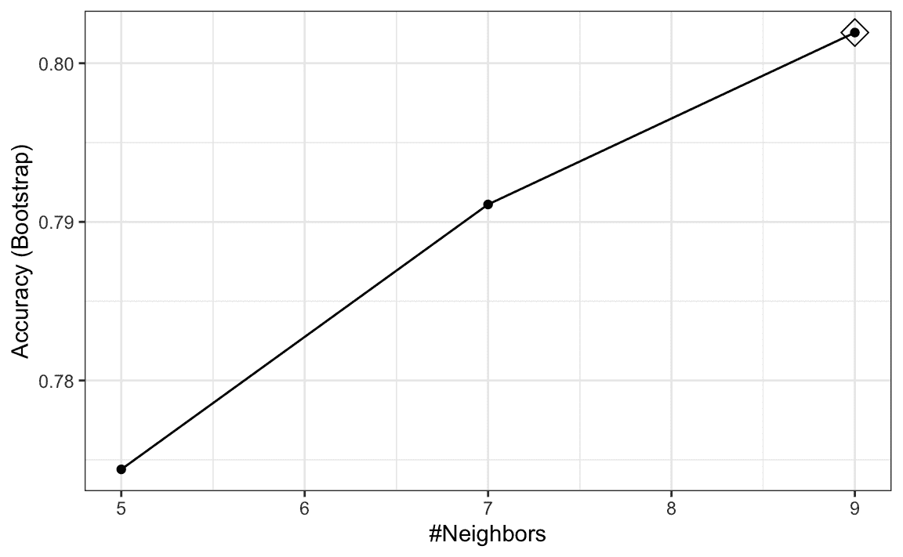
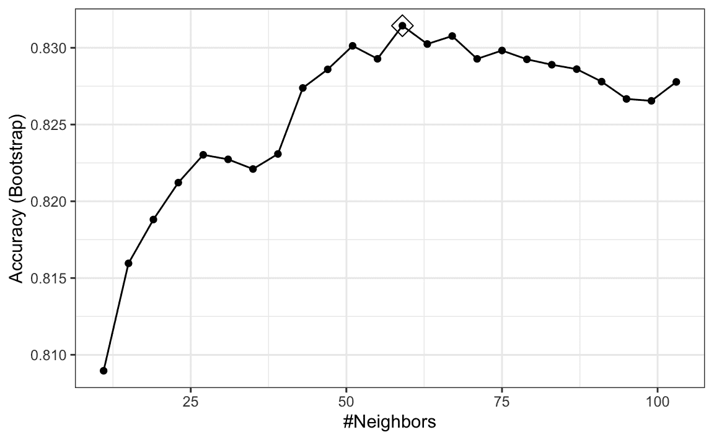
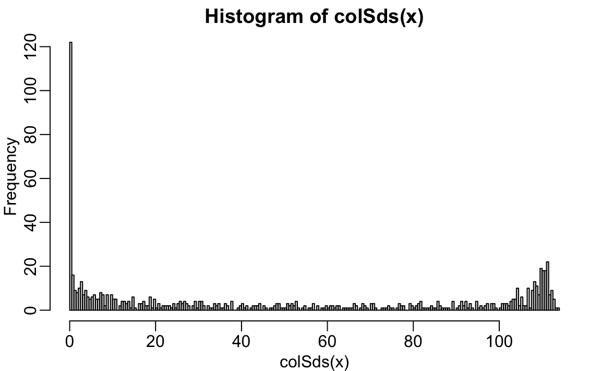
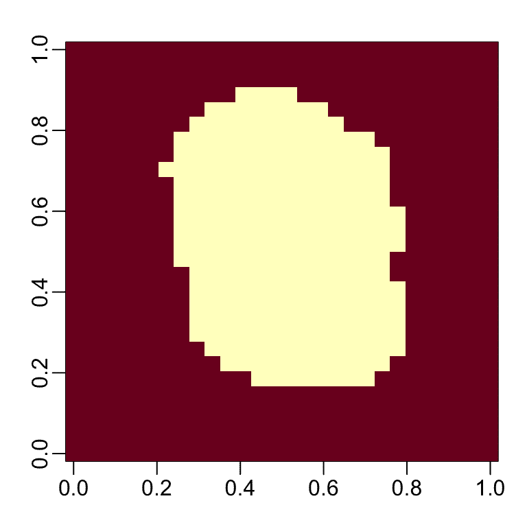
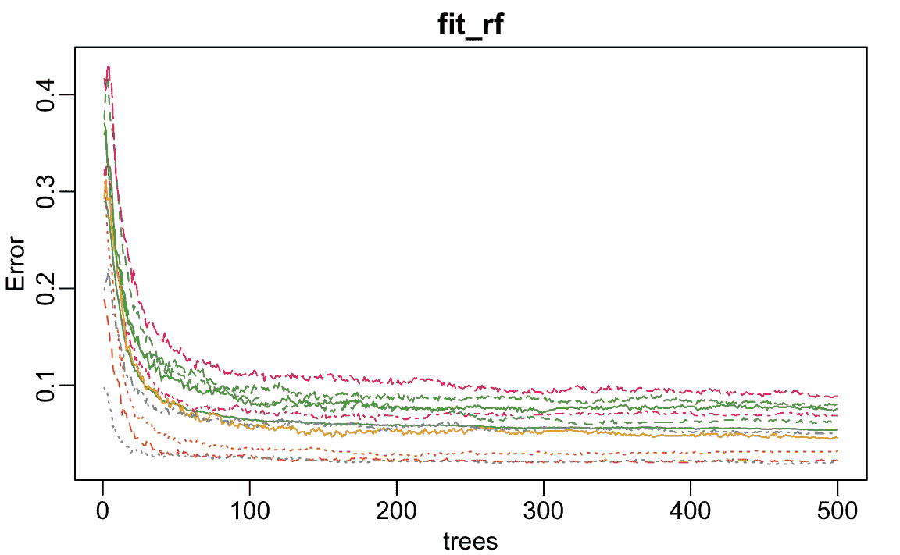
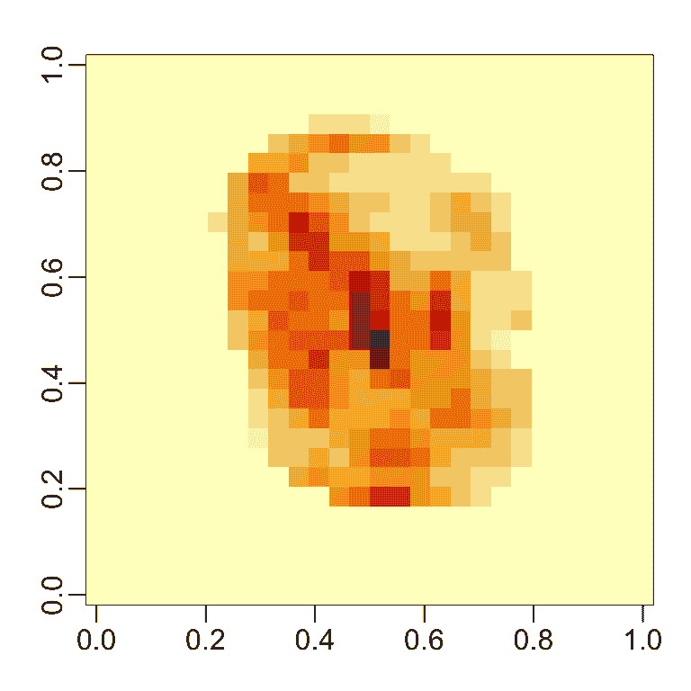
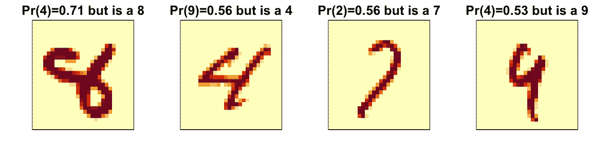

# 31  构建机器学习模型

> 原文：[`rafalab.dfci.harvard.edu/dsbook-part-2/ml/ml-in-practice.html`](https://rafalab.dfci.harvard.edu/dsbook-part-2/ml/ml-in-practice.html)

1.  机器学习

1.  31  构建机器学习模型

构建机器学习模型需要不仅仅是理解底层数学。理论帮助我们避免概念错误并选择适当的方法，但将这些想法转化为有效、现实世界的模型还需要额外的实际考虑。我们必须决定如何预处理和转换特征，结合上下文知识来选择相关预测因子，管理计算约束，调整和比较算法，并且通常通过集成等技术结合多个模型以提升预测性能。

在本章中，我们通过使用 MNIST 手写数字数据集进行完整的案例研究，将这些内容整合在一起，展示了早期章节中开发的工具概念如何转化为实际的机器学习工作流程。

## 31.1 案例研究：手写数字识别

我们将使用在第 21.2 节中介绍的 MNIST 数据集。我们可以使用以下**dslabs**包函数加载数据：

```r
library(dslabs)
mnist <- read_mnist()
```

该数据集包括两个部分，一个训练集和一个测试集：

```r
names(mnist)
#> [1] "train" "test"
```

每个组件都包含一个矩阵，其中列包含特征：

```r
dim(mnist$train$images)
#> [1] 60000   784
```

以及一个包含类别的整数向量：

```r
class(mnist$train$labels)
#> [1] "integer"
table(mnist$train$labels)
#> 
#>    0    1    2    3    4    5    6    7    8    9 
#> 5923 6742 5958 6131 5842 5421 5918 6265 5851 5949
```

因为我们希望这个例子能在笔记本电脑上运行，并且在一小时内完成，所以我们将考虑数据集的一个子集。我们将从训练集中随机抽取 10,000 行，从测试集中随机抽取 1,000 行：

```r
set.seed(1990)
index <- sample(nrow(mnist$train$images), 10000)
x <- mnist$train$images[index,]
y <- factor(mnist$train$labels[index])
index <- sample(nrow(mnist$test$images), 1000)
x_test <- mnist$test$images[index,]
y_test <- factor(mnist$test$labels[index])
```

但您也可以尝试在整个数据集上应用这些想法。

当将模型拟合到大型数据集时，我们建议使用矩阵而不是数据框，因为矩阵操作通常更快。在**caret**包中，预测矩阵必须具有列名，以便在测试集上的预测过程中准确跟踪特征。如果矩阵缺少列名，可以根据它们的位置分配名称：

```r
colnames(x) <- 1:ncol(mnist$train$images)
colnames(x_test) <- colnames(x)
```

## 31.2 caret 包

我们已经学习了多种机器学习算法。其中许多算法在 R 中实现。然而，它们由不同的作者通过不同的包分发，并且通常使用不同的语法。**caret**包试图统一这些差异并提供一致性。它目前包括 200 多种不同的方法，这些方法在**caret**包手册¹中进行了总结。请注意，**caret**不包括运行每个可能算法所需的包。要通过**caret**应用机器学习方法，您仍然需要安装实现该方法的库。每种方法的所需包在包手册中描述。

caret** 包还提供了一个为我们执行交叉验证的函数。这里我们提供一些示例，说明我们如何使用这个有用的包。我们首先使用 2 或 7 个示例来演示，在后面的章节中，我们将使用该包在更大的 MNIST 数据集上运行算法。

### `train` 函数

R 中拟合机器算法的函数都略有不同。例如，`lm`、`glm`、`qda`、`lda`、`knn3`、`rpart` 和 `randomForest` 使用不同的语法，具有不同的参数名称，并生成不同类型的对象。

caret** 的 `train` 函数让我们可以使用类似的语法训练不同的算法。因此，例如，我们可以键入以下内容来训练三个不同的模型：

```r
library(caret)
train_glm <- train(y ~ ., method = "glm", data = mnist_27$train)
train_qda <- train(y ~ ., method = "qda", data = mnist_27$train)
train_knn <- train(y ~ ., method = "knn", data = mnist_27$train)
```

正如我们在 第 31.2.3 节 中更详细地解释的那样，`train` 函数使用重采样方法为您选择参数，以估计 MSE，默认使用 bootstrap。

### `predict` 函数

`predict` 函数是 R 中机器学习和统计建模中最有用的工具之一。它接受一个拟合的模型对象和一个包含我们想要进行预测的特征 $\mathbf{x}$ 的数据框，然后返回相应的预测值。

这里有一个逻辑回归的例子：

```r
fit <- glm(y ~ ., family = "binomial", data = mnist_27$train)
p_hat <- predict(fit, newdata = mnist_27$test)
```

在这种情况下，该函数只是简单地计算

$$ \hat{p}(\mathbf{x}) = g^{-1}\left(\hat{\beta}_0 + \hat{\beta}_1 x_1 + \hat{\beta}_2 x_2 \right) \text{ with } g(p) = \log\frac{p}{1-p} \implies g^{-1}(\mu) = \frac{1}{1-e^{-\mu}} $$

对于测试集 `mnist_27$test` 中的 `x_1` 和 `x_2`，有了这些估计值，我们可以做出预测并计算我们的准确率：

```r
y_hat <- factor(ifelse(p_hat > 0.5, 7, 2))
```

然而，请注意，`predict` 并不总是返回相同类型的对象；这取决于它应用的对象类型。要了解具体细节，您需要查看特定于所使用的拟合对象类型的帮助文件。

`predict` 实际上是 R 中一种特殊类型的函数，称为 *泛型函数*。泛型函数根据接收到的对象类型调用其他函数。因此，如果 `predict` 接收到来自 `lm` 函数的对象，它将调用 `predict.lm`。如果它接收来自 `glm` 的对象，它将调用 `predict.glm`。如果拟合来自 `knn3`，它将调用 `predict.knn3`，依此类推。这些函数相似但不完全相同。您可以通过阅读帮助文件了解更多关于它们之间差异的信息：

```r
?predict.glm
?predict.qda
?predict.knn3
```

`predict` 函数有多个版本，许多机器学习算法定义了自己的 `predict` 函数。

与 `train` 函数一样，**caret** 包统一了 `predict` 函数的使用，通过 `predict.train` 函数。此函数接受 `train` 函数的输出，并产生类别预测或 $p(\mathbf{x})$ 的估计。

所有方法的代码看起来都一样：

```r
y_hat_glm <- predict(train_glm, mnist_27$test, type = "raw")
y_hat_qda <- predict(train_qda, mnist_27$test, type = "raw")
y_hat_knn <- predict(train_knn, mnist_27$test, type = "raw")
```

这使我们能够快速比较算法。例如，我们可以这样比较准确率：

```r
fits <- list(glm = train_glm, qda = train_qda, knn = train_knn)
sapply(fits, function(fit) 
 mean(predict(fit, mnist_27$test, type = "raw") == mnist_27$test$y))
#>   glm   qda   knn 
#> 0.775 0.815 0.835
```

### 重采样

当算法包含一个调整参数时，`train`会自动使用重采样方法来估计均方误差（MSE）并在几个默认候选值之间进行选择。要找出哪些参数被优化，可以阅读**caret**手册²或研究以下输出的结果：

```r
modelLookup("knn")
```

要了解**caret**如何实现 kNN 的所有细节，可以使用以下方法：

```r
getModelInfo("knn")
```

如果我们使用默认值运行它：

```r
train_knn <- train(y ~ ., method = "knn", data = mnist_27$train)
```

你可以使用`ggplot`函数快速查看交叉验证的结果。`highlight`参数突出显示最大值：

```r
ggplot(train_knn, highlight = TRUE)
```

*  *默认情况下，重采样是通过取 25 个自助样本来进行的，每个样本包含 25%的观测值。

对于`knn`方法，默认值是尝试$k=5,7,9$。我们可以使用`tuneGrid`参数来更改这一点。值网格必须由一个数据框提供，其中参数名称与`modelLookup`输出中指定的名称相匹配。

在这里，我们提供了一个例子，我们尝试了 1 到 75 之间的 38 个值。要在**caret**中这样做，我们需要定义一个名为`k`的列，所以我们使用这个：`data.frame(k = seq(11, 105, 2))`。请注意，在运行此代码时，我们正在将 38 个 kNN 版本拟合到 25 个自助样本。由于我们正在拟合$38 \times 25 = 950$个 kNN 模型，运行此代码将需要几秒钟。

```r
train_knn <- train(y ~ ., method = "knn", 
 data = mnist_27$train,
 tuneGrid = data.frame(k = seq(11, 105, 4)))
ggplot(train_knn, highlight = TRUE)
```

*  **重采样方法涉及随机采样步骤，因此相同代码的重复运行可能会产生不同的结果。为了确保你的结果可以被精确复制，请在分析开始时始终设置随机种子，就像我们在本章开头所做的那样。*  *要访问最大化准确率的参数，可以使用以下方法：

```r
train_knn$bestTune
#>     k
#> 13 59
```

以及表现最好的模型如下：

```r
train_knn$finalModel
```

`predict`函数将使用这个表现最好的模型。以下是该模型在测试集上的准确率，我们尚未使用测试集，因为交叉验证是在训练集上进行的：

```r
mean(predict(train_knn, mnist_27$test, type = "raw") == mnist_27$test$y)
#> [1] 0.825
```

自助法并不总是重采样的最佳方法（例如，参见第 31.5 节）。如果我们想更改我们的重采样方法，可以使用`trainControl`函数。例如，下面的代码运行了 10 折交叉验证。这意味着我们有 10 个样本，每个样本使用 90%的观测值进行训练。我们使用以下代码实现这一点：

```r
control <- trainControl(method = "cv", number = 10, p = .9)
train_knn_cv <- train(y ~ ., method = "knn", 
 data = mnist_27$train,
 tuneGrid = data.frame(k = seq(11, 105, 4)),
 trControl = control)
```

`train`输出的`results`组件包括与交叉验证估计的变异性相关的几个汇总统计量：

```r
names(train_knn$results)
#> [1] "k"          "Accuracy"   "Kappa"      "AccuracySD" "KappaSD"
```

你可以从手册³中了解更多关于**caret**包的详细信息。

## 31.3 预处理

我们在运行机器算法之前通常会转换预测变量。我们还会移除显然没有用的预测变量。我们把这些步骤称为*预处理*。

预处理示例包括标准化预测变量、对某些预测变量进行对数变换、移除与其他预测变量高度相关的预测变量，以及移除具有非常少非唯一值或接近零变异的预测变量。

例如，我们可以运行 **caret** 包中的 `nearZeroVar` 函数，以查看有几个特征在观测之间变化不大。我们可以看到有大量特征接近于 0 的变异性：

```r
library(matrixStats)
hist(colSds(x), breaks = 256)
```

*  *这是预期的，因为图像中有一部分很少包含文字（暗像素）。

caret** 包包括一个推荐移除因 *接近零变异* 而应移除特征的函数：

```r
nzv <- nearZeroVar(x)
```

我们可以看到建议移除的列靠近边缘：

```r
image(matrix(1:784 %in% nzv, 28, 28))
```

*  *因此，我们最终移除了 `length(nzv)` = 532 个预测变量。

caret** 包提供了 `preProcess` 函数，允许用户根据训练集建立一组预定义的预处理操作。此函数旨在将这些操作应用于新的数据集，而无需在验证集上重新计算任何内容，确保所有预处理步骤都是一致的，并且仅从训练数据中派生。

下面是一个示例，演示了如何移除接近零变异的预测变量，然后对剩余的预测变量进行中心化：

```r
pp <- preProcess](https://rdrr.io/pkg/caret/man/preProcess.html)(x, method = [c("nzv", "center"))
centered_subsetted_x_test <- predict(pp, newdata = x_test)
dim(centered_subsetted_x_test)
#> [1] 1000  252
```

此外，**caret** 中的 `train` 函数包括一个 `preProcess` 参数，允许用户指定在模型训练期间自动应用哪些预处理步骤。我们将在第 31.5 节中进一步探讨这一功能。

## 31.4 并行化

在交叉验证或自助法中，将模型拟合到不同的样本或使用不同的参数的过程可以独立进行。想象一下你正在拟合 100 个模型；如果你有 100 台计算机，理论上你可以通过在每台计算机上分别拟合每个模型并汇总结果来将过程速度提高 100 倍。实际上，大多数现代计算机，包括许多个人计算机，都配备了多个处理器，允许进行此类并行执行。这种方法称为并行化，它利用这些多个处理器同时执行多个计算任务，显著加速模型训练过程。通过将工作负载分配到不同的处理器，并行化使得有效地管理大型数据集和复杂的建模过程成为可能。

caret** 包旨在利用并行处理，但您需要明确告诉 R 并行运行任务。为此，我们使用 **doParallel** 包：

```r
library(doParallel)
nc <- detectCores() - 1   # it is convention to leave 1 core for the OS
cl <- makeCluster(nc)
registerDoParallel(cl)
```

如果你使用并行化，一旦你完成模型的拟合，请确保使用以下代码让 R 知道你已经完成：

```r
stopCluster(cl)
stopImplicitCluster()
```

当在多个处理器之间并行化任务时，考虑内存耗尽的风险是很重要的。每个处理器可能需要数据的副本或其大部分，这可能会使整体内存需求成倍增加。如果数据或模型很大，这尤其具有挑战性。

## 31.5 k 近邻

在第 Section 29.1 节中，我们介绍了 k 近邻（kNN）算法，并描述了其直观性和数学公式。在这里，我们将关注将 kNN 应用于实际数据的应用方面。我们将探讨如何在 R 中训练和测试 kNN 模型，选择合适的 k 值，并使用交叉验证和调优技术来评估性能。

在开始本节之前，请注意，下面代码中`train`函数的前两次调用可能需要几个小时才能运行。这是训练机器学习算法时的一个常见挑战，因为我们必须为每个交叉验证分割和每个考虑的调优参数运行算法。在下一节中，我们将提供一些预测过程持续时间以及减少方法的一些建议。*  *### kNN 的 Bootstrap 局限性

如我们很快将看到的，MNIST 数据的最佳 $k$ 值在 1 到 7 之间。对于 $k$ 的较小值，对于 k-近邻（kNN）估计 MSE，bootstrap 可能会出现问题。这是因为 bootstrap 涉及从原始数据集中有放回地抽样，这意味着最近的邻居通常会多次出现，但 kNN 将其视为两个独立的观察。这是一个不切实际的场景，当例如 $k=3$ 时，它可能会扭曲估计的 MSE。因此，我们使用交叉验证来估计我们的 MSE。

### 优化 $k$

第一步是优化 $k$。

```r
train_knn <- train(x, y, method = "knn", 
 preProcess = "nzv",
 trControl = trainControl("cv", number = 20, p = 0.95),
 tuneGrid = data.frame(k = seq(1, 7, 2)))
```

一旦我们优化了我们的算法，`predict`函数默认使用与整个训练数据拟合的最佳性能算法：

```r
y_hat_knn <- predict(train_knn, x_test, type = "raw")
```

我们实现了相对较高的准确率：

```r
mean(y_hat_knn == y_test)
#> [1] 0.953
```

### 使用 PCA 进行降维

直接删除低方差列的替代方法是使用主成分分析（PCA）降低特征矩阵的维度。对于这个数据集，总预测变量的大部分变化可以通过仅使用少数几个主成分（PCs）来捕捉。

例如，假设我们想要保留至少解释 90%变异性的最小 PC 数量：

```r
pca <- prcomp(x)
p <- which(cumsum(pca$sdev²) / sum(pca$sdev²) >= 0.9)[1]
```

现在我们可以仅使用这些 87 个转换特征重新运行我们的算法：

```r
fit_knn_pca <- knn3(pca$x[, 1:p], y, k = train_knn$bestTune)
```

使用 PCA 进行预测的一个关键点是，PCA 变换必须仅从训练集中学习。如果我们使用验证集或测试集来计算主成分，甚至用于中心化的均值，我们无意中将从这些集中泄露信息到训练过程中，导致过拟合。

为了避免这种情况，我们在训练集上计算必要的中心化和旋转矩阵：

```r
newdata <- sweep(x_test, 2, colMeans(x)) %*% pca$rotation[, 1:p]
y_hat_knn_pca <- predict(fit_knn_pca, newdata, type = "class")
```

得到的准确度与使用完整特征集得到的相似，但只使用了 87 个维度：

```r
mean(y_hat_knn_pca == y_test)
#> [1] 0.954
```

在这个例子中，我们使用了针对原始数据优化的 $k$ 值，而不是 PCA 变换后的数据。为了在使用 PCA 时获得无偏的 MSE 估计，我们必须在每个交叉验证分割中重新计算 PCA，并将结果变换应用于相应的验证折叠。

幸运的是，**caret** 包可以自动化这个过程。`train` 函数将 PCA 作为其可用的预处理步骤之一。我们可以使用固定数量的组件请求 PCA：

`preProcOptions = list(pcaComp = p)`

或者让 caret 选择解释固定变异分数（例如 90%）的组件数量，使用

`preProcOptions = list(thresh = 0.9)`.

这里是如何修改我们之前的代码，让 caret 在预处理期间执行 PCA：

```r
train_knn_pca <- train(x, y, method = "knn", 
 preProcess = c("nzv", "pca"),
 trControl = trainControl("cv", number = 20, p = 0.95,
 preProcOptions = list(thresh = 0.9)),
 tuneGrid = data.frame(k = seq(1, 7, 2)))
y_hat_knn_pca <- predict(train_knn_pca, x_test, type = "raw")
mean(y_hat_knn_pca == y_test)
#> [1] 0.955
```

这引发了一个自然的问题：我们为什么选择了 0.9？另一个阈值是否会带来更好的性能？

这种方法的局限性之一是 caret **不会**自动优化 PC 的数量。要直接调整这个数量，就像我们调整 $k$ 等参数一样，我们需要定义自己的模型接口。caret 手册⁴ 描述了如何构建允许完全优化 PCA 维度的自定义模型。

## 31.6 随机森林

使用随机森林算法，可以优化多个参数，但主要的一个是 `mtry`，即每个树随机选择的预测因子数量。这也是** caret **函数 `train` 在使用 **randomForest** 包的默认实现时允许的唯一调整参数**。

```r
library(randomForest)
train_rf <- train(x, y, method = "rf", 
 preProcess = "nzv",
 tuneGrid = data.frame(mtry = seq(5, 15)))
y_hat_rf <- predict(train_rf, x_test, type = "raw")
```

现在我们已经优化了我们的算法，我们准备拟合我们的最终模型：

```r
y_hat_rf <- predict(train_rf, x_test, type = "raw")
```

与 kNN 一样，我们也实现了高准确度：

```r
mean(y_hat_rf == y_test)
#> [1] 0.956
```

通过优化其他一些算法参数，我们可以实现更高的准确度。

### 测试和改进计算时间

`train` 函数用于估计准确度的默认方法是测试 25 个自助样本的预测。这可能会导致计算时间较长。例如，如果我们正在考虑几个调整参数的值，比如 10，那么我们将拟合算法 250 次。我们可以使用 `system.time` 函数来估计运行算法一次需要多长时间：

```r
nzv <- nearZeroVar(x)
system.time({fit_rf <- randomForest(x[, -nzv], y,  mtry = 9)})
#>    user  system elapsed 
#>  61.657   0.598  62.356
```

并使用此来估计 250 次迭代的总时间。在这种情况下，它将是几个小时。

减少运行时间的一种方法是通过使用具有较少测试集的 k 折交叉验证。一个流行的选择是排除 5 个测试集，占 20% 的数据。为了使用这个，我们将 `trControl` 参数在 train 中设置为 `trainControl(method = "cv", number = 5, p = .8)`。

对于随机森林，我们还可以通过每拟合一次运行较少的树来加快训练步骤。运行算法一次后，我们可以使用 `plot` 函数来查看错误率如何随着树的数量增长。

这里我们可以看到，错误率在大约 200 棵树后稳定下来：

```r
plot(fit_rf)
```

* *我们可以利用这个发现来加速交叉验证过程。具体来说，因为默认值是 500，通过在上面的`train`调用中添加`ntree = 200`参数，该过程将快 2.5 倍。

### 变量重要性

我们在第 30.5.1 节中描述了变量重要性。以下函数计算每个特征的重要性：

```r
imp <- varImp(fit_rf)
```

我们可以通过绘制图像来查看哪些特征被使用得最多：

```r
mat <- rep(0, ncol(x))
mat[-nzv] <- imp$Overall
image(matrix(mat, 28, 28))
```



## 31.7 诊断

数据分析的一个重要部分是可视化结果以确定我们失败的原因。我们如何做这取决于应用。以下是我们对做出错误预测的数字图像的展示。以下是随机森林的一些错误：



通过检查这样的错误，我们通常会发现算法或参数选择的具体弱点，并尝试纠正它们。

## 31.8 集成

集成思想类似于结合不同民意调查者的数据以获得每个候选人真实支持度更好估计的思想。

在机器学习中，通过结合不同算法的结果，通常可以大大提高最终结果。

这里有一个简单的例子，我们通过取随机森林和 kNN 的平均值来计算新的类概率。我们可以看到，准确率提高了：

```r
p_rf <- predict(fit_rf, x_test[,-nzv], type = "prob") 
p_rf <- p_rf / rowSums(p_rf)
p_knn_pca  <- predict(train_knn_pca, x_test, type = "prob")
p <- (p_rf + p_knn_pca)/2
y_pred <- factor(apply(p, 1, which.max) - 1)
mean(y_pred == y_test)
#> [1] 0.963
```

我们刚刚只用两种算法构建了一个集成。通过结合更多表现相似但相互独立的算法，我们可以进一步提高准确性。

## 31.9 练习

1. 创建一个简单的数据集，其中结果在预测变量每增加 0.75 个单位时平均增长：

```r
n <- 1000
sigma <- 0.25
x <- rnorm(n, 0, 1)
y <- 0.75 * x + rnorm(n, 0, sigma)
dat <- data.frame(x = x, y = y)
```

在第三十章的练习中，我们看到了在`randomForest`函数中更改`maxnodes`或`nodesize`可以改进这个数据集的估计。让我们使用`train`函数来帮助我们选择这些值。从**caret**手册中我们可以看到，我们无法使用`randomForest`调整`maxnodes`参数或`nodesize`参数，因此我们将使用**Rborist**包并调整`minNode`参数。使用`train`函数尝试`minNode <- seq(5, 250, 25)`的值。查看哪个值可以最小化估计的 RMSE。

2. 绘制`x`和`y`的散点图，并添加第 1 个练习中最佳拟合模型的预测。

3. 这个**dslabs** `tissue_gene_expression`数据集包括一个矩阵`x`：

```r
library(dslabs)
dim(tissue_gene_expression$x)
```

使用在 500 个基因上测量 189 个生物样本的基因表达。组织类型存储在`y`中：

```r
table(tissue_gene_expression$y)
```

将数据分为训练集和测试集，然后使用 kNN 预测组织类型并查看你获得的准确率。尝试$k = 1, 3, \dots, 11$。

4. 我们将应用 LDA 和 QDA 到`tissue_gene_expression`数据集。我们将从这个数据集的简单示例开始，然后开发一个现实世界的示例。

创建一个仅包含`cerebellum`和`hippocampus`（大脑的两个部分）类和一个包含 10 个随机选择列的预测矩阵的数据集。

```r
set.seed(1993)
tissues <- c("cerebellum", "hippocampus")
ind <- which(tissue_gene_expression$y %in% tissues)
y <- droplevels(tissue_gene_expression$y[ind])
x <- tissue_gene_expression$x[ind, ]
x <- x, [sample(ncol(x), 10)]
```

估计 LDA 的准确率。

5. 在这种情况下，LDA 拟合了两个 10 维正态分布。通过查看 train 结果的`finalModel`组件来查看拟合的模型。注意有一个名为`means`的组件，其中包含两个分布的估计`means`。将均值向量相互对比，并确定哪些预测因子（基因）似乎在驱动算法。

6. 使用 QDA 重复练习 4。它比 LDA 有更高的准确率吗？

7. 是否有相同的预测因子（基因）驱动算法？制作与练习 5 中相同的图。

8. 在之前的图中，我们看到预测值在两组中的值是相关的：一些预测值在两组中都很低，而其他预测值在两组中都较高。每个预测值的平均值`colMeans(x)`对于预测没有信息或用途，并且通常，为了解释目的，对每个列进行中心化或缩放是有用的。这可以通过`train`函数中的`preProcessing`参数实现。用`preProcessing = "scale"`重新运行 LDA。注意准确率没有变化，但看看在练习 5 中制作的图中如何更容易地识别两组之间差异更大的预测值。

9. 在之前的练习中，我们看到了两种方法都工作得很好。在散点图中绘制两个基因在两组之间差异最大的预测值，以查看它们似乎遵循 LDA 和 QDA 方法所假设的双变量分布。根据结果着色点。

10. 现在我们将稍微增加挑战的复杂性：我们将考虑所有组织类型。

```r
set.seed(1993)
y <- tissue_gene_expression$y
x <- tissue_gene_expression$x
x <- x, [sample(ncol(x), 10)]
```

使用 LDA 能得到多少准确率？

11. 我们看到结果略有下降。使用`confusionMatrix`函数了解我们正在犯什么类型的错误。

12. 绘制 LDA 模型在练习 10 中拟合的七个 10 维正态分布中心的图像。

13. 使用`rpart`函数将分类树拟合到包含所有基因的`tissue_gene_expression`数据集，即重新定义

```r
x <- tissue_gene_expression$x
```

使用`train`函数估计准确率。尝试`cp`值为`seq(0, 0.05, 0.01)`。绘制准确率以报告最佳模型的结果。

14. 研究最佳拟合分类树的混淆矩阵。对于胎盘，你观察到发生了什么？

15. 注意胎盘通常被称为子宫内膜，而且胎盘的数量只有六个。默认情况下，`rpart` 在分割节点之前需要 20 个观测值。因此，使用这些参数不可能有一个节点中胎盘占多数。重新运行上述分析，但这次允许`rpart`使用`control = rpart.control(minsplit = 0)`参数来分割任何节点。准确性是否提高？再次查看混淆矩阵。

16. 绘制在练习 13 中获得的最佳拟合模型的树。

17. 我们可以看到，仅使用 CART 选择的基因，我们就能预测组织类型。现在让我们看看是否可以使用随机森林做得更好。使用**caret**包中的`train`函数和`rf`方法来训练随机森林。尝试`mtry`的值，从至少`seq(50, 200, 25)`开始。哪个`mtry`值最大化了准确性？为了允许小的`nodesize`像我们在分类树中做的那样增长，使用以下参数：`nodesize = 1`。这将需要几秒钟的时间来运行。如果你想测试它，尝试使用更小的`ntree`值。将种子设置为 1990。

18. 在`train`的输出上使用`varImp`函数，并将其保存到名为`imp`的对象中。

19. 在练习 15 中运行的`rpart`模型产生了一个只使用了少数预测因子的树。提取预测因子名称并不直接，但可以做到。如果`train`调用的输出是`fit_rpart`，我们可以这样提取名称：

```r
ind <- !(fit_rpart$finalModel$frame$var == "<leaf>")
tree_terms <- 
 fit_rpart$finalModel$frame$var[ind] |>
 unique() |>
 as.character()
tree_terms
```

对于这些预测因子，随机森林调用中的变量重要性是什么？它们排名如何？

20. 根据重要性提取前 50 个预测因子，从`x`中提取只包含这些预测因子的子集，并应用`heatmap`函数来查看这些基因在组织中的行为。我们将在第三十二章中介绍`heatmap`函数。

21. 在第三十章中，对于 2 或 7 的示例，我们通过绘制图像来比较给定两个预测因子 $\mathbf{x} = (x_1, x_2)^\top$ 的条件概率 $p(\mathbf{x})$ 与使用机器学习算法得到的拟合 $\hat{p}(\mathbf{x})$。以下代码可以用来生成这些图像，并在 $x_1$ 和 $x_2$ 的函数值为 $0.5$ 的点上绘制曲线：

```r
plot_cond_prob <- function(x_1, x_2, p){
 data.frame(x_1 = x_1, x_2 = x_2, p = p) |>
 ggplot(aes(x_1, x_2)) +
 geom_raster(aes(fill = p), show.legend = FALSE) +
 stat_contour(aes(z = p), breaks = 0.5, color = "black") +
 scale_fill_gradientn](https://ggplot2.tidyverse.org/reference/scale_gradient.html)(colors = [c("#F8766D", "white", "#00BFC4"))
}
```

我们可以这样看到 2 或 7 示例的真实条件概率：

```r
with(mnist_27$true_p, plot_cond_prob(x_1, x_2, p))
```

将 kNN 模型拟合并绘制估计的条件概率图。提示：使用`newdata = mnist_27$train`参数来获取网格点的预测结果。

22. 注意，在练习 21 中制作的图中，边界有些曲折。这是因为 kNN，就像基本的二进制平滑器一样，不使用核。为了改进这一点，我们可以尝试使用 loess。通过阅读**caret**手册中可用的模型部分，我们看到我们可以使用`gamLoess`方法。如果我们还没有安装，我们需要安装**gam**包。我们看到我们有两个参数需要优化：

```r
modelLookup("gamLoess")
#>      model parameter  label forReg forClass probModel
#> 1 gamLoess      span   Span   TRUE     TRUE      TRUE
#> 2 gamLoess    degree Degree   TRUE     TRUE      TRUE
```

使用重采样选择介于 0.15 和 0.75 之间的跨度。保持`degree = 1`。选择了哪个跨度？

23. 展示由第 22 个练习中模型拟合得到的估计 $\hat{p}(x,y)$ 的图像。准确度与 kNN 相比如何？对使用 kNN 获得的估计与差异进行评论。

24. 使用`mnist_27`训练集来拟合通过**caret**包提供的各种模型。你的目标仅仅是*尝试许多不同的算法*并比较它们的性能，即使我们还没有解释它们。

这里是一个你可以尝试的模型名称向量：

```r
models <- c(
 "glm", "lda", "naive_bayes", "svmLinear", "gamboost",
 "gamLoess", "qda", "knn", "kknn", "loclda", "gam", "rf",
 "ranger", "wsrf", "Rborist", "avNNet", "mlp", "monmlp",
 "gbm", "adaboost", "svmRadial", "svmRadialCost", "svmRadialSigma"
)
```

使用默认的调整参数使用`train()`拟合每个模型，并将拟合的模型对象保存在一个列表中。你可能需要根据你尝试的模型安装额外的包，并且一些模型将产生警告——这是预期的。

25. 现在你已经有一个包含所有训练模型的列表，使用`sapply`或`map`为测试集创建一个预测矩阵。你应该得到一个有`length(mnist_27$test$y)`行和`length(models)`列的矩阵。

26. 在测试集上计算每个模型的准确度。

27. 通过多数投票构建集成预测并计算集成的准确度。

28. 之前我们计算了每个方法在训练集上的准确度，并注意到它们是变化的。哪些单独的方法比集成做得更好？

29. 移除表现不佳的方法并重新构建集成是有诱惑力的。这种方法的问题是我们正在使用测试数据来做决定。然而，我们可以使用从训练数据中获得的交叉验证准确度估计。获取这些估计并将它们保存在一个对象中。

30. 现在让我们在构建集成时只考虑估计准确度为 0.8 的方法。现在集成的准确度是多少？

31. 注意，如果两个机器学习算法方法预测相同的精确结果，集成它们将不会改变预测。对于每一对算法，比较它们做出相同预测的观测值的百分比。使用这个来定义一个函数，然后使用`heatmap`函数来可视化结果。提示：在`dist`函数中使用`method = "binary"`参数。

32. 注意，每个方法也可以产生一个估计的条件概率。我们可以取这些估计的条件概率的平均值，而不是多数投票。对于大多数方法，我们可以在`train`函数中使用`type = "prob"`。注意，一些方法在调用`train`时需要使用`trControl=trainControl(classProbs=TRUE)`参数。此外，如果类别有数字作为名称，这些方法将不起作用。提示：像这样更改级别：

```r
dat$train$y <- recode_factor(dat$train$y, "2"="two", "7"="seven")
dat$test$y <- recode_factor(dat$test$y, "2"="two", "7"="seven")
```

33. 在本章中，我们在 MNIST 数据集的一个子集上展示了几个机器学习算法。尝试将模型拟合到整个数据集上。

* * *

1.  https://topepo.github.io/caret/available-models.html↩︎

1.  http://topepo.github.io/caret/available-models.html↩︎

1.  https://topepo.github.io/caret/available-models.html↩︎

1.  [在训练中使用自己的模型](https://topepo.github.io/caret/using-your-own-model-in-train.html)↩︎
