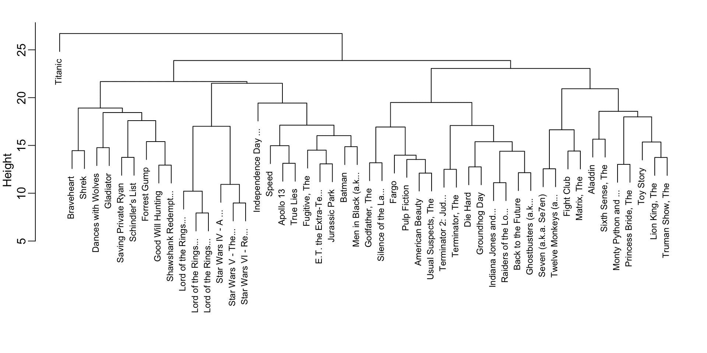
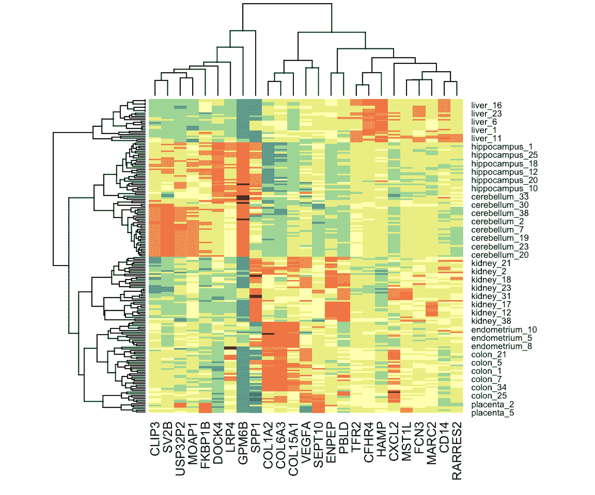

# 32 无监督学习：聚类

> 原文：[`rafalab.dfci.harvard.edu/dsbook-part-2/ml/clustering.html`](https://rafalab.dfci.harvard.edu/dsbook-part-2/ml/clustering.html)

1.  机器学习

1.  32 无监督学习：聚类

我们迄今为止研究过的算法代表了机器学习中最广泛使用的分支：监督学习。在监督学习中，训练数据包括预测因子和结果，目标是学习一个函数，该函数可以预测新观测的结果。前几章中开发的许多数学和实用框架旨在理解、评估和构建这些监督预测模型。

然而，监督学习只是广泛称为机器学习的一部分。第二个主要分支是 *无监督学习*，其中不提供结果（标签）。目标不再是预测，而是揭示数据中的结构：识别组、检测模式或揭示低维表示。这一系列技术在实践中非常重要，包括本书中未涉及到的许多方法。在这里，我们提供了一个简要介绍，并建议读者参考推荐文本进行深入研究。

无监督学习包含了许多不同的方法，但其中最常见的一种是 *聚类*：将具有相似特征的观测分组。在基于身高的性别预测或二对七位数的例子中，聚类可能会很具挑战性，因为组自然重叠。但在许多科学和应用领域，如基因组学、市场营销、图像分析和推荐系统，无监督方法可以揭示其他情况下可能隐藏的有意义模式。

在本章中，我们重点关注两种经典的聚类算法，每个算法都展示了非常不同的策略：

+   **层次聚类**，通过递归合并最近的成对观测来分组。

+   **k-means 聚类**，通过迭代优化聚类中心来划分数据。

这两种方法都是基础性的，因为许多高级无监督学习方法都建立在相同的思想之上。

## 32.1 例子

为了使概念具体化，我们研究了两个真实例子。这些例子说明了无监督学习如何在没有结果标签的情况下，揭示真实数据中的潜在结构。

### 电影评分

我们的第一个例子是基于电影评分。在这里，我们快速构建了一个矩阵 `movies`，它包含了至少有 100 个评分的用户中评分最高的 50 部电影：

```r
[library](https://rdrr.io/r/base/library.html)(dslabs)
[library](https://rdrr.io/r/base/library.html)([data.table](https://r-datatable.com))
[library](https://rdrr.io/r/base/library.html)([stringr](https://stringr.tidyverse.org))
dt <- [as.data.table](https://rdatatable.gitlab.io/data.table/reference/as.data.table.html)(movielens)
dt <- dt[, if (.N >= 100) .SD, by = userId]
top_movies <- dt[, .N, by = .(movieId, title)]
dt <- dt[movieId [%in%](https://rdrr.io/r/base/match.html) top_movies[[order](https://rdrr.io/r/base/order.html)(-N)][1:50, movieId]]
dt <- [dcast](https://rdatatable.gitlab.io/data.table/reference/dcast.data.table.html)(dt, title ~ userId, value.var = "rating") 
movies <- [as.matrix](https://rdrr.io/r/base/matrix.html)(dt[,-1])
[rownames](https://rdrr.io/r/base/colnames.html)(movies) <- [str_remove](https://stringr.tidyverse.org/reference/str_remove.html)(dt$title, ": Episode") |> [str_trunc](https://stringr.tidyverse.org/reference/str_trunc.html)(20)
```

*请注意，如果我们直接从原始评分中计算距离，评分普遍较高的电影往往会彼此靠近，评分普遍较低的电影也是如此。然而，这并不是我们真正感兴趣的。相反，我们想要捕捉 263 位不同用户之间的评分相关性。为了实现这一点，我们通过去除电影效应来对每部电影的评分进行中心化：**

```r
movies <- movies - [rowMeans](https://rdrr.io/r/base/colSums.html)(movies, na.rm = TRUE)
```

*如第二十四章所述，由于并非每个用户都对每部电影进行评分，因此许多条目缺失，所以我们使用参数`na.rm = TRUE`。有了中心化数据，我们现在可以根据电影的评分模式对电影进行聚类。**

### **基因表达测量**

**我们的第二个例子使用了来自**dslabs**的`tissue_gene_expression`数据集。该数据集包含 189 个组织样本的基因表达测量值。预测变量存储在组件`x`中，形成一个具有 500 列的矩阵，每列代表一个基因，因此每一行代表单个组织样本的表达谱。结果标签存储在组件`y`中，指示每个样本来自七个组织类型中的哪一个。

尽管聚类通常在标签未知时应用，但这个数据集在教学中很有用，因为我们确实知道真实的组织类型。这让我们可以检查我们找到的聚类是否很好地反映了潜在的生物结构：不同的组织具有不同的基因表达模式，尽管所有细胞都共享相同的基因组。不同的基因在不同的组织中扮演不同的功能角色，这些模式应该可以通过聚类检测到。从生物学的角度来看，所有这些组织都共享相同的基因组，每个细胞都包含相同的 DNA。使组织不同的是哪些基因被开启或关闭，以及开启或关闭的程度。这些组织特异性的表达模式反映了每种细胞类型的独特功能。因此，我们预计具有相似生物学角色的组织样本将显示出相似的基因表达谱。

在聚类之前，我们通过减去每个基因的平均表达水平来创建基因表达矩阵的中心化版本。这确保我们关注基因表达的*相对差异*而不是绝对大小：

```r
genex <- [sweep](https://rdrr.io/r/base/sweep.html)(tissue_gene_expression$x, 2, [colMeans](https://rdrr.io/r/base/colSums.html)(tissue_gene_expression$x))
```

*当我们后来探索`genex`时，即使没有给出算法的组织标签，我们也应该看到结构的出现：来自同一组织的样本往往聚集在一起，因为它们共享特征的表达模式。***

## ***32.2 层次聚类***

***我们首先描述的聚类算法是*层次聚类*。与许多聚类算法一样，第一步是计算每对观测之间的距离。我们以`movies`矩阵为例进行此操作：**

```r
d <- [dist](https://rdrr.io/r/stats/dist.html)(movies)
```

*`dist`函数自动处理缺失值并标准化距离测量，确保计算的两个电影之间的距离不依赖于可用的评分数量。**

在计算了每对电影之间的距离后，我们需要一个算法来定义基于这些距离的组。层次聚类首先将每个观测值定义为一个单独的组，然后最近的两个组被合并成新的组。然后我们继续迭代地将最近的组合并成新的组，直到只剩下一个包含所有观测值的组。

`hclust`函数实现了这个算法，并接受距离作为输入：

```r
h <- [hclust](https://rdrr.io/r/stats/hclust.html)(d)
```

*我们可以使用树状图来查看生成的组。将`plot`函数应用于`hclust`对象会创建一个树状图：

```r
[plot](https://rdrr.io/r/graphics/plot.default.html)(h, cex = 0.75, main = "", xlab = "")
```

**  *这个图给出了任意两部电影之间的距离近似。为了找到这个距离，我们找到从上到下这些电影首次分成两个不同组的位置。这个位置的高度是这两个组之间的距离。例如，三部《星球大战》电影之间的距离是 8 或更少，而《失落文明的探险者》和《沉默的羔羊》之间的距离大约是 17。

为了生成实际的组，我们可以做两件事之一：1）决定观测值在同一个组中所需的最小距离，或者 2）决定你想要的组数，然后找到实现这一目标的最小距离。

函数`cutree`可以应用于`hclust`的输出，以执行这两个操作之一并生成组。参数`k`可以用来指定组数，或者，参数`h`可以用来表示组内成员之间的最小距离。以下是请求形成 10 个组的方法：

```r
groups <- [cutree](https://rdrr.io/r/stats/cutree.html)(h, k = 10)
```

*请注意，聚类提供了一些关于电影类型的见解。第 2 组看起来像是备受赞誉的电影：

```r
[names](https://rdrr.io/r/base/names.html)(groups)[groups == 2]
#> [1] "American Beauty"      "Fargo"                "Godfather, The" 
#> [4] "Pulp Fiction"         "Silence of the La..." "Usual Suspects, The"
```

*并且第 9 组看起来像是*极客*电影：

```r
[names](https://rdrr.io/r/base/names.html)(groups)[groups == 9]
#> [1] "Lord of the Rings..." "Lord of the Rings..." "Lord of the Rings..."
#> [4] "Star Wars IV - A ..." "Star Wars V - The..." "Star Wars VI - Re..."
```

*我们可以通过使`k`更大或`h`更小来改变组的大小。*********

## ***32.3 热图***

***热图是揭示高维数据中簇或模式的有力视觉工具。热图在观测值和预测变量都可以形成有意义的组时特别有用。基因表达数据集是一个很好的例子：不仅组织样本可以根据生物类型进行聚类，基因本身也经常聚集成功能组，这些组是共表达的。

基本思想很简单：我们使用颜色来表示数据矩阵中的每个值，创建数据矩阵的图像，并根据聚类算法的结果重新排序行和列。这种重新排序将相似的样本和基因放在一起，使得数据中的结构更容易看到。

我们使用来自**dslabs**的`tissue_gene_expression`数据集来说明这种方法。

```r
h_1 <- [hclust](https://rdrr.io/r/stats/hclust.html)([dist](https://rdrr.io/r/stats/dist.html)(genex))
h_2 <- [hclust](https://rdrr.io/r/stats/hclust.html)([dist](https://rdrr.io/r/stats/dist.html)([t](https://rdrr.io/r/base/t.html)(genex)))
```

*请注意，我们进行了两次聚类：我们对样本（`h_1`）和基因（`h_2`）进行了聚类。

现在，我们可以使用这个聚类的结果来排序行和列：

```r
[image](https://rdrr.io/r/graphics/image.html)(genex[h_1$order, h_2$order])
```

*执行所有这些操作的`heatmap`函数：

```r
[heatmap](https://rdrr.io/r/stats/heatmap.html)(genex)
```

*注意我们没有展示上面两行代码的结果，因为特征太多，绘图将没有意义。因此，我们将过滤一些列并重新绘制图表。

如果聚类之间只有少数特征不同，包括所有特征可能会添加足够的噪声，使得聚类检测变得困难。一个简单的避免方法是假设低变异性特征不是信息性的，只包括高变异性特征。例如，在电影示例中，评分变异性低的用户实际上并没有真正区分电影：对他们来说，所有电影看起来都差不多。同样，在基因表达示例中，在样本之间没有变化的基因不太可能提供生物上有意义的模式信息。

在这里，我们展示了如何将热图限制在仅显示最易变的基因上，这些基因通常揭示了最强的生物模式。我们首先计算每个基因的标准差，选择前 25 个最易变的基因，然后使用更合适的发散颜色方案绘制热图：

```r
[library](https://rdrr.io/r/base/library.html)([matrixStats](https://github.com/HenrikBengtsson/matrixStats))
sds <- [colSds](https://rdrr.io/pkg/matrixStats/man/rowSds.html)(genex, na.rm = TRUE)
o <- [order](https://rdrr.io/r/base/order.html)(sds, decreasing = TRUE)[1:25]
[heatmap](https://rdrr.io/r/stats/heatmap.html)(genex[,o], col = [rev](https://rdrr.io/r/base/rev.html)(RColorBrewer::[brewer.pal](https://rdrr.io/pkg/RColorBrewer/man/ColorBrewer.html)(11, "Spectral")))
```

**  *我们在热图中看到了清晰的模式：观测值聚集成组，这些组在很大程度上对应于组织类型，基因也形成聚类，反映了生物上有意义的结构。例如，SV2B、GPM6B、LRP4 和 DOCK4 等基因聚集在一起，因为它们都与神经元功能有关。

注意 R 中有几个其他的热图函数。一个流行的例子是 **gplots** 包中的 `heatmap.2`。

## ***32.4 k-means***

***我们描述的第二种聚类算法是 *k-means*。

k-means 算法要求我们预先定义 \(k\)，即我们想要创建的聚类数量。一旦 \(k\) 被设置，算法就会迭代进行：

1.  *初始化:* 定义 \(k\) 个中心（随机选择）。

1.  *分配步骤:* 每个观测值被分配到最近的中心所在的聚类。

1.  *更新步骤:* 通过取每个聚类中观测值的平均值来重新定义中心。这些新的中心被称为 *质心*。

1.  *迭代:* 步骤 2 和 3 重复进行，直到中心稳定（收敛）。

我们可以运行 k-means 来看看它是否可以发现不同的组织：

```r
[set.seed](https://rdrr.io/r/base/Random.html)(2001)
km <- [kmeans](https://rdrr.io/r/stats/kmeans.html)(genex, centers = 7)
```

*聚类分配存储在 `cluster` 组件中：

```r
km$cluster[1:5]
#> cerebellum_1 cerebellum_2 cerebellum_3 cerebellum_4 cerebellum_5 
#>            7            7            7            7            7
```

*由于初始中心是随机选择的（这就是为什么我们使用 `set.seed`），生成的聚类可能会有所不同。为了提高稳定性，我们可以多次重复这个过程，使用不同的随机起始点，并保留最佳结果。随机起始点的数量由 `nstart` 参数设置：

```r
[set.seed](https://rdrr.io/r/base/Random.html)(2001)
km <- [kmeans](https://rdrr.io/r/stats/kmeans.html)(genex, centers = 7, nstart = 100)
```

*由于我们这个数据集有真实的组织标签，我们可以评估 k-means 生成的聚类与已知生物组之间的匹配程度。最简单的方法是检查列联表，并评估每个聚类的*纯度*，即大多数样本是否来自单一的组织类型：

```r
[table](https://rdrr.io/r/base/table.html)(km$cluster, tissue_gene_expression$y)
#> 
#>     cerebellum colon endometrium hippocampus kidney liver placenta
#>   1         33     0           0           0      0     0        0
#>   2          0    34           0           0      1     0        0
#>   3          0     0           0           0      0    26        0
#>   4          0     0          15           0      0     0        0
#>   5          0     0           0           0     38     0        0
#>   6          5     0           0          31      0     0        0
#>   7          0     0           0           0      0     0        6
```

*结果显示，k-means 在恢复组织结构方面做得相当不错。例如，簇 1、3、4、5 和 7 分别大致对应于小脑、肝脏、子宫内膜、肾脏和胎盘。所有海马样本都落入簇 6，尽管有五个小脑样本被错误地包含在内。簇 2 几乎捕获了所有结肠样本，只有一个肾脏样本分配错误。

在下一节中，我们将讨论使用单个数字来总结这种协议的正式方法，例如 *纯度* 和其他常用的聚类评估指标。

## ***32.5 使用类别标签评估簇***

在监督学习中，我们使用准确率、敏感度和 RMSE 等量来评估性能。聚类提出了不同的挑战：因为该方法是无监督的，算法从未看到真正的结果，也没有“正确”标签的明确概念。然而，在许多实际数据设置中，我们 *确实* 有用于评估目的的地面实况标签——例如，基因表达研究中的组织类型。在这些情况下，我们可以有意义地询问：算法恢复的簇与已知类别之间的匹配程度如何？这种外部评估在比较给定科学或应用背景下的聚类方法的基准测试研究中很常见。

一个方便的第一步是使用列联表（或混淆矩阵）可视化簇质量，就像我们上面用 `table` 做的那样。在这里，行代表簇，列代表真实类别。在可选地重新排序行或列以使结构更容易理解之后：

```r
tab <- [table](https://rdrr.io/r/base/table.html)(km$cluster, tissue_gene_expression$y)
tab[,[apply](https://rdrr.io/r/base/apply.html)(tab, 1, which.max)]
#> 
#>     cerebellum colon liver endometrium kidney hippocampus placenta
#>   1         33     0     0           0      0           0        0
#>   2          0    34     0           0      1           0        0
#>   3          0     0    26           0      0           0        0
#>   4          0     0     0          15      0           0        0
#>   5          0     0     0           0     38           0        0
#>   6          5     0     0           0      0          31        0
#>   7          0     0     0           0      0           0        6
```

*一个“纯”簇看起来像一行只有一个主导条目，其余条目相对较小。这表明分配给该簇的观测几乎共享相同的真实标签。

如果我们想用一个数字来总结这种协议，最广泛使用的度量是 *簇纯度*。

### 簇纯度

假设我们有：

+   每个观测 \(i=1\dots N\) 的真实类别标签 \(Y_i \in {1,\dots,J}\)，以及

+   一种将每个观测 \(i\) 分配到 \(K\) 个簇 \(C_1,\dots,C_K\) 之一的聚类算法。

对于每个簇 \(C_k\)，我们查看该簇内真实标签的分布，并找到最常见的标签。簇 \(k\) 的 *纯度* 是属于这个多数类别的观测在 \(C_k\) 中的比例。整体纯度定义为：

\[ \text{Purity} = \frac{1}{N} \sum_{k=1}^K \max_j | C_k \cap L_j | \]

其中 \(L_j\) 是类别 \(j\) 的观测集合，且 \(|C_k \cap L_j|\) 是 \(C_k\) 和 \(L_j\) 中观测的数量。

纯度很容易理解：纯度为 1 表示每个簇仅由一个类别的观测组成；纯度为 0.6 表示，平均而言，每个簇中的 60% 的点来自其主导类别，40% 是从其他类别“混合”进来的。

我们可以计算我们的基因表达示例的纯度，并注意到它非常接近 1：

```r
tab <- [table](https://rdrr.io/r/base/table.html)(km$cluster, tissue_gene_expression$y)
[sum](https://rdrr.io/r/base/sum.html)([apply](https://rdrr.io/r/base/apply.html)(tab, 1, max))/[sum](https://rdrr.io/r/base/sum.html)(tab)
#> [1] 0.968
```

### *其他指标：ARI 和 NMI*

*纯度简单直观，但它没有校正机会，并且可能偏向于有许多小聚类。在更正式的评估中，特别是在机器学习文献中，还有两个其他指标是常见的：

+   **调整兰德指数（ARI）**：将聚类与真实标签进行比较，并调整由机会产生的协议。它从 0（随机分配）到 1（完美匹配）。

+   **归一化互信息（NMI）**：使用信息论中的思想来衡量知道聚类标签可以减少对真实标签的不确定性。它通常在 0 到 1 之间，值越高表示对齐越好。

在实践中，纯度和相应的列联表通常是首先用来理解聚类如何与已知类别相关联的工具，当需要时，ARI 和 NMI 提供更正式、校正机会的总结。*****

## ***32.6 练习题***

***1. 使用标准距离（例如，欧几里得距离）计算`movies`数据集中用户之间的成对距离。你会得到一个错误，因为某些用户对没有共同评价的电影，产生所有值为 NAs 的行或列。为了诊断这个问题，创建一个矩阵`in_common`，其中条目\((i, j)\)是用户\(i\)和\(j\)共同评价的电影数量。*提示:* 使用`[is.na()](https://rdrr.io/r/base/NA.html)`与`[crossprod()](https://rdrr.io/r/base/crossprod.html)`一起使用。

2. 创建一个`movies`矩阵的简化版本，其中只包含与子集内每个其他用户至少共享一部共同评价电影的用户。通过减去他们的平均值来对每个用户的评分进行中心化，计算距离矩阵，并运行层次聚类（`hclust`）。检查生成的树状图：你是否观察到任何结构？是否有用户组聚在一起？

3. 使用`cutree`与`k = 7`或等价的`cutree`与`h = 14`来获得 7 个聚类。创建一个表格，显示有多少用户属于这 7 个聚类中的每一个。

4. 对于最大和第二大聚类，检查用户的喜爱电影（例如，平均评分最高的电影）。描述每个组中的电影观看者的类型。这些聚类是否对应于明显的偏好模式（例如，动作爱好者、浪漫爱好者等）？

5. 对基因表达矩阵`genex`进行层次聚类，并使用组织类型标记树状图叶子。两个小脑样本（`29`和`30`）和两个肾脏样本（`38`和`39`）与肝脏聚类在一起，请在你的图中验证这一点。

6. 练习 5 的结果与使用以下方法获得的 k-means 聚类结果不同：

```r
[set.seed](https://rdrr.io/r/base/Random.html)(2001)
km <- [kmeans](https://rdrr.io/r/stats/kmeans.html)(genex, centers = 7, nstart = 100)
```

*检查`km$centers`中的聚类中心。将小脑样本（例如，`"cerebellum_29"`）的基因表达轮廓与每个七个中心进行比较，以查看它最相似的中心：

```r
[par](https://rdrr.io/r/graphics/par.html)(mfrow = [c](https://rdrr.io/r/base/c.html)(4, 2))
for (i in 1:7) {
 [plot](https://rdrr.io/r/graphics/plot.default.html)(km$centers[i,], genex["cerebellum_29",],
 xlim = [range](https://rdrr.io/r/base/range.html)(genex), ylim = [range](https://rdrr.io/r/base/range.html)(genex))
}
```

*对于 `"cerebellum_30"`、`"kidney_38"`、`"kidney_39"`、`"liver_13"` 和 `"liver_14"` 重复上述操作，并将这些样本直接进行比较。使用这些比较来提出对练习 5 中观察到的不匹配的可能解释。

7. 将 MNIST 数字的一个子集聚类成**10**个簇：

```r
mnist <- [read_mnist](https://rdrr.io/pkg/dslabs/man/read_mnist.html)()
[set.seed](https://rdrr.io/r/base/Random.html)(1990)
index <- [sample](https://rdrr.io/r/base/sample.html)([nrow](https://rdrr.io/r/base/nrow.html)(mnist$train$images), 1000)
x <- mnist$train$images[index,]
y <- [factor](https://rdrr.io/r/base/factor.html)(mnist$train$labels[index])
km <- [kmeans](https://rdrr.io/r/stats/kmeans.html)(x, centers = 10, nstart = 100)
```

*使用 `[table()](https://rdrr.io/r/base/table.html)` 比较簇分配与真实标签。计算所得聚类的簇纯度。当要求找到 10 个数字簇时，k-means 算法表现如何？

8. 以图像的形式检查簇中心。例如，注意与“3”最相关的簇中心可能是“3”和“5”的混合。评论你的观察结果。

9. 重新运行 k-means 算法，使用 25 个簇，以便算法能够表示同一数字的多种书写风格。检查列联表、簇纯度和簇中心图像。评论结果是否有所改进，以及你从人们书写数字的多样性中学到了什么。

10. 如 第 32.5 节 所述，纯度通常随着簇数的增加而增加。对于 `k` 在 `seq(10, 100, 10)` 范围内重复练习 9。计算每个 `k` 值的纯度，并绘制纯度与簇数的关系图。评论在什么情况下纯度的增加似乎有意义，以及它们似乎仅由于偶然性而出现的情况。******
