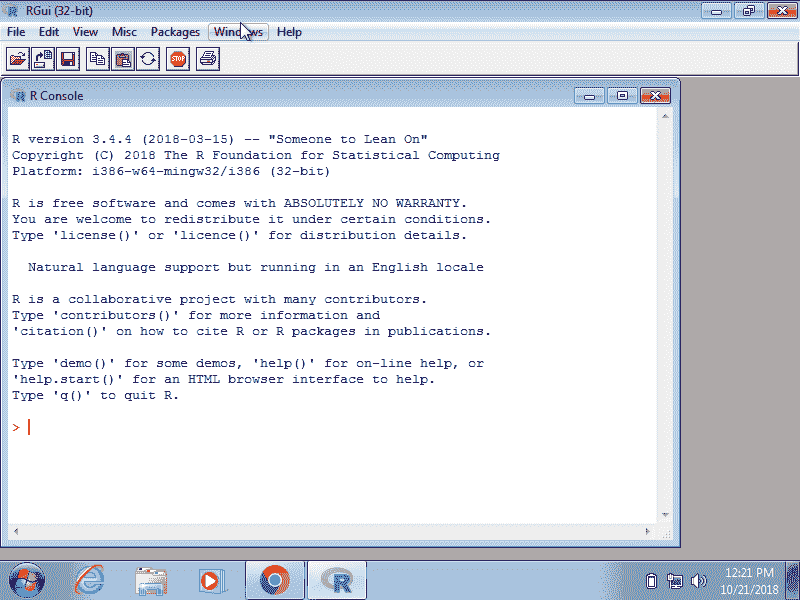
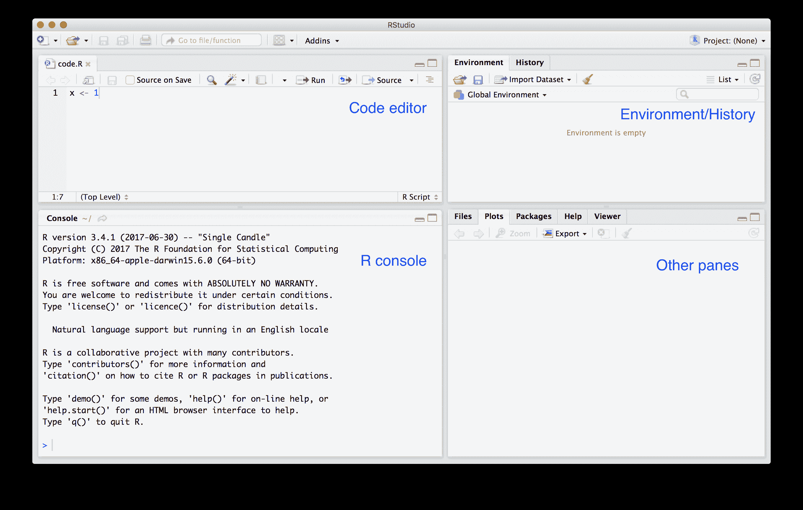
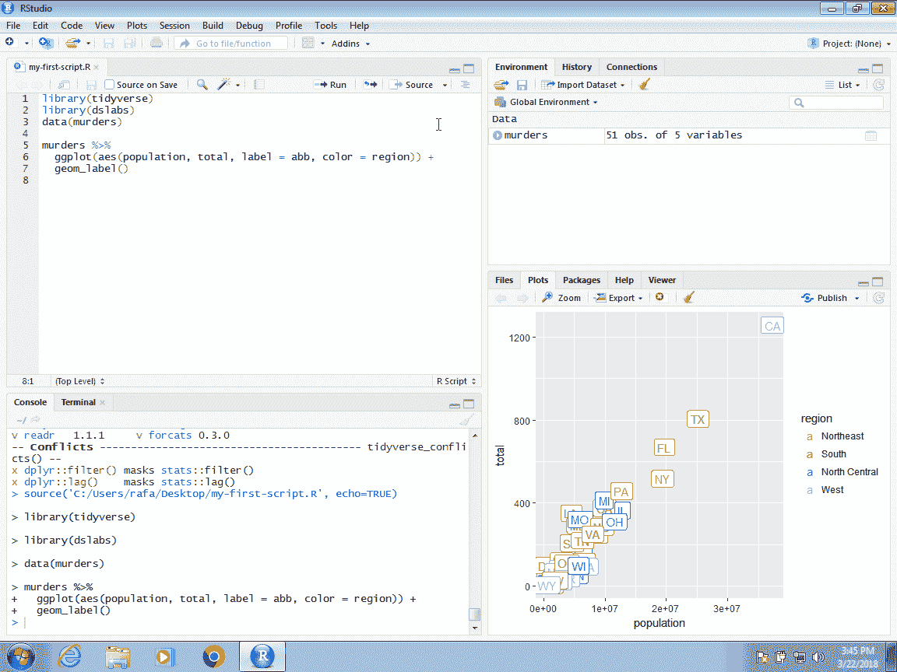
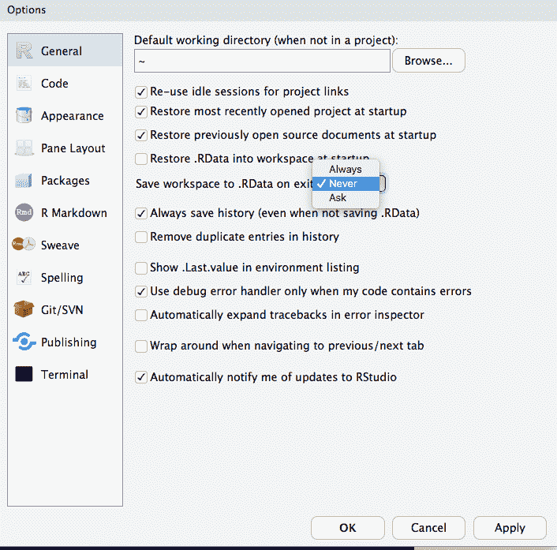

# 第一章：R 和 RStudio 入门

> 原文：[`rafalab.dfci.harvard.edu/dsbook/getting-started.html`](https://rafalab.dfci.harvard.edu/dsbook/getting-started.html)

## 1.1 为什么选择 R？

R 不是一个像 C 或 Java 这样的编程语言。它不是由软件工程师为软件开发而创建的。相反，它是由统计学家开发的一个用于数据分析的交互式环境。你可以在论文《S 的简短历史》中阅读其完整的历史¹。交互性是数据科学中不可或缺的特性，因为你很快就会了解到，快速探索数据的能力是成功在这个领域的关键。然而，就像在其他编程语言中一样，你可以将你的工作保存为脚本，这些脚本可以在任何时刻轻松执行。这些脚本作为你进行的分析的记录，这是一个促进可重复工作的关键特性。如果你是一个专家程序员，你不应该期望 R 会遵循你习惯的约定，因为你可能会感到失望。如果你有耐心，你会开始欣赏 R 在数据分析，尤其是数据可视化方面的不凡能力。

R 的其他吸引人的特性包括：

1.  R 是免费且开源的²。

1.  它在所有主要平台上运行：Windows、Mac Os、UNIX/Linux。

1.  脚本和数据对象可以在各个平台上无缝共享。

1.  R 用户有一个庞大、不断增长且活跃的社区，因此有大量的学习资源和提问资源³ ⁴ ⁵。

1.  其他人为贡献附加组件很容易，这使得开发者可以共享新的数据科学方法论的软件实现。这为 R 用户提供了早期访问最新方法和工具的机会，这些工具为广泛的学科开发，包括生态学、分子生物学、社会科学和地理学，仅举几个例子。

## 1.2 R 控制台

交互式数据分析通常在 *R 控制台* 上进行，该控制台会执行你输入的命令。有多种方式可以访问 R 控制台。一种方式是在你的计算机上简单地启动 R。控制台看起来大致如下：



作为一个快速示例，尝试使用控制台计算一顿价值 $19.71 的餐费的 15% 小费：

```r
0.15 * 19.71 
#> [1] 2.96
```

**请注意，在本书中，灰色框用于显示输入到 R 控制台的 R 代码。符号 `#>` 用于表示 R 控制台的输出。**

## 1.3 脚本

R 相对于点选式分析软件的一个巨大优势是你可以将你的工作保存为脚本。你可以使用文本编辑器编辑和保存这些脚本。本书中的材料是使用交互式 *集成开发环境* (IDE) RStudio⁶ 开发的。RStudio 包含一个具有许多 R 特定功能的编辑器，一个用于执行代码的控制台，以及其他有用的面板，包括一个用于显示图形的面板。



大多数基于 Web 的 R 控制台也提供了一个用于编辑脚本的面板，但并非所有都允许你保存脚本以供以后使用。

生成这本书所用的所有 R 脚本都可以在 GitHub⁷上找到。

## 1.4 RStudio

RStudio 将成为我们数据科学项目的启动平台。它不仅为我们提供了一个创建和编辑脚本的编辑器，还提供了许多其他有用的工具。在本节中，我们将介绍一些基础知识。

### 1.4.1 面板

当你第一次启动 RStudio 时，你会看到三个面板。左侧面板显示 R 控制台。在右侧，顶部面板包括*环境*和*历史*等标签页，而底部面板显示五个标签页：*文件*、*绘图*、*包*、*帮助*和*查看器*（这些标签页在新版本中可能会有所变化）。你可以点击每个标签来浏览不同的功能。


要启动一个新的脚本，你可以点击文件，然后新建文件，然后 R 脚本。


这将在左侧打开一个新的面板，并且在这里你可以开始编写你的脚本。


### 1.4.2 快捷键

我们用鼠标执行的大多数任务都可以通过组合键来完成。这些用于执行任务的键盘版本被称为*快捷键*。例如，我们刚刚展示了如何使用鼠标启动一个新的脚本，但你也可以使用快捷键：Windows 上的 Ctrl+Shift+N 和 Mac 上的 command+shift+N。

虽然在这个教程中我们经常展示如何使用鼠标，但我们**强烈建议你记住你使用最多的操作的快捷键**。RStudio 提供了一个包含最常用命令的有用速查表。你可以直接从 RStudio 获取：


你可能希望将其保留在手边，以便在你发现自己进行重复的点按操作时查找快捷键。

### 1.4.3 在编辑脚本时运行命令

有许多专门为编码制作的编辑器。这些编辑器很有用，因为它们会自动添加颜色和缩进，使代码更易于阅读。RStudio 就是这些编辑器之一，它是专门为 R 开发的。RStudio 相对于其他编辑器提供的主要优势之一是我们可以在编辑脚本时轻松测试我们的代码。下面我们展示一个示例。

让我们先从打开一个新的脚本开始，就像我们之前做的那样。下一步是为脚本命名。我们可以通过编辑器保存当前未命名的脚本来完成此操作。为此，点击保存图标或使用 Windows 上的 Ctrl+S 和 Mac 上的 command+S 快捷键。

当你第一次要求保存文档时，RStudio 会提示你输入名称。一个好的惯例是使用描述性的名称，使用小写字母，没有空格，只使用连字符来分隔单词，然后跟随着*.R*后缀。我们将把这个脚本称为*my-first-script.R*。


现在我们准备开始编辑我们的第一个脚本。R 脚本中的第一行代码是专门用于加载我们将使用的库。另一个有用的 RStudio 功能是，一旦我们输入 `library()`，它就会自动完成我们已安装的库。注意我们输入 `library(ti)` 时会发生什么：


你可能注意到的另一个功能是，当你输入 `library(` 时，第二个括号会自动添加。这将帮助你避免编码中最常见的错误之一：忘记关闭括号。

现在我们可以继续编写代码。作为一个例子，我们将制作一个显示各州谋杀总数与人口总数的图表。一旦你编写了制作此图表所需的代码，你可以通过 *执行* 代码来尝试它。为此，点击编辑窗格右上角的 *运行* 按钮。你也可以使用快捷键：Windows 上的 Ctrl+Shift+Enter 或 Mac 上的 command+shift+return。

一旦运行代码，你将在 R 控制台中看到它出现，在这种情况下，生成的图表将出现在图表控制台中。请注意，图表控制台有一个有用的界面，允许你点击在不同图表之间前后导航，放大图表，或将图表保存为文件。



要逐行运行代码而不是整个脚本，你可以在 Windows 上使用 Control-Enter，在 Mac 上使用 command-return。

### 1.4.4 更改全局选项

你可以相当大地改变 RStudio 的外观和功能。

要更改全局选项，你点击 *工具* 然后点击 *全局选项…*。

作为例子，我们展示了如何进行我们 **强烈推荐** 的更改。这是将 *退出时将工作区保存到 .RData* 改为 *从不*，并取消选择 *启动时将 .RData 恢复到工作区*。默认情况下，当你退出 R 时，会将你创建的所有对象保存到一个名为 .RData 的文件中。这样做是为了当你以相同文件夹重新启动会话时，它会加载这些对象。我们发现这会导致混淆，尤其是当我们与同事共享代码并假设他们有这个 .RData 文件时。要更改这些选项，使你的 *常规* 设置看起来像这样：



## 1.5 安装 R 包

新安装的 R 提供的功能只是可能功能的一小部分。实际上，我们将你第一次安装后得到的内容称为 *基础 R*。额外的功能来自开发者的附加组件。目前，CRAN 上有数百个这样的附加组件，还有许多通过其他存储库如 GitHub 分享。然而，由于并非每个人都需要所有可用功能，R 通过 *包* 提供不同的组件。R 使得从 R 内部安装包变得非常容易。例如，要安装 **dslabs** 包，我们用它来共享与本书相关的数据集和代码，你将输入：

```r
install.packages("dslabs")
```

在 RStudio 中，你可以导航到*工具*标签并选择安装包。然后我们可以使用`library`函数将包加载到我们的 R 会话中：

```r
library(dslabs)
```

随着你阅读这本书，你会发现我们可以在不安装的情况下加载包。这是因为一旦你安装了一个包，它就会保持安装状态，并且只需要通过`library`函数来加载。包会一直保持加载状态，直到我们退出 R 会话。如果你尝试加载一个包并遇到错误，这可能意味着你需要先安装它。

我们可以通过向这个函数提供一个字符向量来一次性安装多个包：

```r
install.packages(c("tidyverse", "dslabs"))
```

注意，安装**tidyverse**实际上会安装多个包。这通常发生在包有*依赖项*或使用其他包中的函数时。当你使用`library`函数加载一个包时，也会加载它的依赖项。

一旦安装了包，你就可以将它们加载到 R 中，并且不需要再次安装，除非你安装了全新的 R 版本。记住，包是在 R 中而不是在 RStudio 中安装的。

将你需要用于工作的所有包列在一个脚本中是有帮助的，因为如果你需要执行 R 的全新安装，你可以通过简单地运行一个脚本来重新安装所有包。

你可以使用以下函数查看你已安装的所有包：

```r
installed.packages()
```

* * *

1.  [`pdfs.semanticscholar.org/9b48/46f192aa37ca122cfabb1ed1b59866d8bfda.pdf`](https://pdfs.semanticscholar.org/9b48/46f192aa37ca122cfabb1ed1b59866d8bfda.pdf)↩︎

1.  [`opensource.org/history`](https://opensource.org/history)↩︎

1.  [`stats.stackexchange.com/questions/138/free-resources-for-learning-r`](https://stats.stackexchange.com/questions/138/free-resources-for-learning-r)↩︎

1.  [`www.r-project.org/help.html`](https://www.r-project.org/help.html)↩︎

1.  [`stackoverflow.com/documentation/r/topics`](https://stackoverflow.com/documentation/r/topics)↩︎

1.  [`www.rstudio.com/`](https://www.rstudio.com/)↩︎

1.  [`github.com/rafalab/dsbook`](https://github.com/rafalab/dsbook)↩︎
