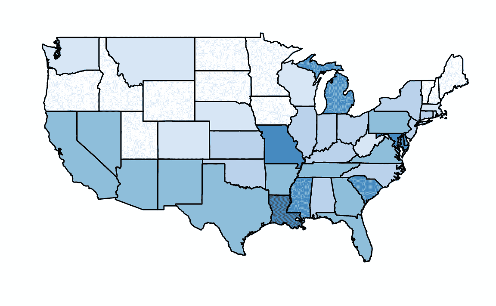
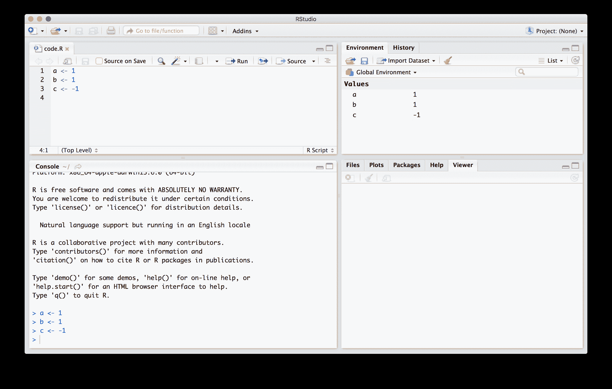
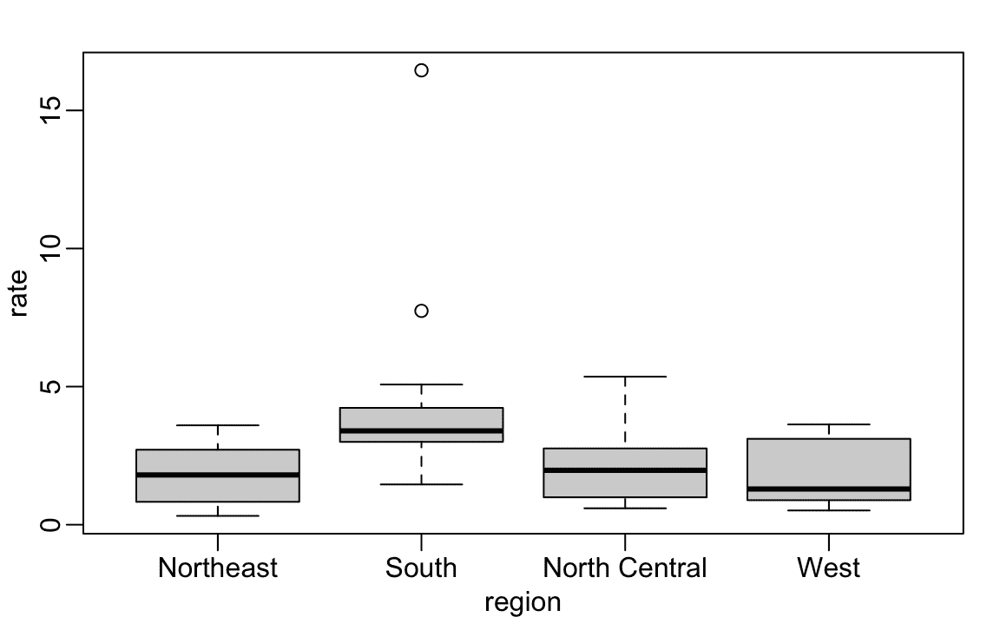
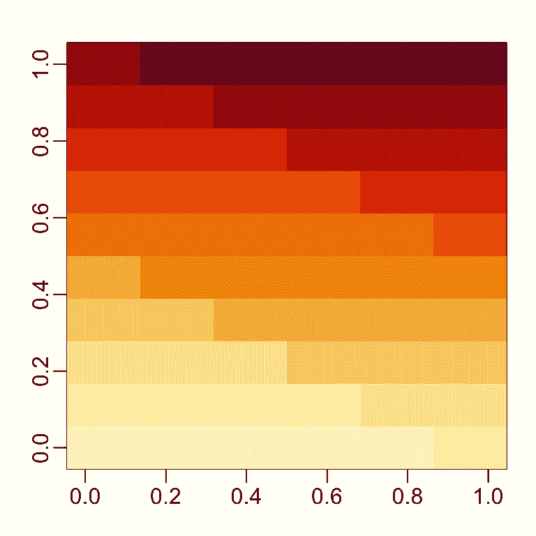

# 第二章 R 基础知识

> 原文：[`rafalab.dfci.harvard.edu/dsbook/r-basics.html`](https://rafalab.dfci.harvard.edu/dsbook/r-basics.html)

在这本书中，我们将使用 R 软件环境进行所有分析。你将同时学习 R 和数据分析技术。为了跟上进度，你需要能够访问 R。我们还推荐使用集成开发环境（IDE），例如 RStudio，以保存你的工作。请注意，课程或研讨会通常通过你的网络浏览器提供 R 环境和 IDE 的访问权限，就像 RStudio 云⁸所做的那样。如果你有此类资源的访问权限，你不需要安装 R 和 RStudio。然而，如果你打算成为一名高级数据分析师，我们强烈建议你在计算机上安装这些工具⁹。R 和 RStudio 都是免费的，并且可在网上获得。

## 2.1 案例研究：美国枪支谋杀案

假设你住在欧洲，并被一家在全美各州都有分公司的美国公司提供了一份工作。这是一份非常好的工作，但像**“美国枪支杀人率高于其他发达国家”**¹⁰这样的新闻标题让你感到担忧。这样的图表可能会让你更加担忧：


但然后你记得，美国是一个庞大且多样化的国家，有 50 个非常不同的州以及哥伦比亚特区（DC）。



例如，加利福尼亚的人口比加拿大多，有 20 个美国州的人口比挪威多。在某些方面，美国各州之间的差异类似于欧洲各国之间的差异。此外，尽管上述图表中没有包括，立陶宛、乌克兰和俄罗斯的谋杀率都高于每 10 万人 4 起。因此，你可能觉得那些让你担忧的新闻报道过于肤浅。你有选择居住地的权利，并希望确定每个特定州的安全性。我们将通过使用 R 分析 2010 年美国枪支谋杀案的相关数据来获得一些见解。

在我们开始示例之前，我们需要了解一些后勤工作以及一些非常基础的构建块，这些构建块对于提高 R 技能是必需的。请注意，这些构建块的一些用途可能一开始并不明显，但在本书的后面部分，你会感激自己掌握了这些技能。

## 2.2 基础知识

在我们开始介绍激励数据集之前，我们需要了解 R 的非常基础的知识。

### 2.2.1 对象

假设一个高中生向我们寻求帮助解决几个形式为 $ax²+bx+c = 0$ 的二次方程。二次公式给出了解：

$$ \frac{-b - \sqrt{b² - 4ac}}{2a}\,\, \mbox{ 和 } \frac{-b + \sqrt{b² - 4ac}}{2a} $$ 当然，这些值会根据 $a$、$b$ 和 $c$ 的值而变化。编程语言的一个优点是我们可以定义变量并使用这些变量编写表达式，就像我们在数学中做的那样，但可以获得数值解。我们将在下面写出二次方程的一般代码，但如果要求我们解 $x² + x -1 = 0$，那么我们定义：

```r
a <- 1
b <- 1
c <- -1
```

这将存储值以供以后使用。我们使用 `<-` 来给变量赋值。

我们也可以使用 `=` 而不是 `<-` 来赋值，但我们建议不要使用 `=` 以免造成混淆。

将上面的代码复制并粘贴到你的控制台中以定义三个变量。请注意，R 在我们进行此赋值时不会打印任何内容。这意味着对象已成功定义。如果你犯了错误，你会收到一个错误消息。

要查看变量中存储的值，我们只需要求 R 评估 `a`，它就会显示存储的值：

```r
a
#> [1] 1
```

要求 R 显示存储在 `a` 中的值的更明确的方法是使用 `print` 如下所示：

```r
print(a)
#> [1] 1
```

我们使用术语 *对象* 来描述存储在 R 中的东西。变量是例子，但对象也可以是更复杂的实体，例如函数，这将在后面进行描述。

### 2.2.2 工作空间

当我们在控制台中定义对象时，我们实际上是在改变 *工作空间*。你可以通过输入以下内容来查看你工作空间中保存的所有变量：

```r
ls()
#> [1] "a"        "b"        "c"        "dat"      "img_path" "murders"
```

在 RStudio 中，*环境* 选项卡显示了值：



我们应该看到 `a`、`b` 和 `c`。如果你尝试恢复不在你工作空间中的变量的值，你会收到一个错误。例如，如果你输入 `x`，你会收到以下消息：`错误：找不到对象 'x'`。

现在这些值已经保存在变量中，为了得到我们方程的解，我们使用二次公式：

```r
(-b + sqrt(b² - 4*a*c) ) / ( 2*a )
#> [1] 0.618
(-b - sqrt(b² - 4*a*c) ) / ( 2*a )
#> [1] -1.62
```

### 2.2.3 函数

一旦定义了变量，数据分析过程通常可以描述为一系列应用于数据的 *函数*。R 包含了几个预定义的函数，我们构建的大多数分析流程都广泛使用了这些函数。

我们已经使用了 `install.packages`、`library` 和 `ls` 函数。我们还使用了 `sqrt` 函数来解决上面的二次方程。有许多预构建的函数，甚至可以通过包添加更多。这些函数不会出现在工作空间中，因为你没有定义它们，但它们可以立即使用。

通常，我们需要使用括号来评估一个函数。如果你输入 `ls`，函数不会被评估，而是 R 会显示定义函数的代码。如果你输入 `ls()`，函数会被评估，如上所示，我们看到工作空间中的对象。

与 `ls` 不同，大多数函数需要一个或多个 *参数*。下面是一个示例，说明我们如何将对象赋给函数 `log` 的参数。记住，我们之前定义 `a` 为 1：

```r
log(8)
#> [1] 2.08
log(a) 
#> [1] 0
```

你可以通过查看 R 中包含的非常有用的手册来了解函数期望什么以及它做什么。你可以使用`help`函数来获取帮助，如下所示：

```r
help("log")
```

对于大多数函数，我们也可以使用这种简写：

```r
?log
```

帮助页面将显示函数期望的参数。例如，`log`需要`x`和`base`来运行。然而，一些参数是必需的，而其他参数是可选的。你可以通过在帮助文档中注意到一个默认值被`=`分配来确定哪些参数是可选的。定义这些是可选的。例如，函数`log`的基数默认为`base = exp(1)`，这使得`log`默认为自然对数。

如果你想要快速查看参数而不打开帮助系统，你可以输入：

```r
args(log)
#> function (x, base = exp(1)) 
#> NULL
```

你可以通过简单地分配另一个对象来更改默认值：

```r
log(8, base = 2)
#> [1] 3
```

注意，我们并没有像这样指定参数`x`：

```r
log(x = 8, base = 2)
#> [1] 3
```

上述代码是有效的，但我们可以节省一些输入：如果没有使用参数名称，R 假设你正在按照帮助文件或`args`中显示的顺序输入参数。所以不使用名称，它假设参数是`x`后面跟着`base`：

```r
log(8,2)
#> [1] 3
```

如果使用参数的名称，那么我们可以按我们想要的任何顺序包括它们：

```r
log(base = 2, x = 8)
#> [1] 3
```

要指定参数，我们必须使用`=`，而不能使用`<-`。

函数需要括号来评估的规则有一些例外。在这些例外中，最常用的是算术和关系运算符。例如：

```r
2 ^ 3
#> [1] 8
```

你可以通过输入来查看算术运算符：

```r
help("+") 
```

或者

```r
?"+"
```

并且可以通过输入来查看关系运算符：

```r
help(">") 
```

或者

```r
?">"
```

### 2.2.4 其他预定义对象

有几个数据集是为用户练习和测试函数而包含的。你可以通过输入来查看所有可用的数据集：

```r
data()
```

这显示了这些数据集的对象名称。这些数据集是可以通过简单地输入名称来使用的对象。例如，如果你输入：

```r
co2
```

R 将显示莫纳罗亚大气二氧化碳浓度数据。

其他预定义对象是数学量，例如常数$\pi$和$\infty$：

```r
pi
#> [1] 3.14
Inf+1
#> [1] Inf
```

### 2.2.5 变量名

我们已经使用了字母`a`、`b`和`c`作为变量名，但变量名可以是几乎任何东西。R 中的一些基本规则是变量名必须以字母开头，不能包含空格，并且不应是 R 中预定义的变量。例如，不要将其中一个变量命名为`install.packages`，如下所示：`install.packages <- 2`。

一个好的约定是使用描述存储内容的含义性词汇，只使用小写字母，并且使用下划线作为空格的替代。对于二次方程，我们可以使用类似以下的形式：

```r
solution_1 <- (-b + sqrt(b² - 4*a*c)) / (2*a)
solution_2 <- (-b - sqrt(b² - 4*a*c)) / (2*a)
```

对于更多建议，我们强烈建议学习 Hadley Wickham 的风格指南¹¹。

### 2.2.6 保存工作空间

值会保留在工作空间中，直到你结束会话或使用 `rm` 函数删除它们。但工作空间也可以保存以供以后使用。事实上，当你退出 R 时，程序会询问你是否想要保存工作空间。如果你保存了它，那么下次你启动 R 时，程序将恢复工作空间。

我们实际上不建议以这种方式保存工作空间，因为当你开始处理不同的项目时，跟踪保存的内容会变得更加困难。相反，我们建议你为工作空间分配一个特定的名称。你可以通过使用 `save` 或 `save.image` 函数来实现这一点。要加载，请使用 `load` 函数。在保存工作空间时，我们建议使用后缀 `rda` 或 `RData`。在 RStudio 中，你也可以通过导航到 *会话* 选项卡并选择 *另存为工作空间* 来实现这一点。你可以在同一选项卡中使用 *加载工作空间* 选项来稍后加载它。你可以阅读有关 `save`、`save.image` 和 `load` 的帮助页面来了解更多信息。

### 2.2.7 脚本激励

要解决另一个方程，例如 $3x² + 2x -1$，我们可以复制并粘贴上面的代码，然后重新定义变量并重新计算解：

```r
a <- 3
b <- 2
c <- -1
(-b + sqrt(b² - 4*a*c)) / (2*a)
(-b - sqrt(b² - 4*a*c)) / (2*a)
```

通过创建并保存上面的代码脚本，我们就不需要每次都重新输入所有内容，而是只需更改变量名。尝试将上面的脚本写入编辑器中，并注意如何轻松地更改变量并得到答案。

### 2.2.8 注释你的代码

如果一行 R 代码以符号 `#` 开头，则不会进行评估。我们可以使用这个来写上为什么写特定代码的提醒。例如，在上述脚本中，我们可以添加：

```r
## Code to compute solution to quadratic equation of the form ax² + bx + c
## define the variables
a <- 3 
b <- 2
c <- -1

## now compute the solution
(-b + sqrt(b² - 4*a*c)) / (2*a)
(-b - sqrt(b² - 4*a*c)) / (2*a)
```

## 2.3 练习

1. 前一百个正整数的和是多少？整数 $1$ 到 $n$ 的和的公式是 $n(n+1)/2$。将 $n$ 定义为 $100$，然后使用 R 来计算 $1$ 到 $100$ 的和，使用这个公式。和是多少？

2. 现在用同样的公式来计算从 1 到 1,000 的整数的和。

3. 查看将以下代码输入 R 的结果：

```r
n <- 1000
x <- seq(1, n)
sum(x)
```

根据结果，你认为 `seq` 和 `sum` 函数做什么？你可以使用 `help`。

1.  `sum` 创建一个数字列表，`seq` 将它们加起来。

1.  `seq` 创建一个数字列表，`sum` 将它们加起来。

1.  `seq` 创建一个随机列表，`sum` 计算从 1 到 1,000 的和。

1.  `sum` 总是返回相同的数字。

4. 在数学和编程中，我们说当我们用一个给定的数字替换参数时，我们评估一个函数。所以如果我们输入 `sqrt(4)`，我们评估 `sqrt` 函数。在 R 中，你可以在另一个函数内部评估一个函数。评估是从内到外发生的。使用一行代码来计算 100 的平方根的以 10 为底的对数。

5. 以下哪个选项将始终返回存储在 `x` 中的数值？如果你想尝试示例并使用帮助系统，可以这样做。

1.  `log(10^x)`

1.  `log10(x¹⁰)`

1.  `log(exp(x))`

1.  `exp(log(x, base = 2))`

## 2.4 数据类型

R 中的变量可以是不同类型的。例如，我们需要区分数字和字符字符串，以及表格和简单的数字列表。函数`class`帮助我们确定我们有什么类型的对象：

```r
a <- 2
class(a)
#> [1] "numeric"
```

要在 R 中高效工作，学习不同类型的变量以及我们可以用它们做什么是非常重要的。

### 2.4.1 数据框

到目前为止，我们定义的变量只是一个数字。这对于存储数据来说并不很有用。在 R 中存储数据集最常见的方式是使用*数据框*。从概念上讲，我们可以将数据框视为一个表，其中行代表观测值，而每个观测值报告的不同变量定义了列。数据框对于数据集特别有用，因为我们可以将不同的数据类型组合到一个对象中。

大多数数据分析挑战都是从存储在数据框中的数据开始的。例如，我们将激励示例中的数据存储在一个数据框中。您可以通过加载**dslabs**库并使用`data`函数加载`murders`数据集来访问此数据集：

```r
library(dslabs)
data(murders)
```

为了确认这实际上是一个数据框，我们输入以下命令：

```r
class(murders)
#> [1] "data.frame"
```

### 2.4.2 检查对象

函数`str`对于了解对象的更多结构非常有用：

```r
str(murders)
#> 'data.frame':    51 obs. of  5 variables:
#> $ state : chr "Alabama" "Alaska" "Arizona" "Arkansas" ...
#> $ abb : chr "AL" "AK" "AZ" "AR" ...
#> $ region : Factor w/ 4 levels "Northeast","South",..: 2 4 4 2 4 4 1 2 2
#>    2 ...
#> $ population: num 4779736 710231 6392017 2915918 37253956 ...
#> $ total : num 135 19 232 93 1257 ...
```

这告诉我们更多关于对象的信息。我们看到这个表有 51 行（50 个州加上华盛顿特区）和五个变量。我们可以使用`head`函数显示前六行：

```r
head(murders)
#>        state abb region population total
#> 1    Alabama  AL  South    4779736   135
#> 2     Alaska  AK   West     710231    19
#> 3    Arizona  AZ   West    6392017   232
#> 4   Arkansas  AR  South    2915918    93
#> 5 California  CA   West   37253956  1257
#> 6   Colorado  CO   West    5029196    65
```

在这个数据集中，每个州被视为一个观测值，并为每个州报告了五个变量。

在我们进一步回答关于不同州的原问题之前，让我们更多地了解这个对象的组成部分。

### 2.4.3 访问器：`$`

对于我们的分析，我们需要访问这个数据框中包含的列所表示的不同变量。为此，我们使用以下方式使用访问器运算符`$`：

```r
murders$population
#>  [1]  4779736   710231  6392017  2915918 37253956  5029196  3574097
#>  [8]   897934   601723 19687653  9920000  1360301  1567582 12830632
#> [15]  6483802  3046355  2853118  4339367  4533372  1328361  5773552
#> [22]  6547629  9883640  5303925  2967297  5988927   989415  1826341
#> [29]  2700551  1316470  8791894  2059179 19378102  9535483   672591
#> [36] 11536504  3751351  3831074 12702379  1052567  4625364   814180
#> [43]  6346105 25145561  2763885   625741  8001024  6724540  1852994
#> [50]  5686986   563626
```

但我们是如何知道使用`population`的呢？之前，通过将函数`str`应用于对象`murders`，我们揭示了存储在此表中五个变量的名称。我们可以快速访问变量名称，使用以下方法：

```r
names(murders)
#> [1] "state"      "abb"        "region"     "population" "total"
```

重要的是要知道`murders$population`中条目的顺序与我们的数据表中行的顺序保持一致。这将在以后允许我们根据另一个变量的结果来操作一个变量。例如，我们将能够根据谋杀案的数量对州名进行排序。

**提示**：R 自带一个非常棒的自动完成功能，这可以节省我们输入所有名称的麻烦。尝试输入`murders$p`然后按键盘上的*tab*键。当在 RStudio 中工作时，此功能以及许多其他有用的自动完成功能都是可用的。

### 2.4.4 向量：数值、字符和逻辑

对象 `murders$population` 不是单个数字，而是多个。我们称这些类型的对象为 *向量*。从技术上讲，单个数字是一个长度为 1 的向量，但通常我们使用术语向量来指代具有多个条目的对象。`length` 函数告诉你向量中有多少条目：

```r
pop <- murders$population
length(pop)
#> [1] 51
```

这个特定的向量是 *numeric*，因为人口规模是数字：

```r
class(pop)
#> [1] "numeric"
```

在一个 numeric 向量中，每个条目都必须是数字。

要存储字符字符串，向量也可以是 *character* 类。例如，州名是字符：

```r
class(murders$state)
#> [1] "character"
```

与 numeric 向量一样，字符向量中的所有条目都需要是字符。

另一种重要的向量类型是 *logical vectors*。这些必须是 `TRUE` 或 `FALSE`。

```r
z <- 3 == 2
z
#> [1] FALSE
class(z)
#> [1] "logical"
```

这里 `==` 是一个关系运算符，询问 3 是否等于 2。在 R 中，如果你只使用一个 `=`，实际上是在分配一个变量，但如果你使用两个 `==`，你就是在测试相等性。

你可以通过输入来查看其他 *关系运算符*：

```r
?Comparison
```

在未来的章节中，你将看到关系运算符有多么有用。

在下一组练习之后，我们将讨论向量的更多重要特性。

**高级**: 从数学角度讲，`pop` 中的值是整数，R 中有一个整数类。然而，默认情况下，即使数字是整数，也会被分配为 numeric 类。例如，`class(1)` 返回 numeric。你可以使用 `as.integer()` 函数或将 `L` 添加到数字前（如 `1L`）来将它们转换为 integer 类。注意，通过输入 `class(1L)` 来查看类。

### 2.4.5 因子

在 `murders` 数据集中，我们可能期望地区也是一个字符向量。然而，它不是：

```r
class(murders$region)
#> [1] "factor"
```

它是一个 *factor*。因子对于存储分类数据很有用。我们可以通过使用 `levels` 函数看到只有 4 个区域：

```r
levels(murders$region)
#> [1] "Northeast"     "South"         "North Central" "West"
```

在后台，R 将这些 *levels* 存储为整数，并保持一个映射来跟踪标签。这比存储所有字符更节省内存。

注意，级别有一个与因子对象中出现的顺序不同的顺序。R 中的默认设置是级别按字母顺序排列。然而，我们通常希望级别按不同的顺序排列。你可以通过在创建因子时使用 `factor` 函数的 `levels` 参数来指定顺序。例如，在谋杀数据集中，地区按从东到西的顺序排列。`reorder` 函数让我们根据对数值向量的汇总来改变因子变量的级别顺序。我们将通过一个简单的例子来演示这一点，并在本书的数据可视化部分看到更高级的例子。

假设我们想根据谋杀总数而不是字母顺序来排序地区的级别。如果每个级别都与值相关联，我们可以使用 `reorder` 并指定数据汇总来确定顺序。以下代码计算每个地区的总谋杀数，并按这些总和重新排序因子。

```r
region <- murders$region
value <- murders$total
region <- reorder(region, value, FUN = sum)
levels(region)
#> [1] "Northeast"     "North Central" "West"          "South"
```

新的顺序与东北部谋杀案最少、南部谋杀案最多的这一事实相符。

**警告**：因子有时可能引起混淆，因为它们有时表现得像字符，有时又不像。因此，混淆因子和字符是常见的错误来源。

### 2.4.6 列表

数据框是 *列表* 的一个特例。列表很有用，因为您可以存储不同类型的任意组合。您可以使用 `list` 函数创建列表，如下所示：

```r
record <- list(name = "John Doe",
 student_id = 1234,
 grades = c(95, 82, 91, 97, 93),
 final_grade = "A")
```

函数 `c` 在第 2.6 节中描述。

此列表包括一个字符、一个数字、一个包含五个数字的向量以及另一个字符。

```r
record
#> $name
#> [1] "John Doe"
#> 
#> $student_id
#> [1] 1234
#> 
#> $grades
#> [1] 95 82 91 97 93
#> 
#> $final_grade
#> [1] "A"
class(record)
#> [1] "list"
```

与数据框一样，您可以使用访问器 `$` 提取列表的组件。

```r
record$student_id
#> [1] 1234
```

我们还可以使用双方括号 (`[[`) 如此操作：

```r
record[["student_id"]]
#> [1] 1234
```

您应该习惯在 R 中，通常有多种方式来完成同一件事，例如访问条目。

您可能还会遇到没有变量名的列表。

```r
record2 <- list("John Doe", 1234)
record2
#> [[1]]
#> [1] "John Doe"
#> 
#> [[2]]
#> [1] 1234
```

如果列表没有名称，您不能使用 `$` 提取元素，但您仍然可以使用方括号方法，而不是提供变量名，而是提供列表索引，如下所示：

```r
record2[[1]]
#> [1] "John Doe"
```

我们不会在这里使用列表，但在您自己对 R 的探索中可能会遇到。因此，我们在这里向您展示一些基础知识。

### 2.4.7 矩阵

矩阵是 R 中常见的一种对象类型。矩阵与数据框类似，因为它们都是二维的：它们有行和列。然而，与数值、字符和逻辑向量一样，矩阵中的条目必须都是同一类型。因此，数据框对于存储数据来说非常有用，因为我们可以在其中包含字符、因子和数字。

然而，矩阵相对于数据框有一个主要优势：我们可以执行矩阵代数运算，这是一种强大的数学技术。我们在这本书中不描述这些操作，但您在执行数据分析时背景中发生的大部分操作都涉及矩阵。我们在这里只简要介绍矩阵，因为我们将学习的某些函数会返回矩阵。然而，如果您计划进行更高级的工作，我们强烈建议您学习更多，因为它们在数据分析中得到了广泛的应用。

我们可以使用 `matrix` 函数定义矩阵。我们需要指定行数和列数。

```r
mat <- matrix(1:12, 4, 3)
mat
#>      [,1] [,2] [,3]
#> [1,]    1    5    9
#> [2,]    2    6   10
#> [3,]    3    7   11
#> [4,]    4    8   12
```

您可以使用方括号 (`[`) 在矩阵中访问特定条目。如果您想获取第二行，第三列，您可以使用：

```r
mat[2, 3]
#> [1] 10
```

如果您想获取整个第二行，您可以将列位置留空：

```r
mat[2, ]
#> [1]  2  6 10
```

注意，这返回的是一个向量，而不是矩阵。

类似地，如果您想获取整个第三列，您可以将行位置留空：

```r
mat[, 3]
#> [1]  9 10 11 12
```

这也是一个向量，而不是矩阵。

如果您喜欢，可以访问多个列或多个行。这将为您提供一个新矩阵。

```r
mat[, 2:3]
#>      [,1] [,2]
#> [1,]    5    9
#> [2,]    6   10
#> [3,]    7   11
#> [4,]    8   12
```

您可以同时选择行和列：

```r
mat[1:2, 2:3]
#>      [,1] [,2]
#> [1,]    5    9
#> [2,]    6   10
```

我们可以使用 `as.data.frame` 函数将矩阵转换为数据框：

```r
as.data.frame(mat)
#>   V1 V2 V3
#> 1  1  5  9
#> 2  2  6 10
#> 3  3  7 11
#> 4  4  8 12
```

您还可以使用单个方括号 (`[`) 来访问数据框的行和列：

```r
data("murders")
murders[25, 1]
#> [1] "Mississippi"
murders[2:3, ]
#>     state abb region population total
#> 2  Alaska  AK   West     710231    19
#> 3 Arizona  AZ   West    6392017   232
```

## 2.5 练习

1. 加载美国谋杀数据集。

```r
library(dslabs)
data(murders)
```

使用 `str` 函数检查 `murders` 对象的结构。以下哪个选项最能描述这个数据框中的变量？

1.  51 个州。

1.  所有 50 个州和哥伦比亚特区的谋杀率。

1.  州名、州名的缩写、州的区域以及 2010 年该州的人口总数和谋杀总数。

1.  `str` 没有显示相关信息。

2. 数据框用于这些五个变量的列名是什么？

3. 使用访问器 `$` 提取州缩写并将其分配给对象 `a`。这个对象的类别是什么？

4. 现在使用方括号提取州缩写并将其分配给对象 `b`。使用 `identical` 函数确定 `a` 和 `b` 是否相同。

5. 我们看到 `region` 列存储了一个因子。你可以通过输入来证实这一点：

```r
class(murders$region)
```

使用一行代码，使用 `levels` 和 `length` 函数来确定由这个数据集定义的区域数量。

6. 函数 `table` 接收一个向量并返回每个元素的频率。你可以快速查看每个区域有多少个州，通过应用这个函数。使用一行代码创建每个区域的州表。

## 2.6 向量

在 R 中，最基本的数据存储对象是 *向量*。正如我们所见，复杂的数据集通常可以分解为向量组件。例如，在数据框中，每一列都是一个向量。在这里，我们更深入地了解这个重要类别。

### 2.6.1 创建向量

我们可以使用 `c` 函数创建向量，它代表 *连接*。我们使用 `c` 以以下方式连接条目：

```r
codes <- c(380, 124, 818)
codes
#> [1] 380 124 818
```

我们也可以创建字符向量。我们使用引号来表示条目是字符而不是变量名。

```r
country <- c("italy", "canada", "egypt")
```

在 R 中，你也可以使用单引号：

```r
country <- c('italy', 'canada', 'egypt')
```

但要注意不要将单引号 ‘与反引号 *`* 混淆。

到现在为止，你应该知道如果你输入：

```r
country <- c(italy, canada, egypt)
```

你会收到一个错误，因为变量 `italy`、`canada` 和 `egypt` 没有定义。如果我们不使用引号，R 会寻找具有这些名称的变量并返回一个错误。

### 2.6.2 名称

有时候给向量的条目命名是有用的。例如，当定义一个国家代码向量时，我们可以使用名称来连接两者：

```r
codes <- c(italy = 380, canada = 124, egypt = 818)
codes
#>  italy canada  egypt 
#>    380    124    818
```

对象 `codes` 仍然是一个数值向量：

```r
class(codes)
#> [1] "numeric"
```

但使用名称：

```r
names(codes)
#> [1] "italy"  "canada" "egypt"
```

如果不使用引号使用字符串看起来很混乱，要知道你也可以使用引号：

```r
codes <- c("italy" = 380, "canada" = 124, "egypt" = 818)
codes
#>  italy canada  egypt 
#>    380    124    818
```

这个函数调用与上一个没有区别。这是 R 与其他语言相比奇特之处之一。

我们也可以使用 `names` 函数来命名：

```r
codes <- c(380, 124, 818)
country <- c("italy","canada","egypt")
names(codes) <- country
codes
#>  italy canada  egypt 
#>    380    124    818
```

### 2.6.3 序列

另一个用于创建向量的有用函数是生成序列：

```r
seq(1, 10)
#>  [1]  1  2  3  4  5  6  7  8  9 10
```

第一个参数定义了起始点，第二个参数定义了结束点（包括在内）。默认情况下，递增的步长为 1，但第三个参数让我们告诉它跳过的步长：

```r
seq(1, 10, 2)
#> [1] 1 3 5 7 9
```

如果我们想要连续的整数，我们可以使用以下缩写：

```r
1:10
#>  [1]  1  2  3  4  5  6  7  8  9 10
```

当我们使用这些函数时，R 产生整数而不是数值，因为它们通常用于索引：

```r
class(1:10)
#> [1] "integer"
```

然而，如果我们创建一个包含非整数的序列，类别就会改变：

```r
class(seq(1, 10, 0.5))
#> [1] "numeric"
```

### 2.6.4 子集

我们使用方括号来访问向量的特定元素。对于上面定义的`codes`向量，我们可以使用以下方法访问第二个元素：

```r
codes[2]
#> canada 
#>    124
```

你可以使用多元素向量作为索引来获取多个条目：

```r
codes[c(1,3)]
#> italy egypt 
#>   380   818
```

如果我们想访问，比如，前两个元素，上面定义的序列特别有用：

```r
codes[1:2]
#>  italy canada 
#>    380    124
```

如果元素有名称，我们也可以使用这些名称来访问条目。下面是两个例子。

```r
codes["canada"]
#> canada 
#>    124
codes[c("egypt","italy")]
#> egypt italy 
#>   818   380
```

## 2.7 强制转换

通常，*强制转换*是 R 尝试对数据类型灵活处理的一种尝试。当一个条目不符合预期时，一些预构建的 R 函数会尝试在抛出错误之前猜测其意图。这也可能导致混淆。在尝试用 R 编程时，未能理解*强制转换*可能会让程序员感到疯狂，因为 R 在这方面与其他大多数语言的行为相当不同。让我们通过一些例子来了解它。

我们说过，向量必须全部是同一类型。所以如果我们尝试组合，比如，数字和字符，你可能会期望一个错误：

```r
x <- c(1, "canada", 3)
```

但我们没有得到一个，甚至没有警告！发生了什么？看看`x`及其类别：

```r
x
#> [1] "1"      "canada" "3"
class(x)
#> [1] "character"
```

R 将数据强制转换为字符。它猜测因为你将字符串放入向量中，所以你实际上想将 1 和 3 视为字符字符串`"1"`和`"3"`。甚至没有发出警告的事实是强制转换如何在 R 中导致许多未察觉错误的例子。

R 还提供了将一种类型转换为另一种类型的函数。例如，你可以使用以下方法将数字转换为字符：

```r
x <- 1:5
y <- as.character(x)
y
#> [1] "1" "2" "3" "4" "5"
```

你可以使用`as.numeric`将其转换回来：

```r
as.numeric(y)
#> [1] 1 2 3 4 5
```

这个函数实际上非常有用，因为包含数字作为字符串的集合很常见。

### 2.7.1 不可用（NA）

当一个函数试图将一种类型强制转换为另一种类型并遇到不可能的情况时，它通常会给我们一个警告，并将条目转换为称为“不可用”（NA）的特殊值。例如：

```r
x <- c("1", "b", "3")
as.numeric(x)
#> Warning: NAs introduced by coercion
#> [1]  1 NA  3
```

R 在你输入`b`时没有猜测你想要什么数字，所以它不会尝试。

作为数据科学家，你经常会遇到`NA`，因为它们通常用于表示缺失数据，这是现实世界数据集中常见的问题。

## 2.8 练习

1. 使用函数`c`创建一个包含北京、拉各斯、巴黎、里约热内卢、圣胡安和多伦多一月份平均最高气温的向量，这些气温分别是 35、88、42、84、81 和华氏 30 度。将对象命名为`temp`。

2. 现在创建一个包含城市名称的向量，并将其命名为`city`。

3. 使用`names`函数和前面练习中定义的对象，将温度数据与其对应的城市关联起来。

4. 使用`[`和`:`运算符访问列表中前三个城市的气温。

5. 使用 `[` 操作符访问巴黎和圣胡安的温度。

6. 使用 `:` 操作符创建一个数字序列 $12,13,14,\dots,73$。

7. 创建一个包含所有小于 100 的正奇数的向量。

8. 创建一个从 6 开始，不超过 55，以 4/7 的增量增加数字的向量：6, 6 + 4/7, 6 + 8/7，以此类推。这个列表有多少个数？提示：使用 `seq` 和 `length`。

9. 以下对象 `a <- seq(1, 10, 0.5)` 的类是什么？

10. 以下对象 `a <- seq(1, 10)` 的类是什么？

11. `class(a<-1)` 的类是 numeric，而不是 integer。R 默认为 numeric，要强制转换为 integer，需要添加字母 `L`。确认 `1L` 的类是 integer。

12. 定义以下向量：

```r
x <- c("1", "3", "5")
```

并将其强制转换为整数。

## 2.9 排序

现在我们已经掌握了一些基本的 R 知识，让我们尝试在枪支谋杀的背景下了解不同州的安全性。

### 2.9.1 `sort`

假设我们想要按枪支谋杀的数量从少到多对州进行排名。函数 `sort` 按递增顺序对向量进行排序。因此，我们可以通过输入以下内容来查看枪支谋杀的最大数量：

```r
library(dslabs)
data(murders)
sort(murders$total)
#>  [1]    2    4    5    5    7    8   11   12   12   16   19   21   22
#> [14]   27   32   36   38   53   63   65   67   84   93   93   97   97
#> [27]   99  111  116  118  120  135  142  207  219  232  246  250  286
#> [40]  293  310  321  351  364  376  413  457  517  669  805 1257
```

然而，这并没有给我们提供关于哪些州有哪种谋杀总数的信息。例如，我们不知道哪个州有 1257。

### 2.9.2 `order`

函数 `order` 更接近我们想要的功能。它接受一个向量作为输入，并返回一个索引向量，该向量按输入向量的顺序排序。这听起来可能有些令人困惑，所以让我们看看一个简单的例子。我们可以创建一个向量并对其进行排序：

```r
x <- c(31, 4, 15, 92, 65)
sort(x)
#> [1]  4 15 31 65 92
```

与对输入向量进行排序不同，函数 `order` 返回排序输入向量的索引：

```r
index <- order(x)
x[index]
#> [1]  4 15 31 65 92
```

这与 `sort(x)` 返回的输出相同。如果我们查看这个索引，我们会看到为什么它有效：

```r
x
#> [1] 31  4 15 92 65
order(x)
#> [1] 2 3 1 5 4
```

`x` 的第二个条目是最小的，所以 `order(x)` 从 `2` 开始。下一个最小的是第三个条目，所以第二个条目是 `3`，以此类推。

这如何帮助我们根据谋杀案对状态进行排序？首先，记住你用 `$` 访问的向量的条目遵循与表中行相同的顺序。例如，这两个分别包含州名和缩写的向量通过它们的顺序相匹配：

```r
murders$state[1:6]
#> [1] "Alabama"    "Alaska"     "Arizona"    "Arkansas"   "California"
#> [6] "Colorado"
murders$abb[1:6]
#> [1] "AL" "AK" "AZ" "AR" "CA" "CO"
```

这意味着我们可以按谋杀总数对州名进行排序。我们首先获取按谋杀总数排序的向量的索引，然后对州名向量进行索引：

```r
ind <- order(murders$total) 
murders$abb[ind] 
#>  [1] "VT" "ND" "NH" "WY" "HI" "SD" "ME" "ID" "MT" "RI" "AK" "IA" "UT"
#> [14] "WV" "NE" "OR" "DE" "MN" "KS" "CO" "NM" "NV" "AR" "WA" "CT" "WI"
#> [27] "DC" "OK" "KY" "MA" "MS" "AL" "IN" "SC" "TN" "AZ" "NJ" "VA" "NC"
#> [40] "MD" "OH" "MO" "LA" "IL" "GA" "MI" "PA" "NY" "FL" "TX" "CA"
```

根据上述内容，加利福尼亚的谋杀案最多。

### 2.9.3 `max` 和 `which.max`

如果我们只对具有最大值的条目感兴趣，我们可以使用 `max` 获取值：

```r
max(murders$total)
#> [1] 1257
```

使用 `which.max` 获取最大值的索引：

```r
i_max <- which.max(murders$total)
murders$state[i_max]
#> [1] "California"
```

对于最小值，我们可以用相同的方式使用 `min` 和 `which.min`。

这是否意味着加利福尼亚是最危险的状态？在接下来的部分中，我们争论我们应该考虑比率而不是总数。在这样做之前，我们介绍一个最后的与排序相关的函数：`rank`。

### 2.9.4 `rank`

虽然不如 `order` 和 `sort` 经常使用，但 `rank` 函数也与排序相关，并且可能很有用。对于任何给定的向量，它返回一个向量，其中包含输入向量的第一个条目、第二个条目等的排名。这里有一个简单的例子：

```r
x <- c(31, 4, 15, 92, 65)
rank(x)
#> [1] 3 1 2 5 4
```

总结一下，让我们看看我们介绍过的三个函数的结果：

| 原始 | 排序 | 排序 | 排名 |
| --- | --- | --- | --- |
| 31 | 4 | 2 | 3 |
| 4 | 15 | 3 | 1 |
| 原始 | 排序 | 排序 | 排名 |
| 92 | 65 | 5 | 5 |
| 65 | 92 | 4 | 4 |

### 2.9.5 小心回收

R 中另一个常见的未注意到的错误来源是使用 *回收*。我们看到了向量是逐元素相加的。所以如果向量长度不匹配，我们自然会假设我们应该得到一个错误。但我们没有。注意发生了什么：

```r
x <- c(1, 2, 3)
y <- c(10, 20, 30, 40, 50, 60, 70)
x+y
#> Warning in x + y: longer object length is not a multiple of shorter
#> object length
#> [1] 11 22 33 41 52 63 71
```

我们确实得到了一个警告，但没有错误。对于输出，R 已经回收了 `x` 中的数字。注意输出中数字的最后一位。

## 2.10 练习

对于这些练习，我们将使用美国谋杀数据集。确保在开始之前加载它。

```r
library(dslabs)
data("murders")
```

1. 使用 `$` 运算符访问人口规模数据并将其存储为对象 `pop`。然后使用 `sort` 函数重新定义 `pop` 以使其排序。最后，使用 `[` 运算符报告最小的人口规模。

2. 现在不是找到最小的人口规模，而是找到具有最小人口规模的条目的索引。提示：使用 `order` 而不是 `sort`。

3. 我们实际上可以使用 `which.min` 函数执行与之前练习相同的操作。写一行代码来完成这个操作。

4. 现在我们知道最小州的规模以及代表它的行。它是哪个州？定义一个变量 `states` 来存储 `murders` 数据框中的州名。报告具有最小人口规模的州名。

5. 你可以使用 `data.frame` 函数创建数据框。这里有一个快速示例：

```r
temp <- c(35, 88, 42, 84, 81, 30)
city <- c("Beijing", "Lagos", "Paris", "Rio de Janeiro", 
 "San Juan", "Toronto")
city_temps <- data.frame(name = city, temperature = temp)
```

使用 `rank` 函数确定每个州从最小人口规模到最大人口规模的排名。将这些排名存储在一个名为 `ranks` 的对象中，然后创建一个包含州名及其排名的数据框。将数据框命名为 `my_df`。

6. 重复之前的练习，但这次将 `my_df` 排序，使得州的人口数量从最少到最多。提示：创建一个对象 `ind` 来存储排序人口值所需的索引。然后使用方括号运算符 `[` 重新排序数据框中的每一列。

7. `na_example` 向量代表一系列计数。你可以快速检查该对象，使用：

```r
data("na_example") 
str(na_example)
#>  int [1:1000] 2 1 3 2 1 3 1 4 3 2 ...
```

然而，当我们使用 `mean` 函数计算平均值时，我们得到一个 `NA`：

```r
mean(na_example)
#> [1] NA
```

`is.na` 函数返回一个逻辑向量，告诉我们哪些条目是 `NA`。将这个逻辑向量分配给一个名为 `ind` 的对象，并确定 `na_example` 有多少个 `NA`。

8. 现在再次计算平均值，但只针对不是 `NA` 的条目。提示：记住 `!` 运算符。

## 2.11 向量算术

加利福尼亚的谋杀案最多，但这是否意味着它是最危险的状态？如果它只是比其他州多很多人口呢？我们可以快速确认加利福尼亚确实有最大的人口：

```r
library(dslabs)
data("murders")
murders$state[which.max(murders$population)]
#> [1] "California"
```

人口超过 3700 万。因此，如果我们对了解该州的安全性感兴趣，比较总数是不公平的。我们真正应该计算的是每千人谋杀数。我们在激励部分描述的报告使用每 10 万人的谋杀数作为单位。为了计算这个数量，R 强大的向量算术功能派上用场。

### 2.11.1 向量缩放

在 R 中，向量的算术运算是逐元素进行的。例如，假设我们有英寸为单位的高度：

```r
inches <- c(69, 62, 66, 70, 70, 73, 67, 73, 67, 70)
```

并将其转换为厘米。注意当我们把“英寸”乘以 2.54 时会发生什么：

```r
inches * 2.54
#>  [1] 175 157 168 178 178 185 170 185 170 178
```

在上面的行中，我们将每个元素乘以 2.54。同样，如果我们想计算每个条目相对于 69 英寸（男性平均身高）高多少或矮多少英寸，我们可以从每个条目中减去它，如下所示：

```r
inches - 69
#>  [1]  0 -7 -3  1  1  4 -2  4 -2  1
```

### 2.11.2 两个向量

如果我们有两个长度相同的向量，并在 R 中将它们相加，它们将逐个条目相加，如下所示：

$$ \begin{pmatrix} a\\ b\\ c\\ d \end{pmatrix} + \begin{pmatrix} e\\ f\\ g\\ h \end{pmatrix} = \begin{pmatrix} a +e\\ b + f\\ c + g\\ d + h \end{pmatrix} $$

对于其他数学运算，如 `-`、`*` 和 `/`，情况相同。

这意味着要计算谋杀率，我们只需简单地输入：

```r
murder_rate <- murders$total / murders$population * 100000
```

一旦我们这样做，我们会注意到加利福尼亚不再接近列表的顶部。事实上，我们可以利用我们所学到的知识按谋杀率对州进行排序：

```r
murders$abb[order(murder_rate)]
#>  [1] "VT" "NH" "HI" "ND" "IA" "ID" "UT" "ME" "WY" "OR" "SD" "MN" "MT"
#> [14] "CO" "WA" "WV" "RI" "WI" "NE" "MA" "IN" "KS" "NY" "KY" "AK" "OH"
#> [27] "CT" "NJ" "AL" "IL" "OK" "NC" "NV" "VA" "AR" "TX" "NM" "CA" "FL"
#> [40] "TN" "PA" "AZ" "GA" "MS" "MI" "DE" "SC" "MD" "MO" "LA" "DC"
```

## 2.12 练习

1. 之前我们创建了以下数据框：

```r
temp <- c(35, 88, 42, 84, 81, 30)
city <- c("Beijing", "Lagos", "Paris", "Rio de Janeiro", 
 "San Juan", "Toronto")
city_temps <- data.frame(name = city, temperature = temp)
```

使用上面的代码重新制作数据框，但添加一行将温度从华氏度转换为摄氏度。转换公式是 $C = \frac{5}{9} \times (F - 32)$。

2. 以下求和 $1+1/2² + 1/3² + \dots 1/100²$ 是什么？提示：多亏了欧拉，我们知道它应该接近 $\pi²/6$。

3. 计算每个州的每 10 万谋杀率并将其存储在对象 `murder_rate` 中。然后使用 `mean` 函数计算美国的平均谋杀率。平均数是多少？

## 2.13 索引

R 提供了一种强大且方便的向量索引方式。例如，我们可以根据另一个向量的属性对向量进行子集化。在本节中，我们继续使用我们的美国谋杀案例，我们可以这样加载它：

```r
library(dslabs)
data("murders")
```

### 2.13.1 使用逻辑进行子集化

我们现在已经使用以下方法计算了谋杀率：

```r
murder_rate <- murders$total / murders$population * 100000 
```

假设你正从谋杀率只有 0.71 每 10 万人的意大利搬走。你会更愿意搬到一个谋杀率相似的状态。R 的另一个强大功能是我们可以使用逻辑来索引向量。如果我们比较一个向量与一个单独的数字，它实际上会对每个条目进行测试。以下是与上述问题相关的一个例子：

```r
ind <- murder_rate < 0.71
```

如果我们想了解一个值是否小于或等于，我们可以使用：

```r
ind <- murder_rate <= 0.71
```

注意，我们得到一个逻辑向量，其中每个小于或等于 0.71 的条目都是 TRUE。为了查看这些州是哪些，我们可以利用向量可以用逻辑值索引的事实。

```r
murders$state[ind]
#> [1] "Hawaii"        "Iowa"          "New Hampshire" "North Dakota" 
#> [5] "Vermont"
```

为了计算有多少是 TRUE，函数 `sum` 返回向量的条目之和，逻辑向量通过 `TRUE` 编码为 1 和 `FALSE` 编码为 0 来转换为数值。因此，我们可以使用以下方式来计算州的数量：

```r
sum(ind)
#> [1] 5
```

### 2.13.2 逻辑运算符

假设我们喜欢山脉，并想搬到国家西部的一个安全州。我们希望谋杀率不超过 1。在这种情况下，我们希望两个条件都为真。在这里，我们可以使用逻辑运算符 *and*，在 R 中用 `&` 表示。这个操作仅在两个逻辑值都为 TRUE 时才产生 `TRUE`。为了看到这一点，考虑以下示例：

```r
TRUE & TRUE
#> [1] TRUE
TRUE & FALSE
#> [1] FALSE
FALSE & FALSE
#> [1] FALSE
```

对于我们的例子，我们可以形成两个逻辑值：

```r
west <- murders$region == "West"
safe <- murder_rate <= 1
```

我们可以使用 `&` 来获取一个逻辑向量，它告诉我们哪些州同时满足这两个条件：

```r
ind <- safe & west
murders$state[ind]
#> [1] "Hawaii"  "Idaho"   "Oregon"  "Utah"    "Wyoming"
```

### 2.13.3 `which`

假设我们想查找加利福尼亚的谋杀率。对于这类操作，将逻辑向量转换为索引比保留长逻辑向量更方便。函数 `which` 告诉我们逻辑向量的哪些条目是 TRUE。因此，我们可以输入：

```r
ind <- which(murders$state == "California")
murder_rate[ind]
#> [1] 3.37
```

### 2.13.4 `match`

如果我们想找出多个州的谋杀率，比如纽约、佛罗里达和德克萨斯州，我们可以使用函数 `match`。这个函数告诉我们第二个向量的哪些索引与第一个向量的每个条目相匹配：

```r
ind <- match(c("New York", "Florida", "Texas"), murders$state)
ind
#> [1] 33 10 44
```

现在，我们可以查看谋杀率：

```r
murder_rate[ind]
#> [1] 2.67 3.40 3.20
```

### 2.13.5 `%in%`

如果我们想要一个逻辑值而不是索引，告诉我们第一个向量的每个元素是否在第二个向量中，我们可以使用函数 `%in%`。让我们假设你不确定波士顿、达科他州和华盛顿是否是州。你可以这样找出：

```r
c("Boston", "Dakota", "Washington") %in% murders$state
#> [1] FALSE FALSE  TRUE
```

注意，在整个书中，我们将经常使用 `%in%`。

**高级**：`match` 和 `%in%` 通过 `which` 有一个联系。为了看到这一点，注意以下两行产生相同的索引（尽管顺序不同）：

```r
match(c("New York", "Florida", "Texas"), murders$state)
#> [1] 33 10 44
which(murders$state%in%c("New York", "Florida", "Texas"))
#> [1] 10 33 44
```

## 2.14 练习

首先加载库和数据。

```r
library(dslabs)
data(murders)
```

1. 计算每个州的每 10 万人谋杀率，并将其存储在名为 `murder_rate` 的对象中。然后使用逻辑运算符创建一个名为 `low` 的逻辑向量，它告诉我们 `murder_rate` 的哪些条目低于 1。

2. 现在利用前一个练习的结果和函数 `which` 来确定与低于 1 的值相关的 `murder_rate` 的索引。

3. 使用前一个练习的结果来报告谋杀率低于 1 的州名。

4. 现在将练习 2 和 3 中的代码扩展，以报告东北部谋杀率低于 1 的州。提示：使用先前定义的逻辑向量 `low` 和逻辑运算符 `&`。

5. 在之前的练习中，我们计算了每个州的谋杀率以及这些数字的平均值。有多少个州的谋杀率低于平均值？

6. 使用匹配函数来识别具有缩写 AK、MI 和 IA 的州。提示：首先定义一个与三个缩写匹配的`murders$abb`条目索引，然后使用``运算符提取州。

7. 使用`%in%`运算符创建一个逻辑向量，回答以下问题：以下哪些是实际缩写：MA、ME、MI、MO、MU？

8. 将练习 7 中使用的代码扩展，以报告一个**不是**实际缩写的条目。提示：使用`!`运算符，它将`FALSE`转换为`TRUE`，反之亦然，然后使用`which`获取索引。

## 2.15 基本绘图

在第[8 章中，我们描述了一个附加包，它提供了在 R 中生成强大绘图的方法。然后我们在数据可视化部分有一个完整的部分，其中我们提供了许多示例。在这里，我们简要描述了一些在基本 R 安装中可用的函数。

### 2.15.1 `plot`

`plot`函数可以用来制作散点图。这里是一个总谋杀数与人口的关系图。

```r
x <- murders$population / 10⁶
y <- murders$total
plot(x, y)
```


为了快速绘图而避免两次访问变量，我们可以使用`with`函数：

```r
with(murders, plot(population, total))
```

函数`with`允许我们在`plot`函数中使用`murders`列名。它也适用于任何数据框和任何函数。

### 2.15.2 `hist`

我们将在本书的数据可视化部分描述直方图与分布的关系。在这里，我们只是简单地指出，直方图是数字列表的强大图形摘要，它为您提供了对值的类型的总体概述。我们可以通过简单地输入以下内容来制作谋杀率的直方图：

```r
x <- with(murders, total / population * 100000)
hist(x)
```


我们可以看到，存在一个广泛的值范围，其中大多数值在 2 到 3 之间，以及一个谋杀率超过 15 的极端案例：

```r
murders$state[which.max(x)]
#> [1] "District of Columbia"
```

### 2.15.3 `boxplot`

箱线图也将在本书的数据可视化部分进行描述。它们比直方图提供更简洁的摘要，但它们更容易与其他箱线图堆叠。例如，我们可以使用它们来比较不同的地区：

```r
murders$rate <- with(murders, total / population * 100000)
boxplot(rate~region, data = murders)
```



我们可以看到，南部地区的谋杀率高于其他三个地区。

### 2.15.4 `image`

图像函数使用颜色显示矩阵中的值。这里有一个快速示例：

```r
x <- matrix(1:120, 12, 10)
image(x)
```



## 2.16 练习

1. 我们绘制了总谋杀数与人口的关系图，并注意到两者之间存在强烈的关联。不出所料，人口较多的州谋杀案更多。

```r
library(dslabs)
data(murders)
population_in_millions <- murders$population/10⁶
total_gun_murders <- murders$total
plot(population_in_millions, total_gun_murders)
```

请记住，许多州的 人口低于 500 万，并且聚集在一起。我们可以通过在对数尺度上制作此图来获得更深入的见解。使用`log10`变换变量，然后绘制它们。

2. 创建州人口的直方图。

3. 通过地区生成状态人口箱线图。

* * *

1.  [`rstudio.cloud`](https://rstudio.cloud)↑

1.  [`rafalab.github.io/dsbook/installing-r-rstudio.html`](https://rafalab.github.io/dsbook/installing-r-rstudio.html)↩︎

1.  [`abcnews.go.com/blogs/headlines/2012/12/us-gun-ownership-homicide-rate-higher-than-other-developed-countries/`](http://abcnews.go.com/blogs/headlines/2012/12/us-gun-ownership-homicide-rate-higher-than-other-developed-countries/)↩︎

1.  [`adv-r.had.co.nz/Style.html`](http://adv-r.had.co.nz/Style.html)↩︎
