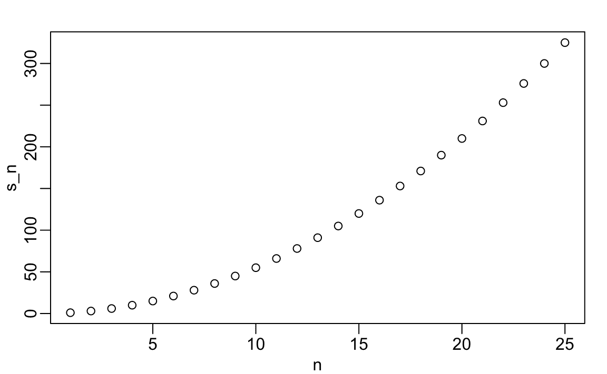

# 第三章 编程基础

> 原文：[`rafalab.dfci.harvard.edu/dsbook/programming-basics.html`](https://rafalab.dfci.harvard.edu/dsbook/programming-basics.html)

我们教授 R 语言，因为它极大地促进了数据分析，这是本书的主要内容。通过在 R 中编码，我们可以高效地进行探索性数据分析，构建数据分析管道，并准备数据可视化以传达结果。然而，R 不仅仅是一个数据分析环境，它还是一种编程语言。高级 R 程序员可以开发复杂的包，甚至可以改进 R 本身，但本书不涉及高级编程。尽管如此，在本节中，我们介绍了三个关键的编程概念：条件表达式、for 循环和函数。这些不仅是高级编程的关键构建块，有时在数据分析中也非常有用。我们还注意到，有几个在 R 中编程时广泛使用的函数，但本书不会涉及。这些包括`split`、`cut`、`do.call`和`Reduce`，以及**data.table**包。如果你计划成为一名专家 R 程序员，这些是值得学习的。

## 3.1 条件表达式

条件表达式是编程的基本特性之一。它们用于所谓的*流程控制*。最常用的条件表达式是 if-else 语句。在 R 中，我们实际上可以在不使用条件语句的情况下进行相当多的数据分析。然而，它们偶尔会出现，一旦你开始编写自己的函数和包，你将需要它们。

这里有一个非常简单的例子，展示了 if-else 语句的一般结构。基本思想是打印`a`的倒数，除非`a`等于 0：

```r
a <- 0

if(a!=0){
 print(1/a)
} else{
 print("No reciprocal for 0.")
}
#> [1] "No reciprocal for 0."
```

让我们再来看一个使用美国谋杀数据框的例子：

```r
library(dslabs)
data(murders)
murder_rate <- murders$total / murders$population*100000
```

这里有一个非常简单的例子，告诉我们哪些州（如果有），谋杀率低于每 10 万人 0.5。if-else 语句保护我们免受没有州满足条件的情况。

```r
ind <- which.min(murder_rate)

if(murder_rate[ind] < 0.5){
 print(murders$state[ind]) 
} else{
 print("No state has murder rate that low")
}
#> [1] "Vermont"
```

如果我们再次以 0.25 的速率尝试，我们会得到不同的答案：

```r
if(murder_rate[ind] < 0.25){
 print(murders$state[ind]) 
} else{
 print("No state has a murder rate that low.")
}
#> [1] "No state has a murder rate that low."
```

一个非常有用的相关函数是`ifelse`。这个函数接受三个参数：一个逻辑值和两个可能的答案。如果逻辑值为`TRUE`，则返回第二个参数的值；如果为`FALSE`，则返回第三个参数的值。以下是一个例子：

```r
a <- 0
ifelse(a > 0, 1/a, NA)
#> [1] NA
```

这个函数特别有用，因为它可以在向量上工作。它检查逻辑向量的每个条目，如果条目是`TRUE`，则返回第二个参数提供的向量中的元素，如果条目是`FALSE`，则返回第三个参数提供的向量中的元素。

```r
a <- c(0, 1, 2, -4, 5)
result <- ifelse(a > 0, 1/a, NA)
```

这个表格帮助我们了解发生了什么：

| a | is_a_positive | answer1 | answer2 | result |
| --- | --- | --- | --- | --- |
| 0 | FALSE | Inf | NA | NA |
| 1 | TRUE | 1.00 | NA | 1.0 |
| 2 | TRUE | 0.50 | NA | 0.5 |
| -4 | FALSE | -0.25 | NA | NA |
| 5 | TRUE | 0.20 | NA | 0.2 |

以下是一个示例，说明如何使用此函数轻松地将向量中的所有缺失值替换为零：

```r
data(na_example)
no_nas <- ifelse(is.na(na_example), 0, na_example) 
sum(is.na(no_nas))
#> [1] 0
```

两个其他有用的函数是 `any` 和 `all`。`any` 函数接受一个逻辑向量，如果其中任何一项为 `TRUE`，则返回 `TRUE`。`all` 函数接受一个逻辑向量，如果所有项都为 `TRUE`，则返回 `TRUE`。以下是一个示例：

```r
z <- c(TRUE, TRUE, FALSE)
any(z)
#> [1] TRUE
all(z)
#> [1] FALSE
```

## 3.2 定义函数

随着你变得越来越有经验，你会发现你需要反复执行相同的操作。一个简单的例子就是计算平均值。我们可以使用 `sum` 和 `length` 函数来计算向量 `x` 的平均值：`sum(x)/length(x)`。因为我们反复这样做，所以编写一个执行此操作的函数会更加高效。这个特定的操作非常常见，以至于有人已经编写了 `mean` 函数，并且它包含在基础 R 中。然而，你可能会遇到函数尚未存在的情况，因此 R 允许你编写自己的函数。一个计算平均值的函数的简单版本可以定义如下：

```r
avg <- function(x){
 s <- sum(x)
 n <- length(x)
 s/n
}
```

现在 `avg` 是一个计算平均值的函数：

```r
x <- 1:100
identical(mean(x), avg(x))
#> [1] TRUE
```

注意，在函数内部定义的变量不会被保存在工作空间中。因此，当我们调用 `avg` 时使用 `s` 和 `n`，这些值仅在调用期间创建和更改。以下是一个说明性的例子：

```r
s <- 3
avg(1:10)
#> [1] 5.5
s
#> [1] 3
```

注意，调用 `avg` 后 `s` 仍然是 3。

通常，函数是对象，所以我们用 `<-` 将它们分配给变量名。`function` 函数告诉 R 你即将定义一个函数。函数定义的一般形式如下所示：

```r
my_function <- function(VARIABLE_NAME){
 perform operations on VARIABLE_NAME and calculate VALUE
 VALUE
}
```

你定义的函数可以有多个参数以及默认值。例如，我们可以定义一个函数，根据用户定义的变量计算算术平均数或几何平均数，如下所示：

```r
avg <- function(x, arithmetic = TRUE){
 n <- length(x)
 ifelse(arithmetic, sum(x)/n, prod(x)^(1/n))
}
```

随着我们面对更复杂的任务，我们将通过经验学习更多关于如何创建函数的知识。

## 3.3 命名空间

一旦你开始成为一个更高级的 R 用户，你可能会需要为你的某些分析加载几个附加包。一旦你开始这样做，很可能两个包会为两个不同的函数使用相同的名称。而且这些函数通常执行完全不同的操作。实际上，你已经遇到了这种情况，因为 **dplyr** 和 R-base 的 **stats** 包都定义了一个 `filter` 函数。**dplyr** 中还有五个其他示例。我们知道这一点是因为当我们第一次加载 **dplyr** 时，我们会看到以下消息：

```r
The following objects are masked from ‘package:stats’:

    filter, lag

The following objects are masked from ‘package:base’:

    intersect, setdiff, setequal, union
```

那么，当我们输入 `filter` 时，R 会做什么？它会使用 **dplyr** 函数还是 **stats** 函数？从我们之前的工作中我们知道它使用的是 **dplyr** 的版本。但如果我们想使用 **stats** 版本怎么办？

这些函数位于不同的 *命名空间* 中。R 在这些 *命名空间* 中搜索函数时会遵循一定的顺序。你可以通过输入以下内容来查看顺序：

```r
search()
```

列表中的第一个条目是全局环境，它包括你定义的所有对象。

如果我们想使用**stats** `filter`而不是**dplyr** `filter`，但**dplyr**在搜索列表中排在前面，我们应该怎么办？你可以通过使用双冒号（`::`）来强制使用特定的命名空间，如下所示：

```r
stats::filter
```

如果我们想确保使用**dplyr** `filter`，我们可以使用

```r
dplyr::filter
```

还要注意，如果我们想在不需要加载整个包的情况下使用包中的函数，我们也可以使用双冒号。

关于这个更高级的话题，我们推荐阅读 R 包书籍¹²。

## 3.4 For 循环

系列之和 $1+2+\dots+n$ 的公式是 $n(n+1)/2$。如果我们不确定这是正确的函数，我们应该如何检查？利用我们关于函数的知识，我们可以创建一个计算 $S_n$ 的函数：

```r
compute_s_n <- function(n){
 x <- 1:n
 sum(x)
}
```

我们如何计算 $S_n$ 的不同值，比如 $n=1,\dots,25$？我们是否需要写 25 行代码调用 `compute_s_n`？不，这就是编程中 for 循环的作用。在这种情况下，我们正在重复执行完全相同的任务，唯一改变的是 $n$ 的值。for 循环让我们定义变量取值的范围（在我们的例子中 $n=1,\dots,10$），然后改变值并评估表达式，就像你 *循环* 一样。

可能 for 循环最简单的例子是这样的无用代码：

```r
for(i in 1:5){
 print(i)
}
#> [1] 1
#> [1] 2
#> [1] 3
#> [1] 4
#> [1] 5
```

这里是我们为 $S_n$ 示例编写的 for 循环：

```r
m <- 25
s_n <- vector(length = m) # create an empty vector
for(n in 1:m){
 s_n[n] <- compute_s_n(n)
}
```

在每次迭代 $n=1$，$n=2$，等等……，我们计算 $S_n$ 并将其存储在 `s_n` 的第 $n$ 个条目中。

现在我们可以创建一个图来寻找模式：

```r
n <- 1:m
plot(n, s_n)
```



如果你注意到它似乎是一个二次函数，那么你就在正确的道路上，因为公式是 $n(n+1)/2$。

## 3.5 矢量化与函数式

虽然 for 循环是一个重要的概念，但在 R 中我们很少使用它们。随着你对 R 的了解加深，你会意识到*矢量化*比 for 循环更受欢迎，因为它会产生更短、更清晰的代码。我们已经在向量算术部分看到了例子。一个*矢量化*的函数是会对每个向量应用相同操作的函数。

```r
x <- 1:10
sqrt(x)
#>  [1] 1.00 1.41 1.73 2.00 2.24 2.45 2.65 2.83 3.00 3.16
y <- 1:10
x*y
#>  [1]   1   4   9  16  25  36  49  64  81 100
```

为了进行这个计算，不需要使用 for 循环。然而，并不是所有函数都以这种方式工作。例如，我们刚刚编写的函数`compute_s_n`不能逐元素工作，因为它期望一个标量。这段代码没有在`n`的每个条目上运行函数：

```r
n <- 1:25
compute_s_n(n)
```

*函数式*是帮助我们将相同的函数应用于向量、矩阵、数据框或列表中的每个条目的函数。在这里，我们介绍在数值、逻辑和字符向量上操作的函数式：`sapply`。

函数 `sapply` 允许我们对任何函数执行逐元素操作。这是它的工作方式：

```r
x <- 1:10
sapply(x, sqrt)
#>  [1] 1.00 1.41 1.73 2.00 2.24 2.45 2.65 2.83 3.00 3.16
```

`x`的每个元素都传递给函数`sqrt`，并返回结果。这些结果被连接起来。在这种情况下，结果是长度与原始`x`相同的向量。这意味着上面的 for 循环可以写成以下形式：

```r
n <- 1:25
s_n <- sapply(n, compute_s_n)
```

其他函数包括`apply`、`lapply`、`tapply`、`mapply`、`vapply`和`replicate`。我们在这本书中主要使用`sapply`、`apply`和`replicate`，但我们建议您熟悉其他函数，因为它们可能非常有用。

## 3.6 练习

1. 这个条件表达式将返回什么？

```r
x <- c(1,2,-3,4)

if(all(x>0)){
 print("All Postives")
} else{
 print("Not all positives")
}
```

2. 以下哪个表达式在逻辑向量`x`至少有一个条目为 TRUE 时总是`FALSE`？

1.  `all(x)`

1.  `any(x)`

1.  `any(!x)`

1.  `all(!x)`

3. 函数`nchar`告诉你一个字符向量有多长。编写一行代码，将对象`new_names`赋值为当州名长度超过 8 个字符时的州简称。

4. 创建一个函数`sum_n`，对于任何给定的值，例如$n$，计算从 1 到 n（包含）的整数之和。使用该函数确定从 1 到 5,000 的整数之和。

5. 创建一个函数`altman_plot`，它接受两个参数`x`和`y`，并绘制差值与和的关系图。

6. 在运行以下代码后，`x`的值是多少？

```r
x <- 3
my_func <- function(y){
 x <- 5
 y+5
}
```

7. 编写一个函数`compute_s_n`，对于任何给定的$n$，计算求和$S_n = 1² + 2² + 3² + \dots n²$。当$n=10$时报告求和的值。

8. 使用`s_n <- vector("numeric", 25)`定义一个大小为 25 的空数值向量`s_n`，并使用 for 循环将$S_1, S_2, \dots S_{25}$的结果存储在其中。

9. 重复练习 8，但这次使用`sapply`。

10. 重复练习 8，但这次使用`map_dbl`。

11. 绘制$S_n$与$n$的关系图。使用$n=1,\dots,25$的点。

12. 确认这个求和的公式是$S_n= n(n+1)(2n+1)/6$。

* * *

1.  [`r-pkgs.had.co.nz/namespace.html`](http://r-pkgs.had.co.nz/namespace.html)↩︎
