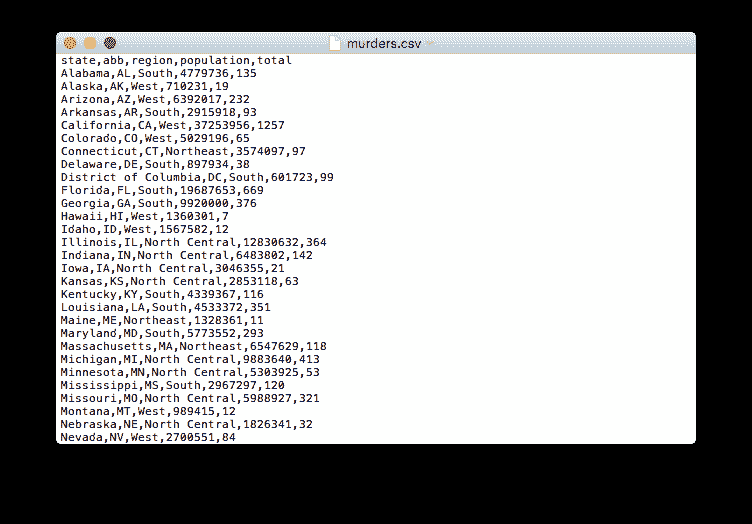

# 第五章 导入数据

> 原文：[`rafalab.dfci.harvard.edu/dsbook/importing-data.html`](https://rafalab.dfci.harvard.edu/dsbook/importing-data.html)

我们一直在使用已经存储为 R 对象的数 据 集合。数据科学家很少有这样的运气，他们必须将数据从文件、数据库或其他来源导入到 R 中。目前，存储和共享数据以供分析最常见的方式是通过电子表格。电子表格以行和列存储数据。它基本上是数据框的文件版本。当将此类表格保存到计算机文件时，需要一种方法来定义何时一行或一列结束，何时开始。这反过来又定义了存储单个值的单元格。

当使用文本文件创建电子表格时，例如使用简单的文本编辑器创建的文件，新行由回车定义，列由一些预定义的特殊字符分隔。最常用的字符是逗号（`,`）、分号（`;`）、空格（ ）和制表符（一个预设数量的空格或`\t`）。以下是一个逗号分隔文件的基本文本编辑器打开时的示例：



第一行包含列名而不是数据。我们称之为*标题*，当我们从电子表格中读取数据时，了解文件是否有标题很重要。大多数读取函数都假设有标题。要确定文件是否有标题，在尝试读取文件之前查看文件很有帮助。这可以通过文本编辑器或 RStudio 来完成。在 RStudio 中，我们可以通过在编辑器中打开文件或导航到文件位置，双击文件，然后点击*查看文件*来实现。

然而，并非所有电子表格文件都是文本格式。在浏览器上渲染的 Google Sheets 就是一个例子。另一个例子是 Microsoft Excel 使用的专有格式。这些不能用文本编辑器查看。尽管如此，由于 Microsoft Excel 软件的广泛使用，这种格式被广泛使用。

我们从描述文本（ASCII）、Unicode 和二进制文件之间的区别以及这如何影响我们导入它们的方式开始本章。然后我们解释文件路径和工作目录的概念，这些是理解如何有效地导入数据所必需的。然后我们介绍**readr**和**readxl**包以及可用于将电子表格导入 R 的函数。最后，我们提供了一些关于如何在文件中存储和组织数据的建议。更复杂的问题，如从网页或 PDF 文档中提取数据，留待本书的数据整理部分。

## 5.1 路径和工作目录

从电子表格导入数据的第一步是找到包含数据的文件。尽管我们不推荐这样做，但你也可以使用类似于在 Microsoft Excel 中打开文件的方法，通过点击 RStudio 的“文件”菜单，然后点击“导入数据集”，接着通过文件夹直到找到文件。我们希望能够编写代码而不是使用点击操作。为了完成这项工作，我们需要学习的关键概念在本书的“生产力工具”部分有详细描述。在这里，我们提供了一些基本概念的概述。

在这个第一步的主要挑战是我们需要让执行导入的 R 函数知道数据文件所在的位置。最简单的方法是将文件复制到导入函数默认查找的文件夹中。一旦这样做，我们只需要提供给导入函数文件名即可。

包含美国谋杀数据的电子表格作为 **dslabs** 包的一部分被包含在内。找到这个文件并不直接，但下面的代码行将文件复制到 R 默认查找的文件夹中。我们将在下面解释这些代码行是如何工作的。

```r
filename <- "murders.csv"
dir <- system.file("extdata", package = "dslabs") 
fullpath <- file.path(dir, filename)
file.copy(fullpath, "murders.csv")
```

这段代码并没有将数据读入 R，它只是复制了一个文件。但是一旦文件被复制，我们就可以用一行简单的代码导入数据。在这里，我们使用了来自 **readr** 包的 `read_csv` 函数，它是 tidyverse 的一部分。

```r
library(tidyverse)
dat <- read_csv(filename)
```

数据被导入并存储在 `dat` 中。本节的其余部分定义了一些重要概念，并概述了如何编写代码来告诉 R 如何找到我们想要导入的文件。第三十八章提供了更多关于这个主题的详细信息。

### 5.1.1 文件系统

你可以将你的计算机文件系统想象成一系列嵌套的文件夹，每个文件夹都包含其他文件夹和文件。数据科学家将文件夹称为*目录*。我们将包含所有其他文件夹的文件夹称为*根目录*。我们将我们当前所在的目录称为*工作目录*。因此，随着你通过文件夹移动，工作目录会发生变化：可以将其视为你的当前位置。

### 5.1.2 相对路径和完整路径

文件的*路径*是一系列目录名，可以将其视为点击文件夹的指令，以及找到文件的顺序。如果这些指令是从根目录开始查找文件，我们将其称为*完整路径*。如果指令是从工作目录开始查找文件，我们将其称为*相对路径*。第 38.3 节提供了更多关于这个主题的详细信息。

要查看你系统上的完整路径示例，请输入以下内容：

```r
system.file(package = "dslabs")
```

由斜杠分隔的字符串是目录名。第一个斜杠代表根目录，我们知道这是一个完整路径，因为它以斜杠开头。如果第一个目录名前面没有斜杠，那么路径被认为是相对的。我们可以使用 `list.files` 函数来查看相对路径的示例。

```r
dir <- system.file(package = "dslabs")
list.files(path = dir)
#>  [1] "data"        "DESCRIPTION" "extdata"     "help" 
#>  [5] "html"        "INDEX"       "Meta"        "NAMESPACE" 
#>  [9] "R"           "script"
```

这些相对路径给出了如果我们从包含完整路径的目录开始时，文件或目录的位置。例如，上面示例中 `help` 目录的完整路径是 `/Library/Frameworks/R.framework/Versions/3.5/Resources/library/dslabs/help`。

**注意**：你可能在日常数据分析工作中不会太多地使用 `system.file` 函数。我们在这个部分介绍它，因为它通过将它们包含在 **dslabs** 包中，方便了电子表格的共享。你很少会有数据包含在你已经安装的包中的奢侈。然而，你将经常需要导航完整和相对路径，并导入电子表格格式的数据。

### 5.1.3 工作目录

我们强烈建议在你的代码中只写相对路径。原因是完整路径对于你的计算机是唯一的，你希望你的代码是可移植的。你可以使用 `getwd` 函数获取工作目录的完整路径，而不需要明确写出。

```r
wd <- getwd()
```

如果你需要更改你的工作目录，你可以使用 `setwd` 函数，或者你可以通过在 RStudio 中点击“会话”来更改它。

### 5.1.4 生成路径名

上面给出的另一个获取完整路径而不明确写出的例子是在我们创建对象 `fullpath` 时：

```r
filename <- "murders.csv"
dir <- system.file("extdata", package = "dslabs") 
fullpath <- file.path(dir, filename)
```

`system.file` 函数提供了包含所有相关文件和目录的文件夹的完整路径，这些文件和目录由 `package` 参数指定的包指定。通过在 `dir` 中探索目录，我们发现 `extdata` 包含我们想要的文件：

```r
dir <- system.file(package = "dslabs") 
filename %in% list.files(file.path(dir, "extdata")) 
#> [1] TRUE
```

`system.file` 函数允许我们提供一个子目录作为第一个参数，因此我们可以这样获取 `extdata` 目录的完整路径：

```r
dir <- system.file("extdata", package = "dslabs") 
```

`file.path` 函数用于组合目录名，以生成我们想要导入的文件的完整路径。

```r
fullpath <- file.path(dir, filename)
```

### 5.1.5 使用路径复制文件

我们用来将文件复制到我们主目录中的最后一行代码使用了

`file.copy` 函数。这个函数接受两个参数：要复制的文件和在新目录中给它取的名字。

```r
file.copy(fullpath, "murders.csv")
#> [1] TRUE
```

如果文件复制成功，`file.copy` 函数返回 `TRUE`。注意，我们给文件取了相同的名字，`murders.csv`，但我们也可以给它取任何名字。另外，注意如果不以斜杠开头，R 会假设这是一个相对路径，并将文件复制到工作目录。

你应该能在你的工作目录中看到这个文件，并且可以通过以下方式进行检查：

```r
list.files()
```

## 5.2 readr 和 readxl 包

在本节中，我们介绍主要的 tidyverse 数据导入函数。我们将使用**dslabs**包提供的`murders.csv`文件作为示例。为了简化说明，我们将使用以下代码将文件复制到我们的工作目录：

```r
filename <- "murders.csv"
dir <- system.file("extdata", package = "dslabs") 
fullpath <- file.path(dir, filename)
file.copy(fullpath, "murders.csv")
```

### 5.2.1 readr

**readr**库包括将存储在文本文件电子表格中的数据读取到 R 中的函数。**readr**是**tidyverse**包的一部分，或者您可以直接加载它：

```r
library(readr)
```

以下函数可用于读取电子表格：

| 函数 | 格式 | 常见后缀 |
| --- | --- | --- |
| read_table | 空格分隔值 | txt |
| read_csv | 逗号分隔值 | csv |
| read_csv2 | 分号分隔值 | csv |
| read_tsv | 制表符分隔值 | tsv |
| read_delim | 通用文本文件格式，必须定义分隔符 | txt |

尽管后缀通常告诉我们文件类型，但并不能保证这些总是匹配。我们可以打开文件查看，或者使用`read_lines`函数查看几行：

```r
read_lines("murders.csv", n_max = 3)
#> [1] "state,abb,region,population,total"
#> [2] "Alabama,AL,South,4779736,135" 
#> [3] "Alaska,AK,West,710231,19"
```

这也表明存在标题。现在我们已准备好将数据读入 R。从.csv 后缀和文件预览中，我们知道应该使用`read_csv`：

```r
dat <- read_csv(filename)
#> Rows: 51 Columns: 5
#> ── Column specification ─────────────────
#> Delimiter: ","
#> chr (3): state, abb, region
#> dbl (2): population, total
#> 
#> ℹ Use `spec()` to retrieve the full column specification for this data.
#> ℹ Specify the column types or set `show_col_types = FALSE` to quiet this message.
```

注意，我们会收到一条消息，告知我们每列使用了哪些数据类型。还要注意，`dat`是一个`tibble`，而不仅仅是一个数据框。这是因为`read_csv`是一个**tidyverse**解析器。我们可以通过以下方式确认数据确实已被读取：

```r
View(dat)
```

最后，请注意，我们也可以使用文件的完整路径：

```r
dat <- read_csv(fullpath)
```

### 5.2.2 readxl

您可以使用以下方式加载**readxl**包：

```r
library(readxl)
```

该包提供了读取 Microsoft Excel 格式的函数：

| 函数 | 格式 | 常见后缀 |
| --- | --- | --- |
| read_excel | 自动检测格式 | xls, xlsx |
| read_xls | 原始格式 | xls |
| read_xlsx | 新格式 | xlsx |

Microsoft Excel 格式允许您在一个文件中拥有多个工作表。这些被称为*工作表*。上面列出的函数默认读取第一个工作表，但我们也可以读取其他工作表。`excel_sheets`函数给出了 Excel 文件中所有工作表的名称。然后，可以将这些名称传递给上面三个函数中的`sheet`参数，以读取除第一个工作表之外的工作表。

## 5.3 练习

1. 使用`read_csv`函数读取以下代码在`files`对象中保存的每个文件：

```r
path <- system.file("extdata", package = "dslabs")
files <- list.files(path)
files
```

2. 注意，最后一个文件`olive`给出了警告。这是因为文件的第一个列标题缺失。

读取`read_csv`的帮助文件以了解如何在不读取此标题的情况下读取文件。如果您跳过标题，则不应收到此警告。将结果保存到名为`dat`的对象中。

3. 前一种方法的问题是我们不知道列代表什么。输入：

```r
names(dat)
```

以查看名称是否具有信息性。

使用`readLines`函数读取第一行（我们稍后会学习如何从输出中提取值）。

## 5.4 文件下载

数据通常还存在于互联网上。当这些数据以文件形式存在时，我们可以下载它们，然后导入或甚至直接从网络读取。例如，我们注意到，因为我们的 **dslabs** 包位于 GitHub 上，所以与该包一起下载的文件有一个 URL：

```r
url <- "https://raw.githubusercontent.com/rafalab/dslabs/master/inst/
extdata/murders.csv"
```

`read_csv` 文件可以直接读取这些文件：

```r
dat <- read_csv(url)
```

如果你想要文件的本地副本，你可以使用 `download.file` 函数：

```r
download.file(url, "murders.csv")
```

这将下载文件并将其保存在你的系统上，文件名为 `murders.csv`。这里可以使用任何名称，不一定是 `murders.csv`。注意，当使用 `download.file` 时，你应该小心，因为它**会无警告地覆盖现有文件**。

在从互联网下载数据时，有时有用的两个函数是 `tempdir` 和 `tempfile`。第一个创建一个具有随机名称的目录，这个名称很可能独一无二。同样，`tempfile` 创建一个字符字符串，而不是文件，这个字符串很可能是一个独一无二的文件名。因此，你可以运行如下命令，一旦导入数据就会删除临时文件：

```r
tmp_filename <- tempfile()
download.file(url, tmp_filename)
dat <- read_csv(tmp_filename)
file.remove(tmp_filename)
```

## 5.5 R-base 导入函数

R-base 还提供了导入函数。这些函数的名称与 **tidyverse** 中的函数类似，例如 `read.table`、`read.csv` 和 `read.delim`。你可以使用以下方法获取一个类似 `dat` 的数据框：

```r
dat2 <- read.csv(filename)
```

一个经常有用的 R-base 导入函数是 `scan`，因为它提供了很多灵活性。在读取电子表格时，可能会出现很多问题。文件可能有多行标题，可能缺少单元格，或者它可能使用意外的编码¹³。我们建议你阅读这篇关于在此处发现的常见问题的帖子：[`www.joelonsoftware.com/2003/10/08/the-absolute-minimum-every-software-developer-absolutely-positively-must-know-about-unicode-and-character-sets-no-excuses/`](https://www.joelonsoftware.com/2003/10/08/the-absolute-minimum-every-software-developer-absolutely-positively-must-know-about-unicode-and-character-sets-no-excuses/)。

通过经验，你会学会如何处理不同的挑战。仔细阅读此处讨论的函数的帮助文件将很有用。使用 `scan`，你可以读取文件的每个单元格。以下是一个示例：

```r
path <- system.file("extdata", package = "dslabs")
filename <- "murders.csv"
x <- scan(file.path(path, filename), sep = ",", what = "c")
x[1:10]
#>  [1] "state"      "abb"        "region"     "population" "total" 
#>  [6] "Alabama"    "AL"         "South"      "4779736"    "135"
```

注意，tidyverse 提供了 `read_lines`，这是一个同样有用的函数。

## 5.6 文本文件与二进制文件

对于数据科学的目的，文件通常可以分为两大类：文本文件（也称为 ASCII 文件）和二进制文件。你已经处理过文本文件。你所有的 R 脚本都是文本文件，用于创建这本书的 R markdown 文件也是文本文件。你读取的 csv 表格也是文本文件。这些文件的一个大优点是我们可以很容易地“查看”它们，而无需购买任何特殊软件或遵循复杂的说明。任何文本编辑器都可以用来检查文本文件，包括免费编辑器，如 RStudio、记事本、textEdit、vi、emacs、nano 和 pico。为了验证这一点，尝试使用“打开文件”RStudio 工具打开一个 csv 文件。你应该能够在你的编辑器中看到内容。然而，如果你尝试打开，比如说，一个 Excel xls 文件、jpg 或 png 文件，你将无法立即看到任何有用的内容。这些都是二进制文件。Excel 文件实际上是包含几个文本文件的压缩文件夹。但这里的主要区别是文本文件可以很容易地检查。

虽然 R 包括读取广泛使用的二进制文件（如 xls 文件）的工具，但通常你将想要找到存储在文本文件中的数据集。同样，当共享数据时，你希望将其作为文本文件提供，只要存储不是问题（二进制文件在节省磁盘空间方面要高效得多）。一般来说，纯文本格式使得共享数据更容易，因为不需要商业软件来处理数据。

从存储为文本文件的电子表格中提取数据可能是将数据从文件带到 R 会话的最简单方法。不幸的是，电子表格并不总是可用，而且能够查看文本文件并不意味着从它们中提取数据将会简单。在本书的数据整理部分，我们学习了如何从更复杂的文本文件中提取数据，例如 html 文件。

## 5.7 Unicode 与 ASCII 的比较

数据科学中的一个陷阱是假设一个文件是 ASCII 文本文件，而实际上它可能是其他看起来很像 ASCII 文本文件的东西：Unicode 文本文件。

要理解这两者之间的区别，请记住，计算机上的所有内容最终都需要被转换成 0s 和 1s。ASCII 是一种**编码**，将字符映射到数字。ASCII 使用 7 位（0s 和 1s），这导致了\(2⁷ = 128\)个独特的项目，足以编码英语键盘上的所有字符。然而，其他语言使用 ASCII 编码中未包含的字符。例如，墨西哥的é字符就不是由 ASCII 编码的。因此，定义了一种新的编码，使用超过 7 位：Unicode。当使用 Unicode 时，可以选择 8 位、16 位和 32 位，分别简称为 UTF-8、UTF-16 和 UTF-32。RStudio 实际上默认使用 UTF-8 编码。

虽然我们在这里不详细介绍如何处理不同的编码，但了解这些不同的编码存在是很重要的，这样你就可以在遇到问题时更好地诊断问题。问题的一种表现方式是当你看到你未预期的“奇怪”字符时。这个 StackOverflow 讨论就是一个例子：[`stackoverflow.com/questions/18789330/r-on-windows-character-encoding-hell`](https://stackoverflow.com/questions/18789330/r-on-windows-character-encoding-hell)。

## 5.8 使用电子表格组织数据

虽然这本书几乎完全专注于数据分析，但数据管理也是数据科学的一个重要部分。正如引言中所述，我们不涉及这个主题。然而，数据分析师经常需要以最方便存储在电子表格中的方式收集数据，或者与他人一起收集数据。虽然我们强烈反对手动填写电子表格，但我们建议尽可能自动化这个过程，有时你不得不这样做。因此，在本节中，我们提供了一些关于如何在电子表格中组织数据的建议。尽管有一些 R 包可以读取 Microsoft Excel 电子表格，但我们通常想避免这种格式。相反，我们推荐使用 Google Sheets 作为免费的软件工具。以下是我们总结了 Karl Broman 和 Kara Woo 在论文中提出的建议¹⁴。请阅读这篇论文以获取重要细节。

+   **保持一致** - 在开始输入数据之前，制定一个计划。一旦有了计划，就要保持一致并坚持下去。

+   **为事物选择好的名称** - 你选择的物体、文件和目录的名称应该是容易记忆的、容易拼写的，并且具有描述性。实际上，这是一个很难达到的平衡，确实需要时间和思考。一个重要的规则是**不要使用空格**，使用下划线 `_` 或破折号 `-` 代替。此外，避免使用符号；坚持使用字母和数字。

+   **按 YYYY-MM-DD 格式写日期** - 为了避免混淆，我们强烈建议使用这个全球 ISO 8601 标准。

+   **不要留空单元格** - 填充所有单元格，并使用一些常见的代码来处理缺失数据。

+   **一个单元格只放一件事情** - 比起在一个单元格中放置多于一条信息，更好的做法是添加列来存储额外的信息。

+   **使其成为矩形** - 电子表格应该是矩形的。

+   **创建数据字典** - 如果你需要解释一些事情，比如列的含义或者分类变量的标签是什么，请在一个单独的文件中这样做。

+   **在原始数据文件中不要进行计算** - Excel 允许你进行计算。不要将这部分包含在你的电子表格中。计算代码应该在脚本中。

+   **不要使用字体颜色或高亮显示作为数据** - 大多数重要功能都无法导入这种信息。将此信息编码为变量代替。

+   **备份** - 定期备份你的数据。

+   **使用数据验证来避免错误** - 利用电子表格软件中的工具，使过程尽可能无错误且无重复性伤害。

+   **将数据保存为文本文件** - 以逗号或制表符分隔的格式保存文件以便分享。

## 5.9 练习

1. 选择你可以定期进行测量的一个指标。例如，你的每日体重或跑 5 英里所需的时间。制作一个包含日期、小时、测量值以及你认为值得保留的任何其他信息的电子表格。这样做两周。然后绘制图表。

* * *

1.  [`en.wikipedia.org/wiki/Character_encoding`](https://en.wikipedia.org/wiki/Character_encoding)↩︎

1.  [`www.tandfonline.com/doi/abs/10.1080/00031305.2017.1375989`](https://www.tandfonline.com/doi/abs/10.1080/00031305.2017.1375989)↩︎
