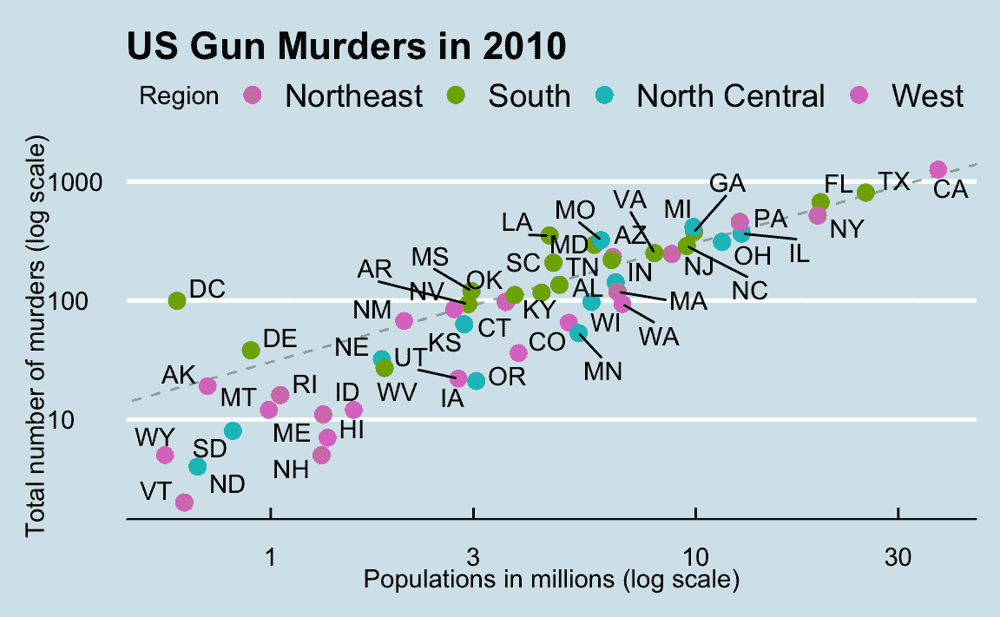
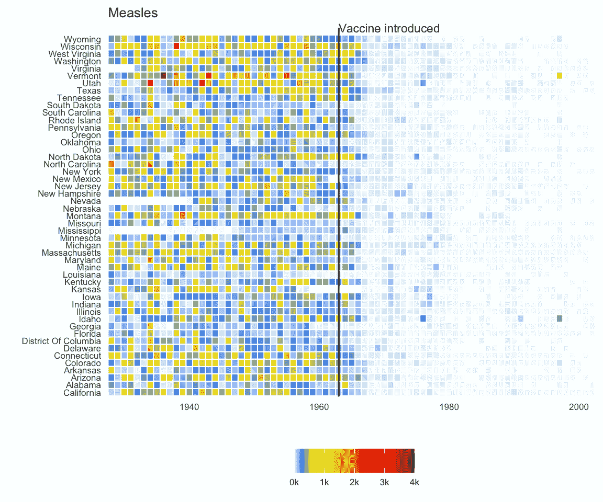
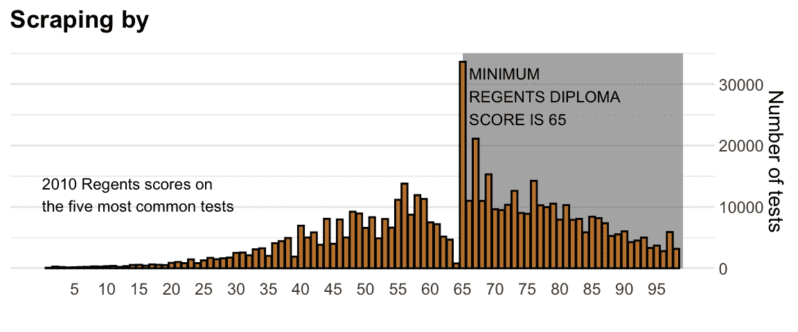
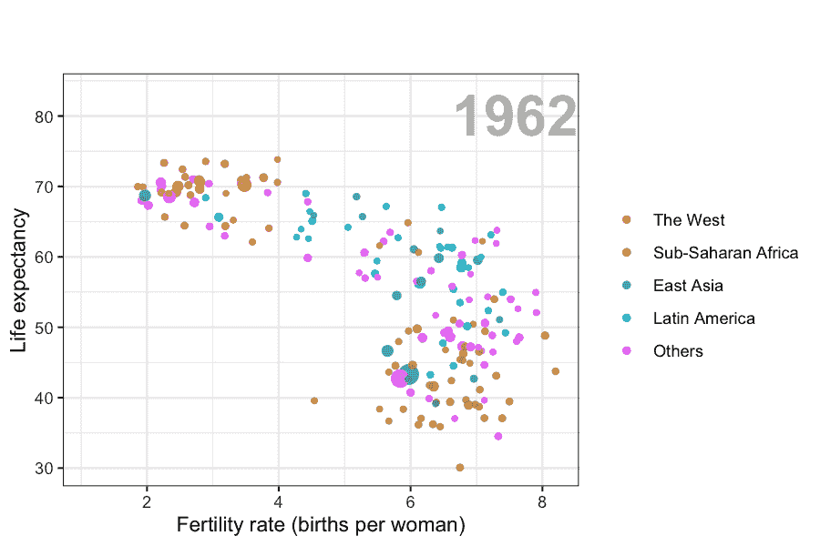

# 第七章 数据可视化简介

> 原文：[`rafalab.dfci.harvard.edu/dsbook/introduction-to-data-visualization.html`](https://rafalab.dfci.harvard.edu/dsbook/introduction-to-data-visualization.html)

看着定义数据集的数字和字符字符串通常很少有用。为了说服自己，打印并盯着美国谋杀数据表看看：

```r
library(dslabs)
data(murders)
head(murders)
#>        state abb region population total
#> 1    Alabama  AL  South    4779736   135
#> 2     Alaska  AK   West     710231    19
#> 3    Arizona  AZ   West    6392017   232
#> 4   Arkansas  AR  South    2915918    93
#> 5 California  CA   West   37253956  1257
#> 6   Colorado  CO   West    5029196    65
```

你从盯着这张表格中学到了什么？你有多快就能确定哪个州人口最多？哪个州人口最少？一个典型的州有多大？人口规模和总谋杀量之间有关系吗？国家各地区的谋杀率如何变化？对于大多数人类大脑来说，仅通过查看数字很难提取这些信息。相比之下，上述所有问题的答案都可以通过检查这个图表轻松获得：



我们想起了那句“一图胜千言”。数据可视化提供了一种强大的方式来传达数据驱动的发现。在某些情况下，可视化如此令人信服，以至于不需要进一步的分析。

信息丰富型数据集和软件工具的日益可用，导致许多行业、学术界和政府越来越多地依赖数据可视化。一个显著的例子是新闻机构，它们越来越多地采用*数据新闻学*，并将有效的*信息图表*作为其报道的一部分。

一个特别有效的例子是《华尔街日报》的一篇文章¹⁶，展示了疫苗对抗传染病影响的相关数据。其中一张图表显示了多年来按美国各州划分的麻疹病例，并用垂直线表示疫苗引入的时间。

```r
#> Warning: Using `size` aesthetic for lines was
#> deprecated in ggplot2 3.4.0.
#> ℹ Please use `linewidth` instead.
#> This warning is displayed once every 8
#> hours.
#> Call
#> `lifecycle::last_lifecycle_warnings()`
#> to see where this warning was generated.
```



另一个引人注目的例子来自《纽约时报》的图表¹⁷，总结了纽约市大学入学考试的成绩。正如文章¹⁸中描述的，这些成绩收集的原因包括确定学生是否从高中毕业。在纽约市，你需要 65 分才能及格。考试成绩的分布迫使我们注意到一些问题：



最常见的考试成绩是最低及格分数，很少有分数仅略低于及格线。这个意外的结果与即将及格的学生分数被提高是一致的。

这就是数据可视化如何导致发现，如果我们仅仅将数据提交给一系列数据分析工具或程序，这些发现可能会被遗漏。数据可视化是我们所说的*探索性数据分析*（EDA）中最强大的工具。约翰·W·图基¹⁹，被认为是 EDA 之父，曾说过，

> > “图片的最大价值在于它迫使我们注意到我们从未预料到看到的东西。”

许多广泛使用的数据分析工具都是通过 EDA（探索性数据分析）的发现而启动的。EDA 可能是数据分析中最重要的部分，但它往往被忽视。

数据可视化现在也普遍应用于慈善和教育组织。在《贫困的新视角²⁰》和《你见过的最佳统计数据²¹》的演讲中，汉斯·罗斯林通过一系列与全球健康和经济相关的图表，让我们注意到意外之处。在他的视频中，他使用动画图表向我们展示世界是如何变化的，以及旧叙事是如何不再真实的。



还需要注意的是，错误、偏差、系统性错误和其他意外问题往往会导致需要谨慎处理的数据。未能发现这些问题可能导致分析有缺陷和错误发现。例如，考虑测量设备有时会失败，而且大多数数据分析程序都没有设计来检测这些。然而，这些数据分析程序仍然会给出答案。仅仅从报告的结果中难以或无法察觉错误的事实使得数据可视化尤为重要。

在本书的这一部分，我们将通过三个具有启发性的例子来学习数据可视化和探索性数据分析的基础。我们将使用**ggplot2**包进行编码。为了学习最基本的内容，我们将从一个相对人为的例子开始：学生报告的身高。然后我们将涵盖上述两个例子：1）世界健康和经济以及 2）美国传染病趋势。

当然，数据可视化远不止我们在这里所涵盖的内容。以下是为那些希望了解更多信息的人提供的参考：

+   ER Tufte (1983) 《定量信息的视觉展示》。Graphics Press。

+   ER Tufte (1990) 《信息可视化》。Graphics Press。

+   ER Tufte (1997) 《视觉解释》。Graphics Press。

+   WS Cleveland (1993) 《数据可视化》。Hobart Press。

+   WS Cleveland (1994) 《数据图表元素》。CRC Press。

+   A Gelman, C Pasarica, R Dodhia (2002) 《让我们实践我们所宣扬的：将表格转换为图表》。《美国统计学家》56:121-130。

+   NB Robbins (2004) 《创建更有效的图表》。Wiley。

+   A Cairo (2013) 《功能艺术：信息图形和可视化的介绍》。New Riders。

+   N Yau (2013) 《数据点：有意义的可视化》。Wiley。

我们也没有涵盖交互式图形，这是一个对于本书来说过于高级的话题。以下是一些对那些有兴趣了解更多信息的人有用的资源：

+   [`shiny.rstudio.com/`](https://shiny.rstudio.com/)

+   [`d3js.org/`](https://d3js.org/)

* * *

1.  [`graphics.wsj.com/infectious-diseases-and-vaccines/?mc_cid=711ddeb86e`](http://graphics.wsj.com/infectious-diseases-and-vaccines/?mc_cid=711ddeb86e)↩︎

1.  [`graphics8.nytimes.com/images/2011/02/19/nyregion/19schoolsch/19schoolsch-popup.gif`](http://graphics8.nytimes.com/images/2011/02/19/nyregion/19schoolsch/19schoolsch-popup.gif)↩︎

1.  [`www.nytimes.com/2011/02/19/nyregion/19schools.html`](https://www.nytimes.com/2011/02/19/nyregion/19schools.html)↩︎

1.  [`en.wikipedia.org/wiki/John_Tukey`](https://en.wikipedia.org/wiki/John_Tukey)↩︎

1.  [`www.ted.com/talks/hans_rosling_reveals_new_insights_on_poverty?language=en`](https://www.ted.com/talks/hans_rosling_reveals_new_insights_on_poverty?language=en)↩︎

1.  [`www.ted.com/talks/hans_rosling_shows_the_best_stats_you_ve_ever_seen`](https://www.ted.com/talks/hans_rosling_shows_the_best_stats_you_ve_ever_seen)↩︎
