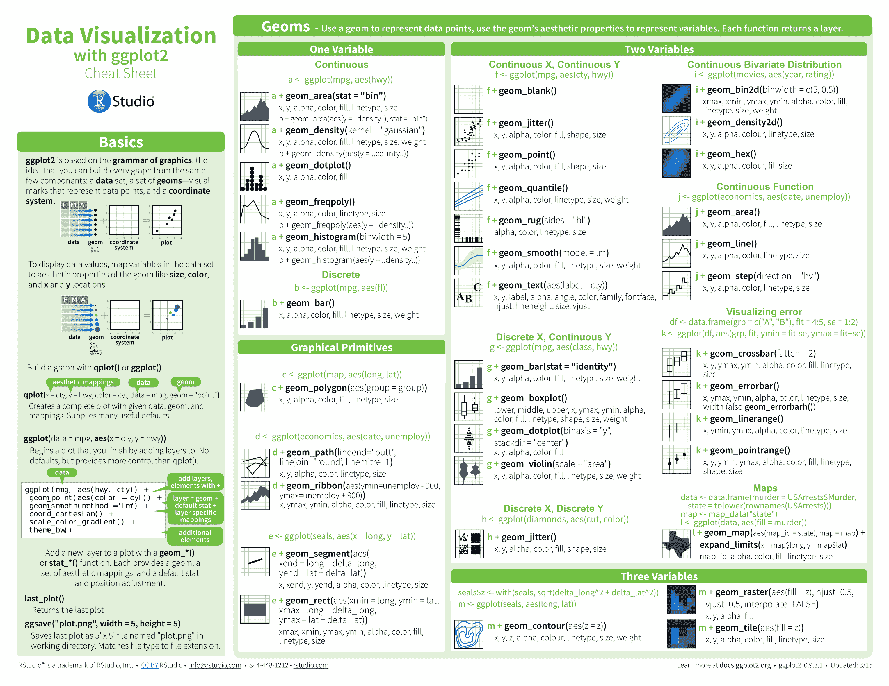
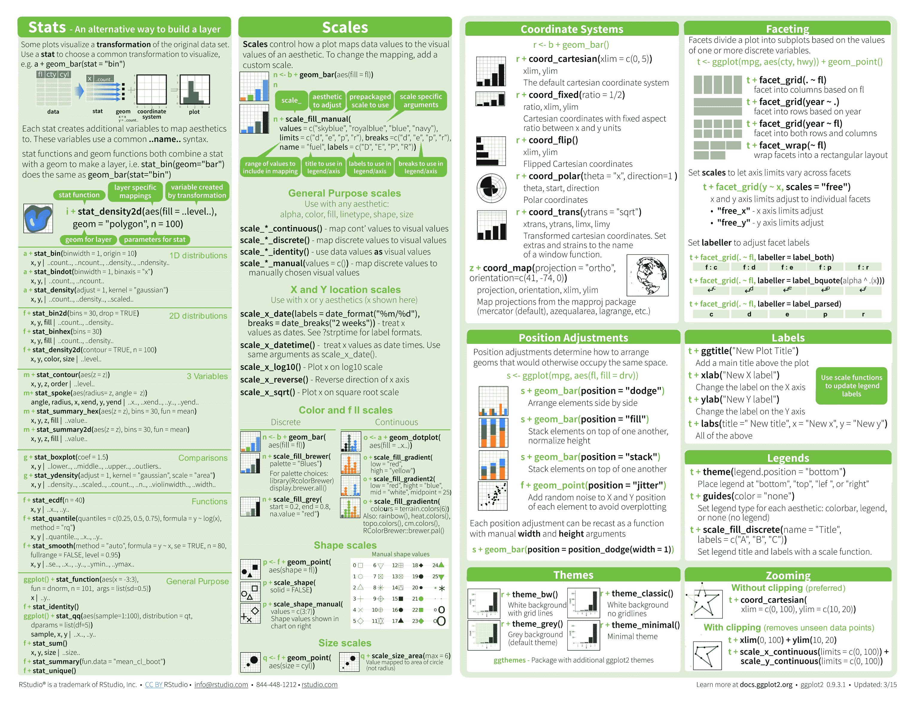
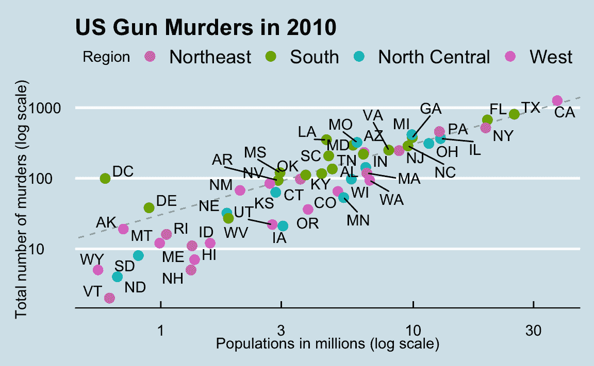
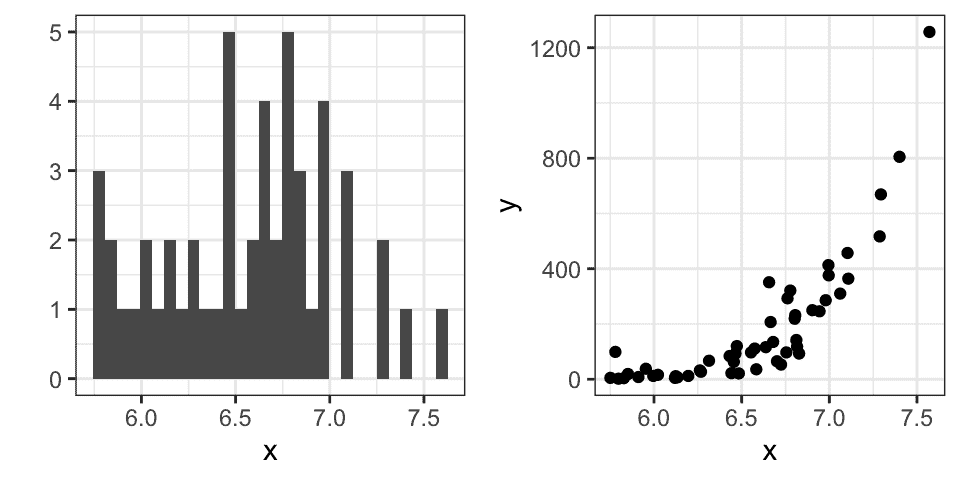

# 第八章 ggplot2

> 原文：[`rafalab.dfci.harvard.edu/dsbook/ggplot2.html`](https://rafalab.dfci.harvard.edu/dsbook/ggplot2.html)

探索性数据可视化可能是 R 的最大优势。人们可以快速从想法到数据再到图表，这种灵活性与易用性的独特平衡。例如，对于某些图表，Excel 可能比 R 更容易使用，但它的灵活性远远不如 R。D3.js 可能比 R 更灵活和强大，但生成图表需要更长的时间。

在整本书中，我们将使用**ggplot2**²²包创建图表。

```r
library(dplyr)
library(ggplot2)
```

R 中创建图表的许多其他方法都是可用的。实际上，R 的基本安装已经提供了相当强大的绘图功能。还有其他用于创建图形的包，如**grid**和**lattice**。我们选择在这本书中使用**ggplot2**，因为它以允许初学者使用直观且相对容易记忆的语法创建相对复杂且美观的图表的方式将图表分解成组件。

**ggplot2**对初学者来说通常更直观的一个原因是，它使用图形语法²³，即**ggplot2**中的*gg*。这类似于学习语法可以帮助初学者通过学习少量动词、名词和形容词来构建数百种不同的句子，而无需记住每个具体的句子。同样，通过学习少量**ggplot2**构建块及其语法，您将能够创建数百种不同的图表。

**ggplot2**对初学者来说容易的另一个原因是，它的默认行为是精心选择的，以满足大多数情况，并且视觉效果令人愉悦。因此，使用相对简单和可读的代码就可以创建信息丰富且优雅的图表。

一个限制是**ggplot2**设计为仅与整洁格式的数据表（其中行是观测值，列是变量）一起工作。然而，初学者使用的相当一部分数据集都是这种格式，或者可以转换成这种格式。这种方法的优点是，假设我们的数据是整洁的，**ggplot2**简化了绘图代码和多种图表的语法学习。

要使用**ggplot2**，您将不得不学习几个函数和参数。这些很难记住，所以我们强烈建议您手头备有 ggplot2 速查表。您可以在以下链接获取一份副本：[`www.rstudio.com/wp-content/uploads/2015/03/ggplot2-cheatsheet.pdf`](https://www.rstudio.com/wp-content/uploads/2015/03/ggplot2-cheatsheet.pdf)或者简单地在网上搜索“ggplot2 cheat sheet”。

## 8.1 图形的组成部分

我们将构建一个总结美国谋杀数据集的图表，看起来像这样：


我们可以清楚地看到各州在人口规模和谋杀总数上的差异。不出所料，我们还看到了谋杀总数和人口规模之间的明显关系。位于虚线灰色线上的州具有与美国平均相同的谋杀率。四个地理区域用颜色表示，这描绘了大多数南部州的谋杀率高于平均水平。

这份数据可视化几乎展示了数据表中所有的信息。制作这个图表所需的代码相对简单。我们将学习逐步创建图表。

学习**ggplot2**的第一步是能够将图表分解成组件。让我们分解上面的图表并介绍一些**ggplot2**术语。需要注意的主要三个组件是：

+   **数据**：正在汇总美国谋杀数据表。我们将其称为**数据**组件。

+   **几何形状**：上面的图表是一个散点图。这被称为**几何形状**组件。其他可能的几何形状包括条形图、直方图、平滑密度、QQ 图和箱线图。我们将在本书的数据可视化部分了解更多关于这些内容。

+   **美学映射**：该图表使用几个视觉线索来表示数据集提供的信息。在这个图表中，最重要的两个线索是 x 轴和 y 轴上的点位置，分别代表人口规模和谋杀总数。每个点代表一个不同的观察结果，我们将这些观察结果的数据映射到 x 和 y 刻度等视觉线索上。颜色是另一个映射到区域的视觉线索，我们将其称为**美学映射**组件。我们定义映射的方式取决于我们使用的**几何形状**。

我们还注意到：

+   点被标记为州简称。

+   x 轴和 y 轴的范围似乎由数据的范围定义。它们都使用对数刻度。

+   有标签、标题、图例，我们使用了《经济学人》杂志的风格。

我们现在将逐步构建这个图表。

我们首先加载数据集：

```r
library(dslabs)
data(murders)
```

## 8.2 `ggplot`对象

创建**ggplot2**图表的第一步是定义一个`ggplot`对象。我们使用`ggplot`函数来完成这个操作，该函数初始化图表。如果我们阅读这个函数的帮助文件，我们会看到第一个参数用于指定与该对象关联的数据：

```r
ggplot(data = murders)
```

我们也可以将数据作为第一个参数传入。所以这一行代码与上面的一行等价：

```r
murders |> ggplot()
```


它渲染了一个图表，在这种情况下是一个空白画布，因为没有定义几何形状。我们看到的唯一样式选择是灰色背景。

上面发生的事情是对象被创建，因为它没有被分配，所以它被自动评估。但我们可以将我们的图表分配给一个对象，例如像这样：

```r
p <- ggplot(data = murders)
class(p)
#> [1] "gg"     "ggplot"
```

要渲染与此对象关联的图表，我们只需打印对象 `p`。以下两行代码各自产生我们上面看到的相同图表：

```r
print(p)
p
```

## 8.3 几何形状

在 `ggplot2` 中，我们通过添加 *层* 来创建图表。层可以定义几何形状、计算汇总统计量、定义要使用的刻度，或者甚至更改样式。要添加层，我们使用符号 `+`。一般来说，一行代码将看起来像这样：

> > DATA |> `ggplot()` + LAYER 1 + LAYER 2 + … + LAYER N

通常，第一个添加的层定义了几何形状。我们想制作一个散点图。我们使用什么几何形状？

快速浏览一下速查表，我们可以看到用于创建这种几何图形的函数是 `geom_point`。



（图片由 RStudio 提供²⁴。CC-BY-4.0 许可证²⁵。）

几何函数名称遵循模式：`geom_X`，其中 X 是几何形状的名称。一些例子包括 `geom_point`、`geom_bar` 和 `geom_histogram`。

为了使 `geom_point` 正确运行，我们需要提供数据和映射。我们已将对象 `p` 与 `murders` 数据表连接起来，如果我们添加层 `geom_point`，它默认使用这些数据。要找出预期的映射，我们阅读 `geom_point` 帮助文件中的 **美学** 部分：

```r
> Aesthetics
> 
> geom_point understands the following aesthetics (required aesthetics are in bold):
>
> x
>
> y
> 
> alpha
>
> colour
```

如预期的那样，我们看到至少需要两个参数 `x` 和 `y`。

## 8.4 美学映射

**美学映射** 描述了数据属性如何与图表特征（如轴上的距离、大小或颜色）相关联。`aes` 函数通过定义美学映射将数据与我们在图表上看到的内容连接起来，将是您在绘图时最常使用的函数之一。`aes` 函数的结果通常用作几何函数的参数。此示例产生了一个总谋杀数与百万人口之间的散点图：

```r
murders |> ggplot() + 
 geom_point(aes(x = population/10⁶, y = total))
```

如果我们想省略 `x =` 和 `y =`，也是可以的，因为它们是前两个预期的参数，正如帮助页面中所示。

除了从头开始定义我们的图表外，我们还可以向上面定义的 `p` 对象添加一个层：

```r
p + geom_point(aes(population/10⁶, total))
```


添加此层时，刻度和标签默认定义。与 **dplyr** 函数一样，`aes` 也使用对象组件中的变量名称：我们可以使用 `population` 和 `total`，而无需将它们作为 `murders$population` 和 `murders$total` 调用。从数据组件中识别变量的行为对 `aes` 来说是相当具体的。在大多数函数中，如果您尝试在 `aes` 之外访问 `population` 或 `total` 的值，您将收到错误。

## 8.5 层

我们希望在图表中添加的第二层涉及为每个点添加标签以识别州。`geom_label` 和 `geom_text` 函数允许我们在有和无矩形背景的情况下将文本添加到图表中。

因为每个点（在这个例子中是每个状态）都有一个标签，我们需要一个美学映射来在点和标签之间建立联系。通过阅读帮助文件，我们了解到我们通过`aes`函数的`label`参数提供点与标签之间的映射。所以代码看起来是这样的：

```r
p + geom_point(aes(population/10⁶, total)) +
 geom_text(aes(population/10⁶, total, label = abb))
```


我们已经成功地为图表添加了第二层。

作为上述`aes`独特行为的例子，请注意以下调用：

```r
p_test <- p + geom_text(aes(population/10⁶, total, label = abb))
```

是可以的，而第二个调用：

```r
p_test <- p + geom_text(aes(population/10⁶, total), label = abb) 
```

将会给出错误，因为`abb`没有找到，因为它在`aes`函数之外。层`geom_text`不知道在哪里找到`abb`，因为它是一个列名，而不是全局变量。

### 8.5.1 参数调整

每个几何函数都有许多除了`aes`和`data`之外的参数。它们通常特定于该函数。例如，在我们想要制作的图表中，点的大小比默认大小要大。在帮助文件中我们看到`size`是一个美学参数，我们可以这样更改它：

```r
p + geom_point(aes(population/10⁶, total), size = 3) +
 geom_text(aes(population/10⁶, total, label = abb))
```


`size`不是一个映射：映射使用特定观察的数据，需要包含在`aes()`中，而我们要影响所有点相同方式的操作则不需要包含在`aes`中。

现在因为点变大了，标签就难以看到了。如果我们阅读`geom_text`的帮助文件，我们会看到`nudge_x`参数，它可以稍微将文本向右或向左移动：

```r
p + geom_point(aes(population/10⁶, total), size = 3) +
 geom_text(aes(population/10⁶, total, label = abb), nudge_x = 1.5)
```


这样做更易于阅读。在 8.11 节中，我们了解到一种更好的确保我们可以看到点和标签的方法。

## 8.6 全局与局部美学映射

在上一行代码中，我们定义了映射`aes(population/10⁶, total)`两次，一次在每个几何图形中。我们可以通过使用*全局*美学映射来避免这种情况。我们可以在定义空白`ggplot`对象时这样做。记住，`ggplot`函数包含一个允许我们定义美学映射的参数：

```r
args(ggplot)
#> function (data = NULL, mapping = aes(), ..., environment = parent.frame()) 
#> NULL
```

如果我们在`ggplot`中定义一个映射，所有作为层添加的几何图形都将默认使用此映射。我们重新定义`p`：

```r
p <- murders |> ggplot(aes(population/10⁶, total, label = abb))
```

然后我们可以简单地写下以下代码来生成之前的图表：

```r
p + geom_point(size = 3) + 
 geom_text(nudge_x = 1.5)
```

我们在`geom_point`和`geom_text`中保留了`size`和`nudge_x`参数，因为我们只想增加点的大小，并且只想微调标签。如果我们将这些参数放在`aes`中，那么它们将应用于两个图表。另外，请注意，`geom_point`函数不需要`label`参数，因此忽略了这个美学参数。

如果需要，我们可以在每个层内部定义一个新的映射来覆盖全局映射。这些*局部*定义会覆盖*全局*定义。以下是一个例子：

```r
p + geom_point(size = 3) + 
 geom_text(aes(x = 10, y = 800, label = "Hello there!"))
```


明显地，第二个`geom_text`调用没有使用`population`和`total`。

## 8.7 规模

首先，我们想要的尺度是对数尺度。这不是默认设置，因此这个更改需要通过一个 *scales* 层来添加。快速查看速查表显示 `scale_x_continuous` 函数让我们可以控制尺度的行为。我们像这样使用它们：

```r
p + geom_point(size = 3) + 
 geom_text(nudge_x = 0.05) + 
 scale_x_continuous(trans = "log10") +
 scale_y_continuous(trans = "log10") 
```


因为我们现在处于对数尺度，所以 *nudge* 必须更小。

这种特定的转换非常常见，因此 **ggplot2** 提供了专门的函数 `scale_x_log10` 和 `scale_y_log10`，我们可以用以下方式重写代码：

```r
p + geom_point(size = 3) + 
 geom_text(nudge_x = 0.05) + 
 scale_x_log10() +
 scale_y_log10() 
```

## 8.8 标签和标题

类似地，速查表迅速显示，要更改标签并添加标题，我们使用以下函数：

```r
p + geom_point(size = 3) + 
 geom_text(nudge_x = 0.05) + 
 scale_x_log10() +
 scale_y_log10() +
 xlab("Populations in millions (log scale)") + 
 ylab("Total number of murders (log scale)") +
 ggtitle("US Gun Murders in 2010")
```


我们几乎完成了！我们剩下要做的就是添加颜色、图例以及可选的样式更改。

## 8.9 类别作为颜色

我们可以使用 `geom_point` 函数中的 `col` 参数更改点的颜色。为了便于演示新功能，我们将重新定义 `p` 为除了点层之外的所有内容：

```r
p <-  murders |> ggplot(aes(population/10⁶, total, label = abb)) + 
 geom_text(nudge_x = 0.05) + 
 scale_x_log10() +
 scale_y_log10() +
 xlab("Populations in millions (log scale)") + 
 ylab("Total number of murders (log scale)") +
 ggtitle("US Gun Murders in 2010")
```

然后，通过添加不同的 `geom_point` 调用来测试会发生什么。我们可以通过添加 `color` 参数将所有点变为蓝色：

```r
p + geom_point(size = 3, color ="blue")
```


当然，这并不是我们想要的。我们想要根据地理区域分配颜色。**ggplot2** 的一个很好的默认行为是，如果我们将一个分类变量分配给颜色，它将自动为每个类别分配不同的颜色，并添加一个图例。

由于颜色的选择是由每个观察到的特征决定的，这是一个美学映射。为了将每个点映射到颜色，我们需要使用 `aes`。我们使用以下代码：

```r
p + geom_point(aes(col=region), size = 3)
```


`x` 和 `y` 映射是从 `p` 中继承的，因此我们不需要重新定义它们。我们还把 `aes` 移到第一个参数，因为在这个函数调用中期望映射在那里。

在这里，我们看到了另一种有用的默认行为：**ggplot2** 自动添加一个图例，将颜色映射到区域。为了避免添加这个图例，我们设置 `geom_point` 参数 `show.legend = FALSE`。

## 8.10 注释、形状和调整

我们经常想要向不是直接从美学映射中导出的图形添加形状或注释；例如，包括标签、框、阴影区域和线条。

在这里，我们想要添加一条代表整个国家平均谋杀率的线。一旦我们确定每百万的比率是 $r$，这条线就由以下公式定义：$y = r x$，其中 $y$ 和 $x$ 是我们的坐标轴：总谋杀数和百万人口，分别。在对数尺度上，这条线变成：$\log(y) = \log(r) + \log(x)$。因此，在我们的图表中，它是一条斜率为 1，截距为 $\log(r)$ 的线。为了计算这个值，我们使用我们的 **dplyr** 技能：

```r
r <- murders |> 
 summarize(rate = sum(total) /  sum(population) * 10⁶) |> 
 pull(rate)
```

要添加一行，我们使用`geom_abline`函数。**ggplot2**在名称中使用`ab`是为了提醒我们我们正在提供截距（`a`）和斜率（`b`）。默认线具有斜率 1 和截距 0，因此我们只需定义截距：

```r
p + geom_point(aes(col=region), size = 3) + 
 geom_abline(intercept = log10(r))
```


在这里，`geom_abline`没有使用数据对象中的任何信息。

我们可以使用参数更改线的类型和颜色。此外，我们首先绘制它，这样它就不会覆盖我们的点。

```r
p <- p + geom_abline(intercept = log10(r), lty = 2, color = "darkgrey") +
 geom_point(aes(col=region), size = 3) 
```

注意，我们已经重新定义了`p`并在此以及下一节中使用了这个新的`p`。

**ggplot2**创建的默认图表已经非常有用。然而，我们经常需要对默认行为进行微调。尽管即使有作弊表，这些调整也不总是显而易见，但**ggplot2**非常灵活。

例如，我们可以通过`scale_color_discrete`函数更改图例。在我们的图中，“区域”一词被大写，我们可以这样更改它：

```r
p <- p + scale_color_discrete(name = "Region") 
```

## 8.11 添加包

**ggplot2**的强大功能因附加包的可用性而进一步增强。为了给我们的图表添加最后的修饰，我们需要**ggthemes**和**ggrepel**包。

**ggplot2**图形的样式可以使用`theme`函数进行更改。**ggplot2**包中包含几个主题。事实上，对于本书中的大多数图表，我们使用**dslabs**包中的一个函数来自动设置默认主题：

```r
ds_theme_set()
```

**ggthemes**包添加了许多其他主题。其中之一是我们使用的`theme_economist`主题。安装包后，您可以通过添加一个类似这样的层来更改样式：

```r
library(ggthemes)
p + theme_economist()
```

您可以通过简单地更改函数来查看其他主题的外观。例如，您可能会尝试使用`theme_fivethirtyeight()`主题。

最终的区别在于标签的位置。在我们的图表中，一些标签重叠在一起。附加包**ggrepel**包含一个几何形状，在添加标签的同时确保它们不会重叠。我们只需将`geom_text`更改为`geom_text_repel`。

## 8.12 将所有内容组合在一起

现在我们完成了测试，我们可以编写一段代码，从头开始生成我们想要的图表。

```r
library(ggthemes)
library(ggrepel)

r <- murders |> 
 summarize(rate = sum(total) /  sum(population) * 10⁶) |>
 pull(rate)

murders |> ggplot(aes(population/10⁶, total, label = abb)) + 
 geom_abline(intercept = log10(r), lty = 2, color = "darkgrey") +
 geom_point(aes(col=region), size = 3) +
 geom_text_repel() + 
 scale_x_log10() +
 scale_y_log10() +
 xlab("Populations in millions (log scale)") + 
 ylab("Total number of murders (log scale)") +
 ggtitle("US Gun Murders in 2010") + 
 scale_color_discrete(name = "Region") +
 theme_economist()
```



## 8.13 使用`qplot`快速绘图

我们已经学习了使用 ggplot 生成可视化的强大方法。然而，有些情况下我们只想快速绘制，例如，一个向量的值的直方图，两个向量的值的散点图，或使用分类和数值向量的箱线图。我们展示了如何使用`hist`、`plot`和`boxplot`生成这些图表。然而，如果我们想与 ggplot 风格保持一致，我们可以使用`qplot`函数。

如果我们在两个向量中有值，比如说：

```r
data(murders)
x <- log10(murders$population)
y <- murders$total
```

如果我们想使用 ggplot 制作散点图，我们就必须输入类似以下的内容：

```r
data.frame(x = x, y = y) |> 
 ggplot(aes(x, y)) +
 geom_point()
```

这似乎为这样一个简单的图表编写了太多的代码。`qplot` 函数牺牲了 `ggplot` 方法提供的灵活性，但允许我们快速生成图表。

```r
qplot(x, y)
```

我们将在第 9.8 节中了解更多关于 `qplot` 的信息。

## 8.14 图表网格

经常会有理由将图表并排放置。`gridExtra` 包允许我们这样做：

```r
library(gridExtra)
p1 <- qplot(x)
p2 <- qplot(x,y)
grid.arrange(p1, p2, ncol = 2)
```



## 8.15 练习

首先，加载 **dplyr** 和 **ggplot2** 库以及 `murders` 和 `heights` 数据。

```r
library(dplyr)
library(ggplot2)
library(dslabs)
data(heights)
data(murders)
```

1. 使用 **ggplot2**，可以将图表保存为对象。例如，我们可以将数据集与图表对象关联起来，如下所示

```r
p <- ggplot(data = murders)
```

因为 `data` 是第一个参数，所以我们不需要明确写出。

```r
p <- ggplot(murders)
```

我们也可以使用管道：

```r
p <- murders |> ggplot()
```

对象 `p` 的类是什么？

2. 记住，要打印一个对象，可以使用 `print` 命令或简单地键入对象。打印第一题中定义的对象 `p` 并描述你所看到的。

1.  没有任何反应。

1.  一个空白图表。

1.  散点图。

1.  直方图。

3. 使用管道 `|>` 创建一个对象 `p`，但这次与 `heights` 数据集相关联，而不是 `murders` 数据集。

4. 你刚刚创建的对象 `p` 的类是什么？

5. 现在我们将添加一个层和相应的美学映射。对于谋杀数据，我们绘制了总谋杀数与人口规模的关系。探索 `murders` 数据框以提醒自己这两个变量的名称，并选择正确的答案。**提示**：查看 `?murders`。

1.  `state` 和 `abb`。

1.  `total_murders` 和 `population_size`。

1.  `total` 和 `population`。

1.  `murders` 和 `size`。

6. 要创建散点图，我们添加一个带有 `geom_point` 的层。美学映射要求我们分别定义 x 轴和 y 轴变量。所以代码看起来是这样的：

```r
murders |> ggplot(aes(x = , y = )) +
 geom_point()
```

除了我们必须定义两个变量 `x` 和 `y`。用正确的变量名填写。

7. 注意，如果我们不使用参数名称，我们可以确保以正确的顺序输入变量名称，从而获得相同的图表，如下所示：

```r
murders |> ggplot(aes(population, total)) +
 geom_point()
```

重新绘制图表，但现在将总数放在 x 轴上，人口放在 y 轴上。

8. 如果我们想添加文本而不是点，我们可以使用 `geom_text()` 或 `geom_label()` 几何体。以下代码

```r
murders |> ggplot(aes(population, total)) + geom_label()
```

将显示错误信息：`错误：geom_label 需要以下缺失的美学属性：label`

为什么会这样？

1.  我们需要通过 `aes` 中的标签参数将字符映射到每个点上。

1.  我们需要让 `geom_label` 知道在图中使用什么字符。

1.  `geom_label` 几何体不需要 x 轴和 y 轴值。

1.  `geom_label` 不是一个 ggplot2 命令。

9. 将上面的代码重写为使用缩写作为标签通过 `aes`

10. 将标签的颜色改为蓝色。我们将如何做到这一点？

1.  向 `murders` 添加一个名为 `blue` 的列。

1.  因为每个标签需要不同的颜色，所以我们通过 `aes` 映射颜色。

1.  在 `ggplot` 中使用 `color` 参数。

1.  因为我们想让所有颜色都是蓝色，所以我们不需要映射颜色，只需在`geom_label`中使用颜色参数即可。

11. 将上面的代码重写，使标签颜色为蓝色。

12. 现在假设我们想用颜色来表示不同的区域。在这种情况下，以下哪个选项最合适：

1.  在`murders`中添加一个名为`color`的列，使用我们想要的颜色。

1.  因为我们需要为每个标签指定不同的颜色，所以我们通过`aes`的颜色参数来映射颜色。

1.  在`ggplot`中使用`color`参数。

1.  因为我们想让所有颜色都是蓝色，所以我们不需要映射颜色，只需在`geom_label`中使用颜色参数即可。

13. 将上面的代码重写，使标签的颜色由州的区域决定。

14. 现在我们将把 x 轴改为对数尺度，以考虑到人口分布是偏斜的事实。让我们首先定义一个对象`p`，它包含我们到目前为止制作的图表。

```r
p <- murders |> 
 ggplot(aes(population, total, label = abb, color = region)) +
 geom_label() 
```

要将 y 轴改为对数尺度，我们学习了`scale_x_log10()`函数。将这一层添加到对象`p`中，以更改尺度并渲染图表。

15. 重复之前的练习，但现在将两个轴都改为对数尺度。

16. 现在编辑上面的代码，向图表添加标题“枪支谋杀数据”。提示：使用`ggtitle`函数。

* * *

1.  [`ggplot2.tidyverse.org/`](https://ggplot2.tidyverse.org/)↩︎

1.  [`www.springer.com/us/book/9780387245447`](http://www.springer.com/us/book/9780387245447)↩︎

1.  [`github.com/rstudio/cheatsheets`](https://github.com/rstudio/cheatsheets)↩︎

1.  [`github.com/rstudio/cheatsheets/blob/master/LICENSE`](https://github.com/rstudio/cheatsheets/blob/master/LICENSE)↩︎
