# 第九章 视觉化数据分布

> 原文：[`rafalab.dfci.harvard.edu/dsbook/dataviz-distributions.html`](https://rafalab.dfci.harvard.edu/dsbook/dataviz-distributions.html)

你可能已经注意到，数值数据通常用*平均值*来概括。例如，一所高中的质量有时可以用一个数字来概括：标准化测试的平均分数。偶尔，还会报告第二个数字：*标准差*。例如，你可能会看到一份报告说分数是 680 分加减 50 分（即标准差）。这份报告只用两个数字就概括了整个分数向量。这是否合适？我们只看这个总结而不是整个列表，是否遗漏了任何重要的信息？

我们的第一步数据可视化是学习总结因素列表或数值向量。通常，分享或探索这种总结的最佳方式是通过数据可视化。一组对象或数字的最基本的统计总结是其分布。一旦数据被总结为分布，就有几种数据可视化技术可以有效地传达这些信息。因此，深入理解分布的概念非常重要。

在本章中，我们首先讨论了各种分布的性质以及如何通过学生身高的激励示例来可视化分布。然后，在第九节 9.8 中，我们讨论了这些可视化所使用的**ggplot2**几何形状。

## 9.1 变量类型

主要的两种变量类型是*分类*和*数值*。每种类型都可以分为另外两组：分类变量可以是有序的或无序的，而数值变量可以是离散的或连续的。当数据集中的每个条目都来自少数几个组之一时，我们称这些数据为*分类数据*。两个简单的例子是性别（男或女）和美国地区（东北部、南部、北中部、西部）。一些分类数据即使不是数字本身也可以是有序的，例如辣度（温和、中等、辣）。在统计学教科书中，有序分类数据被称为*有序数据*。数值数据的例子包括人口规模、谋杀率和身高。一些数值数据可以被视为有序分类。我们可以进一步将数值数据分为连续和离散。连续变量是可以取任何值的变量，例如身高，如果测量足够精确的话。例如，一对双胞胎的身高可能分别是 68.12 英寸和 68.11 英寸。计数，如人口规模，是离散的，因为它们必须是整数。

请记住，离散数值数据可以被认为是有序的。虽然从技术上讲这是正确的，但我们通常将有序数据这个术语保留给属于少数几个不同组别的变量，每个组别都有许多成员。相比之下，当我们有许多组，每组案例很少时，我们通常将它们称为离散数值变量。因此，例如，一个人每天抽的香烟包数（四舍五入到最接近的包），会被认为是有序的，而实际抽的香烟数量则被认为是数值变量。但确实存在一些例子，在可视化数据时既可以被认为是数值的也可以是有序的。

在这里，我们专注于数值变量，因为可视化这种数据类型要复杂得多。然而，我们首先描述了分类数据的可视化与摘要方法。

## 9.2 案例研究：描述学生身高

我们引入一个新的激励问题。这是一个人为的问题，但它将帮助我们说明理解分布所需的概念。

假设我们必须向 ET 描述我们同学的身高，ET 是一个从未见过人类的地球外生物。作为第一步，我们需要收集数据。为此，我们要求学生报告他们的身高（以英寸为单位）。我们要求他们提供性别信息，因为我们知道存在两种不同的性别分布。我们收集了数据，并将其保存在`heights`数据框中：

```r
library(tidyverse)
library(dslabs)
data(heights)
```

向 ET 传达身高的一个方法就是简单地发送他这份 1050 个身高的列表。但还有更有效的方法来传达这些信息，而理解分布的概念将是关键。为了简化解释，我们首先关注男性身高。我们将在 9.6 节中检查女性身高数据。

## 9.3 分布

一系列对象或数字的最基本的统计摘要就是其 *分布*。思考分布的最简单方式就是将其视为一个对具有许多条目的列表的紧凑描述。这个概念对于本书的读者来说不应该陌生。例如，对于分类数据，分布仅仅描述了每个唯一类别的比例。在身高数据集中代表性别的是：

```r
#> 
#> Female   Male 
#>  0.227  0.773
```

这个包含两个类别的 *频率表* 是分布的最简单形式。我们实际上并不需要可视化它，因为一个数字就能描述我们所需要知道的一切：23% 是女性，其余是男性。当有更多类别时，一个简单的条形图就能描述分布。以下是一个关于美国州区域的例子：

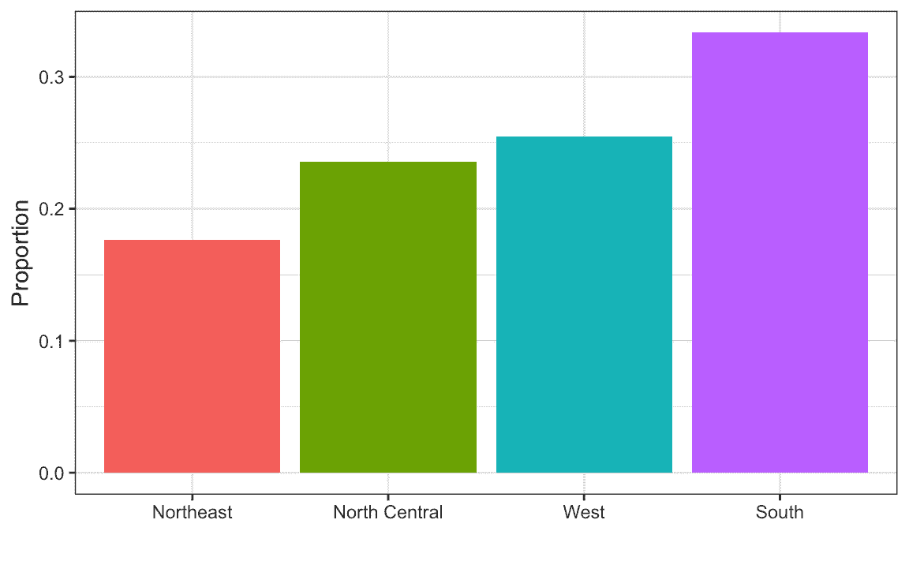

这个特定的图表仅仅展示了四个数字，每个类别一个。我们通常使用条形图来显示几个数字。尽管这个特定的图表本身并没有比频率表提供更多的洞察力，但它是我们如何将向量转换为一个简洁地总结向量中所有信息的图表的第一个例子。当数据是数值时，显示分布的任务更具挑战性。

### 9.3.1 直方图

非分类的数值数据也有分布。然而，通常情况下，当数据不是分类的时，报告每个条目的频率，就像我们对分类数据所做的那样，不是一个有效的总结，因为大多数条目是唯一的。例如，在我们的案例研究中，虽然有几个学生报告身高为 68 英寸，但只有一名学生报告身高为`68.503937007874`英寸，只有一名学生报告身高`68.8976377952756`英寸。我们假设他们分别从 174 厘米和 175 厘米转换而来。

统计学教材教导我们，对于数值数据定义分布的一个更有用的方法是定义一个函数，该函数报告所有可能的值$a$下数据的比例。这个函数被称为经验累积分布函数（eCDF），它可以被绘制出来，并提供了我们数据分布的完整描述。以下是男性学生身高的 eCDF：

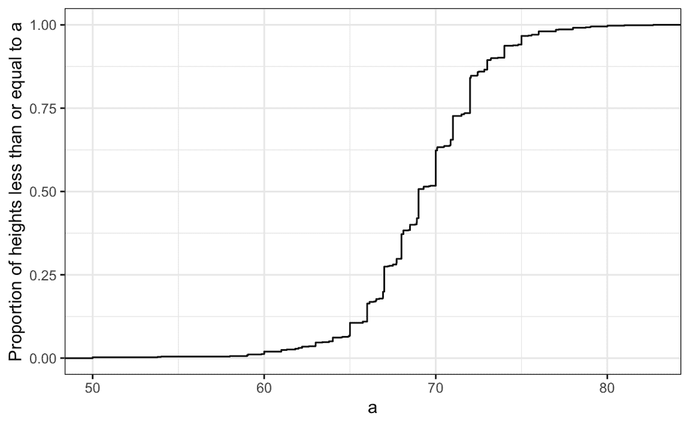

然而，通过绘制经验累积分布函数（eCDF）来总结数据实际上在实践上并不常见。主要原因在于它并不能轻易传达感兴趣的特性，例如：分布的中心值是多少？分布是对称的吗？哪些范围包含 95%的值？

*直方图*更受欢迎，因为它们极大地简化了回答此类问题。直方图牺牲了一点点信息，以产生更容易解释的图表。制作直方图的最简单方法是将我们的数据范围划分为相同大小的非重叠区间。然后，对于每个区间，我们计算落在该区间内的值的数量。直方图将这些计数作为条形图绘制出来，条形的底部由区间定义。以下是按一英寸间隔分割值范围的身高数据直方图：$(49.5, 50.5],(50.5, 51.5],(51.5,52.5],(52.5,53.5],...,(82.5,83.5]$

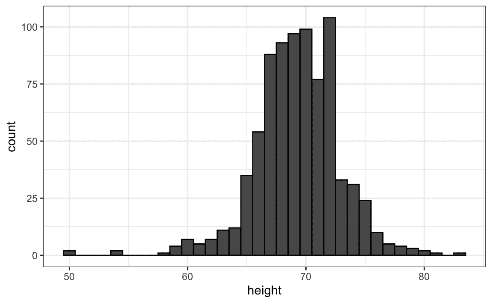

如上图所示，直方图类似于条形图，但不同之处在于 x 轴是数值的，而不是分类的。

如果我们将这个图发送给 ET，他将会立即了解我们数据的一些重要属性。首先，数据的范围是从 50 到 84 英寸，其中大多数（超过 95%）在 63 到 75 英寸之间。其次，身高在 69 英寸左右对称。此外，通过累计计数，ET 可以非常准确地获得任何区间内数据比例的良好近似。因此，上面的直方图不仅易于解释，而且通过大约 30 个柱状计数提供了大约 812 个原始身高列表中包含的所有信息。

我们失去了哪些信息？请注意，在计算柱状高度时，每个区间的所有值都被同等对待。例如，直方图无法区分 64 英寸、64.1 英寸和 64.2 英寸。鉴于这些差异几乎对肉眼不可见，其实际影响可以忽略不计，我们能够将数据总结为仅仅 23 个数字。

我们在 9.8 节中讨论了如何编码直方图。

### 9.3.2 平滑密度

*平滑密度图*传达的信息与直方图相同，但外观上更吸引人。以下是我们的身高数据的平滑密度图的样子：

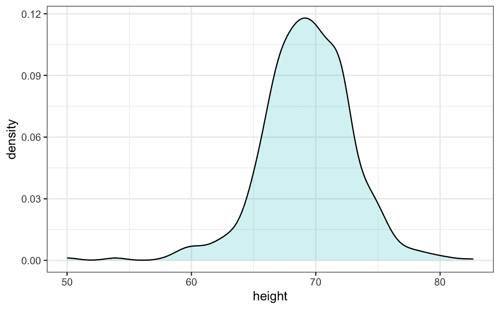

在这个图中，我们不再在区间边界有尖锐的边缘，许多局部峰值也被移除了。此外，y 轴的刻度从计数改为*密度*。为了完全理解平滑密度图，我们必须了解*估计*，这是一个我们稍后才会涉及的话题。在这里，我们只是简单地描述它们为通过直方图柱状顶部绘制曲线，然后移除柱状，使 y 轴上显示的值选择使得曲线下面积达到 1。这表明，对于任何区间，该区间曲线下的面积为我们提供了该区间内数据比例的近似。

在可视化方面，平滑密度图相对于直方图的一个优点是，密度图使得比较两个分布更容易。这在很大程度上是因为直方图的锯齿边缘增加了杂乱。以下是一个比较男性和女性身高的例子：

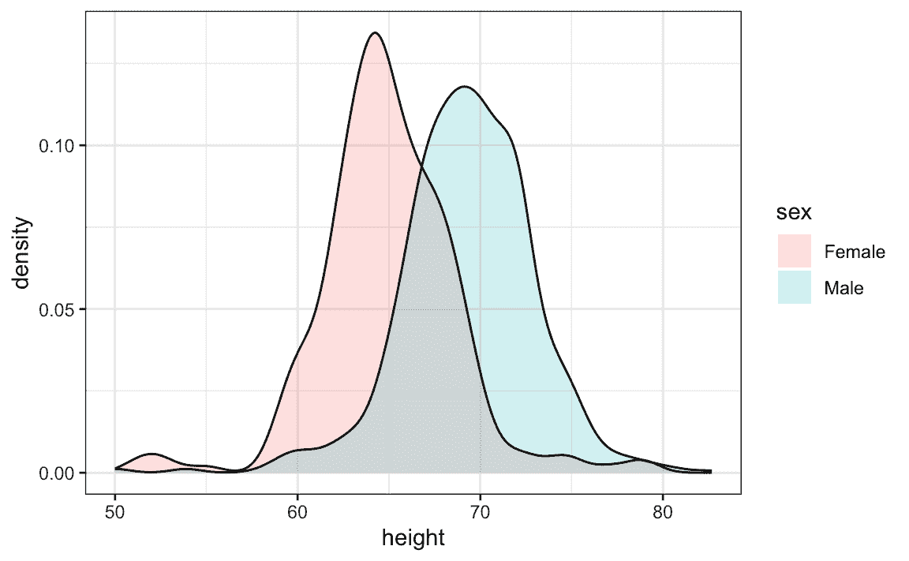

使用正确的参数，`ggplot`会自动用不同的颜色阴影相交的区域。我们将在 10 节以及 9.8 节中展示**ggplot2**代码的密度示例。

### 9.3.3 正态分布

直方图和密度图提供了对分布的优秀总结。但我们能否进一步总结？我们经常看到平均值和标准差被用作总结统计量：两个数字的总结！为了理解这些总结是什么以及为什么它们被广泛使用，我们需要了解正态分布。

正态分布，也称为钟形曲线和高斯分布。以下是正态分布的外观：

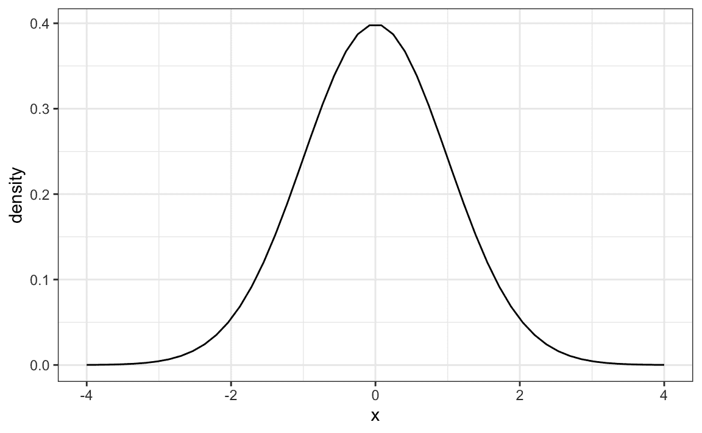

正态分布是历史上最著名的数学概念之一。一个原因是许多数据集的分布可以用正态分布来近似。这包括赌博收益、身高、体重、血压、标准化考试成绩和实验测量误差。统计教材提供了为什么是这样的解释。但是，同一个分布如何近似具有完全不同值范围的不同的数据集，例如身高和体重？正态分布的第二个重要特征是，它可以通过只调整两个数字来适应不同的数据集，这两个数字被称为 *平均值* 或 *均值* 和标准差（SD）。正态分布是对称的，以我们所说的平均值为中心，大多数值（大约 95%）都在平均值的 2 个标准差之内。上面的图显示了平均值为 0 和标准差为 1 的正态分布，通常称为 *标准正态分布*。请注意，由于只需要两个数字就可以将正态分布适应到数据集中，这意味着如果我们的数据分布被正态分布近似，描述分布所需的所有信息都可以编码在仅仅两个数字中。我们现在为任意数字列表定义这些值。

一旦我们确信我们的数据，比如说存储在向量 `x` 中，具有一个近似正态的分布，我们就可以通过将数据的平均值和标准差分别与正态分布的平均值和标准差相匹配，找到与我们的数据匹配的特定分布。对于一个向量 `x` 中包含的数字列表：

```r
index <- heights$sex == "Male"
x <- heights$height[index]
```

平均值定义为

```r
m <- sum(x) / length(x)
```

标准差定义为

```r
s <- sqrt(sum((x-mu)²) / length(x))
```

这可以解释为值与它们平均距离的平均值。

预建函数 `mean` 和 `sd`（注意，由于统计教材中解释的原因，`sd` 除以 `length(x)-1` 而不是 `length(x)`）可以在这里使用：

```r
m <- mean(x)
s <- sd(x)
c(average = m, sd = s)
#> average      sd 
#>   69.31    3.61
```

这里是一个平滑密度和均值为 69.3、标准差为 3.6 的正态分布的黑色线图，以及我们的学生身高平滑密度用蓝色表示：

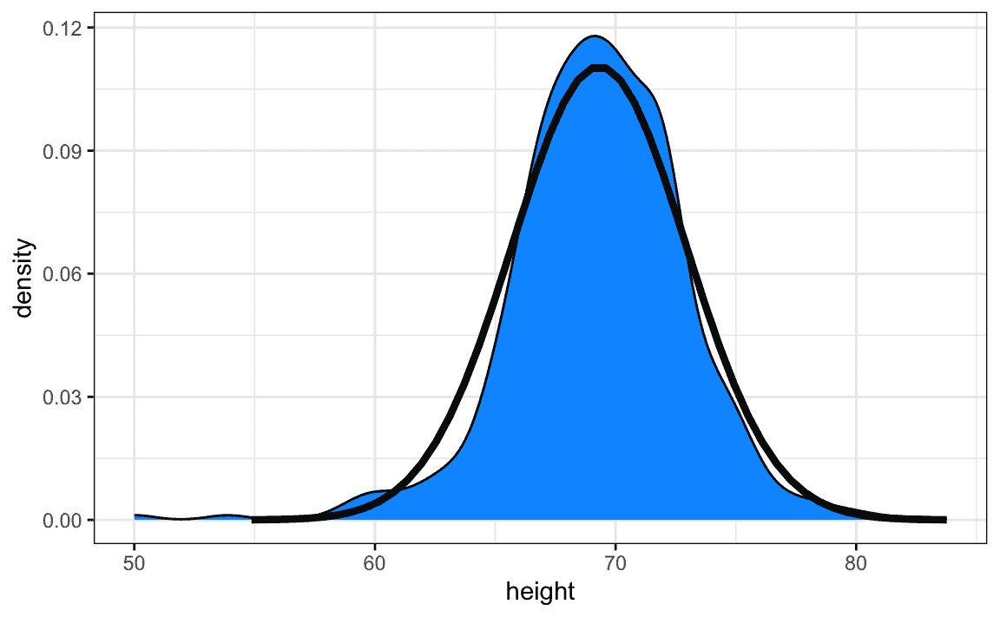

## 9.4 箱线图

要理解箱线图，我们需要定义一些在探索性数据分析中常用的术语。

*百分位数* 是对于 $p = 0.01, 0.02, ..., 0.99$ 的数据，其值小于或等于该值的值。例如，我们称 $p=0.10$ 的情况为第 10 百分位数，它给出了一个数据中有 10%低于的数值。最著名的百分位数是第 50 百分位数，也称为 *中位数*。另一个被赋予名称的特殊情况是 *四分位数*，当设置 $p=0.25,0.50$ 和 $0.75$ 时获得，这些在箱线图中被使用。

为了说明箱线图，我们将回到美国谋杀数据。假设我们想要总结谋杀率分布。使用我们学到的数据可视化技术，我们可以快速看到正态近似在这里不适用：

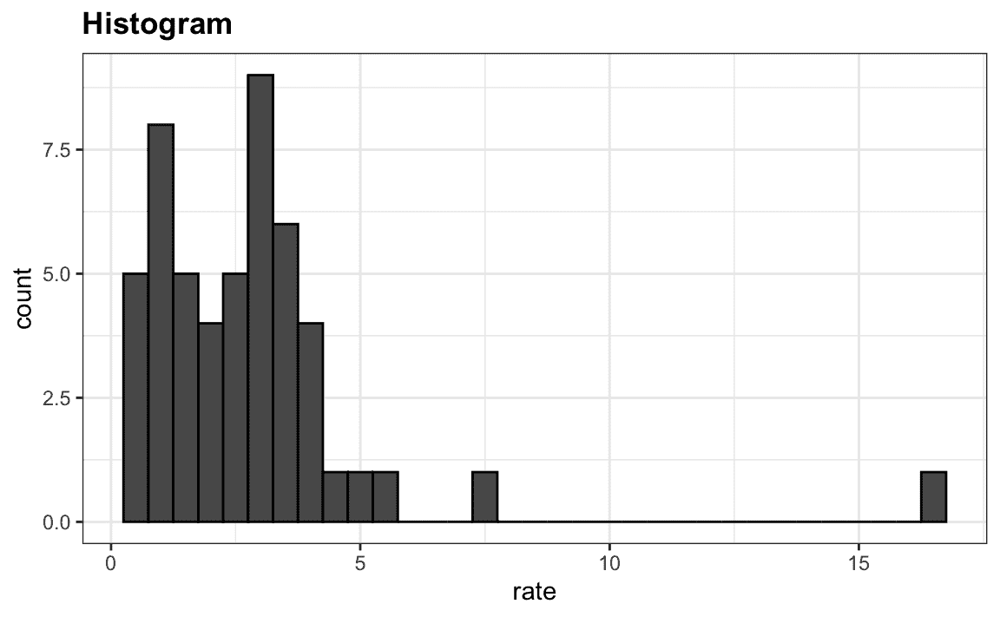

在这种情况下，上面的直方图或平滑密度图可以作为一个相对简洁的总结。

现在假设那些习惯于只接收两个数字作为总结的人要求我们提供一个更紧凑的数值总结。

*箱线图*提供了一个由范围以及*四分位数*（第 25、50 和 75 个百分位数）组成的五数总结。R 实现的箱线图在计算范围时忽略*异常值*，并将这些值作为独立点绘制。帮助文件提供了异常值的特定定义。箱线图将这些数字显示为“框”和“触须”。

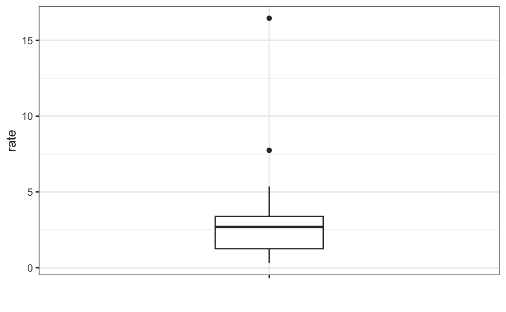

使用由 25%和 75%分位数定义的框和显示范围的触须。这两个点之间的距离称为*四分位距*。根据 R 的实现，这两个点是异常值。中位数用水平线表示。

从这张简单的图中，我们知道中位数大约是 2.5，分布不是对称的，对于大多数州（有两个例外），范围是 0 到 5。

我们在 9.8 节中讨论了如何制作箱线图。

## 9.5 分层

在数据分析中，我们通常根据与这些观察值相关的一个或多个变量的值将观察值分成组。例如，在下一节中，我们将身高值根据性别变量（女性和男性）分成组。我们称这种程序为*分层*，并将由此产生的组称为*层*。

分层在数据可视化中很常见，因为我们通常对变量在不同子组中的分布差异感兴趣。在本书的这一部分，我们将看到几个例子。

## 9.6 案例研究：描述学生身高（继续）

通过使用直方图、密度图和 QQ 图，我们确信男性身高数据可以用正态分布很好地近似。在这种情况下，我们向 ET 报告一个非常简洁的总结：男性身高遵循平均值为 69.3 英寸，标准差为 3.6 英寸的正态分布。有了这些信息，ET 将对他遇到我们的男性学生时可以期待什么有一个很好的了解。然而，为了提供一个完整的画面，我们还需要提供女性身高的总结。

我们了解到，当我们想要快速比较两个或多个分布时，箱线图是有用的。以下是男性和女性的身高：

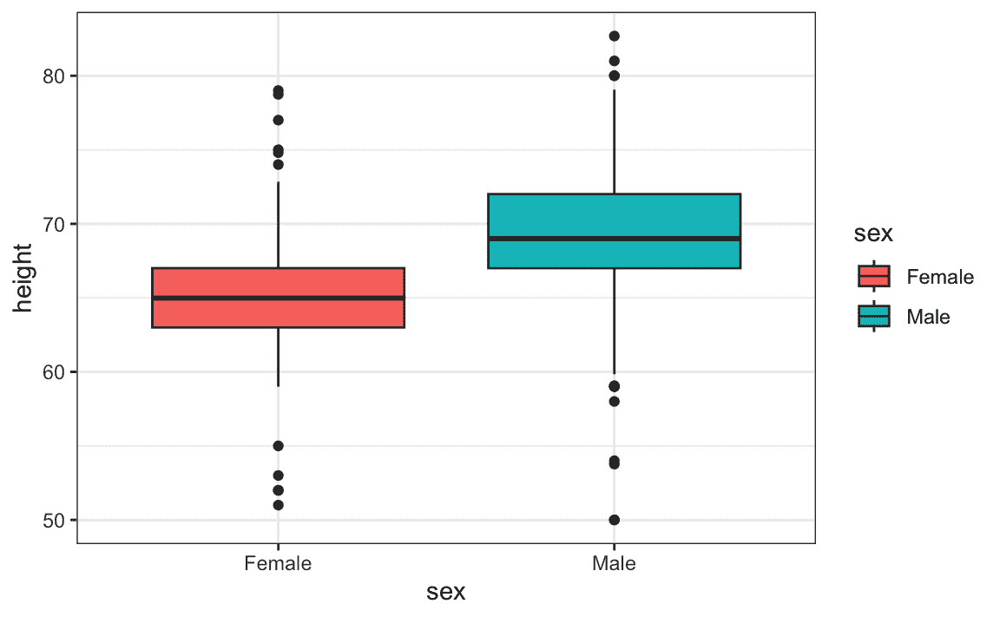

图表立即显示，男性平均身高高于女性。标准差看起来相似。但是，正态近似也适用于调查收集的女性身高数据吗？我们预计它们将遵循正态分布，就像男性一样。然而，探索性图表显示，这种近似并不那么有用：

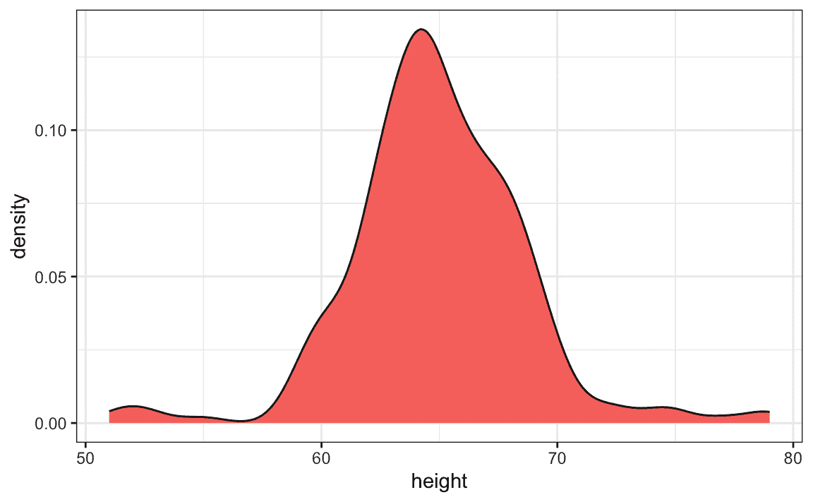

我们看到了在男性身上没有看到的情况：密度图有一个第二个“峰值”。此外，最高点往往比预期的正态分布的高度要高。在向 ET 汇报时，我们可能需要提供一个直方图，而不仅仅是女性身高的平均值和标准差。

然而，回顾一下图克的话。我们已经注意到了我们没有预料到看到的事情。如果我们查看其他女性身高分布，我们发现它们很好地被正态分布所近似。那么为什么我们的女学生不同？我们的班级是女性篮球队的要求吗？是否有小部分女性声称比实际身高更高？另一个可能更合理的解释是，在学生用来输入身高的形式中，`FEMALE` 是默认性别，一些男性输入了他们的身高，但忘记了更改性别变量。无论如何，数据可视化帮助我们发现了数据中可能存在的潜在缺陷。

关于前五个最小值，请注意这些值是：

```r
heights |> filter(sex == "Female") |> 
 top_n(5, desc(height)) |>
 pull(height)
#> [1] 51 53 55 52 52
```

因为这些是报告的身高，所以一个可能性是学生本意是想输入 `5'1"`、`5'2"`、`5'3"` 或 `5'5"`。

## 9.7 练习

1. 定义包含男性和女性身高的变量，如下所示：

```r
library(dslabs)
data(heights)
male <- heights$height[heights$sex == "Male"]
female <- heights$height[heights$sex == "Female"]
```

我们对每个的测量有多少？

2. 假设我们无法制作图表，而想并排比较分布。我们不能只是列出所有数字。相反，我们将查看百分位数。创建一个五行的表格，显示 `female_percentiles` 和 `male_percentiles`，包括每个性别的第 10、30、50、70 和 90 百分位数。然后创建一个数据框，将这两个作为列。

3. 研究以下按国家划分的人口规模的箱线图：

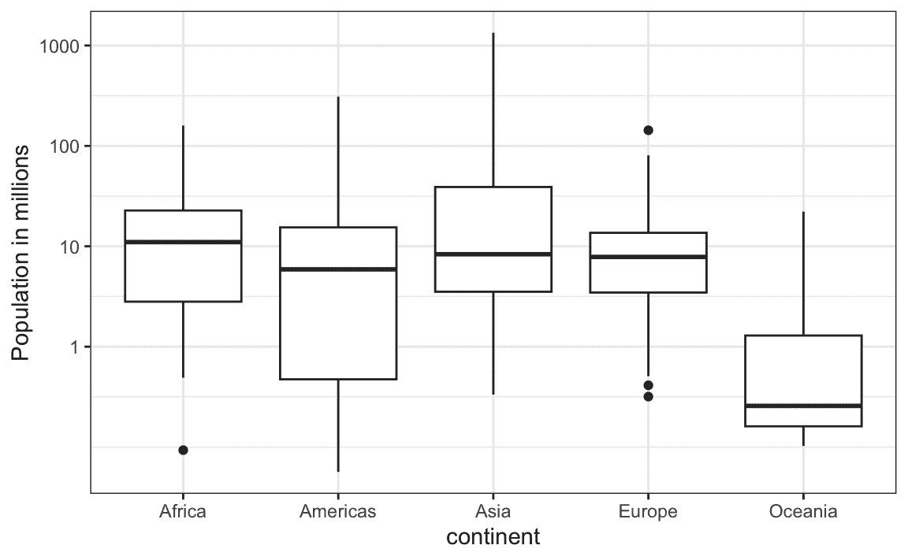

哪个大陆的国家人口规模最大？

4. 哪个大陆的中位人口规模最大？

5. 非洲的中位人口规模是多少（四舍五入到百万）？

6. 欧洲有多少比例的国家人口低于 1400 万？

1.  0.99

1.  0.75

1.  0.50

1.  0.25

7. 如果我们使用对数变换，上面显示的哪个大陆具有最大的四分位距？

8. 加载身高数据集，并创建一个只包含男性身高的向量 `x`：

```r
library(dslabs)
data(heights)
x <- heights$height[heights$sex=="Male"]
```

数据中在 69 英寸到 72 英寸（高于 69 英寸，但低于或等于 72 英寸）之间的比例是多少？提示：使用逻辑运算符和 `mean`。

## 9.8 ggplot2 几何形状

在第八章中，我们介绍了用于数据可视化的**ggplot2**包。在这里，我们演示如何生成与分布相关的图表，特别是本章前面展示的图表。

### 9.8.1 条形图

要生成条形图，我们可以使用`geom_bar`几何形状。默认情况下，是计算每个类别的数量并绘制条形。以下是美国地区的图表。

```r
murders |> ggplot(aes(region)) + geom_bar()
```


我们经常已经有一个我们想要以条形图形式展示的分布表格。以下是一个这样的表格示例：

```r
data(murders)
tab <- murders |> 
 count(region) |> 
 mutate(proportion = n/sum(n))
tab
#>          region  n proportion
#> 1     Northeast  9      0.176
#> 2         South 17      0.333
#> 3 North Central 12      0.235
#> 4          West 13      0.255
```

我们不再希望`geom_bar`计数，而是仅绘制由`proportion`变量提供的高度的条形图。为此，我们需要提供`x`（类别）和`y`（值），并使用`stat="identity"`选项。

```r
tab |> ggplot(aes(region, proportion)) + geom_bar(stat = "identity")
```

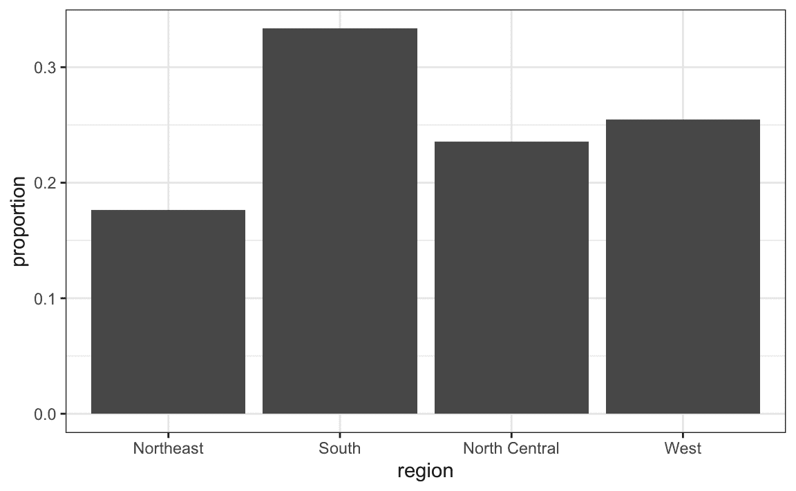

### 9.8.2 直方图

要生成直方图，我们使用`geom_histogram`。通过查看此函数的帮助文件，我们了解到唯一必需的参数是`x`，这是我们将要构建直方图的变量。我们省略了`x`，因为我们知道它是第一个参数。代码如下：

```r
heights |> 
 filter(sex == "Female") |> 
 ggplot(aes(height)) + 
 geom_histogram()
```

如果我们运行上面的代码，它会给我们一个消息：

> 使用`bins = 30`的`stat_bin()`。使用`binwidth`选择更好的值。

我们之前使用的是 1 英寸的箱尺寸，所以代码看起来像这样：

```r
heights |> 
 filter(sex == "Female") |> 
 ggplot(aes(height)) + 
 geom_histogram(binwidth = 1)
```

最后，如果我们出于美学原因想要添加颜色，我们使用帮助文件中描述的参数。我们还添加了标签和标题：

```r
heights |> 
 filter(sex == "Female") |> 
 ggplot(aes(height)) +
 geom_histogram(binwidth = 1, fill = "blue", col = "black") +
 xlab("Female heights in inches") + 
 ggtitle("Histogram")
```

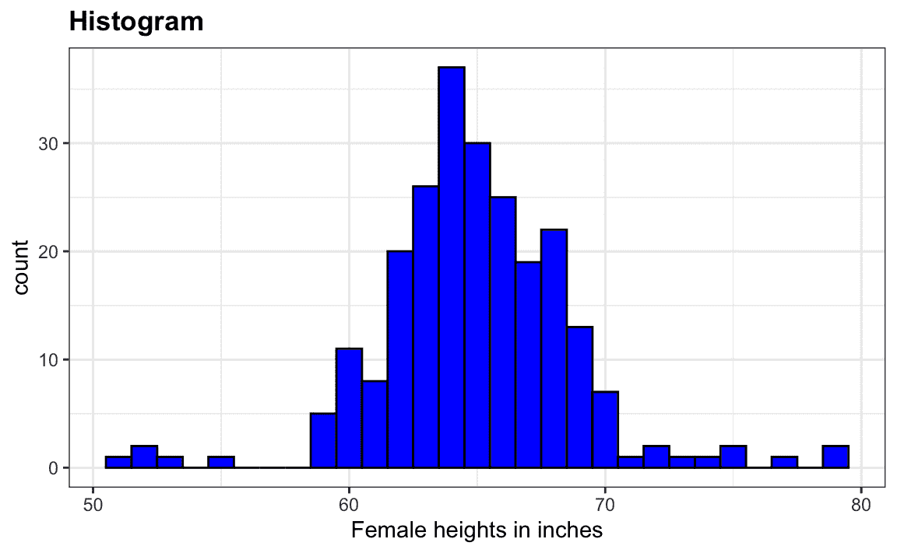

### 9.8.3 密度图

要创建平滑密度，我们使用`geom_density`。要使用之前作为直方图显示的数据创建平滑密度图，我们可以使用此代码：

```r
heights |> 
 filter(sex == "Female") |>
 ggplot(aes(height)) +
 geom_density()
```

为了填充颜色，我们可以使用`fill`参数。

```r
heights |> 
 filter(sex == "Female") |>
 ggplot(aes(height)) +
 geom_density(fill="blue")
```

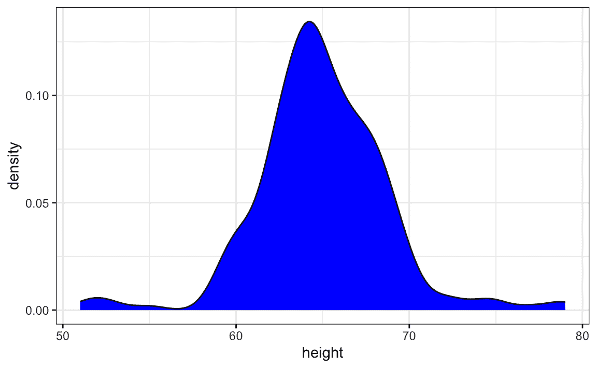

要改变密度的平滑度，我们使用`adjust`参数乘以默认值。例如，如果我们想带宽是两倍大，我们使用：

```r
heights |> 
 filter(sex == "Female") |>
 ggplot(aes(height)) +
 geom_density(fill="blue", adjust = 2)
```

### 9.8.4 箱线图

箱线图的几何形状是`geom_boxplot`。正如讨论的那样，箱线图用于比较分布。例如，下面是之前展示的女性身高，但与男性相比。对于这个几何形状，我们需要`x`作为类别，`y`作为值的参数。

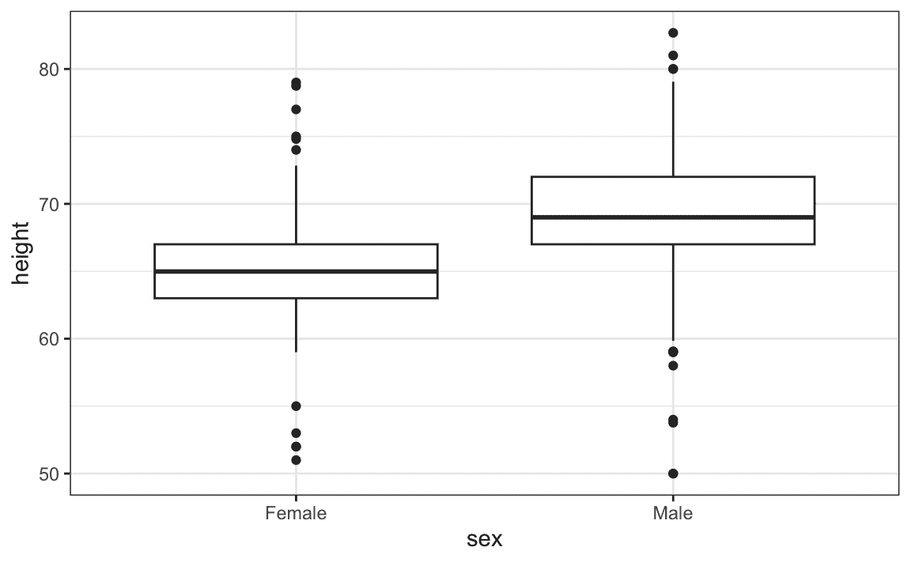

### 9.8.5 图片

本章描述的概念不需要图像，但我们在第 11.14 节中会使用图像，因此我们介绍用于创建图像的两个几何形状：**geom_tile**和**geom_raster**。它们的行为类似；要了解它们如何不同，请查阅帮助文件。要在**ggplot2**中创建图像，我们需要一个包含 x 和 y 坐标以及与每个这些坐标相关联的值的 DataFrame。这是一个 DataFrame。

```r
x <- expand.grid(x = 1:12, y = 1:10) |> 
 mutate(z = 1:120) 
```

注意，这是一个矩阵的整洁版本，`matrix(1:120, 12, 10)`。为了绘制图像，我们使用以下代码：

```r
x |> ggplot(aes(x, y, fill = z)) + 
 geom_raster()
```

使用这些图像时，你通常会想要更改颜色范围。这可以通过`scale_fill_gradientn`层来完成。

```r
x |> ggplot(aes(x, y, fill = z)) + 
 geom_raster() + 
 scale_fill_gradientn(colors =  terrain.colors(10))
```

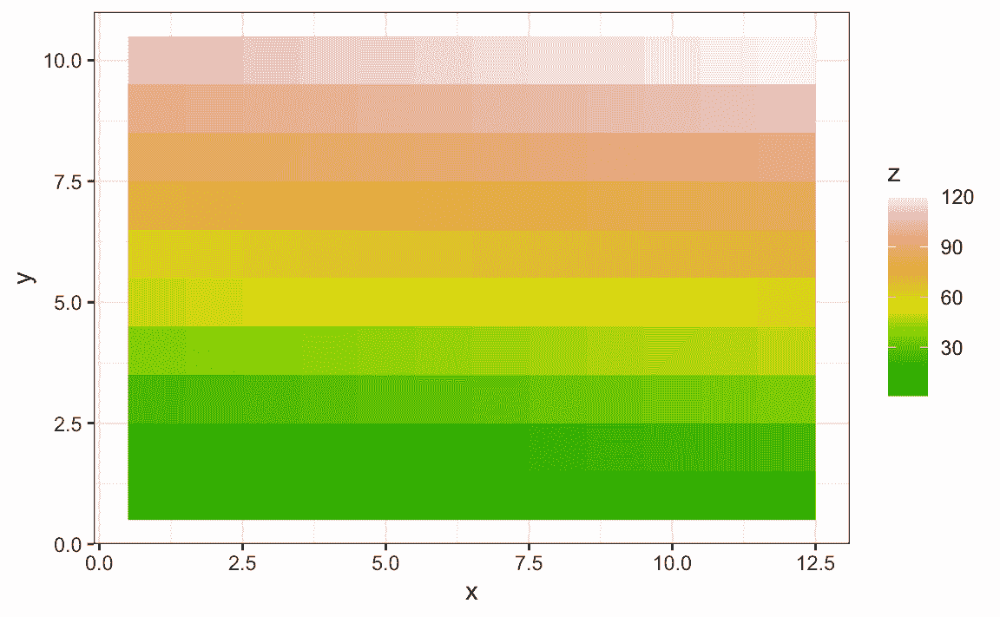

### 9.8.6 快速绘图

在第 8.13 节中，我们介绍了`qplot`作为在需要快速制作散点图时的有用函数。我们还可以使用`qplot`制作直方图、密度图、箱线图、QQ 图等。虽然它不提供`ggplot`级别的控制，但`qplot`确实非常有用，因为它允许我们用一小段代码制作图表。

假设我们有一个包含女性身高的对象`x`：

```r
x <- heights |> 
 filter(sex=="Male") |> 
 pull(height)
```

要快速制作直方图，我们可以使用：

```r
qplot(x)
```

函数猜测我们想要制作直方图，因为我们只提供了一个变量。在第 8.13 节中，我们看到了如果向`qplot`提供两个变量，它会自动制作散点图。

要快速制作 QQ 图，必须使用`sample`参数。注意，我们可以像使用`ggplot`一样添加层。

```r
qplot(sample = scale(x)) + geom_abline()
```

如果我们提供一个因子和一个数值向量，我们将获得下面的图表。注意，在下面的代码中，我们使用`data`参数。因为数据框不是`qplot`的第一个参数，我们必须使用点操作符。

```r
heights |> qplot(sex, height, data = .)
```

我们还可以通过使用`geom`参数选择特定的几何形状。因此，要将上面的图表转换为箱线图，我们使用以下代码：

```r
heights |> qplot(sex, height, data = ., geom = "boxplot")
```

我们还可以使用`geom`参数来生成密度图而不是直方图：

```r
qplot(x, geom = "density")
```

虽然不像`ggplot`那样灵活，但我们确实有一些方法可以改进`qplot`的结果。查看帮助文件，我们可以看到几种改进上述直方图外观的方法。以下是一个示例：

```r
qplot(x, bins=15, color = I("black"), xlab = "Population")
```

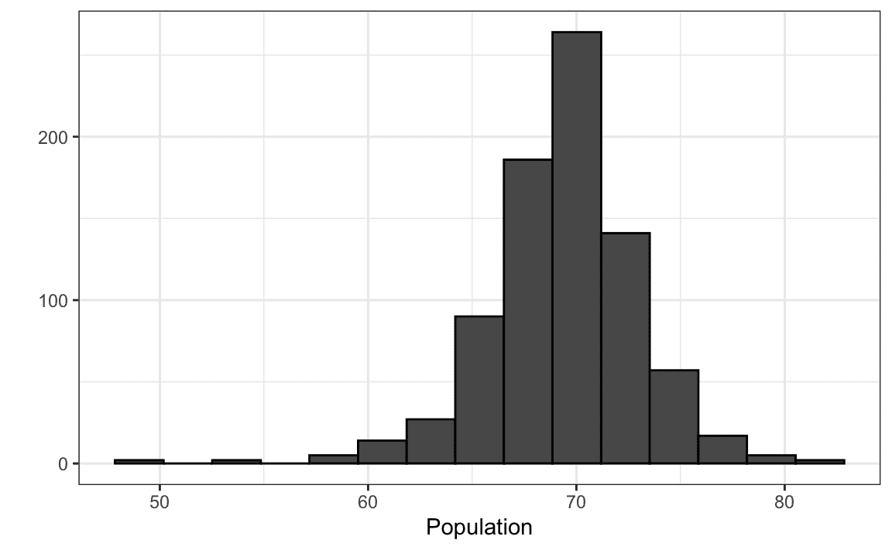

**技术备注**：我们使用`I("black")`的原因是我们希望`qplot`将`"black"`视为字符而不是将其转换为因子，这是`aes`中的默认行为，在这里内部调用。一般来说，函数`I`在 R 中用于表示“保持原样”。

## 9.9 练习

1. 现在我们将使用`geom_histogram`函数来制作`height`数据框中高度的直方图。在阅读该函数的文档时，我们看到它只需要一个映射，即用于直方图的值。制作所有图表的直方图。

包含身高的变量是什么？

1.  `sex`

1.  `heights`

1.  `height`

1.  `heights$height`

2. 现在创建一个 ggplot 对象，使用管道将高度数据分配给 ggplot 对象。通过`aes`函数将`height`分配给 x 值。

3. 现在我们准备添加一个层来实际制作直方图。使用上一个练习中创建的对象和`geom_histogram`函数来制作直方图。

4. 注意，当我们运行上一个练习中的代码时，我们得到警告：“`stat_bin()`使用`bins = 30`”。使用`binwidth`选择更好的值。`

使用`binwidth`参数将上一个练习中制作的直方图改为使用 1 英寸大小的箱。

5. 我们将不使用直方图，而是制作一个平滑的密度图。在这种情况下，我们不会创建一个对象，而是用一行代码来渲染图表。将之前用于制作直方图的代码中的几何形状更改为制作平滑密度图。

6. 现在我们将分别为男性和女性制作密度图。我们可以通过使用`group`参数来完成这个操作。我们通过美学映射分配组，因为每个点在执行估计密度的计算之前都需要分配到一个组。

7. 我们还可以通过`color`参数来分配组。这个额外的优点是它使用颜色来区分组。将上面的代码更改为使用颜色。

8. 我们还可以通过`fill`参数来分配组。这个额外的优点是它使用颜色来区分组，如下所示：

```r
heights |> 
 ggplot(aes(height, fill = sex)) + 
 geom_density() 
```

然而，在这里第二个密度图是覆盖在第一个之上的。我们可以通过使用透明度混合来增加曲线的可见性。在`geom_density`函数中将 alpha 参数设置为 0.2 以实现这一变化。
