# 第十一章 数据可视化原则

> [`rafalab.dfci.harvard.edu/dsbook/data-visualization-principles.html`](https://rafalab.dfci.harvard.edu/dsbook/data-visualization-principles.html)

我们在创建示例图表时已经提供了一些遵循的规则。在这里，我们的目标是提供一些可以作为有效数据可视化指南的一般原则。本节的大部分内容基于 Karl Broman³⁰的演讲，标题为“创建有效的图表和表格”³¹，其中包括 Karl 在他的 GitHub 仓库³²上提供的代码制作的某些图表，以及 Peter Aldhous 的数据可视化导论课程³³的课堂笔记。遵循 Karl 的方法，我们展示了我们应该避免的绘图风格的一些示例，解释了如何改进它们，并以此作为原则列表的动机。我们比较了遵循这些原则的图表和不遵循的图表。

这些原则主要基于与人类检测模式和进行视觉比较相关的研究。首选的方法是那些最能符合我们大脑处理视觉信息的方式的方法。在决定可视化方法时，也要牢记我们的目标。我们可能是在比较可观察的数量、描述类别或数值的分布、比较两组数据或描述两个变量之间的关系。最后，我们想强调，对于数据科学家来说，根据受众调整和优化图表非常重要。例如，为我们自己制作的探索性图表将不同于旨在向普通受众传达发现的图表。

我们将使用以下库：

```r
library(tidyverse)
library(dslabs)
library(gridExtra)
```

## 11.1 使用视觉线索编码数据

我们首先描述一些用于编码数据的原理。我们有几种方法可供选择，包括位置、对齐长度、角度、面积、亮度和颜色色调。

为了说明这些策略的一些比较，让我们假设我们想要报告关于浏览器偏好的一些假设性调查结果，这些调查分别在 2000 年和 2015 年进行。对于每一年，我们只是比较五个数量——五个百分比。百分比的一个广泛使用的图形表示方法是饼图，由微软 Excel 普及：

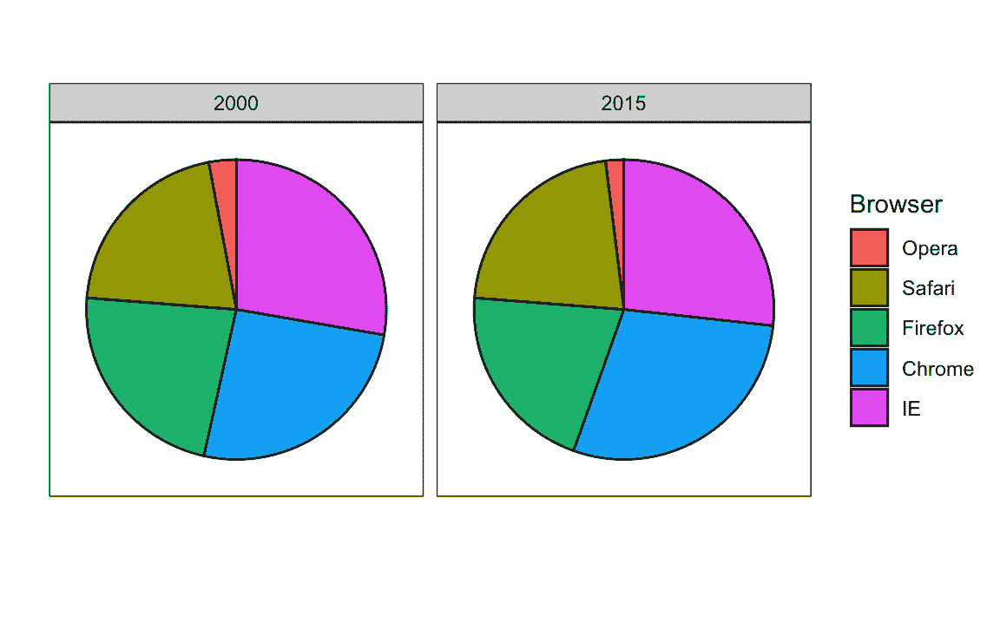

在这里，我们使用面积和角度来表示数量，因为每个饼图的角和面积都与它所代表的数量成比例。事实证明，这是一个次优选择，因为正如感知研究所示，人类在精确量化角度方面并不擅长，当面积是唯一可用的视觉线索时，情况更糟。环形图是一个仅使用面积的图表示例：

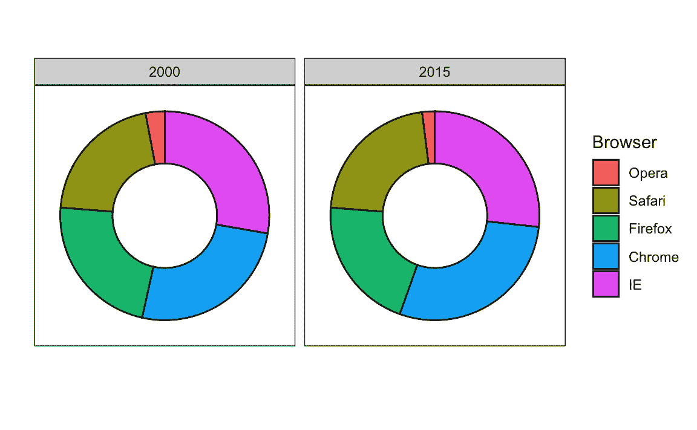

要了解量化角度和面积有多困难，请注意，上述图表中的排名和所有百分比从 2000 年到 2015 年都发生了变化。你能确定实际的百分比并对浏览器的流行度进行排名吗？你能看到百分比从 2000 年到 2015 年的变化吗？从图表中很难看出。事实上，`pie` R 函数的帮助文件中提到：

> 饼图是展示信息的一种非常糟糕的方式。眼睛擅长判断线性度量，而不擅长判断相对面积。条形图或点状图是展示这类数据的更好方式。

在这种情况下，仅仅显示数字不仅更清晰，如果打印纸质副本，还会节省印刷成本：

| Browser | 2000 | 2015 |
| --- | --- | --- |
| Opera | 3 | 2 |
| Safari | 21 | 22 |
| Firefox | 23 | 21 |
| Chrome | 26 | 29 |
| IE | 28 | 27 |

展示这些数量时，使用长度和位置作为视觉线索是首选的，因为人类在判断线性度量方面要好得多。条形图通过使用与感兴趣的数量成比例长度的条形来实现这一点。通过在战略性地选择的位置添加水平线，在这种情况下是每 10 的倍数，我们通过条形顶部的位置减轻了量化的视觉负担。比较和对比我们可以从两个图表中提取的信息。

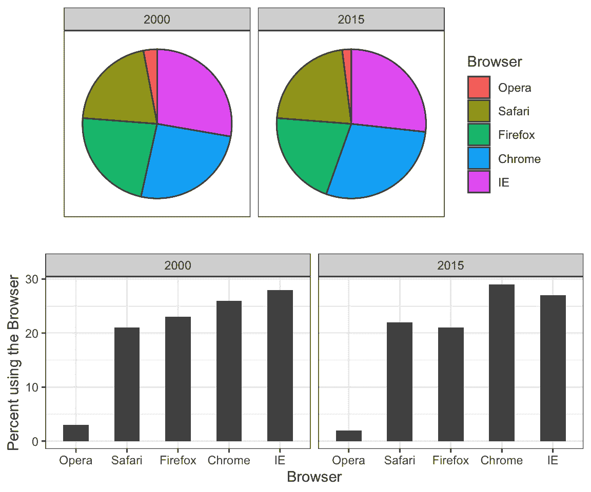

注意观察条形图中的差异有多么容易看出。实际上，我们现在可以通过沿着水平线到 x 轴的方向来确定实际的百分比。

如果出于某种原因你需要制作饼图，请为每个饼图切片标注其相应的百分比，这样观众就不必从角度或面积中推断它们：

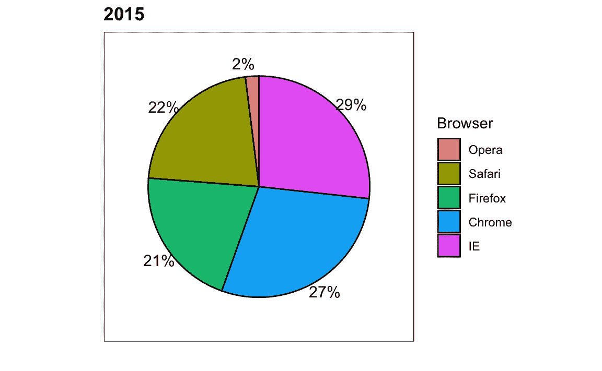

通常，在展示数量时，位置和长度比角度和/或面积更受欢迎。亮度和颜色比角度更难以量化。但正如我们稍后将会看到的，当必须同时显示超过两个维度时，它们有时是有用的。

## 11.2 知道何时包含 0

在使用条形图时，如果不从 0 开始绘制条形，这是误导性的。这是因为，通过使用条形图，我们暗示长度与显示的数量成比例。通过避免 0，相对较小的差异可以显得比实际上大得多。这种方法通常被政治家或媒体机构用来夸大差异。以下是由 Peter Aldhous 在本讲座中使用的说明性示例：[`paldhous.github.io/ucb/2016/dataviz/week2.html`](http://paldhous.github.io/ucb/2016/dataviz/week2.html)。

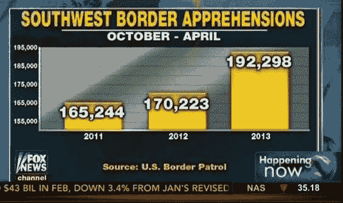

(来源：Fox News，via Media Matters³⁴。)

从上面的图表来看，当实际上只增加了大约 16%时，担忧几乎增加了三倍。从 0 开始绘制图表可以清楚地说明这一点：

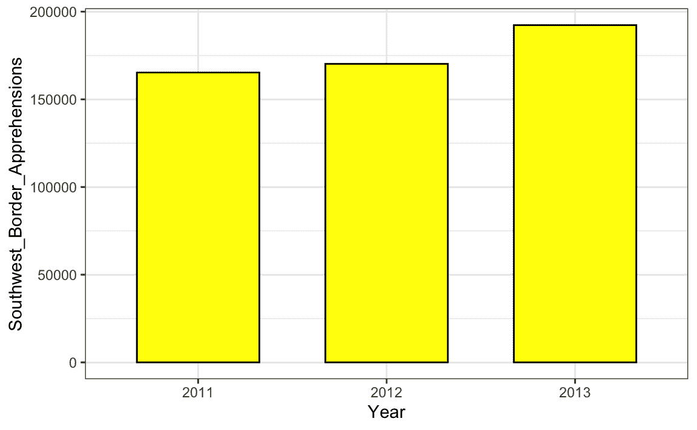

这里是另一个例子，在 Flowing Data 博客文章中详细描述：

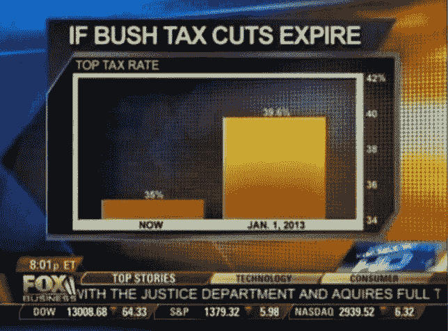 （来源：Fox News，via Flowing Data³⁵。）

这个图表使得 13%的增长看起来像是五倍的变化。这里也是适当的图表：

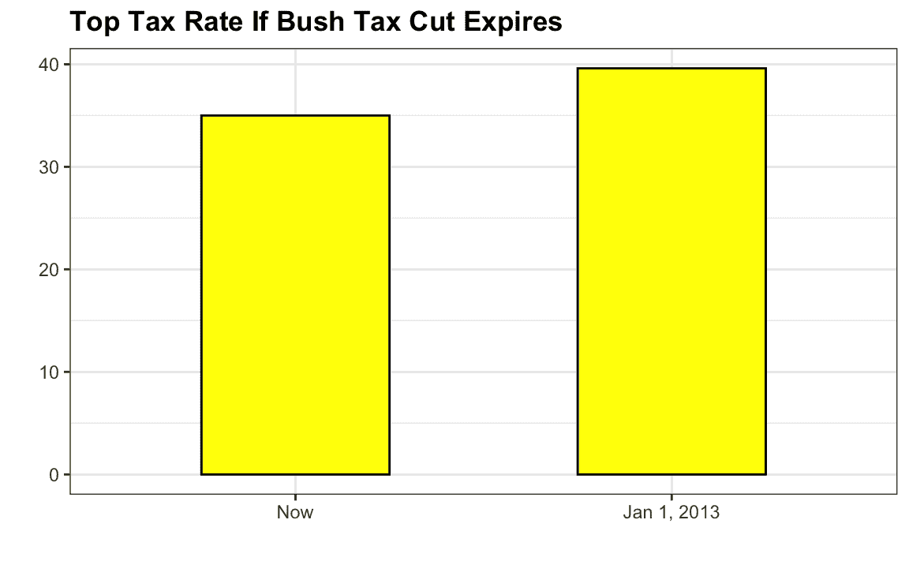

最后，这里有一个极端的例子，它使得小于 2%的微小差异看起来像是 10-100 倍的变化：

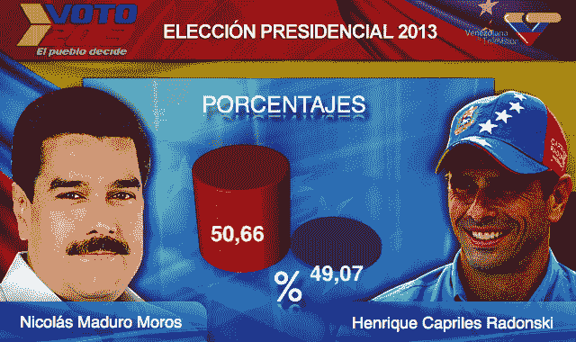

（来源：Venezolana de Televisión via Pakistan Today³⁶ 和 Diego Mariano。）

这里是适当的图表：

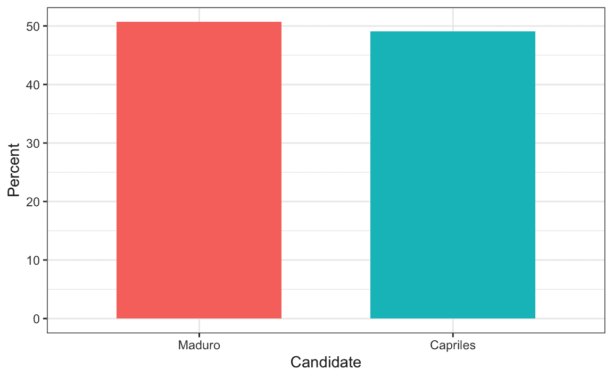

当使用位置而不是长度时，就不需要包括 0。当我们想要比较组间相对于组内变异性时，这一点尤其正确。以下是一个说明性的例子，展示了 2012 年按大洲划分的国家平均预期寿命：

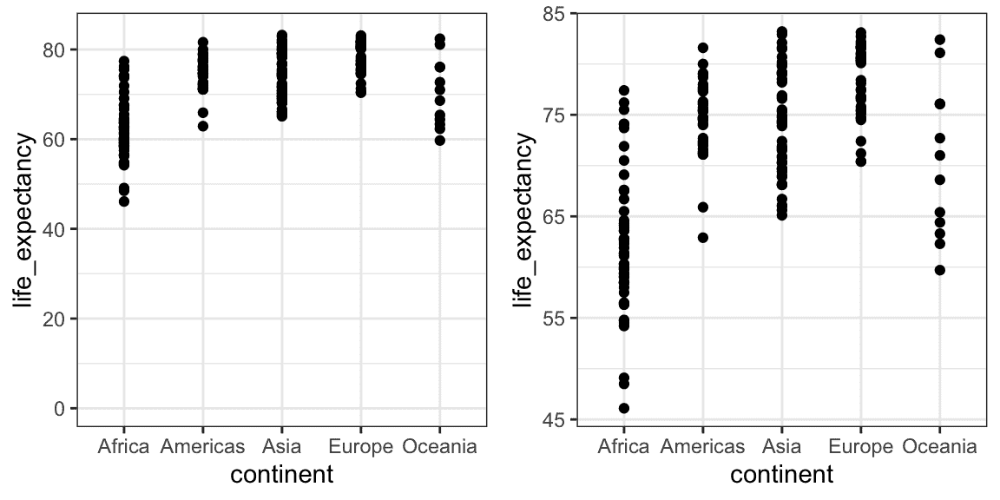

注意，在左边的图中，包括 0 在内，0 和 43 之间的空间没有提供任何信息，反而使得比较组间和组内变异性更加困难。

## 11.3 不要扭曲数量

在美国总统巴拉克·奥巴马 2011 年的国情咨文中，以下图表被用来比较美国 GDP 与四个竞争国家的 GDP：

 （来源：2011 年国情咨文³⁷）

通过观察圆的面积，美国似乎拥有比中国大五倍以上的经济规模，比法国大 30 倍以上。然而，如果我们看实际数字，我们会发现情况并非如此。实际的比率分别是比中国和法国大 2.6 倍和 5.8 倍。这种扭曲的原因是半径而不是面积被用来与数量成比例，这意味着面积之间的比例是平方的：2.6 变成了 6.5，5.8 变成了 34.1。以下是我们将值与半径和面积成比例时得到的圆的比较：

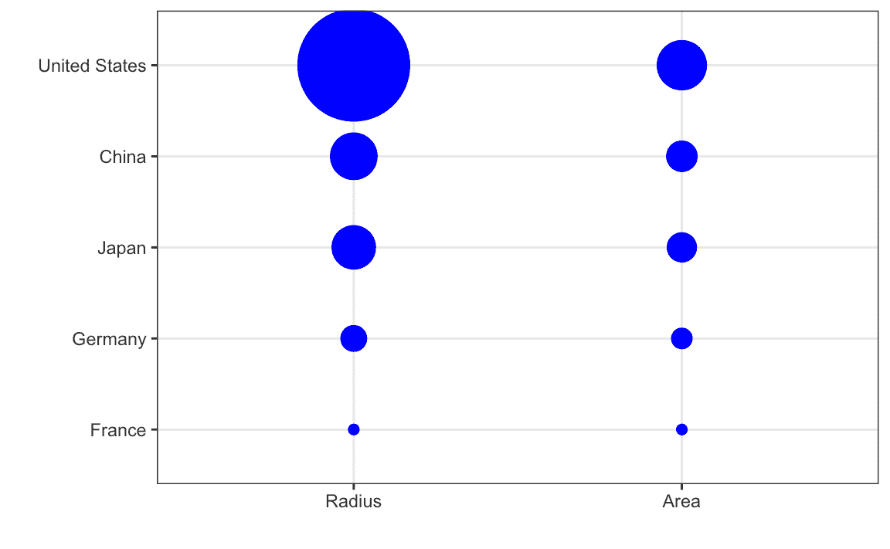

毫不奇怪，**ggplot2**默认使用面积而不是半径。当然，在这种情况下，我们实际上根本不应该使用面积，因为我们可以使用位置和长度：

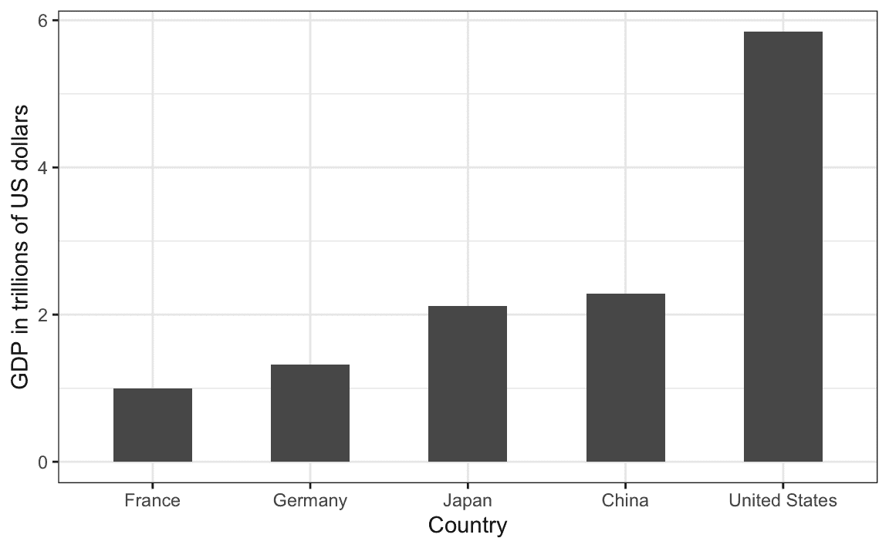

## 11.4 按有意义的值对类别进行排序

当一个坐标轴用于显示类别，如条形图中所做的那样，默认的 **ggplot2** 行为是当类别由字符字符串定义时按字母顺序排序。如果它们由因子定义，则按因子水平排序。我们很少想使用字母顺序。相反，我们应该按一个有意义的数量排序。在所有上述情况下，条形图都是按显示的值排序的。例外的是比较浏览器的条形图。在这种情况下，我们保持条形图的顺序不变，以方便比较。具体来说，我们不是在两年中分别按浏览器的顺序排序，而是按 2000 年和 2015 年的平均值排序。

我们之前学习了如何使用 `reorder` 函数，它帮助我们实现这一目标。为了欣赏正确的顺序如何有助于传达信息，假设我们想要创建一个比较各州谋杀率的图表。我们特别感兴趣的是最危险和最安全的州。注意按字母顺序（默认）排序与按实际比率排序之间的差异：

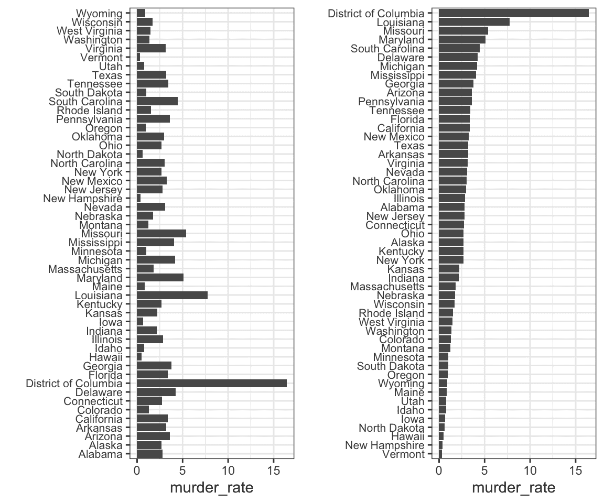

我们可以这样绘制第二个图表：

```r
data(murders)
murders |> mutate(murder_rate = total / population * 100000) |>
 mutate(state = reorder(state, murder_rate)) |>
 ggplot(aes(state, murder_rate)) +
 geom_bar(stat="identity") +
 coord_flip() +
 theme(axis.text.y = element_text(size = 6)) +
 xlab("")
```

`reorder` 函数让我们也可以重新排序组别。之前我们看到了一个与各地区收入分布相关的例子。以下是两个版本相互比较的绘图：

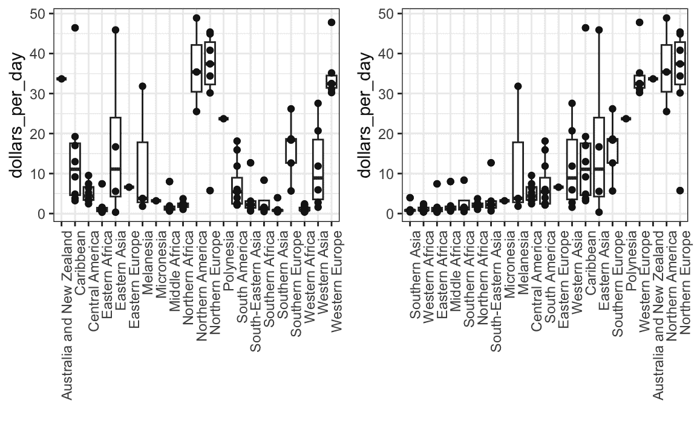

第一个按区域字母顺序排序，而第二个按该组的中间值排序。

## 11.5 展示数据

我们一直专注于在类别间显示单个数量。现在我们将注意力转向显示数据，重点是比较组别。

为了激发我们的第一个原则，“展示数据”，我们回到我们描述 ET（外星人）身高的例子。这次让我们假设 ET 对男性和女性身高差异感兴趣。用于组间比较的常见图表，如 Microsoft Excel 等软件所推广的，是炸药图，它显示了平均值和标准误差（标准误差将在下一章定义，但不要与数据的标准差混淆）。图表看起来是这样的：

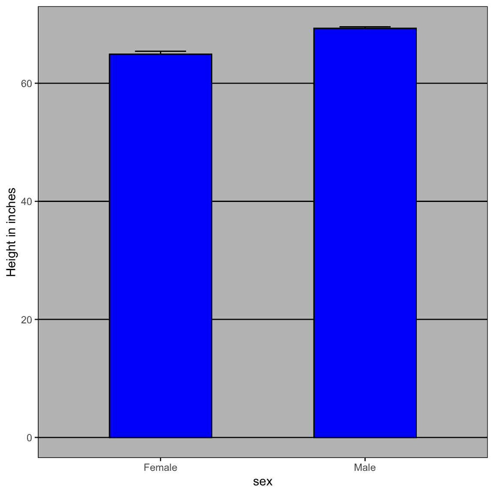

每个组的平均值由每个条形的顶部表示，天线从平均值延伸到平均值加两个标准误差。如果 ET 收到的只是这个图表，他将几乎没有关于他遇到的一组男性和女性可以期待什么的信息。条形到 0：这难道意味着有身高不到一英尺的小人吗？所有男性是否都比最高的女性高？是否存在一个身高范围？由于我们没有提供关于身高分布的几乎任何信息，ET 无法回答这些问题。

这带我们到我们的第一个原则：展示数据。这个简单的**ggplot2**代码已经通过显示所有数据点生成了一个比条形图更有信息量的图表：

```r
heights |> 
 ggplot(aes(sex, height)) + 
 geom_point() 
```

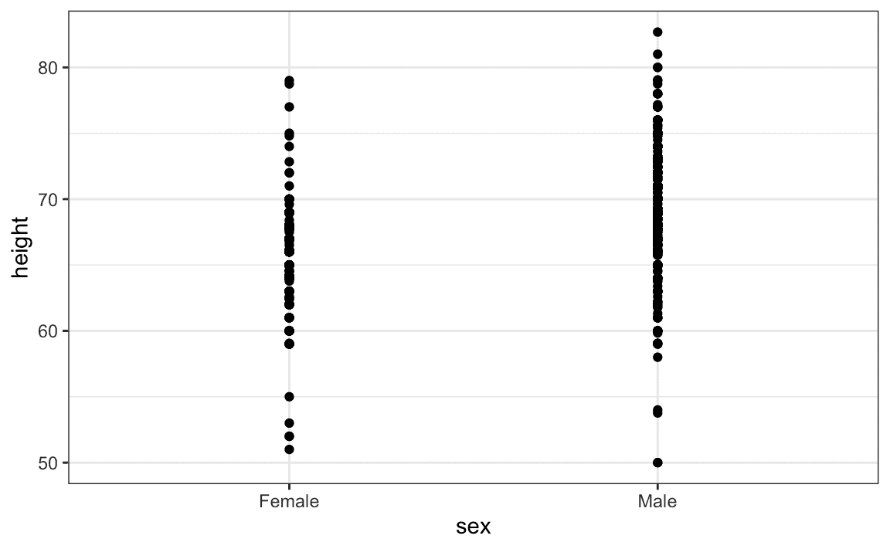

例如，这个图表让我们对数据的范围有一个概念。然而，这个图表也有局限性，因为我们实际上看不到为女性和男性分别绘制的 238 和 812 个点，而且许多点重叠在一起。正如我们之前所描述的，可视化分布更有信息量。但在这样做之前，我们指出两种我们可以改进显示所有点的图表的方法。

第一种方法是添加*抖动*，即给每个点添加一个小随机偏移。在这种情况下，添加水平抖动不会改变解释，因为点的高度没有变化，但我们最小化了落在彼此之上的点的数量，因此更好地直观地了解数据的分布。第二种改进来自于使用*alpha 混合*：使点变得稍微透明。更多的点落在彼此之上，图表就越暗，这也帮助我们了解点的分布。以下是添加抖动和 alpha 混合后的相同图表：

```r
heights |> 
 ggplot(aes(sex, height)) +
 geom_jitter(width = 0.1, alpha = 0.2) 
```

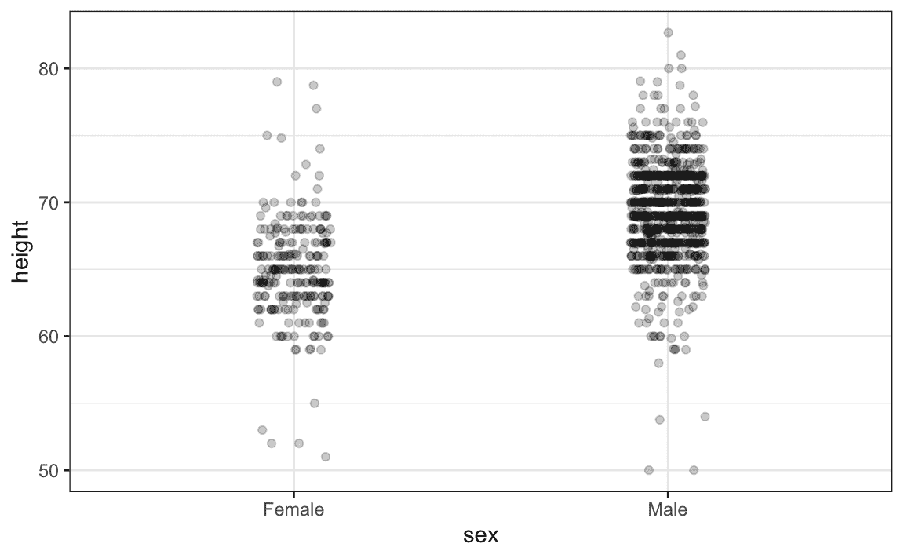

现在我们开始意识到，平均而言，男性的身高高于女性。我们还注意到点的暗色水平带，表明许多人报告的值是四舍五入到最接近的整数。

## 11.6 简化比较

### 11.6.1 使用共同的坐标轴

由于有很多点，显示分布比显示单个点更有效。因此，我们为每个组展示直方图：

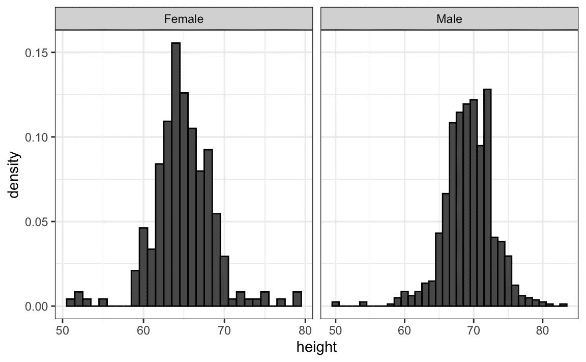

然而，从这个图表中并不立即明显看出男性平均身高高于女性。我们必须仔细观察才能注意到男性直方图的 x 轴有更高的值范围。这里的一个重要原则是在比较两个图表的数据时**保持坐标轴相同**。下面我们看看比较如何变得更容易：

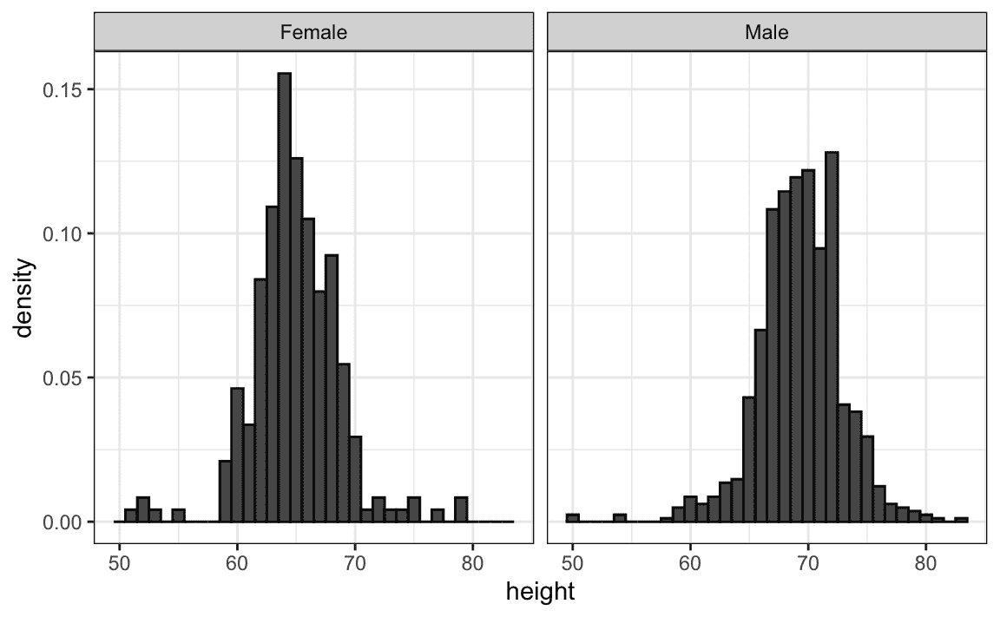

### 11.6.2 垂直对齐图表以查看水平变化，水平对齐以查看垂直变化

在这些直方图中，与高度增加或减少相关的视觉线索是向左或向右的移动，即水平变化。垂直对齐图表有助于我们在坐标轴固定时看到这种变化：

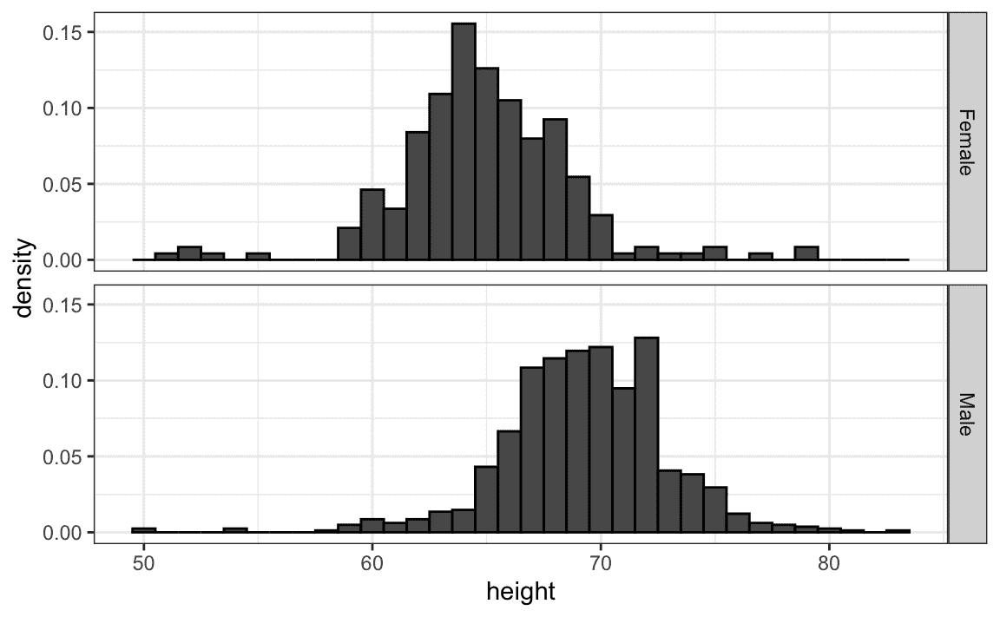

```r
heights |> 
 ggplot(aes(height, ..density..)) +
 geom_histogram(binwidth = 1, color="black") +
 facet_grid(sex~.)
```

这个图表使得注意到男性平均身高更高变得容易得多。

如果我们想要由箱线图提供的更紧凑的摘要，我们则将它们水平对齐，因为默认情况下，箱线图随着高度的变化而上下移动。遵循我们的“展示数据”原则，我们随后覆盖所有数据点：

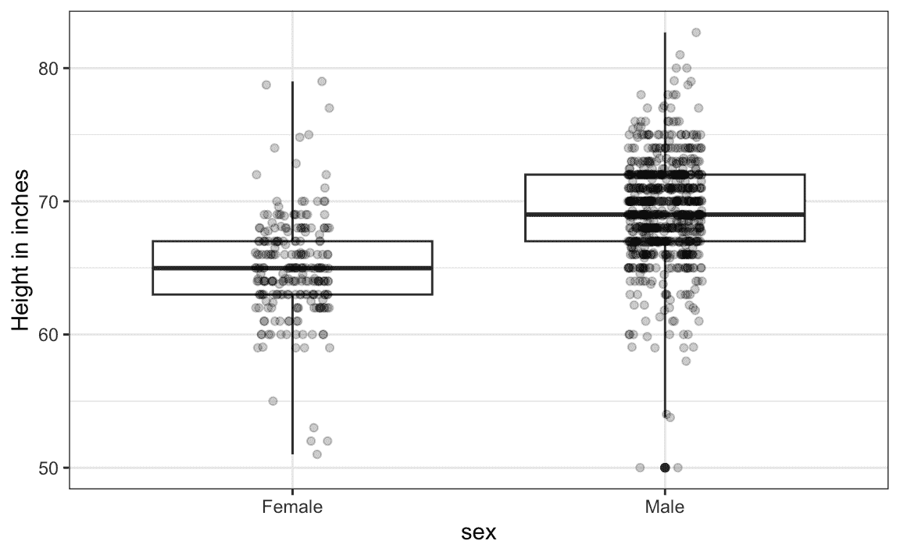

```r
 heights |> 
 ggplot(aes(sex, height)) + 
 geom_boxplot(coef=3) + 
 geom_jitter(width = 0.1, alpha = 0.2) +
 ylab("Height in inches")
```

现在对比和比较这三个基于完全相同数据的图表：

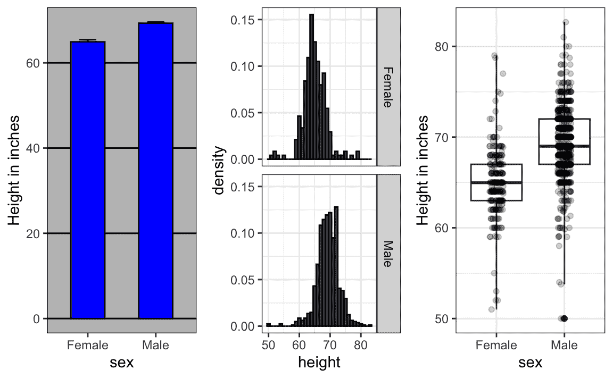

注意从右侧的两个图表中我们学到了多少。条形图对于展示一个数字很有用，但当我们想要描述分布时，它并不是很有用。

### 11.6.3 考虑变换

我们已经说明了在变化是乘法的情况下使用对数变换的必要性。人口规模是我们发现对数变换可以产生更有信息量变换的一个例子。

选择不当的条形图以及在没有必要时未能使用对数变换，可能会导致数据特别失真。例如，考虑以下展示 2015 年每个大洲平均人口规模的条形图：

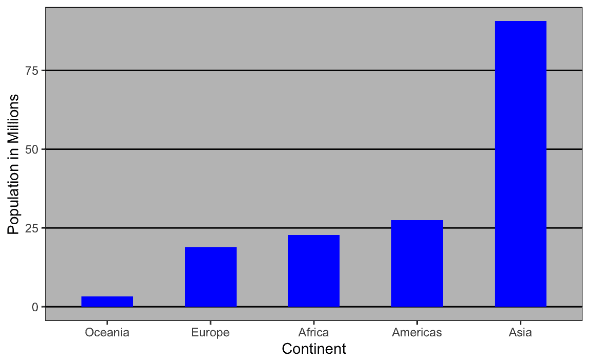

从这个图表中，人们可能会得出亚洲国家的人口比其他大洲都要多的结论。根据“展示数据”的原则，我们很快注意到这主要是因为两个非常大的国家，我们假设是印度和中国：

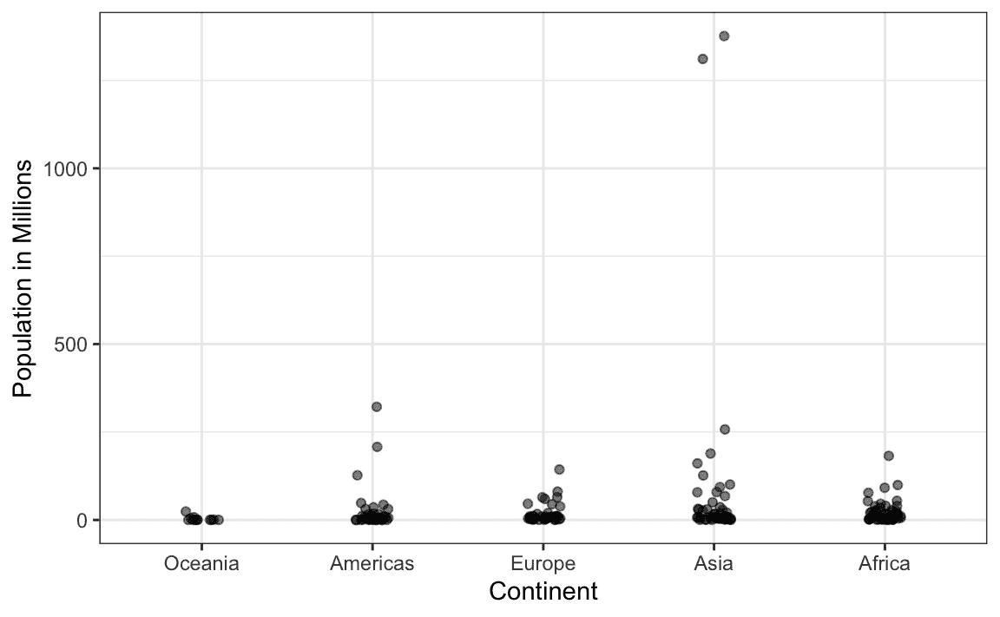

在这里使用对数变换可以得到一个信息量更大的图表。我们使用对数尺度变换对 y 轴进行变换，将原始条形图与箱形图进行比较：

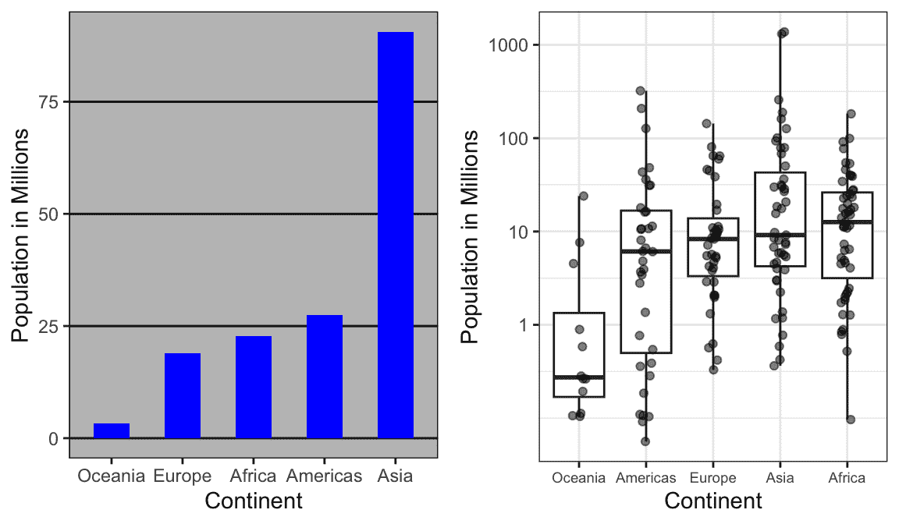

使用新的图表，我们意识到非洲国家实际上具有比亚洲国家更大的中位人口规模。

你还应该考虑的其他变换包括对数变换（`logit`），有助于更好地看到概率比的变化，以及平方根变换（`sqrt`），适用于计数数据。

### 11.6.4 需要比较的视觉线索应相邻

对于每个大洲，让我们比较 1970 年和 2010 年的收入。在比较 1970 年和 2010 年之间各地区收入数据时，我们制作了一个类似于下面的图表，但这次我们调查的是大洲而不是地区。

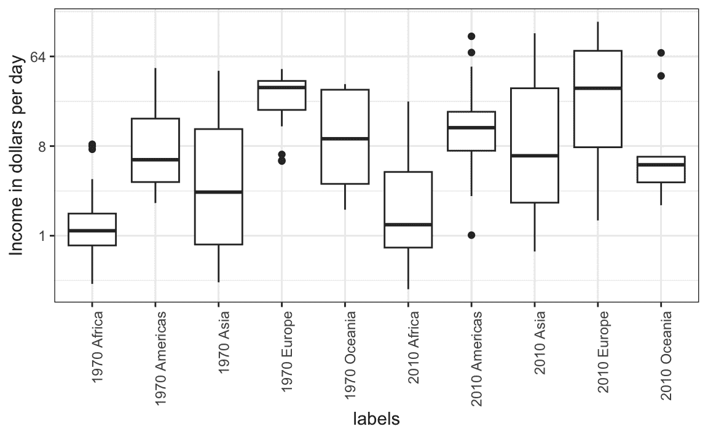

**ggplot2**的默认设置是按字母顺序排序标签，因此 1970 年的标签排在 2010 年的标签之前，这使得比较变得具有挑战性，因为一个大洲在 1970 年的分布与在 2010 年的分布在视觉上相差甚远。当一个大洲的箱形图相邻时，比较 1970 年和 2010 年每个大洲的数据就更容易了：

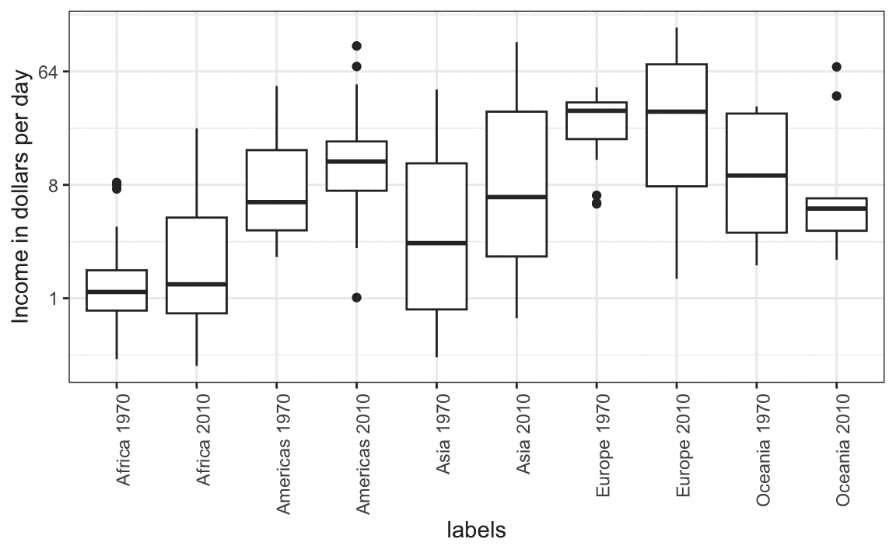

### 11.6.5 使用颜色

如果我们使用颜色来表示我们想要比较的两个事物，比较就会变得更加容易：

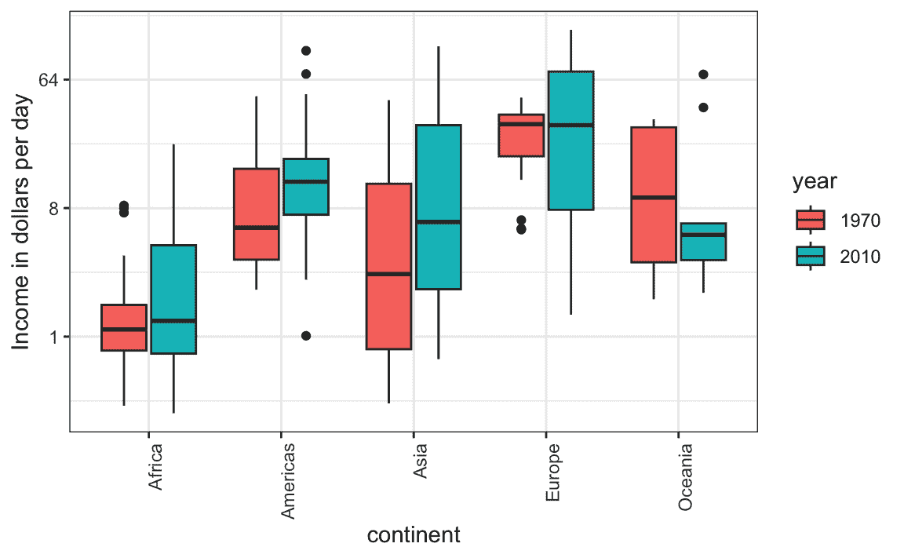

## 11.7 考虑色盲问题

大约 10%的人口有色觉障碍。不幸的是，**ggplot2**中使用的默认颜色对这个群体来说并不理想。然而，**ggplot2**确实使得改变图表中使用的调色板变得容易。如何使用色觉障碍友好调色板的例子在这里描述：[`www.cookbook-r.com/Graphs/Colors_(ggplot2)/#a-colorblind-friendly-palette`](http://www.cookbook-r.com/Graphs/Colors_(ggplot2)/#a-colorblind-friendly-palette):

```r
color_blind_friendly_cols <- 
 c("#999999", "#E69F00", "#56B4E9", "#009E73", 
 "#F0E442", "#0072B2", "#D55E00", "#CC79A7")
```

这里是颜色

有几个资源可以帮助你选择颜色，例如这个：[`bconnelly.net/2013/10/creating-colorblind-friendly-figures/`](http://bconnelly.net/2013/10/creating-colorblind-friendly-figures/).

## 11.8 两个变量的图表

通常，你应该使用散点图来可视化两个变量之间的关系。在我们考察的两个变量关系的每一个实例中，包括谋杀总数与人口规模、预期寿命与生育率、婴儿死亡率与收入之间的关系，我们都使用了散点图。这是我们通常推荐的图表。然而，也有一些例外，我们在这里描述两种替代图表：*斜率图*和*Bland-Altman 图*。

### 11.8.1 斜率图

有一个例外，另一种类型的图表可能更有信息量，那就是当你比较同一类型的变量，但在不同时间点和相对较少的比较时。例如，比较 2010 年和 2015 年的预期寿命。在这种情况下，我们可能会推荐一个*斜率图*。

在**ggplot2**中没有斜率图的几何形状，但我们可以使用`geom_line`构建一个。我们需要做一些调整来添加标签。以下是一个比较 2010 年和 2015 年大型西方国家的例子：

```r
west <- c("Western Europe","Northern Europe","Southern Europe",
 "Northern America","Australia and New Zealand")

dat <- gapminder |> 
 filter(year%in% c(2010, 2015) & region %in% west & 
 !is.na(life_expectancy) & population > 10⁷) 

dat |>
 mutate(location = ifelse(year == 2010, 1, 2), 
 location = ifelse(year == 2015 & 
 country %in% c("United Kingdom", "Portugal"),
 location+0.22, location),
 hjust = ifelse(year == 2010, 1, 0)) |>
 mutate(year = as.factor(year)) |>
 ggplot(aes(year, life_expectancy, group = country)) +
 geom_line(aes(color = country), show.legend = FALSE) +
 geom_text(aes(x = location, label = country, hjust = hjust), 
 show.legend = FALSE) +
 xlab("") + ylab("Life Expectancy")
```

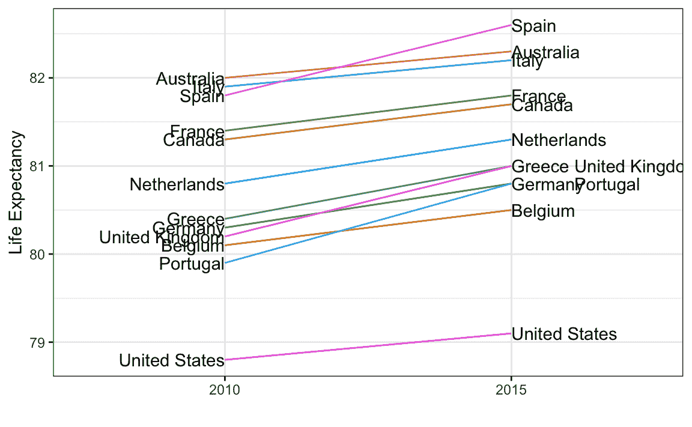

斜率图的一个优点是它允许我们根据线的斜率快速了解变化。虽然我们使用角度作为视觉线索，但我们也有位置来确定确切值。与散点图相比，比较改进要困难一些：

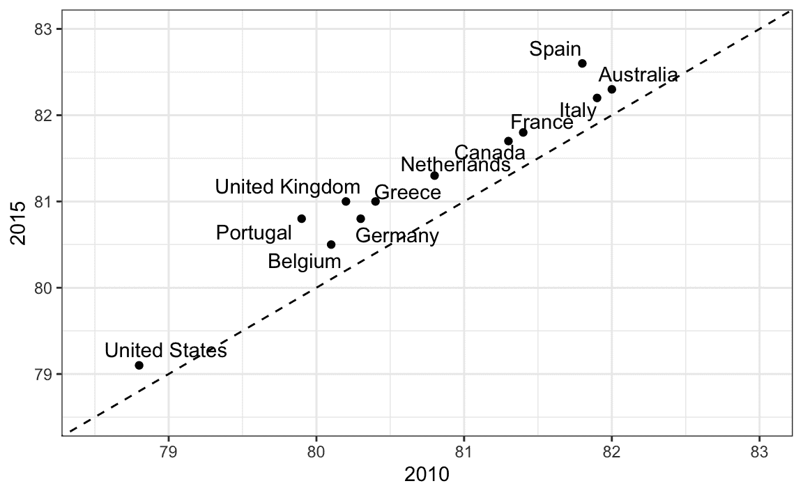

在散点图中，我们遵循了*使用公共坐标轴*的原则，因为我们是在比较这些前后变化。然而，如果我们有很多点，斜率图就不再有用，因为很难看到所有线条。

### 11.8.2 Bland-Altman 图

由于我们主要对差异感兴趣，因此将其中一个坐标轴专门用于它是合理的。Bland-Altman 图，也称为 Tukey 均值差异图和 MA 图，显示了差异与平均值的关系：

```r
library(ggrepel)
dat |> 
 mutate(year = paste0("life_expectancy_", year)) |>
 select(country, year, life_expectancy) |> 
 pivot_wider(names_from = "year", values_from="life_expectancy") |> 
 mutate(average = (life_expectancy_2015 + life_expectancy_2010)/2,
 difference = life_expectancy_2015 - life_expectancy_2010) |>
 ggplot(aes(average, difference, label = country)) + 
 geom_point() +
 geom_text_repel() +
 geom_abline(lty = 2) +
 xlab("Average of 2010 and 2015") + 
 ylab("Difference between 2015 and 2010")
```

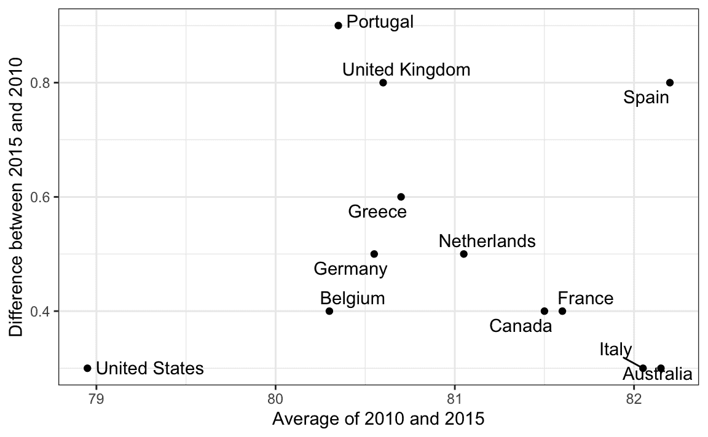

在这里，仅通过观察 y 轴，我们就可以快速看到哪些国家取得了最大的进步。我们还可以从 x 轴上获得整体价值的想法。

## 11.9 编码第三个变量

早期散点图展示了婴儿存活率与平均收入之间的关系。下面是包含三个变量的这种图表版本：OPEC 成员国、地区和人口。

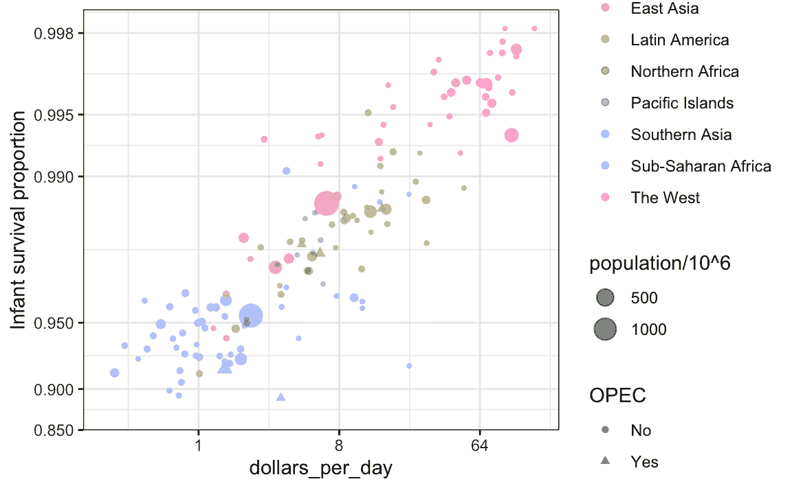

我们用颜色和形状来编码分类变量。这些形状可以用`shape`参数来控制。下面是 R 中可用的形状。对于最后五个，颜色在内部。

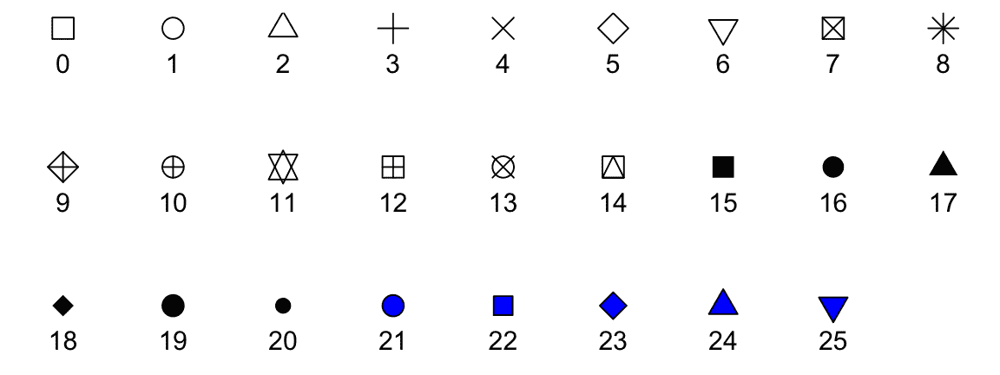

对于连续变量，我们可以使用颜色、强度或大小。现在我们通过一个案例研究来展示我们如何做到这一点。

当选择颜色来量化数值变量时，我们有两种选择：顺序和发散。顺序颜色适用于从高到低的数据。高值与低值明显区分。以下是`RColorBrewer`包提供的示例：

```r
library(RColorBrewer)
display.brewer.all(type="seq")
```

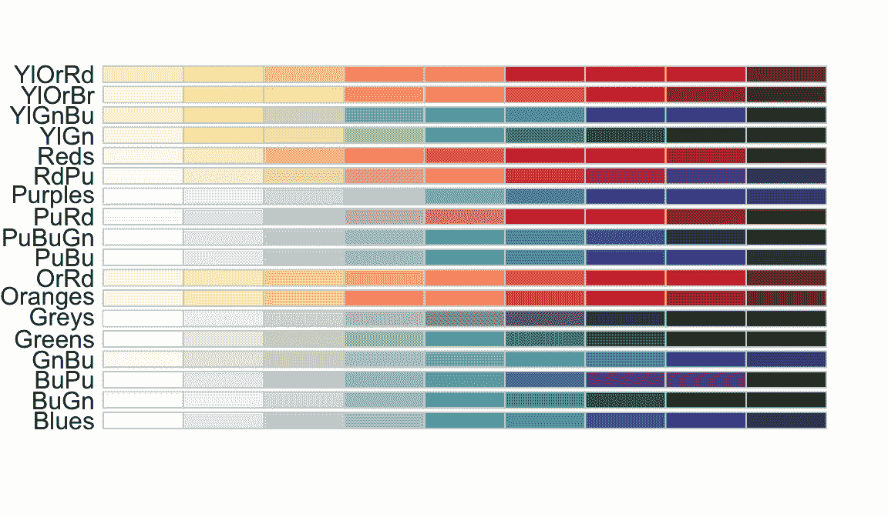

发散颜色用于表示偏离中心值的值。我们对数据范围的两端给予同等重视：高于中心值和低于中心值。我们可能会使用发散模式的一个例子是，如果我们想要展示离平均值多少个标准差的高度。以下是发散模式的示例：

```r
library(RColorBrewer)
display.brewer.all(type="div")
```

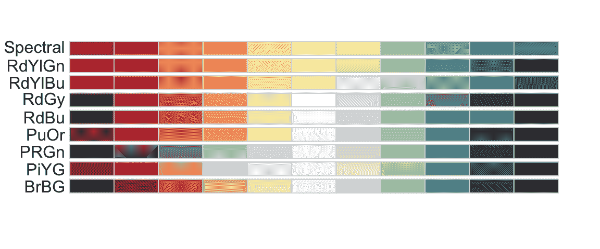

## 11.10 避免使用伪三维图表

下面的图，摘自科学文献³⁸，展示了三个变量：剂量、药物类型和存活率。尽管你的屏幕/书本页面是平面的二维的，但该图表试图模仿三维，并为每个变量分配一个维度。

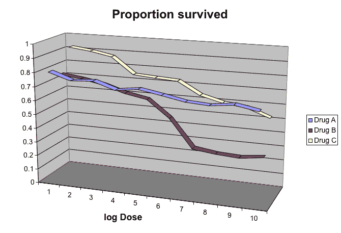

人类在三维空间中看东西的能力有限（这也解释了为什么平行停车很难），而在伪三维空间中的局限性则更为严重。为了看到这一点，尝试确定上图存活变量的值。你能判断紫色带状物何时与红色带状物相交吗？这是一个我们可以轻松使用颜色来表示分类变量而不是使用伪 3D 的例子：

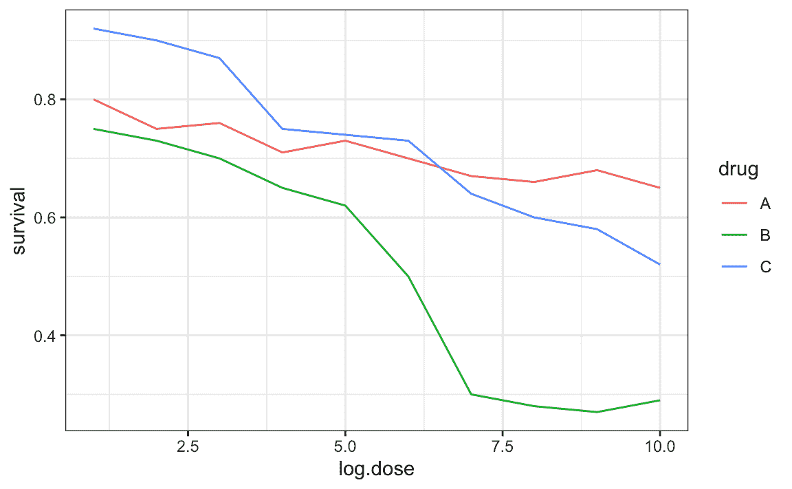

注意确定存活值有多容易。

伪三维有时被完全无用地使用：即使第三维度不表示数量，图表也被制作成看起来是三维的。这只会增加混淆，并使传达信息变得更难。这里有两个例子：

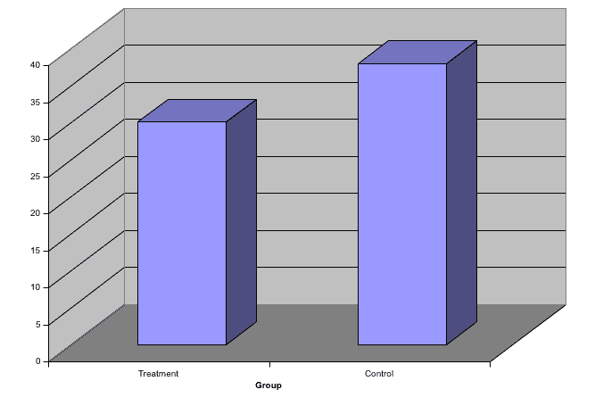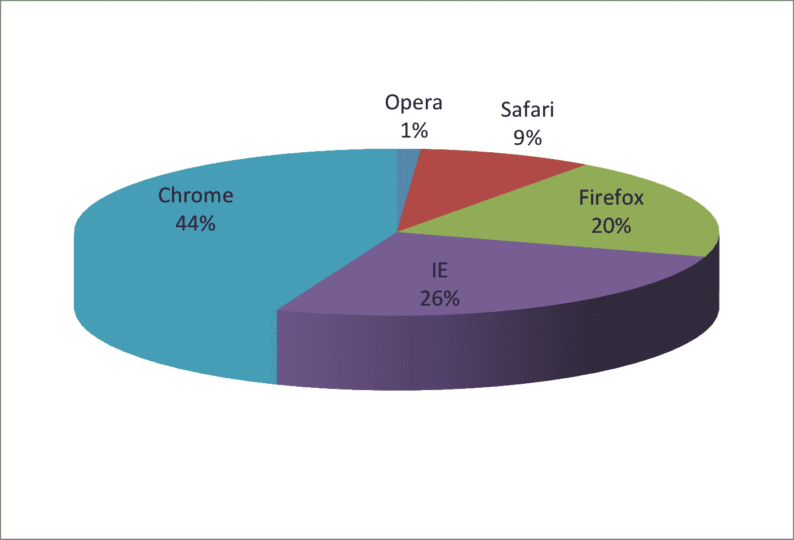

## 11.11 避免使用过多的有效数字

默认情况下，像 R 这样的统计软件会返回许多有效数字。R 的默认行为是显示 7 位有效数字。那么多数字往往不会增加信息，并且增加的视觉杂乱可能会使观众难以理解信息。例如，以下是使用 R 从总数和人口计算出的加利福尼亚在五个十年中的每 10,000 个病例的疾病率：

| 州 | 年份 | 麻疹 | 百日咳 | 脊髓灰质炎 |
| --- | --- | --- | --- | --- |
| 加利福尼亚 | 1940 | 37.8826320 | 18.3397861 | 0.8266512 |
| 加利福尼亚 | 1950 | 13.9124205 | 4.7467350 | 1.9742639 |
| 加利福尼亚 | 1960 | 14.1386471 | NA | 0.2640419 |
| 加利福尼亚 | 1970 | 0.9767889 | NA | NA |
| 加利福尼亚 | 1980 | 0.3743467 | 0.0515466 | NA |

我们报告的精度高达每 10,000 个病例的 0.00001，在日期变化的大背景下，这是一个非常小的值。在这种情况下，两位有效数字已经足够，并且清楚地表明了比率正在下降：

| 州 | 年份 | 麻疹 | 百日咳 | 脊髓灰质炎 |
| --- | --- | --- | --- | --- |
| 加利福尼亚 | 1940 | 37.9 | 18.3 | 0.8 |
| 加利福尼亚 | 1950 | 13.9 | 4.7 | 2.0 |
| 加利福尼亚 | 1960 | 14.1 | NA | 0.3 |
| 加利福尼亚 | 1970 | 1.0 | NA | NA |
| 加利福尼亚 | 1980 | 0.4 | 0.1 | NA |

改变有效数字的数量或四舍五入数字的有用方法是`signif`和`round`。您可以通过设置如下选项来全局定义有效数字的数量：`options(digits = 3)`。

与显示表格相关的另一个原则是将比较的值放在列而不是行上。注意，我们上面的表格比这个表格更容易阅读：

| 州 | 疾病 | 1940 | 1950 | 1960 | 1970 | 1980 |
| --- | --- | --- | --- | --- | --- | --- |
| 加利福尼亚 | 麻疹 | 37.9 | 13.9 | 14.1 | 1 | 0.4 |
| 加利福尼亚 | 百日咳 | 18.3 | 4.7 | NA | NA | 0.1 |
| 加利福尼亚 | 脊髓灰质炎 | 0.8 | 2.0 | 0.3 | NA | NA |

## 11.12 了解你的受众

图表可用于 1）我们自己的探索性数据分析，2）向专家传达信息，或 3）帮助向普通受众讲述故事。确保目标受众理解图表的每个元素。

作为简单的例子，考虑一下，对于你自己的探索，对数据进行对数变换然后绘图可能更有用。然而，对于不熟悉将日志值转换回原始测量的普通受众来说，使用轴上的对数刻度而不是对数变换的值将更容易理解。

## 11.13 练习

对于这些练习，我们将使用**dslabs**包中的疫苗数据：

```r
library(dslabs)
data(us_contagious_diseases)
```

1. 饼图是合适的：

1.  当我们想要显示百分比时。

1.  当**ggplot2**不可用时。

1.  当我在面包店时。

1.  从不。条形图和表格总是更好。

2. 下面的图表有什么问题：

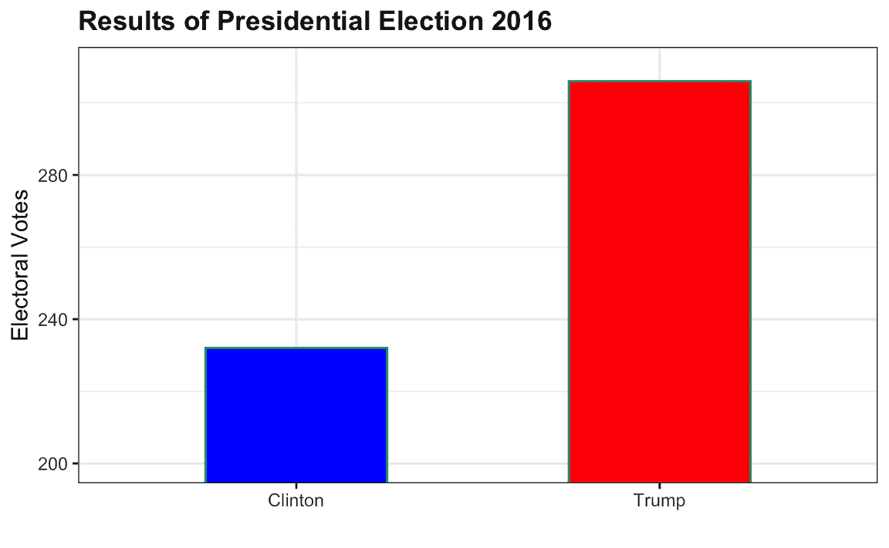

1.  这些值是错误的。最终投票结果是 306 票对 232 票。

1.  轴没有从 0 开始。根据长度判断，特朗普收到的选票似乎是其他人的 3 倍，但实际上只是多了大约 30%。

1.  颜色应该相同。

1.  百分比应以饼图的形式显示。

3. 看看以下两个图表。它们显示了相同的信息：1928 年 50 个州的麻疹比率。

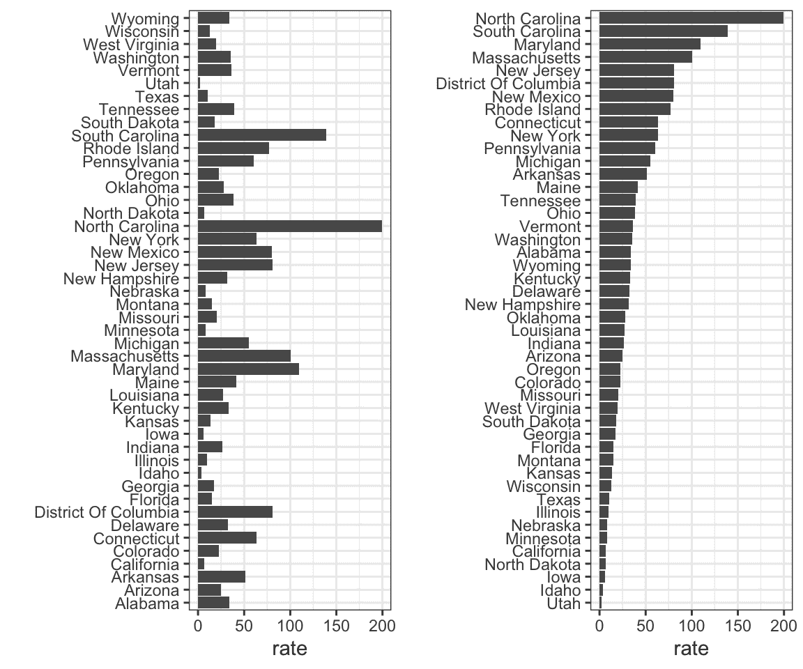 如果你想确定哪些州在比率方面最好和最差，哪个图表更容易阅读？

1.  它们提供了相同的信息，因此它们都是同样好的。

1.  右侧的图表更好，因为它按字母顺序排列州。

1.  右侧的图表更好，因为字母顺序与疾病无关，按照实际比率排序，我们可以快速看到比率最高和最低的州。

1.  这两个图表都应该是饼图。

4. 要制作左侧的图表，我们必须重新排序州的变量级别。

```r
dat <- us_contagious_diseases |> 
 filter(year == 1967 & disease=="Measles" & !is.na(population)) |>
 mutate(rate = count / population * 10000 * 52 / weeks_reporting)
```

注意当我们制作条形图时发生的情况：

```r
dat |> ggplot(aes(state, rate)) +
 geom_bar(stat="identity") +
 coord_flip() 
```

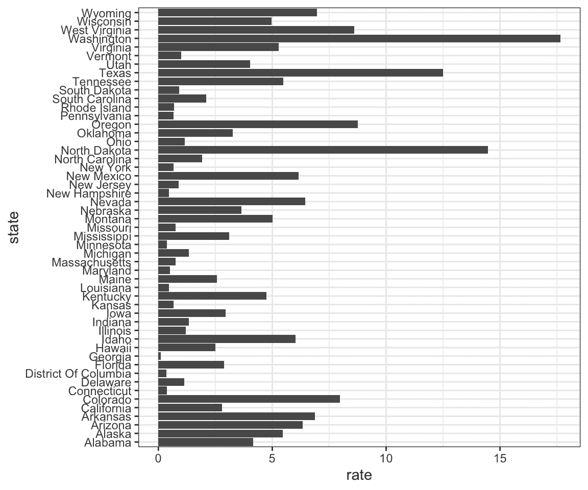

定义这些对象：

```r
state <- dat$state
rate <- dat$count/dat$population*10000*52/dat$weeks_reporting
```

重新定义`state`对象，以便按级别重新排序。打印新的`state`对象及其级别，以便您可以查看向量不是按级别重新排序的。

5. 现在用一行代码定义`dat`表格，如上所述，但将`mutate`的使用改为创建一个比率变量，并重新排序州变量，以便按此变量重新排序级别。然后使用上面的代码制作条形图，但针对这个新的`dat`。

6. 假设我们感兴趣的是比较美国各地区的枪支谋杀率。我们看到这个图表：

```r
library(dslabs)
data("murders")
murders |> mutate(rate = total/population*100000) |>
group_by(region) |>
summarize(avg = mean(rate)) |>
mutate(region = factor(region)) |>
ggplot(aes(region, avg)) +
geom_bar(stat="identity") +
ylab("Murder Rate Average")
```

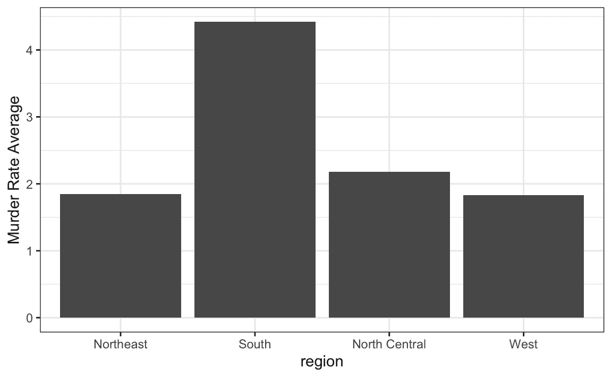

并决定搬到西部地区的某个州。这种解释的主要问题是什么？

1.  类别是按字母顺序排列的。

1.  图表没有显示标准误差。

1.  它没有显示所有数据。我们看不到一个区域内的变异性，而且可能最安全的状态不在西部。

1.  东北部平均最低。

7. 制作谋杀率的箱形图，定义为

```r
data("murders")
murders |> mutate(rate = total/population*100000)
```

按地区划分，显示所有点并按中位数比率排序地区。

8. 下面的图表显示了三个连续变量。

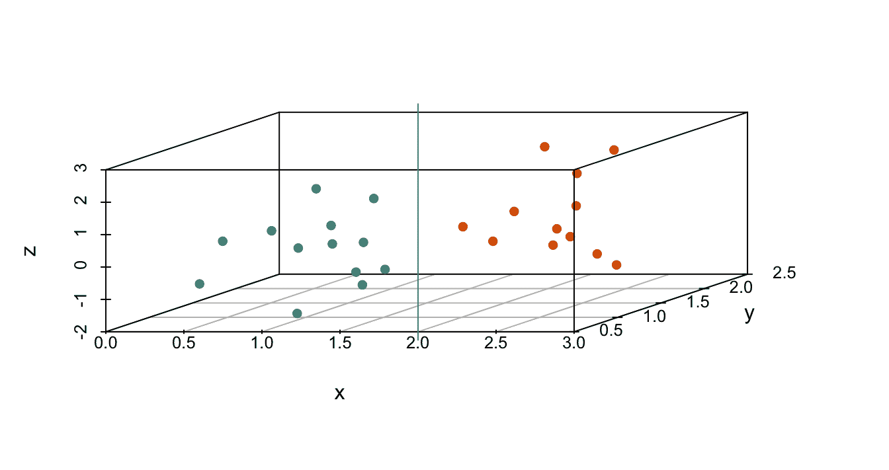

线 $x=2$ 似乎将点分开。但实际上并非如此，我们可以通过将数据绘制成几个二维点来看到这一点。

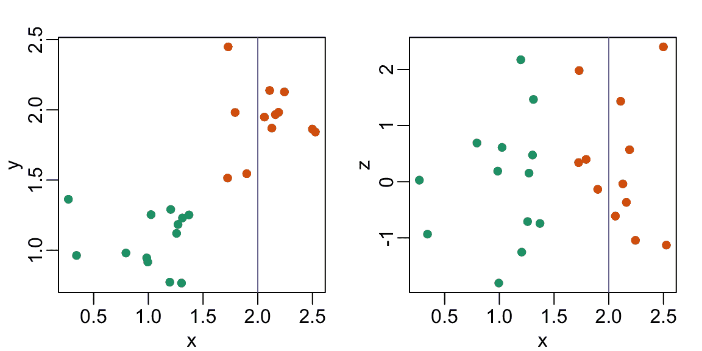

为什么会发生这种情况？

1.  人类不擅长阅读伪 3D 图表。

1.  代码中肯定有错误。

1.  颜色让我们困惑。

1.  当我们有 3 个变量可供比较时，不应使用散点图来比较两个变量。

## 11.14 案例研究：疫苗和传染病

疫苗帮助拯救了数百万人的生命。在 19 世纪，在通过疫苗接种计划实现群体免疫之前，天花和脊髓灰质炎等传染病的死亡是常见的。然而，尽管有所有科学证据证明其重要性，疫苗接种计划今天仍然有些争议。

争议始于 1988 年发表的一篇论文³⁹，由安德鲁·韦克菲尔德领导，声称接种麻疹、腮腺炎和风疹（MMR）疫苗与自闭症和肠道疾病的出现之间存在联系。尽管有大量科学证据与此发现相矛盾，但耸人听闻的媒体报道和阴谋论者的恐惧煽动导致公众的一部分人相信疫苗是有害的。因此，许多父母停止给他们的孩子接种疫苗。这种危险的做法可能会带来潜在的灾难性后果，因为疾病控制中心（CDC）估计，疫苗接种将预防过去 20 年出生的儿童中超过 2100 万次住院和 73.2 万次死亡（参见疫苗接种儿童计划时代的免疫接种益处——美国，1994-2013，MMWR⁴⁰）。自那时起，这篇 1988 年的论文已被撤回，安德鲁·韦克菲尔德最终被“从英国医学注册名单上除名，声明其在《柳叶刀》杂志上发表的研究存在故意伪造，因此被禁止在英国行医。”（来源：维基百科⁴¹）。然而，误解仍然存在，部分原因是那些自称活动家继续传播关于疫苗的错误信息。

数据的有效沟通是消除错误信息和恐惧煽动的强效解毒剂。我们之前使用了一篇《华尔街日报》文章提供的例子⁴²，展示了疫苗对抗感染性疾病影响的相关数据。在这里，我们重建了这个例子。

用于这些图表的数据是由 Tycho 项目⁴³收集、整理和分发的。它们包括从 1928 年到 2011 年，来自所有五十个州的七种疾病的每周报告数量。我们在**dslabs**包中包括了年度总计：

```r
library(tidyverse)
library(RColorBrewer)
library(dslabs)
data(us_contagious_diseases)
names(us_contagious_diseases)
#> [1] "disease"         "state"           "year" 
#> [4] "weeks_reporting" "count"           "population"
```

我们创建了一个临时对象`dat`，它只存储麻疹数据，包括每 10 万人比率，按疾病平均值排序各州，并排除了阿拉斯加和夏威夷，因为它们只在 20 世纪 50 年代末成为州。请注意，有一个`weeks_reporting`列告诉我们一年中有多少周的数据被报告。我们在计算比率时必须调整这个值。

```r
the_disease <- "Measles"
dat <- us_contagious_diseases |>
 filter(!state%in%c("Hawaii","Alaska") & disease == the_disease) |>
 mutate(rate = count / population * 10000 * 52 / weeks_reporting) |> 
 mutate(state = reorder(state, ifelse(year<=1963, rate, NA), 
 median, na.rm = TRUE)) 
```

我们现在可以轻松地绘制每年的疾病率。以下是加利福尼亚的麻疹数据：

```r
dat |> filter(state == "California" & !is.na(rate)) |>
 ggplot(aes(year, rate)) +
 geom_line() + 
 ylab("Cases per 10,000")  + 
 geom_vline(xintercept=1963, col = "blue")
```

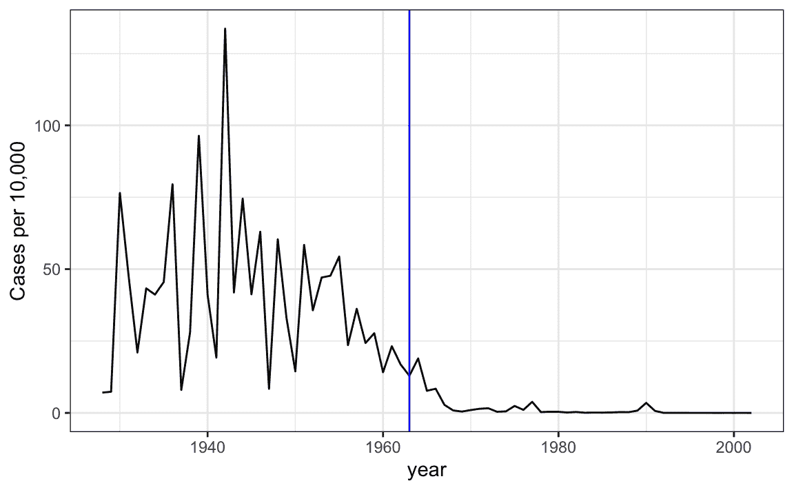

我们在 1963 年添加了一条垂直线，因为这是疫苗被引入的时间[控制，疾病预防控制中心（2014）。国际旅行健康信息 2014（黄色手册）。第 250 页。ISBN 9780199948505]。

现在我们可以在一个图表中展示所有州的数据吗？我们有三个变量要展示：年份、州和比率。在 WSJ 图表中，他们使用 x 轴表示年份，y 轴表示州，使用颜色色调来表示比率。然而，他们使用的颜色范围，从黄色到蓝色到绿色到橙色到红色，可以改进。

在我们的例子中，我们想使用顺序调色板，因为没有有意义的中心，只有低和高比率。

我们使用几何形状`geom_tile`将区域用表示疾病率的颜色进行铺砖。我们使用平方根变换来避免极高计数主导图表。注意，缺失值用灰色表示。请注意，一旦一种疾病被基本根除，一些州就完全停止报告病例。这就是为什么我们在 1980 年之后看到这么多灰色。

```r
dat |> ggplot(aes(year, state, fill = rate)) +
 geom_tile(color = "grey50") +
 scale_x_continuous(expand=c(0,0)) +
 scale_fill_gradientn(colors = brewer.pal(9, "Reds"), trans = "sqrt") +
 geom_vline(xintercept=1963, col = "blue") +
 theme_minimal() + 
 theme(panel.grid = element_blank(), 
 legend.position="bottom", 
 text = element_text(size = 8)) +
 labs(title = the_disease, x = "", y = "")
```

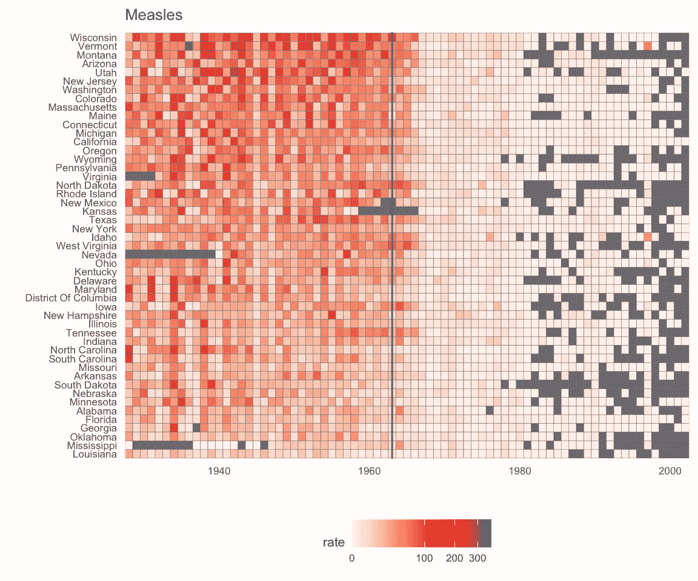

这个图表非常有力地证明了疫苗的贡献。然而，这个图表的一个局限性是它使用颜色来表示数量，我们之前解释过这会使我们难以确切知道数值有多高。位置和长度是更好的线索。如果我们愿意放弃州信息，我们可以制作一个显示值的图表版本。我们还可以显示美国的平均值，我们像这样计算：

```r
avg <- us_contagious_diseases |>
 filter(disease==the_disease) |> group_by(year) |>
 summarize(us_rate = sum(count, na.rm = TRUE) / 
 sum(population, na.rm = TRUE) * 10000)
```

现在制作这个图表我们只需使用`geom_line`几何形状：

```r
dat |> 
 filter(!is.na(rate)) |>
 ggplot() +
 geom_line(aes(year, rate, group = state),  color = "grey50", 
 show.legend = FALSE, alpha = 0.2, size = 1) +
 geom_line(mapping = aes(year, us_rate),  data = avg, size = 1) +
 scale_y_continuous(trans = "sqrt", breaks = c(5, 25, 125, 300)) + 
 ggtitle("Cases per 10,000 by state") + 
 xlab("") + ylab("") +
 geom_text(data = data.frame(x = 1955, y = 50), 
 mapping = aes(x, y, label="US average"), 
 color="black") + 
 geom_vline(xintercept=1963, col = "blue")
```

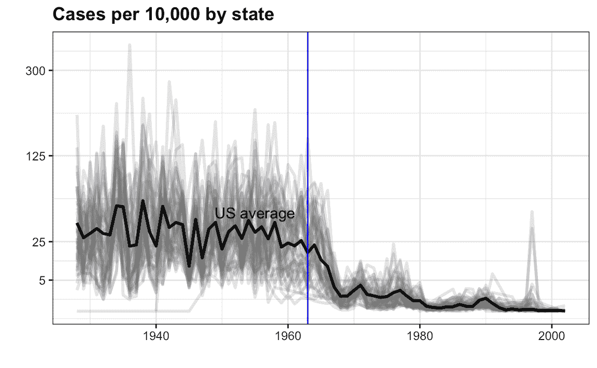

理论上，我们可以使用颜色来表示分类值州，但很难挑选出 50 种不同的颜色。

## 11.15 练习

1.  重新绘制我们之前制作的图像图表，但针对天花。对于这个图表，不要包括在 10 周或更长时间内没有报告病例的年份。

1.  现在重新绘制我们之前制作的时序图，但这次按照之前关于天花的指示进行。

1.  对于加利福尼亚州，制作一个显示所有疾病率的时序图。仅包括有 10 周或更长时间报告的年份。每种疾病使用不同的颜色。

1.  现在同样为美国的疾病率做同样的处理。提示：通过使用 summarize：总数除以总人口来计算美国的疾病率。

* * *

1.  [`kbroman.org/`](http://kbroman.org/)↩︎

1.  [`www.biostat.wisc.edu/~kbroman/presentations/graphs2017.pdf`](https://www.biostat.wisc.edu/~kbroman/presentations/graphs2017.pdf)↩︎

1.  [`github.com/kbroman/Talk_Graphs`](https://github.com/kbroman/Talk_Graphs)↩︎

1.  [`paldhous.github.io/ucb/2016/dataviz/index.html`](http://paldhous.github.io/ucb/2016/dataviz/index.html)↩︎

1.  [`mediamatters.org/blog/2013/04/05/fox-news-newest-dishonest-chart-immigration-enf/193507`](http://mediamatters.org/blog/2013/04/05/fox-news-newest-dishonest-chart-immigration-enf/193507)↩︎

1.  [`flowingdata.com/2012/08/06/fox-news-continues-charting-excellence/`](http://flowingdata.com/2012/08/06/fox-news-continues-charting-excellence/)↩︎

1.  [`www.pakistantoday.com.pk/2018/05/18/whats-at-stake-in-venezuelan-presidential-vote`](https://www.pakistantoday.com.pk/2018/05/18/whats-at-stake-in-venezuelan-presidential-vote)↩︎

1.  [`www.youtube.com/watch?v=kl2g40GoRxg`](https://www.youtube.com/watch?v=kl2g40GoRxg)↩︎

1.  [`projecteuclid.org/download/pdf_1/euclid.ss/1177010488`](https://projecteuclid.org/download/pdf_1/euclid.ss/1177010488)↩︎

1.  [`www.thelancet.com/journals/lancet/article/PIIS0140-6736(97)11096-0/abstract`](http://www.thelancet.com/journals/lancet/article/PIIS0140-6736(97)11096-0/abstract)↩︎

1.  [`www.cdc.gov/mmwr/preview/mmwrhtml/mm6316a4.htm`](https://www.cdc.gov/mmwr/preview/mmwrhtml/mm6316a4.htm)↩︎

1.  [`en.wikipedia.org/wiki/Andrew_Wakefield`](https://en.wikipedia.org/wiki/Andrew_Wakefield)↩︎

1.  [`graphics.wsj.com/infectious-diseases-and-vaccines/`](http://graphics.wsj.com/infectious-diseases-and-vaccines/)↩︎

1.  [`www.tycho.pitt.edu/`](http://www.tycho.pitt.edu/)↩︎
