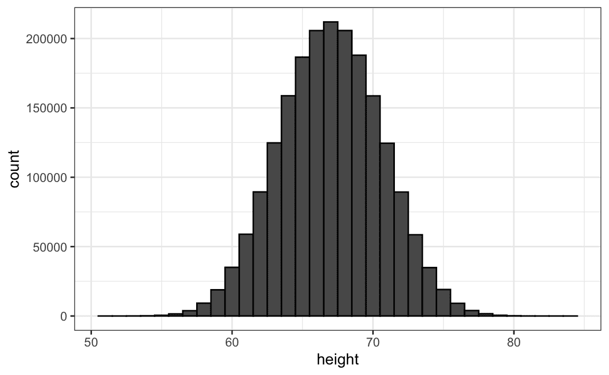
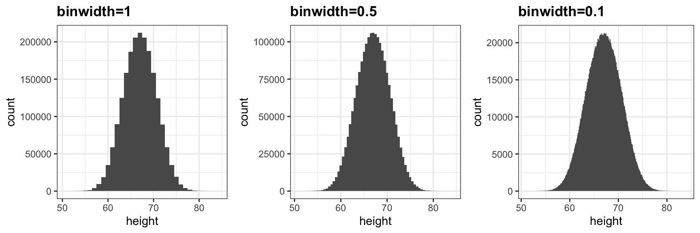
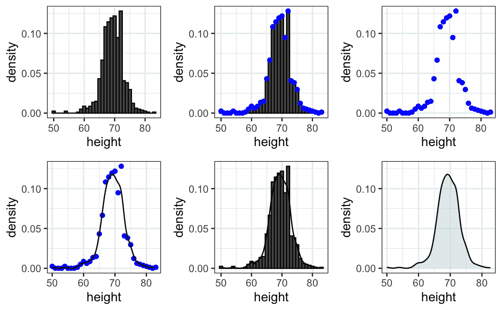
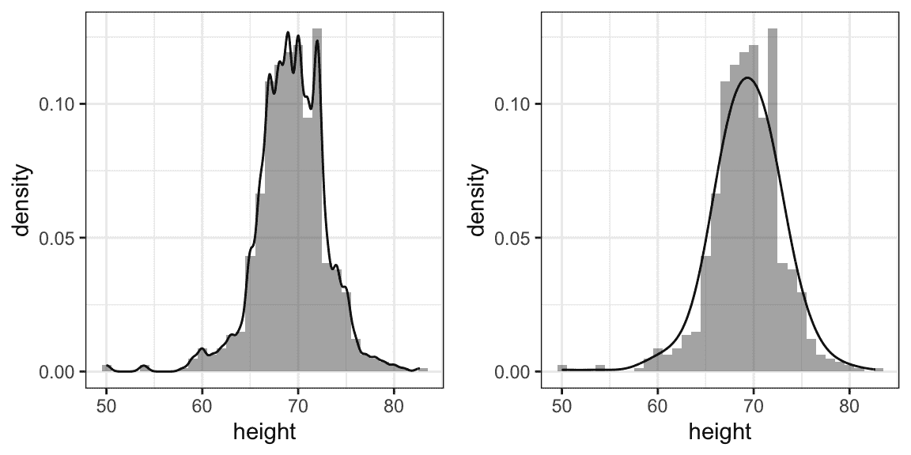
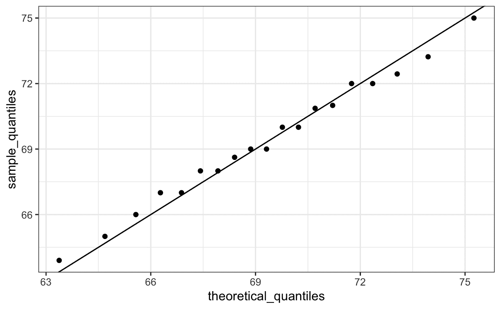
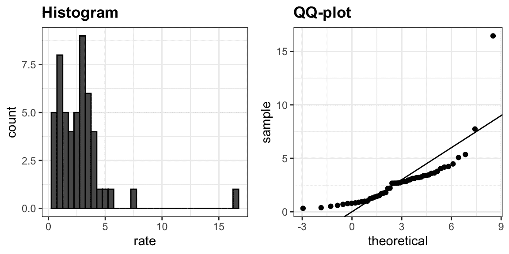
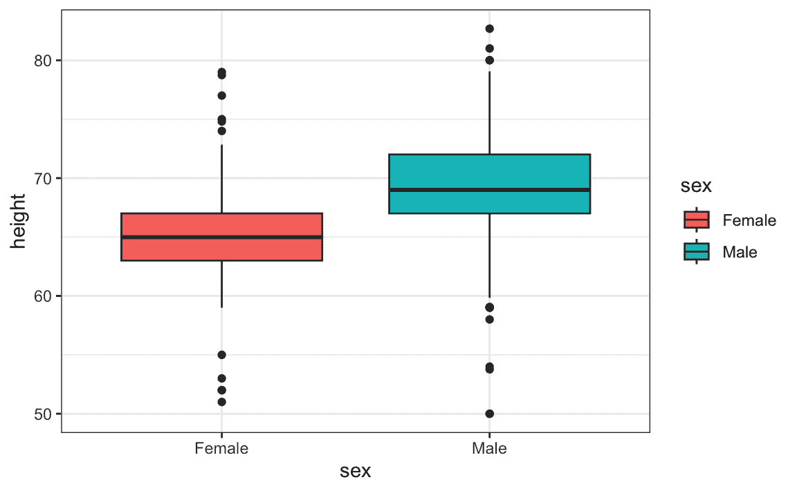
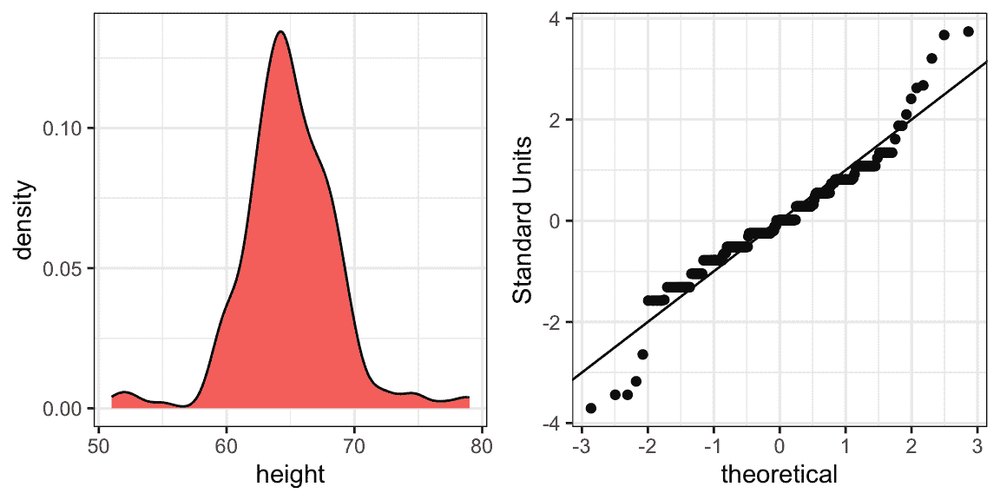
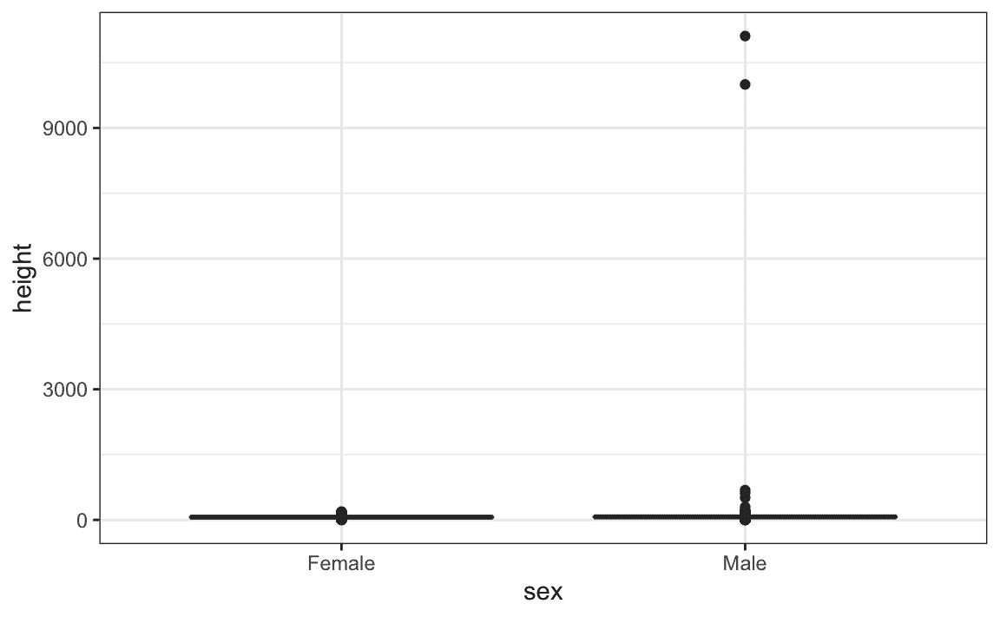

# 第十二章 概率统计摘要

> 原文：[`rafalab.dfci.harvard.edu/dsbook/summary-statistics.html`](https://rafalab.dfci.harvard.edu/dsbook/summary-statistics.html)

我们首先描述一种简单而强大的数据分析技术：构建数据摘要。虽然这种方法不需要数学模型或概率，但我们构建摘要的动机将有助于我们理解这两个主题。

数值数据通常用*平均值*来概括。例如，一所高中的质量有时用一个数字来概括：标准化测试的平均分数。偶尔，还会报告第二个数字：*标准差*。例如，你可能会看到一份报告说分数是 680 分加减 50 分，（50 是标准差）。这份报告只用两个数字就概括了整个分数向量。这是否合适？通过只看这个摘要而不是整个列表，我们是否遗漏了任何重要的信息？在这里，我们将回答这些问题，并激发几个有用的摘要统计量，包括平均值和标准差。

## 12.1 变量类型

我们将处理两种类型的变量：分类和数值。每种类型都可以分为另外两组：分类可以是有序的或不有序，而数值变量可以是离散的或连续的。

当向量的每个条目都来自少数几个组中的一个时，我们称这些数据为*分类数据*。两个简单的例子是性别（男或女）和美国地区（东北部、南部、北中部、西部）。即使这些数据不是数字，一些分类数据也可以排序，例如辣度（温和、中等、辣）。在统计学教科书中，有序分类数据被称为*有序数据*。

数值数据的例子包括人口规模、谋杀率和身高。一些数值数据可以被视为有序分类。我们可以进一步将数值数据分为连续和离散。连续变量是可以取任何值的变量，例如身高，如果测量足够精确的话。例如，一对双胞胎的身高可能分别是 68.12 英寸和 68.11 英寸。计数，如每年枪支谋杀的数量，是离散的，因为它们必须是整数。

请记住，离散数值数据可以被认为是有序的。虽然这在技术上是真的，但我们通常将有序数据这个术语保留给属于少数几个不同组别的变量，每个组别都有许多成员。相比之下，当我们有多个组别，每个组别中的案例很少时，我们通常将它们称为离散数值变量。因此，例如，一个人每天抽的香烟包数，四舍五入到最接近的包，将被认为是有序的，而实际抽的香烟数量将被认为是数值变量。但确实存在既可以被认为是数值也可以被认为是有序的例子。

## 12.2 分布

一组对象或数字的最基本的统计总结是其 *分布*。思考分布的最简单方式是将其视为一个具有许多条目的列表的紧凑描述。这个概念对于本书的读者来说不应该陌生。例如，对于分类数据，分布只是描述每个唯一类别的比例。这里有一个关于美国州地区的例子：

```r
prop.table(table(state.region))
#> state.region
#>     Northeast         South North Central          West 
#>          0.18          0.32          0.24          0.26
```

当数据是数值时，基于分布构建总结的任务更具挑战性。我们引入一个人工的、但具有说明性的、激励性的问题，这将帮助我们介绍理解分布所需的概念。

### 12.2.1 案例研究：描述学生身高

假设我们必须向 ET（一个从未见过人类的地球外生物）描述我们同学的身高。作为第一步，我们需要收集数据。为此，我们要求学生报告他们的身高（以英寸为单位）。我们要求他们提供性别信息，因为我们知道存在两种不同的性别分布。我们收集数据并将其保存在 `heights` 数据框中：

```r
library(tidyverse)
library(dslabs)
data(heights)
```

向 ET 传达身高的一种方法就是简单地发送这个包含 1050 个身高的列表。但还有更有效的方法来传达这些信息，理解分布的概念将有所帮助。为了简化解释，我们首先关注男性身高。我们将在第 12.7.1 节中检查女性身高数据。

结果表明，在某些情况下，平均值和标准差几乎是我们理解数据所需的所有。我们将学习数据可视化技术，这将帮助我们确定何时这两个数字的总结是合适的。这些相同的技巧将在两个数字不足以描述数据时作为替代方案。

### 12.2.2 经验累积分布函数

非分类的数值数据也有分布。一般来说，当数据不是分类的，报告每个条目的频率不是一个有效的总结，因为大多数条目是唯一的。在我们的案例研究中，虽然有几个学生报告身高为 68 英寸，但只有一个学生报告身高为 `68.503937007874` 英寸，只有一个学生报告身高 `68.8976377952756` 英寸。我们假设他们分别从 174 厘米和 175 厘米转换而来。

统计学教材告诉我们，对于数值数据，定义一个分布的更有用方法是定义一个函数，该函数报告所有可能的值 $a$ 下数据条目 $x$ 的比例。这个函数被称为经验累积分布函数（eCDF），通常用 $F$ 表示：

$$ F(a) = \mbox{小于或等于 }a\mbox{ 的数据点的比例} $$

这里是男性身高数据的 $F$ 图：


类似于频率表对分类数据的作用，经验累积分布函数（eCDF）定义了数值数据的分布。从图中我们可以看出，16%的值低于 65，因为 $F(66)=$ 0.164，或者 84%的值低于 72，因为 $F(72)=$ 0.841，依此类推。实际上，我们可以通过计算 $F(b) - F(a)$ 来报告任何两个高度（例如 $a$ 和 $b$）之间的值的比例。这意味着如果我们把这个图发送给 ET，他将拥有重建整个列表所需的所有信息。用“一图胜千言”这句话来比喻，在这种情况下，一张图的信息量相当于 812 个数字。

注意：我们添加“经验”这个词的原因是，正如我们将在 13.10.1 中看到的那样，累积分布函数（CDF）可以在没有数据的情况下从数学上定义。

### 12.2.3 直方图

尽管经验累积分布函数（eCDF）的概念在统计学教科书中广泛讨论，但总结图在实践中的应用实际上并不普遍。主要原因在于它不容易传达感兴趣的特性，例如：分布以什么值为中心？分布是对称的吗？哪些范围包含 95%的值？直方图更受欢迎，因为它们极大地简化了回答这类问题的过程。直方图牺牲了一点点信息，以产生更容易解释的总结。

制作直方图最简单的方法是将我们的数据范围划分为相同大小的非重叠箱。然后，对于每个箱，我们计算落在该区间内的值的数量。直方图将这些计数作为条形绘制，条形的底部由区间定义。以下是按一英寸间隔分割值范围的身高数据直方图：$(49.5, 50.5],(50.5, 51.5],(51.5,52.5],(52.5,53.5],...,(82.5,83.5]$


如上图所示，直方图类似于条形图，但不同之处在于 x 轴是数值的，而不是分类的。

如果我们把这张图发送给 ET，他将会立即了解我们数据的一些重要特性。首先，数据范围从 50 到 84，其中大多数（超过 95%）在 63 到 75 英寸之间。其次，高度在 69 英寸左右对称。此外，通过累计计数，ET 可以非常准确地获得任何区间的数据比例。因此，上面的直方图不仅易于解释，而且提供了大约 30 个箱计数中包含的几乎所有原始 812 个高度列表的信息。

我们失去了哪些信息？请注意，在计算箱高度时，每个区间内的所有值都被同等对待。所以，例如，直方图无法区分 64、64.1 和 64.2 英寸。鉴于这些差异几乎对肉眼不可见，其实际影响可以忽略不计，我们能够将数据总结为仅仅 23 个数字。

### 12.2.4 平滑密度

平滑密度图与直方图类似，但数据并没有被分成箱子。以下是我们高度数据的平滑密度图：


在这个图中，我们不再在区间边界有尖锐的边缘，许多局部峰值也被移除了。此外，y 轴的刻度从计数变成了*密度*。

要理解平滑密度，我们必须理解*估计*，这是一个我们稍后才会涉及的话题。然而，我们提供了一个启发式解释来帮助你理解基础知识。

你必须理解的主要新概念是我们假设我们的观察值列表是一个更大的未观察值列表的子集。在身高的例子中，你可以想象我们的 812 名男学生的列表来自一个假设的列表，其中包含所有男性学生的身高，这些身高都被非常精确地测量过。假设有 100 万个这样的测量值。这个值列表有一个分布，就像任何值列表一样，而这个更大的分布正是我们想要报告给 ET 的，因为它更加通用。不幸的是，我们看不到它。

然而，我们做出一个假设，这或许能帮助我们近似它。如果我们有 100 万个非常精确测量的值，我们可以制作一个非常非常小的箱子的直方图。这个假设是，如果我们展示这个，连续箱子的高度将会相似。这就是我们所说的平滑：连续箱子的高度没有大的跳跃。下面是一个假设的箱子大小为 1 的直方图：



我们使箱子越小，直方图就越平滑。以下是箱子宽度为 1、0.5 和 0.1 的直方图：



平滑密度基本上是在箱子非常非常小的时候通过直方图条形顶部的曲线。为了使曲线不依赖于假设列表的假设大小，我们计算基于频率而不是计数的曲线：


现在，回到现实中。我们没有数百万的测量值。相反，我们有 812 个，我们无法制作一个具有非常小箱子的直方图。

因此，我们制作一个直方图，使用适合我们数据大小的箱子，并计算频率而不是计数，然后我们画一条通过直方图条形顶部曲线的平滑曲线。以下图示演示了导致平滑密度的步骤：



然而，记住*平滑*是一个相对术语。我们实际上可以通过计算平滑密度曲线的函数中的选项来控制定义平滑密度的曲线的*平滑度*。以下是使用相同直方图上不同平滑度度的两个示例：



我们需要谨慎地做出这个选择，因为产生的总结可能会改变我们对数据的解释。我们应该选择一个我们可以为其辩护的平滑度，使其能够代表潜在数据。在身高的例子中，我们确实有理由相信具有相似身高的人的比例应该是相同的。例如，72 英寸的比例应该比 71 英寸的比例更接近，而不是比 78 英寸或 65 英寸的比例更接近。这意味着曲线应该相当平滑；也就是说，曲线看起来应该更像右边的例子，而不是左边的例子。

虽然直方图是一个无假设的总结，但平滑密度是基于一些假设的。

注意，解释平滑密度图的 y 轴并不简单。它是按比例缩放的，使得密度曲线下的面积总和为 1。如果你想象我们形成一个底边长度为 1 单位的箱，y 轴的值告诉我们该箱中值的比例。然而，这只适用于大小为 1 的箱。对于其他大小区间，确定该区间内数据比例的最佳方法是通过计算该区间内包含的总面积的比例。例如，这里是在 65 英寸到 68 英寸之间的值比例：


这个区域的面积比例大约是 0.3，这意味着大约 30%的男性身高在 65 英寸到 68 英寸之间。

通过理解这一点，我们准备好将平滑密度作为总结。对于这个数据集，我们会非常舒适地接受平滑性假设，因此可以与 ET 分享这个美观的图表，他可以用它来理解我们的男性身高数据：


## 12.3 练习

1. 在`murders`数据集中，地区是一个分类变量，以下是其分布：


将比例四舍五入到最接近的 5%，有多少个州位于北中部地区？

2. 以下哪个是正确的：

1.  上面的图表是一个直方图。

1.  上面的图表只显示了四个数字的条形图。

1.  类别不是数字，所以绘制分布没有意义。

1.  颜色，而不是柱状图的高度，描述了分布。

3. 下面的图显示了男性身高的 eCDF：


根据图表，有多少百分比的女性身高低于 75 英寸？

1.  100%

1.  95%

1.  80%

1.  72 英寸

4. 将高度`m`四舍五入到最接近的英寸，具有这样的性质：一半的男性学生身高高于`m`，另一半低于`m`？

1.  61 英寸

1.  64 英寸

1.  69 英寸

1.  74 英寸

5. 下面是各州谋杀率的经验累积分布函数（eCDF）：


知道有 51 个州（包括华盛顿特区）以及根据这个图表，有多少个州的谋杀率超过每 10 万人 10 起？

1.  1

1.  5

1.  10

1.  50

6. 根据上面的经验累积分布函数（eCDF），以下哪个陈述是正确的：

1.  大约一半的州的谋杀率高于每 10 万人 7 起，另一半低于。

1.  大多数州的谋杀率低于每 10 万人 2 起。

1.  所有州的谋杀率都高于每 10 万人 2 起。

1.  除了 4 个州外，谋杀率都低于每 10 万人 5 起。

7. 下面是我们`heights`数据集中男性身高的直方图：


根据这个图表，有多少男性在 63.5 到 65.5 岁之间？

1.  10

1.  24

1.  34

1.  100

8. 大约有多少比例的长度小于 60 英寸？

1.  1%

1.  10%

1.  25%

1.  50%

9. 根据下面的密度图，大约有多少比例的美国州人口超过 1000 万？


1.  0.02

1.  0.15

1.  0.50

1.  0.55

10. 下面是三个密度图。它们可能是来自同一个数据集的吗？


以下哪个陈述是正确的：

1.  它们不可能来自同一个数据集。

1.  它们来自同一个数据集，但由于代码错误，图表不同。

1.  它们是同一个数据集，但第一个和第二个图表下平滑，第三个上平滑。

1.  它们是同一个数据集，但第一个不在对数尺度上，第二个下平滑，第三个上平滑。

## 12.4 正态分布

直方图和密度图提供了对分布的优秀总结。但我们能否进一步总结？我们经常看到平均值和标准差被用作总结统计量：一个双数总结！为了理解这些总结是什么以及为什么它们被广泛使用，我们需要了解正态分布。

正态分布，也称为钟形曲线和高斯分布，是历史上最著名的数学概念之一。一个原因是大约正常的分布出现在许多情况下，包括赌博收益、身高、体重、血压、标准化考试成绩和实验测量误差。对此有解释，但我们稍后描述。这里我们关注正态分布如何帮助我们总结数据。

而不是使用数据，正态分布是通过数学公式定义的。对于任何区间 $(a,b)$，该区间内值的比例可以使用此公式计算：

$$\mbox{Pr}(a < x \leq b) = \int_a^b \frac{1}{\sqrt{2\pi}s} e^{-\frac{1}{2}\left( \frac{x-m}{s} \right)²} \, dx$$

您不需要记住或理解公式的细节。但请注意，它完全由两个参数定义：$m$ 和 $s$。公式中的其余符号代表区间的端点 $a$ 和 $b$，以及已知的数学常数 $\pi$ 和 $e$。这两个参数，$m$ 和 $s$，分别被称为分布的 *平均*（也称为 *均值*）和 *标准差*（SD）。

分布是对称的，以平均值为中心，大部分值（大约 95%）都在平均值加减 2 个标准差范围内。当平均值是 0，标准差是 1 时，正态分布看起来是这样的：


事实是，分布仅由两个参数定义，这意味着如果一个数据集被近似为正态分布，描述分布所需的所有信息都可以编码在两个数字中：平均值和标准差。我们现在为任意的一组数字定义这些值。

对于包含在向量 `x` 中的数字列表，平均值定义为：

```r
m <- sum(x) / length(x)
```

标准差定义为：

```r
s <- sqrt(sum((x-mu)²) / length(x))
```

这可以解释为值与它们平均值之间的平均距离。

让我们计算男性的身高值，我们将这些值存储在对象 $x$ 中：

```r
index <- heights$sex == "Male"
x <- heights$height[index]
```

可以使用预定义的函数 `mean` 和 `sd`：

```r
m <- mean(x)
s <- sd(x)
c(average = m, sd = s)
#> average      sd 
#>   69.31    3.61
```

高级笔记：根据统计教材中解释的原因，`sd` 是除以 `length(x)-1` 而不是 `length(x)`。因此，当 `length(x)` 较大时，`sd(x)` 和 `sqrt(sum((x-mu)²) / length(x))` 这两个实际上是相等的。

这里是一个以黑色线条表示平均值 = 69.3 和标准差 = 3.6 的平滑密度和正态分布的图，我们的学生身高平滑密度用蓝色表示：


正态分布在这里似乎是一个相当好的近似。我们现在将看到这个近似在预测区间内值的比例方面表现如何。

### 12.4.1 标准单位

对于近似正态分布的数据，用标准单位来思考是方便的。一个值的标准化单位告诉我们它离平均值有多少个标准差。具体来说，对于来自向量 `X` 的值 `x`，我们定义 `x` 的标准化值为 `z = (x - m)/s`，其中 `m` 和 `s` 分别是 `X` 的平均值和标准差。为什么这是方便的？

首先回顾一下正态分布的公式，并注意正在指数化的部分是 $-z²/2$，其中 $z$ 等同于标准单位下的 $x$。因为 $e^{-z²/2}$ 的最大值出现在 $z=0$ 时，这解释了为什么分布的最大值出现在平均值处。这也解释了对称性，因为 $- z²/2$ 在 0 处是对称的。其次，注意如果我们把正态分布的数据转换成标准单位，我们可以快速知道，例如，一个人是否大约是平均值（$z=0$），是否是最大的一个（$z \approx 2$），是否是最小的一个（$z \approx -2$），或者是一个极其罕见的事件（$z > 3$ 或 $z < -3$）。记住，原始单位是什么并不重要，这些规则适用于任何近似正态的数据。

在 R 中，我们可以使用 `scale` 函数获得标准单位：

```r
z <- scale(x)
```

现在要查看有多少男性在平均值加减 2 个标准差范围内，我们只需输入：

```r
mean(abs(z) < 2)
#> [1] 0.95
```

比例大约是 95%，这正是正态分布所预测的！为了进一步确认实际上近似是好的，我们可以使用分位数-分位数图。

### 12.4.2 分位数-分位数图

评估正态分布如何很好地拟合数据的一种系统方法是检查观察到的和预测的比例是否匹配。通常，这是分位数-分位数图（QQ-图）的方法。

首先，让我们定义正态分布的理论分位数。在统计学书籍中，我们使用符号 $\Phi(x)$ 来定义一个函数，该函数给出小于 $x$ 的标准正态分布数据的比例。例如，$\Phi(-1.96) = 0.025$ 和 $\Phi(1.96) = 0.975$。在 R 中，我们可以使用 `pnorm` 函数评估 $\Phi$：

```r
pnorm(-1.96)
#> [1] 0.025
```

逆函数 $\Phi^{-1}(x)$ 给出了正态分布的*理论分位数*。例如，$\Phi^{-1}(0.975) = 1.96$。在 R 中，我们可以使用`qnorm`函数评估$\Phi$的逆。

```r
qnorm(0.975)
#> [1] 1.96
```

注意，这些计算默认是针对标准正态分布（均值 = 0，标准差 = 1）进行的，但我们可以为任何正态分布定义这些。我们可以使用 `pnorm` 和 `qnorm` 函数中的 `mean` 和 `sd` 参数来完成此操作。例如，我们可以使用 `qnorm` 确定具有特定平均值和标准差的分布的分位数。

```r
qnorm(0.975, mean = 5, sd = 2)
#> [1] 8.92
```

对于正态分布，所有与分位数相关的计算都是在没有数据的情况下完成的，因此称为*理论分位数*。但是，可以为任何分布定义分位数，包括经验分布。因此，如果我们有一个向量 $x$ 中的数据，我们可以定义与任何比例 $p$ 相关的分位数 $q$，即 $q$ 是使得小于 $q$ 的值的比例等于 $p$ 的 $q$。使用 R 代码，我们可以定义 `q` 为使得 `mean(x <= q) = p` 的值。请注意，并非所有的 $p$ 都有一个使得比例正好等于 $p$ 的 $q$。有关如何定义最佳 $q$ 的几种方法，请参阅 `quantile` 函数的帮助文档。

为了快速举例，对于男性身高数据，我们有：

```r
mean(x <= 69.5)
#> [1] 0.515
```

因此，大约 50%的人身高短于或等于 69 英寸。这意味着如果 $p=0.50$，则 $q=69.5$。

QQ-图的想法是，如果你的数据很好地被正态分布近似，那么你的数据的分位数应该与正态分布的分位数相似。为了构建 QQ-图，我们执行以下操作：

1.  定义一个比例向量 $p_1, p_2, \dots, p_m$。

1.  定义一个比例 $p_1, \dots, p_m$ 的分位数向量 $q_1, \dots, q_m$，用于你的数据。我们称这些为*样本分位数*。

1.  定义一个比例 $p_1, \dots, p_m$ 的理论分位数向量，对于具有与数据相同平均值和标准差的正态分布。

1.  绘制样本分位数与理论分位数的关系图。

让我们使用 R 代码构建一个 QQ-图。首先定义比例向量。

```r
p <- seq(0.05, 0.95, 0.05)
```

要从数据中获得分位数，我们可以使用`quantile`函数，如下所示：

```r
sample_quantiles <- quantile(x, p)
```

要获得具有相应平均值和标准差的正态分布分位数，我们使用`qnorm`函数：

```r
theoretical_quantiles <- qnorm(p, mean = mean(x), sd = sd(x))
```

为了查看它们是否匹配，我们将它们相互绘制并绘制等价线：

```r
qplot(theoretical_quantiles, sample_quantiles) + geom_abline()
```



注意，如果我们使用标准单位，这段代码会变得更加简洁：

```r
sample_quantiles <- quantile(z, p)
theoretical_quantiles <- qnorm(p) 
qplot(theoretical_quantiles, sample_quantiles) + geom_abline()
```

上述代码包含其中是为了帮助描述 QQ 图。然而，在实践中，使用**ggplot2**代码更简单：

```r
heights |> filter(sex == "Male") |>
 ggplot(aes(sample = scale(height))) + 
 geom_qq() +
 geom_abline()
```

而对于上面的示例，我们使用了 20 个分位数，`geom_qq`函数的默认做法是使用与数据点一样多的分位数。

注意，尽管在这里我们使用了 QQ 图来比较观察到的分布与数学上定义的正态分布，但 QQ 图可以用来比较任何两个分布。

## 12.5 百分位数

在我们继续之前，让我们定义一些在探索性数据分析中常用的一些术语。

*百分位数*是*分位数*的特殊情况，通常被广泛使用。百分位数是在将$p$设置为$0.01, 0.02, ..., 0.99$时获得的分位数。例如，当$p=0.25$时，我们称之为 25 百分位数，它给出了一个数值，表示 25%的数据低于这个数值。最著名的百分位数是 50 百分位数，也称为*中位数*。

对于正态分布，*中位数*和平均值是相同的，但通常并非如此。

另一个获得名称的特殊情况是*四分位数*，当将$p$设置为$0.25, 0.50$和$0.75$时获得。

## 12.6 箱线图

为了介绍箱线图，我们将使用美国各州谋杀数据的集合。假设我们想要总结谋杀率分布。使用我们学到的技术，我们可以快速看到正态近似在这里不适用：



在这种情况下，上面的直方图或平滑密度图可以作为一个相对简洁的摘要。

现在假设那些习惯于只接收两个数字作为总结的人要求我们提供一个更紧凑的数值摘要。

箱线图提供了一个由范围以及四分位数（25 分位数、50 分位数和 75 分位数）组成的五数摘要。箱线图在计算范围时通常忽略*异常值*，并将这些值作为独立点进行绘制。我们将在稍后提供异常值的详细解释。最后，他建议我们将这些数值绘制成“箱”状，并带有“胡须”的形状，如下所示：


箱线图由 25%和 75%百分位数定义的箱以及显示范围的胡须组成。这两个值之间的距离称为*四分位距*。默认情况下，我们使用的 R 函数将这两个点视为异常值。中位数用水平线表示。今天，我们称之为*箱线图*。

从这张简单的图中，我们可以知道中位数大约是 2.5，分布不是对称的，以及对于大多数州来说，范围是 0 到 5，只有两个例外。

## 12.7 分层

在数据分析中，我们通常根据与这些观察相关的变量值将观察结果分为一组或多组。例如，在下一节中，我们将身高值根据性别变量分为两组：女性和男性。我们称这种程序为*分层*，并将由此产生的组称为*层*。

分层在数据可视化中很常见，因为我们通常对变量在不同子组中的分布差异感兴趣。我们将在本书的这一部分看到几个例子。

### 12.7.1 案例研究：描述学生身高（继续）

使用直方图、密度图和 QQ 图，我们确信男性身高数据可以用正态分布很好地近似。在这种情况下，我们向 ET 报告一个非常简洁的总结：男性身高遵循平均值为 69.3 英寸，标准差为 3.6 英寸的正态分布。有了这些信息，ET 将对他遇到我们的男性学生有一个很好的预期。然而，为了提供一个完整的画面，我们还需要提供女性身高的总结。

我们了解到，当我们想要快速比较两个或多个分布时，箱线图很有用。以下是男性和女性的身高：



图表立即显示，男性平均身高高于女性。标准差看起来很相似。但是，正态近似也适用于调查收集的女性身高数据吗？我们预计它们将遵循正态分布，就像男性一样。然而，探索性图表显示，这种近似并不那么有用：



我们看到了我们没有看到的情况：密度图有一个第二个*峰值*。此外，QQ 图显示，最高的点往往比正态分布预期的要高。最后，我们还在 QQ 图中看到了五个点，这些点表明对于正态分布来说，身高比预期的要短。在向 ET 报告时，我们可能需要提供一个直方图，而不仅仅是女性身高的平均值和标准差。

我们注意到了我们没有预料到的情况。如果我们查看其他女性的身高分布，我们发现它们可以用正态分布很好地近似。那么，为什么我们的女学生与众不同呢？我们的班级是女性篮球队的必修课吗？是否有少数女性声称自己比实际身高高？另一个，可能更合理的解释是，在学生用来输入他们身高的表格中，`FEMALE`是默认性别，一些男性输入了他们的身高，但忘记了更改性别变量。无论如何，数据可视化帮助我们发现了数据中可能存在的缺陷。

关于五个最小值，请注意，这些值是：

```r
heights |> filter(sex == "Female") |> 
 top_n(5, desc(height)) |>
 pull(height)
#> [1] 51 53 55 52 52
```

由于这些是报告的身高，一个可能性是学生本意是想输入`5'1"`、`5'2"`、`5'3"`或`5'5"`。

## 12.8 练习

1. 定义包含男性和女性身高的变量，如下所示：

```r
library(dslabs)
data(heights)
male <- heights$height[heights$sex == "Male"]
female <- heights$height[heights$sex == "Female"]
```

我们对每个测量有多少个数据？

2. 假设我们无法绘制图表，而想并排比较分布。我们无法只是列出所有数字。相反，我们将查看百分位数。创建一个包含`female_percentiles`和`male_percentiles`的五行表，显示每个性别的第 10、30、50、70 和 90 个百分位数。然后创建一个包含这两个作为列的数据框。

3. 研究以下按国家划分的人口规模的箱线图：


哪个大陆拥有人口最多的国家？

4. 哪个大陆的中位人口数量最大？

5. 非洲的中位人口规模是多少，四舍五入到百万？

6. 欧洲有多少比例的国家人口低于 1400 万？

1.  0.99

1.  0.75

1.  0.50

1.  0.25

7. 如果我们使用对数变换，上面显示的哪个大陆的样本四分位距最大？

8. 加载身高数据集，并创建一个只包含男性身高的向量`x`：

```r
library(dslabs)
data(heights)
x <- heights$height[heights$sex=="Male"]
```

数据中有多少比例在 69 到 72 英寸之间（高于 69 英寸，但不超过或等于 72 英寸）？提示：使用逻辑运算符和`mean`。

9. 假设你只知道数据的平均值和标准差。使用正态近似来估计你刚刚计算的比例。提示：首先计算平均值和标准差。然后使用`pnorm`函数来预测比例。

10. 注意到第九个问题中计算的近似值非常接近第一个问题中精确计算的值。现在对更极端的值执行相同的任务。比较区间（79,81]的精确计算和正态近似。实际比例比近似值大多少倍？

11. 将世界上成年男性的分布近似为平均值为 69 英寸，标准差为 3 英寸的正态分布。使用这个近似值，估计成年男性中身高为 7 英尺或更高的比例，称为*七英尺高*。提示：使用`pnorm`函数。

12. 在世界上，大约有 10 亿名 18 至 40 岁的男性。使用你之前问题的答案来估计世界上有多少名这些男性（18-40 岁）的身高为 7 英尺或更高？

13. 大约有 10 名国家篮球协会（NBA）球员身高为 7 英尺或更高。使用前两个问题的答案，世界上 18 至 40 岁的*7 英尺高*人群中有多少比例在 NBA？

14. 对勒布朗·詹姆斯的身高（6 英尺 8 英寸）重复之前问题的计算：大约有 150 名球员的身高至少是这个高度。

15. 在回答前一个问题中，我们发现 7 英尺高的人成为 NBA 球员并不罕见。对我们计算的一个公平批评是什么：

1.  练习和天赋是成为一名伟大篮球运动员的关键，而不是身高。

1.  正态近似对于身高来说并不合适。

1.  如第 10 题所示，正态近似往往低估极端值。可能七英尺高的人比我们预测的多。

1.  如第 10 题所示，正态近似往往高估极端值。可能七英尺高的人比我们预测的少。

## 12.9 稳健的总结

### 12.9.1 异常值

我们之前描述了箱线图如何显示*异常值*，但我们没有提供一个精确的定义。在这里，我们讨论异常值、有助于检测它们的途径以及考虑它们存在的总结。

在现实世界的数据分析中，异常值非常常见。数据记录可能很复杂，观察到的数据点可能是在错误中产生的。例如，一个旧的监控设备在完全失效之前可能会读出无意义的测量值。人为错误也是异常值的一个来源，尤其是在手动输入数据时。例如，一个人可能会错误地将他们的身高以厘米为单位输入而不是英寸，或者将小数点放在错误的位置。

我们如何区分异常值和仅由于预期变异性而太大或太小的测量值？这并不总是容易回答的问题，但我们会尝试提供一些指导。让我们从一个简单的案例开始。

假设一位同事负责收集一组男性的人口统计数据。数据报告身高以英尺为单位，并存储在对象中：

```r
library(tidyverse)
library(dslabs)
data(outlier_example)
str(outlier_example)
#>  num [1:500] 5.59 5.8 5.54 6.15 5.83 5.54 5.87 5.93 5.89 5.67 ...
```

我们的同事利用了身高通常很好地符合正态分布的事实，并用平均值和标准差总结了数据

```r
mean(outlier_example)
#> [1] 6.1
sd(outlier_example)
#> [1] 7.8
```

并且写了一份关于这个男性群体比平常高得多的有趣事实的报告。平均身高超过六英尺！然而，使用你的数据分析技能，你却注意到一些意想不到的事情：标准差超过七英尺。加减两个标准差，你会发现 95%的这部分人群的身高将在-9.489 至 21.697 英尺之间，这显然是不合逻辑的。一个快速的图表揭示了问题：

```r
boxplot(outlier_example)
```


看起来至少有一个值是不合逻辑的，因为我们知道 180 英尺的身高是不可能的。箱线图将这个点检测为异常值。

### 12.9.2 中位数

当我们遇到这样的异常值时，平均值可能会变得非常大。从数学上讲，我们可以通过简单地改变一个数字来使平均值变得任意大：在 500 个数据点中，我们可以通过向一个数字添加 $\Delta \times$ 500 来增加任何数量的 $\Delta$。中位数，定义为一半的值比它小，另一半的值比它大，对这样的异常值具有稳健性。无论我们如何使最大点变得很大，中位数都保持不变。

使用这些数据，中位数是：

```r
median(outlier_example)
#> [1] 5.74
```

大约是五英尺九英寸。

中位数是箱线图显示为水平线的值。

### 12.9.3 四分位距（IQR）

箱线图中的箱子由第一和第三四分位数定义。这些是为了提供数据变异性的概念：50%的数据落在这个范围内。第三四分位数和第一四分位数（或 75 百分位数和 25 百分位数）之间的差异被称为四分位距（IQR）。与中位数一样，这个量对异常值具有稳健性，因为大值不会影响它。我们可以做一些数学计算来看到，对于正态分布的数据，IQR / 1.349 近似于没有异常值时的数据标准差。我们可以看到，在我们的例子中，我们得到的标准差估计值为：

```r
IQR(outlier_example) / 1.349
#> [1] 0.245
```

这大约是 3 英寸。

### 12.9.4 图基对异常值的定义

在 R 中，落在箱线图胡须外的点被称为*异常值*。这种异常值的定义是由约翰·图基（John Tukey）提出的。上胡须的末端在 75 百分位数加上 1.5 $\times$ IQR 处。同样，下胡须的末端在 25 百分位数减去 1.5$\times$ IQR 处。如果我们定义第一和第三四分位数分别为$Q_1$和$Q_3$，那么异常值是指任何超出以下范围的值：

$$[Q_1 - 1.5 \times (Q_3 - Q1), Q_3 + 1.5 \times (Q_3 - Q1)].$$

当数据呈正态分布时，这些值的标准单位是：

```r
q3 <- qnorm(0.75)
q1 <- qnorm(0.25)
iqr <- q3 - q1
r <- c(q1 - 1.5*iqr, q3 + 1.5*iqr)
r
#> [1] -2.7  2.7
```

使用`pnorm`函数，我们可以看到 99.3%的数据落在这个区间内。

请记住，这并不是一个如此极端的事件：如果我们有 1000 个正态分布的数据点，我们预计大约有 7 个超出这个范围。但它们不会被视为异常值，因为我们预计在典型变异下会看到它们。

如果我们想让异常值更罕见，可以将 1.5 增加到更大的数字。图基（Tukey）也使用了 3，并将这些称为*远端*异常值。在正态分布中，100%的数据都落在这个区间内。这相当于大约有 2 百万分之一的概率超出这个范围。在`geom_boxplot`函数中，这可以通过`outlier.size`参数来控制，默认值为 1.5。

180 英寸的测量值远远超出了身高数据的范围：

```r
max_height <- quantile(outlier_example, 0.75) + 3*IQR(outlier_example)
max_height
#>  75% 
#> 6.91
```

如果我们去掉这个值，我们可以看到数据实际上如预期的那样呈正态分布：

```r
x <- outlier_example[outlier_example < max_height]
qqnorm(x)
qqline(x)
```


### 12.9.5 中位数绝对偏差

另一种在存在异常值的情况下稳健地估计标准差的方法是使用中位数绝对偏差（MAD）。为了计算 MAD，我们首先计算中位数，然后对每个值计算它与中位数之间的距离。MAD 定义为这些距离的中位数。由于一些未在此讨论的技术原因，这个量需要乘以 1.4826，以确保它近似于实际的标准差。`mad`函数已经包含了这一修正。对于身高数据，我们得到的 MAD 为：

```r
mad(outlier_example)
#> [1] 0.237
```

这大约是 3 英寸。

## 12.10 练习

我们将使用 **HistData** 包。如果尚未安装，你可以像这样安装它：

```r
install.packages("HistData")
```

加载高度数据集，并创建一个向量 `x`，其中只包含加尔顿在其关于遗传的历史研究中使用的男性身高。

```r
library(HistData)
data(Galton)
x <- Galton$child
```

1. 计算这些数据的平均值和中位数。

2. 计算这些数据的平均值和中值绝对偏差。

3. 现在假设加尔顿在输入第一个值时犯了一个错误，并且忘记使用小数点。你可以通过输入以下内容来模仿这个错误：

```r
x_with_error <- x
x_with_error[1] <- x_with_error[1]*10
```

在这个错误之后，平均高度增长了多少英寸？

4. 在这个错误之后，SD 增长了多少英寸？

5. 在这个错误之后，中值增长了多少英寸？

6. 在这个错误之后，MAD 增长了多少英寸？

7. 你如何使用探索性数据分析来检测出错误？

1.  由于这只是一个众多值中的一个，我们将无法检测到这一点。

1.  我们会看到分布的明显偏移。

1.  箱线图、直方图或 QQ 图将揭示一个明显的异常值。

1.  散点图将显示高水平的测量误差。

8. 在这种错误下，平均值可能会意外增长多少？编写一个名为 `error_avg` 的函数，该函数接受一个值 `k` 并返回将向量 `x` 的第一个条目更改为 `k` 后的平均值。显示 `k=10000` 和 `k=-10000` 的结果。

### 12.10.1 案例研究：自我报告的学生身高

我们一直在看的高度不是学生报告的原高度。原始报告的高度也包含在 **dslabs** 包中，可以像这样加载：

```r
library(dslabs)
data("reported_heights")
```

高度是一个字符向量，因此我们创建了一个新的列，包含数字版本：

```r
reported_heights <- reported_heights |>
 mutate(original_heights = height, height = as.numeric(height))
#> Warning: There was 1 warning in `mutate()`.
#> ℹ In argument: `height =
#>   as.numeric(height)`.
#> Caused by warning:
#> ! NAs introduced by coercion
```

注意，我们得到了关于 NAs 的警告。这是因为一些自我报告的高度不是数字。我们可以看到为什么会有这些：

```r
reported_heights |> filter(is.na(height)) |>  head()
#>            time_stamp    sex height original_heights
#> 1 2014-09-02 15:16:28   Male     NA            5' 4"
#> 2 2014-09-02 15:16:37 Female     NA            165cm
#> 3 2014-09-02 15:16:52   Male     NA              5'7
#> 4 2014-09-02 15:16:56   Male     NA            >9000
#> 5 2014-09-02 15:16:56   Male     NA             5'7"
#> 6 2014-09-02 15:17:09 Female     NA             5'3"
```

一些学生使用英尺和英寸而不是仅使用英寸来自我报告他们的身高。其他人使用厘米，还有一些人只是在恶作剧。目前，我们将删除这些条目：

```r
reported_heights <- filter(reported_heights, !is.na(height))
```

如果我们计算平均值和标准差，我们会注意到我们得到了奇怪的结果。平均值和标准差与中值和 MAD 不同：

```r
reported_heights |> 
 group_by(sex) |>
 summarize(average = mean(height), sd = sd(height),
 median = median(height), MAD = mad(height))
#> # A tibble: 2 × 5
#>   sex    average    sd median   MAD
#>   <chr>    <dbl> <dbl>  <dbl> <dbl>
#> 1 Female    63.4  27.9   64.2  4.05
#> 2 Male     103\.  530\.    70    4.45
```

这表明我们存在异常值，通过创建箱线图可以确认：



我们可以看到一些相当极端的值。为了查看这些值是什么，我们可以快速查看使用 `arrange` 函数的最大值：

```r
reported_heights |> arrange(desc(height)) |> top_n(10, height)
#>             time_stamp    sex height original_heights
#> 1  2014-09-03 23:55:37   Male  11111            11111
#> 2  2016-04-10 22:45:49   Male  10000            10000
#> 3  2015-08-10 03:10:01   Male    684              684
#> 4  2015-02-27 18:05:06   Male    612              612
#> 5  2014-09-02 15:16:41   Male    511              511
#> 6  2014-09-07 20:53:43   Male    300              300
#> 7  2014-11-28 12:18:40   Male    214              214
#> 8  2017-04-03 16:16:57   Male    210              210
#> 9  2015-11-24 10:39:45   Male    192              192
#> 10 2014-12-26 10:00:12   Male    190              190
#> 11 2016-11-06 10:21:02 Female    190              190
```

前七个条目看起来像是奇怪的错误。然而，接下来的几个条目看起来像是被输入为厘米而不是英寸。由于 184 厘米相当于六英尺高，我们怀疑 184 实际上应该是 72 英寸。

我们可以通过查看 Tukey 认为的 *离群值* 的数据来回顾所有这些荒谬的答案：

```r
whisker <- 3*IQR(reported_heights$height)
max_height <- quantile(reported_heights$height, .75) + whisker
min_height <- quantile(reported_heights$height, .25) - whisker
reported_heights |> 
 filter(!between(height, min_height, max_height)) |> 
 select(original_heights) |>
 head(n=10) |> pull(original_heights)
#>  [1] "6"     "5.3"   "511"   "6"     "2"     "5.25"  "5.5"   "11111"
#>  [9] "6"     "6.5"
```

仔细检查这些高度，我们发现存在两个常见的错误：以厘米为单位的条目，结果发现太大，以及形式为 `x.y` 的条目，其中 `x` 和 `y` 分别代表英尺和英寸，结果发现太小。一些甚至更小的值，例如 1.6，可能是以米为单位的条目。
