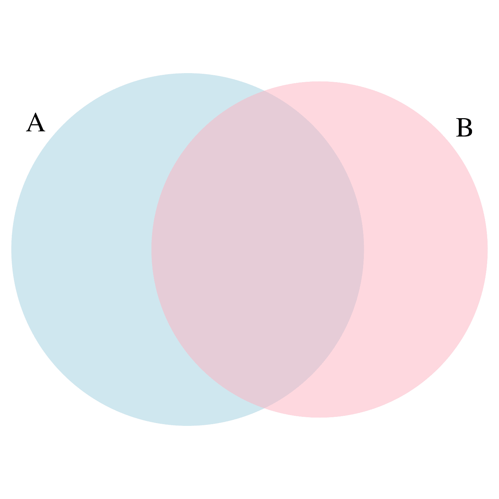
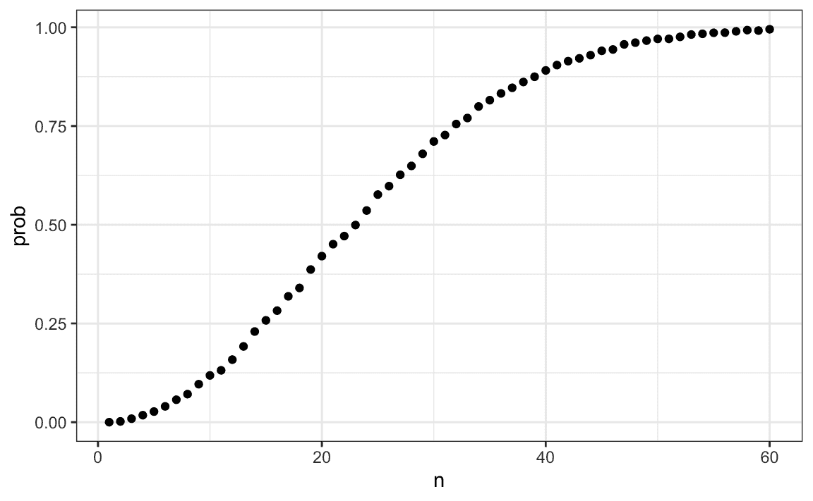
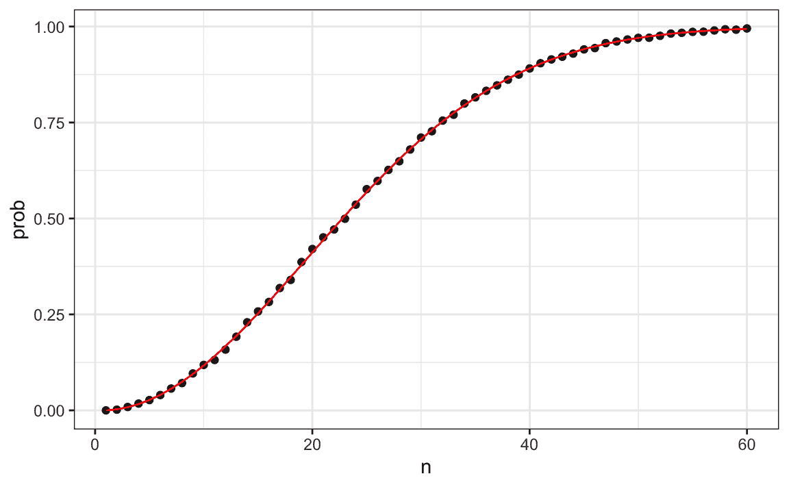
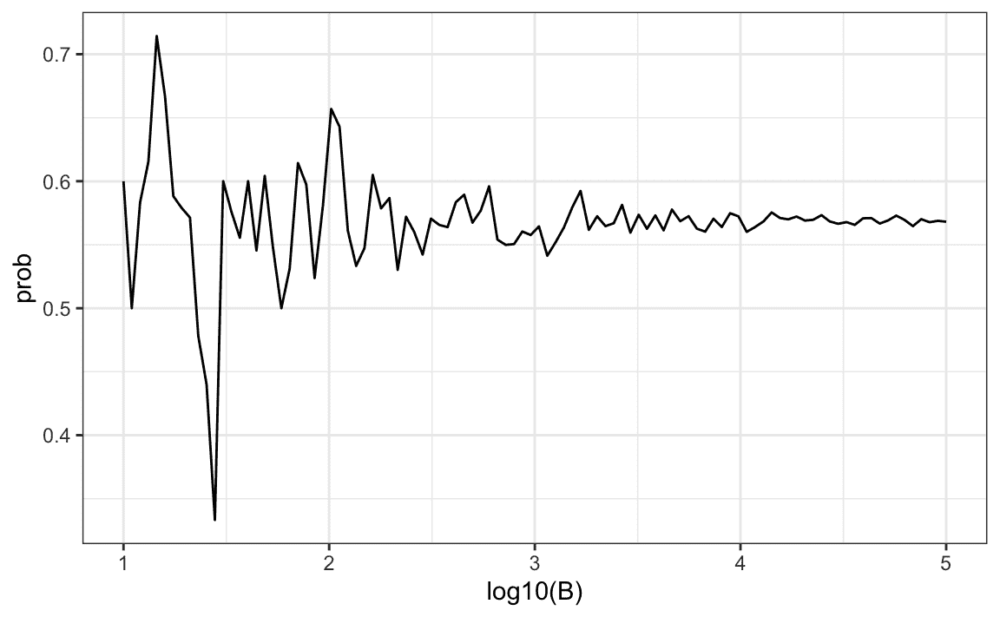
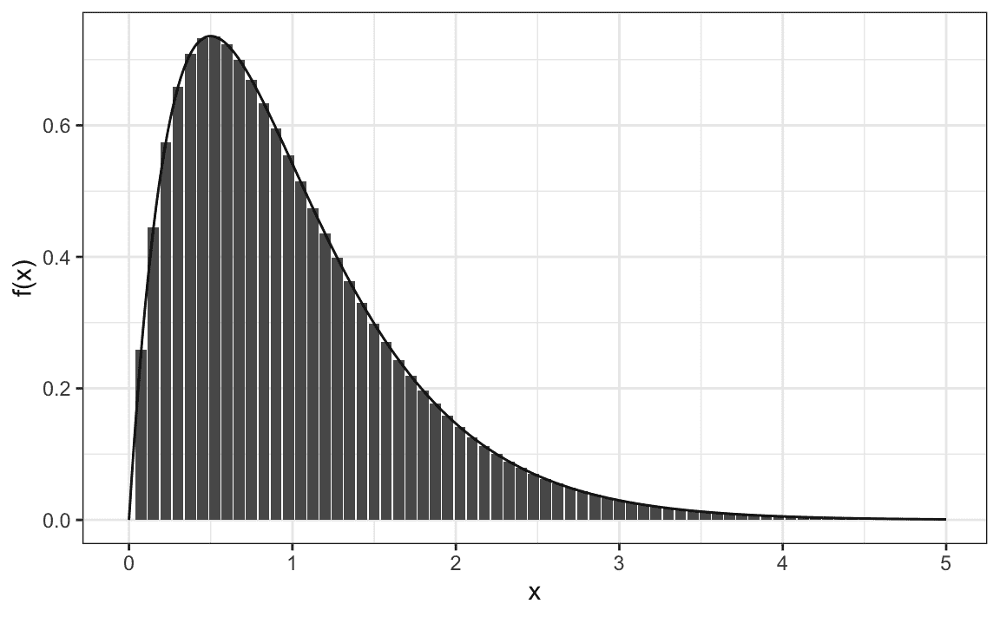
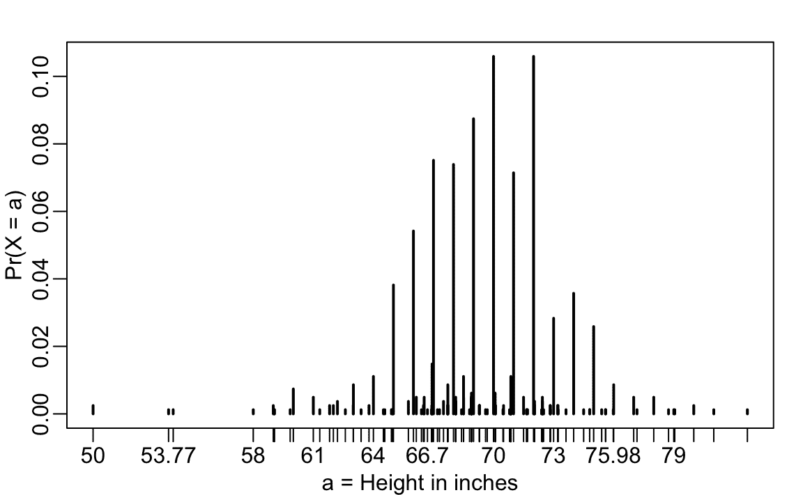
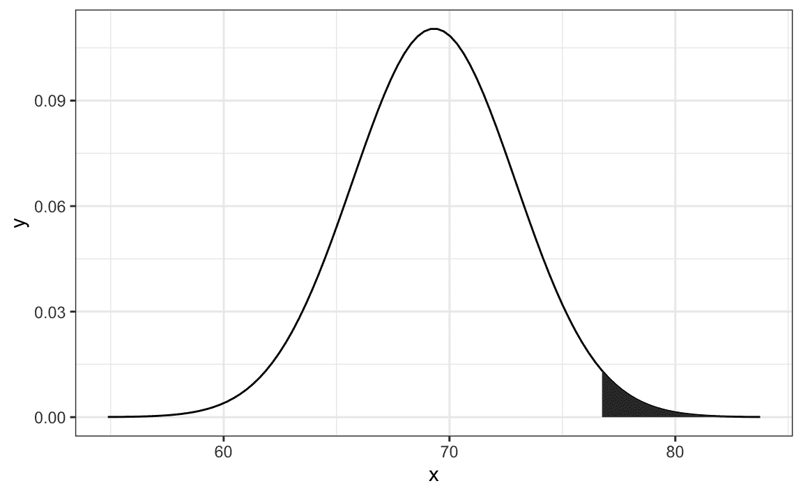
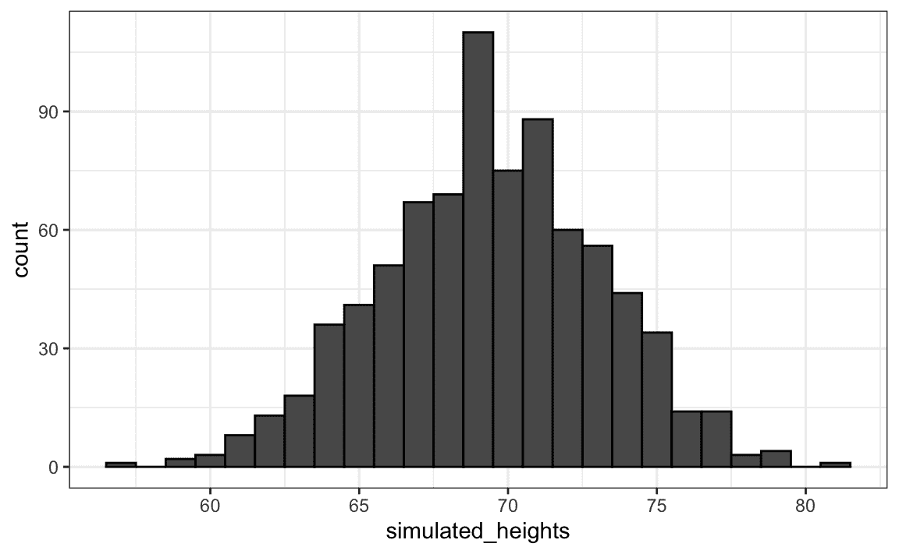
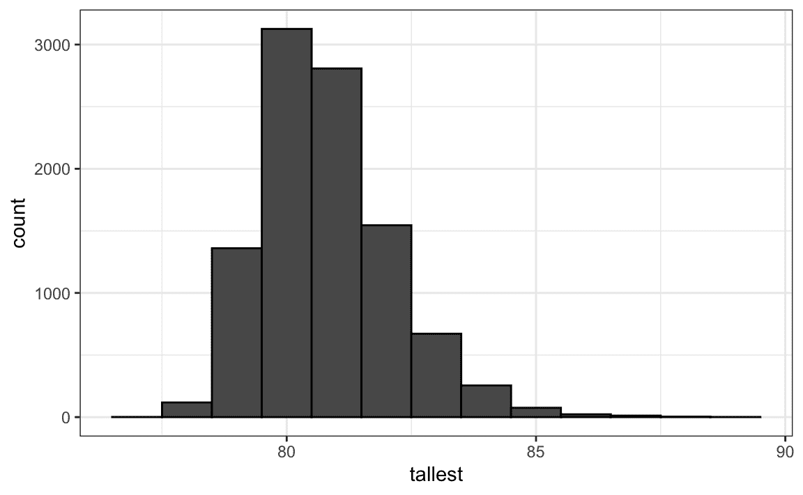

# 第十三章 概率

> 原文：[`rafalab.dfci.harvard.edu/dsbook/probability.html`](https://rafalab.dfci.harvard.edu/dsbook/probability.html)

在机会游戏中，概率有一个非常直观的定义。例如，我们知道掷两个骰子出现 7 的概率是 1/6。然而，在其他情境中并非如此。如今，概率论被更广泛地使用，而“概率”这个词在日常生活中也经常被使用。谷歌自动补全“有什么机会”给出：“生双胞胎”、“今天下雨”、“被雷击中”和“得癌症”。本书的这一部分的目标之一是帮助我们理解在执行数据分析时，概率是如何帮助我们理解和描述现实世界事件的。

由于知道如何计算概率可以在机会游戏中给你带来优势，历史上许多聪明的人，包括著名的数学家如卡尔达诺、费马和帕斯卡，都花费时间和精力思考这些游戏的数学问题。因此，概率论诞生了。概率论在现代机会游戏中仍然非常有用。例如，在扑克牌游戏中，我们可以根据桌上的牌来计算赢得一手牌的概率。此外，赌场也依靠概率论来开发几乎肯定能保证利润的游戏。

概率论在许多其他情境中都很有用，尤其是在某些方面受偶然因素影响的数据领域。本部分的所有其他章节都是建立在概率论基础之上的。因此，对概率的了解对于数据科学来说是必不可少的。

## 13.1 离散概率

我们首先介绍一些与分类数据相关的基本原则。概率的子集被称为*离散概率*。这有助于我们理解我们将在后面介绍的概率论，它对于数据科学应用中的数值和连续数据来说更为常见。离散概率在纸牌游戏中更有用，因此我们使用这些作为例子。

### 13.1.1 相对频率

“概率”这个词在日常生活中被广泛使用。回答关于概率的问题往往很困难，甚至不可能。在这里，我们讨论一个关于“概率”的数学定义，它允许我们给出某些问题的精确答案。

例如，如果我在一个罐子里有 2 个红色弹珠和 3 个蓝色弹珠⁴⁴（大多数概率书籍都使用这个过时的术语，所以我们也是如此）并且随机抽取一个，抽取红色弹珠的概率是多少？我们的直觉告诉我们答案是 2/5 或 40%。可以通过指出有五种可能的结果，其中两种满足“抽取红色弹珠”这一事件的必要条件来给出一个精确的定义。由于这五种结果发生的概率相同，我们得出结论，红色弹珠的概率是 0.4，蓝色弹珠的概率是 0.6。

以更直观的方式思考事件发生的概率，可以将其视为在无限次、独立且在相同条件下重复实验时，事件发生的比例。

### 13.1.2 符号表示

我们使用符号 $\mbox{Pr}(A)$ 来表示事件 $A$ 发生的概率。我们使用非常通用的术语 *事件* 来指代偶然发生时可能发生的事情。在我们之前的例子中，事件是“摘取一个红色珠子”。在一个政治民意调查中，如果我们随机抽取 100 个可能选民，一个事件例子是“抽取 48 个民主党人和 52 个共和党人”。

在数据科学应用中，我们经常会处理连续变量。这些事件通常是一些像“这个人是否比 6 英尺高”这样的东西。在这种情况下，我们以更数学的形式来写事件：$X \geq 6$。我们将在后面看到更多这样的例子。这里我们专注于分类数据。

### 13.1.3 概率分布

如果我们知道不同类别的相对频率，为分类结果定义分布相对简单。我们只需为每个类别分配一个概率。在可以被视为瓮中珠子的例子中，对于每种珠子类型，它们的比例定义了分布。

如果我们从由 44%民主党人、44%共和党人、10%未决定和 2%绿党人组成的群体中随机抽取可能选民，这些比例定义了每个群体的概率。概率分布如下：

| 摘取共和党人的概率 | = | 0.44 |
| --- | --- | --- |
| 摘取民主党人的概率 | = | 0.44 |
| 摘取未决定者的概率 | = | 0.10 |
| 摘取绿党的概率 | = | 0.02 |

## 13.2 用于分类数据的蒙特卡洛模拟

计算机提供了一种实际执行上述简单随机实验的方法：从包含三个蓝色珠子和两个红色珠子的袋子中随机选择一个珠子。随机数生成器允许我们模拟随机选择的过程。

一个例子是 R 中的 `sample` 函数。我们将在下面的代码中展示其用法。首先，我们使用函数 `rep` 来生成瓮：

```r
beads <- rep(c("red", "blue"), times = c(2,3))
beads
#> [1] "red"  "red"  "blue" "blue" "blue"
```

然后使用 `sample` 函数随机选择一个珠子：

```r
sample(beads, 1)
#> [1] "red"
```

这行代码产生一个随机结果。我们希望无限次地重复这个实验，但永远重复下去是不可能的。相反，我们重复实验足够多的次数，使得结果在实际上等同于无限次重复。**这是一个*蒙特卡洛*模拟的例子**。

许多数学和理论统计学家研究的内容，我们在这本书中没有涉及，包括提供“实际上等效”的严格定义以及研究大量实验如何接近极限情况。在本节的后面部分，我们将提供一个决定“足够大”的实际方法。

为了执行我们的第一个蒙特卡洛模拟，我们使用`replicate`函数，它允许我们重复相同的任务任意次数。在这里，我们重复随机事件$B =$ 10,000 次：

```r
B <- 10000
events <- replicate(B, sample(beads, 1))
```

我们现在可以查看我们的定义是否与这个蒙特卡洛模拟近似相一致。我们可以使用`table`来查看分布：

```r
tab <- table(events)
tab
#> events
#> blue  red 
#> 5963 4037
```

`prop.table`给出了比例：

```r
prop.table(tab)
#> events
#>  blue   red 
#> 0.596 0.404
```

上面的数字是此蒙特卡洛模拟提供的估计概率。统计理论（此处未涉及）告诉我们，当$B$增大时，估计值会接近 3/5=0.6 和 2/5=0.4。

虽然这是一个简单且不太有用的例子，但我们将使用蒙特卡洛模拟来估计那些难以计算确切值的概率。在深入研究更复杂的例子之前，我们使用简单的例子来展示 R 中可用的计算工具。

### 13.2.1 设置随机种子

在我们继续之前，我们将简要解释以下重要的一行代码：

```r
set.seed(1986) 
```

在整本书中，我们使用随机数生成器。这意味着所展示的许多结果实际上可能会因偶然而改变，这表明冻结版本的书籍可能显示的结果与您按照书中所示尝试编码时获得的结果不同。这实际上是正常的，因为结果是随机的，并且会不时地改变。然而，如果您想确保每次运行时结果都完全相同，您可以设置 R 的随机数生成种子为一个特定的数字。上面我们将其设置为 1986。我们不想每次都使用相同的种子。选择种子的一种流行方式是年份-月份-日期。例如，我们在 2018 年 12 月 20 日选择了 1986 年：$2018 - 12 - 20 = 1986$。

您可以通过查看文档来了解更多关于设置种子（seed）的信息：

```r
?set.seed
```

在练习中，我们可能会要求您设置种子以确保您获得的结果与我们期望的完全一致。

### 13.2.2 有替换和无替换

函数`sample`有一个参数允许我们从罐子中选取多个元素。然而，默认情况下，这种选择是*不替换*的：选择一个珠子后，它不会被放回罐子中。注意当我们随机选择五个珠子时会发生什么：

```r
sample(beads, 5)
#> [1] "red"  "blue" "blue" "blue" "red"
sample(beads, 5)
#> [1] "red"  "red"  "blue" "blue" "blue"
sample(beads, 5)
#> [1] "blue" "red"  "blue" "red"  "blue"
```

这导致总是有三个蓝色珠子和两个红色珠子的排列。如果我们要求选择六个珠子，我们会得到一个错误：

```r
sample(beads, 6)
```

`Error in sample.int(length(x), size, replace, prob) : cannot take a sample larger than the population when 'replace = FALSE'`

然而，`sample`函数可以直接使用，无需使用`replicate`，在相同的条件下重复选择五个珠子之一的实验。为了做到这一点，我们进行*有替换*的采样：选择珠子后将其放回罐子中。我们可以通过更改`replace`参数（默认为`FALSE`）来告诉`sample`这样做：

```r
events <- sample(beads, B, replace = TRUE)
prop.table(table(events))
#> events
#>  blue   red 
#> 0.602 0.398
```

毫不奇怪，我们得到了与之前使用`replicate`得到的结果非常相似的结果。

## 13.3 独立性

我们说两个事件是独立的，如果其中一个事件的 outcome 不影响另一个。经典的例子是抛硬币。每次我们抛一个公平的硬币，看到正面的概率是 1/2，无论之前的抛掷结果如何。当我们从装有替换的罐子中取珠子时，情况也是如此。在上面的例子中，红色的概率是 0.40，无论之前的抽取结果如何。

许多非独立事件的例子来自牌类游戏。当我们发第一张牌时，得到国王的概率是 1/13，因为有十三种可能：A、2、3、$\dots$、10、J、Q、K 和 A。现在如果我们发第一张是国王，并且不将其放回牌堆，第二张牌是国王的概率会降低，因为只剩下三张国王：概率是 51 张中的 3 张。因此，这些事件因此**不是独立的**：第一个结果影响了下一个结果。

要看到一个非独立事件的极端例子，考虑我们随机抽取五颗珠子但不替换的例子：

```r
x <- sample(beads, 5)
```

如果你必须猜测第一颗珠子的颜色，你会预测蓝色，因为蓝色有 60%的概率。但如果你看到最后四次的结果：

```r
x[2:5]
#> [1] "blue" "blue" "blue" "red"
```

你还会猜测蓝色吗？当然不会。现在你知道红色的概率是 1，因为只剩下一颗红色珠子。事件不是独立的，所以概率会改变。

## 13.4 条件概率

当事件不是相互独立时，*条件概率*很有用。我们已经看到了一个条件概率的例子：我们计算了在第一张牌是国王的情况下，第二张牌也是国王的概率。在概率论中，我们使用以下符号：

$$ \mbox{Pr}(\mbox{Card 2 is a king} \mid \mbox{Card 1 is a king}) = 3/51 $$

我们使用 $\mid$ 作为“给定”或“条件”的简称。

当两个事件，比如 $A$ 和 $B$，是独立的，我们有：

$$ \mbox{Pr}(A \mid B) = \mbox{Pr}(A) $$

这是以数学方式表达：$B$ 发生的 fact 不影响 $A$ 发生的概率。事实上，这可以被认为是独立性的数学定义。

## 13.5 加法和乘法规则

### 13.5.1 乘法规则

如果我们想知道两个事件，比如 $A$ 和 $B$，发生的概率，我们可以使用乘法规则：

$$ \mbox{Pr}(A \mbox{ and } B) = \mbox{Pr}(A)\mbox{Pr}(B \mid A) $$ 以 21 点为例。在 21 点中，你被分配两张随机牌。在你看到你有什么之后，你可以要求更多。目标是比庄家更接近 21，但不能超过。面牌值 10 分，A 值 11 或 1（你选择）。

因此，在 21 点游戏中，要计算通过抽一张 A 和一张面牌得到 21 的概率，我们计算第一张是 A 的概率，然后乘以在第一张是 A 的情况下抽到面牌或 10 的概率：$1/13 \times 16/51 \approx 0.025$

乘法法则也适用于超过两个事件。我们可以使用归纳法来扩展更多事件：

$$ \mbox{Pr}(A \mbox{ and } B \mbox{ and } C) = \mbox{Pr}(A)\mbox{Pr}(B \mid A)\mbox{Pr}(C \mid A \mbox{ and } B) $$

### 13.5.2 独立情况下的乘法法则

当我们遇到独立事件时，乘法法则变得更加简单：

$$ \mbox{Pr}(A \mbox{ and } B \mbox{ and } C) = \mbox{Pr}(A)\mbox{Pr}(B)\mbox{Pr}(C) $$

但在使用之前我们必须非常小心，因为假设独立性可能导致当我们实际上没有独立性时出现非常不同且错误的概率计算。

例如，想象一个法庭案件，其中嫌疑人被描述为有胡须和络腮胡子。被告也有胡须和络腮胡子，起诉方请来一位“专家”作证，称 1/10 的男性有络腮胡子，1/5 的男性有胡须，因此使用乘法法则，我们得出只有 $1/10 \times 1/5$ 或 0.02 的人同时拥有两者。

但要这样相乘，我们需要假设独立性！比如说，一个男性在拥有络腮胡子的情况下拥有胡须的条件概率是 .95。因此，正确的计算概率要高得多：$1/10 \times 95/100 = 0.095$。

乘法法则也为我们提供了一个计算条件概率的一般公式：

$$ \mbox{Pr}(B \mid A) = \frac{\mbox{Pr}(A \mbox{ and } B)}{ \mbox{Pr}(A)} $$

为了说明我们如何在实践中使用这些公式和概念，我们将使用几个与纸牌游戏相关的例子。

### 13.5.3 加法法则

加法法则告诉我们：

$$ \mbox{Pr}(A \mbox{ or } B) = \mbox{Pr}(A) + \mbox{Pr}(B) - \mbox{Pr}(A \mbox{ and } B) $$

这条规则是直观的：想想维恩图。如果我们简单地将概率相加，我们会两次计算交集，所以我们需要减去一个实例。



## 13.6 组合与排列

在我们的第一个例子中，我们想象了一个有五个弹珠的罐子。作为提醒，为了计算一次抽取的概率分布，我们只需列出所有可能性。有 5 种可能性，因此对于每个事件，我们计算有多少种可能性与该事件相关联。选择蓝色弹珠的概率是 3/5，因为五个可能的结果中有三个是蓝色的。

对于更复杂的情况，计算并不那么直接。例如，如果我无放回地抽取五张牌，得到所有牌的花色相同，这在扑克牌中被称为“同花”，这种情况下概率是多少？在离散概率课程中，你学习如何进行这些计算的理论。在这里，我们关注如何使用 R 代码来计算答案。

首先，让我们构建一副扑克牌。为此，我们将使用 `expand.grid` 和 `paste` 函数。我们使用 `paste` 通过连接较小的字符串来创建字符串。为此，我们取一张牌的数字和花色，创建一个像这样的牌名：

```r
number <- "Three"
suit <- "Hearts"
paste(number, suit)
#> [1] "Three Hearts"
```

`paste`也可以在成对的向量上工作，执行逐元素操作：

```r
paste(letters[1:5], as.character(1:5))
#> [1] "a 1" "b 2" "c 3" "d 4" "e 5"
```

函数`expand.grid`给出了两个向量的所有组合。例如，如果你有蓝色和黑色的裤子，以及白色、灰色和格子的衬衫，所有可能的组合是：

```r
expand.grid(pants = c("blue", "black"), shirt = c("white", "grey", "plaid"))
#>   pants shirt
#> 1  blue white
#> 2 black white
#> 3  blue  grey
#> 4 black  grey
#> 5  blue plaid
#> 6 black plaid
```

这是生成一副牌的方法：

```r
suits <- c("Diamonds", "Clubs", "Hearts", "Spades")
numbers <- c("Ace", "Deuce", "Three", "Four", "Five", "Six", "Seven", 
 "Eight", "Nine", "Ten", "Jack", "Queen", "King")
deck <- expand.grid(number=numbers, suit=suits)
deck <- paste(deck$number, deck$suit)
```

构建完牌堆后，我们可以通过计算满足我们条件的结果的比例来检查第一张牌是国王的概率是 1/13：

```r
kings <- paste("King", suits)
mean(deck %in% kings)
#> [1] 0.0769
```

现在，第二张牌是国王的条件概率是多少，假设第一张牌已经是国王？之前，我们推断出如果一张国王已经从牌堆中移除，剩下 51 张牌，那么这个概率是 3/51。让我们通过列出所有可能的结果来确认。

要做到这一点，我们可以使用`gtools`包中的`permutations`函数。对于任何大小为`n`的列表，这个函数计算当我们选择`r`个项目时可以得到的所有不同组合。以下是我们可以从由`1,2,3`组成的列表中选择两个数字的所有方法：

```r
library(gtools)
permutations(3, 2)
#>      [,1] [,2]
#> [1,]    1    2
#> [2,]    1    3
#> [3,]    2    1
#> [4,]    2    3
#> [5,]    3    1
#> [6,]    3    2
```

注意这里的顺序很重要：3,1 与 1,3 不同。另外，(1,1)，(2,2)和(3,3)没有出现，因为一旦我们选择了一个数字，它就不能再次出现。

可选地，我们可以添加一个向量。如果你想从所有可能的电话号码中看到五个随机的七位电话号码（没有重复），你可以输入：

```r
all_phone_numbers <- permutations(10, 7, v = 0:9)
n <- nrow(all_phone_numbers)
index <- sample(n, 5)
all_phone_numbers[index,]
#>      [,1] [,2] [,3] [,4] [,5] [,6] [,7]
#> [1,]    1    3    8    0    6    7    5
#> [2,]    2    9    1    6    4    8    0
#> [3,]    5    1    6    0    9    8    2
#> [4,]    7    4    6    0    2    8    1
#> [5,]    4    6    5    9    2    8    0
```

与使用默认的 1 到 10 的数字不同，它使用我们通过`v`提供的数字：0 到 9。

要计算所有可能的两种牌的选择方式，当顺序很重要时，我们输入：

```r
hands <- permutations(52, 2, v = deck)
```

这是一个有两列和 2652 行的矩阵。使用矩阵，我们可以这样得到第一张和第二张牌：

```r
first_card <- hands[,1]
second_card <- hands[,2]
```

现在可以计算第一手牌是国王的情况，如下所示：

```r
kings <- paste("King", suits)
sum(first_card %in% kings)
#> [1] 204
```

要得到条件概率，我们计算这些组合中有多少在第二张牌中有国王：

```r
sum(first_card%in%kings & second_card%in%kings) / sum(first_card%in%kings)
#> [1] 0.0588
```

这正好是 3/51，正如我们之前推断的那样。注意上面的代码与以下代码等价：

```r
mean(first_card%in%kings & second_card%in%kings) / mean(first_card%in%kings)
#> [1] 0.0588
```

这使用了`mean`而不是`sum`，是 R 语言的一个版本：

$$ \frac{\mbox{Pr}(A \mbox{ and } B)}{ \mbox{Pr}(A)} $$

如果顺序不重要呢？例如，在 21 点中，如果你在第一次抽牌中得到一张 A 和一张面牌，这被称为*自然 21*，你将自动获胜。如果我们想计算这种情况发生的概率，我们应该枚举*组合*而不是排列，因为顺序不重要。

```r
combinations(3,2)
#>      [,1] [,2]
#> [1,]    1    2
#> [2,]    1    3
#> [3,]    2    3
```

在第二行，结果不包括(2,1)，因为(1,2)已经被枚举了。同样的情况也适用于(3,1)和(3,2)。

因此，要计算 21 点游戏中*自然 21*的概率，我们可以这样做：

```r
aces <- paste("Ace", suits)

facecard <- c("King", "Queen", "Jack", "Ten")
facecard <- expand.grid(number = facecard, suit = suits)
facecard <- paste(facecard$number, facecard$suit)

hands <- combinations(52, 2, v = deck)
mean(hands[,1] %in% aces & hands[,2] %in% facecard)
#> [1] 0.0483
```

在最后一行，我们假设 A 先出现。这仅仅是因为我们知道`组合`如何枚举可能性，并且它会首先列出这个情况。但为了安全起见，我们也可以这样写并得到相同的答案：

```r
mean((hands[,1] %in% aces & hands[,2] %in% facecard) |
 (hands[,2] %in% aces & hands[,1] %in% facecard))
#> [1] 0.0483
```

### 13.6.1 蒙特卡洛示例

我们不是使用`combinations`来推断自然 21 的确切概率，而是可以使用蒙特卡洛来估计这个概率。在这种情况下，我们反复抽取两张牌，并记录我们得到多少个 21。我们可以使用`sample`函数来抽取两张牌，而不进行替换：

```r
hand <- sample(deck, 2)
hand
#> [1] "Queen Clubs"  "Seven Spades"
```

然后检查一张牌是 A，另一张是面牌或 10。向前推进时，当我们说到*面牌*时，我们将包括 10。现在我们需要检查两种可能性：

```r
(hands[1] %in% aces & hands[2] %in% facecard) | 
 (hands[2] %in% aces & hands[1] %in% facecard)
#> [1] FALSE
```

如果我们重复 10,000 次，我们将得到自然 21 概率的一个非常好的近似值。

让我们先写一个函数，该函数抽取一手牌，并在得到 21 时返回 TRUE。该函数不需要任何参数，因为它使用全局环境中定义的对象。

```r
blackjack <- function(){
 hand <- sample(deck, 2)
 (hand[1] %in% aces & hand[2] %in% facecard) | 
 (hand[2] %in% aces & hand[1] %in% facecard)
}
```

在这里，我们确实需要检查两种可能性：先抽到 A 还是后抽到 A，因为我们没有使用`combinations`函数。该函数在得到 21 时返回`TRUE`，否则返回`FALSE`：

```r
blackjack()
#> [1] FALSE
```

现在，我们可以玩这个游戏，比如，10,000 次：

```r
B <- 10000
results <- replicate(B, blackjack())
mean(results)
#> [1] 0.0475
```

## 13.7 示例

在本节中，我们描述了两个离散概率的流行例子：蒙提霍尔问题和生日问题。我们使用 R 来帮助说明数学概念。

### 13.7.1 蒙提霍尔问题

在 20 世纪 70 年代，有一个名为“让我们来交易”的游戏节目，蒙提霍尔是主持人。在游戏的某个时刻，参赛者被要求从三扇门中选择一扇。其中一扇门后面有奖品，其他两扇门后面有山羊，以向参赛者表明他们已经输了。参赛者选择一扇门后，在揭示所选门后面是否有奖品之前，蒙提霍尔会打开两扇剩余的门中的一扇，并向参赛者展示那扇门后面没有奖品。然后他会问：“你想换门吗？”你会怎么做？

我们可以使用概率来证明，如果你坚持最初的选择，你赢得奖品的机会仍然是 1/3。然而，如果你选择换到另一扇门，你赢得奖品的机会将翻倍，达到 2/3！这看起来似乎不合常理。许多人错误地认为两种机会都是 1/2，因为你是在两个选项之间进行选择。你可以在可汗学院⁴⁵上观看详细的数学解释，或者在维基百科⁴⁶上阅读相关内容。下面我们使用蒙特卡洛模拟来查看哪种策略更好。请注意，这段代码为了教学目的而写得比应有的要长。

让我们从坚持策略开始：

```r
B <- 10000
monty_hall <- function(strategy){
 doors <- as.character(1:3)
 prize <- sample(c("car", "goat", "goat"))
 prize_door <- doors[prize == "car"]
 my_pick  <- sample(doors, 1)
 show <- sample(doors[!doors %in% c(my_pick, prize_door)],1)
 stick <- my_pick
 stick == prize_door
 switch <- doors[!doors%in%c(my_pick, show)]
 choice <- ifelse(strategy == "stick", stick, switch)
 choice == prize_door
}
stick <- replicate(B, monty_hall("stick"))
mean(stick)
#> [1] 0.342
switch <- replicate(B, monty_hall("switch"))
mean(switch)
#> [1] 0.668
```

在编写代码时，我们注意到以`my_pick`和`show`开头的行，在我们坚持最初选择的情况下，对最后的逻辑操作没有影响。从这个例子中，我们应该意识到机会是 1/3，这是我们一开始就有的。当我们换门时，蒙特卡洛估计证实了 2/3 的计算。这有助于我们通过显示我们正在移除一个肯定不是赢家的门，即`show`，来获得一些洞察。我们还看到，除非我们在第一次抽取时就抽中，否则你会赢：1 - 1/3 = 2/3。

### 13.7.2 生日问题

假设你在一个有 50 人的教室里。如果我们假设这是一个随机选择的 50 人群体，那么至少有两个人有相同生日的概率是多少？虽然这有点复杂，但我们可以用数学方法推断出来。我们稍后会这样做。这里我们使用蒙特卡洛模拟。为了简单起见，我们假设没有人出生在 2 月 29 日。这实际上并不太改变答案。

首先，请注意，生日可以用 1 到 365 之间的数字表示，因此 50 个生日的样本可以像这样获得：

```r
n <- 50
bdays <- sample(1:365, n, replace = TRUE)
```

要检查在这个特定的 50 人群体中是否至少有两个人有相同的生日，我们可以使用函数`duplicated`，该函数在向量中的元素是重复项时返回`TRUE`。以下是一个示例：

```r
duplicated(c(1,2,3,1,4,3,5))
#> [1] FALSE FALSE FALSE  TRUE FALSE  TRUE FALSE
```

当 1 和 3 第二次出现时，我们得到`TRUE`。所以为了检查两个生日是否相同，我们只需像这样使用`any`和`duplicated`函数：

```r
any(duplicated(bdays))
#> [1] TRUE
```

在这种情况下，我们看到确实发生了。至少有两个人有相同的生日。

为了估计小组中共享生日的概率，我们反复通过采样 50 个生日来重复这个实验：

```r
B <- 10000
same_birthday <- function(n){
 bdays <- sample(1:365, n, replace=TRUE)
 any(duplicated(bdays))
}
results <- replicate(B, same_birthday(50))
mean(results)
#> [1] 0.969
```

你是否预期概率会这么高？

人们往往低估这些概率。为了理解为什么这么高，想想当群体大小接近 365 时会发生什么。在这个阶段，我们用完了天数，概率是 1。

假设我们想用这个知识和朋友打赌，关于一群人中两个人是否有相同的生日。什么时候概率大于 50%？大于 75%？

让我们创建一个查找表。我们可以快速创建一个函数来计算任何群体大小的这个概率：

```r
compute_prob <- function(n, B=10000){
 results <- replicate(B, same_birthday(n))
 mean(results)
}
```

使用函数`sapply`，我们可以在任何函数上执行元素级操作：

```r
n <- seq(1,60)
prob <- sapply(n, compute_prob)
```

我们现在可以绘制一个图，显示在大小为$n$的群体中两个人有相同生日的估计概率：

```r
library(tidyverse)
prob <- sapply(n, compute_prob)
qplot(n, prob)
```



现在我们来计算确切的概率，而不是使用蒙特卡洛近似。我们不仅使用数学方法得到确切答案，而且计算速度更快，因为我们不需要生成实验。

为了使数学更简单，我们不是计算它发生的概率，而是计算它不发生的概率。为此，我们使用乘法法则。

让我们从第一个人开始。第一个人有独特生日的概率是 1。第二个人有独特生日的概率，假设第一个人已经选择了一个，是 364/365。然后，假设前两个人都有独特的生日，第三个人只剩下 363 天可以选择。我们继续这样计算，找到所有 50 个人都有独特生日的概率是：

$$ 1 \times \frac{364}{365}\times\frac{363}{365} \dots \frac{365-n + 1}{365} $$

我们可以编写一个函数来计算任何数字的这种情况：

```r
exact_prob <- function(n){
 prob_unique <- seq(365,365-n+1)/365 
 1 - prod( prob_unique)
}
eprob <- sapply(n, exact_prob)
qplot(n, prob) + geom_line(aes(n, eprob), col = "red")
```



这个图表明，蒙特卡洛模拟提供了非常准确的精确概率估计。如果无法计算精确概率，我们仍然能够准确估计概率。

## 13.8 实践中的无限

这里描述的理论需要反复进行实验，永远进行下去。在实践中，我们无法做到这一点。在上面的例子中，我们使用了$B=10,000$次蒙特卡洛实验，结果证明这提供了准确的估计。这个数字越大，估计就越准确，直到近似得如此之好，以至于你的计算机无法分辨出差异。但在更复杂的计算中，10000 可能远远不够。此外，对于某些计算，10000 次实验可能从计算上讲是不可行的。在实践中，我们不知道答案是什么，因此我们不知道我们的蒙特卡洛估计是否准确。我们知道$B$越大，近似越好。但我们需要多大？这实际上是一个具有挑战性的问题，回答它通常需要高级理论统计学培训。

我们将在这里描述的一种实际方法是检查估计的稳定性。以下是一个关于 25 人组生日问题的例子。

```r
B <- 10^seq(1, 5, len = 100)
compute_prob <- function(B, n=25){
 same_day <- replicate(B, same_birthday(n))
 mean(same_day)
}
prob <- sapply(B, compute_prob)
qplot(log10(B), prob, geom = "line")
```



在这个图中，我们可以看到数值开始稳定下来（也就是说，它们的变动小于 0.01）大约在 1000 左右。注意，在这个情况下，我们知道的精确概率是 0.569。

## 13.9 练习

1. 从一个包含 3 个蓝色球、5 个品红色球和 7 个黄色球的盒子中随机抽取一个球。球是蓝色的概率是多少？

2. 球不是蓝色的概率是多少？

3. 而不是只抽取一次，考虑抽取两次。你抽取第二次而不将第一次抽取的球放回盒子中。我们称这种抽样为**不替换**抽样。第一次抽取是蓝色且第二次抽取不是蓝色的概率是多少？

4. 现在重复实验，但这次，在抽取第一个球并记录颜色后，将其放回盒子中并摇动盒子。我们称这种抽样为**替换**抽样。第一次抽取是蓝色且第二次抽取不是蓝色的概率是多少？

5. 如果两个事件$A$和$B$是独立的，那么$\mbox{Pr}(A \mbox{ and } B) = \mbox{Pr}(A) P(B)$。在什么情况下抽取是独立的？

1.  你没有替换抽取。

1.  你替换了抽取。

1.  两个都不

1.  两个

6. 假设你已经从盒子中抽取了 5 个球，并且都是黄色的。下一个球是黄色的概率是多少？

7. 如果你掷一个六面的骰子六次，没有看到 6 的概率是多少？

8. 两个队伍，比如凯尔特人和骑士，正在进行一场七场比赛系列赛。骑士是一支更好的球队，每场比赛获胜的概率是 60%。凯尔特人赢得**至少**一场比赛的概率是多少？

9. 创建一个蒙特卡洛模拟来验证上一个问题的答案。使用 `B <- 10000` 次模拟。提示：使用以下代码生成前四场比赛的结果：

```r
celtic_wins <- sample(c(0,1), 4, replace = TRUE, prob = c(0.6, 0.4))
```

凯尔特人队必须赢得这 4 场比赛中的任何一场。

10. 两支队伍，比如说骑士队和勇士队，正在进行一场七场比赛的冠军系列赛。因此，首先赢得四场比赛的队伍将赢得系列赛。两队实力相当，因此他们每场比赛获胜的概率都是 50-50。如果骑士队输掉第一场比赛，他们赢得系列赛的概率是多少？

11. 使用蒙特卡洛模拟确认上一个问题的结果。

12. 两支队伍，$A$ 和 $B$，正在进行一场七场比赛的系列赛。队伍 $A$ 比队伍 $B$ 更强，并且每场比赛获胜的概率 $p>0.5$。给定一个值 $p$，可以使用以下基于蒙特卡洛模拟的函数计算弱势队伍 $B$ 赢得系列赛的概率：

```r
prob_win <- function(p){
 B <- 10000
 result <- replicate(B, {
 b_win <- sample(c(1,0), 7, replace = TRUE, prob = c(1-p, p))
 sum(b_win)>=4
 })
 mean(result)
}
```

使用 `sapply` 函数计算概率，称为 `Pr`，对于 `p <- seq(0.5, 0.95, 0.025)`。然后绘制结果。

13. 重复上述练习，但现在将概率固定在 `p <- 0.75`，并计算不同系列长度的概率：1 场比赛最佳，3 场比赛，5 场比赛……具体来说，`N <- seq(1, 25, 2)`。提示：使用此函数：

```r
prob_win <- function(N, p=0.75){
 B <- 10000
 result <- replicate(B, {
 b_win <- sample(c(1,0), N, replace = TRUE, prob = c(1-p, p))
 sum(b_win)>=(N+1)/2
 })
 mean(result)
}
```

## 13.10 连续概率

在第 12.2.2 节中，我们解释了为什么在总结一系列数值，例如身高，构建一个为每个可能结果定义比例的分布是没有用的。同样，对于可以取连续集合中任何值的随机变量，不可能为无限多个可能值分配正概率。在这里，我们描述了如何数学上定义连续随机变量的分布以及数据分析中常用的有用近似。

### 13.10.1 累积分布函数

我们以成年男性学生的身高为例

```r
library(tidyverse)
library(dslabs)
data(heights)
x <- heights %>% filter(sex=="Male") %>% pull(height)
```

并定义经验累积分布函数（eCDF）为

```r
F <- function(a) mean(x<=a)
```

它对于任何值 `a`，给出了列表 `x` 中小于或等于 `a` 的值的比例。

让我们通过提问将 eCDF 与概率联系起来：如果我随机挑选一名男性学生，他身高超过 70.5 英寸的概率是多少？因为每个学生被挑选的机会相同，所以这个答案等同于身高超过 70.5 英寸的学生比例。使用 eCDF，我们可以通过输入以下内容获得答案：

```r
1 - F(70)
#> [1] 0.377
```

CDF 是 eCDF 的一种版本，它为每个 $a$ 分配理论概率，而不是从数据中计算出的比例。尽管如此，正如我们刚才所展示的，从数据中计算出的比例可以用来定义随机变量的概率。具体来说，随机结果 $X$ 的 CDF 为任何数字 $a$ 定义了观察到的值大于 $a$ 的概率。

$$ F(a) = \mbox{Pr}(X \leq a) $$

一旦定义了 CDF，我们就可以用它来计算任何值子集的概率。例如，一个学生在身高 `a` 和 `b` 之间的概率是：

$$ \mbox{Pr}(a < X \leq b) = F(b)-F(a) $$

由于我们可以用这种方法计算任何可能事件的概率，因此 CDF 定义了概率分布。

### 13.10.2 概率密度函数

一个在实践中有实际用途的数学结果是，对于大多数 CDF，我们可以定义一个函数，称为 $f(x)$，它允许我们使用微积分来构建 CDF，如下所示：

$$ F(b) - F(a) = \int_a^b f(x)\,dx $$ $f(x)$ 被称为**概率密度函数**。直观地说，即使对于连续的结果，我们也可以定义非常小的区间，这些区间几乎和点一样小，并且具有正概率。如果我们认为这些区间的长度作为矩形的底边，概率密度函数 $f$ 确定矩形的高度，使得这些矩形的面积之和近似于概率 $F(b) - F(a)$。这个和可以写成 Reimann 和，它通过积分来近似：



这样一个连续分布的例子是正态分布。正如我们在 12.4 中看到的，概率密度函数由以下公式给出：

$$f(x) = e^{-\frac{1}{2}\left( \frac{x-m}{s} \right)²} $$

正态分布的累积分布是由一个数学公式定义的，在 R 中可以通过函数 `pnorm` 获取。我们说一个随机量是平均值为 `m` 和标准差 `s` 的正态分布，如果其概率分布是由以下公式定义的：

```r
F(a) = pnorm(a, m, s)
```

这很有用，因为如果我们愿意使用正态分布来近似身高，我们不需要整个数据集来回答诸如：随机选择的学生身高超过 70 英寸的概率是多少？这样的问题。我们只需要平均身高和标准差：

```r
m <- mean(x)
s <- sd(x)
1 - pnorm(70.5, m, s)
#> [1] 0.371
```

### 13.10.3 理论分布作为近似

正态分布是数学上推导出来的：我们不需要数据来定义它。对于实践中的数据科学家来说，我们做的几乎所有事情都涉及到数据。从技术角度讲，数据总是离散的。例如，我们可以将我们的身高数据视为分类数据，每个具体身高都是一个独特的类别。概率分布是由报告每个身高的学生的比例定义的。以下是该概率分布的图示：



当大多数学生将他们的身高四舍五入到最接近的英寸时，其他人报告了更精确的值。一名学生报告他的身高为 69.6850393700787，即 177 厘米。这个高度的分配概率是 0.001 或八分之一。70 英寸的概率要高得多，为 0.106，但真的有意义将恰好 70 英寸的概率视为与 69.6850393700787 不同吗？显然，将这种结果视为连续的数值变量对于数据分析来说更有用，同时考虑到极少数人，或许没有人，身高恰好是 70 英寸，以及我们得到更多 70 英寸值的原因是因为人们将身高四舍五入到最接近的英寸。

对于连续分布，单个值的概率甚至没有定义。例如，询问一个正态分布的值是 70 的概率是没有意义的。相反，我们定义区间的概率。因此，我们可以询问某人处于 69.5 和 70.5 之间的概率。

在诸如身高这样的数据被四舍五入的情况下，如果我们处理包含恰好一个四舍五入数的区间，正态近似特别有用。例如，正态分布可以用来近似以下三个区间内报告值的比例：

```r
mean(x <= 68.5) - mean(x <= 67.5)
#> [1] 0.115
mean(x <= 69.5) - mean(x <= 68.5)
#> [1] 0.119
mean(x <= 70.5) - mean(x <= 69.5)
#> [1] 0.122
```

注意我们如何通过正态近似接近：

```r
pnorm(68.5, m, s) - pnorm(67.5, m, s) 
#> [1] 0.103
pnorm(69.5, m, s) - pnorm(68.5, m, s) 
#> [1] 0.11
pnorm(70.5, m, s) - pnorm(69.5, m, s) 
#> [1] 0.108
```

然而，对于其他区间，这种近似并不那么有用。例如，注意当我们试图估计时，近似是如何失效的：

```r
mean(x <= 70.9) - mean(x<=70.1)
#> [1] 0.0222
```

with

```r
pnorm(70.9, m, s) - pnorm(70.1, m, s)
#> [1] 0.0836
```

通常，我们称这种情况为*离散化*。尽管真实的高度分布是连续的，但报告的高度往往在离散值上更为常见，在本例中，这是由于四舍五入造成的。只要我们意识到如何处理这种现实，正态近似仍然可以是一个非常有用的工具。

### 13.10.4 概率密度

对于分类分布，我们可以定义一个类别的概率。例如，掷骰子，我们可以称之为$X$，可以是 1、2、3、4、5 或 6。4 的概率定义为：

$$ \mbox{Pr}(X=4) = 1/6 $$

累积分布函数（CDF）可以很容易地定义：$$ F(4) = \mbox{Pr}(X\leq 4) = \mbox{Pr}(X = 4) + \mbox{Pr}(X = 3) + \mbox{Pr}(X = 2) + \mbox{Pr}(X = 1) $$

虽然对于连续分布，单个值$\mbox{Pr}(X=x)$的概率没有定义，但有一个理论上的定义，其解释类似。在$x$处的概率密度定义为函数$f(a)$，使得：

$$ F(a) = \mbox{Pr}(X\leq a) = \int_{-\infty}^a f(x)\, dx $$

对于那些了解微积分的人来说，记住积分与和的关系：它是宽度近似为 0 的柱子的和。如果你不了解微积分，你可以将$f(x)$视为一条曲线，该曲线下到值$a$的面积给出了概率$\mbox{Pr}(X\leq a)$。

例如，为了使用正态近似来估计某人身高超过 76 英寸的概率，我们使用：

```r
1 - pnorm(76, m, s)
#> [1] 0.0321
```

这在数学上对应于以下灰色区域：



你看到的曲线是正态分布的概率密度。在 R 中，我们使用 `dnorm` 函数来得到这个结果。

虽然可能并不立即明显知道关于概率密度的知识有什么用，但对于想要拟合没有预定义函数的数据模型的人来说，理解这个概念将是至关重要的。

## 13.11 连续变量的蒙特卡洛模拟

R 提供了生成正态分布结果的函数。具体来说，`rnorm` 函数接受三个参数：大小、平均值（默认为 0）和标准差（默认为 1），并产生随机数。以下是我们如何生成看起来像我们报告的身高数据的示例：

```r
n <- length(x)
m <- mean(x)
s <- sd(x)
simulated_heights <- rnorm(n, m, s)
```

毫不奇怪，分布看起来是正常的：



这是 R 中最有用的函数之一，因为它将允许我们生成模拟自然事件的数据，并通过运行蒙特卡洛模拟来回答有关可能随机发生的事情的问题。

例如，如果我们随机挑选 800 名男性，最高的人的分布是什么？在 800 名男性中，身高七英尺的人有多罕见？以下蒙特卡洛模拟帮助我们回答了这个问题：

```r
B <- 10000
tallest <- replicate(B, {
 simulated_data <- rnorm(800, m, s)
 max(simulated_data)
})
```

身高七英尺的人相当罕见：

```r
mean(tallest >= 7*12)
#> [1] 0.0212
```

这是结果分布：



注意，它看起来并不正常。

## 13.12 连续分布

正态分布并不是唯一有用的理论分布。我们可能遇到的其它连续分布包括学生 t 分布、卡方分布、指数分布、伽马分布、贝塔分布和贝塔二项分布。R 提供了计算密度、分位数、累积分布函数以及生成蒙特卡洛模拟的函数。R 使用一种约定，使我们能够记住这些名称，即在分布的简写前使用字母 `d`、`q`、`p` 和 `r`。我们已经看到了用于正态分布的函数 `dnorm`、`pnorm` 和 `rnorm`。函数 `qnorm` 给我们分位数。因此，我们可以绘制如下分布：

```r
x <- seq(-4, 4, length.out = 100)
qplot(x, f, geom = "line", data = data.frame(x, f = dnorm(x)))
```

对于在 16.10 节中描述的学生 t 分布，使用简写 `t`，因此函数是 `dt` 用于密度，`qt` 用于分位数，`pt` 用于累积分布函数，`rt` 用于蒙特卡洛模拟。

## 13.13 练习

1. 假设女性身高的分布近似为均值为 64 英寸，标准差为 3 英寸的正态分布。如果我们随机挑选一名女性，她身高 5 英尺或更矮的概率是多少？

2\. 假设女性身高的分布近似为均值为 64 英寸，标准差为 3 英寸的正态分布。如果我们随机选择一个女性，她身高 6 英尺或更高的概率是多少？

3\. 假设女性身高的分布近似为均值为 64 英寸，标准差为 3 英寸的正态分布。如果我们随机选择一个女性，她身高在 61 英寸到 67 英寸之间的概率是多少？

4\. 重复上述练习，但将所有内容转换为厘米。也就是说，将包括标准差在内的每个高度乘以 2.54。现在答案是什么？

5\. 注意，当你改变单位时，问题的答案不会改变。这很有道理，因为列表中一个条目与平均值的偏差不受我们使用的单位影响。实际上，如果你仔细观察，你会注意到 61 和 67 都离平均值 1 个标准差。计算随机选择的正态分布随机变量在平均值 1 个标准差内的概率。

6\. 要了解为什么问题 3、4 和 5 的答案相同的原因，假设我们有一个平均值为 $m$ 和标准误差为 $s$ 的随机变量。假设我们询问 $X$ 小于或等于 $a$ 的概率。记住，根据定义，$a$ 是距离平均值 $m$ 的 $(a - m)/s$ 个标准差 $s$。概率是：

$$ \mbox{Pr}(X \leq a) $$

现在我们将 $\mu$ 从两边减去，然后将两边都除以 $\sigma$:

$$ \mbox{Pr}\left(\frac{X-m}{s} \leq \frac{a-m}{s} \right) $$

左边的量是一个标准正态随机变量。它有一个平均值为 0 和标准误差为 1。我们将称之为 $Z$:

$$ \mbox{Pr}\left(Z \leq \frac{a-m}{s} \right) $$

因此，无论单位如何，$X \leq a$ 的概率与标准正态变量小于 $(a - m)/s$ 的概率相同。如果 `mu` 是平均值，`sigma` 是标准误差，以下哪个 R 代码会在每种情况下给出正确答案：

1.  `mean(X<=a)`

1.  `pnorm((a - m)/s)`

1.  `pnorm((a - m)/s, m, s)`

1.  `pnorm(a)`

7\. 想象男性成人的分布近似为均值为 69，标准差为 3 的正态分布。第 99 个百分位的男性身高是多少？提示：使用 `qnorm`。

8\. 智商分数的分布近似为正态分布。平均值为 100，标准差为 15。假设你想知道如果你所在地区的每个学区每年出生 10,000 人，所有毕业班中最高智商的分布。运行一个 `B=1000` 的蒙特卡洛模拟，生成 10,000 个智商分数并保留最高分。制作直方图。

* * *

1.  [`en.wikipedia.org/wiki/Urn_problem`](https://en.wikipedia.org/wiki/Urn_problem)↩︎

1.  [蒙提霍尔问题](https://www.khanacademy.org/math/precalculus/prob-comb/dependent-events-precalc/v/monty-hall-problem)↩︎

1.  [蒙提霍尔问题](https://en.wikipedia.org/wiki/Monty_Hall_problem)↩︎
