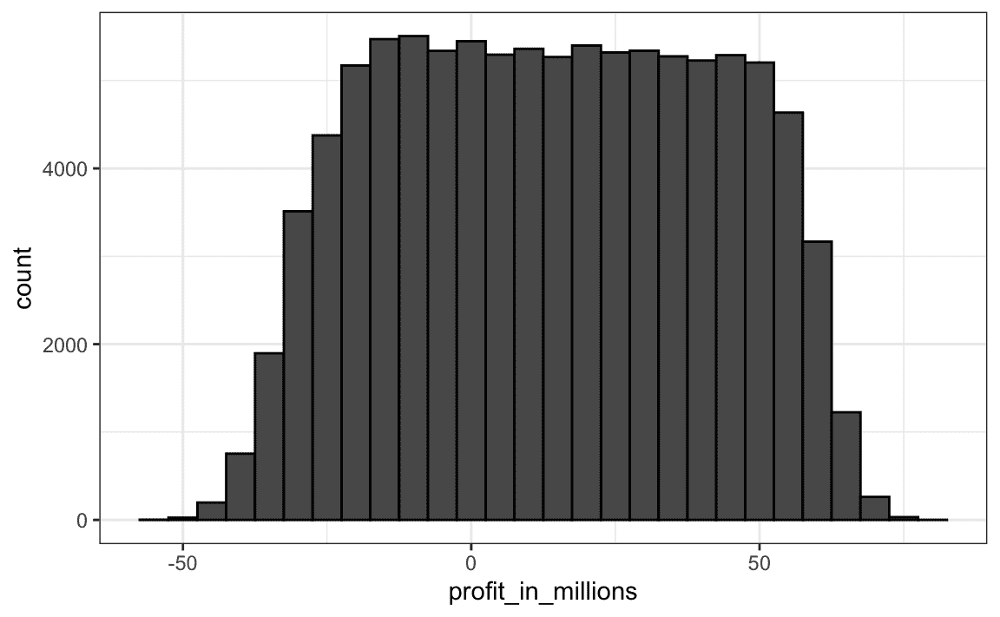

# 第十四章 随机变量

> 原文：[`rafalab.dfci.harvard.edu/dsbook/random-variables.html`](https://rafalab.dfci.harvard.edu/dsbook/random-variables.html)

在数据科学中，我们经常处理受某种方式影响的数据：数据来自随机样本，数据受到测量误差的影响，或者数据衡量的是一些本质上随机的结果。能够量化随机性引入的不确定性是数据分析师最重要的工作之一。统计推断提供了一个框架，以及一些实用的工具，用于完成这项工作。第一步是学习如何用数学方法描述随机变量。

在本章中，我们从随机变量及其应用开始介绍随机变量和它们的性质，这些应用包括机会游戏。然后我们使用概率论描述了 2007-2008 年金融危机周围的一些事件⁴⁷。这次金融危机部分原因是金融机构低估了某些证券⁴⁸的风险。具体来说，抵押贷款支持证券（MBS）和担保债务凭证（CDO）的风险被严重低估。这些资产以假设大多数房主会按时支付月供的价格出售，而这种情况不发生的概率被计算为很低。多种因素的结合导致违约数量远超预期，这导致了这些证券价格的暴跌。因此，银行损失了大量资金，以至于他们需要政府救助以避免完全关闭。

## 14.1 随机变量

随机变量是随机过程产生的数值结果。我们可以使用我们展示的一些简单示例轻松生成随机变量。例如，定义 `X` 为蓝色珠子时为 1，否则为红色：

```r
beads <- rep( c("red", "blue"), times = c(2,3))
X <- ifelse(sample(beads, 1) == "blue", 1, 0)
```

在这里 `X` 是一个随机变量：每次我们选择一个新的珠子时，结果都会随机变化。见下文：

```r
ifelse(sample(beads, 1) == "blue", 1, 0)
#> [1] 1
ifelse(sample(beads, 1) == "blue", 1, 0)
#> [1] 0
ifelse(sample(beads, 1) == "blue", 1, 0)
#> [1] 0
```

有时它是 1，有时它是 0。

## 14.2 抽样模型

许多数据生成过程，即我们研究的数据，可以很好地模拟为从罐子中抽取。例如，我们可以将调查可能选民的过程模拟为从包含所有可能选民 0 和 1 代码的罐子中抽取 0（共和党人）和 1（民主党人）。在流行病学研究中，我们通常假设我们研究的研究对象是感兴趣人群的随机样本。与特定结果相关的数据可以模拟为从包含感兴趣人群全部结果的罐子中抽取的随机样本。同样，在实验研究中，我们通常假设我们正在研究的研究个体，例如蠕虫、苍蝇或老鼠，是从更大的群体中随机抽取的。随机实验也可以通过从分配给个体的方式抽取来模拟：在分配时，你随机抽取你的组。因此，抽样模型在数据科学中无处不在。赌场游戏提供了大量使用抽样模型来回答具体问题的现实世界例子的例子。因此，我们将从这些例子开始。

假设一家非常小的赌场雇佣你来咨询他们是否应该设置轮盘赌。为了使例子简单，我们将假设有 1,000 人将参与游戏，而你可以在轮盘赌上进行的唯一游戏是下注红或黑。赌场希望你能预测他们将会赚多少钱或亏损多少。他们希望得到一个数值范围，特别是，他们想知道亏损的概率。如果这个概率太高，他们将放弃安装轮盘赌。

我们将定义一个随机变量 $S$，它将代表赌场的总赢利。让我们先构建这个罐子。一个轮盘赌有 18 个红色口袋，18 个黑色口袋和 2 个绿色口袋。因此，在轮盘赌的一局中玩一个颜色相当于从这个罐子中抽取：

```r
color <- rep(c("Black", "Red", "Green"), c(18, 18, 2))
```

1,000 人的 1,000 个结果是从这个罐子中独立抽取的。如果出现红色，赌徒赢，赌场损失一美元，所以我们抽取一个 -$1。否则，赌场赢一美元，我们抽取一个 $1。为了构建我们的随机变量 $S$，我们可以使用以下代码：

```r
n <- 1000
X <- sample(ifelse(color == "Red", -1, 1),  n, replace = TRUE)
X[1:10]
#>  [1] -1  1  1 -1 -1 -1  1  1  1  1
```

因为我们知道 1 和 -1 的比例，我们可以用一行代码生成抽取，而不需要定义 `color`：

```r
X <- sample(c(-1,1), n, replace = TRUE, prob=c(9/19, 10/19))
```

我们称这为**抽样模型**，因为我们通过从罐子中抽取样本来模拟轮盘赌的随机行为。总赢利 $S$ 简单地是这些 1,000 个独立抽取的总和：

```r
X <- sample(c(-1,1), n, replace = TRUE, prob=c(9/19, 10/19))
S <- sum(X)
S
#> [1] 22
```

## 14.3 随机变量的概率分布

如果你运行上面的代码，你会看到 $S$ 每次都会变化。这当然是，因为 $S$ 是一个 **随机变量**。随机变量的概率分布告诉我们观察到的值落在任何给定区间的概率。所以，例如，如果我们想知道我们输钱的概率，我们是在询问 $S$ 是否在区间 $S<0$ 内。

注意，如果我们能定义一个累积分布函数 $F(a) = \mbox{Pr}(S\leq a)$，那么我们将能够回答与我们的随机变量 $S$ 定义的任何事件相关的任何问题，包括事件 $S<0$。我们称这个 $F$ 为随机变量的 *分布函数*。

我们可以通过使用蒙特卡洛模拟生成随机变量的许多实现来估计随机变量 $S$ 的分布函数。使用此代码，我们重复进行有 1,000 人玩轮盘赌的实验，具体 $B = 10,000$ 次：

```r
n <- 1000
B <- 10000
roulette_winnings <- function(n){
 X <- sample(c(-1,1), n, replace = TRUE, prob=c(9/19, 10/19))
 sum(X)
}
S <- replicate(B, roulette_winnings(n))
```

现在我们可以问以下问题：在我们的模拟中，我们得到总和小于或等于 `a` 的频率是多少？

```r
mean(S <= a)
```

这将是一个非常好的 $F(a)$ 的近似，我们可以轻松回答赌场的提问：我们输钱的概率有多大？我们可以看到这个概率相当低：

```r
mean(S<0)
#> [1] 0.0456
```

我们可以通过创建一个显示几个区间 $(a,b]$ 的概率 $F(b)-F(a)$ 的直方图来可视化 $S$ 的分布：


我们可以看到，分布看起来大约是正态的。QQ 图将证实，对于这个分布，正态近似接近完美的近似。如果实际上分布是正态的，那么我们只需要定义分布的平均值和标准差。因为我们有创建分布的原始值，我们可以很容易地使用 `mean(S)` 和 `sd(S)` 计算这些值。你看到添加到上面的直方图中的蓝色曲线是这个平均值和标准差的正态密度曲线。

这个平均值和标准差有特殊名称。它们被称为随机变量 $S$ 的 *期望值* 和 *标准误*。我们将在下一节中详细介绍这些内容。

统计理论提供了一种方法，从作为从罐子中独立随机抽取的随机变量推导出其分布。具体来说，在我们上面的例子中，我们可以证明 $(S+n)/2$ 符合二项分布。因此，我们不需要运行蒙特卡洛模拟来了解 $S$ 的概率分布。我们这样做是为了说明目的。

我们可以使用 `dbinom` 和 `pbinom` 函数精确地计算概率。例如，要计算 $\mbox{Pr}(S < 0)$，我们注意到：

$$\mbox{Pr}(S < 0) = \mbox{Pr}((S+n)/2 < (0+n)/2)$$

我们可以使用 `pbinom` 来计算 $$\mbox{Pr}(S \leq 0)$$

```r
n <- 1000
pbinom(n/2, size = n, prob = 10/19)
#> [1] 0.0511
```

因为这是一个离散概率函数，为了得到 $\mbox{Pr}(S < 0)$ 而不是 $\mbox{Pr}(S \leq 0)$，我们写：

```r
pbinom(n/2-1, size = n, prob = 10/19)
#> [1] 0.0448
```

关于二项分布的详细信息，您可以查阅任何基本的概率书籍，甚至可以参考维基百科⁴⁹。

在这里，我们不涉及这些细节。相反，我们将讨论数学理论提供的一个极其有用的近似，它适用于从任何抽屉中抽取的任何总和和平均值：中心极限定理（CLT）。

## 14.4 分布与概率分布的比较

在我们继续之前，让我们在数字列表的分布和概率分布之间做出一个重要的区分和联系。在可视化章节中，我们描述了任何数字列表 $x_1,\dots,x_n$ 都有一个分布。定义非常直接。我们定义 $F(a)$ 为一个函数，它告诉我们列表中有多少比例小于或等于 $a$。因为它们在分布近似正态时非常有用，所以我们定义了平均值和标准差。这些是通过包含数字列表 `x` 的向量进行简单操作来定义的：

```r
m <- sum(x)/length(x)
s <- sqrt(sum((x - m)²) / length(x))
```

随机变量 $X$ 具有分布函数。为了定义这个概念，我们不需要一个数字列表。这是一个理论概念。在这种情况下，我们定义分布为 $F(a)$，它回答的问题是：$X$ 小于或等于 $a$ 的概率是多少？没有数字列表。

然而，如果 $X$ 是通过从包含数字的抽屉中抽取来定义的，那么就有一个列表：抽屉内数字的列表。在这种情况下，这个列表的分布是 $X$ 的概率分布，而这个列表的平均值和标准差是随机变量的期望值和标准误差。

另一种不涉及抽屉的方法是运行蒙特卡洛模拟并生成一个包含 $X$ 的非常长的结果列表。这些结果是一个数字列表。这个列表的分布将很好地近似 $X$ 的概率分布。列表越长，近似越好。这个列表的平均值和标准差将近似随机变量的期望值和标准误差。

## 14.5 随机变量的符号表示

在统计学教科书中，大写字母用于表示随机变量，我们在这里遵循这一惯例。小写字母用于表示观察到的值。你会看到一些包含两者的符号。例如，你会看到事件定义为 $X \leq x$。在这里，$X$ 是一个随机变量，使其成为一个随机事件，而 $x$ 是一个任意值，不是随机的。所以，例如，$X$ 可能代表掷骰子的点数，而 $x$ 将代表我们看到的实际值 1、2、3、4、5 或 6。因此，在这种情况下，$X=x$ 的概率是 1/6，无论观察到的值 $x$ 如何。这种符号有点奇怪，因为当我们询问关于概率的问题时，$X$ 不是一个观察到的量。相反，它是一个我们将在未来看到的随机量。我们可以谈论我们期望它是什么，可能有哪些值，但不能谈论它是什么。但一旦我们有数据，我们确实看到了 $X$ 的一个实现。因此，数据科学家谈论的是在看到实际发生的事情之后可能发生的事情。

## 14.6 期望值和标准误差

我们已经描述了抽取模型的采样。现在我们将探讨数学理论，它使我们能够近似抽取总和的概率分布。一旦我们这样做，我们就能帮助赌场预测他们将赚多少钱。我们用于抽取总和的方法将有助于描述平均值和比例的分布，这是我们理解民意调查如何运作所必需的。

需要学习的第一重要概念是*期望值*。在统计学书籍中，通常使用字母 $\mbox{E}$ 如此表示：

$$\mbox{E}[X]$$

表示随机变量 $X$ 的期望值。

一个随机变量会围绕其期望值变化，如果你取很多很多次抽取的平均值，抽取的平均值将接近期望值，抽取次数越多，越接近。

理论统计学提供了在不同情况下计算期望值的技巧。例如，一个有用的公式告诉我们，*由一次抽取定义的随机变量的期望值是罐子中数字的平均值*。在用于模拟轮盘赌下注红色的罐子中，我们有 20 个一美元和 18 个负一美元。因此，期望值是：

$$ \mbox{E}[X] = (20 + -18)/38 $$

大约 5 分。当 $X$ 只能取 1 和-1 这两个值时，说 $X$ 围绕 0.05 变化，这有点反直觉。一种理解这个期望值的方法是意识到，如果我们反复玩这个游戏，赌场平均每局赢 5 分。蒙特卡洛模拟证实了这一点：

```r
B <- 10⁶
x <- sample(c(-1,1), B, replace = TRUE, prob=c(9/19, 10/19))
mean(x)
#> [1] 0.0517
```

一般而言，如果罐子有两种可能的结果，比如说 $a$ 和 $b$，比例分别为 $p$ 和 $1-p$，平均值为：

$$\mbox{E}[X] = ap + b(1-p)$$

要看到这一点，注意如果罐子里有$n$个珠子，那么我们有$np$个$a$和$n(1-p)$个$b$，因为平均数是总和，$n \times a \times p + n \times b \times (1-p)$，除以总数$n$，我们得到平均数是$ap + b(1-p)$。

现在我们定义期望值的原因是，这个数学定义最终被证明对于近似总和的概率分布是有用的，这对于描述平均值和比例的分布也是有用的。第一个有用的事实是，**抽取总和的期望值**是：

$$ \text{抽取次数} \times \text{罐子中数字的平均值} $$

所以如果 1,000 人玩轮盘赌，赌场平均期望赢得 1,000 $\times$ $0.05 = $50。但这只是一个期望值。一个观察值与期望值可以有多大的不同？赌场真正需要知道这个。可能性的范围是多少？如果负数太可能，他们就不会安装轮盘赌轮。统计理论再次回答了这个问题。**标准误差**（SE）给我们一个关于期望值周围变化大小的概念。在统计学书籍中，通常使用：

$$\text{SE}[X]$$

来表示随机变量的标准误差。

**如果我们抽取的样本是独立的**，那么**总和的标准误差**由以下公式给出：

$$ \sqrt{\text{抽取次数}} \times \text{罐子中数字的标准差} $$

使用标准差的定义，我们可以通过一些数学推导得出，如果一个罐子包含两个值$a$和$b$，比例分别为$p$和$(1-p)$，那么标准差是：

$$\mid b - a \mid \sqrt{p(1-p)}.$$

所以在我们的轮盘赌例子中，罐子内数值的标准差是：$\mid 1 - (-1) \mid \sqrt{10/19 \times 9/19}$ 或者：

```r
2 * sqrt(90)/19
#> [1] 0.999
```

标准误差告诉我们随机变量与其期望值之间的典型差异。由于一次抽取显然是仅一次抽取的总和，我们可以使用上述公式来计算由一次抽取定义的随机变量的期望值为 0.05，标准误差约为 1。这是有道理的，因为我们要么得到 1，要么得到-1，其中 1 略优于-1。

使用上述公式，1,000 人玩游戏的总和标准误差约为$32：

```r
n <- 1000
sqrt(n) * 2 * sqrt(90)/19
#> [1] 31.6
```

因此，当 1,000 人下注红色时，赌场预计会赢得$50，标准误差为$32。因此这似乎是一个安全的赌注。但我们还没有回答这个问题：输钱的可能性有多大？在这里，中心极限定理（CLT）将有所帮助。

**高级笔记**：在继续之前，我们应该指出，使用二项分布可以精确计算赌场赢利的概率。然而，在这里我们关注的是中心极限定理（CLT），它可以一般地应用于随机变量的总和，这是二项分布所不能做到的。

### 14.6.1 总体标准差与样本标准差

列表 `x`（以下我们以身高为例）的标准差定义为平方差的平均值的开方：

```r
library(dslabs)
x <- heights$height
m <- mean(x)
s <- sqrt(mean((x-m)²))
```

使用数学符号，我们写成：

$$ \mu = \frac{1}{n} \sum_{i=1}^n x_i \\ \sigma = \sqrt{\frac{1}{n} \sum_{i=1}^n (x_i - \mu)²} $$

然而，请注意，`sd` 函数返回的结果略有不同：

```r
identical(s, sd(x))
#> [1] FALSE
s-sd(x)
#> [1] -0.00194
```

这是因为 R 中的 `sd` 函数不返回列表的 `sd`，而是使用一个公式来估计从随机样本 $X_1, \dots, X_N$ 中得到的总体标准差，其中，由于未在此讨论的原因，将平方和除以 $N-1$。

$$ \bar{X} = \frac{1}{N} \sum_{i=1}^N X_i, \,\,\,\, s = \sqrt{\frac{1}{N-1} \sum_{i=1}^N (X_i - \bar{X})²} $$

你可以通过输入以下内容来查看这是否成立：

```r
n <- length(x)
s-sd(x)*sqrt((n-1) / n)
#> [1] 5.33e-15
```

对于这里讨论的所有理论，你需要计算实际的标准差，其定义如下：

```r
sqrt(mean((x-m)²))
```

因此，在使用 R 中的 `sd` 函数时要小心。然而，请注意，在整个书中，我们有时使用 `sd` 函数，其实我们真正想要的是实际的 SD。这是因为当列表大小很大时，这两个值实际上几乎是等效的，因为 $\sqrt{(N-1)/N} \approx 1$。

## 14.7 中心极限定理

中心极限定理（CLT）告诉我们，当抽取次数（也称为样本大小）很大时，独立抽取的总和的概率分布近似为正态分布。由于采样模型被用于许多数据生成过程，CLT 被认为是历史上最重要的数学洞察之一。

之前，我们讨论过，如果我们知道数字列表的分布近似为正态分布，我们只需要描述列表的平均值和标准差。我们还知道，这同样适用于概率分布。如果一个随机变量的概率分布近似为正态分布，那么我们只需要描述概率分布的平均值和标准差，即期望值和标准误差。

我们之前运行了这个蒙特卡洛模拟：

```r
n <- 1000
B <- 10000
roulette_winnings <- function(n){
 X <- sample(c(-1,1), n, replace = TRUE, prob=c(9/19, 10/19))
 sum(X)
}
S <- replicate(B, roulette_winnings(n))
```

中心极限定理（CLT）告诉我们，总和 $S$ 近似为正态分布。使用上述公式，我们知道期望值和标准误差是：

```r
n * (20-18)/38 
#> [1] 52.6
sqrt(n) * 2 * sqrt(90)/19 
#> [1] 31.6
```

理论值与蒙特卡洛模拟得到的结果相匹配：

```r
mean(S)
#> [1] 52.2
sd(S)
#> [1] 31.7
```

使用中心极限定理（CLT），我们可以跳过蒙特卡洛模拟，而是使用这个近似值来计算赌场亏损的概率：

```r
mu <- n * (20-18)/38
se <-  sqrt(n) * 2 * sqrt(90)/19 
pnorm(0, mu, se)
#> [1] 0.0478
```

这也与我们的蒙特卡洛结果非常一致：

```r
mean(S < 0)
#> [1] 0.0458
```

### 14.7.1 中心极限定理中的“大”有多大？

CLT 在抽取次数较多时有效。但“多”是一个相对概念。在许多情况下，只需 30 次抽取就足以使 CLT 变得有用。在某些特定情况下，10 次就足够了。然而，这些不应被视为一般规则。例如，当成功的概率非常小的时候，我们需要更大的样本量。

为了说明这一点，让我们考虑彩票。在彩票中，中奖的概率小于百万分之一。成千上万的人参与，因此抽取次数非常多。然而，中奖次数，即抽取的总和，在 0 到 4 之间。这个总和显然不能很好地用正态分布来近似，因此 CLT 不适用，即使样本量非常大。当成功的概率非常低时，通常是这样的。在这些情况下，泊松分布更为合适。

您可以使用 `dpois` 和 `ppois` 来检验泊松分布的性质。您可以使用 `rpois` 生成遵循此分布的随机变量。然而，我们在此不涉及理论。您可以在任何概率教科书中了解泊松分布，甚至可以在维基百科⁵⁰上找到相关信息。

## 14.8 平均值的统计性质

我们在上面使用了几种有用的数学结果，这些结果在处理数据时经常被使用。我们将在下面列出它们。

1. 随机变量之和的期望值是每个随机变量期望值的总和。我们可以这样写：

$$ \mbox{E}[X_1+X_2+\dots+X_n] = \mbox{E}[X_1] + \mbox{E}[X_2]+\dots+\mbox{E}[X_n] $$

如果 $X$ 是从抽屉中独立抽取的，那么它们都具有相同的期望值。我们可以称之为 $\mu$，因此：

$$ \mbox{E}[X_1+X_2+\dots+X_n]= n\mu $$

这是以另一种方式写出我们上面对于抽取总和所展示的结果。

2. 非随机常数乘以随机变量的期望值是非随机常数乘以随机变量的期望值。我们可以用符号来解释这一点：

$$ \mbox{E}[aX] = a\times\mbox{E}[X] $$

为了理解这一点，考虑单位的变化。如果我们改变随机变量的单位，比如从美元变为分，期望值应该以相同的方式改变。上述两个事实的后果是，从同一抽屉中独立抽取的平均值的期望值是抽屉的期望值，我们再次称之为 $\mu$：

$$ \mbox{E}[(X_1+X_2+\dots+X_n) / n]= \mbox{E}[X_1+X_2+\dots+X_n] / n = n\mu/n = \mu $$

3. 独立随机变量之和的标准误差的平方是每个随机变量标准误差平方的总和。这一点在数学形式上更容易理解：

$$ \mbox{SE}[X_1+X_2+\dots+X_n] = \sqrt{\mbox{SE}[X_1]² + \mbox{SE}[X_2]²+\dots+\mbox{SE}[X_n]² } $$

标准误差的平方在统计教材中被称为 *方差*。请注意，这个特定的属性不像前三个那样直观，更深入的解释可以在统计教材中找到。

4. 非随机常数乘以随机变量的标准误差等于非随机常数乘以随机变量的标准误差。与期望值类似：$$ \mbox{SE}[aX] = a \times \mbox{SE}[X] $$

要了解为什么这是直观的，再次考虑单位。

3 和 4 的一个结果是，从同一抽屉中独立抽取的平均值的标准误差等于抽屉标准差除以 $n$（抽取次数）的平方根，称之为 $\sigma$:

$$ \begin{aligned} \mbox{SE}[(X_1+X_2+\dots+X_n) / n] &= \mbox{SE}[X_1+X_2+\dots+X_n]/n \\ &= \sqrt{\mbox{SE}[X_1]²+\mbox{SE}[X_2]²+\dots+\mbox{SE}[X_n]²}/n \\ &= \sqrt{\sigma²+\sigma²+\dots+\sigma²}/n\\ &= \sqrt{n\sigma²}/n\\ &= \sigma / \sqrt{n} \end{aligned} $$

5. 如果 $X$ 是正态分布的随机变量，那么如果 $a$ 和 $b$ 是非随机常数，$aX + b$ 也是一个正态分布的随机变量。我们只是在通过乘以 $a$ 改变随机变量的单位，然后通过 $b$ 平移中心。

注意到统计教材使用希腊字母 $\mu$ 和 $\sigma$ 分别表示期望值和标准误差。这是因为 $\mu$ 是希腊字母 $m$，即“均值”的第一个字母，而“均值”是期望值的另一个术语。同样，$\sigma$ 是希腊字母 $s$，即标准误差的第一个字母。

## 14.9 大数定律

最终结果的一个重要含义是，随着 $n$ 的增大，平均数的标准误差变得越来越小。当 $n$ 非常大时，标准误差实际上为 0，抽取的平均值收敛到抽屉的平均值。这在统计教材中被称为大数定律或平均数定律。

### 14.9.1 对平均数定律的误解

平均数定律有时会被误解。例如，如果你掷硬币 5 次，每次都是正面，你可能会听到有人争论说下一次掷出的可能是反面，因为平均数定律：平均来看，我们应该看到 50% 的正面和 50% 的反面。一个类似的论点可能是说，在看到黑色连续出现 5 次之后，轮盘赌的红色“应该”出现。这些事件是独立的，所以硬币落地正面的概率是 50%，无论前 5 次的结果如何。轮盘赌的结果也是如此。平均数定律只适用于抽取次数非常大时，不适用于小样本。在掷一百万次之后，你肯定会看到大约 50% 的正面，无论前五次的结果如何。

平均数定律的另一个有趣的误用发生在体育比赛中，当电视体育解说员预测一名球员即将成功，因为他们看到该球员连续几次失败。

## 14.10 练习

1. 在美式轮盘赌中，你也可以下注绿色。有 18 个红色，18 个黑色和 2 个绿色（0 和 00）。绿色出现的概率是多少？

2. 在绿色上赢的赔率是 17 美元。这意味着如果你下注 1 美元，并且它落在绿色上，你将得到 17 美元。使用 sample 函数创建一个采样模型来模拟你的收益随机变量$X$。提示：请参考下面的示例，了解下注红色时的样子。

```r
x <- sample(c(1,-1), 1, prob = c(9/19, 10/19))
```

3. 计算随机变量$X$的期望值。

4. 计算随机变量$X$的标准误差。

5. 现在创建一个随机变量$S$，它是你在下注绿色 1000 次后的总收益。提示：在回答第 2 题时，更改`size`和`replace`参数。开始你的代码时，使用`set.seed(1)`设置随机种子为 1。

6. $S$的期望值是多少？

7. $S$的标准误差是多少？

8. 你最终赢钱的概率是多少？提示：使用 CLT。

9. 创建一个蒙特卡洛模拟，生成 1,000 个$S$的结果。计算结果的平均值和标准差，以确认第 6 和第 7 题的结果。开始你的代码时，使用`set.seed(1)`设置随机种子为 1。

10. 现在使用蒙特卡洛结果检查第 8 题的答案。

11. 蒙特卡洛结果和中心极限定理（CLT）近似值相近，但并不那么接近。这可能是由于什么原因？

1.  1,000 次模拟不够。如果我们做更多，它们会匹配。

1.  当成功的概率较小时，CLT 的效果并不好。在这种情况下，成功概率是 1/19。如果我们增加轮盘赌的次数，它们将更接近。

1.  差异在舍入误差范围内。

1.  CLT 只适用于平均值。

12. 现在创建一个随机变量$Y$，它是你在下注绿色 1,000 次后的平均收益。

13. $Y$的期望值是多少？

14. $Y$的标准误差是多少？

15. 你最终赢得每场比赛的收益为正的概率是多少？提示：使用 CLT。

16. 创建一个蒙特卡洛模拟，生成 2,500 个$Y$的结果。计算结果的平均值和标准差，以确认第 6 和第 7 题的结果。开始你的代码时，使用`set.seed(1)`设置随机种子为 1。

17. 现在使用蒙特卡洛结果检查第 8 题的答案。

18. 蒙特卡洛结果和 CLT 近似值现在非常接近。这可能是由于什么原因？

1.  我们现在正在计算平均值而不是总和。

1.  2,500 次蒙特卡洛模拟并不比 1,000 次更好。

1.  当样本量较大时，CLT 的效果更好。我们从 1,000 增加到 2,500。

1.  它们并没有更接近。差异在舍入误差范围内。

## 14.11 案例研究：大空头

### 14.11.1 使用概率模型解释利率

我们讨论过的抽样模型的更复杂版本也被银行用来决定利率。假设你经营一家小银行，有历史记录表明你可以信任某些潜在房主按时还款。事实上，从历史数据来看，在特定的一年里，只有 2%的客户违约，这意味着他们没有偿还你借给他们的钱。然而，你知道 2%的客户可能会违约，但你不知道是哪些客户。然而，通过向每个人收取一点点额外的利息，你可以弥补由于这 2%而造成的损失，并覆盖你的运营成本。你还可以盈利，但如果利率设置得太高，你的客户会去其他银行。我们使用所有这些事实和一些概率理论来决定你应该收取的利率。

假设你的银行今年将发放 1,000 笔贷款，总额为 180,000 美元。此外，在加上所有成本后，假设你的银行每笔房屋查封损失 200,000 美元。为了简化，我们假设这包括所有运营成本。这个场景的抽样模型可以这样编码：

```r
n <- 1000
loss_per_foreclosure <- -200000
p <- 0.02 
defaults <- sample( c(0,1), n, prob=c(1-p, p), replace = TRUE)
sum(defaults * loss_per_foreclosure)
#> [1] -3600000
```

注意，由最终总和定义的总损失是一个随机变量。每次运行上述代码，你都会得到不同的答案。我们可以轻松构建一个蒙特卡洛模拟来了解这个随机变量的分布。

```r
B <- 10000
losses <- replicate(B, {
 defaults <- sample( c(0,1), n, prob=c(1-p, p), replace = TRUE) 
 sum(defaults * loss_per_foreclosure)
})
```

我们实际上并不需要蒙特卡洛模拟。利用我们所学的知识，中心极限定理告诉我们，因为我们的损失是独立抽取的总和，其分布大约是正态分布，期望值和标准误差如下：

```r
n*(p*loss_per_foreclosure + (1-p)*0)
#> [1] -4e+06
sqrt(n)*abs(loss_per_foreclosure)*sqrt(p*(1-p))
#> [1] 885438
```

现在，我们可以设定一个利率，以保证平均来说我们能收支平衡。基本上，我们需要向每笔贷款添加一个数量 $x$，在这种情况下代表抽取，使得期望值为 0。如果我们定义 $l$ 为每笔房屋查封的损失，我们需要：

$$ lp + x(1-p) = 0 $$

这意味着 $x$ 是

```r
- loss_per_foreclosure*p/(1-p)
#> [1] 4082
```

或者 0.023 的利率。

然而，我们仍然存在问题。尽管这个利率保证了平均来说我们能收支平衡，但仍有 50%的几率我们会亏损。如果我们的银行亏损，我们就必须关闭它。因此，我们需要选择一个不太可能发生这种情况的利率。同时，如果利率过高，我们的客户会去其他银行，所以我们必须愿意承担一些风险。所以，让我们假设我们希望亏损的概率是 1 比 100，那么现在的 $x$ 数量需要是多少？这个问题有点难。我们希望总和 $S$ 具有：

$$\mbox{Pr}(S<0) = 0.01$$

我们知道 $S$ 大约是正态分布的。$S$ 的期望值是

$$\mbox{E}[S] = \{ lp + x(1-p)\}n$$

其中 $n$ 是抽取次数，在这个例子中代表贷款。标准误差是

$$\mbox{SD}[S] = |x-l| \sqrt{np(1-p)}.$$

因为$x$是正的，而$l$是负的，所以$|x-l|=x-l$。注意，这些只是前面展示公式的应用，但使用了更紧凑的符号。

现在我们将使用在统计学中非常常见的数学“技巧”。我们在事件$S<0$的等式两边加上并减去相同的量，这样概率不会改变，并且我们最终在左边得到一个标准正态随机变量，这将允许我们写下一个只有$x$作为未知数的方程。这个“技巧”如下：

如果$\mbox{Pr}(S<0) = 0.01$，那么 $$ \mbox{Pr}\left(\frac{S - \mbox{E}[S]}{\mbox{SE}[S]} < \frac{ - \mbox{E}[S]}{\mbox{SE}[S]}\right) $$ 并且记住$\mbox{E}[S]$和$\mbox{SE}[S]$分别是$S$的期望值和标准误差。我们上面所做的一切只是在等式两边加上并除以相同的量。我们这样做是因为现在左边的项是一个标准正态随机变量，我们将它重新命名为$Z$。现在我们用期望值和标准误差的实际公式来填充空白：

$$ \mbox{Pr}\left(Z < \frac{- \{ lp + x(1-p)\}n}{(x-l) \sqrt{np(1-p)}}\right) = 0.01 $$

它可能看起来很复杂，但记住$l$、$p$和$n$都是已知的量，所以最终我们将用数字替换它们。

现在因为 Z 是一个期望值为 0、标准误差为 1 的正态随机变量，这意味着小于<符号右侧的量必须等于：

```r
qnorm(0.01)
#> [1] -2.33
```

for the equation to hold true. Remember that $z=$`qnorm(0.01)` gives us the value of $z$ for which:

$$ \mbox{Pr}(Z \leq z) = 0.01 $$

所以这意味着复杂方程的右侧必须是$z$=`qnorm(0.01)`。

$$ \frac{- \{ lp + x(1-p)\}n} {(x-l) \sqrt{n p (1-p)}} = z $$

这个技巧之所以有效，是因为我们最终得到一个包含$x$的表达式，我们知道它必须等于一个已知的量$z$。求解$x$现在只是一个代数运算：

$$ x = - l \frac{ np - z \sqrt{np(1-p)}}{n(1-p) + z \sqrt{np(1-p)}}$$

which is:

```r
l <- loss_per_foreclosure
z <- qnorm(0.01)
x <- -l*( n*p - z*sqrt(n*p*(1-p)))/ ( n*(1-p) + z*sqrt(n*p*(1-p)))
x
#> [1] 6249
```

我们现在的利率上升到 0.035。这仍然是一个非常具有竞争力的利率。通过选择这个利率，我们现在每笔贷款的预期利润为：

```r
loss_per_foreclosure*p + x*(1-p)
#> [1] 2124
```

which is a total expected profit of about:

```r
n*(loss_per_foreclosure*p + x*(1-p)) 
#> [1] 2124198
```

美元！

我们可以进行蒙特卡洛模拟来双重检查我们的理论近似：

```r
B <- 100000
profit <- replicate(B, {
 draws <- sample( c(x, loss_per_foreclosure), n, 
 prob=c(1-p, p), replace = TRUE) 
 sum(draws)
})
mean(profit)
#> [1] 2122069
mean(profit<0)
#> [1] 0.0127
```

### 14.11.2 大空头

你们其中一位员工指出，由于银行每笔贷款能赚 2,124 美元，银行应该发放更多的贷款！为什么只是$n$？你解释说找到那些$n$个客户很困难。你需要一个可预测的群体，并且保持违约的可能性低。然后他指出，即使违约的可能性更高，只要我们的期望值是正的，通过增加$n$并依赖大数定律，你可以最小化损失的可能性。

他声称，即使违约率是两倍，比如说 4%，如果我们把利率设定得略高于这个值：

```r
p <- 0.04
r <- (- loss_per_foreclosure*p/(1-p)) / 180000
r
#> [1] 0.0463
```

我们将获利。在 5%的情况下，我们保证有正的预期值：

```r
r <- 0.05
x <- r*180000
loss_per_foreclosure*p + x * (1-p)
#> [1] 640
```

通过简单地增加 $n$ 来最小化我们损失的机会，因为：

$$ \mbox{Pr}(S < 0) = \mbox{Pr}\left(Z < - \frac{\mbox{E}[S]}{\mbox{SE}[S]}\right) $$ 其中 $Z$ 是前面展示的标准正态随机变量。如果我们定义 $\mu$ 和 $\sigma$ 分别为罐子的期望值和标准差（即单笔贷款），使用上述公式，我们有：$\mbox{E}[S]= n\mu$ 和 $\mbox{SE}[S]= \sqrt{n}\sigma$。因此，如果我们定义 $z$=`qnorm(0.01)`，我们就有：$$ - \frac{n\mu}{\sqrt{n}\sigma} = - \frac{\sqrt{n}\mu}{\sigma} = z $$ 这意味着如果我们让：

$$ n \geq z² \sigma² / \mu² $$ 我们可以保证概率小于 0.01。这意味着，只要 $\mu$ 是正的，我们可以找到一个 $n$ 来最小化损失的概率。这是大数法则的一种形式：当 $n$ 很大时，我们每笔贷款的平均收益会收敛到期望收益 $\mu$。

当 $x$ 固定时，现在我们可以问，为了使概率为 0.01，我们需要多少 $n$？在我们的例子中，如果我们发放：

```r
z <- qnorm(0.01)
n <- ceiling((z²*(x-l)²*p*(1-p))/(l*p + x*(1-p))²)
n
#> [1] 22163
```

，损失的概率大约是 0.01，我们预计总共会赚得

```r
n*(loss_per_foreclosure*p + x * (1-p))
#> [1] 14184320
```

美元！我们可以通过蒙特卡洛模拟来证实这一点：

```r
p <- 0.04
x <- 0.05*180000
profit <- replicate(B, {
 draws <- sample( c(x, loss_per_foreclosure), n, 
 prob=c(1-p, p), replace = TRUE) 
 sum(draws)
})
mean(profit)
#> [1] 14190724
```

这看起来是一个显而易见的选择。因此，你的同事决定离开你的银行，开始他自己的高风险抵押贷款公司。几个月后，你的同事的银行破产了。一本书被写出来，最终一部电影被制作出来，讲述了你的朋友以及许多其他人犯的错误。发生了什么？

你的同事的方案主要基于这个数学公式：$$ \mbox{SE}[(X_1+X_2+\dots+X_n) / n] = \sigma / \sqrt{n} $$

通过使 $n$ 变大，我们最小化了每笔贷款利润的标准误差。然而，为了使这个规则成立，$X$ 必须是独立的抽取：一个人的违约必须与其他人的违约独立。请注意，在反复平均**相同**事件的情况下，这是一个事件不独立的极端例子，我们得到的标准误差是 $\sqrt{n}$ 倍更大：$$ \mbox{SE}[(X_1+X_1+\dots+X_1) / n] = \mbox{SE}[n X_1 / n] = \sigma > \sigma / \sqrt{n} $$

为了构建一个比你的同事运行的原版更现实的模拟，让我们假设有一个全球事件影响了所有高风险抵押贷款的持有者，并改变了他们的概率。我们将假设有 50-50 的机会，所有概率都会略微上升或下降，介于 0.03 和 0.05 之间。但这是同时发生在每个人身上，而不仅仅是某一个人。这些抽取不再是独立的。

```r
p <- 0.04
x <- 0.05*180000
profit <- replicate(B, {
 new_p <- 0.04 + sample(seq(-0.01, 0.01, length = 100), 1)
 draws <- sample( c(x, loss_per_foreclosure), n, 
 prob=c(1-new_p, new_p), replace = TRUE) 
 sum(draws)
})
```

注意，我们的预期利润仍然很大：

```r
mean(profit)
#> [1] 14080221
```

然而，银行出现负收益的概率急剧上升到：

```r
mean(profit<0)
#> [1] 0.35
```

更令人恐惧的是，损失超过 1000 万美元的概率是：

```r
mean(profit < -10000000)
#> [1] 0.242
```

要了解这是如何发生的，请看分布：

```r
data.frame(profit_in_millions=profit/10⁶) |> 
 ggplot(aes(profit_in_millions)) + 
 geom_histogram(color="black", binwidth = 5)
```



理论完全崩溃，随机变量的变异性远大于预期。2007 年的金融危机，除了其他原因外，还因为金融“专家”在没有任何独立性假设的情况下做出了假设。

## 14.12 练习

1. 创建一个随机变量 $S$，假设你发放 10,000 笔贷款，违约率为 0.3，每次抵押品赎回你损失 200,000 美元。提示：使用我们在上一节中展示的代码，但更改参数。

2. 对 $S$ 进行 10,000 次结果的蒙特卡洛模拟。制作结果直方图。

3. $S$ 的期望值是多少？

4. $S$ 的标准误差是多少？

5. 假设我们发放 180,000 美元的贷款。为了使我们的期望值为 0，利率应该是多少？

6. （较难）为了使亏损的概率为 20 分之一，利率应该是多少？用数学符号表示，为了使 $\mbox{Pr}(S<0) = 0.05$ ，利率应该是多少？

7. 如果银行想要最小化亏损的概率，以下哪项**不会**使利率上升？

1.  较小的贷款池。

1.  更大的违约概率。

1.  较小的预期亏损概率。

1.  蒙特卡洛模拟的次数。

* * *

1.  [2007-2008 年金融危机](https://en.wikipedia.org/w/index.php?title=Financial_crisis_of_2007%E2%80%932008)↩︎

1.  [证券](https://en.wikipedia.org/w/index.php?title=Security_(finance))↩︎

1.  [二项分布](https://en.wikipedia.org/w/index.php?title=Binomial_distribution)↩︎

1.  [泊松分布](https://en.wikipedia.org/w/index.php?title=Poisson_distribution)↩︎
