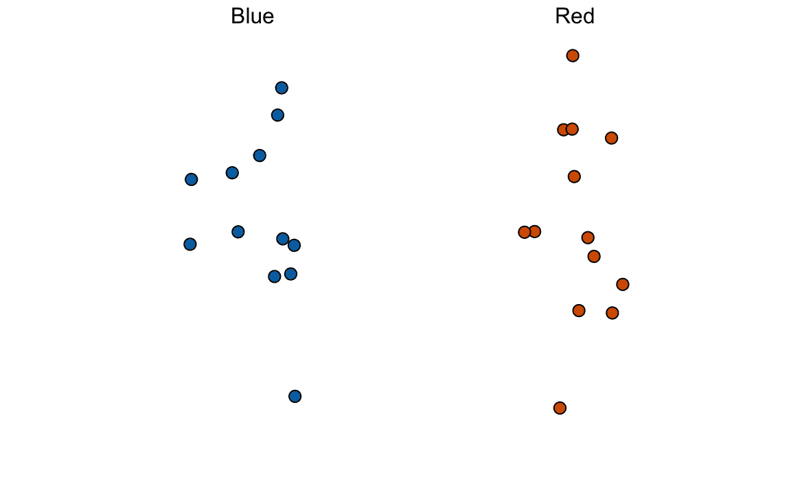
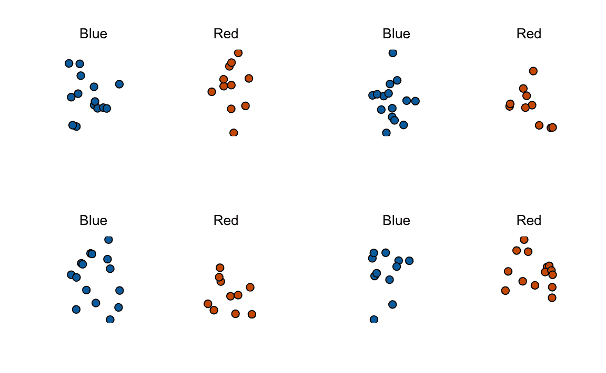
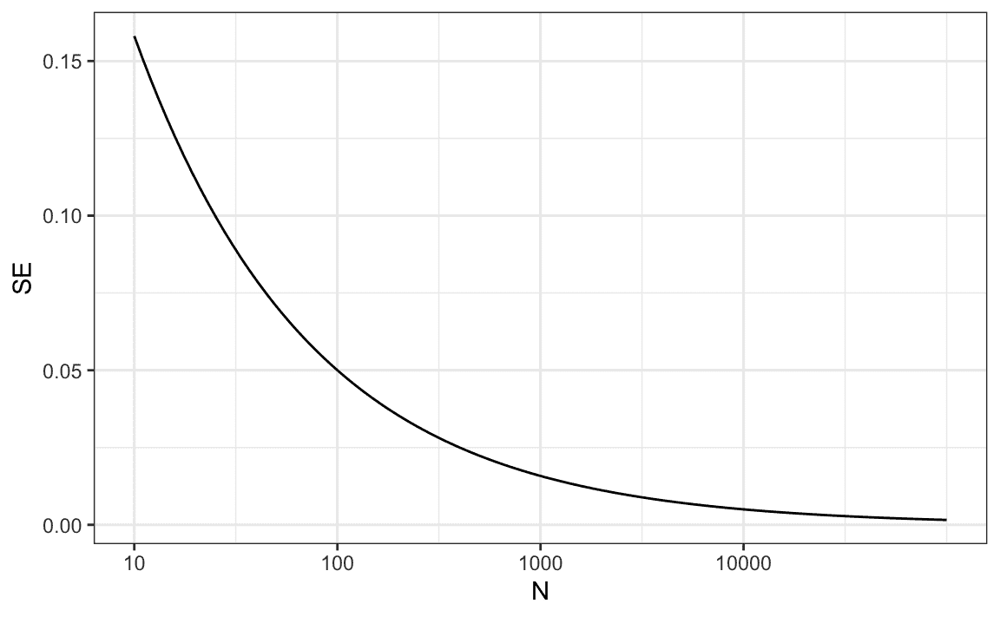
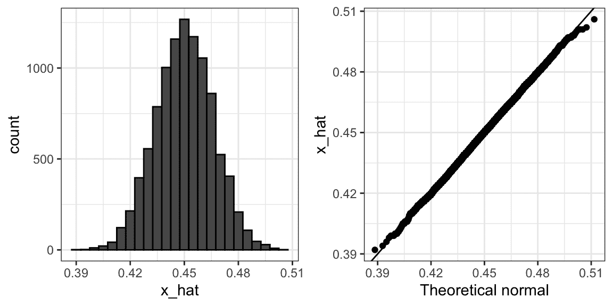
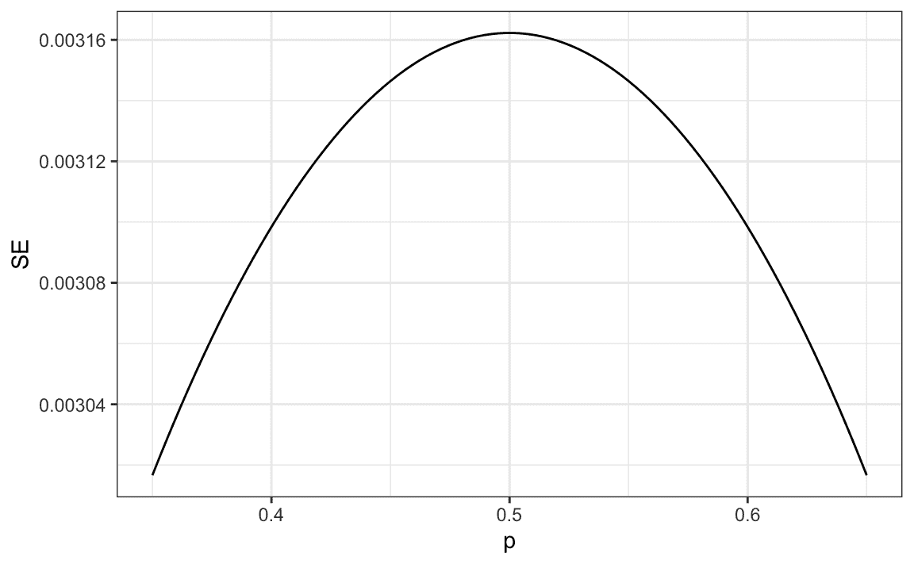
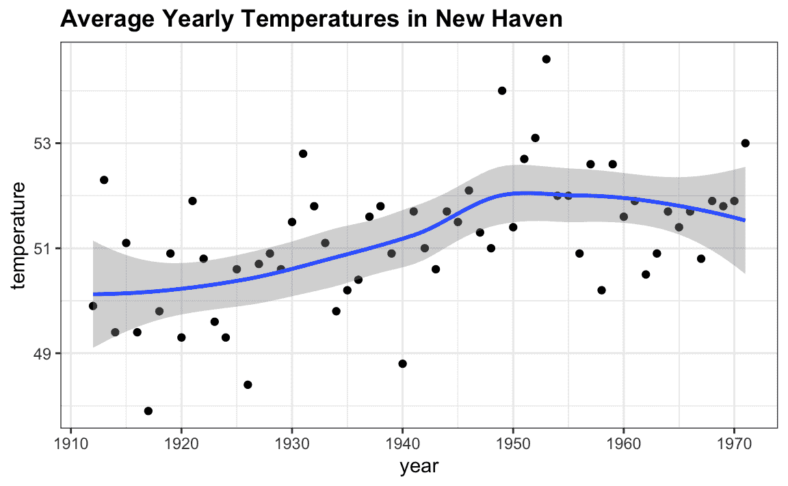
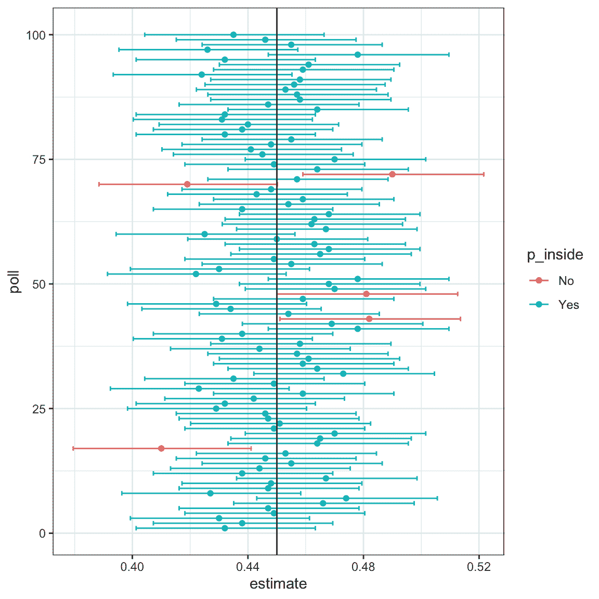

# 第十五章 统计推断

> 原文：[`rafalab.dfci.harvard.edu/dsbook/inference.html`](https://rafalab.dfci.harvard.edu/dsbook/inference.html)

在第十六章中，我们将详细描述像 FiveThirtyEight 这样的民意调查聚合器如何使用数据来预测选举结果。为了理解他们是如何做到这一点的，我们首先需要学习统计推断的基础知识，这是统计学中帮助区分由信号产生的模式与由偶然产生的模式的部分。统计推断是一个广泛的话题，在这里我们使用民意调查作为一个激励性的例子。为了描述这些概念，我们用蒙特卡洛模拟和 R 代码补充数学公式。

## 15.1 民意调查

民意调查自 19 世纪以来就已经进行。一般目标是描述特定人口在特定主题上持有的观点。近年来，这些调查在总统选举中无处不在。当采访特定人群的每个成员在物流上不可能时，民意调查是有用的。一般策略是随机采访一个较小的群体，然后从较小群体的观点中推断整个群体的观点。统计理论被用来证明这一过程。这一理论被称为*推断*，它是本章的主要内容。

可能最著名的民意调查是那些用于确定在特定选举中选民更倾向于哪位候选人的调查。政治策略家广泛使用民意调查来决定如何投资资源。例如，他们可能想知道在哪些地理区域集中他们的“动员投票”努力。

选举是民意调查的一个特别有趣的案例，因为选举当天会揭示整个民众的实际观点。当然，举办实际选举需要花费数百万美元，这使得民意调查成为那些想要预测结果的人的一种成本效益策略。

尽管通常这些调查的结果是保密的，但新闻机构也会进行类似的调查，因为结果往往对公众感兴趣，并公之于众。我们最终将查看此类数据。

Real Clear Politics⁵¹ 是一个新闻聚合器，它组织和发布民意调查结果。例如，他们展示了以下民意调查结果，报告了 2016 年总统选举的民调估计⁵²：

| 民意调查 | 日期 | 样本 | MoE | 克林顿 | 特朗普 | 差距 |
| --- | --- | --- | --- | --- | --- | --- |
| RCP 平均值 | 10/31 - 11/7 | – | – | 47.2 | 44.3 | 克林顿 +2.9 |
| 彭博社 | 11/4 - 11/6 | 799 LV | 3.5 | 46.0 | 43.0 | 克林顿 +3 |
| 经济学家 | 11/4 - 11/7 | 3669 LV | – | 49.0 | 45.0 | 克林顿 +4 |
| IBD | 11/3 - 11/6 | 1026 LV | 3.1 | 43.0 | 42.0 | 克林顿 +1 |
| ABC | 11/3 - 11/6 | 2220 LV | 2.5 | 49.0 | 46.0 | 克林顿 +3 |
| 福克斯新闻 | 11/3 - 11/6 | 1295 LV | 2.5 | 48.0 | 44.0 | 克林顿 +4 |
| 蒙茅斯 | 11/3 - 11/6 | 748 LV | 3.6 | 50.0 | 44.0 | 克林顿 +6 |
| 哥伦比亚广播公司 | 11/2 - 11/6 | 1426 LV | 3.0 | 47.0 | 43.0 | 克林顿 +4 |
| 洛杉矶时报 | 10/31 - 11/6 | 2935 LV | 4.5 | 43.0 | 48.0 | 特朗普 +5 |
| 美国全国广播公司 | 11/3 - 11/5 | 1282 LV | 2.7 | 48.0 | 43.0 | 克林顿 +5 |
| 美国全国广播公司 | 10/31 - 11/6 | 30145 LV | 1.0 | 51.0 | 44.0 | 克林顿 +7 |
| 麦克拉奇 | 11/1 - 11/3 | 940 LV | 3.2 | 46.0 | 44.0 | 克林顿 +2 |
| 路透社 | 10/31 - 11/4 | 2244 LV | 2.2 | 44.0 | 40.0 | 克林顿 +4 |
| GravisGravis | 10/31 - 10/31 | 5360 RV | 1.3 | 50.0 | 50.0 | 平局 |

尽管在美国，普选票并不决定总统选举的结果，但我们将用它作为一个说明性的、简单的例子，来说明调查的效果。预测选举是一个更复杂的过程，因为它涉及到结合 50 个州和哥伦比亚特区的结果，我们将在第 16.8 节中描述它。

让我们对上表进行一些观察。首先，请注意，尽管这些调查都是在选举前几天进行的，但不同的调查报告了不同的*差距*：即两位候选人支持率的估计差异。同时，请注意，报告的差距围绕着最终的实际结果：克林顿以 2.1%的得票率赢得了普选票。我们还可以看到一个标题为**MoE**的列，它代表*误差范围*。

在本节中，我们将展示我们在上一章中学到的概率概念如何应用于开发使调查成为有效工具的统计方法。我们将学习定义*估计值*和*误差范围*所需的统计概念，并展示我们如何使用这些概念来相对准确地预测最终结果，并提供我们预测的精确度估计。一旦我们学会了这些，我们就能理解数据科学中无处不在的两个概念：*置信区间*和*p 值*。最后，为了理解关于候选人获胜概率的概率性陈述，我们必须学习贝叶斯建模。在最后几节中，我们将把这些内容综合起来，重新创建五三八大模型的简化版本，并将其应用于 2016 年选举。

我们首先将概率论与使用调查了解总体的情况联系起来。

### 15.1.1 调查的抽样模型

为了帮助我们理解调查和我们所学的知识之间的联系，让我们构建一个与调查员面临的情况相似的情景。为了模拟调查员在与其他调查员竞争媒体关注方面的挑战，我们将使用一个装满珠子的罐子来代表选民，并假装我们在竞争一个 25 美元的奖品。挑战是猜测这个罐子（在这种情况下，是一个腌菜罐）中蓝色和红色珠子比例的差距：


在做出预测之前，你可以从瓮中抽取一个样本（有放回）。为了模拟进行民意调查的成本高昂的事实，每次抽取珠子需要花费你 0.10 美元。因此，如果你的样本大小是 250，并且你赢了，你将收支平衡，因为你将支付 25 美元来收集你的 25 美元奖金。你的参赛资格可以是一个区间。如果你提交的区间包含真实比例，你将获得你所支付的一半，并进入比赛的第二阶段。在第二阶段，选择区间最小的参赛者作为获胜者。

**dslabs** 包含一个函数，可以显示从这个瓮中进行的随机抽取：

```r
library(tidyverse)
library(dslabs)
take_poll(25)
```



思考一下你将如何根据上述数据构建你的区间。

我们刚刚描述了一个简单的民意调查采样模型。瓮中的珠子代表将在选举日投票的个人。支持共和党候选人的用红色珠子表示，民主党用蓝色珠子表示。为了简化，假设没有其他颜色。也就是说，只有两个政党：共和党和民主党。

## 15.2 总体、样本、参数和估计

我们想要预测瓮中蓝色珠子的比例。让我们称这个量为 $p$，这然后告诉我们红色珠子的比例 $1-p$，以及范围 $p - (1-p)$，这简化为 $2p - 1$。

在统计教科书中，瓮中的珠子被称为**总体**。总体中蓝色珠子的比例 $p$ 被称为**参数**。我们在之前的图表中看到的 25 个珠子被称为**样本**。统计推断的任务是使用样本中的观察数据来预测参数 $p$。

我们能否用上述 25 个观察结果来做这件事？这当然是有信息的。例如，鉴于我们看到 13 个红色珠子和 12 个蓝色珠子，$p$ > .9 或 $p$ < .1 的可能性不大。但我们是否准备好确信罐子里红色珠子比蓝色珠子多？

我们想要使用我们观察到的信息来构建 $p$ 的估计。估计应该被视为观察数据的总结，我们认为它对感兴趣参数是有信息的。直观地认为，样本中蓝色珠子的比例 $0.48$ 必然与实际比例 $p$ 有关。但我们是否简单地预测 $p$ 为 0.48？首先，记住样本比例是一个随机变量。如果我们运行 `take_poll(25)` 命令四次，我们每次都会得到不同的答案，因为样本比例是一个随机变量。



注意，在上述四个随机样本中，样本比例的范围从 0.44 到 0.60。通过描述这个随机变量的分布，我们将能够深入了解这个估计有多好，以及我们如何使其更好。

### 15.2.1 样本平均值

意见调查的建模是随机从罐子中抽取样本。我们提出使用样本中蓝色珠子的比例作为参数 $p$ 的**估计**。一旦我们有了这个估计值，我们就可以轻松地报告关于范围 $2p-1$ 的估计，但为了简化，我们将说明估计 $p$ 的概念。我们将使用我们对概率的了解来捍卫我们使用样本比例的做法，并量化我们认为它与总体比例 $p$ 的接近程度。

我们首先定义随机变量 $X$ 为：如果我们随机抽取一个蓝色珠子，则 $X=1$；如果是红色，则 $X=0$。这意味着总体是一个由 0 和 1 组成的列表。如果我们抽取 $N$ 个珠子，那么抽取的平均值 $X_1, \dots, X_N$ 等价于我们样本中蓝色珠子的比例。这是因为将 $X$ 相加等价于计数蓝色珠子，然后将这个计数除以总数等价于计算一个比例。我们使用符号 $\bar{X}$ 来表示这个平均值。一般来说，在统计学教科书中，符号上方的横线表示平均值。我们刚刚学到的关于抽取总和的理论变得有用，因为平均值是抽取总和乘以常数 $1/N$：

$$\bar{X} = \frac{1}{N} \times \sum_{i=1}^N X_i$$

为了简化，我们假设抽取是独立的：在我们看到每个样本珠子后，我们将其放回罐子中。在这种情况下，我们对抽取总和的分布了解什么？首先，我们知道抽取总和的期望值是罐子中值的平均值的 $N$ 倍。我们知道罐子中 0 和 1 的平均值必须是 $p$，即蓝色珠子的比例。

在这里，我们遇到了与概率章节中我们所做的重要区别：我们不知道罐子里有什么。我们知道有蓝色和红色珠子，但我们不知道每种颜色的数量。这正是我们想要找到的：我们试图**估计** $p$。

### 15.2.2 参数

就像我们在方程组中使用变量来定义未知数一样，在统计推断中，我们定义**参数**来定义我们模型中的未知部分。在我们用来模拟意见调查的罐子模型中，我们不知道罐子中蓝色珠子的比例。我们定义参数 $p$ 来表示这个数量。$p$ 是罐子的平均值，因为如果我们取 1（蓝色）和 0（红色）的平均值，我们得到蓝色珠子的比例。由于我们的主要目标是确定 $p$ 是什么，我们将**估计这个参数**。

这里提出的关于如何估计参数的想法，以及提供关于这些估计好坏的见解，可以推广到许多数据科学任务中。例如，我们可能想要确定接受治疗的患者与对照组之间健康改善的差异。我们可能会问，吸烟对人群的健康影响是什么？警察致命射击中种族群体的差异是什么？过去 10 年美国预期寿命的变化率是多少？所有这些问题都可以表述为从样本中估计参数的任务。

### 15.2.3 民意调查与预测

在我们继续之前，让我们对与预测选举的实际问题相关的一个重要澄清进行说明。如果在选举前四个月进行民意调查，它是在估计那一刻的 $p$，而不是选举日的 $p$。由于人们的观点随时间波动，选举夜的 $p$ 可能不同。选举前一天提供的民意调查通常是最准确的，因为人们的观点在一天内变化不大。然而，预测者试图构建工具来模拟观点随时间的变化，并试图考虑观点波动这一事实来预测选举夜的结果。我们将在下一节中描述一些实现这一目标的方法。

### 15.2.4 我们估计的性质：期望值和标准误差

为了了解我们的估计有多好，我们将描述上面定义的随机变量的统计特性：样本比例 $\bar{X}$。记住，$\bar{X}$ 是独立抽取的总和，因此我们在概率章节中讨论的规则适用。

使用我们所学到的知识，总和 $N\bar{X}$ 的期望值是瓮的平均值 $p$。因此，除以非随机常数 $N$，我们得到平均 $\bar{X}$ 的期望值是 $p$。我们可以用我们的数学符号来表示它：

$$ \mbox{E}(\bar{X}) = p $$

我们还可以利用我们所学到的知识来找出标准误差：总和的标准误差是 $\sqrt{N} \times$ 瓮的标准差。我们能计算瓮的标准误差吗？我们学到了一个公式，告诉我们它是 $(1-0) \sqrt{p (1-p)}$ = $\sqrt{p (1-p)}$。因为我们把总和除以 $N$，所以我们得到了平均标准误差的以下公式：

$$ \mbox{SE}(\bar{X}) = \sqrt{p(1-p)/N} $$

这个结果揭示了民意调查的力量。样本比例 $\bar{X}$ 的期望值是我们感兴趣的参数 $p$，我们可以通过增加 $N$ 来使标准误差尽可能小。大数定律告诉我们，随着调查规模的增大，我们的估计将收敛到 $p$。

如果我们进行足够大的调查，使得我们的标准误差大约为 1%，我们将非常确定谁会获胜。但是，调查需要有多大才能使标准误差如此之小？

一个问题是，我们不知道 $p$，所以无法计算标准误差。然而，为了说明目的，让我们假设 $p=0.51$ 并绘制标准误差与样本大小 $N$ 的关系图：



从图中我们可以看到，我们需要一个超过 10,000 人的调查来得到这么低的标准误差。我们很少看到这么大规模的调查，部分原因是成本。从 Real Clear Politics 表格中，我们了解到民意调查的样本大小在 500-3,500 人之间。对于样本大小为 1,000 和 $p=0.51$，标准误差是：

```r
sqrt(p*(1-p))/sqrt(1000)
#> [1] 0.0158
```

或者 1.5 个百分点。所以即使在大规模调查中，对于接近的选举，如果我们没有意识到 $\bar{X}$ 是一个随机变量，它也可能误导我们。尽管如此，我们实际上可以更多地了解我们如何接近 $p$，我们将在第 15.4 节中这样做。

## 15.3 练习

1. 假设你在对选民进行民意调查的群体中，有比例 $p$ 的选民是民主党人，$1-p$ 是共和党人。你的样本大小是 $N=25$。考虑随机变量 $S$，它是你样本中民主党人的**总数**。这个随机变量的期望值是多少？提示：它是 $p$ 的函数。

2. $S$ 的标准误差是多少？提示：它是 $p$ 的函数。

3. 考虑随机变量 $S/N$。这相当于样本平均数，我们一直用 $\bar{X}$ 表示。$\bar{X}$ 的期望值是多少？提示：它是 $p$ 的函数。

4. $\bar{X}$ 的标准误差是多少？提示：它是 $p$ 的函数。

5. 编写一行代码，给出上述问题中 $p$ 的几个值的标准误差 `se`，特别是对于 `p <- seq(0, 1, length = 100)`。绘制 `se` 与 `p` 的关系图。

6. 复制上面的代码并将其放入一个 for 循环中，以绘制 $N=25$、$N=100$ 和 $N=1000$ 的图形。

7. 如果我们感兴趣的是比例的差异，$p - (1-p)$，我们的估计是 $d = \bar{X} - (1-\bar{X})$。使用我们关于随机变量和缩放随机变量的和的规则来推导 $d$ 的期望值。

8. $d$ 的标准误差是多少？

9. 如果实际的 $p=0.45$，这意味着共和党人以相对较大的优势获胜，因为 $d= -0.1$，这是一个 10% 的胜利幅度。在这种情况下，如果我们抽取 $N=25$ 的样本，$2\hat{X}-1$ 的标准误差是多少？

10. 根据第 9 题的答案，以下哪项最好地描述了您使用 $N=25$ 的样本大小的策略？

1.  我们估计 $2\bar{X}-1$ 的期望值是 $d$，所以我们的预测将是正确的。

1.  我们的标准误差大于差异，所以 $2\bar{X}-1$ 为正并使我们偏离的可能性并不小。我们应该选择更大的样本大小。

1.  差异是 10%，标准误差大约是 0.2，因此远小于差异。

1.  由于我们不知道 $p$，我们无法知道增加 $N$ 实际上是否会改善我们的标准误差。

## 15.4 实际应用中的中心极限定理

中心极限定理告诉我们，抽取总和的分布函数大约是正态分布。我们还了解到，将正态分布的随机变量除以一个常数也是一个正态分布的变量。这意味着 $\bar{X}$ 的分布大约是正态分布。

总结来说，我们有 $\bar{X}$ 有一个大约正态分布，期望值为 $p$，标准误差为 $\sqrt{p(1-p)/N}$。

现在这是如何帮助我们的呢？假设我们想知道我们处于 $p$ 的 1% 以内的概率是多少。我们基本上是在问什么

$$ \mbox{Pr}(| \bar{X} - p| \leq .01) $$ 这与以下相同：

$$ \mbox{Pr}(\bar{X}\leq p + .01) - \mbox{Pr}(\bar{X} \leq p - .01) $$

我们能回答这个问题吗？我们可以使用我们在上一章中学到的数学技巧。减去期望值并除以标准误差以得到一个标准正态随机变量，称为 $Z$，在左边。由于 $p$ 是期望值，$\mbox{SE}(\bar{X}) = \sqrt{p(1-p)/N}$ 是标准误差，我们得到：

$$ \mbox{Pr}\left(Z \leq \frac{ \,.01} {\mbox{SE}(\bar{X})} \right) - \mbox{Pr}\left(Z \leq - \frac{ \,.01} {\mbox{SE}(\bar{X})} \right) $$

我们遇到的一个问题是，由于我们不知道 $p$，所以我们也不知道 $\mbox{SE}(\bar{X})$。但结果证明，如果我们用 $\bar{X}$ 代替 $p$ 来估计标准误差，中心极限定理（CLT）仍然适用。我们说我们进行了“插值”。因此，我们估计的标准误差是：

$$ \hat{\mbox{SE}}(\bar{X})=\sqrt{\bar{X}(1-\bar{X})/N} $$ 在统计学教科书中，我们用一个小帽子来表示估计。估计可以使用观察数据和 $N$ 构建出来。

现在我们继续我们的计算，但用 $\hat{\mbox{SE}}(\bar{X})=\sqrt{\bar{X}(1-\bar{X})/N})$ 来代替除法。在我们的第一个样本中，我们有 12 个蓝色和 13 个红色，所以 $\bar{X} = 0.48$，我们估计的标准误差是：

```r
x_hat <- 0.48
se <- sqrt(x_hat*(1-x_hat)/25)
se
#> [1] 0.0999
```

现在我们可以回答接近 $p$ 的概率问题。答案是：

```r
pnorm(0.01/se) - pnorm(-0.01/se)
#> [1] 0.0797
```

因此，我们有可能接近。只有 $N=25$ 人的民意调查实际上并不很有用，至少对于一个接近的选举来说不是。

之前我们提到了“误差范围”。现在我们可以定义它，因为它仅仅是标准误差的两倍，我们现在可以估计它。在我们的情况下它是：

```r
1.96*se
#> [1] 0.196
```

我们为什么乘以 1.96？因为如果你问我们在 $p$ 的 1.96 个标准误差内的概率是多少，我们得到：

$$ \mbox{Pr}\left(Z \leq \, 1.96\,\mbox{SE}(\bar{X}) / \mbox{SE}(\bar{X}) \right) - \mbox{Pr}\left(Z \leq - 1.96\, \mbox{SE}(\bar{X}) / \mbox{SE}(\bar{X}) \right) $$ 这等于：

$$ \mbox{Pr}\left(Z \leq 1.96 \right) - \mbox{Pr}\left(Z \leq - 1.96\right) $$

我们知道这大约是 95%：

```r
pnorm(1.96)-pnorm(-1.96)
#> [1] 0.95
```

因此，有 95%的概率$\bar{X}$将在$1.96\times \hat{SE}(\bar{X})$的范围内，在我们的例子中大约是 0.2，即$p$的范围内。请注意，95%是一个相当任意的选择，有时会使用其他百分比，但它是定义误差范围最常用的值。我们通常将 1.96 四舍五入到 2，以便于展示。

总结来说，中心极限定理（CLT）告诉我们，基于 25 个样本大小的调查并不很有用。当误差范围这么大时，我们实际上学不到很多东西。我们真正能说的只是，普选不会以很大的优势获胜。这就是为什么民意调查员倾向于使用更大的样本大小。

从上面的表中，我们看到典型的样本大小范围从 700 到 3500。为了看到这如何给我们一个更实用的结果，注意如果我们用 2000 个样本大小得到$\bar{X}=0.48$，我们的标准误差$\hat{\mbox{SE}}(\bar{X})$将是 0.011。因此，我们的结果是估计了 48%，误差范围为 2%。在这种情况下，结果更有信息量，会使我们想到红色球比蓝色球多。然而，请记住，这是假设的。我们并没有对 2000 人进行投票，因为我们不想破坏比赛。

### 15.4.1 蒙特卡洛模拟

假设我们想使用蒙特卡洛模拟来证实我们使用概率论构建的工具。为了创建模拟，我们会编写如下代码：

```r
B <- 10000
N <- 1000
x_hat <- replicate(B, {
 x <- sample(c(0,1), size = N, replace = TRUE, prob = c(1-p, p))
 mean(x)
})
```

问题当然是，我们不知道`p`。我们可以构建一个像上面图片中那样的容器，并运行一个类似（不使用计算机）的模拟。这会花费很长时间，但你可以在 10,000 个样本中计数珠子，并跟踪蓝色珠子的比例。我们可以使用`take_poll(n=1000)`函数而不是从实际的容器中抽取，但这仍然需要时间来计数珠子和输入结果。

因此，为了证实理论结果，我们通常会选取一个或几个`p`的值并运行模拟。让我们设`p=0.45`。然后我们可以模拟一个调查：

```r
p <- 0.45
N <- 1000

x <- sample(c(0,1), size = N, replace = TRUE, prob = c(1-p, p))
x_hat <- mean(x)
```

在这个特定的样本中，我们的估计是`x_hat`。我们可以使用这段代码来进行蒙特卡洛模拟：

```r
B <- 10000
x_hat <- replicate(B, {
 x <- sample(c(0,1), size = N, replace = TRUE, prob = c(1-p, p))
 mean(x)
})
```

为了复习，理论告诉我们$\bar{X}$近似正态分布，期望值为$p=$ 0.45，标准误差为$\sqrt{p(1-p)/N}$ = 0.016。模拟证实了这一点：

```r
mean(x_hat)
#> [1] 0.45
sd(x_hat)
#> [1] 0.0158
```

直方图和 qq 图证实了正态近似也是准确的：



当然，在现实生活中，我们永远无法进行这样的实验，因为我们不知道$p$。但我们可以对$p$和$N$的多个值进行模拟，并看到理论对于大多数值确实工作得很好。你可以通过更改`p`和`N`后重新运行上面的代码来轻松做到这一点。

### 15.4.2 分布范围

竞争是为了预测传播，而不是比例 $p$。然而，因为我们假设只有两个党派，我们知道传播是 $p - (1-p) = 2p - 1$。因此，我们所做的一切都可以很容易地适应对 $2p - 1$ 的估计。一旦我们有了我们的估计 $\bar{X}$ 和 $\hat{\mbox{SE}}(\bar{X})$，我们用 $2\bar{X} - 1$ 来估计传播，由于我们乘以了 2，标准误差是 $2\hat{\mbox{SE}}(\bar{X})$。请注意，减去 1 不会增加任何变异性，因此它不会影响标准误差。

对于我们上面的 25 个项目的样本，我们的 $p$ 估计值为 `.48`，误差范围为 `.20`，我们的传播估计值为 `0.04`，误差范围为 `.40`。然而，样本大小并不大。然而，重点是，一旦我们有了 $p$ 的估计和标准误差，我们就有 $2p-1$ 的传播的估计。

### 15.4.3 偏差：为什么不进行一次非常大的民意调查？

对于 $p$ 的现实值，例如从 0.35 到 0.65，如果我们对 10 万人进行一次非常大的民意调查，理论告诉我们我们可以完美预测选举，因为最大的可能误差范围大约是 0.3%：



一个原因是进行这样的民意调查非常昂贵。另一个可能更重要的原因是理论有其局限性。民意调查比从瓮中挑珠子要复杂得多。有些人可能会向民意调查员撒谎，而其他人可能没有电话。但也许实际民意调查与瓮模型最不同的地方是我们实际上并不确定谁在我们的群体中，谁不在。我们如何知道谁会去投票？我们是否接触到了所有可能的选民？因此，即使我们的误差范围非常小，我们的期望值也不一定是 $p$。我们称之为偏差。从历史上看，我们观察到民意调查确实存在偏差，尽管不是那么多。典型的偏差似乎在 1-2%左右。这使得选举预测变得更有趣，我们将在下一章讨论如何建模这一点。

## 15.5 练习

1. 编写一个**瓮模型**函数，该函数接受民主党比例 $p$ 和样本大小 $N$ 作为参数，并返回如果民主党为 1，共和党为 0 的样本平均值。调用该函数为 `take_sample`。

2. 现在假设 `p <- 0.45` 并且你的样本大小是 $N=100$。进行 10,000 次抽样，并将 `mean(X) - p` 的向量保存到名为 `errors` 的对象中。提示：使用你为练习 1 编写的函数，用一行代码来完成这个操作。

3. 向量 `errors` 包含每个模拟样本的实际 $p$ 和我们的估计 $\bar{X}$ 之间的差异。我们将这个差异称为**误差**。计算平均值，并绘制蒙特卡洛模拟生成的误差的直方图，并选择以下哪个最能描述它们的分布：

```r
mean(errors)
hist(errors)
```

1.  所有误差都在 0.05 左右。

1.  所有误差都在 -0.05 左右。

1.  错误在 0 周围呈对称分布。

1.  误差范围从-1 到 1。

4. 误差$\bar{X}-p$是一个随机变量。在实践中，误差没有被观察到，因为我们不知道$p$。在这里我们观察到它，因为我们构建了模拟。如果我们通过取绝对值$\mid \bar{X} - p \mid$来定义大小，误差的平均大小是多少？

5. 标准误差与我们预测时犯的典型**大小**有关。我们说**大小**是因为我们刚刚看到错误集中在 0 周围，因此平均误差值是 0。由于与中心极限定理相关的数学原因，我们实际上使用`errors`的标准差而不是绝对值的平均值来量化典型大小。这个误差的标准差是多少？

6. 我们刚刚学到的理论告诉我们这个标准差将会是多少，因为它是$\bar{X}$的标准误差。理论告诉我们，对于样本量为 100 的情况，$\bar{X}$的标准误差是多少？

7. 在实践中，我们不知道$p$，所以我们通过将$\bar{X}$插入$p$来构建理论预测的估计。计算这个估计。使用`set.seed(1)`设置种子为 1。

8. 注意从蒙特卡洛模拟（练习 5）、理论预测（练习 6）和理论预测估计（练习 7）中获得的标准误差估计是多么接近。理论正在起作用，它为我们提供了一个了解如果我们用$\bar{X}$预测$p$时将犯的典型错误的实用方法。理论结果提供的另一个优点是，它给出了一个关于需要多大样本量才能获得所需精度的概念。我们之前了解到，最大的标准误差发生在$p=0.5$时。创建一个从 100 到 5,000 的$N$值的最大标准误差的图表。根据这个图表，样本量需要多大才能使标准误差大约为 1%？

1.  100

1.  500

1.  2,500

1.  4,000

9. 对于样本量$N=100$，中心极限定理告诉我们$\bar{X}$的分布是：

1.  实际上等于$p$。

1.  大约呈正态分布，期望值为$p$，标准误差为$\sqrt{p(1-p)/N}$。

1.  大约呈正态分布，期望值为$\bar{X}$，标准误差为$\sqrt{\bar{X}(1-\bar{X})/N}$。

1.  不是一个随机变量。

10. 根据练习 8 的答案，误差$\bar{X} - p$是：

1.  实际上等于 0。

1.  大约呈正态分布，期望值为$0$，标准误差为$\sqrt{p(1-p)/N}$。

1.  大约呈正态分布，期望值为$p$，标准误差为$\sqrt{p(1-p)/N}$。

1.  不是一个随机变量。

11. 为了证实你对练习 9 的答案，制作一个练习 2 中生成的`errors`的 qq-plot，以查看它们是否遵循正态分布。

12. 如果$p=0.45$且$N=100$，如练习 2 中所述，使用中心极限定理估计$\bar{X}>0.5$的概率。你可以假设你为此计算知道$p=0.45$。

13. 假设你处于一个实际情境中，你不知道 $p$。抽取一个大小为 $N=100$ 的样本，并得到样本平均数 $\bar{X} = 0.51$。你的误差等于或大于 0.01 的 CLT 近似概率是多少？

## 15.6 置信区间

置信区间是数据分析师广泛使用的一个非常有用的概念。这些常见版本来自 `ggplot` 几何 `geom_smooth`。以下是一个使用 R 中可用的温度数据集的示例：



在机器学习部分，我们将学习曲线是如何形成的，但就现在而言，考虑曲线周围的阴影区域。这是使用置信区间的概念创建的。

在我们早期的比赛中，你被要求给出一个区间。如果你的区间包含 $p$，你将获得你为“民意调查”花费的一半钱，并进入比赛的下一阶段。进入第二轮的一种方式是报告一个非常大的区间。例如，区间 $[0,1]$ 保证包含 $p$。然而，这样一个大的区间，我们没有任何赢得比赛的机会。同样，如果你是一个选举预测员，预测范围将在 -100% 和 100% 之间，你将因为陈述显而易见的事情而受到嘲笑。即使是一个更小的区间，比如说你认为范围将在 -10 到 10% 之间，也不会被认为认真。

另一方面，我们报告的区间越小，我们赢得奖金的机会就越小。同样，一个报告非常小区间并且大多数时候都错过目标的粗心民意调查员不会被认为是好的调查员。我们希望介于两者之间。

我们可以使用我们学到的统计理论来计算任何给定区间包含 $p$ 的概率。如果我们被要求创建一个有 95% 概率包含 $p$ 的区间，我们也可以做到。这些被称为 95% 置信区间。

当民意调查员报告一个估计值和误差范围时，他们在某种程度上是在报告一个 95% 的置信区间。让我们从数学的角度展示这是如何工作的。

我们想了解区间 $[\bar{X} - 2\hat{\mbox{SE}}(\bar{X}), \bar{X} + 2\hat{\mbox{SE}}(\bar{X})]$ 包含真实比例 $p$ 的概率。首先，考虑这些区间的起始和结束点是随机变量：每次我们抽取样本时，它们都会改变。为了说明这一点，请运行上面的蒙特卡洛模拟两次。我们使用与上面相同的参数：

```r
p <- 0.45
N <- 1000
```

注意这里的区间：

```r
x <- sample(c(0, 1), size = N, replace = TRUE, prob = c(1-p, p))
x_hat <- mean(x)
se_hat <- sqrt(x_hat * (1 - x_hat) / N)
c(x_hat - 1.96 * se_hat, x_hat + 1.96 * se_hat)
#> [1] 0.400 0.462
```

与这个不同：

```r
x <- sample(c(0,1), size=N, replace=TRUE, prob=c(1-p, p))
x_hat <- mean(x)
se_hat <- sqrt(x_hat * (1 - x_hat) / N)
c(x_hat - 1.96 * se_hat, x_hat + 1.96 * se_hat)
#> [1] 0.420 0.482
```

继续抽样并创建区间，你会看到随机变化。

为了确定区间包含 $p$ 的概率，我们需要计算这个值：$$ \mbox{Pr}\left(\bar{X} - 1.96\hat{\mbox{SE}}(\bar{X}) \leq p \leq \bar{X} + 1.96\hat{\mbox{SE}}(\bar{X})\right) $$

通过在方程的所有部分减去和除以相同的量，我们得到上述等价于：

$$ \mbox{Pr}\left(-1.96 \leq \frac{\bar{X}- p}{\hat{\mbox{SE}}(\bar{X})} \leq 1.96\right) $$

中间的项是一个期望值为 0 且标准误差为 1 的近似正态随机变量，我们用 $Z$ 表示，所以我们有：

$$ \mbox{Pr}\left(-1.96 \leq Z \leq 1.96\right) $$

我们可以快速计算这个值：

```r
pnorm(1.96) - pnorm(-1.96)
#> [1] 0.95
```

证明我们有 95% 的概率。

如果我们想要一个更大的概率，比如说 99%，我们需要乘以满足以下条件的 `z`：

$$ \mbox{Pr}\left(-z \leq Z \leq z\right) = 0.99 $$

使用：

```r
z <- qnorm(0.995)
z
#> [1] 2.58
```

将实现这一点，因为根据定义 `pnorm(qnorm(0.995))` 等于 0.995，并且由于对称性 `pnorm(1-qnorm(0.995))` 等于 1 - 0.995。因此，我们有：

```r
pnorm(z) - pnorm(-z)
#> [1] 0.99
```

是 `0.995 - 0.005 = 0.99`。

我们可以使用这种方法来处理任何概率，而不仅仅是 0.95 和 0.99。在统计学教科书中，这些通常被写为任何概率：

$1-\alpha$。然后我们可以通过使用 `z = qnorm(1 - alpha / 2)` 来获得上述方程的 $z$，因为 $1 - \alpha/2 - \alpha/2 = 1 - \alpha$。

因此，例如，对于 $\alpha=0.05$，$1 - \alpha/2 = 0.975$，我们得到我们一直在使用的 1.96：

```r
qnorm(0.975)
#> [1] 1.96
```

### 15.6.1 一个蒙特卡洛模拟

我们可以通过蒙特卡洛模拟来确认，实际上 95% 的置信区间 95% 的时间包括 $p$。

```r
N <- 1000
B <- 10000
inside <- replicate(B, {
 x <- sample(c(0,1), size = N, replace = TRUE, prob = c(1-p, p))
 x_hat <- mean(x)
 se_hat <- sqrt(x_hat * (1 - x_hat) / N)
 between(p, x_hat - 1.96 * se_hat, x_hat + 1.96 * se_hat)
})
mean(inside)
#> [1] 0.948
```

下面的图显示了前 100 个置信区间。在这种情况下，我们创建了模拟，所以黑色线表示我们试图估计的参数：



### 15.6.2 正确的语言

当使用我们上面描述的理论时，重要的是要记住，是区间是随机的，而不是 $p$。在上面的图中，我们可以看到随机区间在移动，而 $p$，用垂直线表示，保持在同一位置。urn 中蓝色的比例 $p$ 不是。因此，95% 是指这个随机区间落在 $p$ 上的概率。说 $p$ 有 95% 的机会在这个和那个之间是技术上不正确的陈述，因为 $p$ 不是随机的。

## 15.7 练习

对于这些练习，我们将使用 2016 年选举的实际民调。你可以从 **dslabs** 包中加载数据。

```r
library(dslabs)
data("polls_us_election_2016")
```

特别地，我们将使用选举前一周结束的所有全国性民调。

```r
library(tidyverse)
polls <- polls_us_election_2016 |> 
 filter(enddate >= "2016-10-31" & state == "U.S.") 
```

1. 对于第一个民调，你可以通过以下方式获得样本量和估计的克林顿百分比：

```r
N <- polls$samplesize[1]
x_hat <- polls$rawpoll_clinton[1]/100
```

假设有两个候选人，构建选举之夜比例 $p$ 的 95% 置信区间。

2. 现在用 `dplyr` 添加一个置信区间作为两列，命名为 `lower` 和 `upper`，到对象 `poll` 中。然后使用 `select` 来显示 `pollster`、`enddate`、`x_hat`、`lower`、`upper` 变量。提示：定义临时列 `x_hat` 和 `se_hat`。

3. 最终的普选票数是克林顿 48.2% 和特朗普 46.1%。向之前的表格中添加一个名为 `hit` 的列，表示置信区间是否包含真实比例 $p=0.482$。

4. 对于你刚刚创建的表格，有多少比例的置信区间包含了 $p$？

5. 如果这些置信区间构建正确，并且理论成立，那么应该有多少比例包含 $p$？

6. 与预期相比，只有更小的比例的民意调查产生了包含 $p$ 的置信区间。如果你仔细查看表格，你会看到大多数未能包含 $p$ 的民意调查都是低估的。原因是不确定的选民，被调查的个体尚未知道他们将投票给谁，或者不想说。因为，从历史上看，不确定的选民在选举日会平均分配给两个主要候选人，因此估计两个候选人比例之间的差异 $d$ 更有信息量，这次选举中 $d = 0.482 - 0.461 = 0.021$。假设只有两个政党，且 $d = 2p - 1$，重新定义`民意调查`如下，并重新做练习 1，但对于差异。

```r
polls <- polls_us_election_2016 |> 
 filter(enddate >= "2016-10-31" & state == "U.S.")  |>
 mutate(d_hat = rawpoll_clinton / 100 - rawpoll_trump / 100)
```

7. 现在重复练习 3，但对于差异。

8. 现在重复练习 4，但对于差异。

9. 尽管置信区间的比例大幅上升，但它仍然低于 0.95。在下一章中，我们将了解这个原因。为了激发这一点，绘制一个误差图，显示每个民意调查估计与实际 $d=0.021$ 之间的差异。按民意调查者分层。

10. 重新绘制你在练习 9 中制作的图表，但只针对进行了五个或更多民意调查的民意调查员。

## 15.8 功率

民意调查员在提供正确的置信区间方面并不成功，而是擅长预测谁会获胜。当我们取 25 个珠子的样本量时，对于分布的置信区间：

```r
N <- 25
x_hat <- 0.48
(2 * x_hat - 1) + c(-1.96, 1.96) * 2 * sqrt(x_hat * (1 - x_hat) / N)
#> [1] -0.432  0.352
```

包含 0。如果这是一个民意调查，我们被迫做出声明，我们只能说这是一个“平局”。

我们民意调查结果的一个问题是，给定样本量和 $p$ 的值，我们不得不牺牲对错误判断的概率，以创建一个不包含 0 的区间。

这并不意味着选举很接近。这只意味着我们的样本量很小。在统计学教科书中，这被称为缺乏*功率*。在民意调查的背景下，*功率*是检测与 0 不同的分布的概率。

通过增加样本量，我们降低了标准误差，因此有更大的机会检测到分布的方向。

## 15.9 p 值

p 值在科学文献中无处不在。它们与置信区间相关，所以我们在这里引入这个概念。

让我们考虑蓝色和红色珠子。假设我不仅对估计分布或蓝色比例感兴趣，而且只对以下问题感兴趣：蓝色珠子是否比红色珠子多？我想知道分布是否，或者说 $p > 0.5$。

假设我们随机抽取了一个$N=100$的样本，并观察到$52$个蓝色珠子，这给我们带来了$\bar{X} = 0.52$。这似乎表明蓝色珠子比红色珠子多，因为 0.52 大于 0.5。然而，作为数据科学家，我们需要保持怀疑态度。我们知道在这个过程中存在偶然性，即使实际分布是 0，我们也可能得到 52 个。我们将分布是$p = 0.5$的假设称为*零假设*。零假设是怀疑者的假设。我们已经观察到随机变量$\bar{X} = 0.52$，p 值是回答以下问题的答案：当零假设为真时，看到这样一个大值的可能性有多大？因此，我们写下：

$$\mbox{Pr}(\mid \bar{X} - 0.5 \mid > 0.02 ) $$

假设$p=0.5$。在零假设下，我们知道：

$$ \sqrt{N}\frac{\bar{X} - 0.5}{\sqrt{0.5(1-0.5)}} $$

是标准正态分布。因此，我们可以计算上面的概率，即 p 值。

$$\mbox{Pr}\left(\sqrt{N}\frac{\mid \bar{X} - 0.5\mid}{\sqrt{0.5(1-0.5)}} > \sqrt{N} \frac{0.02}{ \sqrt{0.5(1-0.5)}}\right)$$

```r
N <- 100
z <- sqrt(N)*0.02/0.5
1 - (pnorm(z) - pnorm(-z))
#> [1] 0.689
```

在这种情况下，实际上在零假设下看到 52 或更大的可能性很大。

请记住，p 值和置信区间之间有一个紧密的联系。如果一个 95%的置信区间不包括 0，我们知道 p 值必须小于 0.05。

要了解更多关于 p 值的信息，你可以查阅任何统计学教材。然而，一般来说，我们更倾向于报告置信区间而不是 p 值，因为它能让我们了解估计的大小。如果我们只报告 p 值，我们无法提供关于在问题背景下发现显著性的任何信息。

## 15.10 关联测试

我们到目前为止所研究的统计测试忽略了大量数据类型。具体来说，我们还没有讨论二进制、分类和有序数据的推断。为了给出一个非常具体的例子，考虑以下案例研究。

2014 年 PNAS 论文⁵³分析了荷兰资助机构的成功率，并得出结论，他们的：

> 结果揭示性别偏见，有利于男性申请者在“研究者质量”（但不是“提案质量”）评估和成功率方面的优先级，以及在教学和评估材料中的语言使用。

这一结论的主要证据来自于百分比的比较。论文中的表 S1 包含了我们需要的信息。以下是显示总体结果的三个列：

```r
library(tidyverse)
library(dslabs)
data("research_funding_rates")
research_funding_rates |> select(discipline, applications_total, 
 success_rates_total) |> head()
#>           discipline applications_total success_rates_total
#> 1  Chemical sciences                122                26.2
#> 2  Physical sciences                174                20.1
#> 3            Physics                 76                26.3
#> 4         Humanities                396                16.4
#> 5 Technical sciences                251                17.1
#> 6  Interdisciplinary                183                15.8
```

我们有这些值针对每个性别：

```r
names(research_funding_rates)
#>  [1] "discipline"          "applications_total"  "applications_men" 
#>  [4] "applications_women"  "awards_total"        "awards_men" 
#>  [7] "awards_women"        "success_rates_total" "success_rates_men" 
#> [10] "success_rates_women"
```

我们可以计算成功和未成功的总数如下：

```r
totals <- research_funding_rates |> 
 select(-discipline) |> 
 summarize_all(sum) |>
 summarize(yes_men = awards_men, 
 no_men = applications_men - awards_men, 
 yes_women = awards_women, 
 no_women = applications_women - awards_women) 
```

因此，我们看到男性获得奖项的比例高于女性：

```r
totals |> summarize(percent_men = yes_men/(yes_men+no_men),
 percent_women = yes_women/(yes_women+no_women))
#>   percent_men percent_women
#> 1       0.177         0.149
```

但这仅仅是由于随机变异性吗？在这里，我们学习如何对这类数据进行推断。

### 15.10.1 女士品茶

R.A. 费舍尔⁵⁴ 是最早将假设检验形式化的人之一。“女士品茶”是最著名的例子之一。

这个故事是这样的：费舍尔的一个熟人声称她能判断牛奶是在倒茶之前还是之后加入的。费舍尔对此表示怀疑。他设计了一个实验来测试这个说法。他给了她四组茶杯：一组先倒牛奶，另一组后倒。顺序是随机化的。这里的零假设是她是在猜测。费舍尔在假设选择是随机且独立的前提下，推导出了正确选择的数量的分布。

例如，假设她正确地选中了 4 个中的 3 个。我们是否相信她有特殊的能力？我们提出的基本问题是：如果测试者实际上是在猜测，她得到 3 个或更多正确答案的概率是多少？就像我们之前做的那样，我们可以在她猜测 4 个每个的零假设下计算一个概率。在这个零假设下，我们可以将这个特定的例子视为从一个包含 4 个蓝色（正确答案）和 4 个红色（错误答案）珠子的罐子中取出 4 个珠子。记住，她知道有四个先倒牛奶的杯子和四个后倒牛奶的杯子。

在她只是猜测的零假设下，每个球被选中的概率是相同的。然后我们可以使用组合来计算每个概率。选中 3 个的概率是 $\binom{4}{3} \binom{4}{1} / \binom{8}{4} = 16/70$。选中所有 4 个正确的概率是 $\binom{4}{4} \binom{4}{0} / \binom{8}{4}= 1/70$。因此，在零假设下观察到 3 个或更极端的情况的概率是 $\approx 0.24$。这就是 p 值。产生这个 p 值的程序被称为**费舍尔精确检验**，它使用**超几何分布**。

### 15.10.2 二乘二表

实验数据通常用如下表格来总结：

```r
tab <- matrix(c(3,1,1,3),2,2)
rownames(tab)<-c("Poured Before","Poured After")
colnames(tab)<-c("Guessed before","Guessed after")
tab
#>               Guessed before Guessed after
#> Poured Before              3             1
#> Poured After               1             3
```

这些被称为二乘二表。对于二元变量的一对组合中可以得到的四种组合，它们显示了每种发生的观察计数。

`fisher.test` 函数执行上述推断计算：

```r
fisher.test(tab, alternative="greater")$p.value
#> [1] 0.243
```

### 15.10.3 卡方检验

注意，从某种意义上说，我们的资助率例子与女士品茶例子相似。然而，在女士品茶例子中，蓝色和红色珠子的数量是实验上固定的，每个类别的答案数量也是固定的。这是因为费舍尔确保有四个先倒牛奶的杯子，有四个后倒牛奶的杯子，女士知道这一点，所以答案也必须包括四个先和四个后。如果是这样，行和列的总和是固定的。这定义了我们可以填充二乘二表的可能方式的约束，并允许我们使用超几何分布。通常情况下并非如此。尽管如此，还有另一种方法，即卡方检验，下面将进行描述。

假设我们有 290、1,345、177、1,011 名申请人，其中一些是男性，一些是女性，一些获得了资助，而其他人没有。我们看到男性和女性的成功率如下：

```r
totals |> summarize(percent_men = yes_men/(yes_men+no_men),
 percent_women = yes_women/(yes_women+no_women))
#>   percent_men percent_women
#> 1       0.177         0.149
```

分别。如果我们以整体比率随机分配资金，我们会再次看到这种情况吗？

```r
rate <- totals |>
 summarize(percent_total = 
 (yes_men + yes_women)/
 (yes_men + no_men +yes_women + no_women)) |>
 pull(percent_total)
rate
#> [1] 0.165
```

卡方检验回答了这个问题。第一步是创建二维数据表：

```r
two_by_two <- data.frame(awarded = c("no", "yes"), 
 men = c(totals$no_men, totals$yes_men),
 women = c(totals$no_women, totals$yes_women))
two_by_two
#>   awarded  men women
#> 1      no 1345  1011
#> 2     yes  290   177
```

卡方检验的一般思想是将这个二维表与预期的进行比较，预期的是：

```r
data.frame(awarded = c("no", "yes"), 
 men = (totals$no_men + totals$yes_men) * c(1 - rate, rate),
 women = (totals$no_women + totals$yes_women) * c(1 - rate, rate))
#>   awarded  men women
#> 1      no 1365   991
#> 2     yes  270   197
```

我们可以看到，比预期的男性更多，比预期的女性更少获得了资助。然而，在零假设下，这些观察结果是随机变量。卡方检验告诉我们看到如此大的偏差或更大偏差的可能性有多大。这种检验使用了一个类似于中心极限定理的渐近结果，与独立二元结果的和有关。R 函数 `chisq.test` 接收一个二维表并返回测试结果：

```r
chisq_test <- two_by_two |> select(-awarded) |> chisq.test()
```

我们看到 p 值为 0.0509：

```r
chisq_test$p.value
#> [1] 0.0509
```

### 15.10.4 概率比

与二维表相关的一个信息性统计量是概率比。定义两个变量为 $X = 1$ 如果你是男性，否则为 0，$Y=1$ 如果你获得了资助，否则为 0。如果你是男性，获得资助的概率定义为：

$$\mbox{Pr}(Y=1 \mid X=1) / \mbox{Pr}(Y=0 \mid X=1)$$

并可以按如下方式计算：

```r
odds_men <- with(two_by_two, (men[2]/sum(men)) / (men[1]/sum(men)))
odds_men
#> [1] 0.216
```

如果你是一名女性，获得资助的概率是：

$$\mbox{Pr}(Y=1 \mid X=0) / \mbox{Pr}(Y=0 \mid X=0)$$

并可以按如下方式计算：

```r
odds_women <- with(two_by_two, (women[2]/sum(women)) / (women[1]/sum(women)))
odds_women
#> [1] 0.175
```

概率比是这两个概率的比值：男性与女性的概率相比大多少倍？

```r
odds_men / odds_women
#> [1] 1.23
```

我们经常看到二维表以如下方式写出

|  | 男性 | 女性 |
| --- | --- | --- |
| 获奖情况 | a | b |
| 未获奖 | c | d |

在这种情况下，概率比是 $\frac{a/c}{b/d}$，这相当于 $(ad) / (bc)$

### 15.10.5 概率比的置信区间

计算概率比的置信区间在数学上并不简单。与其他统计量不同，对于其他统计量，我们可以推导出它们分布的有用近似，概率比不仅是一个比值，而且是比值的比值。因此，没有简单的方法可以使用，例如，中心极限定理。

然而，统计理论告诉我们，当二维表的四个条目都足够大时，概率比的对数近似正态分布，标准误差

$$ \sqrt{1/a + 1/b + 1/c + 1/d} $$

这意味着可以通过以下方式形成对数概率比的 95% 置信区间：

$$ \log\left(\frac{ad}{bc}\right) \pm 1.96 \sqrt{1/a + 1/b + 1/c + 1/d} $$

通过对这两个数字进行指数化，我们可以构建概率比的置信区间。

使用 R，我们可以按如下方式计算这个置信区间：

```r
log_or <- log(odds_men / odds_women)
se <- two_by_two |> select(-awarded) |>
 summarize(se = sqrt(sum(1/men) + sum(1/women))) |>
 pull(se)
ci <- log_or + c(-1,1) * qnorm(0.975) * se
```

如果我们想将其转换回概率比尺度，我们可以进行指数化：

```r
exp(ci)
#> [1] 1.00 1.51
```

注意，1 不包含在置信区间内，这意味着 p 值必须小于 0.05。我们可以使用以下方法来确认：

```r
2*(1 - pnorm(log_or, 0, se))
#> [1] 0.0454
```

这与卡方检验得到的 p 值略有不同。这是因为我们正在使用对零分布的不同渐近近似。要了解更多关于几率比推断和渐近理论的信息，请参阅 McCullagh 和 Nelder 的《广义线性模型》一书。

### 15.10.6 小计数校正

注意，如果二维表的任何单元格为 0，则对数几率比没有定义。这是因为如果$a$、$b$、$c$或$d$为 0，则$\log(\frac{ad}{bc})$要么是 0 的对数，要么分母中有 0。对于这种情况，通常的做法是通过将每个单元格加 0.5 来避免 0。这被称为*哈达内-安科姆校正*，实践和理论都表明它效果很好。

### 15.10.7 大样本，小 p 值

如前所述，仅报告 p 值不是报告数据分析结果的一种适当方式。例如，在科学期刊中，一些研究似乎过分强调 p 值。其中一些研究样本量很大，报告了令人印象深刻的非常小的 p 值。然而，当我们仔细查看结果时，我们会发现几率比相当适度：几乎大于 1。在这种情况下，这种差异可能不是*实际显著*或*科学显著*。

注意，几率比和 p 值之间的关系不是一对一的。它取决于样本量。因此，一个非常小的 p 值并不一定意味着一个非常大的几率比。注意如果我们将我们的二维表乘以 10 会发生什么，这不会改变几率比：

```r
two_by_two_x_10 <- two_by_two |> 
 select(-awarded) |>
 mutate(men = men*10, women = women*10) 
chisq.test(two_by_two_x_10)$p.value
#> [1] 2.63e-10
```

## 15.11 练习

1. 一位著名的运动员有着令人印象深刻的职业生涯，赢得了她 500 场比赛中的 70%。然而，这位运动员因为在大事件中，例如奥运会，她有 8 胜 9 负的失利记录而受到批评。请执行卡方检验以确定这种失利记录是否可以简单地归因于偶然，而不是在压力下表现不佳。

2. 为什么我们在上一个练习中使用了卡方检验而不是费舍尔精确检验？

1.  实际上这并不重要，因为它们给出了完全相同的 p 值。

1.  费舍尔精确检验和卡方检验是同一检验的不同名称。

1.  因为二维表的行和列的总和不是固定的，所以超几何分布不是对零假设的适当假设。因此，费舍尔精确检验很少适用于观察数据。

1.  因为卡方检验运行得更快。

3. 计算在压力下“失败”的几率比以及置信区间。

4. 注意到 p 值大于 0.05，但 95%置信区间不包括 1。这怎么解释？

1.  我们在代码中犯了一个错误。

1.  这些是基于 t 统计量的，所以 p 值和置信区间之间的联系不适用。

1.  p 值和置信区间计算使用了不同的近似方法。如果我们有更大的样本量，匹配会更好。

1.  我们应该使用费舍尔精确检验来获取置信区间。

5. 将 2x2 表格乘以 2，看看 p 值和置信度检索是否更匹配。

* * *

1.  [`www.realclearpolitics.com`](http://www.realclearpolitics.com)↩︎

1.  [`www.realclearpolitics.com/epolls/2016/president/us/general_election_trump_vs_clinton-5491.html`](http://www.realclearpolitics.com/epolls/2016/president/us/general_election_trump_vs_clinton-5491.html)↩︎

1.  [`www.pnas.org/content/112/40/12349.abstract`](http://www.pnas.org/content/112/40/12349.abstract)↩︎

1.  [`en.wikipedia.org/wiki/Ronald_Fisher`](https://en.wikipedia.org/wiki/Ronald_Fisher)↩︎
