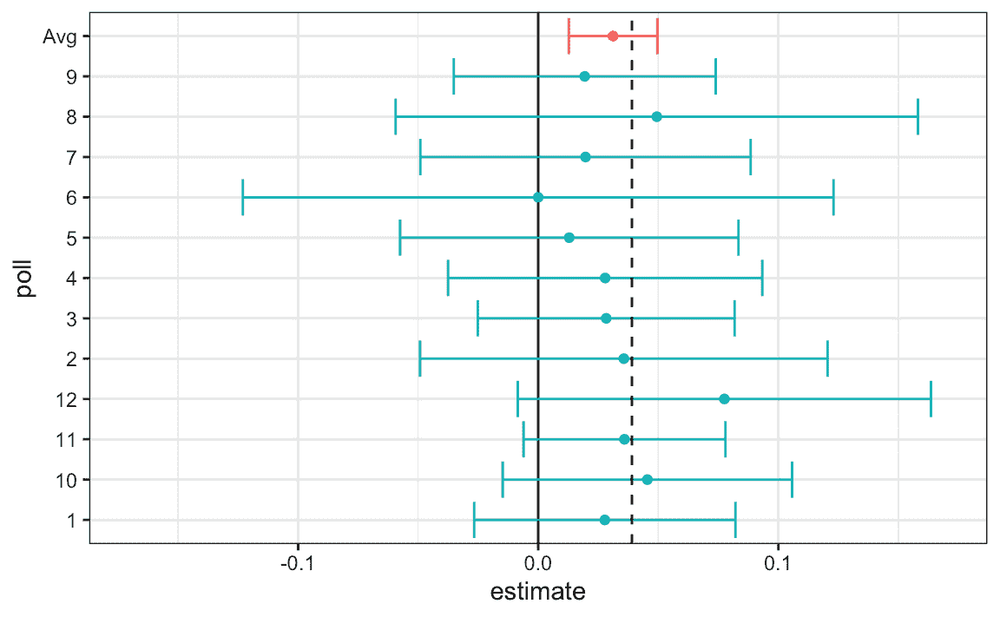
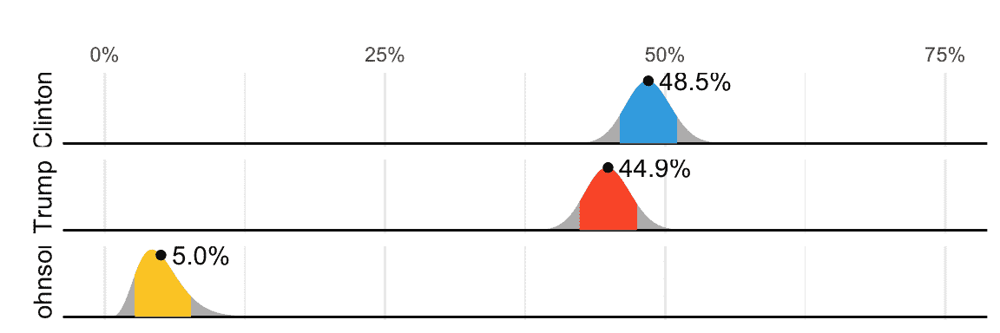
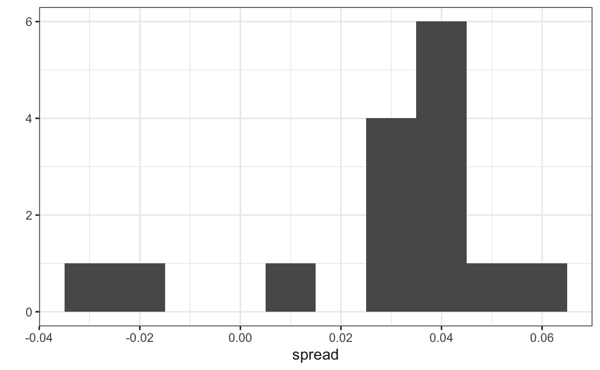
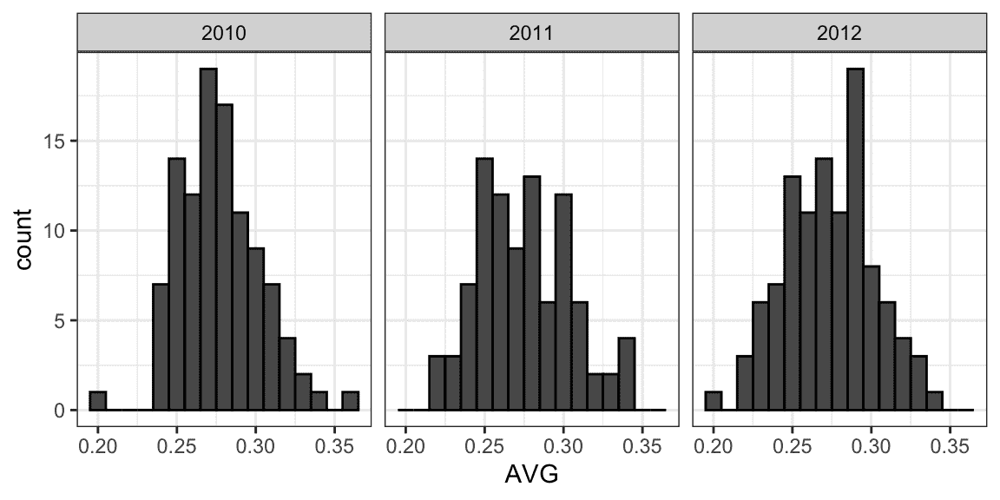
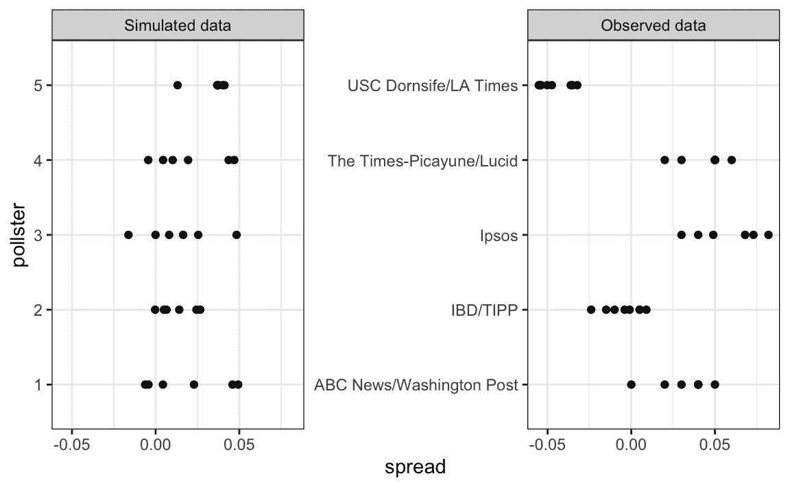
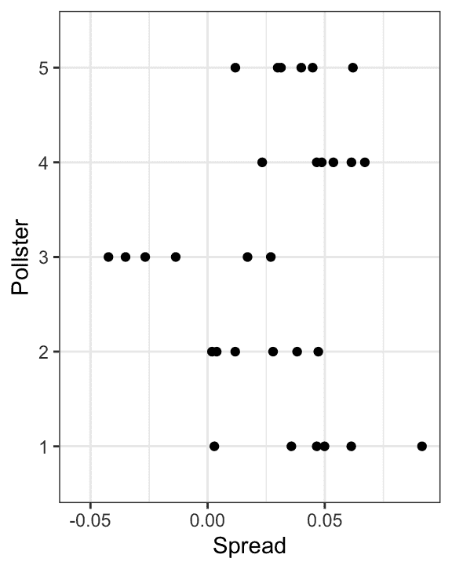
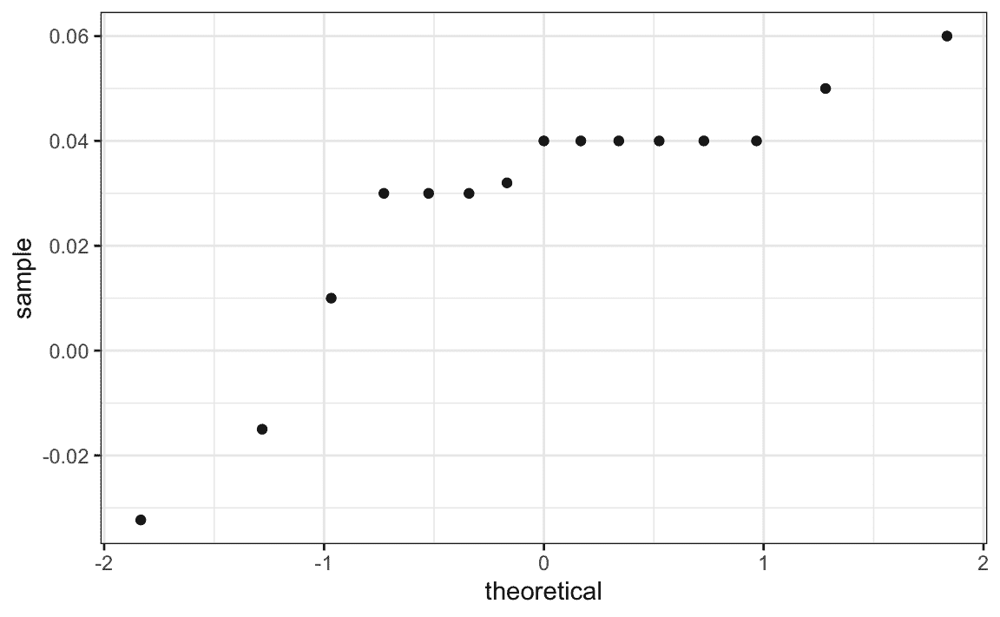

# 第十六章 统计模型

> 原文：[`rafalab.dfci.harvard.edu/dsbook/models.html`](https://rafalab.dfci.harvard.edu/dsbook/models.html)
> 
> > “所有模型都是错误的，但有些是有用的。” ——乔治·E·P·博克斯

在 2008 年总统选举的前一天，Nate Silver 的 FiveThirtyEight 网站预测“巴拉克·奥巴马似乎将获得决定性的选举胜利”。他们更进一步，预测奥巴马将以 349 票对 189 票的选举人票数获胜，以 6.1%的得票率赢得普选票。FiveThirtyEight 还附上了概率声明，声称奥巴马有 91%的胜选机会。预测非常准确，因为最终结果中，奥巴马以 365 票对 173 票赢得了选举人团，以 7.2%的得票率赢得了普选票。他们在 2008 年的表现使 FiveThirtyEight 引起了政治评论家和电视名人的注意。四年后，在 2012 年总统选举的前一周，尽管许多专家认为最终结果将更接近，但 FiveThirtyEight 的 Nate Silver 仍然给奥巴马 90%的胜选机会。政治评论员乔·斯卡伯勒在他的节目中⁵⁵说：

> > 任何认为这场选举现在不是一场势均力敌的比赛的人都是如此意识形态化……他们只是玩笑。

Nate Silver 通过推特回应：

> > 如果你认为这是一场势均力敌的比赛，那我们就打赌吧。如果奥巴马赢了，你向美国红十字会捐赠 1000 美元。如果罗姆尼赢了，我就捐。成交？

在 2016 年，Silver 并不那么确定，只给了希拉里·克林顿 71%的胜选机会。相比之下，大多数其他预测者几乎确信她会获胜。但她输了。但 71%仍然多于 50%，那么 Silver 先生错了吗？在这个背景下，概率又意味着什么呢？骰子在某个地方被掷了吗？

在本章中，我们将展示像 FiveThirtyEight 这样的民意调查聚合器是如何收集和合并不同专家报告的数据，以产生改进的预测的。我们将介绍民意调查聚合器用来提高选举预测能力超越单个民调能力的**统计模型**（也称为**概率模型**）背后的思想。在本章中，我们基于我们在第十五章学到的统计推断概念来激发这些模型，我们从相对简单的模型开始，意识到实际的数据科学练习中的选举预测涉及相当复杂的模型，我们将在本章的 16.8 节末介绍这些模型。

## 16.1 民意调查聚合器

正如我们之前所描述的，在 2012 年选举前几周，Nate Silver 给奥巴马 90%的获胜机会。Silver 先生是如何如此自信的呢？我们将使用蒙特卡洛模拟来展示 Silver 先生所拥有的洞察力，而其他人却忽略了。为此，我们生成选举前一周进行的 12 个调查的结果。我们模仿实际调查的样本量，并为每个 12 个调查构建并报告 95%置信区间。我们将这个模拟的结果保存在一个数据框中，并添加一个调查 ID 列。

```r
library(tidyverse)
library(dslabs)
d <- 0.039
Ns <- c(1298, 533, 1342, 897, 774, 254, 812, 324, 1291, 1056, 2172, 516)
p <- (d + 1) / 2

polls <- map_df(Ns, function(N) {
 x <- sample(c(0,1), size=N, replace=TRUE, prob=c(1-p, p))
 x_hat <- mean(x)
 se_hat <- sqrt(x_hat * (1 - x_hat) / N)
 list(estimate = 2 * x_hat - 1, 
 low = 2*(x_hat - 1.96*se_hat) - 1, 
 high = 2*(x_hat + 1.96*se_hat) - 1,
 sample_size = N)
}) |> mutate(poll = seq_along(Ns))
```

这里有一个可视化展示民意调查员会报告的奥巴马和罗姆尼之间的差异区间：


并不出奇，所有 12 个调查报告的置信区间都包括选举夜的结果（虚线）。然而，所有 12 个调查也包括 0（实线）。因此，如果单独询问预测，民意调查员们必须说：这是一个平局。以下我们将描述他们遗漏的一个关键洞察。

民意调查聚合器，如 Nate Silver，意识到通过结合不同调查的结果，可以大大提高精度。通过这样做，我们实际上进行了一个具有巨大样本量的调查。因此，我们可以报告一个更小的 95%置信区间和更精确的预测。

尽管作为聚合器我们没有访问原始调查数据，但我们可以使用数学来重建如果我们进行了一次大型调查将会得到的结果：

```r
sum(polls$sample_size)
#> [1] 11269
```

参与者。基本上，我们通过以下方式使用加权平均来构建一个关于差异范围的估计，我们可以称之为 $d$：

```r
d_hat <- polls |> 
 summarize(avg = sum(estimate*sample_size) / sum(sample_size)) |> 
 pull(avg)
```

一旦我们有了 $d$ 的估计，我们就可以构建一个关于奥巴马得票比例的估计，然后我们可以使用它来估计标准误差。一旦我们这样做，我们看到我们的误差范围是 0.018。

因此，我们可以预测差异将是 3.1 加上或减去 1.8，这不仅包括我们在选举夜最终观察到的实际结果，而且离包括 0 相当远。一旦我们结合了 12 个调查，我们就非常确信奥巴马将赢得普选票。



当然，这只是一个模拟，用以说明这个想法。实际的预测选举的数据科学练习要复杂得多，它涉及到建模。以下我们解释民意调查员如何将多层次模型拟合到数据中，并使用它来预测选举结果。在 2008 年和 2012 年美国总统选举中，Nate Silver 使用这种方法做出了几乎完美的预测，并使评论员们哑口无言。

自 2008 年选举以来，其他组织也开始建立自己的选举预测小组，这些小组与 Nate Silver 的类似，它们汇总民意调查数据并使用统计模型进行预测。在 2016 年，预测者大大低估了特朗普获胜的机会。在大选前一天，*《纽约时报》* 报道了以下关于希拉里·克林顿赢得总统职位的概率⁵⁶：

|  | NYT | 538 | HuffPost | PW | PEC | DK | Cook | Roth |
| --- | --- | --- | --- | --- | --- | --- | --- | --- |
| 胜率 | 85% | 71% | 98% | 89% | >99% | 92% | 倾向民主党 | 倾向民主党 |

例如，普林斯顿选举联盟（PEC）给特朗普的获胜机会不到 1%，而 Huffington Post 给他 2% 的机会。相比之下，FiveThirtyEight 将特朗普获胜的概率定为 29%，这比掷两个硬币得到两个正面还要高。事实上，在大选前四天，FiveThirtyEight 发布了一篇题为 *特朗普只是克林顿的正常民意调查误差背后*⁵⁷ 的文章。通过理解统计模型以及这些预测者如何使用它们，我们将开始了解这是如何发生的。

虽然预测选举人团并不像预测普选那样有趣，但为了说明目的，我们将首先查看对普选的预测。FiveThirtyEight 预测克林顿领先 3.6%⁵⁸，将实际结果 2.1%（48.2% 对 46.1%）包含在其区间内，并且对克林顿赢得选举非常有信心，给她 81.4% 的胜算。他们的预测用如下图表总结：



彩色区域代表根据 FiveThirtyEight 模型，有 80% 的概率包含实际结果。

我们引入 2016 年美国总统选举的实际数据，以展示模型是如何被激发和构建来产生这些预测的。为了理解“81.4% 的机会”这一说法，我们需要描述贝叶斯统计，我们在第 16.4 和 16.8.1 节中进行了描述。

### 16.1.1 民意调查数据

我们使用由 FiveThirtyEight 组织的 2016 年总统选举的公共民意调查数据。这些数据包含在 **dslabs** 包中：

```r
data(polls_us_election_2016)
```

该表格包括在大选前一年内进行的全国性民意调查以及州级民意调查的结果。对于这个第一个例子，我们将过滤数据以包括在大选前一周进行的全国性民意调查。我们还移除了 FiveThirtyEight 确定不可靠并给予“B”或以下评分的民意调查。一些民意调查没有评分，我们包括那些：

```r
polls <- polls_us_election_2016 |> 
 filter(state == "U.S." & enddate >= "2016-10-31" &
 (grade %in% c("A+","A","A-","B+") | is.na(grade)))
```

我们添加了一个差值估计：

```r
polls <- polls |> 
 mutate(spread = rawpoll_clinton/100 - rawpoll_trump/100)
```

对于这个例子，我们将假设只有两个政党，并将 $p$ 称为支持克林顿的投票比例，$1-p$ 称为支持特朗普的投票比例。我们感兴趣的是差值 $2p-1$。我们可以将差值称为 $d$（差异）。

我们有 49 个关于扩散的估计值。我们学过的理论告诉我们，这些估计值是一个随机变量，其概率分布近似为正态分布。期望值是选举之夜的扩散 $d$，标准误差是 $2\sqrt{p (1 - p) / N}$。假设我们之前描述的 urn 模型是一个好的模型，我们可以使用这些信息来根据汇总数据构建一个置信区间。估计的扩散是：

```r
d_hat <- polls |> 
 summarize(d_hat = sum(spread * samplesize) / sum(samplesize)) |> 
 pull(d_hat)
```

标准误差是：

```r
p_hat <- (d_hat+1)/2 
moe <- 1.96 * 2 * sqrt(p_hat * (1 - p_hat) / sum(polls$samplesize))
moe
#> [1] 0.00662
```

因此，我们报告的扩散率为 1.43%，误差范围为 0.66%。在选举之夜，我们发现实际百分比是 2.1%，这超出了 95%的置信区间。发生了什么？

报告的扩散率的直方图显示了一个问题：

```r
polls |>
 ggplot(aes(spread)) +
 geom_histogram(color="black", binwidth = .01)
```


数据似乎不是正态分布的，标准误差似乎大于 0.007。理论在这里并不完全适用。

### 16.1.2 民意调查员偏差

注意到涉及到的各种民意调查员，有些人每周进行几次民意调查：

```r
polls |> group_by(pollster) |> summarize(n())
#> # A tibble: 15 × 2
#>   pollster                                                   `n()`
#>   <fct>                                                      <int>
#> 1 ABC News/Washington Post                                       7
#> 2 Angus Reid Global                                              1
#> 3 CBS News/New York Times                                        2
#> 4 Fox News/Anderson Robbins Research/Shaw & Company Research     2
#> 5 IBD/TIPP                                                       8
#> # ℹ 10 more rows
```

让我们可视化那些定期进行民意调查的民意调查员的数据：


这个图揭示了一个意外的结果。首先，考虑理论预测的每个民意调查的标准误差：

```r
polls |> group_by(pollster) |> 
 filter(n() >= 6) |>
 summarize(se = 2 * sqrt(p_hat * (1-p_hat) / median(samplesize)))
#> # A tibble: 5 × 2
#>   pollster                     se
#>   <fct>                     <dbl>
#> 1 ABC News/Washington Post 0.0265
#> 2 IBD/TIPP                 0.0333
#> 3 Ipsos                    0.0225
#> 4 The Times-Picayune/Lucid 0.0196
#> 5 USC Dornsife/LA Times    0.0183
```

它在 0.018 和 0.033 之间，这与我们在民意调查内部看到的变异一致。然而，似乎存在**跨民意调查**的差异。注意，例如，USC Dornsife/LA Times 民意调查员预测特朗普将赢得 4%，而 Ipsos 预测克林顿的胜利将超过 5%。我们学过的理论对不同的民意调查员产生具有不同期望值的民意调查没有任何说明。所有民意调查都应该有相同的期望值。FiveThirtyEight 将这些差异称为“house effects”。我们也将它们称为**民意调查员偏差**。

在下一节中，我们不是使用 urn 模型理论，而是将开发一个数据驱动模型。

## 16.2 数据驱动模型

对于每个民意调查员，让我们收集他们在选举前的最后报告结果：

```r
one_poll_per_pollster <- polls |> group_by(pollster) |> 
 filter(enddate == max(enddate)) |>
 ungroup()
```

这里是这些 15 个民意调查员的数据直方图：

```r
qplot(spread, data = one_poll_per_pollster, binwidth = 0.01)
```



在前一节中，我们看到了由于民意调查员效应，使用 urn 模型理论来合并这些结果可能不合适。相反，我们将直接对这种扩散数据进行建模。

新模型也可以被视为一个 urn 模型，尽管这种联系并不直接。而不是 0s（共和党）和 1s（民主党），我们的 urn 现在包含来自所有可能民意调查员的民意调查结果。我们**假设**urn 的期望值是实际的扩散 $d=2p-1$。

因为我们的抽屉包含的是介于 -1 和 1 之间的连续数字，而不是 0 和 1，所以抽屉的标准差不再是 $\sqrt{p(1-p)}$。而不是选民抽样变异性，标准误差现在包括调查员之间的变异性。我们的新抽屉也包括调查的抽样变异性。无论如何，这个标准差现在是一个未知参数。在统计学教科书中，希腊字母 $\sigma$ 用于表示这个参数。

总结来说，我们有两个未知参数：期望值 $d$ 和标准差 $\sigma$。

我们的任务是估计 $d$。因为我们把观察到的值 $X_1,\dots X_N$ 模型化为来自抽屉的随机样本，所以 CLT 在这种情况下可能仍然适用，因为它是一系列独立随机变量的平均值。对于足够大的样本量 $N$，样本平均值 $\bar{X}$ 的概率分布近似为正态分布，期望值为 $\mu$，标准误差为 $\sigma/\sqrt{N}$。如果我们愿意认为 $N=15$ 足够大，我们可以使用这一点来构建置信区间。

一个问题是，我们不知道 $\sigma$。但理论告诉我们，我们可以用定义为 $s = \sqrt{ \sum_{i=1}^N (X_i - \bar{X})² / (N-1)}$ 的样本标准差来估计抽屉模型 $\sigma$。

与总体标准差定义不同，我们现在除以 $N-1$。这使得 $s$ 成为 $\sigma$ 的更好估计。这有一个数学解释，这在大多数统计学教科书中都有解释，但在这里我们不涉及。

R 中的 `sd` 函数计算样本标准差：

```r
sd(one_poll_per_pollster$spread)
#> [1] 0.0242
```

现在我们已经准备好根据我们的新数据驱动模型形成一个新的置信区间：

```r
results <- one_poll_per_pollster |> 
 summarize(avg = mean(spread), 
 se = sd(spread) / sqrt(length(spread))) |> 
 mutate(start = avg - 1.96 * se, 
 end = avg + 1.96 * se) 
round(results * 100, 1)
#>   avg  se start end
#> 1 2.9 0.6   1.7 4.1
```

由于它包含了民意调查者的变异性，我们的置信区间现在更宽了。它确实包括了选举之夜的 2.1% 的结果。此外，请注意，它足够小，以至于不包括 0，这意味着我们相信克林顿会赢得普选票。

我们现在是否准备好宣布克林顿赢得普选票的概率？还不行。在我们的模型中 $d$ 是一个固定参数，所以我们不能谈论概率。为了提供概率，我们需要了解贝叶斯统计。

## 16.3 练习

我们一直使用抽屉模型来激发使用概率模型的应用。大多数数据科学应用与来自抽屉的数据无关。更常见的是来自个人的数据。概率在这里发挥作用的原因是因为数据来自随机样本。随机样本是从总体中抽取的，抽屉作为总体的类比。

让我们回顾一下身高数据集。假设我们认为我们课程中的男性是总体。

```r
library(dslabs)
data(heights)
x <- heights |> filter(sex == "Male") |>
 pull(height)
```

1. 从数学上讲，`x` 是我们的总体。使用抽屉类比，我们有一个包含 `x` 值的抽屉。我们总体的平均值和标准差是多少？

2. 将上面计算出的总体平均值称为 $\mu$，标准差称为 $\sigma$。现在取一个大小为 50 的样本，进行替换，并构建对 $\mu$ 和 $\sigma$ 的估计。

3. 理论告诉我们样本平均值 $\bar{X}$ 与 $\mu$ 之间的关系是什么？

1.  这实际上与 $\mu$ 完全相同。

1.  它是一个具有期望值 $\mu$ 和标准误 $\sigma/\sqrt{N}$ 的随机变量。

1.  它是一个具有期望值 $\mu$ 和标准误 $\sigma$ 的随机变量。

1.  不包含任何信息。

4. 这有什么用呢？我们将使用一个过于简化但具有说明性的例子。假设我们想知道我们男性学生的平均身高，但我们只能测量 708 人中的 50 人。我们将使用 $\bar{X}$ 作为我们的估计。我们知道从练习 3 的答案中，我们的误差标准估计 $\bar{X}-\mu$ 是 $\sigma/\sqrt{N}$。我们想计算这个值，但我们不知道 $\sigma$。根据本节中描述的内容，展示你对 $\sigma$ 的估计。

5. 现在我们已经得到了 $\sigma$ 的估计，让我们称我们的估计为 $s$。构建一个 95% 的置信区间来估计 $\mu$。

6. 现在运行一个蒙特卡洛模拟，在其中你将计算 10,000 个置信区间，就像你刚刚做的那样。这些区间中有多少比例包含 $\mu$？

7. 在本节中，我们讨论了民意调查偏差。我们使用可视化来激发这种偏差的存在。在这里，我们将对其进行更严谨的处理。我们将考虑两个进行每日民调的民意调查机构。我们将查看选举前一个月的全国民调。

```r
data(polls_us_election_2016)
polls <- polls_us_election_2016 |> 
 filter(pollster %in% c("Rasmussen Reports/Pulse Opinion Research",
 "The Times-Picayune/Lucid") &
 enddate >= "2016-10-15" &
 state == "U.S.") |> 
 mutate(spread = rawpoll_clinton/100 - rawpoll_trump/100) 
```

我们想回答的问题是：是否存在民意调查偏差？制作一个显示每个民调范围的图表。

8. 数据似乎确实表明存在差异。然而，这些数据受到变异性影响。也许我们观察到的差异是由于偶然性造成的。

砝码模型理论没有关于民意调查效应的说明。在砝码模型下，两个民意调查机构都有相同的期望值：选举日的差异，我们称之为 $d$。

为了回答“是否存在砝码模型？”这个问题，我们将以下方式对观察到的数据 $Y_{i,j}$ 进行建模：

$$ Y_{i,j} = d + b_i + \varepsilon_{i,j} $$

其中 $i=1,2$ 表示两个民意调查机构，$b_i$ 是民意调查机构 $i$ 的偏差，$\varepsilon_{ij}$ 是民调之间的随机变化。我们假设 $\varepsilon$ 之间相互独立，期望值为 0，标准差为 $\sigma_i$，无论 $j$ 如何。

以下哪个选项最能代表我们的问题？

1.  $\varepsilon_{i,j}$ 是否等于 0？

1.  $Y_{i,j}$ 与 $d$ 的接近程度如何？

1.  $b_1 \neq b_2$ 吗？

1.  $b_1 = 0$ 和 $b_2 = 0$ 吗？

9. 在这个模型的右侧，只有 $\varepsilon_{i,j}$ 是一个随机变量。其他两个是常数。$Y_{1,j}$ 的期望值是多少？

10. 假设我们定义 $\bar{Y}_1$ 为第一个民意调查机构从 $Y_{1,1},\dots,Y_{1,N_1}$ 得到的民调结果的平均值，其中 $N_1$ 是第一个民意调查机构进行的民调数量：

```r
polls |> 
 filter(pollster=="Rasmussen Reports/Pulse Opinion Research") |> 
 summarize(N_1 = n())
```

$\bar{Y}_1$ 的期望值是多少？

11. $\bar{Y}_1$ 的标准误差是多少？

12. 假设我们定义 $\bar{Y}_2$ 为第一个民意调查者的调查结果的平均值，$Y_{2,1},\dots,Y_{2,N_2}$，其中 $N_2$ 是第一个民意调查者进行的调查数量。$\bar{Y}_2$ 的期望值是多少？

13. $\bar{Y}_2$ 的标准误差是多少？

14. 使用我们通过回答上述问题所学的知识，$\bar{Y}_{2} - \bar{Y}_1$ 的期望值是多少？

15. 使用我们通过回答上述问题所学的知识，$\bar{Y}_{2} - \bar{Y}_1$ 的标准误差是多少？

16. 上述问题的答案取决于 $\sigma_1$ 和 $\sigma_2$，这是我们不知道的。我们了解到我们可以用样本标准差来估计这些值。编写代码来计算这两个估计值。

17. 中心极限定理告诉我们 $\bar{Y}_2 - \bar{Y}_1$ 的分布是什么？

1.  没有期望值，因为这不是样本的平均值。

1.  因为 $Y_{ij}$ 大约是正态分布的，所以平均值也是正态分布的。

1.  注意到 $\bar{Y}_2$ 和 $\bar{Y}_1$ 是样本平均值，所以如果我们假设 $N_2$ 和 $N_1$ 足够大，每个都是近似正态的。正态分布的差异也是正态的。

1.  数据不是 0 或 1，因此中心极限定理不适用。

18. 我们构建了一个具有期望值 $b_2 - b_1$ 的随机变量，这是民意调查者的偏差差异。如果我们的模型成立，那么这个随机变量具有近似正态分布，并且我们知道其标准误差。标准误差取决于 $\sigma_1$ 和 $\sigma_2$，但我们可以插入我们上面计算的样本标准差。我们最初的问题是：$b_2 - b_1$ 是否与 0 不同？使用我们上面所学到的所有信息来构建 $b_2$ 和 $b_1$ 差异的 95% 置信区间。

19. 置信区间告诉我们存在相对较强的民意调查者效应，导致差异约为 5%。随机变异性似乎无法解释这一点。我们可以计算一个 p 值来传达事实，即偶然性无法解释这一点。p 值是多少？

20. 由我们的 $b_2-b_1$ 估计值除以其估计标准误差所形成的统计量：

$$ \frac{\bar{Y}_2 - \bar{Y}_1}{\sqrt{s_2²/N_2 + s_1²/N_1}} $$

被称为 t 统计量。现在请注意，我们不止有两个民意调查者。我们还可以使用所有民意调查者来测试民意调查者效应，而不仅仅是两个。想法是比较调查之间的变异性与调查内部的变异性。我们实际上可以构建统计量来测试效应并近似它们的分布。做这件事的统计学领域被称为方差分析或 ANOVA。我们在这里不涉及它，但 ANOVA 提供了一套非常有用的工具来回答诸如：是否存在民意调查者效应等问题。

对于这个练习，创建一个新的表格：

```r
polls <- polls_us_election_2016 |> 
 filter(enddate >= "2016-10-15" &
 state == "U.S.") |>
 group_by(pollster) |>
 filter(n() >= 5) |> 
 mutate(spread = rawpoll_clinton/100 - rawpoll_trump/100) |>
 ungroup()
```

计算每个民意调查员的平均值和标准差，并检查平均值之间的变异性以及它与民意调查员内部变异性的比较，后者由标准差总结。

## 16.4 贝叶斯统计

当选举预测者告诉我们某个候选人胜选的概率为 90%时，这意味着什么？在抽屉模型中，这相当于说概率 $p>0.5$ 为 90%。然而，正如我们之前讨论的，在抽屉模型中 $p$ 是一个固定参数，谈论概率是没有意义的。在贝叶斯统计中，我们将 $p$ 模型化为随机变量，因此“胜选概率为 90%”的表述与这种方法是一致的。

预测者还使用模型来描述不同层面的变异性。例如，抽样变异性、民意调查员之间的变异性、日日变异性以及选举之间的变异性。用于此目的的最成功的方法之一是层次模型，这可以在贝叶斯统计的背景下进行解释。

在本章中，我们简要介绍了贝叶斯统计。对于这个主题的深入探讨，我们推荐以下教材之一：

+   Berger JO (1985). 统计决策理论与贝叶斯分析，第 2 版。Springer-Verlag。

+   Lee PM (1989). 贝叶斯统计：导论。牛津。

### 16.4.1 贝叶斯定理

我们首先描述贝叶斯定理。我们以一个假设的囊性纤维化测试为例进行说明。假设囊性纤维化测试的准确率为 99%。我们将使用以下符号：

$$ \mbox{Prob}(+ \mid D=1)=0.99, \mbox{Prob}(- \mid D=0)=0.99 $$

其中“+”表示阳性测试，“D”代表你是否真的患病（1）或不是（0）。

假设我们随机选择一个人，他们测试结果为阳性。他们患病的概率是多少？我们将其表示为 $\mbox{Prob}(D=1 \mid +)$。囊性纤维化发病率是每 3900 人中就有 1 人，这意味着 $\mbox{Prob}(D=1)=0.00025$。为了回答这个问题，我们将使用贝叶斯定理，它通常告诉我们：

$$ \mbox{Pr}(A \mid B) = \frac{\mbox{Pr}(B \mid A)\mbox{Pr}(A)}{\mbox{Pr}(B)} $$

将此方程应用于我们的问题变为：

$$ \begin{aligned} \mbox{Pr}(D=1 \mid +) & = \frac{ P(+ \mid D=1) \cdot P(D=1)} {\mbox{Pr}(+)} \\ & = \frac{\mbox{Pr}(+ \mid D=1)\cdot P(D=1)} {\mbox{Pr}(+ \mid D=1) \cdot P(D=1) + \mbox{Pr}(+ \mid D=0) \mbox{Pr}( D=0)} \end{aligned} $$

将数值代入后得到：

$$ \frac{0.99 \cdot 0.00025}{0.99 \cdot 0.00025 + 0.01 \cdot (.99975)} = 0.02 $$

这意味着尽管测试的准确率为 0.99，但在测试结果为阳性时，患病概率仅为 0.02。这可能会让一些人感到反直觉，但这种情况发生的原因是因为我们必须考虑一个随机选择的人患病的非常罕见的概率。为了说明这一点，我们运行了一个蒙特卡洛模拟。

## 16.5 贝叶斯定理模拟

以下模拟旨在帮助您可视化贝叶斯定理。我们首先从一个人群中随机选择 100,000 人，这个人群中的疾病患病率是 1/4,000。

```r
prev <- 0.00025
N <- 100000
outcome <- sample(c("Disease","Healthy"), N, replace = TRUE, 
 prob = c(prev, 1 - prev))
```

注意，患病的很少见：

```r
N_D <- sum(outcome == "Disease")
N_D
#> [1] 23
N_H <- sum(outcome == "Healthy")
N_H
#> [1] 99977
```

此外，还有许多没有疾病的人，这使得在测试并不完美的情况下，我们更有可能看到一些假阳性。现在每个人都会接受测试，这个测试有 99%的正确率：

```r
accuracy <- 0.99
test <- vector("character", N)
test[outcome == "Disease"]  <- sample(c("+", "-"), N_D, replace = TRUE, 
 prob = c(accuracy, 1 - accuracy))
test[outcome == "Healthy"]  <- sample(c("-", "+"), N_H, replace = TRUE, 
 prob = c(accuracy, 1 - accuracy))
```

因为对照组比病例组多得多，即使假阳性率很低，我们也会在测试结果为阳性的组中得到比病例组更多的对照组：

```r
table(outcome, test)
#>          test
#> outcome       -     +
#>   Disease     0    23
#>   Healthy 99012   965
```

从这个表中，我们看到阳性测试中有疾病的比例是 988 人中的 23 人。我们可以反复运行这个程序，以看到，实际上，概率收敛到大约 0.022。

### 16.5.1 贝叶斯实践

何塞·伊格莱西亚斯是一名职业棒球运动员。2013 年 4 月，当他刚开始他的职业生涯时，他表现相当出色：

| 月份 | 击球次数 | H | AVG |
| --- | --- | --- | --- |
| 四月 | 20 | 9 | .450 |

打击率（AVG）统计是衡量成功的一种方式。大致来说，它告诉我们击球时的成功率。AVG 为.450 意味着何塞在击球（击球次数）的 45%时是成功的，这在历史上是比较高的。记住，自从泰德·威廉姆斯在 1941 年做到这一点以来，没有人完成过一个赛季的 AVG 达到或超过.400！为了说明层次模型的力量，我们将尝试预测何塞在赛季结束时的打击率。请注意，在一个典型的赛季中，球员大约有 500 次击球。

使用我们迄今为止学到的技术，称为*频率派技术*，我们所能做的最好的就是提供一个置信区间。我们可以将击球的结果视为一个成功率为$p$的二项分布。所以如果成功率确实是.450，那么只有 20 次击球的样本标准误差是：

$$ \sqrt{\frac{.450 (1-.450)}{20}}=.111 $$

这意味着我们的置信区间是$.450 - .222$到$.450 + .222$，即$.228$到$.672$。

这个预测有两个问题。首先，它非常大，所以不太有用。其次，它以.450 为中心，这意味着我们最好的猜测是这位新球员将打破泰德·威廉姆斯的记录。

如果你关注棒球，这个最后的陈述看起来是错误的，这是因为你隐含地使用了一个考虑了多年关注棒球信息的层次模型。在这里，我们展示了我们如何量化这种直觉。

首先，让我们探索在过去三个赛季中，所有超过 500 次击球的球员的打击率分布：



平均球员的 AVG 为.275，球员群体的标准差为 0.027。所以我们可以看到，.450 将是一个非常异常的值，因为它比平均值高出六个标准差。

那么，何塞是幸运的，还是他是过去 50 年里见过的最佳击球手？或许这是运气和天赋的结合。但各占多少呢？如果我们确信他是幸运的，我们应该将他交易到一个信任 .450 观察结果并且可能高估他潜力的球队。

## 16.6 层次化模型

层次化模型为我们如何得出 .450 的观察结果提供了一个数学描述。首先，我们随机选择一位球员，其内在能力可以用例如 $p$ 来概括。然后我们观察到 20 次随机结果，成功概率为 $p$。

我们使用一个模型来表示数据中的两个层次的变化。首先，每位球员都被分配了一个击球的天赋。我们将使用符号 $p$ 来表示这种能力。你可以将 $p$ 视为如果这位特定球员不断击球，他将达到的击球率。

基于我们之前展示的图表，我们假设 $p$ 服从正态分布。期望值为 .270，标准误差为 0.027。

现在的第二层次变化与击球时的运气有关。无论球员多么出色，有时会遇到坏运气，有时会遇到好运气。在每次击球时，这位球员有成功概率 $p$。如果我们把这些成功和失败加起来，CLT 告诉我们观察到的平均数，称之为 $Y$，具有期望值 $p$ 和标准误差 $\sqrt{p(1-p)/N}$，其中 $N$ 是击球次数。

统计教材中会这样描述模型：$$ \begin{aligned} p &\sim N(\mu, \tau²) \\ Y \mid p &\sim N(p, \sigma²) \end{aligned} $$ 这里 $\sim$ 符号告诉我们符号左侧的随机变量遵循右侧的分布，而 $N(a,b²)$ 表示均值为 $a$，标准差为 $b$ 的正态分布。$\mid$ 读作 *基于条件*，意味着我们将符号右侧的随机变量视为已知。我们将该模型称为层次化模型，因为我们需要知道 $p$，第一层，才能对 $Y$，第二层进行建模。在我们的例子中，第一层描述了将天赋分配给球员时的随机性，第二层描述了在确定了天赋参数后，这位特定球员的表现的随机性。在贝叶斯框架中，第一层被称为 *先验分布*，第二层被称为 *抽样分布*。我们在这里进行的数据分析表明，我们应该将 $\mu = .270$，$\tau = 0.027$，和 $\sigma² = p(1-p)/N$ 设置为参数。

现在，让我们使用这个模型来分析何塞的数据。假设我们想要以他的 *真实* 击球率 $p$ 的形式预测他的内在能力。这将是我们数据的层次化模型：

$$ \begin{aligned} p &\sim N(.275, .027²) \\ Y \mid p &\sim N(p, .111²) \end{aligned} $$

现在我们准备计算后验分布来总结我们对 $p$ 的预测。贝叶斯规则的连续版本可以用来推导 *后验概率函数*，这是在观察到 $Y=y$ 时 $p$ 的分布。在我们的案例中，我们可以证明当 $Y=y$ 固定时，$p$ 遵循一个期望值为：

$$ \begin{aligned} \mbox{E}(p \mid Y=y) &= B \mu + (1-B) y\\ &= \mu + (1-B)(y-\mu)\\ \mbox{with } B &= \frac{\sigma²}{\sigma²+\tau²} \end{aligned} $$

这是对总体平均数 $\mu$ 和观察到的数据 $y$ 的加权平均。权重取决于总体标准差 $\tau$ 和我们观察到的数据标准差 $\sigma$。这种加权平均有时被称为 *收缩*，因为它会将估计值 *收缩* 到先验均值。在何塞·伊格莱西亚斯的案例中，我们有：

$$ \begin{aligned} \mbox{E}(p \mid Y=.450) &= B \times .275 + (1 - B) \times .450 \\ &= .275 + (1 - B)(.450 - .275) \\ B &=\frac{.111²}{.111² + .027²} = 0.944\\ \mbox{E}(p \mid Y=450) &\approx .285 \end{aligned} $$

我们在此处不展示推导过程，但标准误差可以表示为：

$$ \mbox{SE}(p\mid y)² = \frac{1}{1/\sigma²+1/\tau²} = \frac{1}{1/.111² + 1/.027²} = 0.00069 $$ 因此标准差为 $0.026$。因此，我们开始时使用了一个频率主义者 95%置信区间，该区间忽略了其他球员的数据，仅总结了何塞的数据：.450 $\pm$ 0.220。然后我们使用贝叶斯方法，结合了其他球员和其他年份的数据，以获得后验概率。这实际上被称为经验贝叶斯方法，因为我们使用了数据来构建先验。从后验中，我们可以通过报告一个以平均值为中心的区域，该区域有 95%的概率发生，来报告所谓的 95% *可信区间*。在我们的案例中，这实际上是：.285 $\pm$ 0.052。

贝叶斯可信区间表明，如果另一支球队对.450 的观察印象深刻，我们应该考虑交易何塞，因为我们预测他将会略高于平均水平。有趣的是，红袜队在七月将何塞交易到了底特律老虎队。以下是何塞·伊格莱西亚斯接下来五个月的击球平均数：

| 月份 | 打击数 | 击球数 | AVG |
| --- | --- | --- | --- |
| 四月 | 20 | 9 | .450 |
| 五月 | 26 | 11 | .423 |
| 六月 | 86 | 34 | .395 |
| 七月 | 83 | 17 | .205 |
| 八月 | 85 | 25 | .294 |
| 九月 | 50 | 10 | .200 |
| 总计（不含四月） | 330 | 97 | .293 |

虽然两个区间都包含了最终的击球平均数，但贝叶斯可信区间提供了更精确的预测。特别是，它预测他在赛季剩余的时间里不会表现得那么好。

## 16.7 练习

1\. 1999 年，在英国，莎莉·克拉克⁵⁹被判定犯有杀害她两个儿子的罪行。两个婴儿都在早上被发现死亡，一个在 1996 年，另一个在 1998 年。在两种情况下，她声称死亡原因是婴儿猝死综合症（SIDS）。在两个婴儿身上都没有发现身体伤害的证据，因此对她不利的证据主要是罗伊·梅多爵士教授的证词，他作证说两个婴儿死于 SIDS 的可能性是 7300 万分之一。他是通过发现 SIDS 的比率是 8500 分之一，然后计算出两个 SIDS 病例的可能性是 8500 $\times$ 8500 $\approx$ 7300 万。以下哪个是你同意的？

1.  梅多爵士假设第二个儿子受到婴儿猝死综合症（SIDS）影响的可能性与第一个儿子受到影响的可能性是独立的，因此忽略了可能的遗传原因。如果遗传起作用，那么：$\mbox{Pr}(\mbox{second case of SIDS} \mid \mbox{first case of SIDS}) < \mbox{Pr}(\mbox{first case of SIDS})$.

1.  无。乘法法则总是以这种方式适用：$\mbox{Pr}(A \mbox{ and } B) =\mbox{Pr}(A)\mbox{Pr}(B)$

1.  梅多爵士是一位专家，我们应该相信他的计算。

1.  数字不会说谎。

2\. 假设 SIDS 确实有一个遗传成分，$\mbox{Pr}(\mbox{second case of SIDS} \mid \mbox{first case of SIDS}) = 1/100$，这个概率比 8500 分之一要高得多。她两个儿子死于 SIDS 的概率是多少？

3\. 许多新闻报道称，专家声称莎莉·克拉克无罪的概率是 7300 万分之一。也许陪审团和法官也是这样解读证词的。这个概率可以写成在“两个孩子被发现死亡且没有身体伤害的证据”的条件下，“她是一个弑子心理变态的母亲”的概率。根据贝叶斯定理，这是什么？

4\. 假设一个弑子心理变态者找到一种方法杀害她的孩子，而不留下身体伤害的证据的可能性是：

$$ \mbox{Pr}(A \mid B) = 0.50 $$

其中 A = 她的两个孩子被发现死亡且没有身体伤害的证据，B = 她是一个弑子心理变态的母亲 = 0.50。假设弑子心理变态母亲的比率是 100 万分之一。根据贝叶斯定理，$\mbox{Pr}(B \mid A)$ 的概率是多少？

5/. 在莎莉·克拉克被判定有罪后，皇家统计学会发表声明称，专家的论断“没有统计依据”。他们表达了对“法庭上统计数据的误用”的担忧。最终，莎莉·克拉克于 2003 年 6 月被宣判无罪。专家错过了什么？

1.  他犯了一个算术错误。

1.  他犯了两个错误。首先，他误用了乘法法则，并且没有考虑到母亲杀害孩子的罕见性。在使用贝叶斯定理后，我们发现概率接近 0.5，而不是 7300 万分之一。

1.  他把贝叶斯定理的分子和分母搞混了。

1.  他没有使用 R。

6. 佛罗里达是美国选举中最受关注的几个州之一，因为它拥有许多选举人票，选举通常很接近，佛罗里达往往是一个摇摆州，可以投给任何一方。创建以下表格，其中包含过去两周进行的民调：

```r
library(tidyverse)
library(dslabs)
data(polls_us_election_2016)
polls <- polls_us_election_2016 |> 
 filter(state == "Florida" & enddate >= "2016-11-04" ) |> 
 mutate(spread = rawpoll_clinton/100 - rawpoll_trump/100)
```

取这些民调的平均扩散。CLT 告诉我们这个平均值大约是正态分布的。计算平均值并提供标准误的估计。将你的结果保存在一个名为`results`的对象中。

7. 现在假设一个贝叶斯模型，将佛罗里达选举夜扩散$d$的先验分布设置为正态分布，期望值为$\mu$，标准差为$\tau$。$\mu$和$\tau$的解释是什么？

1.  $\mu$和$\tau$是任意数字，让我们可以对$d$做出概率陈述。

1.  $\mu$和$\tau$总结了在看到任何民调之前我们会对佛罗里达做出什么预测。根据过去的选举，我们会将$\mu$设得接近 0，因为共和党和民主党都曾获胜，而$\tau$设为大约$0.02$，因为这些选举往往很接近。

1.  $\mu$和$\tau$总结了我们所希望为真的情况。因此，我们将$\mu$设为$0.10$，将$\tau$设为$0.01$。

1.  先验的选择对贝叶斯分析没有影响。

8. CLT 告诉我们，我们对扩散的估计$\hat{d}$具有正态分布，期望值为$d$，标准差为问题 6 中计算出的$\sigma$。使用我们展示的后验分布公式，如果我们设置$\mu = 0$和$\tau = 0.01$，来计算后验分布的期望值。

9. 现在计算后验分布的标准差。

10. 利用后验分布是正态的这一事实，创建一个以后验期望值为中心的 95%概率发生区间的区间。注意，我们称这些为可信区间。

11. 根据这一分析，特朗普赢得佛罗里达的概率是多少？

12. 现在用`sapply`函数将先验方差从`seq(0.05, 0.05, len = 100)`改变，并通过绘制图表来观察概率如何变化。

## 16.8 案例研究：选举预测

在前面的章节中，我们生成了这些数据表：

```r
library(tidyverse)
library(dslabs)
polls <- polls_us_election_2016 |> 
 filter(state == "U.S." & enddate >= "2016-10-31" &
 (grade %in% c("A+","A","A-","B+") | is.na(grade))) |> 
 mutate(spread = rawpoll_clinton/100 - rawpoll_trump/100)

one_poll_per_pollster <- polls |> group_by(pollster) |> 
 filter(enddate == max(enddate)) |>
 ungroup()

results <- one_poll_per_pollster |> 
 summarize(avg = mean(spread), se = sd(spread)/sqrt(length(spread))) |> 
 mutate(start = avg - 1.96*se, end = avg + 1.96*se) 
```

下面，我们将使用这些来进行预测。

### 16.8.1 贝叶斯方法

民调员倾向于对选举结果做出概率陈述。例如，“奥巴马赢得选举人票的机会是 91%”是对一个参数的概率陈述，在前面几节中我们用$d$表示这个参数。我们展示了在 2016 年选举中，FiveThirtyEight 给克林顿赢得了 81.4%的普选票的机会。为了做到这一点，他们使用了我们描述的贝叶斯方法。

我们假设一个类似于我们预测棒球运动员表现的分层模型。统计教材会这样写模型：

$$ \begin{aligned} d &\sim N(\mu, \tau²) \mbox{描述了在没有看到任何民调数据时的最佳猜测}\\ \bar{X} \mid d &\sim N(d, \sigma²) \mbox{描述了由于抽样和民意调查者效应引起的随机性} \end{aligned} $$

对于我们的最佳猜测，我们注意到在没有任何民调数据可用之前，我们可以使用除了民调数据之外的数据来源。一种流行的方法是使用民意调查者所说的“基础”，这些是基于历史上似乎对现任政党有利的或不利的经济特性的。我们在这里不会使用这些。相反，我们将使用 $\mu = 0$，这被解释为一个不提供任何关于谁将获胜的信息的模型。对于标准差，我们将使用最近的历史数据，该数据显示普选票获胜者的平均分布约为 3.5%。因此，我们设置 $\tau = 0.035$。

现在我们可以使用参数 $d$ 的后验分布公式：给定观察到的民调数据的 $d>0$ 的概率：

```r
mu <- 0
tau <- 0.035
sigma <- results$se
Y <- results$avg
B <- sigma² / (sigma² + tau²)

posterior_mean <- B*mu + (1-B)*Y
posterior_se <- sqrt( 1/ (1/sigma² + 1/tau²))

posterior_mean
#> [1] 0.0281
posterior_se
#> [1] 0.00615
```

为了做出概率陈述，我们使用后验分布也是正态分布的事实。我们有一个可信区间为：

```r
posterior_mean + c(-1.96, 1.96)*posterior_se
#> [1] 0.0160 0.0401
```

后验概率 $\mbox{Pr}(d>0 \mid \bar{X})$ 可以这样计算：

```r
1 - pnorm(0, posterior_mean, posterior_se)
#> [1] 1
```

这意味着我们 100%确信克林顿将赢得普选票，这似乎过于自信。而且，这与 FiveThirtyEight 的 81.4%不符。这其中的差异是什么解释？

### 16.8.2 一般偏差

选举结束后，人们可以查看民意调查预测和实际结果之间的差异。我们的模型没有考虑的一个重要观察结果是，通常存在一种影响许多民意调查者的普遍偏差，使得观察到的数据相关。对此没有很好的解释，但我们确实在历史数据中观察到这一点：在一次选举中，民调的平均结果使民主党领先 2%，然后在下一次选举中，他们使共和党领先 1%，然后在下一次选举中没有偏差，然后在下一次选举中，共和党领先 3%，以此类推。在 2016 年，民调使民主党领先 1-2%。

虽然我们知道这个偏差项会影响我们的民调，但我们无法知道这个偏差是什么，直到选举之夜。因此，我们无法相应地纠正我们的民调。我们能做的是在我们的模型中包含一个考虑这种变异性的项。

### 16.8.3 模型的数学表示

假设我们正在收集一个民意调查者的数据，并且我们假设没有普遍偏差。民意调查者收集了几个样本量为 $N$ 的民调，因此我们观察到了几个关于分布的测量值 $X_1, \dots, X_J$。理论告诉我们，这些随机变量的期望值为 $d$，标准误差为 $2 \sqrt{p(1-p)/N}$。让我们首先使用以下模型来描述观察到的变异性：

$$ X_j = d + \varepsilon_j. $$ 我们使用索引 $j$ 来表示不同的调查，并定义 $\varepsilon_j$ 为一个随机变量，它解释了由抽样误差引入的调查到调查的变化。为此，我们假设其平均值为 0，标准误差为 $2 \sqrt{p(1-p)/N}$。如果 $d$ 为 $0.021$，并且这些调查的样本量为 2,000，我们可以从这个模型中模拟 $J=6$ 个数据点，如下所示：

```r
set.seed(3)
J <- 6
N <- 2000
d <- .021
p <- (d + 1)/2
X <- d + rnorm(J, 0, 2 * sqrt(p * (1 - p) / N))
```

现在假设我们有 $J=6$ 个来自 $I=5$ 个不同调查员的数据点。为了表示这一点，我们现在需要两个索引，一个用于调查员，一个用于每个调查员进行的调查。我们使用 $X_{ij}$ ，其中 $i$ 代表调查员，$j$ 代表该调查员进行的第 $j$ 次调查。如果我们应用相同的模型，我们写成：

$$ X_{i,j} = d + \varepsilon_{i,j} $$

为了模拟数据，我们现在必须遍历调查员：

```r
I <- 5
J <- 6
N <- 2000
X <- sapply(1:I, function(i){
 d + rnorm(J, 0, 2 * sqrt(p * (1 - p) / N))
})
```

模拟数据并没有真正捕捉到实际数据的特征：



上述模型没有考虑到调查员之间的变化。为了解决这个问题，我们添加了一个新的项来表示调查员效应。我们将使用 $h_i$ 来表示第 $i$ 个调查员的 house 效应。模型现在扩展为：

$$ X_{i,j} = d + h_i + \varepsilon_{i,j} $$

为了模拟来自特定调查员的数据，我们现在需要抽取一个 $h_i$ 并然后添加 $\varepsilon$。以下是一个特定调查员的示例。我们假设 $\sigma_h$ 为 0.025：

```r
I <- 5
J <- 6
N <- 2000
d <- .021
p <- (d + 1) / 2
h <- rnorm(I, 0, 0.025)
X <- sapply(1:I, function(i){
 d + h[i] + rnorm(J, 0, 2 * sqrt(p * (1 - p) / N))
})
```

模拟数据现在看起来更像是实际数据：



注意，$h_i$ 对所有来自特定调查员的观察到的扩散是通用的。不同的调查员有不同的 $h_i$，这解释了为什么我们可以看到点群在调查员之间上下移动。

现在，在上面的模型中，我们假设平均 house 效应为 0。我们认为，对于每个偏向我们党派的调查员，都有一个偏向另一方的调查员，并假设标准差为 $\sigma_h$。但历史上我们看到每次选举都有一个影响所有调查的一般偏差。我们可以用 2016 年的数据观察到这一点，但如果我们收集历史数据，我们会看到调查的平均值比上述模型预测的要低。为了将这一点纳入模型，我们可以添加另一个项来表示这种变化：$$ X_{i,j} = d + b + h_i + \varepsilon_{i,j}. $$

在这里，$b$ 是一个随机变量，它解释了选举之间的变异性。这个随机变量从一次选举到下一次选举都会变化，但对于任何给定的选举，它对所有民意调查和该选举内的所有民意调查都是相同的。这就是为什么它没有索引。这意味着对于选举年份的任何随机变量 $X_{i,j}$ 都是相关的，因为它们都有 $b$ 这个共同点。

解释 $b$ 的方法之一是将其视为所有民意调查的平均值与选举实际结果之间的差异。由于我们不知道实际结果直到选举之后，我们只能在选举之后估计 $b$。然而，我们可以从之前的选举中估计 $b$ 并研究这些值的分布。基于这种方法，我们假设，在选举年份中，$b$ 的期望值为 0，标准误差约为 $\sigma_b = 0.025$。

将此项添加到模型中的含义是，$X_{i,j}$ 的标准差实际上比我们之前所说的 $\sigma$ 更高，$\sigma$ 结合了民意调查的变异性以及样本的变异性，并且是用以下方式估计的：

```r
sd(one_poll_per_pollster$spread)
#> [1] 0.0242
```

这个估计不包括由 $b$ 引入的变异性。请注意，因为

$$ \bar{X} = d + b + \frac{1}{N}\sum_{i=1}^N X_i, $$

$\bar{X}$ 的标准差为：

$$ \sqrt{\sigma²/N + \sigma_b²}. $$ 由于相同的 $b$ 出现在每个测量中，平均值并不能减少 $b$ 项引入的变异性。这是一个重要的观点：无论你进行多少次民意调查，这种偏差都不会减少。

如果我们重新进行贝叶斯计算，并考虑这种变异性，我们将得到一个与 FiveThirtyEight 的结果非常接近的结果：

```r
mu <- 0
tau <- 0.035
sigma <- sqrt(results$se² + .025²)
Y <- results$avg
B <- sigma² / (sigma² + tau²)

posterior_mean <- B*mu + (1-B)*Y
posterior_se <- sqrt( 1/ (1/sigma² + 1/tau²))

1 - pnorm(0, posterior_mean, posterior_se)
#> [1] 0.817
```

### 16.8.4 预测选举人团

到目前为止，我们一直关注的是普选票。但在美国，选举并不是由普选票决定的，而是由所谓的选举人团决定的。每个州根据该州的人口规模以某种复杂的方式获得一定数量的选举人票。以下是 2016 年按选举人票排名前五的州。

```r
results_us_election_2016 |> top_n(5, electoral_votes)
#>          state electoral_votes clinton trump others
#> 1   California              55    61.7  31.6    6.7
#> 2        Texas              38    43.2  52.2    4.5
#> 3      Florida              29    47.8  49.0    3.2
#> 4     New York              29    59.0  36.5    4.5
#> 5     Illinois              20    55.8  38.8    5.4
#> 6 Pennsylvania              20    47.9  48.6    3.6
```

除了我们未讨论的一些小例外，选举人票要么全部赢得，要么全部失去。例如，如果你在加利福尼亚州仅以 1 票的微弱优势获胜，你仍然会得到其全部 55 张选举人票。这意味着通过以较大优势赢得几个大州，但以较小优势输掉许多小州，你可以赢得普选票，却输掉选举人团。这发生在 1876 年、1888 年、2000 年和 2016 年。背后的想法是避免几个大州拥有主导总统选举的力量。尽管如此，许多美国人认为选举人团是不公平的，并希望看到它被废除。

现在，我们准备预测 2016 年的选举人团结果。我们首先汇总选举前最后一周进行的民调结果。我们使用 `grepl`，它在字符向量中查找字符串，以移除不是针对整个州的民调。

```r
results <- polls_us_election_2016 |>
 filter(state!="U.S." & 
 !grepl("CD", state) & 
 enddate >="2016-10-31" & 
 (grade %in% c("A+","A","A-","B+") | is.na(grade))) |>
 mutate(spread = rawpoll_clinton/100 - rawpoll_trump/100) |>
 group_by(state) |>
 summarize(avg = mean(spread), sd = sd(spread), n = n()) |>
 mutate(state = as.character(state))
```

根据民调，以下是五场最接近的比赛：

```r
results |> arrange(abs(avg))
#> # A tibble: 47 × 4
#>   state               avg     sd     n
#>   <chr>             <dbl>  <dbl> <int>
#> 1 Florida         0.00356 0.0163     7
#> 2 North Carolina -0.0073  0.0306     9
#> 3 Ohio           -0.0104  0.0252     6
#> 4 Nevada          0.0169  0.0441     7
#> 5 Iowa           -0.0197  0.0437     3
#> # ℹ 42 more rows
```

我们现在介绍命令 `left_join`，它将使我们能够轻松地将每个州的选举人票数从数据集 `us_electoral_votes_2016` 中添加进来。我们将在“整理”章节中详细描述这个函数。在这里，我们只是简单地说，该函数将两个数据集合并，以便第二个参数的信息添加到第一个参数的信息中：

```r
results <- left_join(results, results_us_election_2016, by = "state")
```

注意，一些州没有民调，因为获胜者几乎已经确定：

```r
results_us_election_2016 |> filter(!state %in% results$state) |> 
 pull(state)
#> [1] "Rhode Island"         "Alaska"               "Wyoming" 
#> [4] "District of Columbia"
```

在哥伦比亚特区、罗德岛、阿拉斯加和怀俄明州没有进行民调，因为民主党在头两个州必胜，而共和党在最后两个州必胜。

由于我们无法估计只有一个民调的州的方差，我们将它估计为拥有多个民调的州的方差的中间值：

```r
results <- results |>
 mutate(sd = ifelse(is.na(sd), median(results$sd, na.rm = TRUE), sd))
```

为了进行概率论证，我们将使用蒙特卡洛模拟。对于每个州，我们应用贝叶斯方法来生成一个选举日 $d$。我们可以根据最近的历史为每个州构建先验。然而，为了简化，我们为每个州分配一个先验，假设我们对将要发生的事情一无所知。由于从选举年到选举年，一个特定州的选举结果变化不大，我们将分配一个 2%或 $\tau=0.02$ 的标准差。目前，我们将错误地假设每个州的民调结果是独立的。在这些假设下，贝叶斯计算的代码如下：

```r
mu <- 0
tau <- 0.02
results |> mutate(sigma = sd/sqrt(n), 
 B = sigma² / (sigma² + tau²),
 posterior_mean = B * mu + (1 - B) * avg,
 posterior_se = sqrt(1/ (1/sigma² + 1/tau²)))
#> # A tibble: 47 × 12
#>   state          avg       sd     n electoral_votes clinton trump others
#>   <chr>        <dbl>    <dbl> <int>           <int>   <dbl> <dbl>  <dbl>
#> 1 Alabama    -0.149  0.0253       3               9    34.4  62.1    3.6
#> 2 Arizona    -0.0326 0.0270       9              11    45.1  48.7    6.2
#> 3 Arkansas   -0.151  0.000990     2               6    33.7  60.6    5.8
#> 4 California  0.260  0.0387       5              55    61.7  31.6    6.7
#> 5 Colorado    0.0452 0.0295       7               9    48.2  43.3    8.6
#> # ℹ 42 more rows
#> # ℹ 4 more variables: sigma <dbl>, B <dbl>, posterior_mean <dbl>,
#> #   posterior_se <dbl>
```

基于后验的估计确实将估计值推向了 0，尽管拥有许多民调的州的受影响较小。这是预期的，因为收集到的民调数据越多，我们越信任这些结果：


现在，我们重复 10,000 次，并从后验中生成一个结果。在每次迭代中，我们跟踪克林顿的总选举人票数。记住，特朗普得到的是 270 减去克林顿的票数。另外，代码中加 7 的原因是为了考虑到罗德岛和哥伦比亚特区：

```r
B <- 10000
mu <- 0
tau <- 0.02
clinton_EV <- replicate(B, {
 results |> mutate(sigma = sd/sqrt(n), 
 B = sigma² / (sigma² + tau²),
 posterior_mean = B * mu + (1 - B) * avg,
 posterior_se = sqrt(1 / (1/sigma² + 1/tau²)),
 result = rnorm(length(posterior_mean), 
 posterior_mean, posterior_se),
 clinton = ifelse(result > 0, electoral_votes, 0)) |> 
 summarize(clinton = sum(clinton)) |> 
 pull(clinton) + 7
})

mean(clinton_EV > 269)
#> [1] 0.998
```

这个模型给克林顿超过 99%的获胜机会。普林斯顿选举联盟也做出了类似的预测。我们现在知道这个预测相当不准确。发生了什么？

上面的模型忽略了总体偏差并假设不同州的结果是独立的。选举之后，我们意识到 2016 年的总体偏差并不大：它在 1%到 2%之间。但是，由于几个大州的选举非常接近，并且这些州有大量的民调，忽视总体偏差的调查员大大低估了标准误差。使用我们引入的符号，他们假设标准误差是 $\sqrt{\sigma²/N}$，对于大的 N 来说，这比更准确的估计 $\sqrt{\sigma²/N + \sigma_b²}$ 要小得多。FiveThirtyEight 以一种相当复杂的方式模拟了总体偏差，并报告了一个更接近的结果。我们现在可以用偏差项来模拟结果。对于州级，总体偏差可能更大，所以我们将其设置为 $\sigma_b = 0.03$:

```r
tau <- 0.02
bias_sd <- 0.03
clinton_EV_2 <- replicate(1000, {
 results |> mutate(sigma = sqrt(sd²/n  + bias_sd²), 
 B = sigma² / (sigma² + tau²),
 posterior_mean = B*mu + (1-B)*avg,
 posterior_se = sqrt( 1/ (1/sigma² + 1/tau²)),
 result = rnorm(length(posterior_mean), 
 posterior_mean, posterior_se),
 clinton = ifelse(result>0, electoral_votes, 0)) |> 
 summarize(clinton = sum(clinton) + 7) |> 
 pull(clinton)
})
mean(clinton_EV_2 > 269)
#> [1] 0.848
```

这给我们提供了一个更合理的估计。查看模拟的结果，我们看到偏差项是如何给最终结果增加可变性的。


FiveThirtyEight 包括许多我们没有在这里包括的其他特征。其中一个是他们使用具有相对于正态分布高极端事件概率的分布来模拟可变性。我们可以通过将模拟中使用的分布从正态分布更改为 t 分布来实现这一点。FiveThirtyEight 预测了 71%的概率。

### 16.8.5 预测

预测师喜欢在选举前很久就做出预测。随着新民调的发布，预测会相应调整。然而，预测师必须问的一个重要问题是：选举前几周进行的民调对实际选举有多大的信息量？在这里，我们研究民调结果随时间的变化。

为了确保我们观察到的可变性不是由于调查员效应造成的，让我们研究一位调查员的数据：

```r
one_pollster <- polls_us_election_2016 |> 
 filter(pollster == "Ipsos" & state == "U.S.") |> 
 mutate(spread = rawpoll_clinton/100 - rawpoll_trump/100)
```

由于没有调查员效应，因此理论标准误差可能与数据得出的标准差相匹配。我们在这里计算了两者：

```r
se <- one_pollster |> 
 summarize(empirical = sd(spread), 
 theoretical = 2 * sqrt(mean(spread) * (1 - mean(spread)) /
 min(samplesize)))
se
#>   empirical theoretical
#> 1    0.0403      0.0326
```

但经验标准差高于可能的理论估计的最高值。此外，扩散数据看起来并不像理论所预测的那样呈正态分布：


我们所描述的模型包括调查员之间的可变性和抽样误差。但这个图是针对一位调查员的，我们看到的可变性肯定不是由抽样误差解释的。额外的可变性是从哪里来的？以下图表强烈表明，它来自理论假设 $p$ 是固定值时未考虑的时间波动：

```r
#> `geom_smooth()` using formula = 'y ~ x'
```


我们看到的一些峰值和谷值与党派大会等事件相吻合，这些事件往往会给候选人带来提升。我们可以看到峰值和谷值在几位调查员之间是一致的：

```r
#> `geom_smooth()` using formula = 'y ~ x'
```


这意味着，如果我们打算进行预测，我们的模型必须包括一个考虑时间效应的项。我们需要编写一个包括时间偏差项的模型：

$$ Y_{i,j,t} = d + b + h_j + b_t + \varepsilon_{i,j,t} $$

$b_t$ 的标准差将取决于 $t$，因为随着我们越来越接近选举日，这个偏差项应该越来越接近 0。

民意调查员还试图从这些数据中估计趋势，并将这些趋势纳入他们的预测中。我们可以用函数 $f(t)$ 来模拟时间趋势，并将模型重写如下：上图中的蓝色线条：

$$ Y_{i,j,t} = d + b + h_j + b_t + f(t) + \varepsilon_{i,jt,} $$

我们通常看到估计的 $f(t)$ 不是差异，而是每个候选人的实际百分比，如下所示：


一旦选择了像上面的模型，我们可以使用历史和现有数据来估计所有必要的参数以进行预测。有各种估计趋势 $f(t)$ 的方法，我们将在机器学习部分讨论。

## 16.9 练习

1. 创建此表格：

```r
library(tidyverse)
library(dslabs)
data("polls_us_election_2016")
polls <- polls_us_election_2016 |> 
 filter(state != "U.S." & enddate >= "2016-10-31") |> 
 mutate(spread = rawpoll_clinton/100 - rawpoll_trump/100)
```

现在，对于每个民意调查，使用 CLT 为每个民意调查报告的范围创建一个 95% 的置信区间。将结果对象命名为 `cis`，包含置信区间的下限和上限的列。使用 `select` 函数保留 `state, startdate, end date, pollster, grade, spread, lower, upper` 列。

2. 您可以使用 `right_join` 函数将最终结果添加到您刚刚创建的 `cis` 表格中，如下所示：

```r
add <- results_us_election_2016 |> 
 mutate(actual_spread = clinton/100 - trump/100) |> 
 select(state, actual_spread)
cis <- cis |> 
 mutate(state = as.character(state)) |> 
 left_join(add, by = "state")
```

现在确定 95% 置信区间包含实际结果有多频繁。

3. 重复此操作，但显示每个民意调查员的命中比例。仅显示拥有超过 5 个民意调查的民意调查员，并按从好到坏排序。显示每个民意调查员进行的民意调查数量以及每个民意调查员的 FiveThirtyEight 等级。提示：在调用 summarize 时使用 `n=n(), grade = grade[1]`。

4. 重复练习 3，但按州而不是民意调查员进行分层。请注意，在这里我们无法显示等级。

5. 基于练习 4 的结果制作一个条形图。使用 `coord_flip`。

6. 通过计算每个民意调查预测范围与实际范围的差异，向 `cis` 表格中添加两列，并定义一个名为 `hit` 的列，如果符号相同则为真。提示：使用 `sign` 函数。将对象命名为 `resids`。

7. 创建一个类似于练习 5 的图表，但用于表示趋势符号一致的次数比例。

8. 在练习 7 中，我们看到对于大多数州，民意调查在 100% 的时间里都是正确的。只有 9 个州的民意调查有超过 25% 的时间出错。特别是，请注意在威斯康星州，每个民意调查都错了。在宾夕法尼亚州和密歇根州，超过 90% 的民意调查的符号是错误的。制作一个误差的直方图。这些误差的中位数是多少？

9. 我们看到在州一级，平均误差为 3%，有利于克林顿。分布不是以 0 为中心，而是在 0.03。这是我们上面描述的一般偏差。创建一个箱线图来查看这种偏差是否对所有州都普遍存在，或者它是否影响了某些州的差异。使用`filter(grade %in% c("A+","A","A-","B+") | is.na(grade)))`仅包括评分高的民意调查者。

10. 其中一些州只有少数几个民意调查。重复练习 9，但只包括有 5 个或更多良好民意调查的州。提示：使用 `group_by`，`filter` 然后取消 `ungroup`。你会发现西部（华盛顿、新墨西哥州、加利福尼亚州）低估了希拉里的表现，而中西部（密歇根州、宾夕法尼亚州、威斯康星州、俄亥俄州、密苏里州）高估了它。在我们的模拟中，我们没有模拟这种行为，因为我们添加了普遍偏差，而不是地区偏差。请注意，一些民意调查者现在可能正在模拟类似州之间的相关性，并从历史数据中估计这种相关性。要了解更多关于这方面的信息，你可以学习随机效应和混合模型。

## 16.10 t 分布

在上面，我们使用了样本大小为 15 的 CLT。因为我们正在估计第二个参数 $\sigma$，这引入了更多的变异性，导致置信区间过小。对于非常大的样本大小，这种额外的变异性可以忽略不计，但一般来说，对于小于 30 的值，我们需要谨慎使用 CLT。

然而，如果已知抽屉中的数据遵循正态分布，那么我们实际上有数学理论告诉我们需要将区间扩大多少来考虑 $\sigma$ 的估计。使用这种理论，我们可以为任何 $N$ 构造置信区间。但同样，这仅在 **抽屉中的数据已知遵循正态分布** 时才有效。因此，对于我们之前抽屉模型的 0，1 数据，这个理论肯定不适用。

基于置信区间 $d$ 的统计量是

$$ Z = \frac{\bar{X} - d}{\sigma/\sqrt{N}} $$

CLT 告诉我们 Z 大约服从正态分布，期望值为 0，标准误差为 1。但在实践中，我们不知道 $\sigma$，所以我们使用：

$$ t = \frac{\bar{X} - d}{s/\sqrt{N}} $$ 这被称为 *t 统计量*。通过将 $\sigma$ 替换为 $s$，我们引入了一些变异性。理论告诉我们 $t$ 遵循具有 $N-1$ 个 *自由度* 的 *学生 t 分布*。自由度是一个参数，通过更宽的尾部来控制变异性：


如果我们愿意假设民意调查者的效应数据是正态分布的，基于样本数据 $X_1, \dots, X_N$，

```r
one_poll_per_pollster |>
 ggplot(aes(sample=spread)) + stat_qq()
```

 则 $t$ 遵循具有 $N-1$ 个自由度的 t 分布。因此，对于 $d$ 的置信区间来说，可能更好的是：

```r
z <- qt(0.975,  nrow(one_poll_per_pollster)-1)
one_poll_per_pollster |> 
 summarize(avg = mean(spread), moe = z*sd(spread)/sqrt(length(spread))) |> 
 mutate(start = avg - moe, end = avg + moe) 
#> # A tibble: 1 × 4
#>      avg    moe  start    end
#>    <dbl>  <dbl>  <dbl>  <dbl>
#> 1 0.0290 0.0134 0.0156 0.0424
```

比使用正态分布的大一点

```r
qt(0.975, 14)
#> [1] 2.14
```

大于

```r
qnorm(0.975)
#> [1] 1.96
```

使用 t 分布和 t 统计量是**t 检验**的基础，**t 检验**是一种广泛用于计算 p 值的常用方法。要了解更多关于 t 检验的信息，您可以查阅任何统计学教材。

t 分布还可以用来模拟比正态分布更可能出现的较大偏差的错误，正如我们在之前看到的密度图中所见。Fivethirtyeight 使用 t 分布来生成更准确地模拟选举数据中偏差的错误。例如，在威斯康星州，六个民调的平均值为克林顿领先 7%，标准差为 1%，但特朗普以 0.7%的微弱优势获胜。即使考虑到整体偏差，这个 7.7%的残差与 t 分布数据比正态分布数据更吻合。

```r
data("polls_us_election_2016")
polls_us_election_2016 |>
 filter(state =="Wisconsin" &
 enddate >="2016-10-31" & 
 (grade %in% c("A+","A","A-","B+") | is.na(grade))) |>
 mutate(spread = rawpoll_clinton/100 - rawpoll_trump/100) |>
 mutate(state = as.character(state)) |>
 left_join(results_us_election_2016, by = "state") |>
 mutate(actual = clinton/100 - trump/100) |>
 summarize(actual = first(actual), avg = mean(spread), 
 sd = sd(spread), n = n()) |>
 select(actual, avg, sd, n)
#>   actual    avg     sd n
#> 1 -0.007 0.0711 0.0104 6
```

* * *

1.  [`www.youtube.com/watch?v=TbKkjm-gheY`](https://www.youtube.com/watch?v=TbKkjm-gheY)↩︎

1.  [`www.nytimes.com/interactive/2016/upshot/presidential-polls-forecast.html`](https://www.nytimes.com/interactive/2016/upshot/presidential-polls-forecast.html)↩︎

1.  [`fivethirtyeight.com/features/trump-is-just-a-normal-polling-error-behind-clinton/`](https://fivethirtyeight.com/features/trump-is-just-a-normal-polling-error-behind-clinton/)↩︎

1.  [`projects.fivethirtyeight.com/2016-election-forecast/`](https://projects.fivethirtyeight.com/2016-election-forecast/)↩︎

1.  [`en.wikipedia.org/wiki/Sally_Clark`](https://en.wikipedia.org/wiki/Sally_Clark)↩︎
