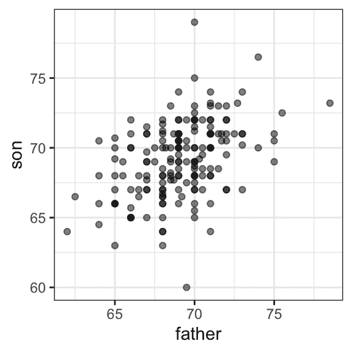
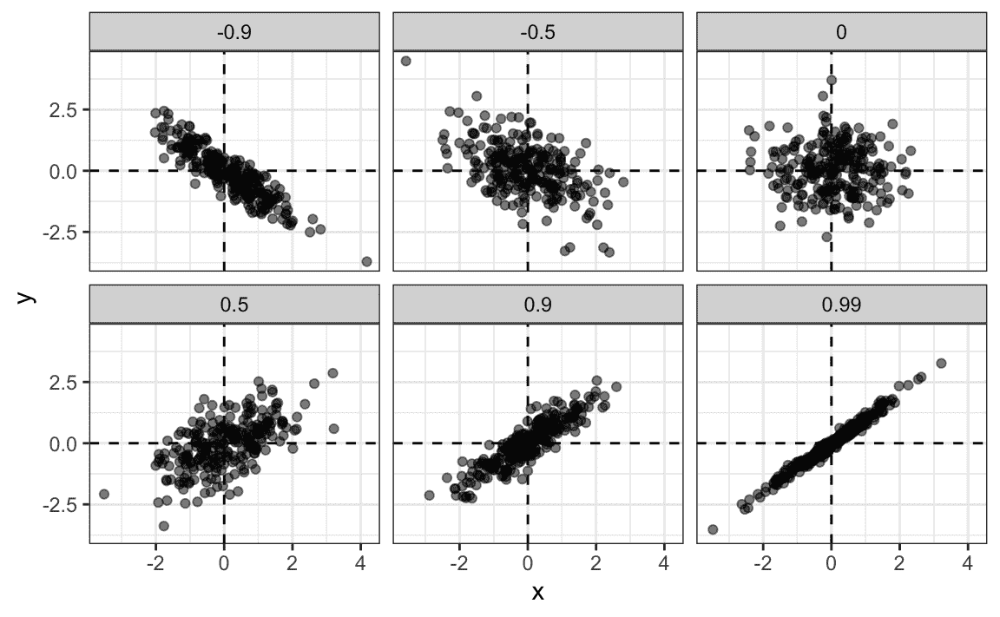
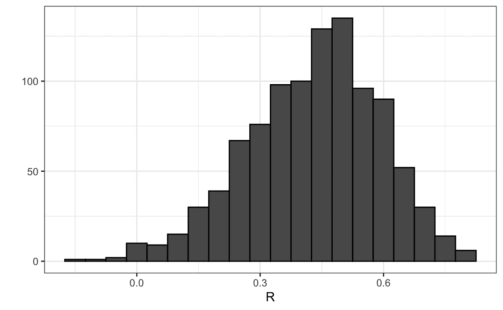
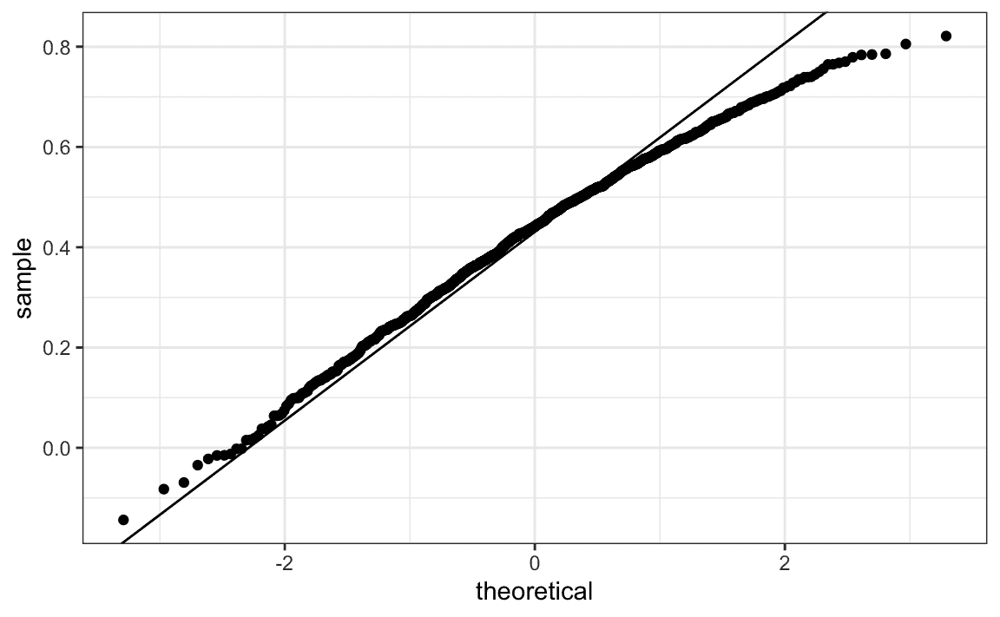
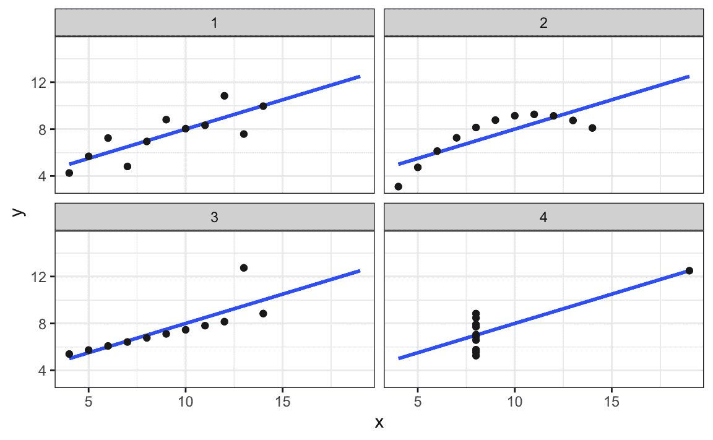
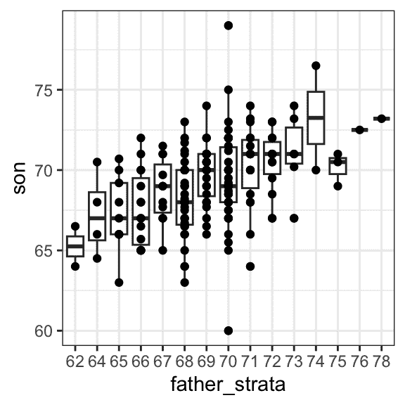
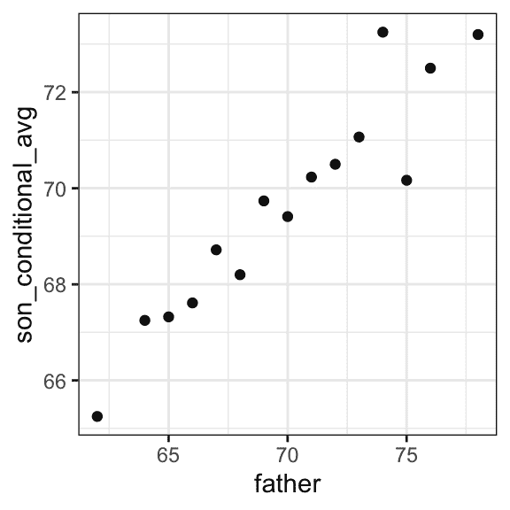
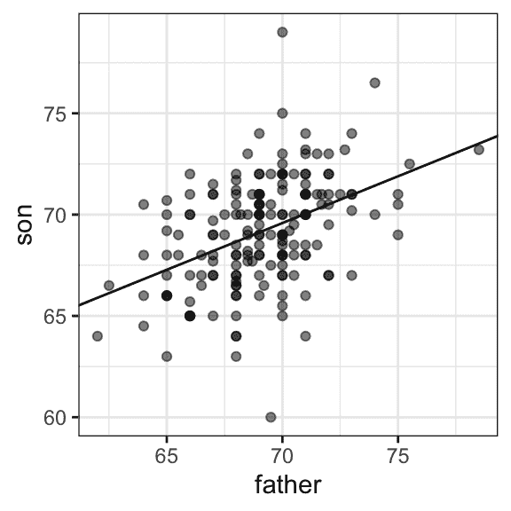
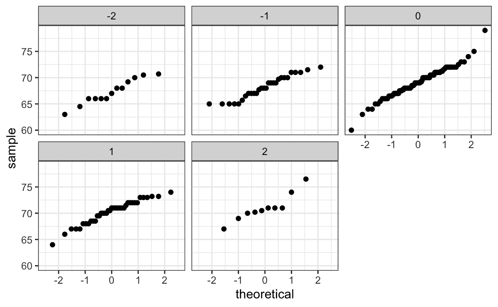
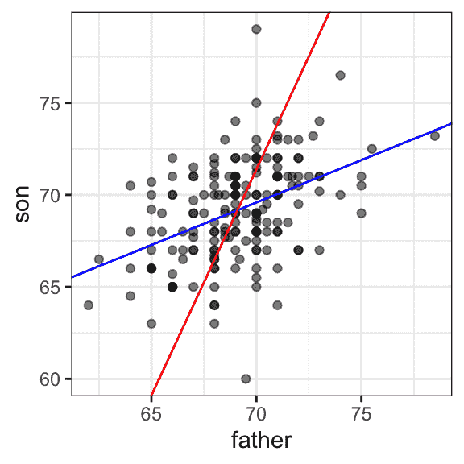

# 第十七章 回归

> 原文：[`rafalab.dfci.harvard.edu/dsbook/regression.html`](https://rafalab.dfci.harvard.edu/dsbook/regression.html)

到目前为止，这本书主要关注单一变量。然而，在数据科学应用中，我们通常对两个或更多变量之间的关系感兴趣。例如，在第十八章中，我们将使用一种数据驱动的方法来研究球员统计数据与成功之间的关系，以指导构建一个预算有限的棒球队。在深入探讨这个更复杂的例子之前，我们通过一个更简单的示例介绍理解回归所需的概念。实际上，我们使用了回归起源的数据集。

这个例子来自遗传学。弗朗西斯·高尔顿⁶⁰研究了人类特征的变化和遗传。在许多其他特征中，高尔顿收集并研究了家庭的高度数据，试图理解遗传。在这个过程中，他发展了相关性和回归的概念，以及与遵循正态分布的数据对之间的联系。当然，在收集这些数据的时候，我们对遗传学的了解与今天相比非常有限。高尔顿试图回答的一个非常具体的问题是：我们能够多好地根据父母的身高预测孩子的身高？他用来回答这个问题的技术，即回归，也可以应用于我们的棒球问题。回归还可以应用于许多其他情境。

**历史注释**：高尔顿对统计学和遗传学做出了重要贡献，但他也是优生学的早期支持者之一，这是一种科学上存在缺陷的哲学运动，当时许多高尔顿时代的生物学家都支持它，但带来了可怕的历史后果。你可以在这里了解更多信息：[`pged.org/history-eugenics-and-genetics/`](https://pged.org/history-eugenics-and-genetics/).

## 17.1 案例研究：身高是否遗传？

我们可以通过**HistData**包访问高尔顿家族身高数据。这些数据包含几十个家庭的高度：母亲、父亲、女儿和儿子。为了模仿高尔顿的分析，我们将创建一个包含父亲身高和每个家庭随机选择的儿子身高的数据集：

```r
library(tidyverse)
library(HistData)
data("GaltonFamilies")

set.seed(1983)
galton_heights <- GaltonFamilies |>
 filter(gender == "male") |>
 group_by(family) |>
 sample_n(1) |>
 ungroup() |>
 select(father, childHeight) |>
 rename(son = childHeight)
```

在练习中，我们将查看其他关系，包括母亲和女儿。

假设我们被要求总结父亲和儿子的数据。由于这两个分布都很好地被正态分布所近似，我们可以使用两个平均值和两个标准差作为总结：

```r
galton_heights |> 
 summarize(mean(father), sd(father), mean(son), sd(son))
#> # A tibble: 1 × 4
#>   `mean(father)` `sd(father)` `mean(son)` `sd(son)`
#>            <dbl>        <dbl>       <dbl>     <dbl>
#> 1           69.1         2.55        69.2      2.71
```

然而，这个总结未能描述数据的一个重要特征：父亲越高，儿子也越高。

```r
galton_heights |> ggplot(aes(father, son)) + 
 geom_point(alpha = 0.5)
```



我们将了解到相关系数是两个变量如何一起移动的有信息量的总结，然后我们将看到如何使用另一个变量来预测一个变量。

## 17.2 相关系数

相关系数定义为一系列成对数值 \((x_1, y_1), \dots, (x_n,y_n)\) 的标准化值乘积的平均值：

\[ \rho = \frac{1}{n} \sum_{i=1}^n \left( \frac{x_i-\mu_x}{\sigma_x} \right)\left( \frac{y_i-\mu_y}{\sigma_y} \right) \] 其中 \(\mu_x, \mu_y\) 分别是 \(x_1,\dots, x_n\) 和 \(y_1, \dots, y_n\) 的平均值，\(\sigma_x, \sigma_y\) 是标准差。希腊字母 \(\rho\) 在统计学书籍中常用作相关性的表示。希腊字母 \(\rho\) 是回归的第一个字母。我们很快就会了解到相关性和回归之间的联系。我们可以使用 R 代码表示上面的公式：

```r
rho <- mean(scale(x) * scale(y))
```

要理解这个方程实际上是如何总结两个变量如何一起变化的，考虑 \(x\) 的第 \(i\) 个值是 \(\left( \frac{x_i-\mu_x}{\sigma_x} \right)\) 个标准差（SD）远离平均值。同样，与 \(x_i\) 配对的 \(y_i\)，是 \(\left( \frac{y_i-\mu_y}{\sigma_y} \right)\) 个标准差远离平均值 \(y\)。如果 \(x\) 和 \(y\) 没有关系，那么 \(\left( \frac{x_i-\mu_x}{\sigma_x} \right)\left( \frac{y_i-\mu_y}{\sigma_y} \right)\) 的乘积将正（ \(+ \times +\) 和 \(- \times -\) ）和负（ \(+ \times -\) 和 \(- \times +\））一样多，平均起来大约是 0。这种相关性是平均值，因此无关变量将有 0 相关性。如果相反，数量一起变化，那么我们主要平均的是正的乘积（ \(+ \times +\) 和 \(- \times -\）），我们得到正的相关性。如果它们以相反的方向变化，我们得到负的相关性。

相关系数总是在 -1 和 1 之间。我们可以用数学方法证明这一点：考虑我们无法比将一个列表与其自身比较（完美相关性）有更高的相关性，在这种情况下，相关性是：

\[ \rho = \frac{1}{n} \sum_{i=1}^n \left( \frac{x_i-\mu_x}{\sigma_x} \right)² = \frac{1}{\sigma_x²} \frac{1}{n} \sum_{i=1}^n \left( x_i-\mu_x \right)² = \frac{1}{\sigma_x²} \sigma²_x = 1 \]

类似的推导，但用 \(x\) 和它的确切相反数，证明了相关性必须大于或等于 -1。

对于其他成对数值，相关性在 -1 和 1 之间。父亲和儿子身高的相关性约为 0.5：

```r
galton_heights |> summarize(r = cor(father, son)) |> pull(r)
#> [1] 0.433
```

要看到不同 \(\rho\) 值的数据看起来是什么样子，这里有六个成对数值的例子，其相关性从 -0.9 到 0.99：



### 17.2.1 样本相关性是随机变量

在我们继续将相关性连接到回归之前，让我们提醒自己关于随机变异性。

在大多数数据科学应用中，我们观察到包含随机变化的数据。例如，在许多情况下，我们不是观察整个感兴趣人群的数据，而是观察一个随机样本。与平均值和标准差一样，*样本相关性*是人口相关性的最常用估计。这意味着我们计算并用作总结的相关性是一个随机变量。

为了说明这一点，让我们假设 179 对父亲和儿子的数据是我们的整个群体。一个不太幸运的遗传学家只能负担得起 25 对随机样本的测量。样本相关性可以通过以下方式计算：

```r
R <- sample_n(galton_heights, 25, replace = TRUE) |> 
 summarize(r = cor(father, son)) |> pull(r)
```

`R` 是一个随机变量。我们可以运行蒙特卡洛模拟来查看其分布：

```r
B <- 1000
N <- 25
R <- replicate(B, {
 sample_n(galton_heights, N, replace = TRUE) |> 
 summarize(r=cor(father, son)) |> 
 pull(r)
})
qplot(R, geom = "histogram", binwidth = 0.05, color = I("black"))
```



我们看到 `R` 的期望值是人口相关性：

```r
mean(R)
#> [1] 0.431
```

并且它相对于 `R` 可以取的值范围的标准误差相对较高：

```r
sd(R)
#> [1] 0.161
```

因此，在解释相关性时，请记住，从样本中得出的相关性是包含不确定性的估计。

此外，请注意，由于样本相关性是独立抽取的平均值，中心极限定理实际上适用。因此，对于足够大的 \(N\)，`R` 的分布大约是正态分布，期望值为 \(\rho\)。标准差，其推导有些复杂，是 \(\sqrt{\frac{1-r²}{N-2}}\)。

在我们的例子中，\(N=25\)似乎不足以使近似值很好：

```r
ggplot(aes(sample=R), data = data.frame(R)) + 
 stat_qq() + 
 geom_abline(intercept = mean(R), slope = sqrt((1-mean(R)²)/(N-2)))
```



如果你增加 \(N\)，你会看到分布收敛到正态分布。

### 17.2.2 相关性并不总是有用的总结

相关性并不总是两个变量之间关系的良好总结。以下四个被称为安斯康姆四重奏的人工数据集，著名地说明了这一点。所有这些对的相关性都是 0.82：

```r
#> `geom_smooth()` using formula = 'y ~ x'
```



相关性仅在特定上下文中才有意义。为了帮助我们理解相关性何时作为总结统计量是有意义的，我们将回到使用父亲的高度预测儿子身高的例子。这将有助于激发和定义线性回归。我们首先演示相关性如何对预测有用。

## 17.3 条件期望

假设我们被要求猜测随机选择的一个儿子的身高，而我们不知道他父亲的高度。因为儿子的身高分布大约是正态分布，我们知道平均身高，69.2，是比例最高的值，将是预测以最高概率最小化误差的值。但如果我们被告知父亲比平均水平高，比如说 72 英寸高，我们还会猜测 69.2 作为儿子的身高吗？

结果表明，如果我们能够收集到大量身高为 72 英寸的父亲的样本数据，他们的儿子的身高分布将是正态分布。这意味着在这个子集上计算的分布的平均值将是我们最好的预测。

通常，我们称这种方法为**条件化**。一般思路是将总体分层为组，并在每组中计算汇总。为了提供条件化的数学描述，考虑我们有一个由值对 \((x_1,y_1),\dots,(x_n,y_n)\) 组成的总体，例如英格兰所有父亲和儿子的身高。在上一章中，我们了解到，如果你取一个随机对 \((X,Y)\)，\(Y\) 的期望值和最佳预测是 \(\mbox{E}(Y) = \mu_y\)，总体平均 \(1/n\sum_{i=1}^n y_i\)。然而，我们不再对总体感兴趣，而是只对具有特定 \(x_i\) 值的总体子集感兴趣，在我们的例子中是 72 英寸。这个总体子集也是一个总体，因此我们学到的相同的原则和属性同样适用。子总体中的 \(y_i\) 有一个分布，称为**条件分布**，这个分布有一个期望值，称为**条件期望**。在我们的例子中，条件期望是所有身高为 72 英寸的父亲在英国的儿子们的平均身高。条件期望的统计符号是

\[ \mbox{E}(Y \mid X = x) \]

其中 \(x\) 代表定义该子集的固定值，例如 72 英寸。类似地，我们用

\[ \mbox{SD}(Y \mid X = x) = \sqrt{\mbox{Var}(Y \mid X = x)} \]

因为条件期望 \(E(Y\mid X=x)\) 是在由 \(X=x\) 定义的层中对于随机变量 \(Y\) 的个体的最佳预测，许多数据科学挑战都归结为估计这个量。条件标准差量化了预测的精度。

在我们一直在考虑的例子中，我们感兴趣的是在父亲身高为 72 英寸的条件下计算平均儿子身高。我们希望使用高尔顿收集的样本来估计 \(E(Y|X=72)\)。我们之前了解到，样本平均是估计总体平均的首选方法。然而，使用这种方法估计条件期望的挑战在于，对于连续数据，我们没有许多数据点与样本中的确切值完全匹配。例如，我们只有：

```r
sum(galton_heights$father == 72)
#> [1] 8
```

精确身高为 72 英寸的父亲。如果我们把数字改为 72.5，我们得到的数据点就更少了：

```r
sum(galton_heights$father == 72.5)
#> [1] 1
```

提高这些条件期望估计的一个实用方法是定义具有相似\(x\)值的层。在我们的例子中，我们可以将父亲身高四舍五入到最接近的英寸，并假设它们都是 72 英寸。如果我们这样做，我们最终会得到以下预测，即一个 72 英寸高父亲的儿子：

```r
conditional_avg <- galton_heights |> 
 filter(round(father) == 72) |>
 summarize(avg = mean(son)) |> 
 pull(avg)
conditional_avg
#> [1] 70.5
```

注意，一个 72 英寸的父亲比平均水平要高——具体来说，(72.0 - 69.1)/2.5 = 1.1 个标准差高于平均水平。我们的预测 70.5 也高于平均水平，但仅比平均水平儿子高 0.49 个标准差。72 英寸父亲的儿子们*回归*到了平均身高。我们注意到身高增加的 SD 减少大约是 0.5，这恰好是相关系数。正如我们将在后面的章节中看到的，这并非巧合。

如果我们想要预测任何身高，而不仅仅是 72 英寸，我们可以将相同的方法应用于每个层。分层后跟随箱线图让我们看到每个组的分布：

```r
galton_heights |> mutate(father_strata = factor(round(father))) |> 
 ggplot(aes(father_strata, son)) + 
 geom_boxplot() + 
 geom_point()
```



并不令人惊讶，这些群体的中心随着身高的增加而增加。此外，这些中心似乎遵循线性关系。以下我们绘制了每个群体的平均值。如果我们考虑到这些平均值是具有标准误的随机变量，数据与这些点遵循直线是一致的：



这些条件平均值遵循一条线的事实并非巧合。在下一节中，我们解释了这些平均值遵循的线就是我们所说的*回归线*，它提高了我们估计的精度。然而，并不是总是适合用回归线来估计条件期望，所以我们还描述了高尔顿使用回归线的理论依据。

## 17.4 回归线

如果我们使用回归线预测一个随机变量\(Y\)的值，已知另一个\(X=x\)的值，那么我们预测对于每个标准差\(\sigma_X\)，\(x\)相对于平均\(\mu_X\)增加，\(Y\)相对于平均\(\mu_Y\)增加\(\rho\)个标准差\(\sigma_Y\)，其中\(\rho\)是\(X\)和\(Y\)之间的相关性。因此，回归的公式如下：

\[ \left( \frac{Y-\mu_Y}{\sigma_Y} \right) = \rho \left( \frac{x-\mu_X}{\sigma_X} \right) \]

我们可以将其重写为：

\[ Y = \mu_Y + \rho \left( \frac{x-\mu_X}{\sigma_X} \right) \sigma_Y \]

如果存在完美的相关性，回归线预测的增加量与 SD 的数量相同。如果存在 0 相关性，那么我们根本不使用\(x\)进行预测，而是简单地预测平均值\(\mu_Y\)。对于介于 0 和 1 之间的值，预测介于两者之间。如果相关性为负，我们预测减少而不是增加。

注意，如果相关性为正且小于 1，我们的预测在标准单位上比用于预测的值 \(x\) 更接近平均值。这就是我们称之为**回归**的原因：儿子回归到平均身高。实际上，高尔顿论文的标题是：*遗传身高的回归到中等水平*。为了将回归线添加到图中，我们需要上述公式以以下形式：

\[ y= b + mx \mbox{ 其中斜率 } m = \rho \frac{\sigma_y}{\sigma_x} \mbox{ 和截距 } b=\mu_y - m \mu_x \]

在这里，我们将回归线添加到原始数据上：

```r
mu_x <- mean(galton_heights$father)
mu_y <- mean(galton_heights$son)
s_x <- sd(galton_heights$father)
s_y <- sd(galton_heights$son)
r <- cor(galton_heights$father, galton_heights$son)

galton_heights |> 
 ggplot(aes(father, son)) + 
 geom_point(alpha = 0.5) +
 geom_abline(slope = r * s_y/s_x, intercept = mu_y - r * s_y/s_x * mu_x) 
```



回归公式意味着如果我们首先对变量进行标准化，即减去平均值并除以标准差，那么回归线具有截距 0 和斜率等于相关性 \(\rho\)。你可以绘制相同的图，但使用这样的标准单位：

```r
galton_heights |> 
 ggplot(aes(scale(father), scale(son))) + 
 geom_point(alpha = 0.5) +
 geom_abline(intercept = 0, slope = r) 
```

### 17.4.1 回归提高精度

让我们比较我们提出的两种预测方法：

1.  将父亲的身高四舍五入到最接近的英寸，分层，然后取平均值。

1.  计算回归线并使用它进行预测。

我们使用蒙特卡洛模拟抽样 \(N=50\) 个家庭：

```r
B <- 1000
N <- 50

set.seed(1983)
conditional_avg <- replicate(B, {
 dat <- sample_n(galton_heights, N)
 dat |> filter(round(father) == 72) |> 
 summarize(avg = mean(son)) |> 
 pull(avg)
 })

regression_prediction <- replicate(B, {
 dat <- sample_n(galton_heights, N)
 mu_x <- mean(dat$father)
 mu_y <- mean(dat$son)
 s_x <- sd(dat$father)
 s_y <- sd(dat$son)
 r <- cor(dat$father, dat$son)
 mu_y + r*(72 - mu_x)/s_x*s_y
})
```

尽管这两个随机变量的期望值大致相同：

```r
mean(conditional_avg, na.rm = TRUE)
#> [1] 70.5
mean(regression_prediction)
#> [1] 70.5
```

回归预测的标准误差显著较小：

```r
sd(conditional_avg, na.rm = TRUE)
#> [1] 0.964
sd(regression_prediction)
#> [1] 0.452
```

因此，回归线比条件均值更加稳定。这有一个直观的原因。条件平均是在相对较小的子集上计算的：大约 72 英寸高的父亲们。实际上，在一些排列中我们没有数据，这就是为什么我们使用 `na.rm=TRUE`。回归总是使用所有数据。

那为什么我们总是使用回归进行预测呢？因为并不总是合适。例如，安斯康姆提供了数据没有线性关系的案例。那么我们使用回归线进行预测是否合理呢？高尔顿对身高数据给出了肯定的回答。这种合理性，我们将在下一节中介绍，比本章其他部分更为复杂。

### 17.4.2 双变量正态分布（高级）

相关系数和回归斜率是广泛使用的汇总统计量，但它们经常被误用或误解。安斯康姆的例子提供了过度简化的数据集案例，其中使用相关性进行汇总将是错误的。但还有更多现实生活中的例子。

我们主要通过所谓的**双变量正态分布**来激励使用相关系数。

当一对随机变量近似于双变量正态分布时，散点图看起来像椭圆形。正如我们在第 17.2 节中看到的，它们可以是细长的（高相关性）或圆形的（无相关性）。

定义二元正态分布的一个更技术的方法如下：如果 \(X\) 是一个正态分布的随机变量，\(Y\) 也是一个正态分布的随机变量，并且对于任何 \(X=x\) 的 \(Y\) 的条件分布近似正态，那么这对变量近似为二元正态。当三个或更多变量具有每对变量都是二元正态的性质时，我们说这些变量遵循**多元**正态分布，或者它们是**联合正态**的。

+   或者简单地说，变量是**联合正态**的。

如果我们认为身高数据很好地被二元正态分布近似，那么我们应该看到每个层级的正态近似都成立。在这里，我们按标准化的父亲身高分层儿子身高，并看到假设似乎成立：

```r
galton_heights |>
 mutate(z_father = round((father - mean(father)) / sd(father))) |>
 filter(z_father %in% -2:2) |>
 ggplot() + 
 stat_qq(aes(sample = son)) +
 facet_wrap( ~ z_father) 
```



现在我们回到定义相关性的问题。高尔顿使用数学统计学证明了，当两个变量遵循二元正态分布时，计算回归线等同于计算条件期望。这里我们不展示推导过程，但我们可以表明，在这个假设下，对于任何给定的 \(x\) 值，\(X=x\) 的 \(Y\) 对的期望值是：

\[ \mbox{E}(Y | X=x) = \mu_Y + \rho \frac{X-\mu_X}{\sigma_X}\sigma_Y \]

这是回归线，斜率为 \[\rho \frac{\sigma_Y}{\sigma_X}\]，截距为 \(\mu_y - m\mu_X\)。它等同于我们之前展示的回归方程，可以写成这样：

\[ \frac{\mbox{E}(Y \mid X=x) - \mu_Y}{\sigma_Y} = \rho \frac{x-\mu_X}{\sigma_X} \]

这意味着，如果我们的数据近似二元，回归线给出了条件概率。因此，我们可以通过找到回归线并使用它来预测，从而获得条件期望的一个更稳定的估计。

总结来说，如果我们的数据近似二元，那么在已知 \(X\) 的值的情况下，\(Y\) 的条件期望，即 \(Y\) 的最佳预测，由回归线给出。

### 17.4.3 解释的方差

二元正态理论还告诉我们，上述**条件**分布的标准差是：

\[ \mbox{SD}(Y \mid X=x ) = \sigma_Y \sqrt{1-\rho²} \]

要理解为什么这是直观的，请注意，在没有条件的情况下，\(\mbox{SD}(Y) = \sigma_Y\)，我们正在观察所有儿子的变异性。但一旦我们进行条件化，我们只观察身高为 72 英寸、父亲身高为高的儿子的变异性。这个群体都会倾向于稍微高一些，因此标准差会降低。

具体来说，它减少到 \(\sqrt{1-\rho²} = \sqrt{1 - 0.25}\) = 0.87 原始值。我们可以说父亲身高“解释”了儿子身高观察到的 13% 的变异性。

学术论文中常用“\(X\) 解释了这样的百分比的变化”这样的说法。在这种情况下，这个百分比实际上指的是方差（标准差的平方）。所以如果数据是双变量正态的，方差会减少 \(1-\rho²\)，所以我们说 \(X\) 解释了 \(1- (1-\rho²)=\rho²\)（相关系数的平方）的方差。

但重要的是要记住，“解释的方差”这个说法只有在数据被双变量正态分布近似时才有意义。

### 17.4.4 警告：存在两条回归线

我们计算了一条回归线来预测儿子的身高从父亲身高。我们使用了以下计算：

```r
mu_x <- mean(galton_heights$father)
mu_y <- mean(galton_heights$son)
s_x <- sd(galton_heights$father)
s_y <- sd(galton_heights$son)
r <- cor(galton_heights$father, galton_heights$son)
m_1 <-  r * s_y / s_x
b_1 <- mu_y - m_1*mu_x
```

这给出了函数 \(\mbox{E}(Y\mid X=x) =\) 37.3 + 0.46 \(x\)。

如果我们想根据儿子的身高预测父亲的身高呢？重要的是要知道这并不是通过计算逆函数来确定的：\(x = \{ \mbox{E}(Y\mid X=x) -\) 37.3 \(\} /\) 0.5。

我们需要计算 \(\mbox{E}(X \mid Y=y)\)。由于数据大约是双变量正态的，上述理论告诉我们这个条件期望将遵循一个具有斜率和截距的直线：

```r
m_2 <-  r * s_x / s_y
b_2 <- mu_x - m_2 * mu_y
```

因此我们得到 \(\mbox{E}(X \mid Y=y) =\) 40.9 + 0.41y。再次我们看到回归到平均值：对父亲的预测比儿子的高度 \(y\) 对儿子平均值的接近。

这里是一个显示两条回归线的图表，蓝色用于预测儿子身高与父亲身高，红色用于预测父亲身高与儿子身高：

```r
galton_heights |> 
 ggplot(aes(father, son)) + 
 geom_point(alpha = 0.5) + 
 geom_abline(intercept = b_1, slope = m_1, col = "blue") +
 geom_abline(intercept = -b_2/m_2, slope = 1/m_2, col = "red") 
```



## 17.5 练习

1. 从 **HistData** 加载 `GaltonFamilies` 数据。每个家庭的孩子按性别和身高顺序列出。通过随机选择一个男性和一个女性来创建一个名为 `galton_heights` 的数据集。

2. 为母亲与女儿、母亲与儿子、父亲与女儿和父亲与儿子之间的身高制作散点图。

3. 计算母亲与女儿、母亲与儿子、父亲与女儿和父亲与儿子之间身高的相关性。

* * *

1.  [`zh.wikipedia.org/wiki/弗朗西斯·高尔顿`](https://zh.wikipedia.org/wiki/弗朗西斯·高尔顿)↩︎
