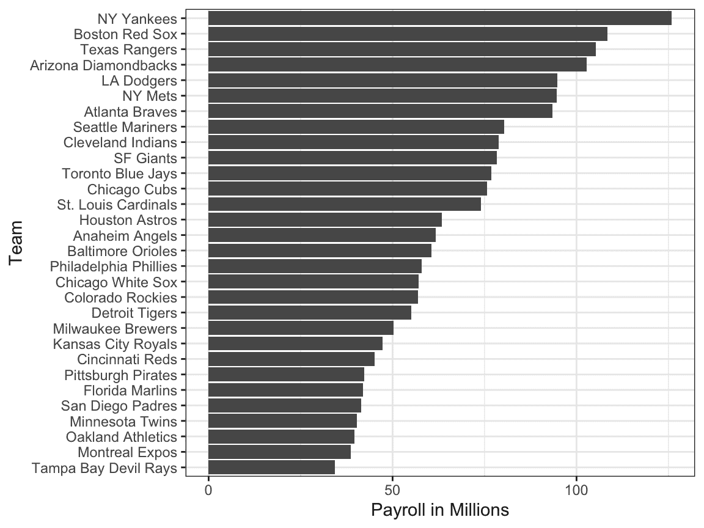
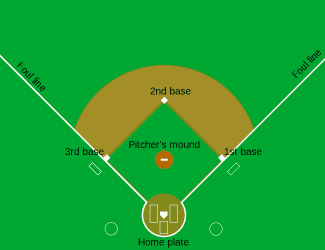
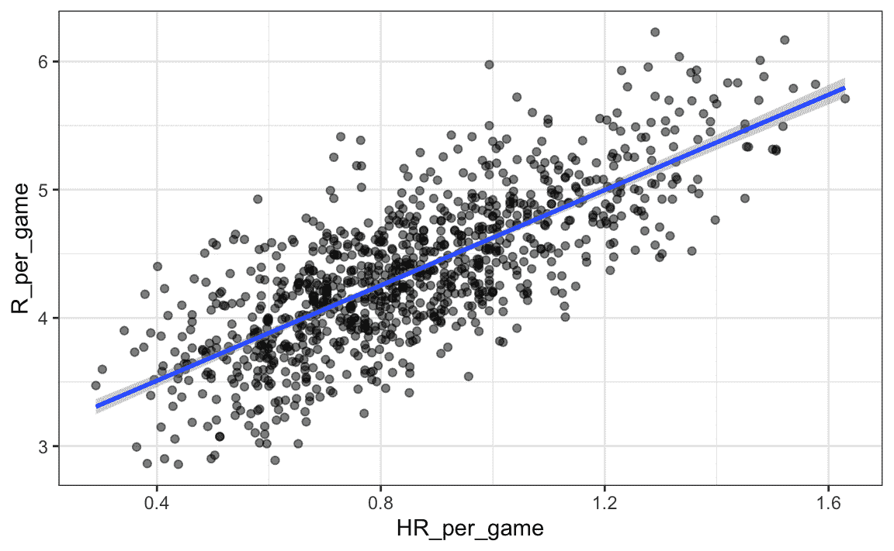
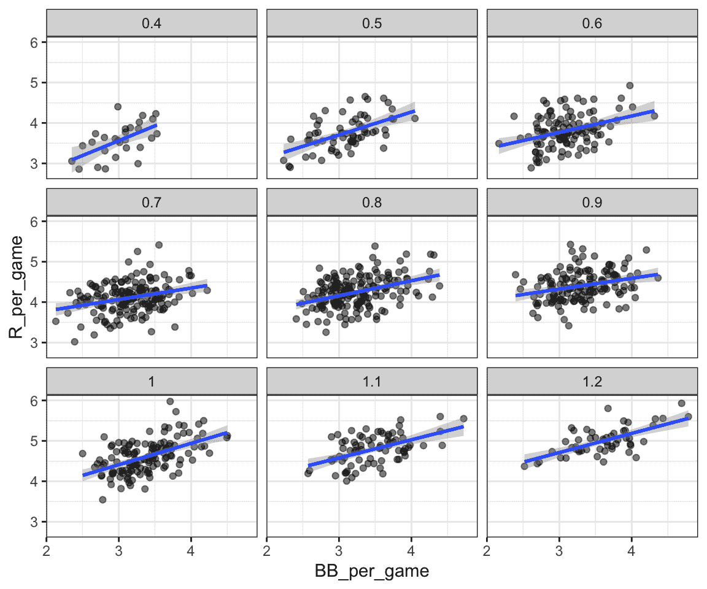
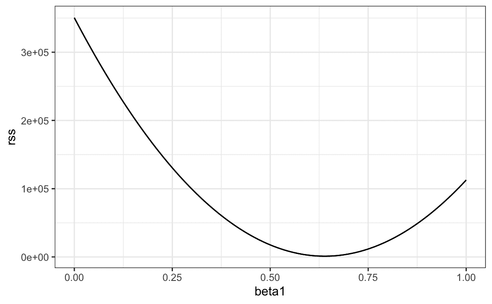
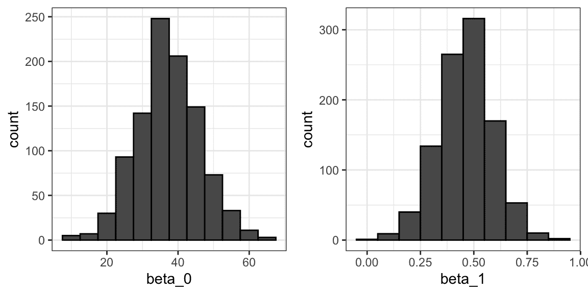
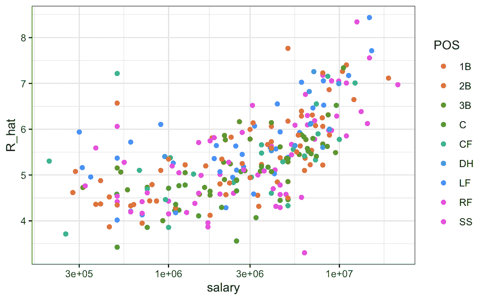
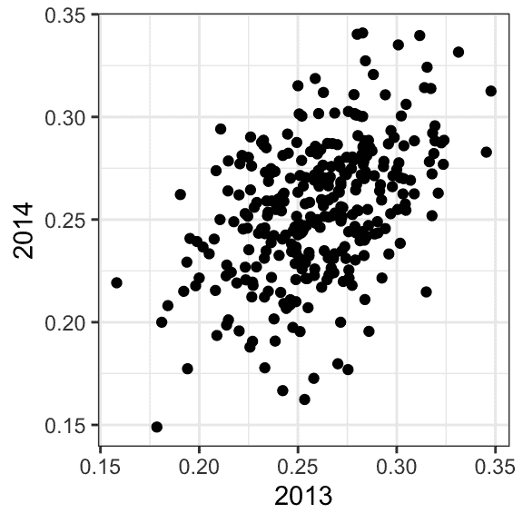
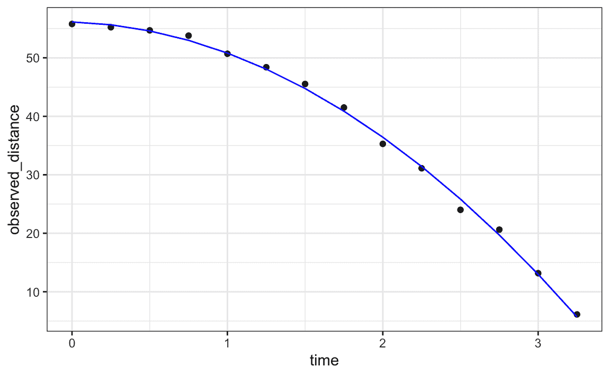

# 第十八章 线性模型

> 原文：[`rafalab.dfci.harvard.edu/dsbook/linear-models.html`](https://rafalab.dfci.harvard.edu/dsbook/linear-models.html)

自从高尔顿最初的发展以来，回归已成为数据科学中最广泛使用的工具之一。一个原因与回归允许我们找到两个变量之间关系的事实有关，同时考虑到影响这两个变量的其他变量的影响。这在随机实验难以进行的领域尤其受欢迎，如经济学和流行病学。

当我们无法随机将每个人分配到治疗组或对照组时，混杂因素尤为普遍。例如，考虑使用从某个司法管辖区随机抽取的人群数据来估计食用快餐对预期寿命的影响。快餐消费者更有可能吸烟、饮酒，并且收入较低。因此，一个简单的回归模型可能会导致对快餐负面健康影响的过度估计。那么我们在实践中如何解释混杂因素呢？在本章中，我们将学习线性模型如何帮助处理这种情况，并可以用来描述一个或多个变量如何影响结果变量。

## 18.1 案例研究：点球成金

《*点球成金：不公平游戏的胜利艺术*》是迈克尔·刘易斯关于奥克兰运动家队（A's）及其总经理，负责组建球队的比利·比恩的一本书。

传统的棒球队使用*球探*来帮助他们决定聘请哪些球员。球探通过观察球员的表现来评估球员。球探倾向于青睐具有可观察的身体能力的运动员型球员。因此，球探倾向于同意谁是最佳球员，结果，这些球员往往需求旺盛。这反过来又推高了他们的薪水。

从 1989 年到 1991 年，运动家队拥有棒球界最高的薪资。他们能够购买最好的球员，在那段时间里，他们是最好的球队之一。然而，到了 1995 年，运动家队的所有者发生了变化，新管理层大幅削减了预算，使得当时的总经理桑迪·阿尔德森拥有了棒球界最低的薪资。他再也负担不起最抢手的球员。阿尔德森开始使用统计方法来寻找市场中的低效之处。阿尔德森是比利·比恩的导师，比恩在 1998 年接替了他的位置，并完全接受了数据科学，而不是像球探那样，作为寻找低成本球员的方法，这些球员的数据预测将有助于球队获胜。如今，这种策略已被大多数棒球队采用。正如我们将看到的，回归在这一方法中扮演了重要角色。

为了本章的动机，我们将假装是 2002 年，并尝试用有限的预算组建一支棒球队，就像运动家队当时所做的那样。为了理解你所面临的挑战，请注意，在 2002 年，洋基队的薪资 1,259,285,833 美元是奥克兰运动家队 39,679,746 美元的三倍多：



### 18.1.1 Sabermetrics

统计学自棒球诞生以来就被使用。我们将使用的数据库，包含在**Lahman**库中，可以追溯到 19 世纪。例如，我们很快将要描述的总结统计量，*打击率*，几十年来一直被用来总结击球手的成功。其他统计数据⁶¹如本垒打（HR）、跑垒得分（RBI）和盗垒（SB）在报纸体育版的游戏摘要中都有报道，高数值的球员会得到奖励。尽管像这样的总结统计数据在棒球中得到了广泛应用，但数据分析本身并没有。这些统计数据是任意决定的，没有充分考虑它们是否真的预测了任何事情，或者是否与帮助球队获胜有关。

这种情况随着比尔·詹姆斯⁶²的出现而改变。在 20 世纪 70 年代末，这位有抱负的作家和棒球爱好者开始发表文章，描述对棒球数据的更深入分析。他将使用数据来预测哪些结果最能预测一支球队是否会获胜的方法命名为 *sabermetrics*⁶³。直到比利·比恩将 sabermetrics 作为其棒球运营的核心，比尔·詹姆斯的工作在棒球界基本上被忽视。目前，sabermetrics 的流行度已不再仅限于棒球；其他运动也开始采用这种方法。

在本章中，为了简化练习，我们将专注于得分，而忽略游戏中的另外两个重要方面：投球和防守。我们将看到回归分析如何帮助制定策略，以在预算有限的情况下构建一支具有竞争力的棒球队。这种方法可以分为两个独立的数据分析。在第一个分析中，我们确定哪些记录的球员特定统计数据可以预测得分。在第二个分析中，我们检查根据第一个分析预测的结果，球员是否被低估。

### 18.1.2 Baseball basics

要了解回归分析如何帮助我们找到被低估的球员，我们实际上不需要了解棒球游戏的所有细节，该游戏有超过 100 条规则。在这里，我们将运动简化为需要了解的基本知识，以便有效地解决数据科学问题。

棒球比赛的目标是比对方得分更多（得分）。每个队有 9 名击球手，他们有机会用棒击球，顺序是预先确定的。当第 9 名击球手完成他们的回合后，第一个击球手再次击球，然后是第二个，以此类推。每次击球手有机会击球，我们称之为击球机会（PA）。在每次 PA 中，对方队的*投手*投球，击球手尝试击球。PA 以二元结果结束：击球手要么做出一个*出局*（失败）并返回板凳，要么不做出局（成功）并可以在垒上跑动，并可能得分（到达所有 4 个垒）。每个队有九次尝试得分的机会，这被称为*局*，每局在三次出局（三次失败）后结束。

这里有一个展示成功的视频：[`www.youtube.com/watch?v=HL-XjMCPfio`](https://www.youtube.com/watch?v=HL-XjMCPfio)。还有一个展示失败的视频：[`www.youtube.com/watch?v=NeloljCx-1g`](https://www.youtube.com/watch?v=NeloljCx-1g)。在这些视频中，我们看到运气在过程中是如何起作用的。当击球时，击球手希望把球击得很远。如果击球手击得足够远，那就是全垒打，这是最好的结果，因为击球手至少能得一分。但有时，由于偶然，击球手把球击得很远，但防守者接住了它，结果出局。相反，有时击球手把球击得很轻，但它恰好落在了正确的位置。运气涉及的事实暗示了为什么概率模型会涉及其中。

现在成功的方式有几种。理解这种区别对于我们分析来说很重要。当击球手击中球时，击球手希望尽可能多地通过*垒*。这里有四个垒，第四个被称为*本垒*。本垒是击球手开始尝试击球的地方，因此垒形成了一个循环。

（由 Cburnett⁶⁴提供。CC BY-SA 3.0 许可⁶⁵。）

一个绕过垒并回到家的击球手得一分。

我们简化了一些，但击球手有五种成功的方式，也就是说，不做出出局：

+   保送 (BB) - 投手未能将球投过被认为可击的区域（击球区），因此击球手被允许走到一垒。

+   单打 - 击球手击中球并到达一垒。

+   双垒打 (2B) - 击球手击中球并到达二垒。

+   三垒打 (3B) - 击球手击中球并到达三垒。

+   全垒打 (HR) - 击球手击中球并一直跑回家得分。

这里是一个本垒打的例子：[`www.youtube.com/watch?v=xYxSZJ9GZ-w`](https://www.youtube.com/watch?v=xYxSZJ9GZ-w)。如果一个击球手到达垒包，如果下一个击球手击球成功，那么击球手仍然有机会跑回家得分。当击球手在**垒上**时，击球手还可以尝试盗垒（SB）。如果一个击球手跑得足够快，他可以尝试在不被对方球队触球的情况下从一垒跑到下一垒。[这里]是一个盗垒的例子：[`www.youtube.com/watch?v=JSE5kfxkzfk`](https://www.youtube.com/watch?v=JSE5kfxkzfk)。

所有这些事件都在赛季期间被记录下来，并且可以通过**Lahman**包供我们使用。现在我们将开始讨论数据分析如何帮助我们决定如何使用这些统计数据来评估球员。

### 18.1.3 对 BB 没有奖项

从历史上看，**击球率**被认为是最重要的进攻统计数据。为了定义这个平均数，我们定义了一个**安打**（H）和一个**击球**（AB）。单打、双打、三打和本垒打都是安打。第五种成功方式，BB，不是安打。AB 是你得到安打或出局次数的数量；BB 被排除在外。击球率仅仅是 H/AB，被认为是成功率的衡量标准。今天这个成功率在 20%到 38%之间。我们用千分比来表示击球率，例如，如果你的成功率是 28%，我们称之为**击球 280**。


比尔·詹姆斯的第一个重要洞察之一是，击球率忽略了 BB，但 BB 是一种成功。他提议我们使用**上垒率**（OBP）而不是击球率。他定义 OBP 为（H+BB）/（AB+BB），这仅仅是未导致出局击球的击球次数比例，是一个非常直观的度量。他指出，如果一个球员比平均水平获得更多的 BB，但击球率不高，那么这个球员可能不会被认可。但这个球员不是在帮助产生得分吗？没有奖项授予 BB 最多的球员。然而，坏习惯很难改掉，棒球并没有立即将 OBP 作为重要的统计数据。相反，总盗垒数被认为很重要，并且授予了盗垒最多的球员奖项⁶⁸。但那些总盗垒数高的球员也犯了更多的出局，因为他们并不总是成功。一个总盗垒数高的球员是否有助于产生得分？我们能否使用数据科学来确定是否应该为 BB 或 SB 高的球员付费？

### 18.1.4 保送或盗垒？

在这个分析中，一个挑战是并不明显如何确定一名球员是否产出得分，因为这很大程度上取决于他的队友。我们确实记录了球员得分的数量。然而，记住如果一名球员 X 在击出很多全垒打的球员之前击球，球员 X 将得分很多。但如果我们雇佣球员 X 而不雇佣他的全垒打击球队友，这些得分并不一定会发生。然而，我们可以考察团队层面的统计数据。拥有很多盗垒的球队与拥有很少盗垒的球队相比如何？BB 呢？我们有数据！让我们来考察一些。

让我们从显而易见的一个开始：全垒打数。击出更多全垒打的球队得分更多吗？我们考察了从 1962 年（所有球队首次进行 162 场比赛，就像今天一样，而不是 154 场）到 2001 年的数据，这一年我们将构建一支球队。在探索两个变量之间的关系时，例如全垒打数和胜利数，散点图是首选的可视化方式：

```r
library(Lahman)

Teams |> filter(yearID %in% 1962:2001) |>
 mutate(HR_per_game = HR / G, R_per_game = R / G) |>
 ggplot(aes(HR_per_game, R_per_game)) + 
 geom_point(alpha = 0.5)
```


图表显示了一个强烈的关联：全垒打数更多的球队往往得分更多。现在让我们考察盗垒数和得分之间的关系：

```r
Teams |> filter(yearID %in% 1962:2001) |>
 mutate(SB_per_game = SB / G, R_per_game = R / G) |>
 ggplot(aes(SB_per_game, R_per_game)) + 
 geom_point(alpha = 0.5)
```


这里关系并不那么明显。最后，让我们考察 BB 和得分之间的关系：

```r
Teams |> filter(yearID %in% 1962:2001) |>
 mutate(BB_per_game = BB/G, R_per_game = R/G) |>
 ggplot(aes(BB_per_game, R_per_game)) + 
 geom_point(alpha = 0.5)
```


这里我们又看到了一个明显的关联。但这是否意味着增加一个球队的 BB 数**导致**得分增加？在这本书中你学到的最重要的教训之一是**关联并不等同于因果关系**。

实际上，看起来 BB 和 HR 也是相关的：

```r
Teams |> filter(yearID %in% 1962:2001 ) |>
 mutate(HR_per_game = HR/G, BB_per_game = BB/G) |>
 ggplot(aes(HR_per_game, BB_per_game)) + 
 geom_point(alpha = 0.5)
```


我们知道全垒打会导致得分，因为正如“全垒打”这个名字所暗示的，当一名球员击出全垒打时，他们至少能保证得到一分。这可能是因为全垒打也会导致 BB，这使得 BB 看起来像导致得分的原因？当这种情况发生时，我们称之为**混杂**，这是我们将在本章中了解更多的重要概念。

线性回归将帮助我们解析所有这些，并量化关联。这将帮助我们确定要招募哪些球员。具体来说，我们将尝试预测如果我们增加 BB 的数量，但保持 HR 不变，球队将多得分多少？回归将帮助我们回答这样的问题。

### 18.1.5 将回归应用于棒球统计数据

我们可以使用回归分析这些数据吗？首先，注意 HR 和得分数据看起来是双变量正态分布的。我们将这个图表保存到对象`p`中，因为我们稍后会再次使用它。

```r
library(Lahman)
p <- Teams |> filter(yearID %in% 1962:2001 ) |>
 mutate(HR_per_game = HR/G, R_per_game = R/G) |>
 ggplot(aes(HR_per_game, R_per_game)) + 
 geom_point(alpha = 0.5)
p
```


qq 图证实了正态近似在这里是有用的：

```r
Teams |> filter(yearID %in% 1962:2001 ) |>
 mutate(z_HR = round((HR - mean(HR))/sd(HR)), 
 R_per_game = R/G) |>
 filter(z_HR %in% -2:3) |>
 ggplot() + 
 stat_qq(aes(sample=R_per_game)) +
 facet_wrap(~z_HR) 
```


现在我们已经准备好使用线性回归来预测如果知道一支球队击出的全垒打数，该球队将得分多少。我们只需要计算五个总结统计量：

```r
summary_stats <- Teams |> 
 filter(yearID %in% 1962:2001 ) |>
 mutate(HR_per_game = HR/G, R_per_game = R/G) |>
 summarize(avg_HR = mean(HR_per_game),
 s_HR = sd(HR_per_game),
 avg_R = mean(R_per_game),
 s_R = sd(R_per_game),
 r = cor(HR_per_game, R_per_game))
summary_stats
#>   avg_HR  s_HR avg_R   s_R     r
#> 1  0.853 0.243  4.35 0.591 0.763
```

并使用上面给出的公式来创建回归线：

```r
reg_line <- summary_stats |> summarize(slope = r*s_R/s_HR,
 intercept = avg_R - slope*avg_HR)

p + geom_abline(intercept = reg_line$intercept, slope = reg_line$slope)
```


很快我们将学习 R 函数，如`lm`，这些函数使拟合回归线变得容易得多。另一个例子是**ggplot2**函数`geom_smooth`，它计算并添加回归线到图中，并附带置信区间，我们稍后也会学习。我们使用`method = "lm"`参数，它代表*线性模型*，这是即将到来的章节的标题。因此，我们可以将上面的代码简化如下：

```r
p + geom_smooth(method = "lm")
#> `geom_smooth()` using formula = 'y ~ x'
```



在上面的例子中，斜率是 1.859。这告诉我们，那些每场比赛比平均球队多打一个全垒打的球队，每场比赛比平均球队多得 1.859 分。鉴于最常见的最终得分是相差一分，这肯定会导致胜利的大幅增加。不出所料，全垒打投手非常昂贵。因为我们正在预算限制下工作，我们需要找到其他方法来增加胜利。所以，在下一节中，我们将注意力转向三振。

## 18.2 混杂

之前，我们注意到跑垒得分（Runs）和三振（BB）之间存在强烈的关联。如果我们找到从三振球数预测跑垒得分的回归线，我们得到的斜率是：

```r
library(tidyverse)
library(Lahman)
get_slope <- function(x, y) cor(x, y) * sd(y) / sd(x)

bb_slope <- Teams |> 
 filter(yearID %in% 1962:2001 ) |> 
 mutate(BB_per_game = BB/G, R_per_game = R/G) |> 
 summarize(slope = get_slope(BB_per_game, R_per_game))

bb_slope 
#>   slope
#> 1 0.743
```

那么，这意味着如果我们去雇佣低薪但有很多三振的球员，并且因此每场比赛增加两次三振，我们的球队每场比赛将多得 1.5 分吗？

我们再次被提醒，关联并不等同于因果关系。数据确实提供了强有力的证据，表明一支每场比赛比平均球队多出两个三振球的球队，每场比赛能多得 1.5 分。但这并不意味着三振是原因。

注意，如果我们计算单打的回归线斜率，我们会得到：

```r
singles_slope <- Teams |> 
 filter(yearID %in% 1962:2001 ) |>
 mutate(Singles_per_game = (H-HR-X2B-X3B)/G, R_per_game = R/G) |>
 summarize(slope = get_slope(Singles_per_game, R_per_game))

singles_slope 
#>   slope
#> 1 0.452
```

这比我们得到的三振斜率要低。

注意，一个单打（single）也能让你到达一垒，就像三振一样。那些了解棒球的人会告诉你，与三振相比，有跑垒者的球队更有可能得分。那么三振如何能更好地预测得分呢？这种情况发生的原因是混杂。这里我们展示了全垒打（HR）、三振和单打之间的相关性：

```r
Teams |> 
 filter(yearID %in% 1962:2001 ) |> 
 mutate(Singles = (H-HR-X2B-X3B)/G, BB = BB/G, HR = HR/G) |> 
 summarize(cor(BB, HR), cor(Singles, HR), cor(BB, Singles))
#>   cor(BB, HR) cor(Singles, HR) cor(BB, Singles)
#> 1       0.406           -0.171          -0.0495
```

结果表明，投手害怕全垒打，有时会避免向全垒打投手投球。因此，全垒打投手往往有更多的三振，而拥有许多全垒打的球队也会有更多的三振。尽管看起来三振会导致得分，但实际上是全垒打导致了这些得分的大部分。我们说三振与全垒打是*混杂的*。尽管如此，三振是否仍然有帮助？为了找出答案，我们必须要调整全垒打的影响。回归分析也能帮助做到这一点。

### 18.2.1 通过分层理解混杂

一种方法是保持全垒打在某个固定值，然后检查三振和得分之间的关系。就像我们按最接近的英寸分层父亲一样，这里我们可以按每场比赛最接近的十个全垒打分层。我们过滤掉点数很少的层次，以避免高度可变的估计：

```r
dat <- Teams |> filter(yearID %in% 1962:2001) |>
 mutate(HR_strata = round(HR/G, 1), 
 BB_per_game = BB / G,
 R_per_game = R / G) |>
 filter(HR_strata >= 0.4 & HR_strata <=1.2) 
```

然后为每个层次制作散点图：

```r
dat |> 
 ggplot(aes(BB_per_game, R_per_game)) + 
 geom_point(alpha = 0.5) +
 geom_smooth(method = "lm") +
 facet_wrap( ~ HR_strata) 
#> `geom_smooth()` using formula = 'y ~ x'
```



记住，用 BB 预测运行的回归斜率为 0.7。一旦我们按 HR 分层，这些斜率就会显著降低：

```r
dat |> 
 group_by(HR_strata) |>
 summarize(slope = get_slope(BB_per_game, R_per_game))
#> # A tibble: 9 × 2
#>   HR_strata slope
#>       <dbl> <dbl>
#> 1       0.4 0.734
#> 2       0.5 0.566
#> 3       0.6 0.405
#> 4       0.7 0.284
#> 5       0.8 0.370
#> # ℹ 4 more rows
```

斜率降低，但它们不是 0，这表明 BBs 对产生运行是有帮助的，只是没有之前认为的那么多。事实上，上面的值更接近我们从单打中获得的斜率，0.45，这与我们的直觉更一致。由于单打和 BB 都能让我们到达一垒，它们应该具有大约相同的预测能力。

虽然我们对应用的理解告诉我们，HR 导致 BB，而不是反过来，但我们仍然可以检查按 BB 分层是否会使 BB 的效果降低。为此，我们使用相同的代码，只是将 HR 和 BBs 交换以获得此图：

```r
#> `geom_smooth()` using formula = 'y ~ x'
```


在这种情况下，斜率与原始值变化不大：

```r
dat |> group_by(BB_strata) |>
 summarize(slope = get_slope(HR_per_game, R_per_game))
#> # A tibble: 12 × 2
#>   BB_strata slope
#>       <dbl> <dbl>
#> 1       2.8  1.50
#> 2       2.9  1.57
#> 3       3    1.52
#> 4       3.1  1.48
#> 5       3.2  1.60
#> # ℹ 7 more rows
```

它们略有降低，这与 BB 实际上确实导致了一些运行的事实一致。

```r
hr_slope <- Teams |> 
 filter(yearID %in% 1962:2001 ) |> 
 mutate(HR_per_game = HR/G, R_per_game = R/G) |> 
 summarize(slope = get_slope(HR_per_game, R_per_game))

hr_slope
#>   slope
#> 1  1.86
```

不论如何，如果我们按 HR 分层，我们就有运行与 BB 的双变量分布。同样，如果我们按 BB 分层，我们就有 HR 与运行的大致双变量正态分布。

### 18.2.2 多元回归

计算每个层的回归线有些复杂。我们实际上是在拟合这样的模型：

$$ \mbox{E}[R \mid BB = x_1, \, HR = x_2] = \beta_0 + \beta_1(x_2) x_1 + \beta_2(x_1) x_2 $$

其中 $x_1$ 的斜率随 $x_2$ 的不同值而变化，反之亦然。但有没有更简单的方法？

如果我们考虑随机变异性，层中的斜率似乎没有太大变化。如果这些斜率实际上相同，这表明 $\beta_1(x_2)$ 和 $\beta_2(x_1)$ 是常数。这反过来又意味着，在 HR 和 BB 的条件下，运行期望可以写成这样：

$$ \mbox{E}[R \mid BB = x_1, \, HR = x_2] = \beta_0 + \beta_1 x_1 + \beta_2 x_2 $$

此模型表明，如果 HR 的数量固定为 $x_2$，我们观察到运行与 BB 之间存在线性关系，截距为 $\beta_0 + \beta_2 x_2$。我们的探索性数据分析也提出了这一点。该模型还表明，随着 HR 数量的增加，截距的增长也是线性的，并由 $\beta_1 x_1$ 决定。

在这项分析中，被称为 *多元回归*，你经常会听到人们说 BB 斜率 $\beta_1$ 是 *调整* 过的 HR 影响。如果模型是正确的，那么混杂因素已经被考虑在内。但我们如何从数据中估计 $\beta_1$ 和 $\beta_2$？为此，我们学习了线性模型和最小二乘估计。

## 18.3 最小二乘估计

我们已经描述了如果数据是双变量正态的，条件期望将遵循回归线。条件期望是线性的这一事实不是一个额外的假设，而是一个推导结果。然而，在实践中，通常明确写出描述两个或更多变量之间关系的模型，使用的是 *线性模型*。

我们注意到，“线性”在这里并不特指直线，而是指条件期望是已知量的线性组合。在数学中，当我们把每个变量乘以一个常数然后相加时，我们说我们形成了变量的线性组合。例如，$3x - 4y + 5z$ 是 $x$、$y$ 和 $z$ 的线性组合。我们也可以添加一个常数，所以 $2 + 3x - 4y + 5z$ 也是 $x$、$y$ 和 $z$ 的线性组合。

因此，$\beta_0 + \beta_1 x_1 + \beta_2 x_2$ 是 $x_1$ 和 $x_2$ 的线性组合。最简单的线性模型是一个常数 $\beta_0$；第二简单的模型是一条直线 $\beta_0 + \beta_1 x$。如果我们为高尔顿的数据指定一个线性模型，我们将用 $x_1, \dots, x_n$ 表示 $N$ 个观察到的父亲身高，然后我们用以下方式来模拟我们试图预测的 $N$ 个儿子身高：

$$ Y_i = \beta_0 + \beta_1 x_i + \varepsilon_i, \, i=1,\dots,N. $$

在这里，$x_i$ 是父亲的高度，由于条件限制，它是固定的（不是随机的），而 $Y_i$ 是我们想要预测的随机儿子的高度。我们进一步假设 $\varepsilon_i$ 之间相互独立，期望值为 0，标准差，称为 $\sigma$，不依赖于 $i$。

在上述模型中，我们知道 $x_i$，但要有一个有用的预测模型，我们需要 $\beta_0$ 和 $\beta_1$。我们从数据中估计这些值。一旦我们这样做，我们就可以预测任何父亲身高 $x$ 的儿子的身高。我们将在下一节中展示如何进行预测。

注意，如果我们进一步假设 $\varepsilon$ 是正态分布的，那么这个模型与我们之前通过假设双变量正态数据所推导出的模型完全相同。一个细微的区别是，在第一种方法中，我们假设数据是双变量正态的，并且线性模型是推导出来的，而不是假设的。在实践中，线性模型只是假设，而不一定假设正态性：$\varepsilon$ 的分布没有指定。尽管如此，如果你的数据是双变量正态的，上述线性模型仍然成立。如果你的数据不是双变量正态的，那么你需要有其他方法来证明模型的合理性。

### 18.3.1 解释线性模型

线性模型受欢迎的一个原因是它们是可解释的。在高尔顿数据的情况下，我们可以这样解释数据：由于遗传基因，儿子的身高预测随着父亲身高 $x$ 每增加一英寸而增加 $\beta_1$。由于不是所有身高为 $x$ 的儿子都有相同的高度，我们需要 $\varepsilon$ 这个项来解释剩余的变异性。这个剩余的变异性包括母亲的遗传效应、环境因素以及其他生物学上的随机性。

根据我们上面写的模型，截距 $\beta_0$ 并不是很容易解释，因为它代表了一个父亲身高为 0 的儿子的预测身高。由于回归到平均值，预测通常会比 0 略大。为了使斜率参数更易解释，我们可以稍微修改模型如下：

$$ Y_i = \beta_0 + \beta_1 (x_i - \bar{x}) + \varepsilon_i, \, i=1,\dots,N $$

其中 $\bar{x} = 1/N \sum_{i=1}^N x_i$ 是 $x$ 的平均值。在这种情况下，$\beta_0$ 代表当 $x_i = \bar{x}$ 时的身高，即平均父亲的儿子的身高。

### 18.3.2 最小二乘估计（LSE）

为了使线性模型有用，我们必须估计未知的 $\beta$ 值。在科学中，标准的做法是找到使拟合模型与数据之间的距离最小化的值。以下称为最小二乘（LS）方程，我们将在本章中经常看到它。对于高尔顿的数据，我们会写成：

$$ RSS = \sum_{i=1}^n \left\{ y_i - \left(\beta_0 + \beta_1 x_i \right)\right\}² $$

这个量被称为残差平方和（RSS）。一旦我们找到使 RSS 最小的值，我们将这些值称为最小二乘估计（LSE），并用 $\hat{\beta}_0$ 和 $\hat{\beta}_1$ 表示。让我们用之前定义的数据集来演示这一点：

```r
library(HistData)
data("GaltonFamilies")
set.seed(1983)
galton_heights <- GaltonFamilies |>
 filter(gender == "male") |>
 group_by(family) |>
 sample_n(1) |>
 ungroup() |>
 select(father, childHeight) |>
 rename(son = childHeight)
```

让我们编写一个函数，用于计算任何一对值 $\beta_0$ 和 $\beta_1$ 的 RSS。

```r
rss <- function(beta0, beta1, data){
 resid <- galton_heights$son - (beta0+beta1*galton_heights$father)
 return(sum(resid²))
}
```

因此，对于任何一对值，我们都会得到一个 RSS。以下是一个当我们将 $\beta_0$ 固定在 25 时，RSS 作为 $\beta_1$ 函数的图表。

```r
beta1 = seq(0, 1, len=nrow(galton_heights))
results <- data.frame(beta1 = beta1,
 rss = sapply(beta1, rss, beta0 = 25))
results |> ggplot(aes(beta1, rss)) + geom_line() + 
 geom_line(aes(beta1, rss))
```



我们可以看到 $\beta_1$ 在大约 0.65 处有一个明显的最小值。然而，这个 $\beta_1$ 的最小值是在 $\beta_0 = 25$ 时得到的，这是一个我们任意选择的值。我们不知道 (25, 0.65) 是否是使所有可能对中方程最小化的那一对。

在这个情况下，试错法是行不通的。我们可以在 $\beta_0$ 和 $\beta_1$ 值的精细网格中搜索最小值，但这是不必要的耗时，因为我们可以使用微积分：求偏导数，将它们设为 0 并求解 $\beta_1$ 和 $\beta_2$。当然，如果我们有很多参数，这些方程可能会相当复杂。但在 R 中有函数可以为我们做这些计算。我们将在下一节学习这些函数。要了解背后的数学，你可以查阅线性模型方面的书籍。

### 18.3.3 `lm` 函数

在 R 中，我们可以使用`lm`函数来获得最小二乘估计。要拟合模型：

$$ Y_i = \beta_0 + \beta_1 x_i + \varepsilon_i $$

以$Y_i$代表儿子的身高和$x_i$代表父亲的身高，我们可以使用这段代码来获得最小二乘估计。

```r
fit <- lm(son ~ father, data = galton_heights)
fit$coef
#> (Intercept)      father 
#>      37.288       0.461
```

我们最常用的`lm`方法是通过使用字符`~`来让`lm`知道我们预测的是哪个变量（`~`的左边）以及我们使用什么来预测（`~`的右边）。截距会自动添加到将要拟合的模型中。

对象`fit`包含了更多关于拟合的信息。我们可以使用`summary`函数来提取更多信息（未显示）：

```r
summary(fit)
#> 
#> Call:
#> lm(formula = son ~ father, data = galton_heights)
#> 
#> Residuals:
#>    Min     1Q Median     3Q    Max 
#> -9.354 -1.566 -0.008  1.726  9.415 
#> 
#> Coefficients:
#>             Estimate Std. Error t value Pr(>|t|) 
#> (Intercept)  37.2876     4.9862    7.48  3.4e-12 ***
#> father        0.4614     0.0721    6.40  1.4e-09 ***
#> ---
#> Signif. codes:  0 '***' 0.001 '**' 0.01 '*' 0.05 '.' 0.1 ' ' 1
#> 
#> Residual standard error: 2.45 on 177 degrees of freedom
#> Multiple R-squared:  0.188,  Adjusted R-squared:  0.183 
#> F-statistic: 40.9 on 1 and 177 DF,  p-value: 1.36e-09
```

要理解这个摘要中包含的一些信息，我们需要记住 LSE 是随机变量。数学统计学给我们一些关于这些随机变量分布的想法

### 18.3.4 LSE 是随机变量

LSE 是从数据$y_1,\dots,y_N$中导出的，这些数据是随机变量$Y_1, \dots, Y_N$的一个实现。这意味着我们的估计是随机变量。为了看到这一点，我们可以运行一个蒙特卡洛模拟，其中我们假设儿子和父亲的身高数据定义了一个总体，随机抽取一个大小为$N=50$的样本，并计算每个样本的回归斜率系数：

```r
B <- 1000
N <- 50
lse <- replicate(B, {
 sample_n(galton_heights, N, replace = TRUE) |> 
 lm(son ~ father, data = _) |> 
 coef()
})
lse <- data.frame(beta_0 = lse[1,], beta_1 = lse[2,]) 
```

我们可以通过绘制它们的分布来看到估计值的变异性：



这些看起来是正态分布的原因是因为中心极限定理也适用于这里：对于足够大的$N$，最小二乘估计将大约服从正态分布，期望值分别为$\beta_0$和$\beta_1$。标准误差的计算稍微复杂一些，但数学理论确实允许我们计算它们，并且它们包含在`lm`函数提供的摘要中。以下是我们模拟数据集中的一个例子：

```r
 sample_n(galton_heights, N, replace = TRUE) |> 
 lm(son ~ father, data = _) |> 
 summary() |> 
 coef()
#>             Estimate Std. Error t value Pr(>|t|)
#> (Intercept)    19.28     11.656    1.65 1.05e-01
#> father          0.72      0.169    4.25 9.79e-05
```

你可以看到`summary`报告的标准误差估计与模拟得到的标准误差非常接近：

```r
lse |> summarize(se_0 = sd(beta_0), se_1 = sd(beta_1))
#>   se_0  se_1
#> 1 8.84 0.128
```

`summary`函数还会报告 t 统计量（`t value`）和 p 值（`Pr(>|t|)`）。t 统计量实际上并不是基于中心极限定理，而是基于假设$\varepsilon$s 服从正态分布。在这个假设下，数学理论告诉我们，LSE 除以其标准误差，$\hat{\beta}_0 / \hat{\mbox{SE}}(\hat{\beta}_0 )$和$\hat{\beta}_1 / \hat{\mbox{SE}}(\hat{\beta}_1 )$，服从自由度为$N-p$的 t 分布，其中$p$是我们模型中参数的数量。在身高的情况下，$p=2$，两个 p 值分别检验$\beta_0 = 0$和$\beta_1=0$的零假设。

记住，正如我们在第 16.10 节中描述的，对于足够大的 $N$，中心极限定理（CLT）是有效的，t 分布几乎与正态分布相同。此外，请注意，我们可以构建置信区间，但我们很快就会了解到**broom**，这是一个使这一过程变得简单的附加包。

尽管我们在这本书中没有展示示例，但在流行病学和经济学中，使用回归模型进行假设检验是常见的，例如“在调整 X、Y 和 Z 之后，A 对 B 的影响在统计上是显著的”。然而，为了使这些陈述成立，必须满足几个假设。

### 18.3.5 预测值是随机变量

一旦我们拟合了模型，我们就可以通过将估计值代入回归模型来获得 $Y$ 的预测。例如，如果父亲的身高是 $x$，那么我们对儿子身高的预测 $\hat{Y}$ 将会是：

$$\hat{Y} = \hat{\beta}_0 + \hat{\beta}_1 x$$

当我们绘制 $\hat{Y}$ 与 $x$ 的关系图时，我们看到回归线。

请记住，预测 $\hat{Y}$ 也是一个随机变量，数学理论告诉我们标准误差是多少。如果我们假设误差是正态分布的，或者样本量足够大，我们也可以使用理论来构建置信区间。事实上，我们之前使用的**ggplot2**层 `geom_smooth(method = "lm")` 绘制了 $\hat{Y}$ 并用置信区间包围它：

```r
galton_heights |> ggplot(aes(son, father)) +
 geom_point() +
 geom_smooth(method = "lm")
#> `geom_smooth()` using formula = 'y ~ x'
```


R 函数 `predict` 以 `lm` 对象为输入并返回预测。如果需要，它还提供了构建置信区间所需的标准误差和其他信息：

```r
fit <- galton_heights |> lm(son ~ father, data = _) 

y_hat <- predict(fit, se.fit = TRUE)

names(y_hat)
#> [1] "fit"            "se.fit"         "df"             "residual.scale"
```

## 18.4 练习

我们已经展示了 BB 和单打在得分预测方面具有相似的预测能力。另一种比较这些棒球指标有用性的方法是评估它们在多年间的稳定性。由于我们必须根据球员之前的成绩来挑选球员，因此我们将更喜欢更稳定的指标。在这些练习中，我们将比较单打和 BB 的稳定性。

1\. 在我们开始之前，我们想要生成两个表格。一个是 2002 年的表格，另一个是 1999-2001 赛季平均值的表格。我们想要定义每局出场的统计数据。以下是如何创建 2017 年表格的方法。仅保留每局出场次数超过 100 次的球员。

```r
library(Lahman)
dat <- Batting |> filter(yearID == 2002) |>
 mutate(pa = AB + BB, 
 singles = (H - X2B - X3B - HR) / pa, bb = BB / pa) |>
 filter(pa >= 100) |>
 select(playerID, singles, bb)
```

现在计算一个类似的表格，但使用 1999-2001 年的数据进行计算。

2\. 您可以使用 `inner_join` 函数将 2001 年的数据和平均值合并到同一张表中：

```r
dat <- inner_join(dat, avg, by = "playerID")
```

计算单打和 BB 在 2002 年与之前赛季之间的相关性。

3\. 注意，BB 的相关性更高。为了快速了解与这个相关性估计相关的不确定性，我们将拟合一个线性模型并计算斜率系数的置信区间。然而，首先绘制散点图以确认拟合线性模型是合适的。

4. 现在为每个指标拟合一个线性模型，并使用 `confint` 函数来比较估计值。

## 18.5 在 tidyverse 中的线性回归

为了看到我们如何在更复杂的分析中使用 `lm` 函数，让我们回到棒球示例。在先前的例子中，我们估计了回归线来预测不同 HR 层级的 BB 的得分。我们首先构建了一个类似以下的数据框：

```r
dat <- Teams |> filter(yearID %in% 1962:2001) |>
 mutate(HR = round(HR/G, 1), 
 BB = BB/G,
 R = R/G) |>
 select(HR, BB, R) |>
 filter(HR >= 0.4 & HR<=1.2) 
```

由于我们不知道 `lm` 函数，为了在每个层级的斜率上计算回归线，我们直接使用公式如下：

```r
get_slope <- function(x, y) cor(x, y) * sd(y) / sd(x)
dat |> 
 group_by(HR) |>
 summarize(slope = get_slope(BB, R))
```

我们认为斜率相似，差异可能是由于随机变化。为了更严格地证明斜率相同，这导致了我们的多变量模型，我们可以为每个斜率计算置信区间。我们还没有学习这个公式，但 `lm` 函数提供了足够的信息来构建它们。

首先，请注意，如果我们尝试使用 `lm` 函数以这种方式获取估计斜率：

```r
dat |> 
 group_by(HR) |>
 lm(R ~ BB, data = _) |> coef()
#> (Intercept)          BB 
#>       2.177       0.644
```

我们没有得到我们想要的结果。`lm` 函数忽略了 `group_by`。这是预期的，因为 `lm` 不是 **tidyverse** 的一部分，也不知道如何处理分组后的 tibble 的结果。

**tidyverse** 函数知道如何解释分组后的 tibbles。此外，为了便于通过管道 `|>` 连接命令，**tidyverse** 函数始终返回数据框，因为这确保了函数的输出可以被另一个函数作为输入。但是，大多数 R 函数都不识别分组后的 tibbles，也不会返回数据框。`lm` 函数就是一个例子。然而，我们可以编写一个函数，使用 `lm` 来计算并返回所需的总览信息，然后使用 `summarize` 函数：

```r
get_slope <- function(x, y){
 fit <- lm(y ~ x)
 tibble(slope = fit$coefficients[2], 
 se = summary(fit)$coefficient[2,2])
}
dat |> 
 group_by(HR) |>
 summarize(get_slope(BB, R))
#> # A tibble: 9 × 3
#>      HR slope     se
#>   <dbl> <dbl>  <dbl>
#> 1   0.4 0.734 0.208 
#> 2   0.5 0.566 0.110 
#> 3   0.6 0.405 0.0984
#> 4   0.7 0.284 0.0717
#> 5   0.8 0.370 0.0654
#> # ℹ 4 more rows
```

这里有一个例子，其中我们返回了估计参数：

```r
get_lse <- function(x, y){
 fit <- lm(y ~ x)
 data.frame(term = names(fit$coefficients),
 slope = fit$coefficients, 
 se = summary(fit)$coefficient[,2])
}

dat |> 
 group_by(HR) |>
 summarize(get_lse(BB, R))
#> Warning: Returning more (or less) than 1 row per
#> `summarise()` group was deprecated in
#> dplyr 1.1.0.
#> ℹ Please use `reframe()` instead.
#> ℹ When switching from `summarise()` to
#>   `reframe()`, remember that `reframe()`
#>   always returns an ungrouped data frame
#>   and adjust accordingly.
#> Call
#> `lifecycle::last_lifecycle_warnings()`
#> to see where this warning was generated.
#> # A tibble: 18 × 4
#> # Groups:   HR [9]
#>      HR term        slope    se
#>   <dbl> <chr>       <dbl> <dbl>
#> 1   0.4 (Intercept) 1.36  0.631
#> 2   0.4 x           0.734 0.208
#> 3   0.5 (Intercept) 2.01  0.344
#> 4   0.5 x           0.566 0.110
#> 5   0.6 (Intercept) 2.55  0.307
#> # ℹ 13 more rows
```

如果你认为这有点复杂，你并不孤单。为了简化问题，我们引入了 **broom** 包，该包旨在简化使用模型拟合函数（如 `lm`）与 **tidyverse** 的使用。

### 18.5.1 broom 包

我们最初的任务是为每个层级的斜率估计提供估计值和置信区间。**broom** 包将使这变得相当简单。

**broom** 包有三个主要函数，所有这些函数都从 `lm` 返回的对象中提取信息，并以 **tidyverse** 友好的数据框形式返回。这些函数是 `tidy`、`glance` 和 `augment`。`tidy` 函数将估计和相关信息作为数据框返回：

```r
library(broom)
fit <- lm(R ~ BB, data = dat)
tidy(fit)
#> # A tibble: 2 × 5
#>   term        estimate std.error statistic  p.value
#>   <chr>          <dbl>     <dbl>     <dbl>    <dbl>
#> 1 (Intercept)    2.18     0.115       19.0 4.85e-68
#> 2 BB             0.644    0.0349      18.5 4.88e-65
```

我们可以添加其他重要的总览信息，例如置信区间：

```r
tidy(fit, conf.int = TRUE)
#> # A tibble: 2 × 7
#>   term        estimate std.error statistic  p.value conf.low conf.high
#>   <chr>          <dbl>     <dbl>     <dbl>    <dbl>    <dbl>     <dbl>
#> 1 (Intercept)    2.18     0.115       19.0 4.85e-68    1.95      2.40 
#> 2 BB             0.644    0.0349      18.5 4.88e-65    0.575     0.712
```

因为结果是数据框，我们可以立即使用它与 `summarize` 连接命令，生成我们想要的结果表。因为返回的是数据框，我们可以过滤和选择我们想要的行和列，这有助于使用 **ggplot2**：

```r
dat |> 
 group_by(HR) |>
 summarize(tidy(lm(R ~ BB), conf.int = TRUE)) |>
 filter(term == "BB") |>
 select(HR, estimate, conf.low, conf.high) |>
 ggplot(aes(HR, y = estimate, ymin = conf.low, ymax = conf.high)) +
 geom_errorbar() +
 geom_point()
#> Warning: Returning more (or less) than 1 row per
#> `summarise()` group was deprecated in
#> dplyr 1.1.0.
#> ℹ Please use `reframe()` instead.
#> ℹ When switching from `summarise()` to
#>   `reframe()`, remember that `reframe()`
#>   always returns an ungrouped data frame
#>   and adjust accordingly.
#> Call
#> `lifecycle::last_lifecycle_warnings()`
#> to see where this warning was generated.
```


现在我们回到讨论我们的原始任务，即确定斜率是否发生变化。我们刚刚制作的图表，使用`summarize`和`tidy`，显示置信区间重叠，这提供了一个很好的视觉确认，即我们的假设斜率没有变化是安全的。

**broom**提供的其他函数，`glance`和`augment`，分别与模型特定的和观察特定的结果相关。在这里，我们可以看到`glance`返回的模型拟合摘要：

```r
glance(fit)
#> # A tibble: 1 × 12
#>   r.squared adj.r.squared sigma statistic  p.value    df logLik   AIC
#>       <dbl>         <dbl> <dbl>     <dbl>    <dbl> <dbl>  <dbl> <dbl>
#> 1     0.268         0.267 0.455      341\. 4.88e-65     1  -588\. 1182.
#> # ℹ 4 more variables: BIC <dbl>, deviance <dbl>, df.residual <int>,
#> #   nobs <int>
```

你可以在任何回归教科书中了解更多关于这些总结的信息。

我们将在下一节中看到一个`augment`的例子。

## 18.6 练习

1. 在前面的章节中，我们计算了母亲和女儿、母亲和儿子、父亲和女儿以及父亲和儿子的相关性，并注意到最高的相关性在父亲和儿子之间，最低的是在母亲和儿子之间。我们可以使用以下方法计算这些相关性：

```r
library(HistData)
data("GaltonFamilies")
set.seed(1)
galton_heights <- GaltonFamilies |>
 group_by(family, gender) |>
 sample_n(1) |>
 ungroup()

cors <- galton_heights |> 
 pivot_longer(father:mother, names_to = "parent", values_to = "parentHeight") |>
 mutate(child = ifelse(gender == "female", "daughter", "son")) |>
 unite(pair, c("parent", "child")) |> 
 group_by(pair) |>
 summarize(cor = cor(parentHeight, childHeight))
```

这些差异在统计上是否显著？为了回答这个问题，我们将计算回归线的斜率及其标准误差。首先使用`lm`和**broom**包来计算斜率 LSE 和标准误差。

2. 重复上述练习，但也要计算置信区间。

3. 绘制置信区间，并注意它们重叠，这意味着数据与身高遗传独立于性别的假设一致。

4. 因为我们是随机选择孩子，所以我们实际上可以做一些类似排列检验的事情。重复计算相关性 100 次，每次取不同的样本。提示：使用与模拟中使用的类似代码。

5. 使用线性回归模型拟合 1971 年 BB 和 HR 对跑动次数（在团队层面）的影响。使用**broom**包中的`tidy`函数将结果放入数据框中。

6. 现在让我们从 1962 年以来每年重复上述操作，并绘制一个图表。使用`summarize`和**broom**包来为自 1962 年以来每年的数据拟合此模型。

7. 使用前一个练习的结果来绘制 BB 对跑动次数的估计效应。

8. **高级**。编写一个函数，该函数接受 R、HR 和 BB 作为参数，并拟合两个线性模型：`R ~ BB`和`R~BB+HR`。然后使用`summary`函数获取自 1962 年以来每年两个模型的`BB`。然后将这些数据作为时间函数绘制出来。

## 18.7 案例研究：金钱球（续）

在尝试回答 BB 如何预测跑动次数的问题时，数据探索引导我们到一个模型：

$$ \mbox{E}[R \mid BB = x_1, HR = x_2] = \beta_0 + \beta_1 x_1 + \beta_2 x_2 $$

在这里，数据近似正态分布，条件分布也是正态的。因此，我们使用线性模型是合理的：

$$ Y_i = \beta_0 + \beta_1 x_{i,1} + \beta_2 x_{i,2} + \varepsilon_i $$

其中$Y_i$是队伍$i$每场比赛的跑动次数，$x_{i,1}$是每场比赛的步行次数，$x_{i,2}$。要在这里使用`lm`，我们需要让函数知道我们有两个预测变量。所以我们使用以下`+`符号：

```r
fit <- Teams |> 
 filter(yearID %in% 1962:2001) |> 
 mutate(BB = BB/G, HR = HR/G,  R = R/G) |> 
 lm(R ~ BB + HR, data = _)
```

我们可以使用`tidy`查看一个很好的总结：

```r
tidy(fit, conf.int = TRUE) 
#> # A tibble: 3 × 7
#>   term        estimate std.error statistic   p.value conf.low conf.high
#>   <chr>          <dbl>     <dbl>     <dbl>     <dbl>    <dbl>     <dbl>
#> 1 (Intercept)    1.72     0.0831      20.8 6.24e- 80    1.56      1.89 
#> 2 BB             0.391    0.0273      14.3 1.55e- 42    0.338     0.445
#> 3 HR             1.57     0.0495      31.7 2.39e-153    1.47      1.67
```

当我们只使用一个变量拟合模型时，估计的斜率分别是 BB 的 0.743 和 HR 的 1.859。注意，当拟合多变量模型时，这两个斜率都下降了，其中 BB 的影响下降得更多。

现在我们想要构建一个挑选球员的指标，我们需要考虑单打、双打和三垒打。我们能否构建一个基于所有这些结果的预测得分的模型？

现在，我们将采取一种“信仰跳跃”，并假设这五个变量是联合正态分布的。这意味着如果我们选择其中的任何一个，并保持其他四个不变，那么与结果的关系是线性的，斜率不依赖于保持不变的四个值。如果这是真的，那么我们数据的线性模型如下：

$$ Y_i = \beta_0 + \beta_1 x_{i,1} + \beta_2 x_{i,2} + \beta_3 x_{i,3}+ \beta_4 x_{i,4} + \beta_5 x_{i,5} + \varepsilon_i $$

其中 $x_{i,1}, x_{i,2}, x_{i,3}, x_{i,4}, x_{i,5}$ 分别代表 BB、单打、双打、三垒打和 HR。

使用`lm`，我们可以快速找到参数的 LSE，使用以下方法：

```r
teams_data <- Teams |> 
 filter(yearID %in% 1962:2002) |> 
 mutate(BB = BB / G, 
 singles = (H - X2B - X3B - HR) / G, 
 doubles = X2B / G, 
 triples = X3B / G, 
 HR = HR / G,
 R = R / G) |>
 select(teamID, yearID, BB, singles, doubles, triples, HR, R)

fit <- teams_data |> 
 filter(yearID <= 2001) |> 
 lm(R ~ BB + singles + doubles + triples + HR, data = _)
```

注意我们拟合的模型是直到 2001 年的数据，这是我们构建团队的前一年。我们可以使用`tidy`查看系数：

```r
coefs <- tidy(fit, conf.int = TRUE)

coefs
#> # A tibble: 6 × 7
#>   term        estimate std.error statistic   p.value conf.low conf.high
#>   <chr>          <dbl>     <dbl>     <dbl>     <dbl>    <dbl>     <dbl>
#> 1 (Intercept)   -2.76     0.0865     -31.9 1.43e-154   -2.93     -2.59 
#> 2 BB             0.370    0.0119      31.2 1.00e-149    0.347     0.393
#> 3 singles        0.517    0.0128      40.5 5.29e-213    0.492     0.543
#> 4 doubles        0.775    0.0229      33.8 7.09e-168    0.730     0.820
#> 5 triples        1.24     0.0778      15.9 4.62e- 51    1.09      1.39 
#> # ℹ 1 more row
```

为了了解我们的指标实际上如何预测得分，我们可以使用`predict`函数预测 2002 年每个团队的得分，然后绘制一个图表：

```r
teams_data$R_hat <- predict(fit, newdata = teams_data)
teams_data %>% filter(yearID == 2002) %>%
 ggplot(aes(R_hat, R, label = teamID)) + 
 geom_point() +
 geom_text(nudge_x=0.1, cex = 2) + 
 geom_abline()
```


我们的模式表现相当不错，正如观察到的点与预测图中的点接近于身份线的事实所证明的那样。

因此，我们不再使用击球率或仅仅使用本垒打次数作为挑选球员的衡量标准，我们可以使用我们的拟合模型来形成一个与得分生产更直接相关的指标。具体来说，为了定义球员 A 的指标，我们想象一个由与球员 A 相似的球员组成的团队，并使用我们的拟合回归模型来预测这个团队将产生多少得分。公式看起来像这样：-2.758 + 0.37 $\times$ BB + 0.517 $\times$ 单打 + 0.775 $\times$ 双打 + 1.239 $\times$ 三垒打 + 1.442 $\times$ 本垒打。

为了定义一个特定球员的指标，我们还有更多的工作要做。这里的挑战在于，我们是基于团队层面的汇总统计数据推导出团队的指标的。例如，方程中输入的 HR 值是整个团队的每场比赛的 HR。如果我们计算球员的每场比赛的 HR，由于总得分是由 9 名击球手累积的，所以会低得多。此外，如果球员只打了一部分比赛并且得到的击球机会少于平均水平，仍然被视为一场比赛。对于球员来说，考虑机会的速率是每局比赛的球员击球次数。

为了使每场比赛的团队评分与每局比赛的球员评分相当，我们计算每场比赛的平均团队击球次数：

```r
pa_per_game <- Batting |> filter(yearID == 2002) |> 
 group_by(teamID) |>
 summarize(pa_per_game = sum(AB+BB)/max(G)) |> 
 pull(pa_per_game) |> 
 mean()
```

我们计算了 2002 年可用球员在 1997-2001 年数据中的每局出场率。为了避免小样本效应，我们过滤了每年少于 200 次击球次数的球员。以下是整个计算的单一行：

```r
players <- Batting |> 
 filter(yearID %in% 1997:2001) |> 
 group_by(playerID) |>
 mutate(PA = BB + AB) |>
 summarize(G = sum(PA)/pa_per_game,
 BB = sum(BB)/G,
 singles = sum(H-X2B-X3B-HR)/G,
 doubles = sum(X2B)/G, 
 triples = sum(X3B)/G, 
 HR = sum(HR)/G,
 AVG = sum(H)/sum(AB),
 PA = sum(PA)) |>
 filter(PA >= 1000) |>
 select(-G)

players$R_hat = predict(fit, newdata = players)
```

在这里计算出的球员特定预测跑分可以解释为我们预测一个球队如果所有击球手都像该球员一样，将会得多少分。分布显示，球员之间的差异很大：

```r
qplot(R_hat, data = players, binwidth = 0.5, color = I("black"))
```


### 18.7.1 添加薪资和职位信息

为了真正组建球队，我们需要知道他们的薪资以及他们的防守位置。为此，我们使用 `righ_join` 函数将我们刚刚创建的 `players` 数据框与包含在其他 Lahman 数据表中的球员信息数据框结合起来。

首先添加每个球员的 2002 年薪资：

```r
players <- Salaries |> 
 filter(yearID == 2002) |>
 select(playerID, salary) |>
 right_join(players, by = "playerID")
```

接下来，我们添加他们的防守位置。这是一个相对复杂的工作，因为球员每年会打多个位置。**Lahman** 包的 `Appearances` 表格告诉我们每个球员在每个位置上打了多少场比赛，因此我们可以使用 `which.max` 在每一行中选择最常打的位置。我们使用 `apply` 来做这件事。然而，由于一些球员被交易，他们在表格中出现了不止一次，所以我们首先将他们在不同球队中的出场次数相加。在这里，我们使用 `top_n` 函数选择球员最常打的位置。为了确保我们只选择一个位置，在出现平局的情况下，我们选择结果数据框的第一行。我们还移除了代表外场的 `OF` 位置，这是三个位置（左外场（LF）、中外场（CF）和右外场（RF））的泛称。我们还移除了投手，因为他们不在 A 队所在的联赛中击球。

```r
position_names <- 
 paste0("G_", c("p","c","1b","2b","3b","ss","lf","cf","rf", "dh"))

tmp <- Appearances |> 
 filter(yearID == 2002) |> 
 group_by(playerID) |>
 summarize_at(position_names, sum) |>
 ungroup()

pos <- tmp |>
 select(all_of(position_names)) |>
 apply(X = _, 1, which.max) 

players <- tibble(playerID = tmp$playerID, POS = position_names[pos]) |>
 mutate(POS = str_to_upper(str_remove(POS, "G_"))) |>
 filter(POS != "P") |>
 right_join(players, by="playerID") |>
 filter(!is.na(POS)  & !is.na(salary))
```

最后，我们添加他们的名字：

```r
players <- People |>
 select(playerID, nameFirst, nameLast, debut) |>
 mutate(debut = as.Date(debut)) |>
 right_join(players, by="playerID")
```

如果你是一个棒球迷，你会认出前 10 名球员：

```r
players |> select(nameFirst, nameLast, POS, salary, R_hat) |> 
 arrange(desc(R_hat)) |> top_n(10) 
#> Selecting by R_hat
#>    nameFirst nameLast POS   salary R_hat
#> 1      Barry    Bonds  LF 15000000  8.44
#> 2      Larry   Walker  RF 12666667  8.34
#> 3       Todd   Helton  1B  5000000  7.77
#> 4      Manny  Ramirez  LF 15462727  7.71
#> 5      Sammy     Sosa  RF 15000000  7.56
#> 6       Jeff  Bagwell  1B 11000000  7.40
#> 7       Mike   Piazza   C 10571429  7.34
#> 8      Jason   Giambi  1B 10428571  7.26
#> 9      Edgar Martinez  DH  7086668  7.26
#> 10       Jim    Thome  1B  8000000  7.23
```

### 18.7.2 选择九名球员

平均而言，具有更高指标的球员薪资更高：

```r
players |> ggplot(aes(salary, R_hat, color = POS)) + 
 geom_point() +
 scale_x_log10()
```



我们可以通过查看那些比其他类似薪资的球员产生更多跑分的球员来寻找好的交易。我们可以使用这张表格来决定选择哪些球员，并确保我们的总薪资低于比利·比恩必须处理的 4000 万美元。这可以通过计算机科学家所说的线性规划来完成。这不是我们教授的内容，但以下是使用这种方法选择的内场球员：

| nameFirst | nameLast | POS | salary | R_hat |
| --- | --- | --- | --- | --- |
| Todd | Helton | 1B | 5000000 | 7.76 |
| Mike | Piazza | C | 10571429 | 7.34 |
| Edgar | Martinez | DH | 7086668 | 7.26 |
| Jim | Edmonds | CF | 7333333 | 6.55 |
| Jeff | Kent | 2B | 6000000 | 6.39 |
| Phil | Nevin | 3B | 2600000 | 6.16 |
| Matt | Stairs | RF | 500000 | 6.06 |
| Henry | Rodriguez | LF | 300000 | 5.94 |
| John | Valentin | SS | 550000 | 5.28 |

我们看到，所有这些球员的 BB 率都高于平均水平，而大多数球员的 HR 率也高于平均水平，但单打的情况并非如此。以下是一个表格，其中统计了所有球员的标准化数据，例如，平均以上的 HR 打击者具有大于 0 的值。

| nameLast | BB | singles | doubles | triples | HR | AVG | R_hat |
| --- | --- | --- | --- | --- | --- | --- | --- |
| 赫尔顿 | 0.909 | -0.215 | 2.649 | -0.311 | 1.522 | 2.670 | 2.542 |
| 皮亚扎 | 0.328 | 0.423 | 0.204 | -1.418 | 1.825 | 2.199 | 2.093 |
| 马丁内斯 | 2.135 | -0.005 | 1.265 | -1.224 | 0.808 | 2.203 | 2.004 |
| 爱德蒙兹 | 1.071 | -0.558 | 0.791 | -1.152 | 0.973 | 0.854 | 1.259 |
| 肯特 | 0.232 | -0.732 | 2.011 | 0.448 | 0.766 | 0.787 | 1.093 |
| 内文 | 0.307 | -0.905 | 0.479 | -1.191 | 1.193 | 0.105 | 0.850 |
| 斯泰尔斯 | 1.100 | -1.513 | -0.046 | -1.129 | 1.121 | -0.561 | 0.742 |
| 罗德里格斯 | 0.201 | -1.596 | 0.332 | -0.782 | 1.320 | -0.672 | 0.613 |
| 瓦伦蒂尼 | 0.180 | -0.929 | 1.794 | -0.435 | -0.045 | -0.472 | -0.088 |

## 18.8 回归谬误

维基百科将**大二生滑坡**定义为：

> 大二生滑坡或大二生诅咒或大二生紧张是指第二次努力（或大二生）未能达到第一次努力标准的情况。这个词通常用来指代学生（高中、大学或大学的第二年）、运动员（第二个赛季）、歌手/乐队（第二张专辑）、电视节目（第二季）和电影（续集/前传）的表现。

在美国职业棒球大联盟中，年度最佳新秀（ROY）奖项授予第一年表现最佳的球员。**大二生滑坡**这个短语用来描述年度最佳新秀在第二年表现不佳的观察结果。例如，这篇 Fox Sports 文章⁶⁹提出了“MLB 2015 年令人惊叹的新秀班是否将遭遇大二生滑坡？”的问题。

是否数据证实了存在大二生滑坡？让我们看一下击球率的统计数据。我们发现，对于表现最好的年度最佳新秀（ROY）来说，这一观察结果是正确的：

| nameFirst | nameLast | rookie_year | rookie | sophomore |
| --- | --- | --- | --- | --- |
| 威利 | 麦考维 | 1959 | 0.354 | 0.238 |
| 伊查鲁 | 鈴木 | 2001 | 0.350 | 0.321 |
| 阿尔 | 巴姆布里 | 1973 | 0.337 | 0.233 |
| 弗雷德 | 莱恩 | 1975 | 0.331 | 0.314 |
| 阿尔伯特 | 普乌约斯 | 2001 | 0.329 | 0.314 |

事实上，二年级时击球率低于平均值的球员比例是 0.698。

所以是“紧张”还是“诅咒”？为了回答这个问题，让我们将注意力转向所有在 2013 年和 2014 赛季中出场超过 130 次（最低标准以赢得年度最佳新秀）的球员。

当我们观察顶尖表现者时，同样的模式出现：大多数顶尖表现者的击球率下降。

| nameFirst | nameLast | 2013 | 2014 |
| --- | --- | --- | --- |
| 米格尔 | 卡布瑞拉 | 0.348 | 0.313 |
| 汉利 | 拉米雷斯 | 0.345 | 0.283 |
| 迈克尔 | 卡迪耶 | 0.331 | 0.332 |
| Scooter | Gennett | 0.324 | 0.289 |
| Joe | Mauer | 0.324 | 0.277 |

但这些人不是新手！而且，看看 2013 年最差表现者的表现发生了什么变化：

| nameFirst | nameLast | 2013 | 2014 |
| --- | --- | --- | --- |
| Danny | Espinosa | 0.158 | 0.219 |
| Dan | Uggla | 0.179 | 0.149 |
| Jeff | Mathis | 0.181 | 0.200 |
| B. J. | Upton | 0.184 | 0.208 |
| Adam | Rosales | 0.190 | 0.262 |

他们的击球率大多有所上升！这是否是一种反向的二年级生滑坡？不是的。根本不存在二年级生滑坡这回事。这一切都可以用一个简单的统计事实来解释：两年表现的相关性很高，但并不完美：



相关系数为 0.46，数据看起来非常像双变量正态分布，这意味着我们可以预测任何给定球员在 2013 年击球率 $X$ 为 $Y$ 的 2014 年击球率：

$$ \frac{Y - .255}{.032} = 0.46 \left( \frac{X - .261}{.023}\right) $$

由于相关性不是完美的，回归分析告诉我们，平均而言，2013 年的高表现者 2014 年的表现可能会略有下降。这并不是什么诅咒；这只是由于偶然。最佳新秀（ROY）是从 $X$ 的最高值中选出的，因此预计 $Y$ 将回归到平均值。

## 18.9 测量误差模型

到目前为止，我们所有的线性回归示例都应用于两个或多个随机变量。我们假设这些对是双变量正态分布，并以此来说明线性模型。这种方法涵盖了线性回归在现实生活中的大多数例子。另一个主要应用来自测量误差模型。在这些应用中，通常会有一个非随机协变量，例如时间，而随机性是从测量误差而不是抽样或自然变异性中引入的。

要理解这些模型，想象一下你是 16 世纪的伽利略，试图描述落体物体的速度。一个助手爬上比萨斜塔并扔下一个球，而几个其他助手记录不同时间的位置。让我们使用我们今天所知道的方程式和一些测量误差来模拟一些数据。`rfalling_object` 函数生成这些模拟：

```r
library(dslabs)
falling_object <- rfalling_object()
```

助手将数据交给伽利略，这就是他看到的情况：

```r
falling_object |> 
 ggplot(aes(time, observed_distance)) + 
 geom_point() +
 ylab("Distance in meters") + 
 xlab("Time in seconds")
```


伽利略不知道确切的方程式，但通过观察上面的图表，他推断出位置应该遵循抛物线，我们可以写成这样：

$$ f(x) = \beta_0 + \beta_1 x + \beta_2 x²$$

数据并不完全落在抛物线上。伽利略知道这是由于测量误差造成的。他的助手在测量距离时犯了错误。为了解决这个问题，他用以下模型来模拟数据：

$$ Y_i = \beta_0 + \beta_1 x_i + \beta_2 x_i² + \varepsilon_i, i=1,\dots,n $$

其中 $Y_i$ 代表米数，$x_i$ 代表秒数，$\varepsilon$ 考虑测量误差。假设测量误差是随机的，彼此独立，并且对于每个 $i$ 都有相同的分布。我们还假设没有偏差，这意味着期望值 $\mbox{E}[\varepsilon] = 0$。

注意，这是一个线性模型，因为它是由已知量（$x$ 和 $x²$ 是已知量）和未知参数（伽利略的 $\beta$ 是未知参数）的线性组合。与我们的前几个例子不同，这里 $x$ 是一个固定量；我们不是在条件化。

为了提出一个新的物理理论并开始对其他下落物体进行预测，伽利略需要实际数字，而不是未知参数。使用最小二乘法（LSE）似乎是一个合理的途径。我们如何找到 LSE？

LSE 计算不需要误差近似为正态分布。`lm` 函数将找到使残差平方和最小的 $\beta$ 值：

```r
fit <- falling_object |> 
 mutate(time_sq = time²) |> 
 lm(observed_distance~time+time_sq, data = _)
tidy(fit)
#> # A tibble: 3 × 5
#>   term        estimate std.error statistic  p.value
#>   <chr>          <dbl>     <dbl>     <dbl>    <dbl>
#> 1 (Intercept)   56.1       0.592    94.9   2.23e-17
#> 2 time          -0.786     0.845    -0.930 3.72e- 1
#> 3 time_sq       -4.53      0.251   -18.1   1.58e- 9
```

让我们检查估计的抛物线是否适合数据。**broom** 函数 `augment` 让我们轻松地做到这一点：

```r
augment(fit) |> 
 ggplot() +
 geom_point(aes(time, observed_distance)) + 
 geom_line(aes(time, .fitted), col = "blue")
```



多亏了我的高中物理老师，我知道下落物体的轨迹方程是：

$$d = h_0 + v_0 t - 0.5 \times 9.8 t²$$

其中 $h_0$ 和 $v_0$ 分别是起始高度和速度。我们上面模拟的数据遵循这个方程，并添加测量误差来模拟从比萨斜塔（$h_0=55.86$）下落的球（$v_0=0$）的 $n$ 个观测值。

这些与参数估计是一致的：

```r
tidy(fit, conf.int = TRUE)
#> # A tibble: 3 × 7
#>   term        estimate std.error statistic  p.value conf.low conf.high
#>   <chr>          <dbl>     <dbl>     <dbl>    <dbl>    <dbl>     <dbl>
#> 1 (Intercept)   56.1       0.592    94.9   2.23e-17    54.8      57.4 
#> 2 time          -0.786     0.845    -0.930 3.72e- 1    -2.65      1.07
#> 3 time_sq       -4.53      0.251   -18.1   1.58e- 9    -5.08     -3.98
```

比萨斜塔的高度在 $\beta_0$ 的置信区间内，初始速度 0 在 $\beta_1$ 的置信区间内（注意 p 值大于 0.05），加速度常数在 $-2 \times \beta_2$ 的置信区间内。

## 18.10 练习

自 1980 年代以来，统计学家们使用了一个不同于打击率的总结统计指标来评估球员。他们意识到步行很重要，并且双打、三打和本垒打应该比单打更重要。因此，他们提出了以下指标：

$$ \frac{\mbox{BB}}{\mbox{PA}} + \frac{\mbox{Singles} + 2 \mbox{Doubles} + 3 \mbox{Triples} + 4\mbox{HR}}{\mbox{AB}} $$

他们称之为上垒率加长打率（OPS）。尽管统计学家可能没有使用回归，但在这里我们展示了这个指标如何接近使用回归得到的结果。

1. 计算 2001 赛季每支球队的 OPS。然后绘制每场比赛的得分与 OPS 的关系图。

2. 从 1962 年以来，每年计算每场比赛得分与 OPS 之间的相关性；然后以年份为函数绘制这些相关性。

3. 注意，我们可以将 OPS 重写为 BB、单打、双打、三打和本垒打的加权平均值。我们知道双打、三打和本垒打的权重分别是单打的两倍、三倍和四倍。那么 BB 的权重是多少？BB 相对于单打的权重是什么？提示：BB 相对于单打的权重将是 AB 和 PA 的函数。

4. 注意，BB（步行率）的权重$\frac{\mbox{AB}}{\mbox{PA}}$会因球队而异。为了了解其变化程度，计算并绘制自 1962 年以来每个球队每年的这个量，然后再次绘制，但不是为每个球队计算，而是计算并绘制整个年份的比率。然后，一旦你确信没有太多时间或球队趋势，报告整体平均值。

5. 因此，现在我们知道 OPS 的公式与$0.91 \times \mbox{BB} + \mbox{singles} + 2 \times \mbox{doubles} + 3 \times \mbox{triples} + 4 \times \mbox{HR}$成比例。让我们看看这些系数与回归得到的系数如何比较。拟合 1962 年后的数据回归模型，就像之前做的那样：使用每个球队每年每场比赛的统计数据。拟合此模型后，报告系数作为相对于单打系数的权重。

6. 我们看到我们的线性回归模型系数与 OPS 所使用的趋势相同，但除了单打之外的其他指标权重略低。对于 1962 年之后的每个球队，计算 OPS、回归模型预测的得分，并计算这两个指标之间的相关性以及与每场比赛得分的相关性。

7. 我们看到使用回归方法预测得分略优于 OPS，但差距不大。然而，请注意，当我们使用这些指标来评估球员时，我们已经计算了球队的 OPS 和得分预测。让我们展示 OPS 在球员层面与回归得到的指标非常相似。对于 1962 赛季及以后，计算每个球员的 OPS 和模型预测的得分，并绘制它们。使用我们在上一章中使用的每场比赛 PA 修正值：

8. 哪些球员在预测得分和 OPS 排名之间显示出最大的差异？

* * *

1.  [`mlb.mlb.com/stats/league_leaders.jsp`](http://mlb.mlb.com/stats/league_leaders.jsp)↩︎

1.  [`en.wikipedia.org/wiki/Bill_James`](https://en.wikipedia.org/wiki/Bill_James)↩︎

1.  [`en.wikipedia.org/wiki/Sabermetrics`](https://en.wikipedia.org/wiki/Sabermetrics)↩︎

1.  [`en.wikipedia.org/wiki/User:Cburnett`](https://en.wikipedia.org/wiki/User:Cburnett)↩︎

1.  [`creativecommons.org/licenses/by-sa/3.0/deed.en`](https://creativecommons.org/licenses/by-sa/3.0/deed.en)↩︎

1.  [`www.flickr.com/people/27003603@N00`](https://www.flickr.com/people/27003603@N00)↩︎

1.  [`creativecommons.org/licenses/by-sa/2.0`](https://creativecommons.org/licenses/by-sa/2.0)↩︎

1.  [`www.baseball-almanac.com/awards/lou_brock_award.shtml`](http://www.baseball-almanac.com/awards/lou_brock_award.shtml)↩︎

1.  [`www.foxsports.com/mlb/story/kris-bryant-carlos-correa-rookies-of-year-award-matt-duffy-francisco-lindor-kang-sano-120715`](http://www.foxsports.com/mlb/story/kris-bryant-carlos-correa-rookies-of-year-award-matt-duffy-francisco-lindor-kang-sano-120715)↩︎
