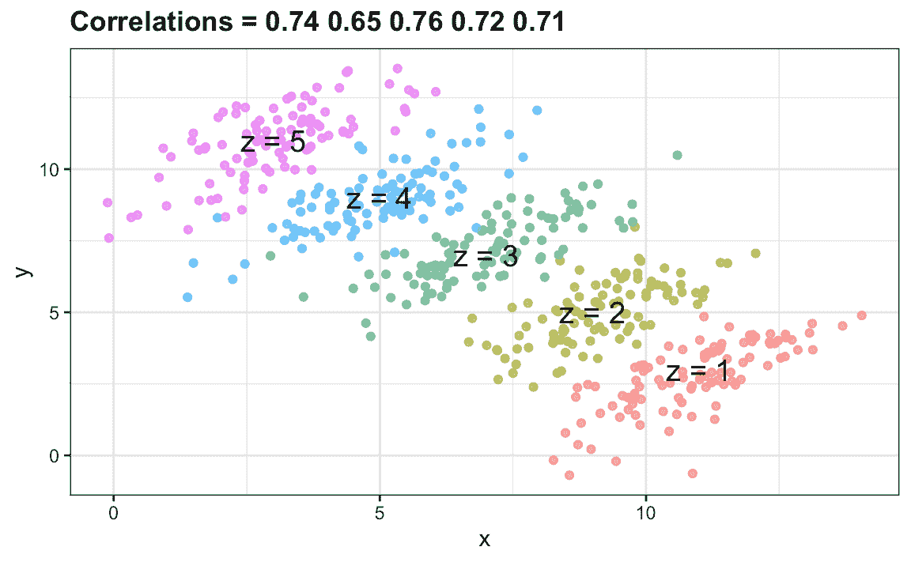

# 第十九章 关联不是因果关系

> 原文：[`rafalab.dfci.harvard.edu/dsbook/association-is-not-causation.html`](https://rafalab.dfci.harvard.edu/dsbook/association-is-not-causation.html)

*关联不是因果关系*可能是你在统计学课程中学到的最重要的课程。*相关性不是因果关系*是另一种说法。在本书的统计学部分，我们描述了用于量化变量之间关联的有用工具。然而，我们必须小心不要过度解释这些关联。

有许多原因会导致变量 $X$ 与变量 $Y$ 相关，而 $X$ 对 $Y$ 没有任何直接影响。我们在此检查四种常见的方式，这些方式可能导致误解数据。

## 19.1 虚假的相关性

以下这个有趣的例子强调了相关性不是因果关系。它显示了离婚率和黄油消费之间非常强的相关性。


这是否意味着黄油导致离婚？或者离婚导致人们吃更多的黄油？当然，这两个问题的答案都是否定的。这只是一个我们称之为*虚假相关性*的例子。

你可以在 Spurious Correlations 网站上看到更多荒谬的例子⁷⁰。

在虚假相关性网站上展示的案例都是通常所说的*数据挖掘*、*数据钓鱼*或*数据侦察*的实例。这基本上是美国所说的*选择性抽样*的一种形式。数据挖掘的一个例子是，如果你查看由随机过程产生的许多结果，并选择显示支持你想要捍卫的理论的关联关系的那一个。

可以使用蒙特卡洛模拟来展示数据挖掘如何导致在非相关变量中找到高相关性。我们将把我们的模拟结果保存到一个 tibble 中：

```r
N <- 25
g <- 1000000
sim_data <- tibble(group = rep(1:g, each=N), 
 x = rnorm(N * g), 
 y = rnorm(N * g))
```

第一列表示组。我们创建了组，并为每个组生成了一对独立的向量，$X$ 和 $Y$，每个向量包含 25 个观测值，分别存储在第二列和第三列。因为我们构建了模拟，所以我们知道 $X$ 和 $Y$ 是不相关的。

接下来，我们计算每个组中 $X$ 和 $Y$ 之间的相关性，并查看最大值：

```r
res <- sim_data |> 
 group_by(group) |> 
 summarize(r = cor(x, y)) |> 
 arrange(desc(r))
res
#> # A tibble: 1,000,000 × 2
#>    group     r
#>    <int> <dbl>
#> 1 115725 0.770
#> 2 251695 0.770
#> 3 852943 0.768
#> 4 965363 0.765
#> 5 255105 0.761
#> # ℹ 999,995 more rows
```

我们看到最大相关性为 0.77，如果你只绘制实现这一相关性的组的数据，它显示了一个令人信服的图表，表明 $X$ 和 $Y$ 实际上是相关的：

```r
sim_data |> filter(group == res$group[which.max(res$r)]) |>
 ggplot(aes(x, y)) +
 geom_point() + 
 geom_smooth(method = "lm")
#> `geom_smooth()` using formula = 'y ~ x'
```


记住，相关性总结是一个随机变量。以下是蒙特卡洛模拟生成的分布：

```r
res |> ggplot(aes(x=r)) + geom_histogram(binwidth = 0.1, color = "black")
```


这只是一个数学事实：如果我们观察到预期为 0 的随机相关性，但标准误差为 0.204，最大的一个将接近 1。

如果我们对这个群体进行回归并解释 p 值，我们会错误地声称这是一个具有统计学意义的关联：

```r
library(broom)
sim_data |> 
 filter(group == res$group[which.max(res$r)]) |>
 summarize(tidy(lm(y ~ x))) |> 
 filter(term == "x")
#> # A tibble: 1 × 5
#>   term  estimate std.error statistic    p.value
#>   <chr>    <dbl>     <dbl>     <dbl>      <dbl>
#> 1 x        0.925     0.160      5.79 0.00000670
```

这种特定形式的数据挖掘被称为 *p-hacking*。p-hacking 是一个讨论很多的话题，因为它在科学出版物中是一个问题。因为出版商倾向于奖励统计上显著的结果而不是负面结果，因此存在报告显著结果的激励。例如，在流行病学和社会科学中，研究人员可能会寻找不良结果与几个暴露之间的关联，并仅报告导致小 p 值的那一个暴露。此外，他们可能会尝试拟合几个不同的模型来解释混杂因素，并选择产生最小 p 值的那个模型。在实验学科中，一个实验可能会重复多次，但只有具有小 p 值的那个实验的结果被报告。这并不一定是因为不道德的行为，而是由于统计的无知或愿望思考。在高级统计学课程中，你可以学习调整这些多重比较的方法。

## 19.2 异常值

假设我们从两个独立的结果，$X$ 和 $Y$，中取测量值，并对这些测量值进行标准化。然而，想象一下我们犯了一个错误，忘记了标准化第 23 条记录。我们可以使用以下方法来模拟这样的数据：

```r
set.seed(1985)
x <- rnorm(100,100,1)
y <- rnorm(100,84,1)
x[-23] <- scale(x[-23])
y[-23] <- scale(y[-23])
```

数据看起来是这样的：

```r
qplot(x, y)
```


毫不奇怪，相关性非常高：

```r
cor(x,y)
#> [1] 0.988
```

但这是由一个异常值驱动的。如果我们移除这个异常值，相关性将大大降低，几乎接近 0，这正是它应该有的：

```r
cor(x[-23], y[-23])
#> [1] -0.0442
```

对于估计对异常值稳健的总体相关系数，有一种替代样本相关系数的方法。它被称为 *斯皮尔曼相关系数*。这个想法很简单：计算值排名之间的相关性。以下是值排名相互对比的图示：

```r
qplot(rank(x), rank(y))
```


异常值不再与一个非常大的值相关联，相关性大幅下降：

```r
cor(rank(x), rank(y))
#> [1] 0.00251
```

斯皮尔曼相关系数也可以这样计算：

```r
cor(x, y, method = "spearman")
#> [1] 0.00251
```

还有用于稳健拟合线性模型的方法，你可以在例如这本书中了解这些方法：Peter J. Huber 和 Elvezio M. Ronchetti 著的《稳健统计：第 2 版》。

## 19.3 原因和效果的颠倒

另一种将关联与因果关系混淆的方式是当原因和效果颠倒时。一个例子是声称辅导使学生表现更差，因为他们测试成绩低于未接受辅导的同伴。在这种情况下，辅导并不是导致低测试成绩的原因，而是相反。

实际上，这种说法的一种形式被发表在《纽约时报》的一篇社论中，标题为《家长的参与被高估了》⁷¹。考虑以下文章中的这句话：

> > 当我们检查定期帮助做作业是否对儿童的学业表现有积极影响时，我们发现的结果让我们非常震惊。无论家庭的社会阶级、种族或民族背景，或孩子的年级水平如何，一致的作业帮助几乎从未提高过测试分数或成绩……更令人惊讶的是，当父母定期帮助做作业时，孩子们通常表现得更差。

一个非常可能的情况是，需要经常得到父母帮助的孩子，之所以得到这种帮助是因为他们在学校表现不佳。

我们可以很容易地使用父亲和儿子的身高数据构建一个因果倒置的例子。如果我们拟合以下模型：

$$X_i = \beta_0 + \beta_1 y_i + \varepsilon_i, i=1, \dots, N$$

对于父亲和儿子的身高数据，其中 $X_i$ 是父亲身高，$y_i$ 是儿子身高，我们确实得到了一个具有统计学意义的显著结果。我们使用了第 17.1 节中定义的 `galton_heights` 数据集：

```r
galton_heights |> summarize(tidy(lm(father ~ son)))
#> Warning: Returning more (or less) than 1 row per
#> `summarise()` group was deprecated in
#> dplyr 1.1.0.
#> ℹ Please use `reframe()` instead.
#> ℹ When switching from `summarise()` to
#>   `reframe()`, remember that `reframe()`
#>   always returns an ungrouped data frame
#>   and adjust accordingly.
#> Call
#> `lifecycle::last_lifecycle_warnings()`
#> to see where this warning was generated.
#> # A tibble: 2 × 5
#>   term        estimate std.error statistic  p.value
#>   <chr>          <dbl>     <dbl>     <dbl>    <dbl>
#> 1 (Intercept)   40.9      4.40        9.29 5.47e-17
#> 2 son            0.407    0.0636      6.40 1.36e- 9
```

该模型很好地拟合了数据。如果我们观察上述模型的数学公式，它很容易被错误地解释，以至于暗示儿子的高个子导致了父亲的高个子。但鉴于我们对遗传和生物学的了解，我们知道情况正好相反。该模型在技术上正确。估计值和 p 值也正确获得。这里的问题在于解释。

## 19.4 混杂因素

混杂因素可能是导致关联被错误解释的最常见原因。

如果 $X$ 和 $Y$ 相关，我们称 $Z$ 为 *混杂因素*，如果 $Z$ 的变化导致 $X$ 和 $Y$ 都发生变化。在之前研究棒球数据时，我们看到了本垒打是如何成为一个混杂因素，导致在研究保送和得分之间的关系时，相关性比预期更高。在某些情况下，我们可以使用线性模型来解释混杂因素。然而，这并不总是适用。

由于混杂因素导致的错误解释在大众媒体中普遍存在，并且它们往往难以检测。在这里，我们提供了一个与大学招生相关广泛使用的例子。

### 19.4.1 示例：加州大学伯克利分校的招生

来自 1973 年六个加州大学伯克利分校专业的招生数据表明，被录取的男性比女性多：男性录取率为 44%，女性为 30%。PJ Bickel，EA Hammel，和 JW O’Connell。科学（1975）。我们可以加载这些数据和统计检验，这明显拒绝了性别和录取独立性的假设：

```r
data(admissions)
two_by_two <- admissions |> group_by(gender) |> 
 summarize(total_admitted = round(sum(admitted / 100 * applicants)), 
 not_admitted = sum(applicants) - sum(total_admitted)) |>
 select(-gender) 

chisq.test(two_by_two)$p.value
#> [1] 1.06e-21
```

但更仔细的检查显示了一个矛盾的结果。以下是按专业划分的录取百分比：

```r
admissions |> select(major, gender, admitted) |>
 pivot_wider(names_from = "gender", values_from = "admitted") |>
 mutate(women_minus_men = women - men)
#> # A tibble: 6 × 4
#>   major   men women women_minus_men
#>   <chr> <dbl> <dbl>           <dbl>
#> 1 A        62    82              20
#> 2 B        63    68               5
#> 3 C        37    34              -3
#> 4 D        33    35               2
#> 5 E        28    24              -4
#> # ℹ 1 more row
```

六个专业中有四个倾向于女性。更重要的是，所有差异都远小于我们在检查总数时看到的 14.2 的差异。

悖论在于，分析总数似乎表明录取和性别之间存在依赖关系，但当数据按专业分组时，这种依赖关系似乎消失了。发生了什么事？实际上，如果未计数的混杂因素驱动了大部分变异性，这种情况就会发生。

因此，让我们定义三个变量：$X$ 对于男性为 1，对于女性为 0，$Y$ 对于被录取者为 1，否则为 0，$Z$ 量化专业的选择性。性别偏见的主张将基于 $\mbox{Pr}(Y=1 | X = x)$ 对于 $x=1$ 比对于 $x=0$ 更高的事实。然而，$Z$ 是一个重要的混杂因素需要考虑。显然，$Z$ 与 $Y$ 相关，因为越具选择性的专业，$\mbox{Pr}(Y=1 | Z = z)$ 越低。但是，专业选择性 $Z$ 与性别 $X$ 是否相关？

一种方法是绘制一个专业录取总百分比与申请者中女性百分比的关系图：

```r
admissions |> 
 group_by(major) |> 
 summarize(major_selectivity = sum(admitted * applicants)/sum(applicants),
 percent_women_applicants = sum(applicants * (gender=="women")) /
 sum(applicants) * 100) |>
 ggplot(aes(major_selectivity, percent_women_applicants, label = major)) +
 geom_text()
```


看起来存在关联。图表表明，女性更有可能申请两个“硬”专业：性别和专业选择性是混杂因素。例如，比较专业 B 和专业 E。专业 E 比专业 B 更难进入，而且超过 60% 的专业 E 申请者是女性，而专业 B 的申请者中女性不到 30%。

### 19.4.2 图形解释混杂因素

下面的图表显示了按专业录取和未录取的申请人数：


它还按专业分解了录取情况。这种分解使我们能够看到，大多数被录取的男性来自两个专业：A 和 B。它还让我们看到，很少有女性申请这些专业。

### 19.4.3 分层后的平均数

在这个图表中，我们可以看到，如果我们按专业进行条件化或分层，然后观察差异，我们就控制了混杂因素，这种效应就会消失：

```r
admissions |> 
 ggplot(aes(major, admitted, col = gender, size = applicants)) +
 geom_point()
```


现在我们看到，按专业来看，差异并不大。点的尺寸代表申请人数，解释了悖论：对于最容易的专业 A 和 B，我们看到大红色点和小蓝色点。

如果我们按专业平均差异，我们会发现女性的百分比实际上比男性高 3.5%。

```r
admissions |>  group_by(gender) |> summarize(average = mean(admitted))
#> # A tibble: 2 × 2
#>   gender average
#>   <chr>    <dbl>
#> 1 men       38.2
#> 2 women     41.7
```

## 19.5 辛普森悖论

我们刚刚讨论的案例是辛普森悖论的例子。它被称为悖论，因为我们比较整个出版物和特定层时，会看到相关性的符号翻转。作为一个说明性的例子，假设你有三个随机变量 $X$、$Y$ 和 $Z$，并且我们观察了这些变量的实现。以下是 $X$ 和 $Y$ 的模拟观察结果以及样本相关性的图表：


你可以看到 $X$ 和 $Y$ 是负相关的。然而，一旦我们按 $Z$ 分层（如下面的不同颜色所示），另一种模式就会出现：



实际上，是$Z$与$X$呈负相关。如果我们按$Z$分层，$X$和$Y$实际上如上图所示呈正相关。

## 19.6 练习

对于下一组练习，我们检查了 2014 年 PNAS 论文⁷²中的数据，该论文分析了荷兰资助机构的成功率，并得出以下结论：

> 我们的结果揭示了性别偏见，这种偏见在评估“研究人员的质量”（但不是“提案的质量”）和成功率方面，以及在教学和评估材料中使用的语言上，都倾向于男性申请人而不是女性申请人。

几个月后，发表了一篇回应⁷³，标题为《没有证据表明性别对荷兰个人研究资金成功有贡献：对范德利和埃勒梅斯的回应》，该回应得出以下结论：

> 然而，尽管样本量很大，整体性别效应几乎达到统计显著性。此外，他们的结论可能是辛普森悖论的一个典型例子；如果女性在更具竞争力的科学学科中申请资助的比例更高（即男性和女性的申请成功率都很低），那么对所有学科的分析可能会错误地显示“证据”表明性别不平等。

谁是对的？原始论文还是回应？在这里，你将检查数据并得出自己的结论。

1. 原始论文结论的主要证据归结为百分比的比较。论文中的表 S1 包含了我们需要的信息：

```r
library(dslabs)
data("research_funding_rates")
research_funding_rates
```

构建用于关于性别奖项差异结论的二维二维表。

2. 计算二维二维表中的百分比差异。

3. 在上一个练习中，我们注意到女性的成功率较低。但这是否具有统计学意义？使用卡方检验计算 p 值。

4. 我们看到 p 值大约是 0.05。因此，似乎有一些证据表明存在某种关联。但在这里我们能推断因果关系吗？性别偏见是否导致了这种观察到的差异？对原始论文的回应声称，我们在这里看到的情况与加州大学伯克利分校的招生例子相似。具体来说，他们指出这“可能是辛普森悖论的一个典型例子；如果女性在更具竞争力的科学学科中申请资助的比例更高，那么对所有学科的分析可能会错误地显示性别不平等的‘证据’。”为了解决这一争议，创建一个包含每个性别申请数量、奖项和成功率的数据集。按整体成功率重新排序学科。提示：首先使用`reorder`函数重新排序学科，然后使用`pivot_longer`、`separate`和`pivot_wider`创建所需的表格。

5. 要检查这是否是辛普森悖论的一个案例，绘制成功率与学科的对比图，这些学科已按整体成功率排序，用颜色表示性别，用大小表示申请数量。

6. 我们确实没有看到像加州大学伯克利分校例子中那样的混杂程度。很难说这里存在混杂因素。然而，我们确实看到，根据观察到的比率，一些领域倾向于男性，而其他领域倾向于女性，我们也看到，两个差异最大的领域——即男性申请最多的领域——也是申请最多的领域。但与加州大学伯克利分校的例子不同，女性不太可能申请难度较大的科目。因此，也许一些选拔委员会存在偏见，而另一些则没有。

但在得出结论之前，我们必须检查这些差异是否与偶然得到的结果有任何不同。上述差异中，是否有任何差异在统计学上具有显著性？请记住，即使没有偏差，我们也会在评审过程中的随机变异性以及候选人之间的随机变异性中看到差异。为每个学科进行卡方检验。提示：定义一个函数，该函数接收一个 2x2 表的总量，并返回一个包含 p 值的 data frame。使用 0.5 校正。然后使用`summarize`函数。

7. 对于医学科学，似乎存在统计学上的显著差异。但这是一种虚假的相关性吗？我们进行了 9 次测试。仅报告 p 值小于 0.05 的一个案例可能被认为是 cherry picking 的例子。重复上述练习，但不是计算 p 值，而是计算对数优势比除以其标准误差。然后使用 qq-plot 来查看这些对数优势比与预期标准正态分布的偏离程度：一个标准正态分布。

* * *

1.  [`tylervigen.com/spurious-correlations`](http://tylervigen.com/spurious-correlations)↩︎

1.  [`opinionator.blogs.nytimes.com/2014/04/12/parental-involvement-is-overrated`](https://opinionator.blogs.nytimes.com/2014/04/12/parental-involvement-is-overrated)↩︎

1.  [`www.pnas.org/content/112/40/12349.abstract`](http://www.pnas.org/content/112/40/12349.abstract)↩︎

1.  [`www.pnas.org/content/112/51/E7036.extract`](http://www.pnas.org/content/112/51/E7036.extract)↩︎
