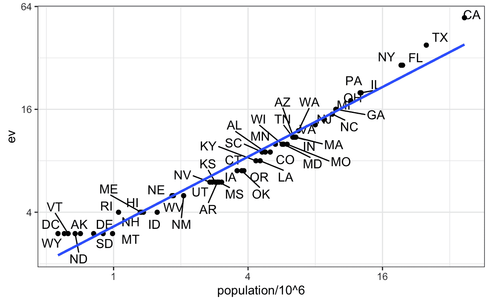
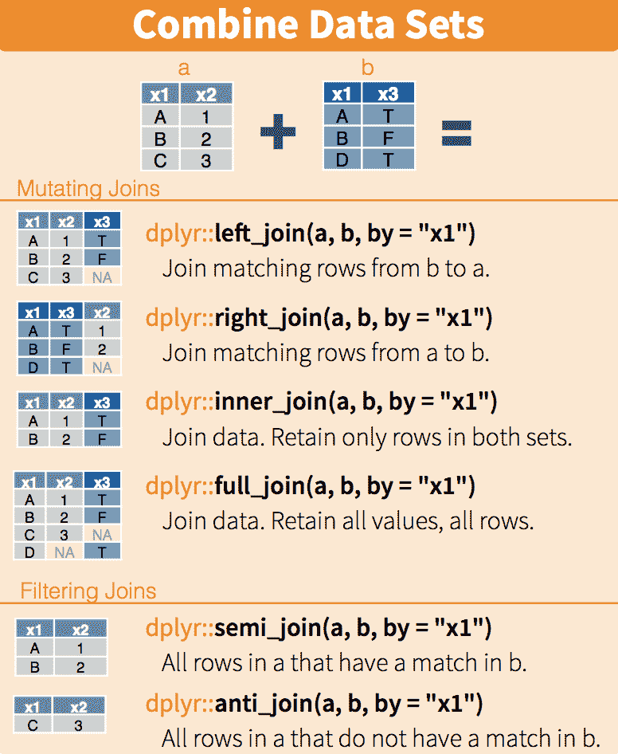

# 第二十二章 表格连接

> 原文：[`rafalab.dfci.harvard.edu/dsbook/joining-tables.html`](https://rafalab.dfci.harvard.edu/dsbook/joining-tables.html)

对于一个特定的分析，所需的信息可能不仅仅在一个表格中。例如，在预测选举时，我们使用了`left_join`函数来合并两个表格的信息。在这里，我们用一个更简单的例子来说明合并表格的一般挑战。

假设我们想探究美国各州人口规模与选举人票数之间的关系。我们在这个表格中找到了人口规模：

```r
library(tidyverse)
library(dslabs)
data(murders)
head(murders)
#>        state abb region population total
#> 1    Alabama  AL  South    4779736   135
#> 2     Alaska  AK   West     710231    19
#> 3    Arizona  AZ   West    6392017   232
#> 4   Arkansas  AR  South    2915918    93
#> 5 California  CA   West   37253956  1257
#> 6   Colorado  CO   West    5029196    65
```

以及这个表格中的选举人票数：

```r
data(polls_us_election_2016)
head(results_us_election_2016)
#>          state electoral_votes clinton trump others
#> 1   California              55    61.7  31.6    6.7
#> 2        Texas              38    43.2  52.2    4.5
#> 3      Florida              29    47.8  49.0    3.2
#> 4     New York              29    59.0  36.5    4.5
#> 5     Illinois              20    55.8  38.8    5.4
#> 6 Pennsylvania              20    47.9  48.6    3.6
```

直接将这两个表格连接起来是不行的，因为州的顺序不同。

```r
identical(results_us_election_2016$state, murders$state)
#> [1] FALSE
```

下面描述的*连接*函数旨在处理这个挑战。

## 22.1 连接

**dplyr**包中的*连接*函数确保表格被合并，使得匹配的行在一起。如果你知道 SQL，你会看到方法和语法非常相似。一般思路是，需要确定一个或多个列，这些列将用于匹配两个表格。然后返回一个新的包含合并信息的表格。注意，如果我们使用`left_join`通过州连接上述两个表格会发生什么（我们将移除`others`列并将`electoral_votes`重命名，以便表格适合页面）：

```r
tab <- left_join(murders, results_us_election_2016, by = "state") |>
 select(-others) |> rename(ev = electoral_votes)
head(tab)
#>        state abb region population total ev clinton trump
#> 1    Alabama  AL  South    4779736   135  9    34.4  62.1
#> 2     Alaska  AK   West     710231    19  3    36.6  51.3
#> 3    Arizona  AZ   West    6392017   232 11    45.1  48.7
#> 4   Arkansas  AR  South    2915918    93  6    33.7  60.6
#> 5 California  CA   West   37253956  1257 55    61.7  31.6
#> 6   Colorado  CO   West    5029196    65  9    48.2  43.3
```

数据已成功连接，现在我们可以，例如，绘制一个图来探索这种关系：

```r
library(ggrepel)
tab |> ggplot(aes(population/10⁶, ev, label = abb)) +
 geom_point() +
 geom_text_repel() + 
 scale_x_continuous(trans = "log2") +
 scale_y_continuous(trans = "log2") +
 geom_smooth(method = "lm", se = FALSE)
```



我们看到关系接近线性，大约每百万人口有 2 张选举人票，但小州的比率更高。

在实践中，一个表格中的每一行并不总是与另一个表格中的行匹配。因此，我们有几种连接版本。为了说明这个挑战，我们将从上面的表格中取子集。我们创建了`tab1`和`tab2`这两个表格，它们有一些共同的状态，但不是全部：

```r
tab_1 <- slice(murders, 1:6) |> select(state, population)
tab_1
#>        state population
#> 1    Alabama    4779736
#> 2     Alaska     710231
#> 3    Arizona    6392017
#> 4   Arkansas    2915918
#> 5 California   37253956
#> 6   Colorado    5029196
tab_2 <- results_us_election_2016 |> 
 filter(state%in%c("Alabama", "Alaska", "Arizona", 
 "California", "Connecticut", "Delaware")) |> 
 select(state, electoral_votes) |> rename(ev = electoral_votes)
tab_2
#>         state ev
#> 1  California 55
#> 2     Arizona 11
#> 3     Alabama  9
#> 4 Connecticut  7
#> 5      Alaska  3
#> 6    Delaware  3
```

我们将在下一节中使用这两个表格作为例子。

### 22.1.1 左连接

假设我们想要一个像`tab_1`这样的表格，但为所有可用的州添加选举人票数。为此，我们使用`left_join`，并将`tab_1`作为第一个参数。我们通过`by`参数指定要匹配的列。

```r
left_join(tab_1, tab_2, by = "state")
#>        state population ev
#> 1    Alabama    4779736  9
#> 2     Alaska     710231  3
#> 3    Arizona    6392017 11
#> 4   Arkansas    2915918 NA
#> 5 California   37253956 55
#> 6   Colorado    5029196 NA
```

注意，`NA`s 被添加到`tab_2`中未出现的两个州。此外，请注意，这个函数以及所有其他连接函数都可以通过管道接收第一个参数：

```r
tab_1 |> left_join(tab_2, by = "state")
```

### 22.1.2 右连接

如果我们想要一个与第二个表格具有相同行的表格，而不是与第一个表格具有相同行的表格，我们可以使用`right_join`：

```r
tab_1 |> right_join(tab_2, by = "state")
#>         state population ev
#> 1     Alabama    4779736  9
#> 2      Alaska     710231  3
#> 3     Arizona    6392017 11
#> 4  California   37253956 55
#> 5 Connecticut         NA  7
#> 6    Delaware         NA  3
```

现在，缺失值（NAs）出现在来自`tab_1`的列中。

### 22.1.3 内连接

如果我们只想保留两个表格中都有信息的行，我们使用`inner_join`。你可以将其视为一个交集：

```r
inner_join(tab_1, tab_2, by = "state")
#>        state population ev
#> 1    Alabama    4779736  9
#> 2     Alaska     710231  3
#> 3    Arizona    6392017 11
#> 4 California   37253956 55
```

### 22.1.4 全连接

如果我们想要保留所有行并用 NAs 填充缺失的部分，我们可以使用`full_join`。你可以将其视为一个并集：

```r
full_join(tab_1, tab_2, by = "state")
#>         state population ev
#> 1     Alabama    4779736  9
#> 2      Alaska     710231  3
#> 3     Arizona    6392017 11
#> 4    Arkansas    2915918 NA
#> 5  California   37253956 55
#> 6    Colorado    5029196 NA
#> 7 Connecticut         NA  7
#> 8    Delaware         NA  3
```

### 22.1.5 半连接

`semi_join` 函数允许我们保留第一表中在第二表中具有信息的部分。它不会添加第二表的列：

```r
semi_join(tab_1, tab_2, by = "state")
#>        state population
#> 1    Alabama    4779736
#> 2     Alaska     710231
#> 3    Arizona    6392017
#> 4 California   37253956
```

### 22.1.6 反连接

函数 `anti_join` 是 `semi_join` 的反函数。它保留第一表中第二表中没有信息的元素：

```r
anti_join(tab_1, tab_2, by = "state")
#>      state population
#> 1 Arkansas    2915918
#> 2 Colorado    5029196
```

以下图表总结了上述连接：

（图片由 RStudio 提供⁷⁴。CC-BY-4.0 许可⁷⁵。从原始图片裁剪而来。）

## 22.2 绑定

尽管我们在这本书中还没有使用它，但合并数据集的另一种常见方式是通过 *绑定*。与连接函数不同，绑定函数不是通过变量进行匹配，而是简单地合并数据集。如果数据集在适当的维度上不匹配，则会得到一个错误。

### 22.2.1 按列绑定

**dplyr** 函数 *bind_cols* 通过将它们作为 tibble 中的列来绑定两个对象。例如，我们很快就想创建一个由我们可以使用的数字组成的数据框。

```r
bind_cols(a = 1:3, b = 4:6)
#> # A tibble: 3 × 2
#>       a     b
#>   <int> <int>
#> 1     1     4
#> 2     2     5
#> 3     3     6
```

此函数要求我们为列分配名称。这里我们选择了 `a` 和 `b`。

注意，有一个具有完全相同功能性的 R-base 函数 `cbind`。一个重要的区别是 `cbind` 可以创建不同类型的对象，而 `bind_cols` 总是产生数据框。

`bind_cols` 也可以绑定两个不同的数据框。例如，这里我们拆分 `tab` 数据框，然后将其重新绑定在一起：

```r
tab_1 <- tab[, 1:3]
tab_2 <- tab[, 4:6]
tab_3 <- tab[, 7:8]
new_tab <- bind_cols(tab_1, tab_2, tab_3)
head(new_tab)
#>        state abb region population total ev clinton trump
#> 1    Alabama  AL  South    4779736   135  9    34.4  62.1
#> 2     Alaska  AK   West     710231    19  3    36.6  51.3
#> 3    Arizona  AZ   West    6392017   232 11    45.1  48.7
#> 4   Arkansas  AR  South    2915918    93  6    33.7  60.6
#> 5 California  CA   West   37253956  1257 55    61.7  31.6
#> 6   Colorado  CO   West    5029196    65  9    48.2  43.3
```

### 22.2.2 按行绑定

`bind_rows` 函数与 `bind_cols` 类似，但绑定的是行而不是列：

```r
tab_1 <- tab[1:2,]
tab_2 <- tab[3:4,]
bind_rows(tab_1, tab_2)
#>      state abb region population total ev clinton trump
#> 1  Alabama  AL  South    4779736   135  9    34.4  62.1
#> 2   Alaska  AK   West     710231    19  3    36.6  51.3
#> 3  Arizona  AZ   West    6392017   232 11    45.1  48.7
#> 4 Arkansas  AR  South    2915918    93  6    33.7  60.6
```

这基于 R-base 函数 `rbind`。

## 22.3 集合运算符

另一组用于合并数据集的命令是集合运算符。当应用于向量时，它们的行为如它们的名称所暗示。例如，有 `intersect`、`union`、`setdiff` 和 `setequal`。然而，如果加载了 **tidyverse**，或者更具体地说 **dplyr**，则这些函数可以用于数据框，而不仅仅是向量。

### 22.3.1 交集

您可以对任何类型的向量取交集，例如数值型：

```r
intersect(1:10, 6:15)
#> [1]  6  7  8  9 10
```

或者字符：

```r
intersect(c("a","b","c"), c("b","c","d"))
#> [1] "b" "c"
```

**dplyr** 包含一个 `intersect` 函数，可以应用于具有相同列名的表。此函数返回两个表之间的公共行。为了确保我们使用 **dplyr** 版本的 `intersect` 而不是基础包版本，我们可以使用 `dplyr::intersect` 如此：

```r
tab_1 <- tab[1:5,]
tab_2 <- tab[3:7,]
dplyr::intersect(tab_1, tab_2)
#>        state abb region population total ev clinton trump
#> 1    Arizona  AZ   West    6392017   232 11    45.1  48.7
#> 2   Arkansas  AR  South    2915918    93  6    33.7  60.6
#> 3 California  CA   West   37253956  1257 55    61.7  31.6
```

### 22.3.2 并集

类似地，*并集* 取向量的并集。例如：

```r
union(1:10, 6:15)
#>  [1]  1  2  3  4  5  6  7  8  9 10 11 12 13 14 15
union(c("a","b","c"), c("b","c","d"))
#> [1] "a" "b" "c" "d"
```

**dplyr** 包含一个 `union` 版本，可以将两个具有相同列名的表的行合并在一起。

```r
tab_1 <- tab[1:5,]
tab_2 <- tab[3:7,]
dplyr::union(tab_1, tab_2) 
#>         state abb    region population total ev clinton trump
#> 1     Alabama  AL     South    4779736   135  9    34.4  62.1
#> 2      Alaska  AK      West     710231    19  3    36.6  51.3
#> 3     Arizona  AZ      West    6392017   232 11    45.1  48.7
#> 4    Arkansas  AR     South    2915918    93  6    33.7  60.6
#> 5  California  CA      West   37253956  1257 55    61.7  31.6
#> 6    Colorado  CO      West    5029196    65  9    48.2  43.3
#> 7 Connecticut  CT Northeast    3574097    97  7    54.6  40.9
```

### 22.3.3 `setdiff`

使用 `setdiff` 可以获得第一个和第二个参数之间的集合差。与 `intersect` 和 `union` 不同，此函数不是对称的：

```r
setdiff(1:10, 6:15)
#> [1] 1 2 3 4 5
setdiff(6:15, 1:10)
#> [1] 11 12 13 14 15
```

与上面显示的函数一样，**dplyr** 为数据框提供了一个版本：

```r
tab_1 <- tab[1:5,]
tab_2 <- tab[3:7,]
dplyr::setdiff(tab_1, tab_2)
#>     state abb region population total ev clinton trump
#> 1 Alabama  AL  South    4779736   135  9    34.4  62.1
#> 2  Alaska  AK   West     710231    19  3    36.6  51.3
```

### 22.3.4 `setequal`

最后，函数 `setequal` 告诉我们两个集合是否相同，无论顺序如何。所以请注意：

```r
setequal(1:5, 1:6)
#> [1] FALSE
```

但：

```r
setequal(1:5, 5:1)
#> [1] TRUE
```

当应用于不等的 DataFrame 时（无论顺序如何），**dplyr**版本提供了一个有用的消息，让我们知道集合之间的差异：

```r
dplyr::setequal(tab_1, tab_2)
#> [1] FALSE
```

## 22.4 练习

1. 安装并加载**Lahman**库。这个数据库包括与棒球队相关的数据。它包括关于球员在进攻和防守方面多年表现的总结统计信息。还包括球员的个人资料。

`Batting`数据框包含所有球员多年来的进攻统计数据。例如，你可以通过运行以下代码看到前 10 名打击者：

```r
library(Lahman)

top <- Batting |> 
 filter(yearID == 2016) |>
 arrange(desc(HR)) |>
 slice(1:10)

top |> as_tibble()
```

但这些球员是谁呢？我们看到的是一个 ID，而不是名字。球员的名字在这个表格中

```r
People |> as_tibble()
```

我们可以看到列名`nameFirst`和`nameLast`。使用`left_join`函数创建一个关于最高全垒打打击者的表格。该表格应包含`playerID`、名字、姓氏和全垒打次数（HR）。用这个新表格重写对象`top`。

2. 现在使用`Salaries`数据框将每个球员的薪水添加到你在练习 1 中创建的表格中。注意，薪水每年都不同，所以请确保筛选出 2016 年的数据，然后使用`right_join`。这次显示名字、姓氏、球队、HR 和薪水。

3. 在之前的练习中，我们创建了`co2`数据集的整洁版本：

```r
co2_wide <- data.frame(matrix(co2, ncol = 12, byrow = TRUE)) |> 
 setNames(1:12) |>
 mutate(year = 1959:1997) |>
 pivot_longer(-year, names_to = "month", values_to = "co2") |>
 mutate(month = as.numeric(month))
```

我们想看看月度趋势是否在变化，所以我们将移除年度影响，然后绘制结果。我们首先计算年度平均值。使用`group_by`和`summarize`计算每年的平均二氧化碳排放量。保存到一个名为`yearly_avg`的对象中。

4. 现在使用`left_join`函数将年度平均值添加到`co2_wide`数据集中。然后计算残差：观测到的二氧化碳测量值减去年度平均值。

5. 在移除年度影响后，按年份绘制季节性趋势图。

* * *

1.  [`github.com/rstudio/cheatsheets`](https://github.com/rstudio/cheatsheets)↩︎

1.  [`github.com/rstudio/cheatsheets/blob/master/LICENSE`](https://github.com/rstudio/cheatsheets/blob/master/LICENSE)↩︎
