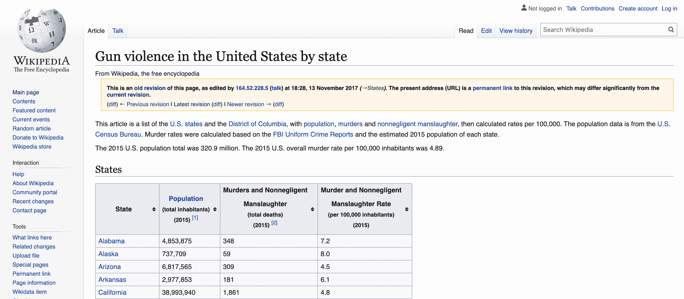
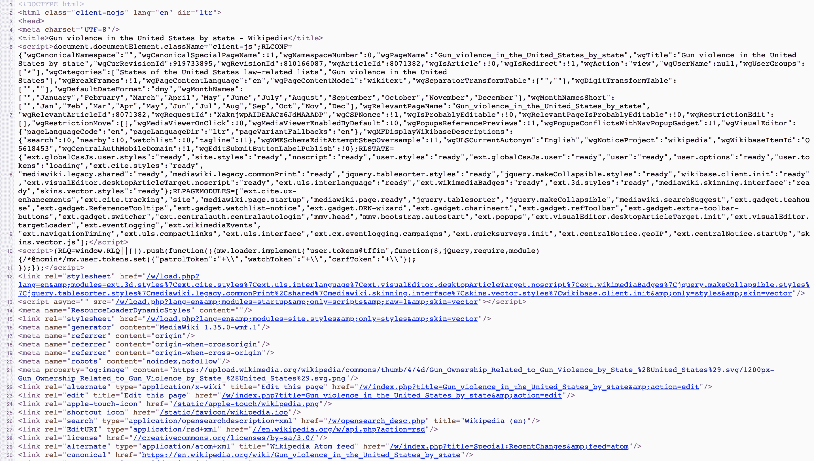

# 第二十三章 网络爬虫

> 原文：[`rafalab.dfci.harvard.edu/dsbook/web-scraping.html`](https://rafalab.dfci.harvard.edu/dsbook/web-scraping.html)

我们需要回答问题的数据并不总是以供我们阅读的电子表格形式存在。例如，我们在 R 基础章节中使用的美国谋杀数据集最初来源于这个维基百科页面：

```r
url <- paste0("https://en.wikipedia.org/w/index.php?title=",
 "Gun_violence_in_the_United_States_by_state",
 "&direction=prev&oldid=810166167")
```

当你访问网页时，你可以看到数据表：



（网页由维基百科提供⁷⁶。CC-BY-SA-3.0 许可证⁷⁷。页面部分截图。）

不幸的是，没有数据文件的链接。为了在输入 `data(murders)` 时加载数据框，我们不得不进行一些 *网络爬虫*。

*网络爬虫* 或 *网络采集* 是我们用来描述从网站中提取数据的过程的术语。我们可以这样做的原因是浏览器用来渲染网页的信息是以文本文件的形式从服务器接收的。这些文本是用超文本标记语言（HTML）编写的代码。每个浏览器都有一种显示页面 HTML 源代码的方式，每种方式都不同。在 Chrome 中，你可以在 PC 上使用 Control-U，在 Mac 上使用 command+alt+U。你会看到类似这样的内容：



## 23.1 HTML

因为这段代码是可访问的，我们可以下载 HTML 文件，将其导入 R，然后编写程序从页面中提取所需的信息。然而，一旦我们查看 HTML 代码，这可能会显得像是一项艰巨的任务。但我们将向您展示一些方便的工具来简化这个过程。为了了解它是如何工作的，以下是提供美国谋杀数据的维基百科页面中的一段代码：

```r
<table class="wikitable sortable">
<tr>
<th>State</th>
<th><a href="/wiki/List_of_U.S._states_and_territories_by_population" 
title="List of U.S. states and territories by population">Population</a><br />
<small>(total inhabitants)</small><br />
<small>(2015)</small> <sup id="cite_ref-1" class="reference">
<a href="#cite_note-1">[1]</a></sup></th>
<th>Murders and Nonnegligent
<p>Manslaughter<br />
<small>(total deaths)</small><br />
<small>(2015)</small> <sup id="cite_ref-2" class="reference">
<a href="#cite_note-2">[2]</a></sup></p>
</th>
<th>Murder and Nonnegligent
<p>Manslaughter Rate<br />
<small>(per 100,000 inhabitants)</small><br />
<small>(2015)</small></p>
</th>
</tr>
<tr>
<td><a href="/wiki/Alabama" title="Alabama">Alabama</a></td>
<td>4,853,875</td>
<td>348</td>
<td>7.2</td>
</tr>
<tr>
<td><a href="/wiki/Alaska" title="Alaska">Alaska</a></td>
<td>737,709</td>
<td>59</td>
<td>8.0</td>
</tr>
<tr>
```

你实际上可以看到数据，但数据值被如 `<td>` 这样的 HTML 代码包围。我们还可以看到它存储的模式。如果你了解 HTML，你可以编写利用这些模式提取我们所需信息的程序。我们还利用了一种广泛用于使网页看起来“美观”的语言，称为层叠样式表（CSS）。我们将在第 23.3 节中详细介绍这一点。

尽管我们提供了无需了解 HTML 就能抓取数据的工具，但对于数据科学家来说，学习一些 HTML 和 CSS 非常有用。这不仅提高了你的抓取技能，而且如果你正在创建一个展示你工作的网页，这可能会派上用场。有许多在线课程和教程可以学习这些内容。两个例子是 Codeacademy⁷⁸ 和 W3schools⁷⁹。

## 23.2 rvest 包

**tidyverse** 提供了一个名为 **rvest** 的网络采集包。使用此包的第一步是将网页导入 R。该包使这一过程变得非常简单：

```r
library(tidyverse)
library(rvest)
h <- read_html(url)
```

注意，美国谋杀维基百科网页的整个内容现在都包含在 `h` 中。这个对象的类是：

```r
class(h)
#> [1] "xml_document" "xml_node"
```

**rvest** 包实际上更通用；它处理 XML 文档。XML 是一种通用标记语言（ML 代表的就是这个），可以用来表示任何类型的数据。HTML 是 XML 的一种特定类型，专门开发用于表示网页。在这里，我们专注于 HTML 文档。

现在，我们如何从对象 `h` 中提取表格？如果我们打印 `h`，我们实际上看不到太多：

```r
h
#> {html_document}
#> <html class="client-nojs vector-feature-language-in-header-enabled vector-feature-language-in-main-page-header-disabled vector-feature-sticky-header-disabled vector-feature-page-tools-pinned-disabled vector-feature-toc-pinned-clientpref-1 vector-feature-main-menu-pinned-disabled vector-feature-limited-width-clientpref-1 vector-feature-limited-width-content-enabled vector-feature-zebra-design-enabled vector-feature-custom-font-size-clientpref-0 vector-feature-client-preferences-disabled vector-feature-client-prefs-pinned-disabled vector-toc-available" lang="en" dir="ltr">
#> [1] <head>\n<meta http-equiv="Content-Type" content="text/html; chars ...
#> [2] <body class="skin-vector skin-vector-search-vue mediawiki ltr sit ...
```

我们可以使用 `html_text` 函数查看定义下载网页的所有代码，如下所示：

```r
html_text(h)
```

我们在这里不显示输出，因为它包含数千个字符，但如果我们查看它，我们可以看到我们想要的数据存储在一个 HTML 表格中：你可以在上面的 HTML 代码的这一行中看到 `<table class="wikitable sortable">`。HTML 文档的不同部分，通常在 `<` 和 `>` 之间用消息定义，被称为*节点*。**rvest** 包包括用于提取 HTML 文档节点的函数：`html_nodes` 提取所有不同类型的节点，`html_node` 提取第一个。要从 HTML 代码中提取表格，我们使用：

```r
tab <- h |> html_nodes("table")
```

现在，我们不再有整个网页，我们只有页面中表格的 HTML 代码：

```r
tab
#> {xml_nodeset (2)}
#> [1] <table class="wikitable sortable"><tbody>\n<tr>\n<th>State\n</th> ...
#> [2] <table class="nowraplinks hlist mw-collapsible mw-collapsed navbo ...
```

我们感兴趣的表格是第一个：

```r
tab[[1]]
#> {html_node}
#> <table class="wikitable sortable">
#> [1] <tbody>\n<tr>\n<th>State\n</th>\n<th>\n<a href="/wiki/List_of_U.S ...
```

这显然不是一个整洁的数据集，甚至不是一个数据框。在上面的代码中，你可以肯定地看到一个模式，编写代码来提取数据是完全可行的。事实上，**rvest** 包包括一个专门用于将 HTML 表格转换为数据框的函数：

```r
tab <- tab[[1]] |> html_table()
class(tab)
#> [1] "tbl_df"     "tbl"        "data.frame"
```

我们现在离拥有一个可用的数据表格更近了：

```r
tab <- tab |> setNames(c("state", "population", "total", "murder_rate")) 
head(tab)
#> # A tibble: 6 × 4
#>   state      population total murder_rate
#>   <chr>      <chr>      <chr>       <dbl>
#> 1 Alabama    4,853,875  348           7.2
#> 2 Alaska     737,709    59            8 
#> 3 Arizona    6,817,565  309           4.5
#> 4 Arkansas   2,977,853  181           6.1
#> 5 California 38,993,940 1,861         4.8
#> # ℹ 1 more row
```

我们仍然需要进行一些处理。例如，我们需要删除逗号并将字符转换为数字。在继续进行之前，我们将学习一种更通用的从网站提取信息的方法。

## 23.3 CSS 选择器

使用最基本 HTML 制作的网页默认外观相当不吸引人。我们今天看到的令人愉悦的页面是使用 CSS 来定义网页的外观和样式制作的。公司所有页面都有相同风格的事实通常源于它们使用相同的 CSS 文件来定义样式。这些 CSS 文件的一般工作方式是定义网页的每个元素将如何显示。例如，标题、标题、项目符号列表、表格和链接，每个都接收自己的样式，包括字体、颜色、大小和与边距的距离。CSS 通过利用定义这些元素的模式来实现这一点，这些模式被称为*选择器*。上面我们使用的这样一个模式的例子是 `table`，但还有很多很多。

如果我们想从网页中抓取数据，并且恰好知道包含这些数据的页面部分具有独特的选择器，我们可以使用 `html_nodes` 函数。然而，知道哪个选择器可能相当复杂。实际上，随着网页变得越来越复杂，网页的复杂性也在增加。对于一些更高级的网页，似乎几乎不可能找到定义特定数据的节点。然而，选择器工具实际上使这成为可能。

SelectorGadget⁸⁰ 是一款软件，允许你交互式地确定从网页中提取特定组件所需的 CSS 选择器。如果你计划从 HTML 页面中抓取除表格之外的数据，我们强烈建议你安装它。有一个 Chrome 扩展程序，允许你打开这个工具，然后，当你点击页面时，它会突出显示部分内容并显示你需要提取这些部分的选择器。包括 **rvest** 作者 Hadley Wickham 的示例⁸¹ 和基于示例的其他教程⁸² ⁸³ 在内，都有各种如何做到这一点的演示。

## 23.4 JSON

在互联网上共享数据变得越来越普遍。不幸的是，提供者使用不同的格式，这使得数据科学家将数据整理到 R 中变得更加困难。然而，也有一些标准正在变得越来越普遍。目前，一个被广泛采用的标准是 JavaScript 对象表示法或 JSON。因为这个格式非常通用，它不像电子表格。这个 JSON 文件看起来更像是你用来定义列表的代码。以下是一个存储在 JSON 格式中的信息示例：

```r
#> 
#> Attaching package: 'jsonlite'
#> The following object is masked from 'package:purrr':
#> 
#>     flatten
#> [
#>   {
#>     "name": "Miguel",
#>     "student_id": 1,
#>     "exam_1": 85,
#>     "exam_2": 86
#>   },
#>   {
#>     "name": "Sofia",
#>     "student_id": 2,
#>     "exam_1": 94,
#>     "exam_2": 93
#>   },
#>   {
#>     "name": "Aya",
#>     "student_id": 3,
#>     "exam_1": 87,
#>     "exam_2": 88
#>   },
#>   {
#>     "name": "Cheng",
#>     "student_id": 4,
#>     "exam_1": 90,
#>     "exam_2": 91
#>   }
#> ]
```

上面的文件实际上代表一个数据框。为了读取它，我们可以使用 **jsonlite** 包中的 `fromJSON` 函数。请注意，JSON 文件通常通过互联网提供。几个组织提供 JSON API 或网络服务，你可以直接连接并获取数据。以下是一个提供诺贝尔奖获得者信息的示例：

```r
nobel <- fromJSON("http://api.nobelprize.org/v1/prize.json")
```

这将下载一个列表。第一个参数是一个包含诺贝尔奖获得者信息的表格：

```r
filter(nobel$prize, category == "literature" & year == "1971") |> pull(laureates)
#> [[1]]
#>    id firstname surname
#> 1 645     Pablo  Neruda
#>                                                                                                motivation
#> 1 "for a poetry that with the action of an elemental force brings alive a continent's destiny and dreams"
#>   share
#> 1     1
```

你可以通过检查 **jsonlite** 包的教程和帮助文件来学习更多。这个包旨在处理相对简单的任务，例如将数据转换为表格。为了获得更多灵活性，我们推荐使用 `rjson`。

## 23.5 练习

1. 访问以下网页：[`web.archive.org/web/20181024132313/http://www.stevetheump.com/Payrolls.htm`](https://web.archive.org/web/20181024132313/http://www.stevetheump.com/Payrolls.htm)

注意有几个表格。假设我们感兴趣的是比较不同年份的团队工资。接下来的几个练习将引导我们完成这一步骤。

首先，将你学到的知识应用到将网站内容读入一个名为 `h` 的对象中。

2. 注意，尽管不是很实用，我们实际上可以通过输入以下内容来查看页面内容：

```r
html_text(h)
```

下一步是提取表格。为此，我们可以使用`html_nodes`函数。我们了解到 HTML 中的表格与`table`节点相关联。使用`html_nodes`函数和`table`节点来提取第一个表格。将其存储在对象`nodes`中。

3. `html_nodes`函数返回一个类为`xml_node`的对象列表。我们可以使用例如`html_text`函数查看每个对象的内容。你可以这样查看任意选择的组件的内容：

```r
html_text(nodes[[8]])
```

如果这个对象的内容是 HTML 表格，我们可以使用`html_table`函数将其转换为数据框。使用`html_table`函数将`nodes`的第八个条目转换为表格。

4. 对`nodes`的前四个组件重复上述操作。以下哪些是工资表：

1.  所有这些。

1.  1

1.  2

1.  2-4

5. 对`nodes`的前**最后**三个组件重复上述操作。以下哪个是正确的：

1.  `nodes`中的最后一个条目显示了所有球队随时间推移的平均值，而不是每个球队的工资。

1.  所有这三个都是每个球队的工资表。

1.  所有这三个都像第一个条目一样，不是工资表。

1.  所有上述内容。

6. 我们已经了解到`nodes`的第一个和最后一个条目不是工资表。重新定义`nodes`，以便删除这两个条目。

7. 在前面的分析中，我们看到第一个表格节点实际上不是一个表格。在 HTML 中，这种情况有时会发生，因为表格被用来使文本看起来有特定的样子，而不是存储数值。删除第一个组件，然后使用`sapply`和`html_table`将`nodes`中的每个节点转换为表格。请注意，在这种情况下，`sapply`将返回一个表格列表。你也可以使用`lapply`来确保列表被应用。

8. 查看生成的表格。它们是否都相同？我们是否可以使用`bind_rows`将它们直接合并？

9. 使用条目 10 和 19 创建两个表格，分别命名为`tab_1`和`tab_2`。

10. 使用`full_join`函数合并这两个表格。在这样做之前，你必须解决缺失标题的问题。你还需要使名称匹配。

11. 在合并表格后，你会看到几个 NA 值。这是因为一些队伍在一个表格中，而在另一个表格中则没有。使用`anti_join`函数来更好地了解这是为什么。

12. 我们可以看到，其中一个问题是洋基队被列为*N.Y. Yankees*和*NY Yankees*。在下一节中，我们将学习解决此类问题的有效方法。在这里，我们可以手动这样做：

```r
tab_1 <- tab_1 |>
 mutate(Team = ifelse(Team == "N.Y. Yankees", "NY Yankees", Team))
```

现在合并表格，只显示奥克兰和洋基队以及工资列。

13. 高级：从以下网站提取获得最佳影片的电影标题：[`m.imdb.com/chart/bestpicture/`](https://m.imdb.com/chart/bestpicture/)

* * *

1.  [`en.wikipedia.org/w/index.php?title=Gun_violence_in_the_United_States_by_state&direction=prev&oldid=810166167`](https://en.wikipedia.org/w/index.php?title=Gun_violence_in_the_United_States_by_state&direction=prev&oldid=810166167)↩︎

1.  [`en.wikipedia.org/wiki/Wikipedia:Text_of_Creative_Commons_Attribution-ShareAlike_3.0_Unported_License`](https://en.wikipedia.org/wiki/Wikipedia:Text_of_Creative_Commons_Attribution-ShareAlike_3.0_Unported_License)↩︎

1.  [`www.codecademy.com/learn/learn-html`](https://www.codecademy.com/learn/learn-html)↩︎

1.  [`www.w3schools.com/`](https://www.w3schools.com/)↩︎

1.  [`selectorgadget.com/`](http://selectorgadget.com/)↩︎

1.  [`cran.r-project.org/web/packages/rvest/vignettes/selectorgadget.html`](https://cran.r-project.org/web/packages/rvest/vignettes/selectorgadget.html)↩︎

1.  [`stat4701.github.io/edav/2015/04/02/rvest_tutorial/`](https://stat4701.github.io/edav/2015/04/02/rvest_tutorial/)↩︎

1.  [`www.analyticsvidhya.com/blog/2017/03/beginners-guide-on-web-scraping-in-r-using-rvest-with-hands-on-knowledge/`](https://www.analyticsvidhya.com/blog/2017/03/beginners-guide-on-web-scraping-in-r-using-rvest-with-hands-on-knowledge/)↩︎
