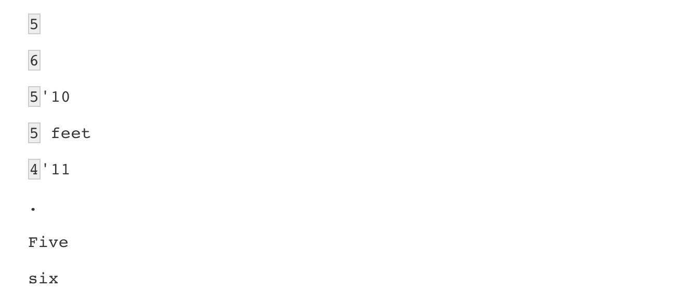
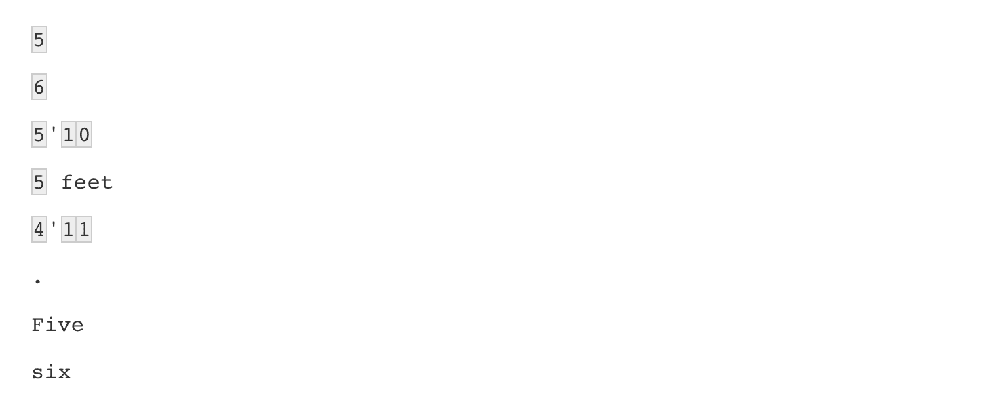
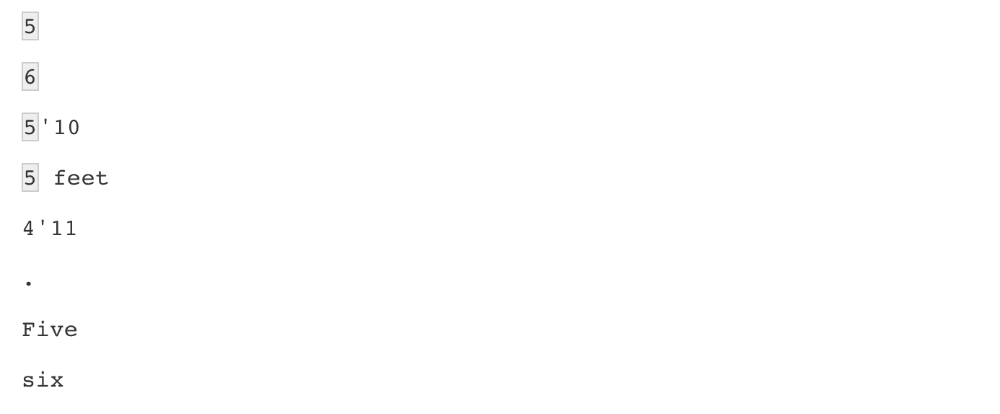
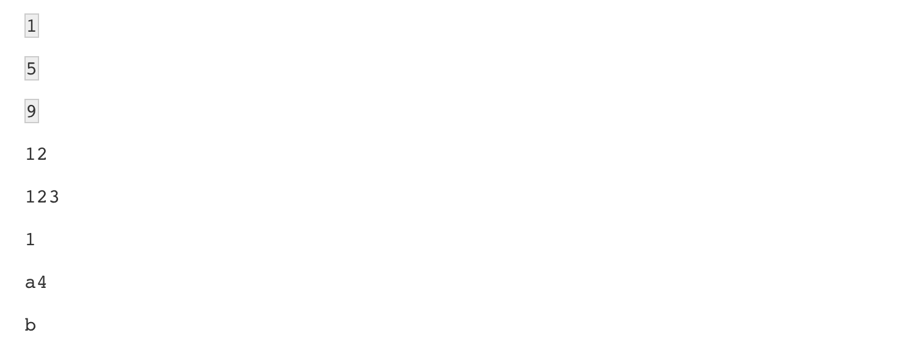
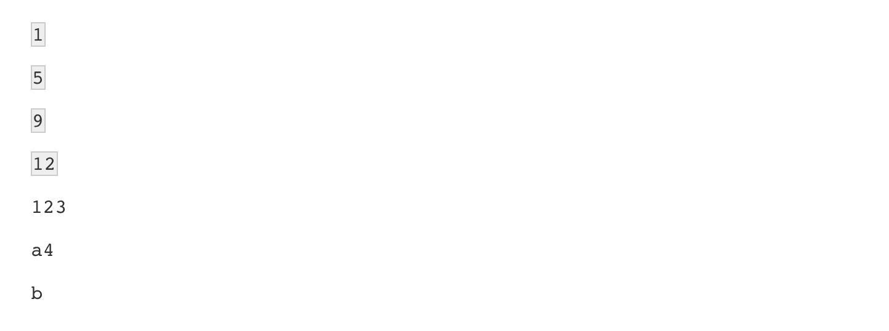
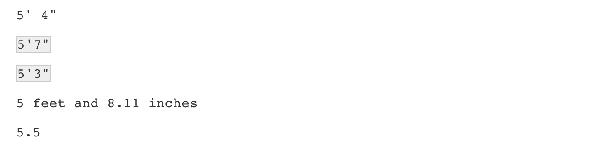
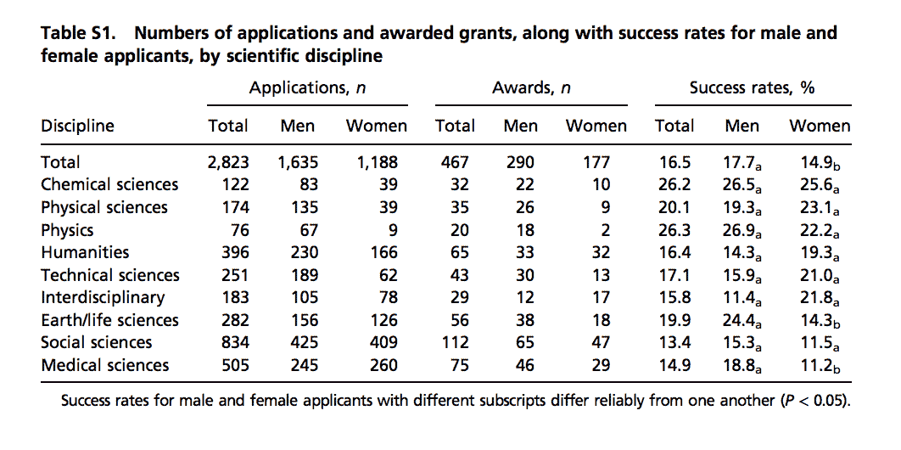
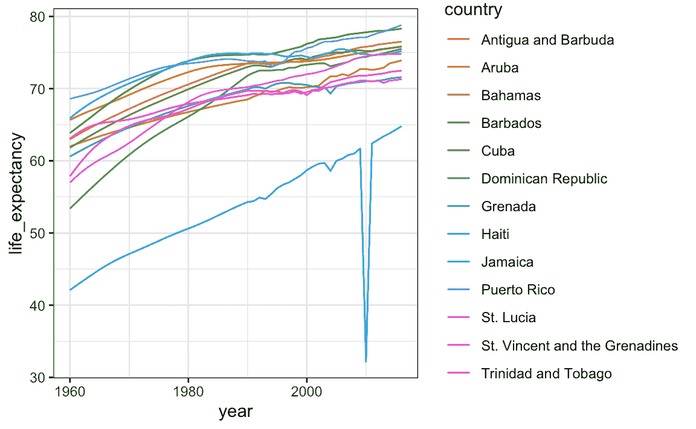
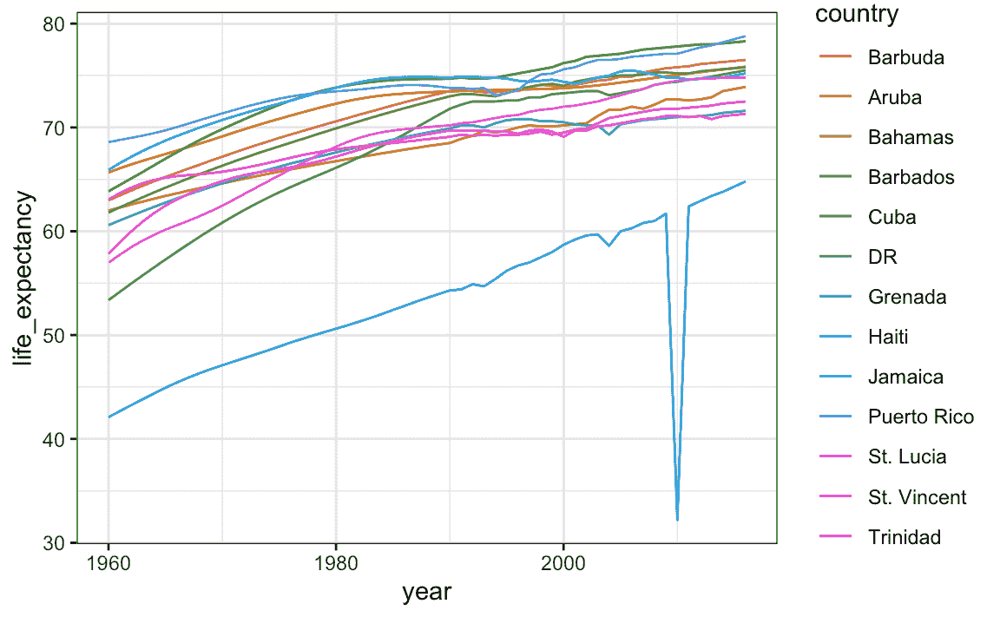

# 第二十四章 字符串处理

> 原文：[`rafalab.dfci.harvard.edu/dsbook/string-processing.html`](https://rafalab.dfci.harvard.edu/dsbook/string-processing.html)

最常见的数据整理挑战之一涉及从字符字符串中提取数值数据，并将它们转换为 R 中制作图表、计算摘要或拟合模型所需的数值表示。将无序文本处理成有意义的变量名或分类变量也很常见。数据科学家面临的大多数字符串处理挑战都是独特的，往往出乎意料。因此，撰写一个关于这个主题的全面章节是非常雄心勃勃的。在这里，我们使用一系列案例研究来帮助我们展示字符串处理是如何成为许多数据整理挑战的必要步骤。具体来说，我们描述了将尚未展示的原始*原始*数据（从中提取了`murders`、`heights`和`research_funding_rates`示例）转换为本书中研究的数据框的过程。

通过回顾这些案例研究，我们将涵盖字符串处理中最常见的任务，包括从字符串中提取数字、从文本中删除不需要的字符、查找和替换字符、提取字符串的特定部分、将自由文本转换为更统一的格式，以及将字符串拆分为多个值。

基础 R 包括执行所有这些任务的功能。然而，它们并不遵循统一的约定，这使得它们难以记忆和使用。**stringr**包基本上重新包装了这些功能，但使用了一种更一致的命名函数和排序参数的方法。例如，在**stringr**中，所有的字符串处理函数都以`str_`开头。这意味着如果你输入`str_`然后按 Tab 键，R 将自动完成并显示所有可用的函数。因此，我们不一定需要记住所有的函数名。另一个优点是，在这个包中的函数中，被处理的字符串总是第一个参数，这意味着我们可以更轻松地使用管道。因此，我们将首先描述如何使用**stringr**包中的函数。

大多数示例将来自第二个案例研究，该研究涉及学生自报的身高，而本章的大部分内容都致力于学习正则表达式（regex）以及**stringr**包中的函数。

## 24.1 stringr 包

```r
library(tidyverse)
library(stringr)
```

通常，字符串处理任务可以分为在字符串中**检测**、**定位**、**提取**或**替换**模式。我们将看到几个示例。下表包括了**stringr**包中可用的函数。我们按任务将它们分开。我们还包括了当可用时的 R-base 等价函数。

所有这些函数都将字符向量作为第一个参数。此外，对于每个函数，操作都是矢量化：操作应用于向量中的每个字符串。

最后，请注意，在这个表中我们提到了*组*。这些将在第 24.5.10 节中解释。

| stringr | 任务 | 描述 | R-base |
| --- | --- | --- | --- |
| `str_detect` | 检测 | 模式是否在字符串中？ | `grepl` |
| `str_which` | 检测 | 返回包含模式的条目的索引。 | `grep` |
| `str_subset` | 检测 | 返回包含模式的字符串的子集。 | `grep`与`value = TRUE` |
| `str_locate` | 定位 | 返回字符串中模式首次出现的位置。 | `regexpr` |
| `str_locate_all` | 定位 | 返回字符串中模式所有出现的位置。 | `gregexpr` |
| `str_view` | 定位 | 显示匹配模式的字符串的第一部分。 |  |
| `str_view_all` | 定位 | 显示匹配模式的字符串的所有部分。 |  |
| `str_extract` | 提取 | 提取匹配模式的字符串的第一部分。 |  |
| `str_extract_all` | 提取 | 提取字符串中所有匹配模式的各个部分。 |  |
| `str_match` | 提取 | 提取字符串中匹配由组定义的组和模式的第一部分。 |  |
| `str_match_all` | 提取 | 提取字符串中所有匹配由组定义的组和模式的部分。 |  |
| `str_sub` | 提取 | 提取子字符串。 | `substring` |
| `str_split` | 提取 | 将字符串分割成由模式分隔的部分组成的列表。 | `strsplit` |
| `str_split_fixed` | 提取 | 将字符串分割成由模式分隔的部分组成的矩阵。 | `strsplit`与`fixed = TRUE` |
| `str_count` | 描述 | 计算模式在字符串中出现的次数。 |  |
| `str_length` | 描述 | 字符串中的字符数。 | `nchar` |
| `str_replace` | 替换 | 将匹配模式的字符串的第一部分替换为另一个字符串。 |  |
| `str_replace_all` | 替换 | 将匹配模式的字符串部分替换为另一个字符串。 | `gsub` |
| `str_to_upper` | 替换 | 将所有字符转换为大写。 | `toupper` |
| `str_to_lower` | 替换 | 将所有字符转换为小写。 | `tolower` |
| `str_to_title` | 替换 | 将第一个字符改为大写，其余改为小写。 |  |
| `str_replace_na` | 替换 | 将所有`NA`替换为新值。 |  |
| `str_trim` | 替换 | 从字符串的开始和结束处删除空白。 |  |
| `str_c` | 操作 | 连接多个字符串。 | `paste0` |
| `str_conv` | 操作 | 更改字符串的编码。 |  |
| `str_sort` | 操作 | 按字母顺序排序向量。 | `sort` |
| `str_order` | 操作 | 按字母顺序排序向量所需的索引。 | `order` |
| `str_trunc` | 操作 | 截断字符串到固定大小。 |  |
| `str_pad` | 操作 | 向字符串添加空白使其达到固定大小。 |  |
| `str_dup` | 操作 | 重复字符串。 | `rep`然后`paste` |
| `str_wrap` | 操作 | 将内容包装成格式化的段落。 |  |
| `str_interp` | 操作 | 字符串插值。 | `sprintf` |

## 24.2 案例研究 1：美国谋杀数据

在本节中，我们以以下数据集为例，介绍一些更简单的字符串处理挑战：

```r
library(rvest)
url <- paste0("https://en.wikipedia.org/w/index.php?title=",
 "Gun_violence_in_the_United_States_by_state",
 "&direction=prev&oldid=810166167")
murders_raw <- read_html(url) |>
 html_node("table") |>
 html_table() |>
 setNames(c("state", "population", "total", "murder_rate"))
```

上述代码显示了构建数据集的第一步

```r
library(dslabs)
data(murders)
```

来自原始数据，这些数据是从维基百科页面提取的。

通常，字符串处理涉及一个字符串和一个模式。在 R 中，我们通常将字符串存储在字符向量中，例如 `murders$population`。由人口变量定义的此向量中的前三个字符串是：

```r
murders_raw$population[1:3]
#> [1] "4,853,875" "737,709"   "6,817,565"
```

在这里通常的强制转换不起作用：

```r
as.numeric(murders_raw$population[1:3])
#> Warning: NAs introduced by coercion
#> [1] NA NA NA
```

这是因为逗号 `,`。我们在这里想要进行的字符串处理是移除 `strings` 中的 `pattern`，即 `murders_raw$population` 中的逗号，然后将其强制转换为数字。我们可以使用 `str_detect` 函数来查看三个列中的两个有逗号：

```r
commas <- function(x) any(str_detect(x, ","))
murders_raw |> summarize_all(commas)
#> # A tibble: 1 × 4
#>   state population total murder_rate
#>   <lgl> <lgl>      <lgl> <lgl> 
#> 1 FALSE TRUE       TRUE  FALSE
```

然后，我们可以使用 `str_replace_all` 函数来移除它们：

```r
test_1 <- str_replace_all(murders_raw$population, ",", "")
test_1 <- as.numeric(test_1)
```

然后，我们可以使用 `mutate_all` 来将此操作应用于每一列，因为它不会影响没有逗号的列。

结果表明，这个操作如此常见，以至于 `readr` 包中包含了一个名为 `parse_number` 的函数，专门用于在强制转换之前移除非数字字符：

```r
test_2 <- parse_number(murders_raw$population)
identical(test_1, test_2)
#> [1] TRUE
```

因此，我们可以使用以下方法获得我们想要的表格：

```r
murders_new <- murders_raw |> mutate_at(2:3, parse_number)
head(murders_new)
#> # A tibble: 6 × 4
#>   state      population total murder_rate
#>   <chr>           <dbl> <dbl>       <dbl>
#> 1 Alabama       4853875   348         7.2
#> 2 Alaska         737709    59         8 
#> 3 Arizona       6817565   309         4.5
#> 4 Arkansas      2977853   181         6.1
#> 5 California   38993940  1861         4.8
#> # ℹ 1 more row
```

与我们在数据科学中通常遇到的字符串处理挑战相比，这个案例相对简单。下一个例子相当复杂，它提供了几个挑战，将使我们能够学习许多字符串处理技术。

## 24.3 案例研究 2：自我报告的高度

**dslabs** 包包含从其中获取高度数据集的原始数据。你可以这样加载它：

```r
data(reported_heights)
```

这些高度是通过一个网页表单获得的，学生被要求输入他们的身高。他们可以输入任何内容，但说明要求输入 *英寸* 高度，一个数字。我们收集了 1,095 份提交，但不幸的是，报告高度的那一列有几个非数字条目，因此变成了字符向量：

```r
class(reported_heights$height)
#> [1] "character"
```

如果我们尝试将其解析为数字，我们会收到一个警告：

```r
x <- as.numeric(reported_heights$height)
#> Warning: NAs introduced by coercion
```

尽管大多数值看起来像是按照要求的高度（英寸）：

```r
head(x)
#> [1] 75 70 68 74 61 65
```

我们最终确实得到了许多 `NA`：

```r
sum(is.na(x))
#> [1] 81
```

我们可以通过使用 `filter` 来保留只产生 `NA` 的条目来查看一些未能成功转换的条目：

```r
reported_heights |> 
 mutate(new_height = as.numeric(height)) |>
 filter(is.na(new_height)) |> 
 head(n=10)
#>             time_stamp    sex                 height new_height
#> 1  2014-09-02 15:16:28   Male                  5' 4"         NA
#> 2  2014-09-02 15:16:37 Female                  165cm         NA
#> 3  2014-09-02 15:16:52   Male                    5'7         NA
#> 4  2014-09-02 15:16:56   Male                  >9000         NA
#> 5  2014-09-02 15:16:56   Male                   5'7"         NA
#> 6  2014-09-02 15:17:09 Female                   5'3"         NA
#> 7  2014-09-02 15:18:00   Male 5 feet and 8.11 inches         NA
#> 8  2014-09-02 15:19:48   Male                   5'11         NA
#> 9  2014-09-04 00:46:45   Male                  5'9''         NA
#> 10 2014-09-04 10:29:44   Male                 5'10''         NA
```

我们立即看到发生了什么。一些学生没有按照要求报告他们的英寸身高。我们可以丢弃这些数据并继续。然而，许多条目遵循的模式，在原则上，我们可以轻松地将其转换为英寸。例如，在上面的输出中，我们看到各种使用格式 `x'y''` 的案例，其中 `x` 和 `y` 分别代表英尺和英寸。这些案例中的每一个都可以由人类读取并转换为英寸，例如 `5'4''` 是 `5*12 + 4 = 64`。因此，我们可以手动修复所有有问题的条目。然而，人类容易犯错，所以自动方法更可取。此外，因为我们计划继续收集数据，编写自动执行此操作的代码将很方便。

在这类任务中的第一步是调查有问题的条目，并尝试定义大量条目遵循的特定模式。这些群体越大，我们就能用单一程序方法修复更多的条目。我们希望找到可以用规则准确描述的模式，例如“一个数字，后面跟着英尺符号，然后是一个或两个数字，然后是英寸符号”。

为了寻找这样的模式，删除与英寸一致性的条目并仅查看有问题的条目很有帮助。因此，我们编写了一个函数来自动完成这项工作。我们保留在应用 `as.numeric` 时产生 `NA` 或在合理身高范围之外的条目。我们允许一个覆盖大约 99.9999% 的成年人群体的范围。我们还使用 `suppressWarnings` 来避免我们知道 `as.numeric` 会给出的警告信息。

```r
not_inches <- function(x, smallest = 50, tallest = 84){
 inches <- suppressWarnings(as.numeric(x))
 ind <- is.na(inches) | inches < smallest | inches > tallest
 ind
}
```

我们应用这个函数并找出有问题的条目数量：

```r
problems <- reported_heights |> 
 filter(not_inches(height)) |>
 pull(height)
length(problems)
#> [1] 292
```

我们现在可以通过简单地打印它们来查看所有案例。我们在这里不这样做，因为 `length(problems)`，但在仔细调查后，我们发现可以使用三种模式来定义这些异常中的三个大型群体。

1. 形式为 `x'y` 或 `x' y''` 或 `x'y"` 的模式，其中 `x` 和 `y` 分别代表英尺和英寸。以下是十个例子：

```r
#> 5' 4" 5'7 5'7" 5'3" 5'11 5'9'' 5'10'' 5' 10 5'5" 5'2"
```

2. 形式为 `x.y` 或 `x,y` 的模式，其中 `x` 代表英尺，`y` 代表英寸。以下是十个例子：

```r
#> 5.3 5.5 6.5 5.8 5.6 5,3 5.9 6,8 5.5 6.2
```

3. 报告为厘米而不是英寸的条目。以下是十个例子：

```r
#> 150 175 177 178 163 175 178 165 165 180
```

一旦我们看到这些大型群体遵循特定的模式，我们就可以制定攻击计划。记住，很少只有一种方法来完成这些任务。在这里，我们选择一种可以帮助我们教授几种有用技术的方案。但肯定有更有效的方法来完成这项任务。

**行动计划**：我们将把符合前两个模式的条目转换为标准格式。然后，我们将利用标准化来提取英尺和英寸，并将它们转换为英寸。然后，我们将定义一个识别厘米条目的程序并将它们转换为英寸。在应用这些步骤之后，我们将再次检查哪些条目没有被修复，并看看我们是否可以调整我们的方法使其更全面。

最后，我们希望有一个脚本，使基于网络的收集方法对最常见的用户错误具有鲁棒性。

为了达到我们的目标，我们将使用一种技术，使我们能够准确地检测模式并提取我们想要的片段：*正则表达式*（regex）。但首先，我们简要描述一下如何*转义*某些字符的功能，以便它们可以包含在字符串中。

## 24.4 定义字符串时如何*转义*

在 R 中定义字符串，我们可以使用双引号：

```r
s <- "Hello!"
```

或者单引号：

```r
s <- 'Hello!'
```

确保你选择正确的单引号，因为使用反引号会导致错误：

```r
s <- `Hello`
```

```r
Error: object 'Hello' not found
```

现在，如果我们想定义的字符串中包含双引号会怎样？例如，如果我们想写成 `10"` 的 10 英寸，这种情况你无法使用：

```r
s <- "10""
```

因为这只是一个跟着双引号的字符串 `10`。如果你在 R 中输入这个，你会得到一个错误，因为你有一个*未关闭*的双引号。为了避免这种情况，我们可以使用单引号：

```r
s <- '10"'
```

如果我们打印出 `s`，我们会看到双引号被反斜杠 `\` 转义了。

```r
s
#> [1] "10\""
```

实际上，使用反斜杠转义提供了一种在仍然使用双引号定义字符串的同时定义字符串的方法：

```r
s <- "10\""
```

在 R 中，`cat` 函数让我们可以看到字符串的实际样子：

```r
cat(s)
#> 10"
```

现在，如果我们想将字符串写成 `5'` 这样的 5 英尺，我们应该怎么做？在这种情况下，我们可以使用双引号：

```r
s <- "5'"
cat(s)
#> 5'
```

所以我们已经学会了如何分别写出 5 英尺和 10 英寸，但如果我们想将它们一起写出来，表示成 `5'10"` 这样的 *5 英尺和 10 英寸*，我们应该怎么做？在这种情况下，单引号和双引号都不适用。这个：

```r
s <- '5'10"'
```

在 5 后关闭字符串，这个：

```r
s <- "5'10""
```

在 10 后关闭字符串。记住，如果我们把上面的代码片段之一输入到 R 中，它将卡住等待你关闭开头的引号，你将不得不使用 *esc* 按钮退出执行。

在这种情况下，我们需要使用反斜杠 `\` 来转义引号的功能。你可以这样转义任意一个字符：

```r
s <- '5\'10"'
cat(s)
#> 5'10"
```

或者像这样：

```r
s <- "5'10\""
cat(s)
#> 5'10"
```

转义字符是在处理字符串时我们经常需要使用的东西。

## 24.5 正则表达式

正则表达式（regex）是描述文本中特定字符模式的一种方式。它们可以用来确定给定的字符串是否与该模式匹配。已经定义了一套规则来有效地和精确地完成这项任务，这里我们展示了几个例子。我们可以通过阅读详细的教程⁸⁴ ⁸⁵ 来了解更多关于这些规则的信息。这个 RStudio 速查表⁸⁶ 也非常有用。

传递给**stringr**函数的模式可以是正则表达式而不是标准字符串。我们将通过一系列示例了解这是如何工作的。

在本节中，您将看到我们创建字符串来测试我们的正则表达式。为此，我们定义了我们知道应该匹配的图案，以及我们知道不应该匹配的图案。我们将它们分别称为“是”和“否”。这允许我们检查两种类型的错误：匹配失败和错误匹配。

### 24.5.1 字符串是正则表达式

技术上，任何字符串都是正则表达式，也许最简单的例子是一个单个字符。因此，在下一个代码示例中使用的逗号`,`是使用正则表达式搜索的一个简单示例。

```r
pattern <- ","
str_detect(murders_raw$total, pattern) 
```

我们抑制了输出，这是一个逻辑向量，告诉我们哪些条目包含逗号。

如上所述，一个条目包含`cm`。这也是一个简单的正则表达式示例。我们可以这样显示所有使用`cm`的条目：

```r
str_subset(reported_heights$height, "cm")
#> [1] "165cm"  "170 cm"
```

### 24.5.2 特殊字符

现在让我们考虑一个稍微复杂一点的例子。以下哪些字符串包含模式`cm`或`inches`？

```r
yes <- c("180 cm", "70 inches")
no <- c("180", "70''")
s <- c(yes, no)
```

```r
str_detect(s, "cm") | str_detect(s, "inches")
#> [1]  TRUE  TRUE FALSE FALSE
```

然而，我们不需要这样做。正则表达式语言与普通字符串的主要区别在于我们可以使用特殊字符。这些字符具有特定的意义。我们首先介绍`|`，它表示“或”。因此，如果我们想知道字符串中是否包含`cm`或`inches`，我们可以使用正则表达式`cm|inches`：

```r
str_detect(s, "cm|inches")
#> [1]  TRUE  TRUE FALSE FALSE
```

并获得正确答案。

另一个有用的特殊字符是`\d`，它表示任何数字：0，1，2，3，4，5，6，7，8，9。反斜杠用于将其与字符`d`区分开来。在 R 中，我们必须*转义*反斜杠`\`，因此实际上我们必须使用`\\d`来表示数字。以下是一个示例：

```r
yes <- c("5", "6", "5'10", "5 feet", "4'11")
no <- c("", ".", "Five", "six")
s <- c(yes, no)
pattern <- "\\d"
str_detect(s, pattern)
#> [1]  TRUE  TRUE  TRUE  TRUE  TRUE FALSE FALSE FALSE FALSE
```

我们借此机会介绍`str_view`函数，它在故障排除时很有帮助，因为它显示了每个字符串的第一个匹配项：

```r
str_view(s, pattern)
```



而`str_view_all`显示了所有匹配项，因此`3'2`有两个匹配项，而`5'10`有三个。

```r
str_view_all(s, pattern)
```



还有许多其他特殊字符。我们将在下面学习一些其他内容，但您可以在之前提到的作弊表中看到大多数或所有这些⁸⁷。

最后，一个有用的特殊字符是`\w`，它代表*单词字符*，它可以匹配任何字母、数字或下划线。它等同于`[a-zA-Z0-9_]`。

### 24.5.3 字符类

字符类用于定义可以匹配的一系列字符。我们使用方括号`[]`定义字符类。例如，如果我们想要模式仅在存在`5`或`6`时匹配，我们使用正则表达式`[56]`：

```r
str_view(s, "[56]")
```



假设我们想要匹配介于 4 到 7 之间的值。定义字符类的一种常见方法是使用范围。例如，`[0-9]`等同于`\\d`。因此，我们想要的模式是`[4-7]`。

```r
yes <- as.character(4:7)
no <- as.character(1:3)
s <- c(yes, no)
str_detect(s, "[4-7]")
#> [1]  TRUE  TRUE  TRUE  TRUE FALSE FALSE FALSE
```

然而，重要的是要知道在正则表达式中，一切都是字符；没有数字。所以 `4` 是字符 `4`，而不是数字四。注意，例如，`[1-20]` 并不表示 1 到 20，它表示字符 1 到 2 或字符 0。所以 `[1-20]` 简单地表示由 0、1 和 2 组成的字符类。

请记住，字符确实有顺序，数字遵循数字顺序。所以 `0` 在 `1` 之前，`1` 在 `2` 之前，依此类推。同样，我们可以将小写字母定义为 `[a-z]`，大写字母定义为 `[A-Z]`，而 `[a-zA-z]` 则表示两者。

### 24.5.4 锚点

如果我们想要匹配正好一个数字的情况呢？这在我们的案例研究中很有用，因为英尺永远不会超过一个数字，所以限制会有所帮助。使用正则表达式实现这一点的其中一种方法是通过使用 *锚点*，这允许我们定义必须从特定位置开始或结束的模式。最常用的两个锚点是 `^` 和 `$`，分别代表字符串的开始和结束。因此，模式 `^\\d$` 可以读作“字符串的开始，后跟一个数字，然后是字符串的结束”。

这个模式现在只检测正好有一个数字的字符串：

```r
pattern <- "^\\d$"
yes <- c("1", "5", "9")
no <- c("12", "123", " 1", "a4", "b")
s <- c(yes, no)
str_view_all(s, pattern)
```



`1` 不匹配，因为它不是以数字开头，而是以空格开头，这实际上并不容易看到。

### 24.5.5 量词

对于英寸部分，我们可以有一个或两个数字。这可以用正则表达式中的量词来指定。这是通过在模式后面跟随包含前一个条目可以重复次数的括号来完成的。我们用一个例子来说明。一个或两个数字的模式是：

```r
pattern <- "^\\d{1,2}$"
yes <- c("1", "5", "9", "12")
no <- c("123", "a4", "b")
str_view(c(yes, no), pattern)
```



在这种情况下，`123` 不匹配，但 `12` 匹配。所以为了寻找我们的英尺和英寸模式，我们可以在数字后面添加英尺的符号 `'` 和英寸的符号 `"`。

通过我们所学的，我们现在可以为模式 `x'y\"` 构建一个示例，其中 `x` 代表英尺，`y` 代表英寸。

```r
pattern <- "^[4-7]'\\d{1,2}\"$"
```

模式现在变得越来越复杂，但你可以仔细查看并分解它：

+   `^` = 字符串的开始

+   `[4-7]` = 一个数字，可以是 4、5、6 或 7

+   `'` = 英尺符号

+   `\\d{1,2}` = 一个或两个数字

+   `\"` = 英寸符号

+   `$` = 字符串的结束

让我们测试一下：

```r
yes <- c("5'7\"", "6'2\"",  "5'12\"")
no <- c("6,2\"", "6.2\"","I am 5'11\"", "3'2\"", "64")
str_detect(yes, pattern)
#> [1] TRUE TRUE TRUE
str_detect(no, pattern)
#> [1] FALSE FALSE FALSE FALSE FALSE
```

目前，我们允许英寸为 12 或更大。我们将在稍后添加限制，因为对此的正则表达式比我们准备展示的要复杂一些。

### 24.5.6 空白 `\s`

我们遇到的另一个问题是空格。例如，我们的模式不匹配 `5' 4"`，因为在 `'` 和 `4` 之间存在空格，而我们的模式不允许空格。空格是字符，R 不忽略它们：

```r
identical("Hi", "Hi ")
#> [1] FALSE
```

在正则表达式中，`\s` 代表空白。为了找到像 `5' 4` 这样的模式，我们可以将我们的模式更改为：

```r
pattern_2 <- "^[4-7]'\\s\\d{1,2}\"$"
str_subset(problems, pattern_2)
#> [1] "5' 4\""  "5' 11\"" "5' 7\""
```

然而，这不会与没有空格的图案匹配。那么我们是否需要多个正则表达式模式？实际上，我们也可以使用量词来实现这一点。

### 24.5.7 量词：`*`, `?`, `+`

我们希望模式允许空格，但不要求它们。即使有几个空格，比如这个例子中的`5' 4`，我们仍然希望它匹配。有一个量词正是为此目的。在正则表达式中，字符 `*` 表示前一个字符的零个或多个实例。以下是一个例子：

```r
yes <- c("AB", "A1B", "A11B", "A111B", "A1111B")
no <- c("A2B", "A21B")
str_detect(yes, "A1*B")
#> [1] TRUE TRUE TRUE TRUE TRUE
str_detect(no, "A1*B")
#> [1] FALSE FALSE
```

上述匹配了第一个没有 1 的字符串以及所有包含一个或多个 1 的字符串。然后我们可以通过在空格字符 `\s` 后添加 `*` 来改进我们的模式。

还有两个类似的量词。对于零次或一次，我们可以使用 `?`，对于一次或多次，我们可以使用 `+`。你可以通过这个例子看到它们的不同：

```r
data.frame(string = c("AB", "A1B", "A11B", "A111B", "A1111B"),
 none_or_more = str_detect(yes, "A1*B"),
 nore_or_once = str_detect(yes, "A1?B"),
 once_or_more = str_detect(yes, "A1+B"))
#>   string none_or_more nore_or_once once_or_more
#> 1     AB         TRUE         TRUE        FALSE
#> 2    A1B         TRUE         TRUE         TRUE
#> 3   A11B         TRUE        FALSE         TRUE
#> 4  A111B         TRUE        FALSE         TRUE
#> 5 A1111B         TRUE        FALSE         TRUE
```

我们实际上将在我们的报告高度示例中使用这三个，但我们将稍后在另一节中看到这些。

### 24.5.8 非

要指定我们不想检测的模式，我们可以使用 `^` 符号，但只能 **在方括号内** 使用。记住，在方括号外 `^` 表示字符串的开始。所以，例如，如果我们想检测除了字母之外的所有内容的前面的数字，我们可以这样做：

```r
pattern <- "[^a-zA-Z]\\d"
yes <- c(".3", "+2", "-0","*4")
no <- c("A3", "B2", "C0", "E4")
str_detect(yes, pattern)
#> [1] TRUE TRUE TRUE TRUE
str_detect(no, pattern)
#> [1] FALSE FALSE FALSE FALSE
```

另一种生成搜索除了*之外的所有内容的模式的方法是使用特殊字符的大写形式。例如 `\\D` 表示除了数字之外的所有内容，`\\S` 表示除了空格之外的所有内容，等等。

### 24.5.9 查找模式

查找模式提供了一种方式，可以在不移动搜索位置或匹配它的情况下，要求满足一个或多个条件。例如，你可能想要检查多个条件，如果它们匹配，则返回匹配的模式或模式的某个部分。例如：检查一个字符串是否满足密码的条件，如果是，则返回密码。假设条件是 1）8-16 个单词字符，2）以字母开头，3）至少有一个数字。

有四种类型的查找模式：前瞻 `(?=pattern)`，后顾 `(?<=pattern)`，负前瞻 `(?!pattern)` 和负后顾 `(?<!pattern)`。你可以将它们连接起来以检查多个条件，所以对于我们的例子，我们可以写成这样：

```r
pattern <- "(?=\\w{8,16})(?=^[a-z|A-Z].*)(?=.*\\d+.*).*"
yes <- c("Ihatepasswords1", "password1234")
no <- c("sh0rt", "Ihaterpasswords", "7X%9,N`yrYG92b7")
str_detect(yes, pattern)
#> [1] TRUE TRUE
str_detect(no, pattern)
#> [1] FALSE FALSE FALSE
str_extract(yes, pattern)
#> [1] "Ihatepasswords1" "password1234"
```

### 24.5.10 分组

*分组*是正则表达式的一个强大方面，允许提取值。分组使用括号定义。它们本身不影响模式匹配。相反，它允许工具识别模式的具体部分，以便我们可以提取它们。

我们想要将像`5.6`这样的高度写成`5'6`。

为了避免改变像`70.2`这样的模式，我们将要求第一个数字在 4 到 7 之间 `[4-7]`，第二个数字为 0 个或多个数字 `\\d*`。让我们先定义一个简单的模式来匹配这个：

```r
pattern_without_groups <- "^[4-7],\\d*$"
```

我们想要提取数字，这样我们就可以使用句点来形成新版本。这些是我们的两个分组，因此我们用括号将它们封装起来：

```r
pattern_with_groups <-  "^([4-7]),(\\d*)$"
```

我们封装了模式中匹配我们想要保留以供以后使用的部分的那个部分。添加分组不会影响检测，因为它只表示我们想要保存由分组捕获的内容。请注意，这两个模式在使用`str_detect`时返回相同的结果：

```r
yes <- c("5,9", "5,11", "6,", "6,1")
no <- c("5'9", ",", "2,8", "6.1.1")
s <- c(yes, no)
str_detect(s, pattern_without_groups)
#> [1]  TRUE  TRUE  TRUE  TRUE FALSE FALSE FALSE FALSE
str_detect(s, pattern_with_groups)
#> [1]  TRUE  TRUE  TRUE  TRUE FALSE FALSE FALSE FALSE
```

一旦我们定义了分组，我们就可以使用`str_match`函数来提取这些分组定义的值：

```r
str_match(s, pattern_with_groups)
#>      [,1]   [,2] [,3]
#> [1,] "5,9"  "5"  "9" 
#> [2,] "5,11" "5"  "11"
#> [3,] "6,"   "6"  "" 
#> [4,] "6,1"  "6"  "1" 
#> [5,] NA     NA   NA 
#> [6,] NA     NA   NA 
#> [7,] NA     NA   NA 
#> [8,] NA     NA   NA
```

注意，第二列和第三列分别包含英尺和英寸。第一列是字符串匹配模式的那个部分。如果没有发生匹配，我们会看到一个`NA`。

现在我们可以理解`str_extract`和`str_match`函数之间的区别：`str_extract`只提取与模式匹配的字符串，而不是由分组定义的值：

```r
str_extract(s, pattern_with_groups)
#> [1] "5,9"  "5,11" "6,"   "6,1"  NA     NA     NA     NA
```

## 24.6 使用正则表达式进行搜索和替换

之前我们定义了包含不似英寸的字符串的对象`problems`。我们可以看到，我们的问题字符串中不太多的匹配该模式：

```r
pattern <- "^[4-7]'\\d{1,2}\"$"
sum(str_detect(problems, pattern))
#> [1] 14
```

为了说明为什么是这样，我们展示了一些例子，以暴露我们没有更多匹配项的原因：

```r
problems[c(2, 10, 11, 12, 15)] |> str_view(pattern)
```

 我们立即看到的一个初始问题是，一些学生写出了“feet”和“inches”这两个单词。我们可以使用`str_subset`函数查看哪些条目这样做了：

```r
str_subset(problems, "inches")
#> [1] "5 feet and 8.11 inches" "Five foot eight inches"
#> [3] "5 feet 7inches"         "5ft 9 inches" 
#> [5] "5 ft 9 inches"          "5 feet 6 inches"
```

我们还看到，一些条目使用了两个单引号`''`而不是双引号`"`。

```r
str_subset(problems, "''")
#>  [1] "5'9''"   "5'10''"  "5'10''"  "5'3''"   "5'7''"   "5'6''" 
#>  [7] "5'7.5''" "5'7.5''" "5'10''"  "5'11''"  "5'10''"  "5'5''"
```

为了纠正这一点，我们可以将英寸和英尺的不同表示方式替换为统一的符号。我们将使用`'`作为英尺的符号，而对于英寸，我们将简单地不使用符号，因为一些条目的形式是`x'y`。现在，如果我们不再使用英寸符号，我们必须相应地更改我们的模式：

```r
pattern <- "^[4-7]'\\d{1,2}$"
```

如果我们在匹配之前进行这种替换，我们会得到更多匹配项：

```r
problems |> 
 str_replace("feet|ft|foot", "'") |> # replace feet, ft, foot with ' 
 str_replace("inches|in|''|\"", "") |> # remove all inches symbols
 str_detect(pattern) |> 
 sum()
#> [1] 48
```

然而，我们仍然有很多情况需要处理。

注意，在上述代码中，我们利用了**stringr**的一致性并使用了管道符。

目前，我们通过在英尺符号`'`前后添加`\\s*`来改进我们的模式，以允许在英尺符号和数字之间有空格。现在我们可以匹配更多条目：

```r
pattern <- "^[4-7]\\s*'\\s*\\d{1,2}$"
problems |> 
 str_replace("feet|ft|foot", "'") |> # replace feet, ft, foot with ' 
 str_replace("inches|in|''|\"", "") |> # remove all inches symbols
 str_detect(pattern) |> 
 sum()
#> [1] 53
```

我们可能会倾向于通过使用`str_replace_all`删除所有空格来避免这样做。然而，在进行此类操作时，我们需要确保它不会产生意外的效果。在我们的身高示例中，这将是一个问题，因为一些条目的形式是`x y`，英尺和英寸之间由空格分隔。如果我们删除所有空格，我们会错误地将`x y`转换为`xy`，这意味着`6 1`将变成`61`英寸，而不是`73`英寸。

第二大类有问题的条目形式为`x.y`、`x,y`和`x y`。我们希望将这些都改为我们的通用格式`x'y`。但我们不能只是进行搜索和替换，因为这样会把像`70.5`这样的值改为`70'5`。因此，我们的策略将是搜索一个非常具体的模式，以确保提供的确实是英尺和英寸，然后对于匹配的条目，进行适当的替换。

### 24.6.1 使用分组进行搜索和替换

组的另一个强大之处在于，你可以在搜索和替换时引用正则表达式中的提取值。

正则表达式的`i`-th 组特殊字符是`\\i`。所以`\\1`是从第一组提取的值，`\\2`是从第二组提取的值，依此类推。作为一个简单的例子，注意以下代码将替换逗号为句点，但只有当它位于两个数字之间时：

```r
pattern_with_groups <-  "^([4-7]),(\\d*)$"
yes <- c("5,9", "5,11", "6,", "6,1")
no <- c("5'9", ",", "2,8", "6.1.1")
s <- c(yes, no)
str_replace(s, pattern_with_groups, "\\1'\\2")
#> [1] "5'9"   "5'11"  "6'"    "6'1"   "5'9"   ","     "2,8"   "6.1.1"
```

我们可以用这个来转换报告中高度的情况。

现在，我们已经准备好定义一个模式，帮助我们将所有`x.y`、`x,y`和`x y`转换为我们的首选格式。我们需要调整`pattern_with_groups`使其更加灵活，并捕获所有情况。

```r
pattern_with_groups <-"^([4-7])\\s*[,\\.\\s+]\\s*(\\d*)$"
```

让我们分解这个例子：

+   `^` = 字符串的开始

+   `[4-7]` = 一个数字，可以是 4、5、6 或 7

+   `\\s*` = 零个或多个空白字符

+   `[,\\.\\s+]` = 英尺符号是`,`、`.`或至少一个空格

+   `\\s*` = 零个或多个空白字符

+   `\\d*` = 零个或多个数字

+   `$` = 字符串的结尾

我们可以看到它似乎正在起作用：

```r
str_subset(problems, pattern_with_groups) |> head()
#> [1] "5.3"  "5.25" "5.5"  "6.5"  "5.8"  "5.6"
```

并将能够执行搜索和替换：

```r
str_subset(problems, pattern_with_groups) |> 
 str_replace(pattern_with_groups, "\\1'\\2") |> head()
#> [1] "5'3"  "5'25" "5'5"  "6'5"  "5'8"  "5'6"
```

再次，我们将稍后处理大于十二英寸的挑战。

## 24.7 测试和改进

在第一次尝试就开发出正确的正则表达式通常很困难。试错法是找到满足所有期望条件正则表达式模式的一种常见方法。在前面的章节中，我们已经开发了一种强大的字符串处理技术，可以帮助我们捕捉许多有问题的输入。在这里，我们将测试我们的方法，寻找进一步的问题，并调整我们的方法以进行可能的改进。让我们编写一个函数，捕获所有无法转换为数字的条目，记住其中一些是以厘米为单位的（我们稍后会处理这些）： 

```r
not_inches_or_cm <- function(x, smallest = 50, tallest = 84){
 inches <- suppressWarnings(as.numeric(x))
 ind <- !is.na(inches) & 
 ((inches >= smallest & inches <= tallest) |
 (inches/2.54 >= smallest & inches/2.54 <= tallest))
 !ind
}

problems <- reported_heights |> 
 filter(not_inches_or_cm(height)) |>
 pull(height)
length(problems)
#> [1] 200
```

让我们看看在上述我们开发的处理步骤之后，这些条目中有多少比例符合我们的模式：

```r
converted <- problems |> 
 str_replace("feet|foot|ft", "'") |> # convert feet symbols to '
 str_replace("inches|in|''|\"", "") |>  # remove inches symbols
 str_replace("^([4-7])\\s*[,\\.\\s+]\\s*(\\d*)$", "\\1'\\2")# change format

pattern <- "^[4-7]\\s*'\\s*\\d{1,2}$"
index <- str_detect(converted, pattern)
mean(index)
#> [1] 0.615
```

注意我们如何利用管道，这是使用**stringr**的优点之一。这段代码的最后部分表明我们已经很好地匹配了超过一半的字符串。让我们检查剩余的情况：

```r
converted[!index]
#>  [1] "6"             "165cm"         "511"           "6" 
#>  [5] "2"             ">9000"         "5 ' and 8.11 " "11111" 
#>  [9] "6"             "103.2"         "19"            "5" 
#> [13] "300"           "6'"            "6"             "Five ' eight "
#> [17] "7"             "214"           "6"             "0.7" 
#> [21] "6"             "2'33"          "612"           "1,70" 
#> [25] "87"            "5'7.5"         "5'7.5"         "111" 
#> [29] "5' 7.78"       "12"            "6"             "yyy" 
#> [33] "89"            "34"            "25"            "6" 
#> [37] "6"             "22"            "684"           "6" 
#> [41] "1"             "1"             "6*12"          "87" 
#> [45] "6"             "1.6"           "120"           "120" 
#> [49] "23"            "1.7"           "6"             "5" 
#> [53] "69"            "5' 9 "         "5 ' 9 "        "6" 
#> [57] "6"             "86"            "708,661"       "5 ' 6 " 
#> [61] "6"             "649,606"       "10000"         "1" 
#> [65] "728,346"       "0"             "6"             "6" 
#> [69] "6"             "100"           "88"            "6" 
#> [73] "170 cm"        "7,283,465"     "5"             "5" 
#> [77] "34"
```

出现了四种清晰的模式：

1.  许多测量恰好为 5 或 6 英尺的学生没有输入英寸数，例如`6'`，而我们的模式要求包含英寸数。

1.  一些测量恰好为 5 或 6 英尺的学生只输入了那个数字。

1.  一些英寸值带有小数点。例如 `5'7.5''`。我们的模式只查找两位数字。

1.  一些条目在末尾有空格，例如`5 ' 9`。

虽然不那么常见，但我们还看到了以下问题：

1.  一些条目是以米为单位的，其中一些使用欧洲小数：`1.6`、`1,70`。

1.  有两名学生添加了 `cm`。

1.  有名学生将数字拼读出来：`Five foot eight inches`。

并不一定清楚编写代码来处理这些最后三个案例是否值得，因为它们可能足够罕见。然而，其中一些为我们提供了学习更多正则表达式技术的机会，因此我们将构建一个修复方案。

对于情况 1，如果我们第一个数字后添加一个`'0`，例如，将所有`6`转换为`6'0`，那么我们之前定义的模式将匹配。这可以通过使用组来完成：

```r
yes <- c("5", "6", "5")
no <- c("5'", "5''", "5'4")
s <- c(yes, no)
str_replace(s, "^([4-7])$", "\\1'0")
#> [1] "5'0" "6'0" "5'0" "5'"  "5''" "5'4"
```

该模式表示它必须以一个介于 4 和 7 之间的数字开始（`^`），并在那里结束（`$`）。括号定义了我们传递给`\\1`以生成替换正则表达式字符串的组。

我们可以稍微调整这段代码以处理情况 2，这涵盖了条目`5'`。注意`5'`保持不变。这是因为额外的`'`使得模式不匹配，因为我们必须以 5 或 6 结束。我们希望允许 5 或 6 后面跟着 0 个或 1 个英尺符号。因此，我们可以在`'`后简单地添加`'{0,1}`来完成这个操作。然而，我们可以使用特殊字符`?`。如上所述，这与`*`不同，`*`表示零个或多个。我们现在看到第四种情况也被转换了：

```r
str_replace(s, "^([56])'?$", "\\1'0")
#> [1] "5'0" "6'0" "5'0" "5'0" "5''" "5'4"
```

在这里，我们只允许 5 和 6，但不允许 4 和 7。这是因为 5 英尺和 6 英尺高相当常见，所以我们假设输入 5 或 6 的人实际上是指`60`或`72`英寸。然而，4 英尺和 7 英尺高非常罕见，尽管我们接受`84`作为有效条目，但我们假设`7`是输入错误。

我们可以使用量词来处理**情况 3**。这些条目不匹配，因为英寸包括小数，而我们的模式不允许这一点。我们需要允许第二个组包括小数，而不仅仅是数字。这意味着我们必须允许零个或一个点`.`然后是零个或多个数字。因此，我们将使用`?`和`*`。此外，请记住，对于这个特定的情况，点需要转义，因为它是一个特殊字符（它表示除了换行符之外的任何字符）。以下是一个简单的示例，说明我们如何使用`*`。

因此，我们可以调整我们的模式，目前是 `^[4-7]\\s*'\\s*\\d{1,2}$`，以允许末尾有一个小数：

```r
pattern <- "^[4-7]\\s*'\\s*(\\d+\\.?\\d*)$"
```

情况 4，使用逗号的米，我们可以类似地处理，就像我们将`x.y`转换为`x'y`一样。一个区别是我们需要第一个数字是 1 或 2：

```r
yes <- c("1,7", "1, 8", "2, " )
no <- c("5,8", "5,3,2", "1.7")
s <- c(yes, no)
str_replace(s, "^([12])\\s*,\\s*(\\d*)$", "\\1\\.\\2")
#> [1] "1.7"   "1.8"   "2."    "5,8"   "5,3,2" "1.7"
```

我们将在介绍两个在字符串处理中广泛使用的函数之后，检查条目是否为米，这些函数在开发我们最终解决方案以处理自我报告的高度时将很有用。

## 24.8 去除空格

通常，字符串开头或结尾的空格是无意义的。这些可能特别具有欺骗性，因为有时它们很难看到：

```r
s <- "Hi "
cat(s)
#> Hi
identical(s, "Hi")
#> [1] FALSE
```

这是一个足够普遍的问题，以至于有一个专门用于移除它们的函数：`str_trim`。

```r
str_trim("5 ' 9 ")
#> [1] "5 ' 9"
```

## 24.9 改变字母大小写

注意，正则表达式是区分大小写的。我们经常想要匹配一个单词而不考虑大小写。实现这一目标的一种方法是将所有内容首先转换为小写，然后忽略大小写进行操作。例如，注意其中一条记录将数字以单词的形式写出来 `Five foot eight inches`。虽然效率不高，但我们可以在 `zero` 到 `0`、`one` 到 `1` 等等之间添加 13 个额外的 `str_replace` 调用来转换。为了避免必须为 `Zero` 和 `zero`、`One` 和 `one` 等等编写两个单独的操作，我们可以使用 `str_to_lower` 函数首先将所有单词转换为小写：

```r
s <- c("Five feet eight inches")
str_to_lower(s)
#> [1] "five feet eight inches"
```

其他相关函数有 `str_to_upper` 和 `str_to_title`。我们现在准备定义一个将所有问题案例转换为英寸的程序。

## 24.10 案例研究 2：自我报告的高度（继续）

我们现在将所学的一切整合到一个函数中，该函数接受一个字符串向量并尝试将尽可能多的字符串转换为一种格式。我们编写一个将上述操作整合在一起的函数。

```r
convert_format <- function(s){
 s |>
 str_replace("feet|foot|ft", "'") |> 
 str_replace_all("inches|in|''|\"|cm|and", "") |> 
 str_replace("^([4-7])\\s*[,\\.\\s+]\\s*(\\d*)$", "\\1'\\2") |> 
 str_replace("^([56])'?$", "\\1'0") |> 
 str_replace("^([12])\\s*,\\s*(\\d*)$", "\\1\\.\\2") |> 
 str_trim() 
}
```

我们还可以编写一个将单词转换为数字的函数：

```r
library(english)
words_to_numbers <- function(s){
 s <- str_to_lower(s)
 for(i in 0:11)
 s <- str_replace_all(s, words(i), as.character(i))
 s
}
```

注意，我们可以使用函数 `recode` 更高效地执行上述操作，我们将在第 24.13 节中了解它。现在我们可以看到哪些问题条目仍然存在：

```r
converted <- problems |> words_to_numbers() |> convert_format()
remaining_problems <- converted[not_inches_or_cm(converted)]
pattern <- "^[4-7]\\s*'\\s*\\d+\\.?\\d*$"
index <- str_detect(remaining_problems, pattern)
remaining_problems[!index]
#>  [1] "511"       "2"         ">9000"     "11111"     "103.2" 
#>  [6] "19"        "300"       "7"         "214"       "0.7" 
#> [11] "2'33"      "612"       "1.70"      "87"        "111" 
#> [16] "12"        "yyy"       "89"        "34"        "25" 
#> [21] "22"        "684"       "1"         "1"         "6*12" 
#> [26] "87"        "1.6"       "120"       "120"       "23" 
#> [31] "1.7"       "86"        "708,661"   "649,606"   "10000" 
#> [36] "1"         "728,346"   "0"         "100"       "88" 
#> [41] "7,283,465" "34"
```

除了报告为米的情况，我们将在下面修复它们，它们似乎都是无法修复的情况。

### 24.10.1 `extract` 函数

`extract` 函数是一个有用的 **tidyverse** 字符串处理函数，我们将在最终解决方案中使用它，因此我们在这里介绍它。在前面的一节中，我们构建了一个正则表达式，使我们能够识别字符向量中哪些元素与英尺和英寸模式匹配。然而，我们想要做更多。我们想要提取并保存英尺和数值，以便在适当的时候将它们转换为英寸。

如果我们有一个更简单的案例，如下所示：

```r
s <- c("5'10", "6'1")
tab <- data.frame(x = s)
```

在第 21.3 节中，我们学习了 `separate` 函数，它可以用来实现我们的当前目标：

```r
tab |> separate(x, c("feet", "inches"), sep = "'")
#>   feet inches
#> 1    5     10
#> 2    6      1
```

**tidyr** 包中的 `extract` 函数允许我们使用正则表达式组来提取所需的值。以下是使用 `separate` 但使用 `extract` 的上述代码的等效代码：

```r
library(tidyr)
tab |> extract(x, c("feet", "inches"), regex = "(\\d)'(\\d{1,2})")
#>   feet inches
#> 1    5     10
#> 2    6      1
```

那么为什么我们甚至需要新的函数 `extract` 呢？我们已经看到小的变化如何会破坏精确的模式匹配。正则表达式中的组给我们提供了更多的灵活性。例如，如果我们定义：

```r
s <- c("5'10", "6'1\"","5'8inches")
tab <- data.frame(x = s)
```

我们只想要数字，`separate` 失败了：

```r
tab |> separate(x, c("feet","inches"), sep = "'", fill = "right")
#>   feet  inches
#> 1    5      10
#> 2    6      1"
#> 3    5 8inches
```

然而，我们可以使用 `extract`。这里的正则表达式稍微复杂一些，因为我们必须允许包含空格和 `feet` 的 `'`。我们也不希望将 `"` 包含在值中，因此我们不将其包含在组中：

```r
tab |> extract(x, c("feet", "inches"), regex = "(\\d)'(\\d{1,2})")
#>   feet inches
#> 1    5     10
#> 2    6      1
#> 3    5      8
```

### 24.10.2 整合所有内容

我们现在准备将所有内容整合起来，整理我们的报告高度数据，以尝试恢复尽可能多的高度。代码很复杂，但我们将将其分解成几个部分。

我们首先清理了 `height` 列，以便身高更接近英尺和英寸的格式。我们添加了一个原始身高列，这样我们就可以比较前后。

现在，我们准备好整理我们报告的身高数据集了：

```r
pattern <- "^([4-7])\\s*'\\s*(\\d+\\.?\\d*)$"

smallest <- 50
tallest <- 84
new_heights <- reported_heights |> 
 mutate(original = height, 
 height = words_to_numbers(height) |> convert_format()) |>
 extract(height, c("feet", "inches"), regex = pattern, remove = FALSE) |> 
 mutate_at(c("height", "feet", "inches"), as.numeric) |>
 mutate(guess = 12 * feet + inches) |>
 mutate(height = case_when(
 is.na(height) ~ as.numeric(NA),
 between(height, smallest, tallest) ~ height,  #inches
 between(height/2.54, smallest, tallest) ~ height/2.54, #cm
 between(height*100/2.54, smallest, tallest) ~ height*100/2.54, #meters
 TRUE ~ as.numeric(NA))) |>
 mutate(height = ifelse(is.na(height) & 
 inches < 12 & between(guess, smallest, tallest),
 guess, height)) |>
 select(-guess)
```

我们可以通过输入以下内容来检查我们转换的所有条目：

```r
new_heights |>
 filter(not_inches(original)) |>
 select(original, height) |> 
 arrange(height) |>
 View()
```

一个最后的观察是，如果我们查看我们课程中最矮的学生：

```r
new_heights |> arrange(height) |> head(n=7)
#>            time_stamp    sex height feet inches original
#> 1 2017-07-04 01:30:25   Male   50.0   NA     NA       50
#> 2 2017-09-07 10:40:35   Male   50.0   NA     NA       50
#> 3 2014-09-02 15:18:30 Female   51.0   NA     NA       51
#> 4 2016-06-05 14:07:20 Female   52.0   NA     NA       52
#> 5 2016-06-05 14:07:38 Female   52.0   NA     NA       52
#> 6 2014-09-23 03:39:56 Female   53.0   NA     NA       53
#> 7 2015-01-07 08:57:29   Male   53.8   NA     NA    53.77
```

我们看到身高为 53、54 和 55。在原始数据中，我们还有 51 和 52。这些较矮的身高很少见，而且学生实际上可能是指 `5'1`、`5'2`、`5'3`、`5'4` 和 `5'5`。因为我们并不完全确定，所以我们保留它们为报告的值。对象 `new_heights` 包含了我们这个案例研究的最终解决方案。

## 24.11 字符串分割

另一个非常常见的数据整理操作是字符串分割。为了说明这种情况，我们从一个说明性的例子开始。假设我们没有 `read_csv` 或 `read.csv` 函数可用。我们不得不使用基本的 R 函数 `readLines` 来读取 csv 文件，如下所示：

```r
filename <- system.file("extdata/murders.csv", package = "dslabs")
lines <- readLines(filename)
```

这个函数逐行读取数据以创建一个字符串向量。在这种情况下，每个电子表格的每一行对应一个字符串。前六行是：

```r
lines |> head()
#> [1] "state,abb,region,population,total"
#> [2] "Alabama,AL,South,4779736,135" 
#> [3] "Alaska,AK,West,710231,19" 
#> [4] "Arizona,AZ,West,6392017,232" 
#> [5] "Arkansas,AR,South,2915918,93" 
#> [6] "California,CA,West,37253956,1257"
```

我们想要提取每个字符串中用逗号分隔的值。`str_split` 命令正是这样做的：

```r
x <- str_split(lines, ",") 
x |> head(2)
#> [[1]]
#> [1] "state"      "abb"        "region"     "population" "total" 
#> 
#> [[2]]
#> [1] "Alabama" "AL"      "South"   "4779736" "135"
```

注意，第一项包含列名，因此我们可以将其单独分离出来：

```r
col_names <- x[[1]]
x <- x[-1]
```

为了将我们的列表转换为数据框，我们可以使用 **purrr** 包中提供的快捷方式。`map` 函数将相同的函数应用于列表中的每个元素。因此，如果我们想提取 `x` 中每个元素的第一个条目，我们可以这样写：

```r
library(purrr)
map(x, function(y) y[1]) |> head(2)
#> [[1]]
#> [1] "Alabama"
#> 
#> [[2]]
#> [1] "Alaska"
```

然而，因为这个任务如此常见，**purrr** 提供了一个快捷方式。如果第二个参数接收一个整数而不是一个函数，它假设我们想要那个条目。所以上面的代码可以更高效地写成这样：

```r
map(x, 1)
```

为了强制 `map` 返回一个字符向量而不是一个列表，我们可以使用 `map_chr`。同样，`map_int` 返回整数。因此，要创建我们的数据框，我们可以使用：

```r
dat <- tibble(map_chr(x, 1), 
 map_chr(x, 2),
 map_chr(x, 3),
 map_chr(x, 4),
 map_chr(x, 5)) |>
 mutate_all(parse_guess) |>
 setNames(col_names)
dat |> head()
#> # A tibble: 6 × 5
#>   state      abb   region population total
#>   <chr>      <chr> <chr>       <dbl> <dbl>
#> 1 Alabama    AL    South     4779736   135
#> 2 Alaska     AK    West       710231    19
#> 3 Arizona    AZ    West      6392017   232
#> 4 Arkansas   AR    South     2915918    93
#> 5 California CA    West     37253956  1257
#> # ℹ 1 more row
```

如果你更多地了解 **purrr** 包，你会知道你可以用以下更高效的代码来完成上述操作：

```r
dat <- x |>
 transpose() |>
 map( ~ parse_guess(unlist(.))) |>
 setNames(col_names) |> 
 as_tibble() 
```

结果表明，在调用 `str_split` 之后，我们可以避免上述所有工作。具体来说，如果我们知道我们要提取的数据可以表示为一个表格，我们可以使用 `simplify=TRUE` 参数，这样 `str_split` 就会返回一个矩阵而不是一个列表：

```r
x <- str_split(lines, ",", simplify = TRUE) 
col_names <- x[1,]
x <- x[-1,]
colnames(x) <- col_names
x |> as_tibble() |>
 mutate_all(parse_guess) |>
 head(5)
#> # A tibble: 5 × 5
#>   state      abb   region population total
#>   <chr>      <chr> <chr>       <dbl> <dbl>
#> 1 Alabama    AL    South     4779736   135
#> 2 Alaska     AK    West       710231    19
#> 3 Arizona    AZ    West      6392017   232
#> 4 Arkansas   AR    South     2915918    93
#> 5 California CA    West     37253956  1257
```

## 24.12 案例研究 3：从 PDF 中提取表格

**dslabs** 提供的其中一个数据集显示了荷兰按性别划分的科学资助率：

```r
library(dslabs)
data("research_funding_rates")
research_funding_rates |> 
 select("discipline", "success_rates_men", "success_rates_women")
#>            discipline success_rates_men success_rates_women
#> 1   Chemical sciences              26.5                25.6
#> 2   Physical sciences              19.3                23.1
#> 3             Physics              26.9                22.2
#> 4          Humanities              14.3                19.3
#> 5  Technical sciences              15.9                21.0
#> 6   Interdisciplinary              11.4                21.8
#> 7 Earth/life sciences              24.4                14.3
#> 8     Social sciences              15.3                11.5
#> 9    Medical sciences              18.8                11.2
```

数据来自发表在国家科学院院刊（PNAS）⁸⁸的一篇论文。这是一份广受欢迎的科学期刊。然而，数据不是以电子表格的形式提供的；它是在一个 PDF 文档中的表格中。以下是表格的截图：



（来源：Romy van der Lee 和 Naomi Ellemers，PNAS 2015 112 (40) 12349-12353⁸⁹.）

我们可以手动提取数字，但这可能导致人为错误。相反，我们可以尝试使用 R 来整理数据。我们首先下载 pdf 文档，然后将其导入 R：

```r
library("pdftools")
temp_file <- tempfile()
url <- paste0("https://www.pnas.org/content/suppl/2015/09/16/",
 "1510159112.DCSupplemental/pnas.201510159SI.pdf")
download.file(url, temp_file)
txt <- pdf_text(temp_file)
file.remove(temp_file)
```

如果我们检查对象文本，我们会注意到它是一个字符向量，每个页面都有一个条目。因此，我们保留我们想要的页面：

```r
raw_data_research_funding_rates <- txt[2]
```

上述步骤实际上可以跳过，因为我们已经将原始数据包含在 **dslabs** 包中：

```r
data("raw_data_research_funding_rates")
```

检查对象 `raw_data_research_funding_rates`，我们发现它是一个长字符串，页面上的每一行，包括表格行，都是由换行符 `\n` 分隔的。因此，我们可以创建一个列表，其中包含文本的每一行作为元素，如下所示：

```r
tab <- str_split(raw_data_research_funding_rates, "\n")
```

由于我们开始时字符串中只有一个元素，所以我们最终得到一个只有一个条目的列表。

```r
tab <- tab[[1]]
```

通过检查 `tab`，我们看到列名信息是第三和第四条记录：

```r
the_names_1 <- tab[3]
the_names_2 <- tab[4]
```

这些行中的第一行看起来是这样的：

```r
#>                                                       Applications, n
#>                   Awards, n                      Success rates, %
```

我们想要创建一个向量，其中包含每一列的一个名称。使用我们刚刚学到的某些函数，我们这样做。让我们从上面的 `the_names_1` 开始。我们想要去除前导空格和逗号后面的任何内容。我们使用正则表达式来处理后者。然后我们可以通过分割由空格分隔的字符串来获取元素。我们只想在有两个或更多空格时分割，以避免分割 `Success rates`。因此，我们使用正则表达式 `\\s{2,}`

```r
the_names_1 <- the_names_1 |>
 str_trim() |>
 str_replace_all(",\\s.", "") |>
 str_split("\\s{2,}", simplify = TRUE)
the_names_1 
#>      [,1]           [,2]     [,3] 
#> [1,] "Applications" "Awards" "Success rates"
```

现在，我们将查看 `the_names_2`：

```r
#>                         Discipline              Total     Men      Women
#> n         Total    Men       Women          Total    Men      Women
```

在这里，我们想要去除前导空格，然后像处理第一行那样通过空格进行分割：

```r
the_names_2 <- the_names_2 |>
 str_trim() |>
 str_split("\\s+", simplify = TRUE)
the_names_2
#>      [,1]         [,2]    [,3]  [,4]    [,5]    [,6]  [,7]    [,8] 
#> [1,] "Discipline" "Total" "Men" "Women" "Total" "Men" "Women" "Total"
#>      [,9]  [,10] 
#> [1,] "Men" "Women"
```

然后，我们可以将这些分割后的字符串连接起来，为每一列生成一个名称：

```r
tmp_names <- str_c(rep(the_names_1, each = 3), the_names_2[-1], sep = "_")
the_names <- c(the_names_2[1], tmp_names) |>
 str_to_lower() |>
 str_replace_all("\\s", "_")
the_names
#>  [1] "discipline"          "applications_total"  "applications_men" 
#>  [4] "applications_women"  "awards_total"        "awards_men" 
#>  [7] "awards_women"        "success_rates_total" "success_rates_men" 
#> [10] "success_rates_women"
```

现在，我们已经准备好获取实际数据。通过检查 `tab` 对象，我们发现信息位于第 6 行至第 14 行。我们可以再次使用 `str_split` 来实现我们的目标：

```r
new_research_funding_rates <- tab[6:14] |>
 str_trim() |>
 str_split("\\s{2,}", simplify = TRUE) |>
 data.frame() |>
 setNames(the_names) |>
 mutate_at(-1, parse_number)
new_research_funding_rates |> as_tibble()
#> # A tibble: 9 × 10
#>   discipline      applications_total applications_men applications_women
#>   <chr>                        <dbl>            <dbl>              <dbl>
#> 1 Chemical scien…                122               83                 39
#> 2 Physical scien…                174              135                 39
#> 3 Physics                         76               67                  9
#> 4 Humanities                     396              230                166
#> 5 Technical scie…                251              189                 62
#> # ℹ 4 more rows
#> # ℹ 6 more variables: awards_total <dbl>, awards_men <dbl>,
#> #   awards_women <dbl>, success_rates_total <dbl>,
#> #   success_rates_men <dbl>, success_rates_women <dbl>
```

我们可以看到，对象是相同的：

```r
identical(research_funding_rates, new_research_funding_rates)
#> [1] TRUE
```

## 24.13 重新编码

另一个常见的涉及字符串的操作是重新编码分类变量的名称。假设你的水平名称很长，你将在图表中显示它们，你可能希望使用这些名称的较短版本。例如，在包含国家名称的字符向量中，你可能希望将“United States of America”改为“USA”，将“United Kingdom”改为 UK，等等。我们可以使用 `case_when` 来完成这个任务，尽管 **tidyverse** 提供了一个专门为此任务设计的选项：`recode` 函数。

下面是一个示例，展示了如何重命名具有长名称的国家：

```r
library(dslabs)
data("gapminder")
```

假设我们想要展示加勒比地区的国家预期寿命时间序列：

```r
gapminder |> 
 filter(region == "Caribbean") |>
 ggplot(aes(year, life_expectancy, color = country)) +
 geom_line()
```



我们想要的图表就是这样的，但为了适应一些较长的国家名称，浪费了很多空间。我们有四个国家名称超过 12 个字符。这些名称在 Gapminder 数据集中每年出现一次。一旦我们选择了昵称，就需要一致地更改它们。`recode` 函数可以用来完成这个任务：

```r
gapminder |> filter(region=="Caribbean") |>
 mutate(country = recode(country, 
 `Antigua and Barbuda` = "Barbuda",
 `Dominican Republic` = "DR",
 `St. Vincent and the Grenadines` = "St. Vincent",
 `Trinidad and Tobago` = "Trinidad")) |>
 ggplot(aes(year, life_expectancy, color = country)) +
 geom_line()
```



其他 R 包中也有类似的函数，例如 **forcats** 包中的 `recode_factor` 和 `fct_recoder`。

## 24.14 练习

1\. 完成所有在 [`regexone.com/`](https://regexone.com/) 在线交互教程中的课程和练习。

2\. 在 **dslabs** 包的 `extdata` 目录中，您将找到一个包含从 2015 年 1 月 1 日到 2018 年 5 月 31 日波多黎各每日死亡率数据的 PDF 文件。您可以通过以下方式找到该文件：

```r
fn <- system.file("extdata", "RD-Mortality-Report_2015-18-180531.pdf",
 package="dslabs")
```

查找并打开文件或直接从 RStudio 中打开。在 Mac 上，您可以输入：

```r
system2("open", args = fn)
```

在 Windows 上，您可以输入：

```r
system("cmd.exe", input = paste("start", fn))
```

以下哪个选项最能描述这个文件：

1.  它是一个表格。提取数据将很容易。

1.  这是一篇用散文写成的报告。提取数据将是不可能的。

1.  这是一篇结合图表和表格的报告。提取数据似乎是可能的。

1.  它显示了数据的图表。提取数据将很困难。

3\. 我们将创建一个整洁的数据集，其中每一行代表一个观测值。这个数据集中的变量将是年份、月份、日期和死亡人数。首先安装并加载 **pdftools** 包：

```r
install.packages("pdftools")
library(pdftools)
```

现在用 `pdf_text` 函数读取 `fn` 并将结果存储在一个名为 `txt` 的对象中。以下哪个选项最能描述您在 `txt` 中看到的内容？

1.  一个包含死亡率数据的表格。

1.  一个长度为 12 的字符字符串。每个条目代表每一页中的文本。死亡率数据就在其中某个地方。

1.  一个包含 PDF 文件中所有信息的条目字符字符串。

1.  一个 HTML 文档。

4\. 从对象 `txt` 中提取 PDF 文件的第九页，然后使用 **stringr** 包中的 `str_split` 函数，以便每行都在不同的条目中。将这个字符串向量命名为 `s`。然后查看结果并选择最能描述您所看到的内容的选项。

1.  它是一个空字符串。

1.  我能看到第 1 页显示的图形。

1.  它是一个整洁的表格。

1.  我能看到表格！但还有一大堆其他东西我们需要去除。

5\. `s` 是什么类型的对象，它有多少条记录？

6\. 我们看到输出是一个只有一个组件的列表。将 `s` 重新定义为列表的第一个条目。`s` 是什么类型的对象，它有多少条记录？

7\. 当检查我们获得的字符串时，我们看到一个常见问题：其他字符前后有空格。修剪是字符串处理中的常见第一步。这些额外的空格最终会使字符串分割变得困难，所以我们首先去除它们。我们学习了如何使用 `str_trim` 命令去除字符串开头或结尾的空格。使用此函数修剪 `s`。

8. 我们想要从存储在 `s` 中的字符串中提取数字。然而，有许多非数字字符会妨碍这个过程。我们可以移除这些字符，但在这样做之前，我们想要保留包含列标题的字符串，该标题包括月份缩写。使用 `str_which` 函数来找到包含标题的行。将这些结果保存到 `header_index`。提示：使用 `str_which` 函数找到第一个匹配模式 `2015` 的字符串。

9. 现在我们将定义两个对象：`month` 将存储月份，`header` 将存储列名。确定包含表格标题的行。将行的内容保存到名为 `header` 的对象中，然后使用 `str_split` 来帮助定义我们需要的两个对象。提示：这里的分隔符是一个或多个空格。同时，考虑使用 `simplify` 参数。

10. 注意到页面末尾有一行名为 *总计* 的行，后面跟着其他摘要统计行的行。创建一个名为 `tail_index` 的对象，用于存储 *总计* 条目的索引。

11. 由于我们的 PDF 页面包含带数字的图表，因此我们的某些行只有一个数字（来自图表的 y 轴）。使用 `str_count` 函数创建一个名为 `n` 的对象，其中包含每行的数字数量。提示：你可以编写一个像这样的正则表达式来表示数字 `\\d+`。

12. 我们现在准备从不需要的行中删除条目。`header_index` 以及它之前的内容应该被删除。对于 `n` 为 1 的条目也应该被删除，以及 `tail_index` 以及它之后的内容也应该被删除。

13. 现在我们准备删除所有非数字条目。使用正则表达式和 `str_remove_all` 函数来完成此操作。提示：记住，在正则表达式中，特殊字符的大写版本通常表示相反的含义。所以 `\\D` 表示“不是数字”。记住你还需要保留空格。

14. 要将字符串转换为表格，使用 `str_split_fixed` 函数。将 `s` 转换为仅包含日期和死亡计数数据的数据矩阵。提示：注意分隔符是一个或多个空格。将参数 `n` 设置为一个限制列数为 4 列和最后一列捕获所有额外内容的值。然后只保留前四列。

15. 现在你几乎可以完成工作了。向矩阵中添加列名，包括一个名为 `day` 的列。还要添加一个包含月份的列。将结果对象命名为 `dat`。最后，确保日期是一个整数而不是字符。提示：只使用前五列。

16. 现在通过使用 `pivot_longer_` 函数整理 `tab`。

17. 绘制死亡人数与日期的关系图，用颜色表示年份。排除 2018 年，因为我们没有整年的数据。

18. 现在我们已经逐步整理了这些数据，将它们全部放在一个 R 代码块中，尽可能多地使用管道。提示：首先定义索引，然后写一行代码来完成所有的字符串处理。

19. 高级：让我们回到网络爬取部分中的 MLB 薪资示例。运用你在网络爬取和字符串处理章节中学到的知识，提取纽约洋基队、波士顿红袜队和奥克兰运动家的薪资，并将它们作为时间的函数进行绘图。

* * *

1.  [`www.regular-expressions.info/tutorial.html`](https://www.regular-expressions.info/tutorial.html)↩︎

1.  [`r4ds.had.co.nz/strings.html#matching-patterns-with-regular-expressions`](http://r4ds.had.co.nz/strings.html#matching-patterns-with-regular-expressions)↩︎

1.  [`www.rstudio.com/wp-content/uploads/2016/09/RegExCheatsheet.pdf`](https://www.rstudio.com/wp-content/uploads/2016/09/RegExCheatsheet.pdf)↩︎

1.  [`www.rstudio.com/wp-content/uploads/2016/09/RegExCheatsheet.pdf`](https://www.rstudio.com/wp-content/uploads/2016/09/RegExCheatsheet.pdf)↩︎

1.  [`www.pnas.org/content/112/40/12349.abstract`](http://www.pnas.org/content/112/40/12349.abstract)↩︎

1.  [`www.pnas.org/content/112/40/12349`](http://www.pnas.org/content/112/40/12349)↩︎
