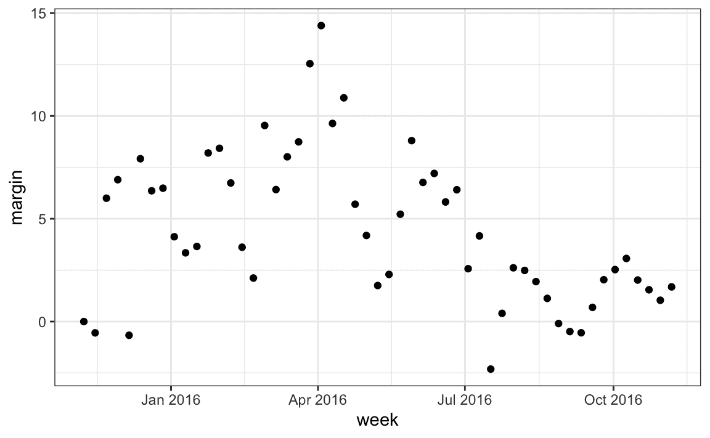

# 第二十五章 解析日期和时间

> 原文：[`rafalab.dfci.harvard.edu/dsbook/parsing-dates-and-times.html`](https://rafalab.dfci.harvard.edu/dsbook/parsing-dates-and-times.html)

## 25.1 日期数据类型

我们已经描述了三种主要的向量类型：数值型、字符型和逻辑型。在数据科学项目中，我们经常遇到日期变量。虽然我们可以用字符串表示日期，例如`2017 年 11 月 2 日`，但一旦我们选择一个参考日，即所谓的*纪元*，它们可以通过计算自纪元以来的天数来转换为数字。计算机语言通常使用 1970 年 1 月 1 日作为纪元。因此，例如，1970 年 1 月 2 日是第 1 天，1969 年 12 月 31 日是第-1 天，2017 年 11 月 2 日是第 17,204 天。

现在我们如何在 R 中分析数据时表示日期和时间呢？我们可以使用自纪元以来的天数，但那样几乎无法解释。如果我告诉你今天是 2017 年 11 月 2 日，你会立刻知道这意味着什么。如果我告诉你今天是第 17,204 天，你可能会感到非常困惑。类似的问题也出现在时间上，甚至由于时区的原因可能会出现更多复杂的情况。

因此，R 定义了一种专门用于日期和时间的数据类型。我们在 polls 数据中看到了一个例子：

```r
library(tidyverse)
library(dslabs)
data("polls_us_election_2016")
polls_us_election_2016$startdate |> head()
#> [1] "2016-11-03" "2016-11-01" "2016-11-02" "2016-11-04" "2016-11-03"
#> [6] "2016-11-03"
```

这些看起来像字符串，但它们不是：

```r
class(polls_us_election_2016$startdate)
#> [1] "Date"
```

看看当我们将它们转换为数字时会发生什么：

```r
as.numeric(polls_us_election_2016$startdate) |> head()
#> [1] 17108 17106 17107 17109 17108 17108
```

它们变成了自纪元以来的天数。`as.Date`函数可以将字符转换为日期。因此，为了看到纪元是第 0 天，我们可以输入

```r
as.Date("1970-01-01") |> as.numeric()
#> [1] 0
```

绘图函数，如 ggplot 中的函数，知道日期格式。这意味着，例如，散点图可以使用数值表示来决定点的位置，但在标签中包含字符串：

```r
polls_us_election_2016 |> filter(pollster == "Ipsos" & state =="U.S.") |>
 ggplot(aes(startdate, rawpoll_trump)) +
 geom_line()
```


特别注意，月份名称被显示出来，这是一个非常方便的功能。

## 25.2 lubridate 包

**tidyverse** 包含通过**lubridate**包处理日期的功能。

```r
library(lubridate)
```

我们将随机抽取一些日期样本来展示一些可以做的有用事情：

```r
set.seed(2002)
dates <- sample(polls_us_election_2016$startdate, 10) |> sort()
dates
#>  [1] "2016-05-31" "2016-08-08" "2016-08-19" "2016-09-22" "2016-09-27"
#>  [6] "2016-10-12" "2016-10-24" "2016-10-26" "2016-10-29" "2016-10-30"
```

`year`、`month`和`day`函数提取这些值：

```r
tibble(date = dates, 
 month = month(dates),
 day = day(dates),
 year = year(dates))
#> # A tibble: 10 × 4
#>   date       month   day  year
#>   <date>     <int> <int> <int>
#> 1 2016-05-31     5    31  2016
#> 2 2016-08-08     8     8  2016
#> 3 2016-08-19     8    19  2016
#> 4 2016-09-22     9    22  2016
#> 5 2016-09-27     9    27  2016
#> # ℹ 5 more rows
```

我们还可以提取月份标签：

```r
month(dates, label = TRUE)
```

```r
#>  [1] May Aug Aug Sep Sep Oct Oct Oct Oct Oct
#> 12 Levels: Jan < Feb < Mar < Apr < May < Jun < Jul < Aug < ... < Dec
```

另一组有用的函数是*解析器*，它们可以将字符串转换为日期。函数`ymd`假设日期格式为 YYYY-MM-DD，并尽可能地进行解析。

```r
x <- c(20090101, "2009-01-02", "2009 01 03", "2009-1-4",
 "2009-1, 5", "Created on 2009 1 6", "200901 !!! 07")
ymd(x)
#> [1] "2009-01-01" "2009-01-02" "2009-01-03" "2009-01-04" "2009-01-05"
#> [6] "2009-01-06" "2009-01-07"
```

另一个复杂之处在于，日期通常以不同的格式出现，其中年、月、日的顺序不同。首选的格式是显示年份（四位数字），然后是月份（两位数字），最后是日期，或者称为 ISO 8601 格式。具体来说，我们使用 YYYY-MM-DD，这样如果对字符串进行排序，它将按日期排序。您可以看到`ymd`函数以这种格式返回它们。

但是，如果你遇到像“09/01/02”这样的日期，这可能是指 2002 年 9 月 1 日、2009 年 1 月 2 日或 2002 年 1 月 9 日。在这些情况下，通过排除法检查整个日期向量将帮助你确定其格式。一旦你知道了，你就可以使用*lubridate*提供的许多解析器。

例如，如果字符串是：

```r
x <- "09/01/02"
```

`ymd`函数假设第一个条目是年份，第二个是月份，第三个是日期，因此它将其转换为：

```r
ymd(x)
#> [1] "2009-01-02"
```

`mdy`函数假设第一个条目是月份，然后是日期，最后是年份：

```r
mdy(x)
#> [1] "2002-09-01"
```

*lubridate*包为每种可能性都提供了一个函数：

```r
ydm(x)
#> [1] "2009-02-01"
myd(x)
#> [1] "2001-09-02"
dmy(x)
#> [1] "2002-01-09"
dym(x)
#> [1] "2001-02-09"
```

*lubridate*包在处理时间方面也非常有用。在 R 基础中，你可以通过输入`Sys.time()`来获取当前时间。*lubridate*包提供了一个稍微高级一点的函数`now`，允许你定义时区：

```r
now()
#> [1] "2023-12-21 12:29:39 EST"
now("GMT")
#> [1] "2023-12-21 17:29:39 GMT"
```

你可以使用`OlsonNames()`函数查看所有可用的时区。

我们还可以提取小时、分钟和秒：

```r
now() |> hour()
#> [1] 12
now() |> minute()
#> [1] 29
now() |> second()
#> [1] 39
```

该包还包括一个将字符串解析为时间以及解析包含日期的时间对象的函数：

```r
x <- c("12:34:56")
hms(x)
#> [1] "12H 34M 56S"
x <- "Nov/2/2012 12:34:56"
mdy_hms(x)
#> [1] "2012-11-02 12:34:56 UTC"
```

此包还有许多其他有用的函数。我们在这里描述了其中两个我们认为特别有用的函数。

`make_date`函数可以用来快速创建日期对象。它接受三个参数：年、月、日、小时、分钟、秒，默认为 UTC 时间的纪元值。因此，要创建代表例如 2019 年 7 月 6 日的日期对象，我们编写：

```r
make_date(2019, 7, 6)
#> [1] "2019-07-06"
```

要为 80 年代的 1 月 1 日创建一个向量，我们编写：

```r
make_date(1980:1989)
#>  [1] "1980-01-01" "1981-01-01" "1982-01-01" "1983-01-01" "1984-01-01"
#>  [6] "1985-01-01" "1986-01-01" "1987-01-01" "1988-01-01" "1989-01-01"
```

另一个非常有用的函数是`round_date`。它可以用来将日期四舍五入到最近的年、季度、月、周、日、小时、分钟或秒。因此，如果我们想按年度周分组所有民意调查，我们可以这样做：

```r
polls_us_election_2016 |> 
 mutate(week = round_date(startdate, "week")) |>
 group_by(week) |>
 summarize(margin = mean(rawpoll_clinton - rawpoll_trump)) |>
 ggplot(aes(week, margin)) +
 geom_point()
```



## 25.3 练习

在前面的练习部分，我们从包含波多黎各人口统计数据的 PDF 文件中整理了数据。我们为 9 月份做了这件事。下面我们包括为所有 12 个月份做这件事的代码。

```r
library(tidyverse)
library(lubridate)
library(purrr)
library(pdftools)
library(dslabs)

fn <- system.file("extdata", "RD-Mortality-Report_2015-18-180531.pdf",
 package="dslabs")
dat <- map_df(str_split(pdf_text(fn), "\n"), function(s){
 s <- str_trim(s)
 header_index <- str_which(s, "2015")[1]
 tmp <- str_split(s[header_index], "\\s+", simplify = TRUE)
 month <- tmp[1]
 header <- tmp[-1]
 tail_index  <- str_which(s, "Total")
 n <- str_count(s, "\\d+")
 out <- c(1:header_index, which(n == 1), 
 which(n >= 28), tail_index:length(s))
 s[-out] |>  str_remove_all("[^\\d\\s]") |> str_trim() |>
 str_split_fixed("\\s+", n = 6) |> .[,1:5] |> as_tibble() |> 
 setNames(c("day", header)) |>
 mutate(month = month, day = as.numeric(day)) |>
 pivot_longer(-c(day, month), names_to = "year", values_to = "deaths") |>
 mutate(deaths = as.numeric(deaths))
}) |>
 mutate(month = recode(month, 
 "JAN" = 1, "FEB" = 2, "MAR" = 3, 
 "APR" = 4, "MAY" = 5, "JUN" = 6, 
 "JUL" = 7, "AGO" = 8, "SEP" = 9, 
 "OCT" = 10, "NOV" = 11, "DEC" = 12)) |>
 mutate(date = make_date(year, month, day)) |>
 filter(date <= "2018-05-01")
```

1. 我们想绘制死亡人数与日期的图表。第一步是将月份变量从字符转换为数字。注意，月份缩写是西班牙语式的。使用`recode`函数将月份转换为数字并重新定义`tab`。

2. 创建一个新的列`date`，包含每个观测值的日期。提示：使用`make_date`函数。

3. 绘制死亡人数与日期的关系图。

4. 注意，2018 年 5 月 31 日之后，死亡人数都是 0。数据可能尚未输入。我们还看到从 5 月 1 日开始的数据下降。重新定义`tab`以排除 2018 年 5 月 1 日或之后的观测值。然后，重新绘制图表。

5. 重新绘制上面的图表，但这次绘制死亡人数与一年中的天数的关系，例如，2016 年 1 月 12 日和 2017 年 1 月 12 日都是第 12 天。使用颜色来表示不同的年份。提示：使用*lubridate*函数`yday`。

6. 重新绘制上述图表，但这次为 2017 年 9 月 20 日之前和之后使用两种不同的颜色。

7. 高级：重新绘制上述图表，但这次在 x 轴上显示月份。提示：为给定年份创建一个包含日期的变量。然后使用`scale_x_date`函数仅显示月份。

8. 重新绘制死亡人数与天数的关系图，但使用每周平均值。提示：使用`round_date`函数。

9. 重新绘制图表，但使用每月平均值。提示：再次使用`round_date`函数。
