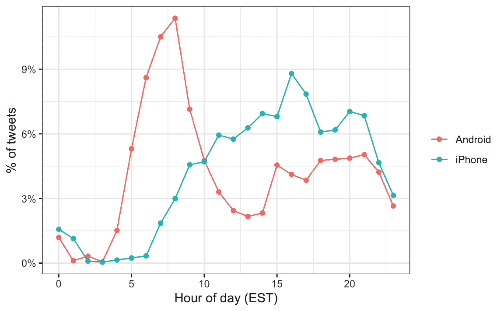
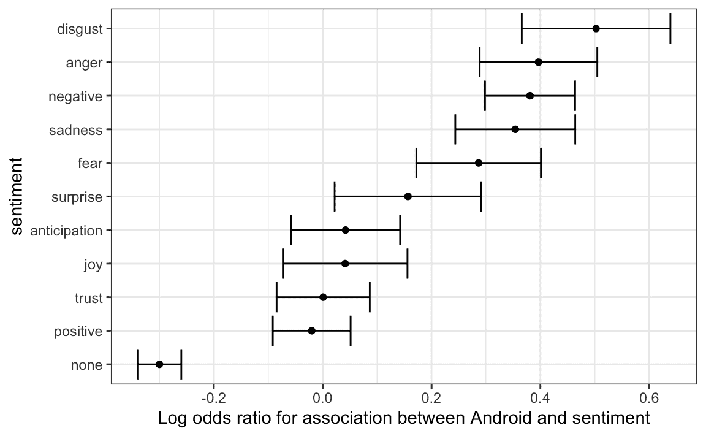
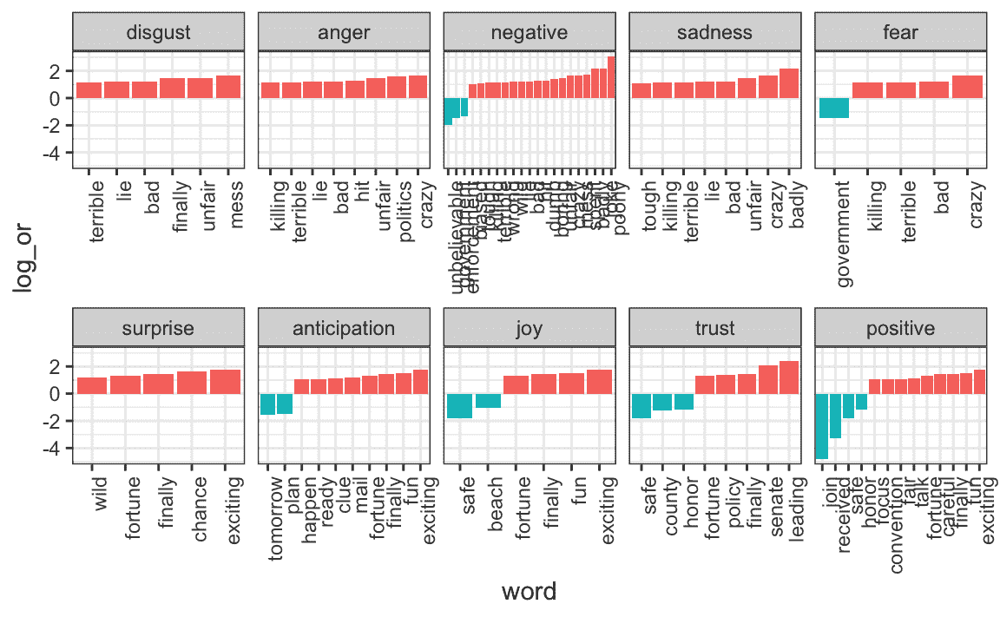

# 第二十六章 文本挖掘

> 原文：[`rafalab.dfci.harvard.edu/dsbook/text-mining.html`](https://rafalab.dfci.harvard.edu/dsbook/text-mining.html)

除了用于表示分类数据的标签外，我们主要关注数值数据。但在许多应用中，数据最初是以文本形式出现的。众所周知的例子包括垃圾邮件过滤、网络犯罪预防、反恐和情感分析。在这些所有情况下，原始数据都是由自由文本组成的。我们的任务是从中提取见解。在本节中，我们学习如何从文本数据中生成有用的数值摘要，然后我们可以应用我们已学到的某些强大的数据可视化和分析技术。

## 26.1 案例研究：特朗普的推文

在 2016 年美国总统选举期间，当时的候选人唐纳德·J·特朗普利用他的推特账号与潜在选民进行沟通。2016 年 8 月 6 日，托德·瓦齐里（Todd Vaziri）关于特朗普发了一条推文⁹⁰，称“每个非夸张的推文都来自 iPhone（他的工作人员）。每个夸张的推文都来自 Android（他本人）。”数据科学家大卫·罗宾逊（David Robinson）进行了一项分析⁹¹，以确定数据是否支持这一说法。在这里，我们回顾大卫的分析，以了解文本挖掘的一些基础知识。要了解更多关于 R 中的文本挖掘，我们推荐茱莉亚·西尔吉（Julia Silge）和大卫·罗宾逊（David Robinson）合著的《Text Mining with R》一书⁹²。

我们将使用以下库：

```r
library(tidyverse)
library(lubridate)
library(scales)
```

通常，我们可以使用**rtweet**包直接从 Twitter 中提取数据。然而，在这种情况下，一个小组已经为我们编译了数据，并在[`www.trumptwitterarchive.com`](http://www.trumptwitterarchive.com)上提供。我们可以使用如下脚本从他们的 JSON API 中获取数据：

```r
url <- 'http://www.trumptwitterarchive.com/data/realdonaldtrump/%s.json'
trump_tweets <- map(2009:2017, ~sprintf(url, .x)) |>
 map_df(jsonlite::fromJSON, simplifyDataFrame = TRUE) |>
 filter(!is_retweet & !str_detect(text, '^"')) |>
 mutate(created_at = parse_date_time(created_at, 
 orders = "a b! d! H!:M!:S! z!* Y!",
 tz="EST")) 
```

为了方便，我们将上述代码的结果包含在**dslabs**包中：

```r
library(dslabs)
data("trump_tweets")
```

您可以通过输入以下命令来查看有关推文的信息：

```r
head(trump_tweets)
```

包含以下变量：

```r
names(trump_tweets)
#> [1] "source"                  "id_str" 
#> [3] "text"                    "created_at" 
#> [5] "retweet_count"           "in_reply_to_user_id_str"
#> [7] "favorite_count"          "is_retweet"
```

帮助文件`?trump_tweets`提供了每个变量代表的详细信息。推文由`text`变量表示：

```r
trump_tweets$text[16413] |> str_wrap(width = options()$width) |> cat()
#> Great to be back in Iowa! #TBT with @JerryJrFalwell joining me in
#> Davenport- this past winter. #MAGA https://t.co/A5IF0QHnic
```

以及源变量告诉我们每个推文是用哪个设备编写和上传的：

```r
trump_tweets |> count(source) |> arrange(desc(n)) |> head(5)
#>                source     n
#> 1  Twitter Web Client 10718
#> 2 Twitter for Android  4652
#> 3  Twitter for iPhone  3962
#> 4           TweetDeck   468
#> 5     TwitLonger Beta   288
```

我们对竞选期间发生的事情感兴趣，因此在这个分析中，我们将关注特朗普宣布竞选到选举日之间的推文。我们定义以下表格，仅包含该时间段内的推文。请注意，我们使用`extract`来删除源中的`Twitter for`部分，并过滤掉转发推文。

```r
campaign_tweets <- trump_tweets |> 
 extract(source, "source", "Twitter for (.*)") |>
 filter(source %in% c("Android", "iPhone") &
 created_at >= ymd("2015-06-17") & 
 created_at < ymd("2016-11-08")) |>
 filter(!is_retweet) |>
 arrange(created_at) |> 
 as_tibble()
```

现在，我们可以使用数据可视化来探索两个不同的群体是否可能使用这些设备进行推文。对于每条推文，我们将提取推文的时辰，东部时间（EST），然后计算每个设备在每个时辰推文的占比：

```r
campaign_tweets |>
 mutate(hour = hour(with_tz(created_at, "EST"))) |>
 count(source, hour) |>
 group_by(source) |>
 mutate(percent = n / sum(n)) |>
 ungroup() |>
 ggplot(aes(hour, percent, color = source)) +
 geom_line() +
 geom_point() +
 scale_y_continuous(labels = percent_format()) +
 labs(x = "Hour of day (EST)", y = "% of tweets", color = "")
```



我们注意到，在早上 6 点到 8 点之间，安卓的峰值很大。这些模式似乎存在明显差异。因此，我们将假设两个不同的实体正在使用这两个设备。

我们现在将研究当我们比较安卓和 iPhone 时，推文有何不同。为此，我们引入了**tidytext**包。

## 26.2 文本作为数据

**tidytext**包帮助我们将自由文本转换为整洁的表格。以这种格式拥有数据极大地促进了数据可视化和统计技术的应用。

```r
library(tidytext)
```

实现这一目标所需的主要功能是`unnest_tokens`。*token*指的是我们考虑作为数据点的单元。最常见的*token*将是单词，但它们也可以是单个字符、ngrams、句子、行或由正则表达式定义的模式。这些函数将接受一个字符串向量并提取 token，以便每个 token 在新表中都有一行。以下是一个简单的例子：

```r
poem <- c("Roses are red,", "Violets are blue,", 
 "Sugar is sweet,", "And so are you.")
example <- tibble(line = c(1, 2, 3, 4),
 text = poem)
example
#> # A tibble: 4 × 2
#>    line text 
#>   <dbl> <chr> 
#> 1     1 Roses are red, 
#> 2     2 Violets are blue,
#> 3     3 Sugar is sweet, 
#> 4     4 And so are you.
example |> unnest_tokens(word, text)
#> # A tibble: 13 × 2
#>    line word 
#>   <dbl> <chr> 
#> 1     1 roses 
#> 2     1 are 
#> 3     1 red 
#> 4     2 violets
#> 5     2 are 
#> # ℹ 8 more rows
```

现在让我们看看推文中的一个例子。我们将查看推文编号 3008，因为它将允许我们说明几个要点：

```r
i <- 3008
campaign_tweets$text[i] |> str_wrap(width = 65) |> cat()
#> Great to be back in Iowa! #TBT with @JerryJrFalwell joining me in
#> Davenport- this past winter. #MAGA https://t.co/A5IF0QHnic
campaign_tweets[i,] |> 
 unnest_tokens(word, text) |>
 pull(word) 
#>  [1] "great"          "to"             "be"             "back" 
#>  [5] "in"             "iowa"           "tbt"            "with" 
#>  [9] "jerryjrfalwell" "joining"        "me"             "in" 
#> [13] "davenport"      "this"           "past"           "winter" 
#> [17] "maga"           "https"          "t.co"           "a5if0qhnic"
```

注意，该函数试图将 token 转换为单词。一个小的调整是移除图片链接：

```r
links <- "https://t.co/[A-Za-z\\d]+|&amp;"
campaign_tweets[i,] |> 
 mutate(text = str_replace_all(text, links, ""))  |>
 unnest_tokens(word, text) |>
 pull(word)
#>  [1] "great"          "to"             "be"             "back" 
#>  [5] "in"             "iowa"           "tbt"            "with" 
#>  [9] "jerryjrfalwell" "joining"        "me"             "in" 
#> [13] "davenport"      "this"           "past"           "winter" 
#> [17] "maga"
```

现在我们已经准备好提取所有推文的单词。

```r
tweet_words <- campaign_tweets |> 
 mutate(text = str_replace_all(text, links, ""))  |>
 unnest_tokens(word, text)
```

现在，我们可以回答诸如“最常用的单词是什么？”等问题：

```r
tweet_words |> 
 count(word) |>
 arrange(desc(n))
#> # A tibble: 6,264 × 2
#>   word      n
#>   <chr> <int>
#> 1 the    2330
#> 2 to     1413
#> 3 and    1245
#> 4 in     1190
#> 5 i      1151
#> # ℹ 6,259 more rows
```

这些是顶级单词并不令人惊讶。顶级单词并不具有信息性。*tidytext*包有一个常用单词的数据库，称为*停用词*，用于文本挖掘：

```r
stop_words
#> # A tibble: 1,149 × 2
#>   word  lexicon
#>   <chr> <chr> 
#> 1 a     SMART 
#> 2 a's   SMART 
#> 3 able  SMART 
#> 4 about SMART 
#> 5 above SMART 
#> # ℹ 1,144 more rows
```

如果我们使用`filter(!word %in% stop_words$word)`过滤掉表示停用词的行：

```r
tweet_words <- campaign_tweets |> 
 mutate(text = str_replace_all(text, links, ""))  |>
 unnest_tokens(word, text) |>
 filter(!word %in% stop_words$word ) 
```

我们最终得到一组更丰富的推文前 10 位常用单词：

```r
tweet_words |> 
 count(word) |>
 top_n(10, n) |>
 mutate(word = reorder(word, n)) |>
 arrange(desc(n))
#> # A tibble: 10 × 2
#>   word                      n
#>   <fct>                 <int>
#> 1 trump2016               415
#> 2 hillary                 407
#> 3 people                  304
#> 4 makeamericagreatagain   298
#> 5 america                 255
#> # ℹ 5 more rows
```

对生成的单词进行一些探索（此处未显示）揭示了我们的 token 中存在一些不受欢迎的特性。首先，我们的一些 token 只是数字（例如年份）。我们希望删除这些，我们可以使用正则表达式`^\d+$`找到它们。其次，我们的一些 token 来自引号，并以`'`开头。我们希望在单词开头时删除`'`，所以我们只需使用`str_replace`。我们将这两行代码添加到上面的代码中，以生成我们的最终表格：

```r
tweet_words <- campaign_tweets |> 
 mutate(text = str_replace_all(text, links, ""))  |>
 unnest_tokens(word, text) |>
 filter(!word %in% stop_words$word &
 !str_detect(word, "^\\d+$")) |>
 mutate(word = str_replace(word, "^'", ""))
```

现在我们已经将所有单词放入表中，并附带有关用于撰写推文的设备的信息，我们可以开始探索在比较安卓和 iPhone 时哪些单词更常见。

对于每个单词，我们想知道它更有可能来自安卓推文还是 iPhone 推文。优势比是用于量化这些差异的汇总统计量。对于每个设备和给定的单词，我们可以将其称为`y`，我们计算`y`和不是`y`的单词比例之间的比率，并计算这些比率的比率。在这里，我们将有许多比例为 0 的比例，因此我们使用 0.5 校正。你可以在统计学或流行病学教科书中了解更多关于优势比的信息。

```r
android_iphone_or <- tweet_words |>
 count(word, source) |>
 pivot_wider(names_from = "source", values_from = "n", values_fill = 0) |>
 mutate(or = (Android + 0.5) / (sum(Android) - Android + 0.5) / 
 ( (iPhone + 0.5) / (sum(iPhone) - iPhone + 0.5)))
```

这里是安卓的最高优势比

```r
android_iphone_or |> arrange(desc(or))
#> # A tibble: 5,607 × 4
#>   word  Android iPhone    or
#>   <chr>   <int>  <int> <dbl>
#> 1 a.m        65      0 113\. 
#> 2 p.m        39      0  68.0
#> 3 mails      22      0  38.7
#> 4 poor       13      0  23.2
#> 5 t.v        13      0  23.2
#> # ℹ 5,602 more rows
```

以及 iPhone 的前十名：

```r
android_iphone_or |> arrange(or)
#> # A tibble: 5,607 × 4
#>   word                  Android iPhone      or
#>   <chr>                   <int>  <int>   <dbl>
#> 1 makeamericagreatagain       0    298 0.00141
#> 2 americafirst                0     71 0.00598
#> 3 draintheswamp               0     63 0.00673
#> 4 trump2016                   3    412 0.00707
#> 5 votetrump                   0     56 0.00757
#> # ℹ 5,602 more rows
```

由于这些单词中有几个是整体低频词，我们可以根据总频率设置一个过滤器，如下所示：

```r
android_iphone_or |> filter(Android+iPhone > 100) |>
 arrange(desc(or))
#> # A tibble: 30 × 4
#>   word        Android iPhone    or
#>   <chr>         <int>  <int> <dbl>
#> 1 bad             104     26  3.40
#> 2 crooked         156     49  2.73
#> 3 cnn             116     37  2.68
#> 4 ted              86     28  2.62
#> 5 interviewed      76     25  2.59
#> # ℹ 25 more rows

android_iphone_or |> filter(Android+iPhone > 100) |>
 arrange(or)
#> # A tibble: 30 × 4
#>   word                  Android iPhone      or
#>   <chr>                   <int>  <int>   <dbl>
#> 1 makeamericagreatagain       0    298 0.00141
#> 2 trump2016                   3    412 0.00707
#> 3 join                        1    157 0.00809
#> 4 tomorrow                   24    101 0.206 
#> 5 vote                       46     67 0.591 
#> # ℹ 25 more rows
```

我们已经看到，从一种设备比另一种设备更多地推特的单词类型中，存在某种模式。然而，我们感兴趣的并不是具体的单词，而是语气。Vaziri 的断言是，Android 的推文更加夸张。那么我们如何用数据来检查这一点呢？*夸张*是一种难以从单词中提取的情感，因为它依赖于对短语的解释。然而，单词可以与更基本情感相关联，如愤怒、恐惧、喜悦和惊讶。在下一节中，我们将展示基本情感分析。

## 26.3 情感分析

在情感分析中，我们将一个词分配给一个或多个“情感”。尽管这种方法会错过依赖于上下文的变化的情感，如讽刺，但在处理大量单词时，总结可以提供洞察。

情感分析的第一步是为每个单词分配一个情感。正如我们所展示的，**tidytext**包包括几个映射或词典。我们还将使用**textdata**包。

```r
library(tidytext)
library(textdata)
```

`bing`词典将单词分为`积极`和`消极`情感。我们可以使用*tidytext*函数`get_sentiments`来查看这一点：

```r
get_sentiments("bing")
```

`AFINN`词典将分数分配在-5 到 5 之间，其中-5 表示最消极，5 表示最积极。请注意，此词典在第一次调用`get_sentiment`函数时需要下载：

```r
get_sentiments("afinn")
```

`loughran`和`nrc`词典提供了几种不同的情感。请注意，这些在第一次使用时也需要下载。

```r
get_sentiments("loughran") |> count(sentiment)
#> # A tibble: 6 × 2
#>   sentiment        n
#>   <chr>        <int>
#> 1 constraining   184
#> 2 litigious      904
#> 3 negative      2355
#> 4 positive       354
#> 5 superfluous     56
#> # ℹ 1 more row
```

```r
get_sentiments("nrc") |> count(sentiment)
#> # A tibble: 10 × 2
#>   sentiment        n
#>   <chr>        <int>
#> 1 anger         1245
#> 2 anticipation   837
#> 3 disgust       1056
#> 4 fear          1474
#> 5 joy            687
#> # ℹ 5 more rows
```

对于我们的分析，我们感兴趣的是探索每条推文的不同情感，因此我们将使用`nrc`词典：

```r
nrc <- get_sentiments("nrc") |>
 select(word, sentiment)
```

我们可以使用`inner_join`将单词和情感结合起来，这将只保留与情感相关的单词。以下是来自推文的 10 个随机单词：

```r
tweet_words |> inner_join(nrc, by = "word", relationship = "many-to-many") |> 
 select(source, word, sentiment) |> 
 sample_n(5)
#> # A tibble: 5 × 3
#>   source  word     sentiment 
#>   <chr>   <chr>    <chr> 
#> 1 Android enjoy    joy 
#> 2 iPhone  terrific sadness 
#> 3 iPhone  tactics  trust 
#> 4 Android clue     anticipation
#> 5 iPhone  change   fear
```

现在我们准备通过比较从每个设备发布的推文的情感来进行 Android 和 iPhone 的定量分析。在这里，我们可以进行逐条推文的分析，为每条推文分配一个情感。然而，这将具有挑战性，因为每条推文都将附有多个情感，每个情感对应于词典中出现的每个单词。为了说明目的，我们将进行一个更简单的分析：我们将计算并比较每个设备中出现的每种情感的频率。

```r
sentiment_counts <- tweet_words |>
 left_join(nrc, by = "word", relationship = "many-to-many") |>
 count(source, sentiment) |>
 pivot_wider(names_from = "source", values_from = "n") |>
 mutate(sentiment = replace_na(sentiment, replace = "none"))
sentiment_counts
#> # A tibble: 11 × 3
#>   sentiment    Android iPhone
#>   <chr>          <int>  <int>
#> 1 anger            962    527
#> 2 anticipation     917    707
#> 3 disgust          639    314
#> 4 fear             799    486
#> 5 joy              695    536
#> # ℹ 6 more rows
```

对于每种情感，我们可以计算其在设备中的概率：具有情感的单词比例与没有情感的单词比例，然后计算两个设备之间的优势比。

```r
sentiment_counts |>
 mutate(Android = Android / (sum(Android) - Android) , 
 iPhone = iPhone / (sum(iPhone) - iPhone), 
 or = Android/iPhone) |>
 arrange(desc(or))
#> # A tibble: 11 × 4
#>   sentiment Android iPhone    or
#>   <chr>       <dbl>  <dbl> <dbl>
#> 1 disgust    0.0299 0.0181  1.65
#> 2 anger      0.0457 0.0307  1.49
#> 3 negative   0.0814 0.0556  1.46
#> 4 sadness    0.0427 0.0300  1.42
#> 5 fear       0.0377 0.0283  1.33
#> # ℹ 6 more rows
```

因此，我们确实看到了一些差异，并且顺序很有趣：最大的三种情感是厌恶、愤怒和负面！但这些差异仅仅是由于偶然吗？如果我们只是随机分配情感，这会是什么样的比较？为了回答这个问题，我们可以为每种情感计算一个优势比和置信区间。我们将添加形成二维表的两个值和优势比：

```r
library(broom)
log_or <- sentiment_counts |>
 mutate(log_or = log((Android / (sum(Android) - Android)) / 
 (iPhone / (sum(iPhone) - iPhone))),
 se = sqrt(1/Android + 1/(sum(Android) - Android) + 
 1/iPhone + 1/(sum(iPhone) - iPhone)),
 conf.low = log_or - qnorm(0.975)*se,
 conf.high = log_or + qnorm(0.975)*se) |>
 arrange(desc(log_or))

log_or
#> # A tibble: 11 × 7
#>   sentiment Android iPhone log_or     se conf.low conf.high
#>   <chr>       <int>  <int>  <dbl>  <dbl>    <dbl>     <dbl>
#> 1 disgust       639    314  0.502 0.0697    0.366     0.639
#> 2 anger         962    527  0.397 0.0552    0.288     0.505
#> 3 negative     1657    931  0.381 0.0423    0.298     0.464
#> 4 sadness       901    514  0.354 0.0562    0.244     0.464
#> 5 fear          799    486  0.287 0.0584    0.172     0.401
#> # ℹ 6 more rows
```

图形可视化显示了一些明显过度表示的情感：

```r
log_or |>
 mutate(sentiment = reorder(sentiment, log_or)) |>
 ggplot(aes(x = sentiment, ymin = conf.low, ymax = conf.high)) +
 geom_errorbar() +
 geom_point(aes(sentiment, log_or)) +
 ylab("Log odds ratio for association between Android and sentiment") +
 coord_flip() 
```



我们看到，厌恶、愤怒、负面、悲伤和恐惧情感与 Android 的关联难以仅用偶然来解释。与原始关于夸张推文的声明一致，与情感不相关的单词与 iPhone 源有很强的关联。

如果我们想探索是哪些具体的单词导致了这些差异，我们可以参考我们的`android_iphone_or`对象：

```r
android_iphone_or |> inner_join(nrc) |>
 filter(sentiment == "disgust" & Android + iPhone > 10) |>
 arrange(desc(or))
#> Joining with `by = join_by(word)`
#> # A tibble: 20 × 5
#>   word    Android iPhone    or sentiment
#>   <chr>     <int>  <int> <dbl> <chr> 
#> 1 mess         15      2  5.33 disgust 
#> 2 finally      12      2  4.30 disgust 
#> 3 unfair       12      2  4.30 disgust 
#> 4 bad         104     26  3.40 disgust 
#> 5 lie          13      3  3.32 disgust 
#> # ℹ 15 more rows
```

然后，我们可以绘制一个图表：

```r
android_iphone_or |> inner_join(nrc, by = "word") |>
 mutate(sentiment = factor(sentiment, levels = log_or$sentiment)) |>
 mutate(log_or = log(or)) |>
 filter(Android + iPhone > 10 & abs(log_or)>1) |>
 mutate(word = reorder(word, log_or)) |>
 ggplot(aes(word, log_or, fill = log_or < 0)) +
 facet_wrap(~sentiment, scales = "free_x", nrow = 2) + 
 geom_bar(stat="identity", show.legend = FALSE) +
 theme(axis.text.x = element_text(angle = 90, hjust = 1)) 
```



这只是使用 tidytext 可以执行的多项分析中的一个简单例子。要了解更多信息，我们再次推荐 Tidy Text Mining 书籍⁹³。

## 26.4 练习

Project Gutenberg 是公共领域书籍的数字档案。R 包 **gutenbergr** 便于将这些文本导入 R。

您可以通过输入以下命令进行安装和加载：

```r
install.packages("gutenbergr")
library(gutenbergr)
```

您可以看到可用的书籍如下：

```r
gutenberg_metadata
```

1. 使用 `str_detect` 查找小说《傲慢与偏见》的 ID。

2. 我们注意到有几个版本。`gutenberg_works()` 函数过滤这个表以删除重复项并仅包括英语作品。阅读帮助文件并使用此函数查找《傲慢与偏见》的 ID。

3. 使用 `gutenberg_download` 函数下载《傲慢与偏见》的文本。将其保存到名为 `book` 的对象中。

4. 使用 **tidytext** 包创建一个包含文本中所有单词的整洁表。将表保存到名为 `words` 的对象中

5. 我们将在稍后绘制情感与书中位置的关系图。为此，向表中添加一个包含单词数量的列将很有用。

6. 从 `words` 对象中删除停用词和数字。提示：使用 `anti_join`。

7. 现在使用 `AFINN` 词典为每个单词分配情感值。

8. 绘制情感得分与书中位置的关系图，并添加一个平滑器。

9. 假设有每页 300 个单词。将位置转换为页码，然后计算每页的平均情感。绘制按页的平均得分。添加一个看起来穿过数据的平滑器。

* * *

1.  [`twitter.com/tvaziri/status/762005541388378112/photo/1`](https://twitter.com/tvaziri/status/762005541388378112/photo/1)↩︎

1.  [`varianceexplained.org/r/trump-tweets/`](http://varianceexplained.org/r/trump-tweets/)↩︎

1.  [`www.tidytextmining.com/`](https://www.tidytextmining.com/)↩︎

1.  [`www.tidytextmining.com/`](https://www.tidytextmining.com/)↩︎
