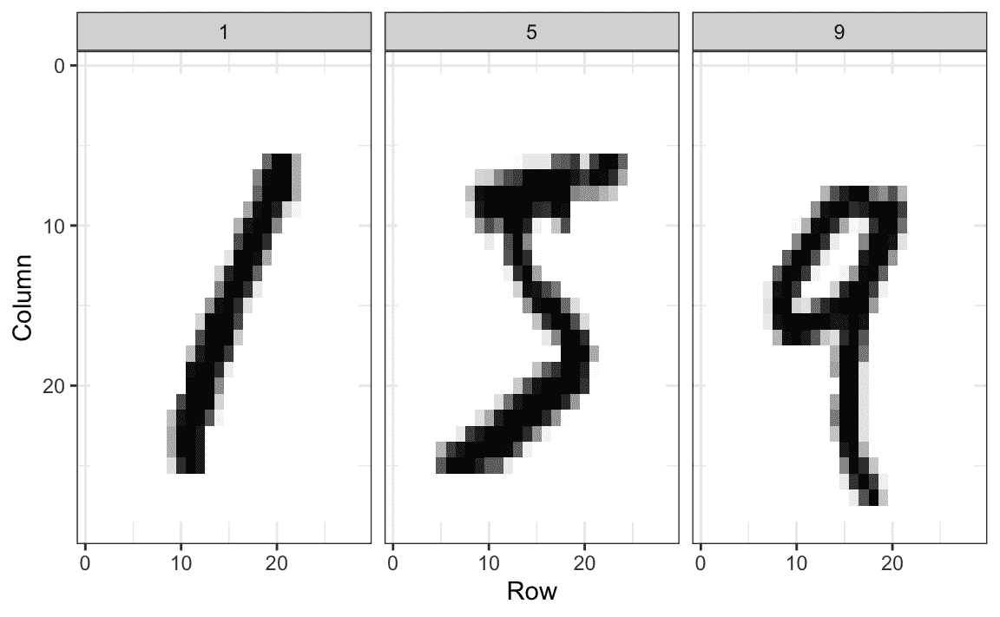
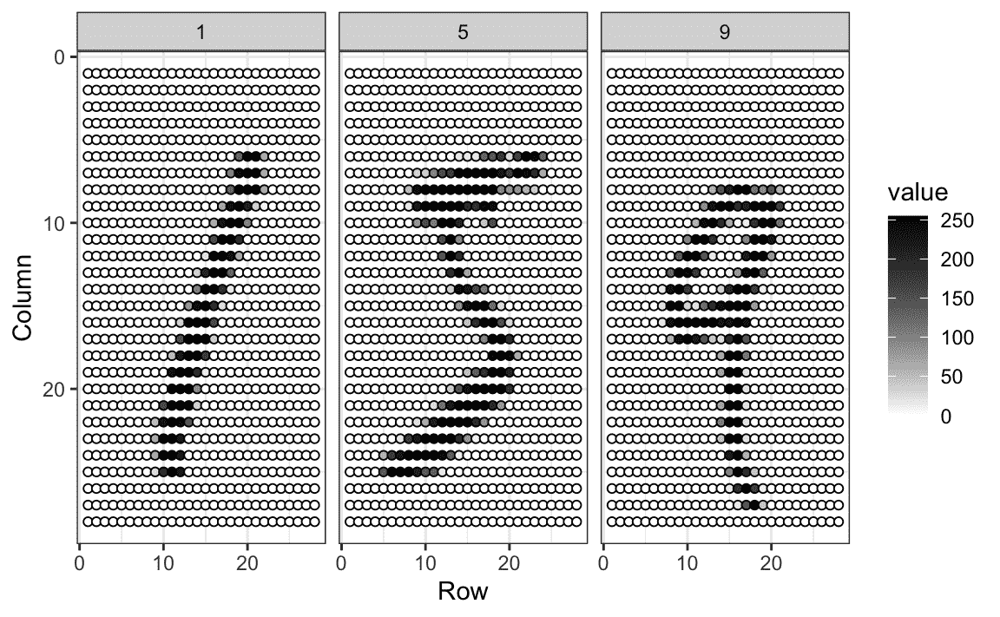
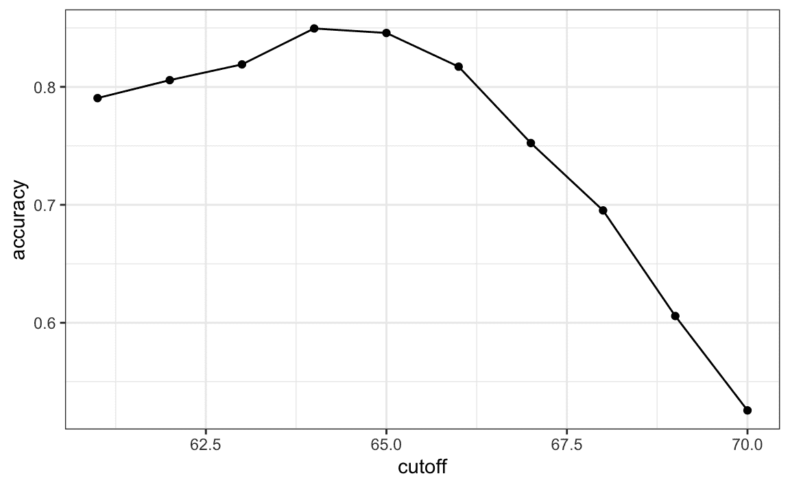
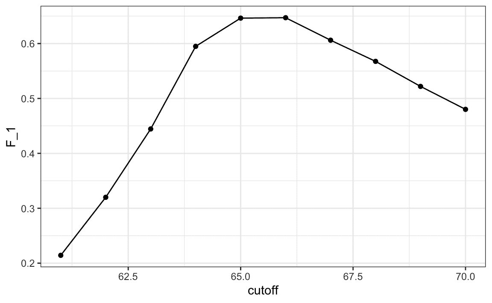
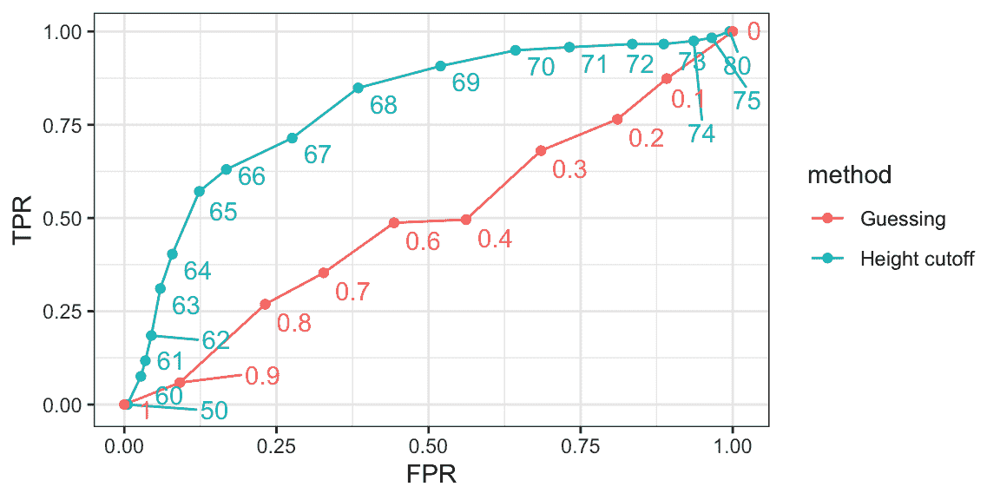
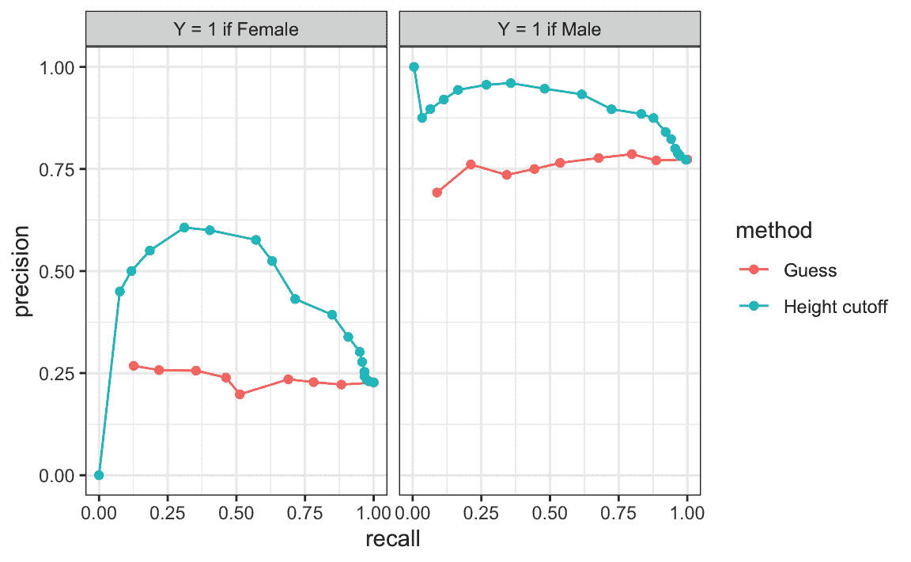
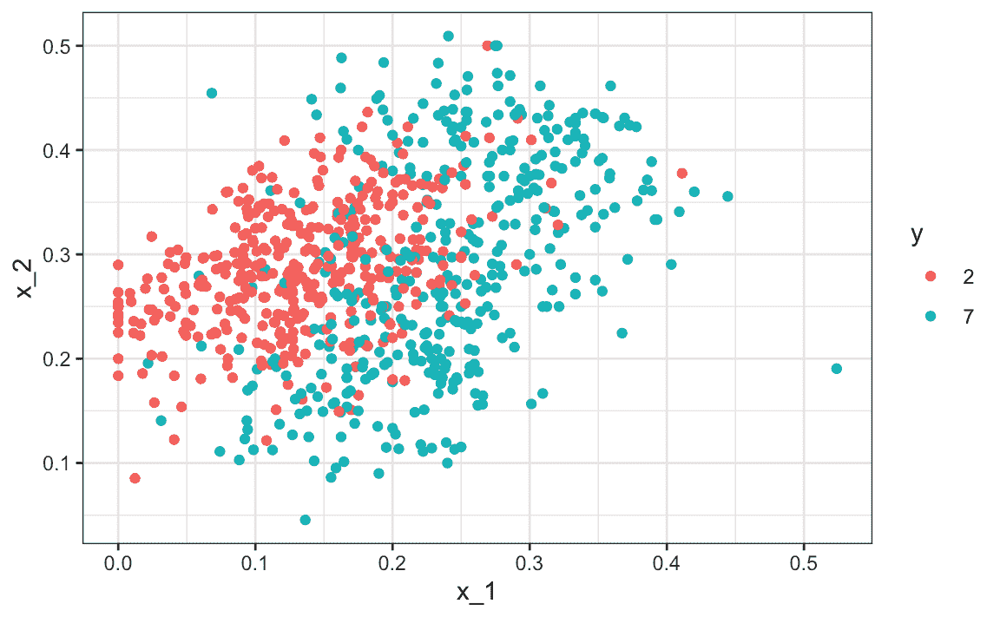
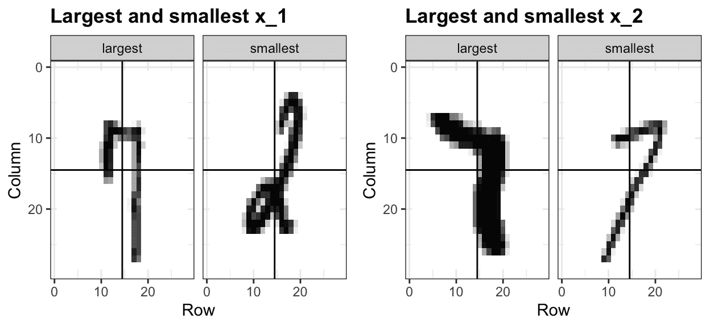
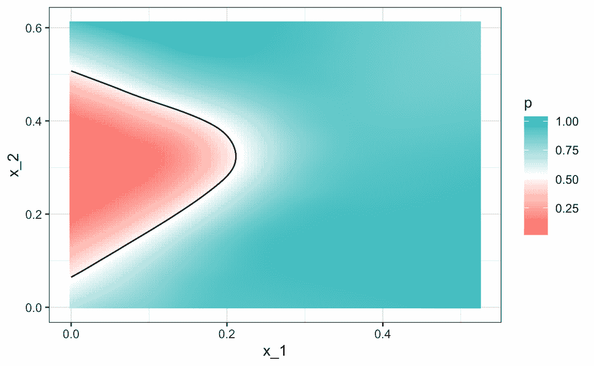
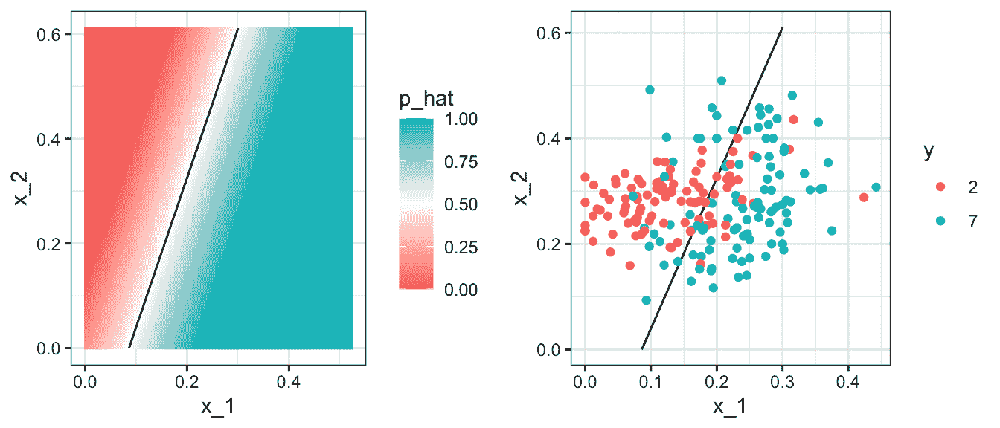

# 第二十七章 机器学习简介

> 原文：[`rafalab.dfci.harvard.edu/dsbook/introduction-to-machine-learning.html`](https://rafalab.dfci.harvard.edu/dsbook/introduction-to-machine-learning.html)

可能最流行的数据科学方法来自**机器学习**领域。机器学习的成功案例包括邮政服务实现的印刷体邮政编码读取器，苹果的 Siri 语音识别技术，电影推荐系统，垃圾邮件和恶意软件检测器，房价预测器和自动驾驶汽车。尽管今天人工智能和机器学习经常被互换使用，但我们做出以下区分：虽然最初的人工智能算法，如用于下棋机器的算法，基于从理论或第一性原理推导出的可编程规则实现的决策，但在机器学习中，决策是基于**用数据构建**的算法。

## 27.1 符号表示

在机器学习中，数据以以下形式出现：

1.  我们想要预测的**结果**

1.  我们将使用的**特征**来预测结果

我们希望构建一个算法，该算法以特征值作为输入，并在我们不知道结果时返回对结果的预测。机器学习方法是通过使用我们知道结果的数据集来**训练**算法，然后在未来应用此算法来预测我们不知道结果的情况。

在这里，我们将使用 \(Y\) 来表示结果，\(X_1, \dots, X_p\) 来表示特征。请注意，特征有时被称为预测器或协变量。我们把这些都视为同义词。

预测问题可以分为分类和连续结果。对于分类结果，\(Y\) 可以是 \(K\) 个类别中的任何一个。类别的数量在应用中可能会有很大差异。例如，在数字读取数据中，\(K=10\)，类别是数字 0, 1, 2, 3, 4, 5, 6, 7, 8, 和 9。在语音识别中，结果是所有可能的单词或短语，我们试图检测。垃圾邮件检测有两个结果：垃圾邮件或非垃圾邮件。在这本书中，我们用索引 \(k=1,\dots,K\) 表示 \(K\) 个类别。然而，对于二元数据，我们将使用 \(k=0,1\)，以方便我们稍后展示的数学运算。

一般设置如下。我们有一系列特征和一个我们想要预测的未知结果：

| outcome | feature 1 | feature 2 | feature 3 | feature 4 | feature 5 |
| --- | --- | --- | --- | --- | --- |
| ? | \(X_1\) | \(X_2\) | \(X_3\) | \(X_4\) | \(X_5\) |

为了**构建一个模型**，该模型可以对任何一组观察到的值（\(X_1=x_1, X_2=x_2, \dots X_5=x_5\)）进行预测，我们收集那些我们知道结果的数据：

| outcome | feature 1 | feature 2 | feature 3 | feature 4 | feature 5 |
| --- | --- | --- | --- | --- | --- |
| \(y_{1}\) | \(x_{1,1}\) | \(x_{1,2}\) | \(x_{1,3}\) | \(x_{1,4}\) | \(x_{1,5}\) |
| \(y_{2}\) | \(x_{2,1}\) | \(x_{2,2}\) | \(x_{2,3}\) | \(x_{2,4}\) | \(x_{2,5}\) |
| \(\vdots\) | \(\vdots\) | \(\vdots\) | \(\vdots\) | \(\vdots\) | \(\vdots\) |
| \(y_n\) | \(x_{n,1}\) | \(x_{n,2}\) | \(x_{n,3}\) | \(x_{n,4}\) | \(x_{n,5}\) |

当输出是连续的时，我们将机器学习任务称为*预测*，模型的主要输出是一个函数 \(f\)，它可以自动为任何一组预测变量生成预测，表示为 \(\hat{y}\)：\(\hat{y} = f(x_1, x_2, \dots, x_p)\)。我们使用术语*实际结果*来表示我们最终观察到的结果。因此，我们希望预测 \(\hat{y}\) 尽可能地匹配实际结果 \(y\)。因为我们的结果是连续的，我们的预测 \(\hat{y}\) 不会完全正确或错误，而是我们将确定一个*误差*，定义为预测与实际结果 \(y - \hat{y}\) 之间的差异。

当结果为分类时，我们将机器学习任务称为*分类*，模型的主要输出将是一个*决策规则*，它规定了我们应该预测哪个 \(K\) 类。在这种情况下，大多数模型为每个类 \(k\) 提供了预测函数 \(f_k(x_1, x_2, \dots, x_p)\)，用于做出这个决定。当数据是二进制时，典型的决策规则如下：如果 \(f_1(x_1, x_2, \dots, x_p) > C\)，则预测类别 1，否则预测其他类别，其中 \(C\) 是一个预定的截止值。因为结果是分类的，我们的预测要么正确要么错误。

注意，这些术语在不同的课程、教科书和其他出版物中有所不同。通常，*预测*一词用于分类和连续结果，而*回归*一词可以用于连续情况。在这里，我们避免使用*回归*，以避免与之前对术语*线性回归*的使用混淆。在大多数情况下，我们的结果是否为分类或连续的将很清楚，因此我们将在可能的情况下避免使用这些术语。

## 27.2 一个例子

让我们考虑邮编阅读器的例子。在邮局处理收到的邮件的第一步是按照邮编对信件进行分类：


最初，人类必须手动对这些信件进行分类。为此，他们必须阅读每封信上的邮编。如今，多亏了机器学习算法，电脑可以读取邮编，然后机器人对这些信件进行分类。在本部分书中，我们将学习如何构建能够读取数字的算法。

构建算法的第一步是理解结果和特征。以下是三个手写数字的图像。这些数字已经被人类阅读并分配了一个结果 \(Y\)。这些被认为是已知的，并作为训练集。



这些图像被转换为\(28 \times 28 = 784\)像素，并且对于每个像素，我们获得一个介于 0（白色）和 255（黑色）之间的灰度强度，我们目前将其视为连续的。以下图表显示了每个图像的单独特征：



对于每个数字化的图像\(i\)，我们有一个分类结果\(Y_i\)，它可以取 10 个值中的任何一个（\(0,1,2,3,4,5,6,7,8,9\)），以及特征\(X_{i,1}, \dots, X_{i,784}\)。我们使用粗体\(\mathbf{X}_i = (X_{i,1}, \dots, X_{i,784})\)来区分预测因子的向量与单个预测因子。当我们提到数据集中的任意一组特征而不是特定图像时，我们省略索引\(i\)，并使用\(Y\)和\(\mathbf{X} = (X_{1}, \dots, X_{784})\)。我们使用大写变量，因为通常我们将预测因子视为随机变量。我们使用小写，例如\(\mathbf{X} = \mathbf{x}\)，来表示观察到的值。当我们编码时，我们坚持使用小写。

机器学习任务是构建一个算法，该算法可以对特征的任何可能值进行预测。在这里，我们将学习构建这些算法的几种方法。尽管到目前为止这可能看起来不可能实现，但我们将从简单的例子开始，逐步积累知识，直到我们能够应对更复杂的例子。事实上，我们从一个只有一个预测因子的人为简单例子开始，然后转向一个稍微更现实的例子，有两个预测因子。一旦我们理解了这些，我们将应对涉及许多预测因子的现实世界机器学习挑战。

## 27.3 练习

1. 对于以下每个，确定结果是否为连续或分类：

1.  数字阅读器

1.  电影推荐

1.  垃圾邮件过滤器

1.  医院住院

1.  Siri（语音识别）

2. 在数字数据集中，我们有多少个特征可用于预测？

3. 在数字阅读器示例中，结果存储在这里：

```r
library(dslabs)
mnist <- read_mnist()
y <- mnist$train$labels
```

这些操作有实际意义吗？

```r
y[5] + y[6]
y[5] > y[6]
```

选择最佳答案：

1.  是的，因为\(9 + 2 = 11\)且\(9 > 2\)。

1.  不，因为`y`不是一个数值向量。

1.  不，因为 11 不是一个数字。它是两个数字。

1.  不，因为这些是表示类别而不是数字的标签。一个`9`代表一个类别，而不是数字 9。

## 27.4 评估指标

在我们开始描述优化算法构建方式的方法之前，我们首先需要定义当我们说一种方法比另一种方法更好时，我们指的是什么。在本节中，我们专注于描述评估机器学习算法的方式。具体来说，我们需要量化我们所说的“更好”的含义。

对于我们对机器学习概念的第一次介绍，我们将从一个无聊且简单的例子开始：如何使用身高预测性别。随着我们逐步解释机器学习，这个例子将帮助我们奠定第一个基础。不久，我们将面对更有趣的挑战。我们使用**caret**包，它包含几个用于构建和评估机器学习方法的实用函数，我们将在第三十部分中详细介绍。

```r
library(tidyverse)
library(caret)
```

对于第一个例子，我们使用 dslabs 中的身高数据：

```r
library(dslabs)
data(heights)
```

我们首先定义结果和预测因子。

```r
y <- heights$sex
x <- heights$height
```

在这种情况下，我们只有一个预测因子，即身高，而`y`显然是一个分类结果，因为观察到的值要么是`Male`要么是`Female`。我们知道，基于`X`我们无法非常准确地预测\(Y\)，因为男性和女性的平均身高相对于组内变异性并不那么不同。但我们能否做得比猜测更好？为了回答这个问题，我们需要一个更好的量化定义。

### 27.4.1 训练集和测试集

最终，机器学习算法的评估标准是它在现实世界中使用全新的数据集时的表现。然而，在开发算法时，我们通常有一个已知结果的数据集，就像我们对身高那样：我们知道数据集中每个学生的性别。因此，为了模拟最终的评估过程，我们通常将数据分成两部分，并假装我们不知道其中一部分的结果。我们停止假装不知道结果以评估算法，但仅在构建完算法之后。我们将知道结果并用于开发算法的那组称为*训练集*。我们将假装不知道结果的那组称为*测试集*。

生成训练集和测试集的标准方法是通过随机分割数据。**caret**包包括一个名为`createDataPartition`的函数，它帮助我们生成随机分割数据为训练集和测试集的索引：

```r
set.seed(2007)
test_index <- createDataPartition(y, times = 1, p = 0.5, list = FALSE)
```

参数`times`用于定义返回多少个随机索引样本，参数`p`用于定义索引代表的数据比例，参数`list`用于决定是否将索引作为列表返回。我们可以使用`createDataPartition`函数调用的结果来定义训练集和测试集，如下所示：

```r
test_set <- heights[test_index, ]
train_set <- heights[-test_index, ]
```

现在，我们将仅使用训练集开发一个算法。一旦我们完成算法的开发，我们将将其*冻结*并使用测试集进行评估。当结果为分类时，评估算法的最简单方法就是简单地报告在测试集中正确预测的案例比例。这个指标通常被称为*总体准确率*。

### 27.4.2 总体准确率

为了展示总体准确率的使用，我们将构建两个相互竞争的算法并比较它们。

让我们从开发最简单的机器算法开始：猜测结果。

```r
y_hat <- sample(c("Male", "Female"), length(test_index), replace = TRUE)
```

注意，我们完全忽略了预测因子，只是简单地猜测性别。

在机器学习应用中，使用因素来表示分类结果是有用的，因为为机器学习开发的 R 函数，如**caret**包中的函数，要求或建议将分类结果编码为因素。因此，使用`factor`函数将`y_hat`转换为因素：

```r
y_hat <- sample(c("Male", "Female"), length(test_index), replace = TRUE) |>
 factor(levels = levels(test_set$sex))
```

*总体准确率*简单地定义为预测正确的总体比例：

```r
mean(y_hat == test_set$sex)
#> [1] 0.51
```

并不奇怪，我们的准确率大约是 50%。我们只是在猜测！

我们能做得更好吗？探索性数据分析表明我们可以，因为平均而言，男性的身高略高于女性：

```r
heights |> group_by(sex) |> summarize(mean(height), sd(height))
#> # A tibble: 2 × 3
#>   sex    `mean(height)` `sd(height)`
#>   <fct>           <dbl>        <dbl>
#> 1 Female           64.9         3.76
#> 2 Male             69.3         3.61
```

但我们如何利用这个洞察力呢？让我们尝试另一种简单的方法：如果身高在平均男性身高两个标准差范围内，则预测为`男性`：

```r
y_hat <- ifelse(x > 62, "Male", "Female") |> 
 factor(levels = levels(test_set$sex))
```

准确率从 0.50 上升到大约 0.80：

```r
mean(y == y_hat)
#> [1] 0.793
```

但我们能做得更好吗？在上面的例子中，我们使用了 62 的截止点，但我们可以检查其他截止点的准确率，然后选择提供最佳结果的价值。但请记住，**我们使用训练集来优化截止点是非常重要的**：测试集仅用于评估。尽管对于这个简单的例子来说这不是一个大问题，但稍后我们将了解到在训练集上评估算法可能导致*过拟合*，这通常会导致危险的高估。

在这里，我们检查了 10 个不同的截止点，并选择了产生最佳结果的一个：

```r
cutoff <- seq(61, 70)
accuracy <- map_dbl(cutoff, function(x){
 y_hat <- ifelse(train_set$height > x, "Male", "Female") |> 
 factor(levels = levels(test_set$sex))
 mean(y_hat == train_set$sex)
})
```

我们可以绘制一个图，显示在训练集上获得的男性和女性的准确率：



我们看到最大值是：

```r
max(accuracy)
#> [1] 0.85
```

这个值远高于 0.5。导致这种准确率的截止点是：

```r
best_cutoff <- cutoff[which.max(accuracy)]
best_cutoff
#> [1] 64
```

现在，我们可以将这个截止点测试在我们的测试集上，以确保我们的准确率不是过于乐观：

```r
y_hat <- ifelse(test_set$height > best_cutoff, "Male", "Female") |> 
 factor(levels = levels(test_set$sex))
y_hat <- factor(y_hat)
mean(y_hat == test_set$sex)
#> [1] 0.804
```

我们看到它略低于训练集观察到的准确率，但仍然比猜测要好。并且通过在一个我们没有训练过的数据集上进行测试，我们知道我们的结果不是由于挑选了一个好结果。

### 27.4.3 混淆矩阵

我们在上一节中开发的预测规则是，如果学生的身高超过 64 英寸，则预测为`男性`。鉴于平均女性的身高约为 64 英寸，这个预测规则似乎是不正确的。发生了什么？如果一个学生的身高与平均女性相同，我们不应该预测为`女性`吗？

一般而言，总体准确率可能是一个误导性的指标。为了说明这一点，我们将首先构建所谓的*混淆矩阵*，它基本上是预测值和实际值每种组合的表格。我们可以在 R 中使用`table`函数来完成这项工作：

```r
table(predicted = y_hat, actual = test_set$sex)
#>          actual
#> predicted Female Male
#>    Female     48   32
#>    Male       71  374
```

如果我们仔细研究这个表格，它会揭示一个问题。如果我们分别对每个性别计算准确率，我们得到：

```r
test_set |> 
 mutate(y_hat = y_hat) |>
 group_by(sex) |> 
 summarize(accuracy = mean(y_hat == sex))
#> # A tibble: 2 × 2
#>   sex    accuracy
#>   <fct>     <dbl>
#> 1 Female    0.403
#> 2 Male      0.921
```

男女的准确率存在不平衡：预测的太多女性被判定为男性。我们甚至将几乎一半的女性判定为男性！那么我们的总体准确率怎么会这么高呢？这是因为这个数据集中男性的**流行度**很高。这些身高数据是从三个数据科学课程中收集的，其中两个课程男性报名人数较多：

```r
prev <- mean(y == "Male")
prev
#> [1] 0.773
```

因此，在计算总体准确率时，对女性犯的错误的高比例被对男性正确预测的收益所抵消。**这实际上可能是机器学习中的一个重大问题**。如果你的训练数据存在某种偏差，你很可能会开发出同样存在偏差的算法。我们使用了测试集的事实并不重要，因为它也是从原始有偏差的数据集中派生出来的。这就是我们在评估机器学习算法时，除了总体准确率之外还要查看其他指标的原因之一。

我们可以使用几个指标来评估算法，这样流行度就不会影响我们的评估，而这些都可以从混淆矩阵中推导出来。使用总体准确率的一般改进是分别研究**灵敏度**和**特异性**。

### 27.4.4 灵敏度和特异性

要定义灵敏度和特异性，我们需要一个二元结果。当结果为分类时，我们可以为特定类别定义这些术语。在数字示例中，我们可以询问在正确预测 2 而不是其他数字的情况下，特异性是多少。一旦我们指定了一个感兴趣的类别，我们就可以讨论阳性结果，\(Y=1\)，和阴性结果，\(Y=0\)。

通常，**灵敏度**被定义为算法在实际结果为阳性时预测阳性结果的能力：当 \(Y=1\) 时，\(\hat{Y}=1\)。因为一个将所有内容都判定为阳性的算法（无论什么情况都\(\hat{Y}=1\)）具有完美的灵敏度，这个指标本身不足以判断算法。因此，我们也检查**特异性**，这通常被定义为算法在实际情况不是阳性 \(Y=0\) 时不预测阳性 \(\hat{Y}=0\) 的能力。我们可以以下述方式总结：

+   高灵敏度：\(Y=1 \implies \hat{Y}=1\)

+   高特异性：\(Y=0 \implies \hat{Y} = 0\)

虽然上述内容通常被认为是特异性的定义，但另一种思考特异性的方式是，通过实际为阳性的预测比例：

+   高特异性：\(\hat{Y}=1 \implies Y=1\).

为了提供精确的定义，我们命名混淆矩阵的四个条目：

|  | 实际为阳性 | 实际为阴性 |
| --- | --- | --- |
| 预测为阳性 | 真阳性 (TP) | 假阳性 (FP) |
| 预测为阴性 | 假阴性 (FN) | 真阴性 (TN) |

敏感性通常通过 \(TP/(TP+FN)\) 来量化，这是实际正例（第一列 = \(TP+FN\)）被标记为正例（\(TP\)）的比例。这个量被称为*真正阳性率（TPR）*或*回收率*。

特异性定义为 \(TN/(TN+FP)\) 或负例的比例（第二列 = \(FP+TN\)）被标记为负例（\(TN\)）。这个量也被称为真正的负例率（TNR）。还有另一种量化特异性的方法，即 \(TP/(TP+FP)\) 或被标记为正例（第一行或 \(TP+FP\)）的实际比例是正例（\(TP\)）。这个量被称为*阳性预测值（PPV）*，也称为*精确度*。请注意，与 TPR 和 TNR 不同，精确度取决于发病率，因为较高的发病率意味着即使猜测也能获得更高的精确度。

多个名称可能会令人困惑，因此我们包括一个表格来帮助我们记住这些术语。该表格包括一个列，如果我们把比例看作概率，它将显示定义。

| 测量指标 | 名称 1 | 名称 2 | 定义 | 概率表示 |
| --- | --- | --- | --- | --- |
| 敏感性 | TPR | 回收率 | \(\frac{\mbox{TP}}{\mbox{TP} + \mbox{FN}}\) | \(\mbox{Pr}(\hat{Y}=1 \mid Y=1)\) |
| 特异性 | TNR | 1-FPR | \(\frac{\mbox{TN}}{\mbox{TN}+\mbox{FP}}\) | \(\mbox{Pr}(\hat{Y}=0 \mid Y=0)\) |
| 特异性 | PPV | 精确度 | \(\frac{\mbox{TP}}{\mbox{TP}+\mbox{FP}}\) | \(\mbox{Pr}(Y=1 \mid \hat{Y}=1)\) |

在这里，TPR 代表真正阳性率，FPR 代表假阳性率，PPV 代表阳性预测值。**caret**函数`confusionMatrix`在我们定义“正例”类别后，会为我们计算所有这些指标。该函数期望输入因子，第一级被视为正例或 \(Y=1\)。在我们的例子中，`Female`是第一级，因为它在字母顺序上排在`Male`之前。如果你在 R 中输入这些内容，你会看到包括准确率、敏感性、特异性和 PPV 在内的多个指标。

```r
cm <- confusionMatrix(data = y_hat, reference = test_set$sex)
```

你可以直接访问这些指标，例如，像这样：

```r
cm$overall["Accuracy"]
#> Accuracy 
#>    0.804
cm$byClass[c("Sensitivity","Specificity", "Prevalence")]
#> Sensitivity Specificity  Prevalence 
#>       0.403       0.921       0.227
```

我们可以看到，尽管敏感性相对较低，但仍然可能实现较高的整体准确率。正如我们上面所暗示的，这种情况发生的原因是由于低发病率（0.23）：女性的比例较低。由于发病率低，未能将实际女性预测为女性（低敏感性）并不会像未能将实际男性预测为男性（低特异性）那样大幅降低准确率。这是一个为什么检查敏感性、特异性而不仅仅是准确率很重要的例子。在将此算法应用于通用数据集之前，我们需要问自己发病率是否相同。

### 27.4.5 平衡准确率和 \(F_1\) 分数

虽然我们通常建议研究特异性和敏感性，但非常经常，有一个单一数字的总结是有用的，例如用于优化目的。一个比整体准确率更受青睐的指标是特异性和敏感性的平均值，被称为 *平衡准确率*。因为特异性和敏感性是比率，所以计算 *调和* 平均更合适。事实上，*\(F_1\)-分数*，一个广泛使用的单一数字总结，是精确率和召回率的调和平均：

\[ \frac{1}{\frac{1}{2}\left(\frac{1}{\mbox{召回率}} + \frac{1}{\mbox{精确率}}\right) } \]

因为写起来更简单，所以你经常看到这种调和平均被重写为：

\[ 2 \times \frac{\mbox{精确率} \cdot \mbox{召回率}} {\mbox{精确率} + \mbox{召回率}} \]

当定义 \(F_1\) 时。

记住，根据上下文的不同，某些类型的错误可能比其他类型的错误代价更高。例如，在飞机安全的情况下，最大化敏感性比最大化特异性更为重要：未能预测飞机在坠毁前会出故障是一个代价更高的错误，比在飞机实际上处于完美状态时将其停飞要昂贵得多。在死刑刑事案件中，情况正好相反，因为假阳性可能导致无辜的人被处决。\(F_1\) 分数可以调整以不同方式权衡特异性和敏感性。为此，我们定义 \(\beta\) 来表示敏感性相对于特异性的重要性，并考虑一个加权调和平均：

\[ \frac{1}{\frac{\beta²}{1+\beta²}\frac{1}{\mbox{召回率}} + \frac{1}{1+\beta²}\frac{1}{\mbox{精确率}} } \]

**caret** 包中的 `F_meas` 函数使用默认的 \(\beta\) 值为 1 来计算这个总结。

让我们重新构建我们的预测算法，但这次是最大化 F 分数而不是整体准确率：

```r
cutoff <- seq(61, 70)
F_1 <- map_dbl(cutoff, function(x){
 y_hat <- ifelse(train_set$height > x, "Male", "Female") |> 
 factor(levels = levels(test_set$sex))
 F_meas(data = y_hat, reference = factor(train_set$sex))
})
```

和之前一样，我们可以绘制这些 \(F_1\) 测量值与截止值的关系图：



我们看到它在 \(F_1\) 值为：

```r
max(F_1)
#> [1] 0.647
```

这个最大值是在我们使用以下截止值时达到的：

```r
best_cutoff <- cutoff[which.max(F_1)]
best_cutoff
#> [1] 66
```

66 的截止值比 64 更有意义。此外，它平衡了我们的混淆矩阵的特异性和敏感性：

```r
y_hat <- ifelse(test_set$height > best_cutoff, "Male", "Female") |> 
 factor(levels = levels(test_set$sex))
sensitivity(data = y_hat, reference = test_set$sex)
#> [1] 0.63
specificity(data = y_hat, reference = test_set$sex)
#> [1] 0.833
```

我们现在看到，我们的表现比猜测要好得多，特异性和敏感性都相对较高，我们已经构建了我们的第一个机器学习算法。它以身高作为预测因子，如果你是 65 英寸或更矮，它就会预测你是女性。

### 27.4.6 实践中，普遍性很重要

当患病率接近 0 或 1 时，具有非常高的敏感性和特异性的机器学习算法在实践上可能没有用处。为了看到这一点，考虑一位专门从事罕见疾病且对开发预测患病算法感兴趣的医生。医生与你分享数据，然后你开发了一个具有非常高敏感性的算法。你解释说这意味着如果患者有病，算法很可能预测正确。你还告诉医生，你也很担心，因为根据你分析的数据集，一半的患者有病：\(\mbox{Pr}(\hat{Y}=1)\)。医生既不担心也不印象深刻，并解释说重要的是测试的精确度：\(\mbox{Pr}(Y=1 | \hat{Y}=1)\)。使用贝叶斯定理，我们可以将这两个度量联系起来：

\[ \mbox{Pr}(Y = 1\mid \hat{Y}=1) = \mbox{Pr}(\hat{Y}=1 \mid Y=1) \frac{\mbox{Pr}(Y=1)}{\mbox{Pr}(\hat{Y}=1)}\]

医生知道该疾病的患病率是每 1000 人中有 5 人，这意味着\(\mbox{Pr}(Y=1) \, / \,\mbox{Pr}(\hat{Y}=1) = 1/100\)，因此你算法的精确度小于 0.01。医生对你的算法没有太多用处。

### 27.4.7 ROC 和精确度-召回率曲线

当比较这两种方法（猜测与使用身高截止值）时，我们考虑了准确性和\(F_1\)。第二种方法明显优于第一种。然而，尽管我们考虑了第二种方法的几个截止值，对于第一种方法，我们只考虑了一种方法：以相等的概率进行猜测。请注意，以更高的概率猜测“男性”会由于样本中的偏差而提高准确性：

```r
p <- 0.9
n <- length(test_index)
y_hat <- sample(c("Male", "Female"), n, replace = TRUE, prob=c(p, 1-p)) |> 
 factor(levels = levels(test_set$sex))
mean(y_hat == test_set$sex)
#> [1] 0.739
```

但是，如上所述，这将以降低敏感性为代价。本节中描述的曲线将帮助我们看到这一点。

记住，对于这些参数中的每一个，我们都可以得到不同的敏感性和特异性。因此，评估方法的一个非常常见的方法是通过绘制两者来图形化比较。

做这件事的一个广泛使用的图是*接收者操作特征*（ROC）曲线。如果你想知道这个名字的由来，你可以查阅 ROC 的维基百科页面⁹⁴。

ROC 曲线绘制的是敏感性（TPR）与 1 - 特异性或假阳性率（FPR）的对比。在这里，我们计算了不同猜测男性概率所需的 TPR 和 FPR：

```r
probs <- seq(0, 1, length.out = 10)
guessing <- map_df(probs, function(p){
 y_hat <- 
 sample(c("Male", "Female"), n, replace = TRUE, prob=c(p, 1-p)) |> 
 factor(levels = c("Female", "Male"))
 list(method = "Guessing",
 FPR = 1 - specificity(y_hat, test_set$sex),
 TPR = sensitivity(y_hat, test_set$sex))
})
```

我们可以使用类似的代码来计算我们第二种方法中的这些值。通过将两条曲线一起绘制，我们能够比较不同特异性值下的敏感性：



我们可以看到，对于所有特异性值，这种方法都能获得更高的敏感性，这意味着实际上它是一个更好的方法。请注意，猜测的 ROC 曲线总是落在身份线上。此外，请注意，在制作 ROC 曲线时，通常最好添加与每个点相关的截止值。

**pROC** 和 **plotROC** 这些包对于生成这些图很有用。

ROC 曲线有一个弱点，那就是图中绘制的两个指标都不依赖于患病率。在患病率很重要的情况下，我们可能相反地制作一个精确度召回率图。想法是相似的，但我们相反地绘制精确度对召回率的图：



从这个图中我们可以立即看出，猜测的精确度并不高。这是因为患病率低。我们还看到，如果我们把阳性改为表示男性而不是女性，ROC 曲线保持不变，但精确度召回率图发生了变化。

### 27.4.8 损失函数

到目前为止，我们已描述了仅适用于分类数据的评估指标。具体来说，对于二元结果，我们已描述了如何使用灵敏度、特异性、准确率和 \(F_1\) 作为量化指标。然而，这些指标对于连续结果来说并不适用。在本节中，我们描述了在机器学习中定义“最佳”的一般方法，即定义一个 *损失函数*，该函数可以应用于分类数据和连续数据。

最常用的损失函数是平方损失函数。如果 \(\hat{y}\) 是我们的预测器，\(y\) 是观察到的结果，则平方损失函数简单地为：

\[ (\hat{y} - y)² \]

由于我们通常有一个包含许多观察值的测试集，比如说 \(N\)，我们使用均方误差（MSE）：

\[ \mbox{MSE} = \frac{1}{N} \mbox{RSS} = \frac{1}{N}\sum_{i=1}^N (\hat{y}_i - y_i)² \]

在实践中，我们经常报告均方根误差（RMSE），它是 \(\sqrt{\mbox{MSE}}\)，因为它与结果处于相同的单位。但进行数学运算通常更容易使用 MSE，因此它在教科书中更常用，因为这些通常描述算法的理论特性。

如果结果是二元的，RMSE 和 MSE 都等于 1 减去准确率，因为如果预测正确，\((\hat{y} - y)²\) 为 0，否则为 1。一般来说，我们的目标是构建一个算法，使其损失最小化，尽可能接近 0。

由于我们的数据通常是随机样本，我们可以将 MSE 视为一个随机变量，观察到的 MSE 可以被视为期望 MSE 的估计，在数学符号中我们这样写：

\[ \mbox{E}\left\{ \frac{1}{N}\sum_{i=1}^N (\hat{Y}_i - Y_i)² \right\} \]

这是一个理论概念，因为在实践中我们只有一个数据集可以工作。但在理论上，我们考虑拥有一个非常大的随机样本数量（称之为 \(B\)），将我们的算法应用于每个样本，为每个随机样本获得均方误差（MSE），并将期望的 MSE 视为：

\[ \frac{1}{B} \sum_{b=1}^B \frac{1}{N}\sum_{i=1}^N \left(\hat{y}_i^b - y_i^b\right)² \]

其中 \( y_{i}^b \) 表示第 \( b \) 个随机样本中的第 \( i \) 个观测值，\(\hat{y}_i^b\) 是将完全相同的算法应用于第 \( b \) 个随机样本所得到的预测结果。再次强调，在实践中，我们只能观察到单个随机样本，因此期望均方误差（MSE）仅是理论上的。然而，在第二十九章节中，我们描述了一种尝试模拟这个理论量的估计 MSE 的方法。

注意，除了平方损失之外，还有其他损失函数。例如，*平均绝对误差* 使用绝对值，\( |\hat{Y}_i - Y_i| \) 而不是平方误差 \((\hat{Y}_i - Y_i)²\)。然而，在这本书中，我们专注于最小化平方损失，因为它是最广泛使用的。

## 27.5 练习

`reported_height` 和 `height` 数据集是从计算机科学和生物统计学系的三个班级收集的，以及通过远程教育学校收集的。生物统计学课程于 2016 年授课，同时提供由远程教育学校提供的在线版本。在 2016-01-25 上午 8:15 的某次讲座中，讲师要求学生填写性别和身高问卷，该问卷构成了 `reported_height` 数据集。在线学生是在讲座发布在线后的几天内填写调查问卷的。我们可以利用这个洞察力定义一个变量，称之为 `type`，以表示学生的类型：`inclass` 或 `online`：

```r
library(lubridate)
data("reported_heights")
dat <- mutate(reported_heights, date_time = ymd_hms(time_stamp)) |>
 filter(date_time >= make_date(2016, 01, 25) & 
 date_time < make_date(2016, 02, 1)) |>
 mutate(type = ifelse(day(date_time) == 25 & hour(date_time) == 8 & 
 between(minute(date_time), 15, 30),
 "inclass", "online")) |> select(sex, type)
x <- dat$type
y <- factor(dat$sex, c("Female", "Male"))
```

1. 展示表明 `type` 是性别预测因素的总结统计量。

2. 不要使用身高来预测性别，而使用 `type` 变量。

3. 展示混淆矩阵。

4. 使用 **caret** 包中的 `confusionMatrix` 函数来报告准确率。

5. 现在使用 `sensitivity` 和 `specificity` 函数来报告特异性和灵敏度。

6. 上文定义的 `dat` 数据集中女性（百分比）的流行率是多少？

## 27.6 条件概率和期望

在机器学习应用中，我们很少能够完美地预测结果。例如，垃圾邮件过滤器经常会错过显然是垃圾邮件的电子邮件，Siri 经常会误解我们所说的词语，有时你的银行会错误地认为你的卡被盗了，而实际上并没有。无法构建完美算法的最常见原因是这是不可能的。为了理解这一点，请注意，大多数数据集都会包括具有所有预测因子相同观察值的观测组，但结果不同。因为我们的预测规则是函数，相同的输入（预测因子）意味着相同的输出（预测）。因此，对于同一个预测因子在不同个体观测中与不同结果相关联的挑战，不可能对所有这些情况做出正确预测。我们在上一节中看到了一个简单的例子：对于任何给定的高度 \(x\)，你都会有身高为 \(x\) 英寸的男性和女性。

然而，这并不意味着我们不能构建比猜测更好的有用算法，在某些情况下甚至比专家意见更好。为了以最佳方式实现这一点，我们利用基于第 17.3 节中提出的思想的问题的概率表示。对于具有相同预测器观察值的观测值可能并不完全相同，但我们可以假设它们都具有相同的此类或此类概率。我们将用数学方式表达这一想法，针对分类数据。

### 27.6.1 条件概率

我们使用符号 \((X_1 = x_1,\dots,X_p=x_p)\) 来表示我们已观察到协变量 \(X_1, \dots, X_p\) 的值 \(x_1,\dots,x_p\)。这并不暗示结果 \(Y\) 将取特定值。相反，它暗示了一个特定的概率。特别是，我们表示每个类别 \(k\) 的*条件概率*：

\[ \mbox{Pr}(Y=k \mid X_1 = x_1,\dots,X_p=x_p), \, \mbox{for}\,k=1,\dots,K \]

为了避免写出所有的预测器，我们将使用这样的粗体字母：\(\mathbf{X} \equiv (X_1,\dots,X_p)\) 和 \(\mathbf{x} \equiv (x_1,\dots,x_p)\)。我们还将使用以下符号表示属于类别 \(k\) 的条件概率：

\[ p_k(\mathbf{x}) = \mbox{Pr}(Y=k \mid \mathbf{X}=\mathbf{x}), \, \mbox{for}\, k=1,\dots,K \]

注意：我们将使用 \(p(x)\) 符号来表示条件概率作为预测器的函数。不要将其与表示预测器数量的 \(p\) 混淆。

这些概率指导构建一个最佳预测的算法：对于任何给定的 \(\mathbf{x}\)，我们将预测概率最大的类别 \(k\)，在 \(p_1(x), p_2(x), \dots p_K(x)\) 中。用数学符号表示，我们写成这样：\(\hat{Y} = \max_k p_k(\mathbf{x})\)。

在机器学习中，我们将其称为*贝叶斯定理*。但请记住，这是一个理论规则，因为在实践中我们不知道 \(p_k(\mathbf{x}), k=1,\dots,K\)。事实上，估计这些条件概率可以被认为是机器学习的主要挑战。我们的概率估计 \(\hat{p}_k(\mathbf{x})\) 越好，我们的预测器就越好：

\[\hat{Y} = \max_k \hat{p}_k(\mathbf{x})\]

因此，我们将预测的依据有两点：1) \(\max_k p_k(\mathbf{x})\) 与 1 或 0（绝对确定性）的距离有多近，2) 我们的估计 \(\hat{p}_k(\mathbf{x})\) 与 \(p_k(\mathbf{x})\) 的距离有多近。我们无法改变第一个限制，因为它由问题的性质决定，所以我们把精力放在寻找最佳估计条件概率的方法上。第一个限制确实意味着我们对于最佳算法的性能有极限。你应该习惯这样的想法，即在某些挑战中，我们可能会实现几乎完美的准确性，例如在数字阅读器的情况下，而在其他情况下，我们的成功受到过程随机性的限制，例如在电影推荐的情况下。

在我们继续之前，重要的是要记住，通过最大化概率来定义我们的预测在实践上并不总是最优的，并且取决于上下文。如上所述，敏感性和特异性可能在不同情况下具有不同的重要性。但即使在这些情况下，只要我们有一个好的 \(p_k(x), k=1,\dots,K\) 的估计，就足以为我们构建最优预测模型，因为我们可以在任何我们希望的情况下控制特异性和敏感性的平衡。例如，我们可以简单地改变用于预测一个结果或另一个结果的截止值。在平面示例中，我们可以在故障概率高于一百万分之一时停止飞机，而不是在错误类型同样不受欢迎时使用的默认值 1/2。

### 27.6.2 条件期望

对于二进制数据，你可以将概率 \(\mbox{Pr}(Y=1 \mid \mathbf{X}=\mathbf{x})\) 视为在 \(\mathbf{X}=\mathbf{x}\) 的群体层中 1 的比例。由于 *条件概率* 和 *条件期望* 之间的联系，我们将会学习的许多算法都可以应用于分类数据和连续数据。

因为期望是群体中 \(y_1,\dots,y_n\) 值的平均值，在 \(y\) 值为 0 或 1 的情况下，期望等同于随机抽取一个 1 的概率，因为平均值仅仅是 1 的比例：

\[ \mbox{E}(Y \mid \mathbf{X}=\mathbf{x})=\mbox{Pr}(Y=1 \mid \mathbf{X}=\mathbf{x}). \]

因此，我们通常只使用期望来表示条件概率和条件期望。

就像分类结果一样，在大多数应用中，相同的观察预测因子并不保证相同的连续结果。相反，我们假设结果遵循相同的条件分布。现在我们将解释为什么我们使用条件期望来定义我们的预测因子。

### 27.6.3 条件期望最小化平方损失函数

为什么我们在机器学习中关心条件期望？这是因为期望值具有一个吸引人的数学属性：它最小化均方误差（MSE）。具体来说，在所有可能的预测 \(\hat{Y}\) 中，

\[ \hat{Y} = \mbox{E}(Y \mid \mathbf{X}=\mathbf{x}) \, \mbox{ minimizes } \, \mbox{E}\{ (\hat{Y} - Y)² \mid \mathbf{X}=\mathbf{x} \} \]

由于这个特性，机器学习主要任务的简洁描述是，我们使用数据来估计：

\[ f(\mathbf{x}) \equiv \mbox{E}( Y \mid \mathbf{X}=\mathbf{x} ) \]

对于任何特征集 \(\mathbf{x} = (x_1, \dots, x_p)\)。当然，说起来容易做起来难，因为这个函数可以采取任何形状，而\(p\)可能非常大。考虑一个只有一个预测因子\(x\)的情况。期望 \(\mbox{E}\{ Y \mid X=x \}\) 可以是\(x\)的任何函数：一条线，一个抛物线，一个正弦波，一个阶梯函数，任何东西。当我们考虑具有大\(p\)的实例时，事情变得更加复杂，在这种情况下，\(f(\mathbf{x})\)是多维向量\(\mathbf{x}\)的函数。例如，在我们的数字阅读器例子中，\(p = 784\)！**竞争机器学习算法之间的主要区别在于它们估计这个期望的方法。**

## 27.7 练习

1. 计算`heights`数据集中为男性的条件概率。将身高四舍五入到最接近的英寸。为每个\(x\)绘制估计的条件概率 \(P(x) = \mbox{Pr}(\mbox{Male} | \mbox{height}=x)\)。

2. 在我们刚刚制作的图表中，我们可以看到身高较低时的变异性较高。这是因为在这些层中我们的数据点很少。这次使用`quantile`函数来计算分位数 \(0.1,0.2,\dots,0.9\)，并使用`cut`函数确保每个组有相同数量的点。提示：对于任何数值向量`x`，你可以根据分位数创建组，如下所示：

```r
cut(x, quantile(x, seq(0, 1, 0.1)), include.lowest = TRUE)
```

3. 使用**MASS**包生成来自双变量正态分布的数据，如下所示：

```r
Sigma <- 9*matrix(c(1,0.5,0.5,1), 2, 2)
dat <- MASS::mvrnorm(n = 10000, c(69, 69), Sigma) |>
 data.frame() |> setNames(c("x", "y"))
```

你可以使用`plot(dat)`快速绘制数据。使用与上一个练习类似的方法来估计条件期望并绘制图表。

## 27.8 案例研究：这是一个 2 还是 7？

在上面的简单例子中，我们只有一个预测因子。实际上，我们不考虑这些具有许多预测因子的机器学习挑战。让我们回到我们之前有 784 个预测因子的数字例子。为了说明目的，我们将首先将这个问题简化为具有两个预测因子和两个类别的形式。具体来说，我们将挑战定义为构建一个算法，该算法可以从预测因子中确定一个数字是 2 还是 7。我们还没有准备好构建具有 784 个预测因子的算法，因此我们将从 784 个中提取两个简单的预测因子：位于左上象限的暗像素比例（\(X_1\)）和位于右下象限的暗像素比例（\(X_2\)）。

然后，我们选择一个包含 1,000 个数字的随机样本，其中训练集有 500 个，测试集有 500 个。我们在`dslabs`包中提供这个数据集。

```r
library(tidyverse)
library(dslabs)
data("mnist_27")
```

我们可以通过绘制两个预测因子并使用颜色表示标签来探索数据。

```r
mnist_27$train |> ggplot(aes(x_1, x_2, color = y)) + geom_point()
```



我们可以立即看到一些模式。例如，如果 \(X_1\)（左上角面板）非常大，那么这个数字可能是一个 7。另外，对于较小的 \(X_1\) 值，2 看起来似乎位于 \(X_2\) 的中间值范围内。

为了说明如何解释 \(X_1\) 和 \(X_2\)，我们包含了四个示例图像。在左边是两个数字的原图像，其中 \(X_1\) 的值最大和最小，而在右边我们有与 \(X_2\) 的最大和最小值相对应的图像：



我们可以开始了解为什么这些预测因子是有用的，同时也了解为什么这个问题将会有些挑战性。

我们还没有真正学习任何算法，所以让我们尝试使用回归构建一个算法。模型很简单：

\[ p(x_1, x_2) = \mbox{Pr}(Y=1 \mid X_1=x_1 , X_2 = x_2) = \beta_0 + \beta_1 x_1 + \beta_2 x_2 \]

我们是这样拟合的：

```r
fit <- mnist_27$train |>
 mutate(y = ifelse(y==7, 1, 0)) |>
 lm(y ~ x_1 + x_2, data = _)
```

我们现在可以根据 \(\hat{p}(x_1, x_2)\) 的估计值建立一个决策规则：

```r
library(caret)
p_hat <- predict(fit, newdata = mnist_27$test)
y_hat <- factor(ifelse(p_hat > 0.5, 7, 2))
confusionMatrix(y_hat, mnist_27$test$y)$overall[["Accuracy"]]
#> [1] 0.775
```

我们得到了超过 50%的准确率。对于第一次尝试来说，这已经很不错了。但我们能做得更好吗？

因为我们在 `mnist_27` 示例中构建了它，并且我们手头上有 MNIST 数据集中的 60,000 个数字，所以我们使用了这些来构建 *真实* 条件分布 \(p(x_1, x_2)\)。记住，这在实践中是我们无法获得的，但我们将其包含在这个示例中，因为它允许我们将 \(\hat{p}(x_1, x_2)\) 与真实 \(p(x_1, x_2)\) 进行比较。这种比较教会了我们不同算法的限制。让我们在这里做一下。我们已经将真实的 \(p(x_1,x_2)\) 存储在 `mnist_27` 对象中，并可以使用 **ggplot2** 函数 `geom_raster()` 绘制图像。我们选择了更好的颜色，并使用 `stat_contour` 函数绘制一条曲线，将 \(p(x_1,x_2) > 0.5\) 的对和 \(p(x_1,x_2) < 0.5\) 的对分开：

```r
mnist_27$true_p |> ggplot(aes(x_1, x_2, z = p, fill = p)) +
 geom_raster() +
 scale_fill_gradientn(colors=c("#F8766D", "white", "#00BFC4")) +
 stat_contour(breaks=c(0.5), color="black")
#> Warning: The following aesthetics were dropped
#> during statistical transformation: fill
#> ℹ This can happen when ggplot fails to
#>   infer the correct grouping structure
#>   in the data.
#> ℹ Did you forget to specify a `group`
#>   aesthetic or to convert a numerical
#>   variable into a factor?
```



在上面你可以看到真实 \(p(x_1, x_2)\) 的图。为了开始理解回归在这里的限制，首先要注意的是，由于回归，\(\hat{p}(x_1,x_2)\) 必须是一个平面，因此决策规则定义的边界由以下公式给出：\(\hat{p}(x_1,x_2) = 0.5\)，这意味着边界不能是任何其他东西，而只能是一条直线：

\[ \hat{\beta}_0 + \hat{\beta}_1 x_1 + \hat{\beta}_2 x_2 = 0.5 \implies \hat{\beta}_0 + \hat{\beta}_1 x_1 + \hat{\beta}_2 x_2 = 0.5 \implies x_2 = (0.5-\hat{\beta}_0)/\hat{\beta}_2 -\hat{\beta}_1/\hat{\beta}_2 x_1 \]

注意，对于这个边界，\(x_2\) 是 \(x_1\) 的线性函数。这意味着我们的回归方法没有机会捕捉到真实 \(p(x_1,x_2)\) 的非线性本质。下面是 \(\hat{p}(x_1, x_2)\) 的可视化表示。我们使用了来自 **scales** 包的 `squish` 函数来限制估计值在 0 和 1 之间。通过同时显示数据和边界，我们可以看到错误发生在哪里。它们主要来自 \(x_1\) 的低值，这些低值要么 \(x_2\) 的值很高，要么 \(x_2\) 的值很低。回归无法捕捉到这一点。

```r
#> Warning: The following aesthetics were dropped
#> during statistical transformation: fill
#> ℹ This can happen when ggplot fails to
#>   infer the correct grouping structure
#>   in the data.
#> ℹ Did you forget to specify a `group`
#>   aesthetic or to convert a numerical
#>   variable into a factor?
```



我们需要更灵活的东西：一种允许估计形状不是平面的方法。

我们将要学习一些基于不同想法和概念的新算法。但它们共同的特点是允许更灵活的方法。我们将从描述最近邻和核方法开始。为了介绍这些方法背后的概念，我们再次从一个简单的一维例子开始，并描述*平滑*的概念。

* * *

1.  [`en.wikipedia.org/wiki/Receiver_operating_characteristic`](https://en.wikipedia.org/wiki/Receiver_operating_characteristic)↩︎
