# 第二十八章 平滑

> 原文：[`rafalab.dfci.harvard.edu/dsbook/smoothing.html`](https://rafalab.dfci.harvard.edu/dsbook/smoothing.html)

在继续学习机器学习算法之前，我们介绍一个重要的概念：*平滑*。平滑是一种在数据分析中被广泛使用的非常强大的技术。这种技术还有其他名称，如*曲线拟合*和*低通滤波*。它旨在检测在趋势形状未知的情况下，存在噪声数据中的趋势。*平滑*这个名字来源于这样一个事实，即为了完成这一壮举，我们假设趋势是*平滑的*，就像一个平滑的表面。相比之下，噪声，或趋势的偏差，是不规则地摇摆不定的：

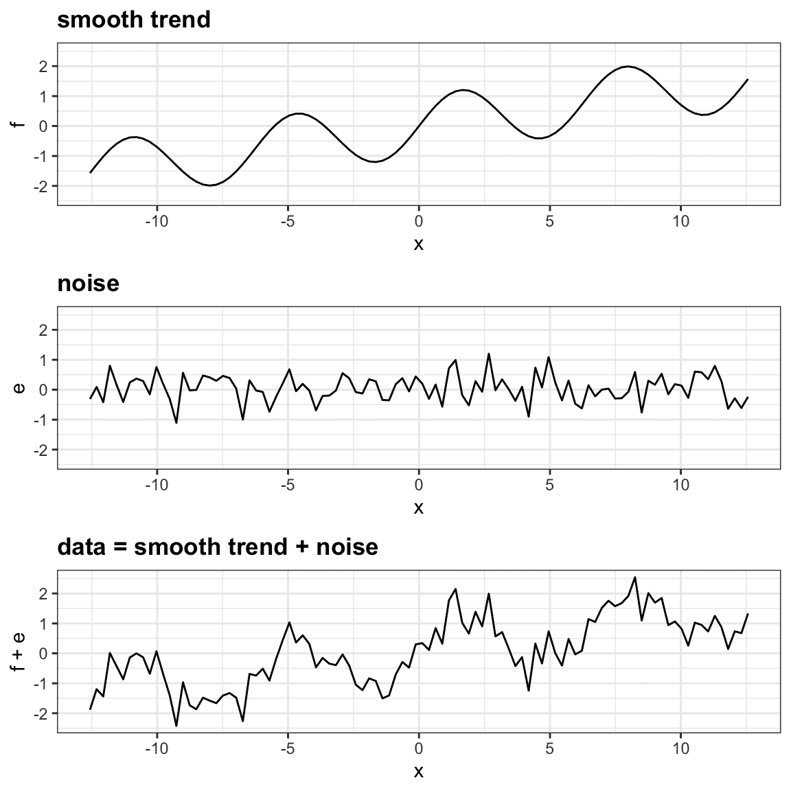

我们在本节中解释的部分是我们用来从噪声中提取趋势的假设。

要理解为什么我们要介绍这个主题，请记住，平滑技术背后的概念在机器学习中非常有用，因为条件期望/概率可以被视为我们需要在存在不确定性的情况下估计的未知形状的趋势。

为了解释这些概念，我们首先关注一个只有一个预测因子的问题。具体来说，我们试图估计 2008 年美国流行投票差额（奥巴马和麦凯恩之间的差异）的时间趋势。

```r
library(tidyverse)
library(dslabs)
data("polls_2008")
qplot(day, margin, data = polls_2008)
```


对于这个例子，不要把它看作是一个预测问题。相反，我们只是对选举结束后趋势的形状感兴趣。

我们假设对于任何给定的一天 $x$，选民中存在一个真实的偏好 $f(x)$，但由于民意调查引入的不确定性，每个数据点都伴随着一个误差 $\varepsilon$。观察到的投票差额 $Y_i$ 的数学模型是：

$$ Y_i = f(x_i) + \varepsilon_i $$

要将这个问题视为一个机器学习问题，考虑一下我们想要根据一天 $x$ 预测 $Y$。如果我们知道条件期望 $f(x) = \mbox{E}(Y \mid X=x)$，我们会使用它。但由于我们不知道这个条件期望，我们必须估计它。让我们使用回归，因为这是我们迄今为止学到的唯一方法。

```r
#> `geom_smooth()` using formula = 'y ~ x'
```


我们看到的线似乎并不能很好地描述趋势。例如，在 9 月 4 日（第-62 天），共和党全国代表大会举行，数据表明这给了约翰·麦凯恩在民调中的提升。然而，回归线并没有捕捉到这种潜在的趋势。为了更清楚地看到*拟合不足*，我们注意到高于拟合线（蓝色）和低于拟合线（红色）的点在每天并不是均匀分布的。因此，我们需要一个更灵活的替代方法。

## 28.1 离散平滑

平滑的一般思想是将数据点分组到层中，在这些层中可以假设 $f(x)$ 的值是常数。我们可以做出这个假设，因为我们认为 $f(x)$ 变化缓慢，因此 $f(x)$ 在小时间窗口中几乎是常数。对于 `poll_2008` 数据的一个例子是假设公众舆论在一周时间内大致保持不变。有了这个假设，我们就有几个具有相同期望值的数据点。

如果我们固定一周的中心天为 $x_0$，那么对于任何其他满足 $|x - x_0| \leq 3.5$ 的天 $x$，我们假设 $f(x)$ 是一个常数 $f(x) = \mu$。这个假设意味着：$$ E[Y_i | X_i = x_i ] \approx \mu \mbox{ if } |x_i - x_0| \leq 3.5 $$

在平滑中，我们将满足 $|x_i - x_0| \leq 3.5$ 的区间大小称为 *窗口大小*、*带宽* 或 *跨度*。稍后我们将看到我们试图优化这个参数。

这个假设意味着对 $f(x)$ 的良好估计是窗口中 $Y_i$ 值的平均值。如果我们定义 $A_0$ 为满足 $|x_i - x_0| \leq 3.5$ 的索引 $i$ 的集合，并将 $N_0$ 定义为 $A_0$ 中的索引数量，那么我们的估计是：

$$ \hat{f}(x_0) = \frac{1}{N_0} \sum_{i \in A_0} Y_i $$

*二值平滑*背后的思想是使用每个 $x$ 的值作为中心进行这个计算。在投票示例中，对于每一天，我们都会计算以那天为中心的一周内值的平均值。这里有两个例子：$x_0 = -125$ 和 $x_0 = -55$。蓝色部分表示结果平均值。

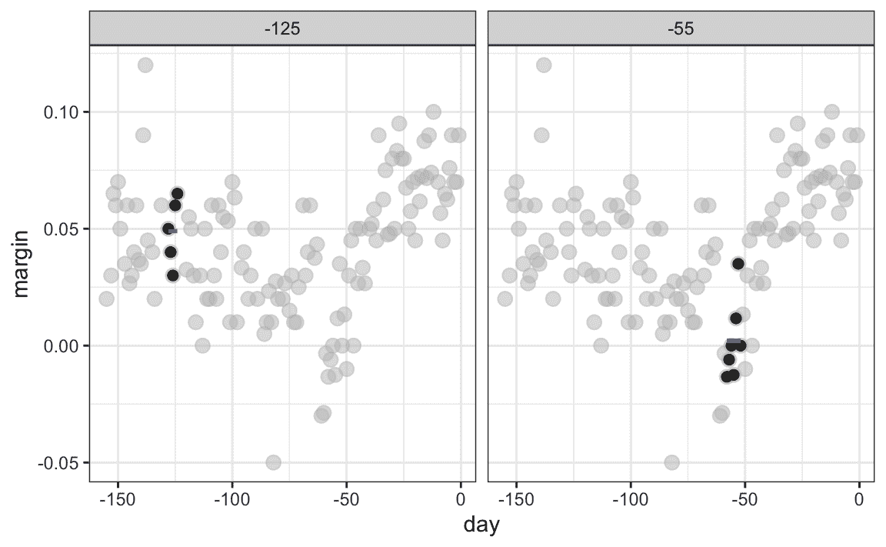

通过计算每个点的这个平均值，我们形成对潜在曲线 $f(x)$ 的估计。以下是我们从 -155 移动到 0 的过程。在 $x_0$ 的每个值，我们保持估计 $\hat{f}(x_0)$ 并移动到下一个点：

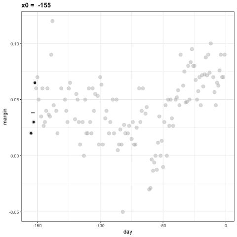

最终的代码和结果看起来像这样：

```r
span <- 7 
fit <- with(polls_2008, 
 ksmooth(day, margin, kernel = "box", bandwidth = span))

polls_2008 |> mutate(smooth = fit$y) |>
 ggplot(aes(day, margin)) +
 geom_point(size = 3, alpha = .5, color = "grey") + 
 geom_line(aes(day, smooth), color="red")
```

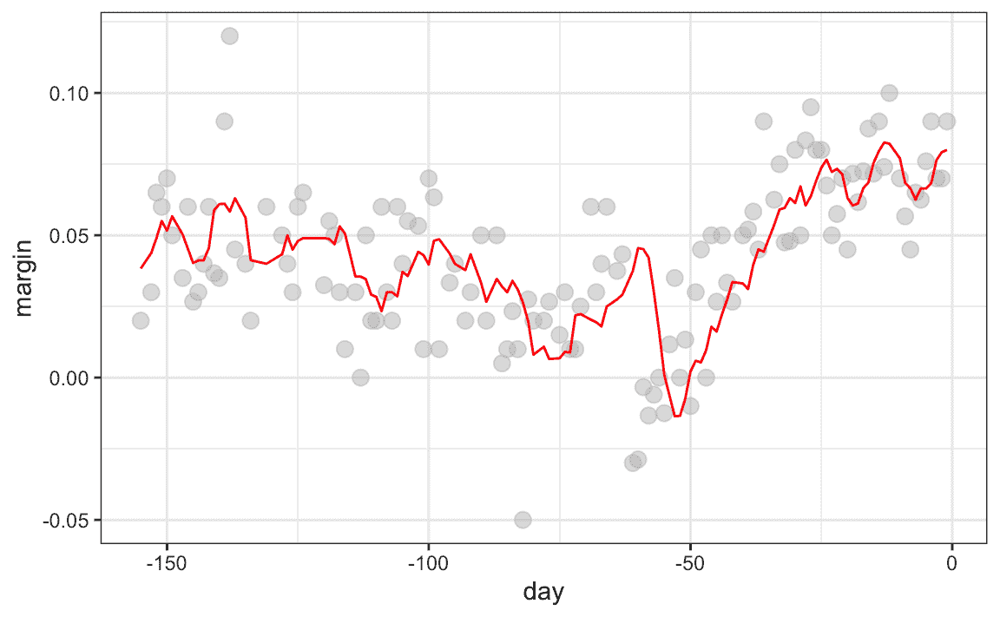

## 28.2 核函数

二值平滑器的最终结果相当波动。其中一个原因是每次窗口移动时，两个点都会改变。我们可以通过取加权平均来减少这种波动，给中心点比远点更多的权重，边缘的两个点几乎不得到权重。

你可以将二值平滑方法视为加权平均：

$$ \hat{f}(x_0) = \sum_{i=1}^N w_0(x_i) Y_i $$

其中每个点要么得到 $0$ 的权重，要么得到 $1/N_0$ 的权重，其中 $N_0$ 是一周中的点数。在上面的代码中，我们在调用 `ksmooth` 函数时使用了 `kernel="box"` 参数。这是因为权重函数看起来像一个盒子。`ksmooth` 函数提供了一个“平滑”选项，它使用正态密度来分配权重。

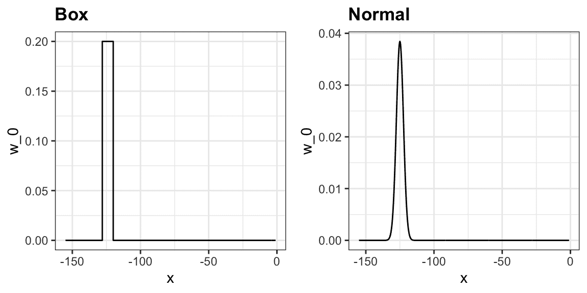

正常核的最终代码和结果图看起来像这样：

```r
span <- 7
fit <- with(polls_2008, 
 ksmooth(day, margin, kernel = "normal", bandwidth = span))

polls_2008 |> mutate(smooth = fit$y) |>
 ggplot(aes(day, margin)) +
 geom_point(size = 3, alpha = .5, color = "grey") + 
 geom_line(aes(day, smooth), color="red")
```

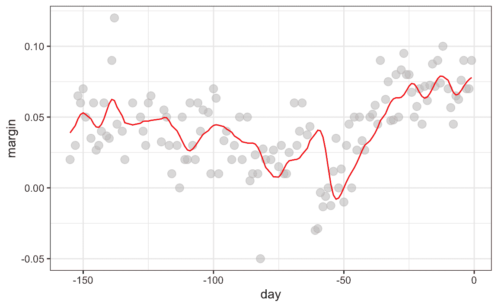

注意到最终的估计现在看起来更平滑。

R 中有几个函数实现了二进制平滑器。一个例子是上面显示的`ksmooth`。然而，在实践中，我们通常更喜欢使用比拟合常数稍微复杂一些的模型的方法。例如，上面的最终结果在部分我们预期它不会出现波动的区域（例如，在-125 和-75 之间）仍然有些波动。像`loess`这样的方法，我们将在下面解释，在这方面有所改进。

## 28.3 局部加权回归（loess）

正如刚才描述的二进制平滑器方法的一个局限性是，我们需要小窗口来保持大约恒定的假设。因此，我们最终只有少量数据点可以平均并得到不精确的估计 $\hat{f}(x)$。在这里，我们描述如何通过 *局部加权回归*（loess）来考虑更大的窗口大小。为此，我们将使用一个数学结果，称为泰勒定理，它告诉我们，如果你足够仔细地观察任何光滑函数 $f(x)$，它将看起来像一条线。为了理解为什么这有意义，考虑园艺师使用直边铲子做的弯曲边缘：


（“Downing Street garden path edge”⁹⁵ 由 Flckr 用户 Number 10⁹⁶ 提供。CC-BY 2.0 许可证⁹⁷。）

我们不是假设函数在窗口内近似恒定，而是假设函数是局部线性的。与常数相比，我们可以考虑更大的窗口大小。我们不是考虑一周的窗口，而是考虑一个趋势近似线性的更大的窗口。我们从一个三周的窗口开始，后来考虑并评估其他选项：

$$ E[Y_i | X_i = x_i ] = \beta_0 + \beta_1 (x_i-x_0) \mbox{ if } |x_i - x_0| \leq 21 $$

对于每个点 $x_0$，loess 定义一个窗口并在该窗口内拟合一条线。以下是一个显示 $x_0=-125$ 和 $x_0 = -55$ 的拟合示例：

```r
#> `geom_smooth()` using formula = 'y ~ x'
```

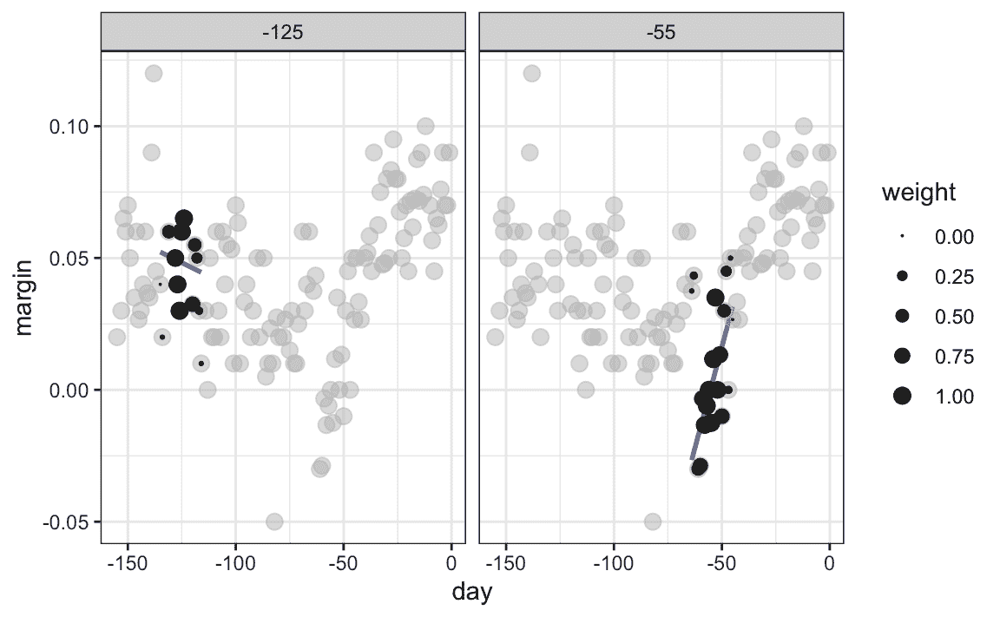

在 $x_0$ 处的拟合值成为我们的估计 $\hat{f}(x_0)$。以下是我们从-155 移动到 0 时的过程：

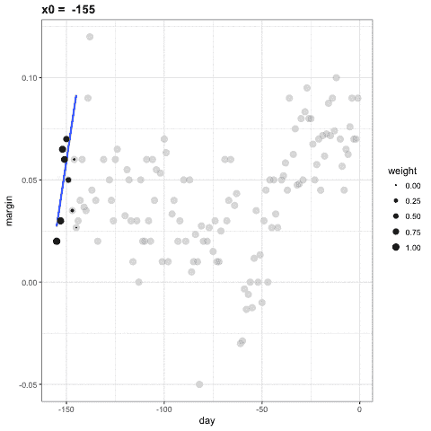

由于我们使用更大的样本量来估计我们的局部参数，最终结果比二进制平滑器更平滑：

```r
total_days <- diff(range(polls_2008$day))
span <- 21/total_days

fit <- loess(margin ~ day, degree=1, span = span, data=polls_2008)

polls_2008 |> mutate(smooth = fit$fitted) |>
 ggplot(aes(day, margin)) +
 geom_point(size = 3, alpha = .5, color = "grey") +
 geom_line(aes(day, smooth), color="red")
```

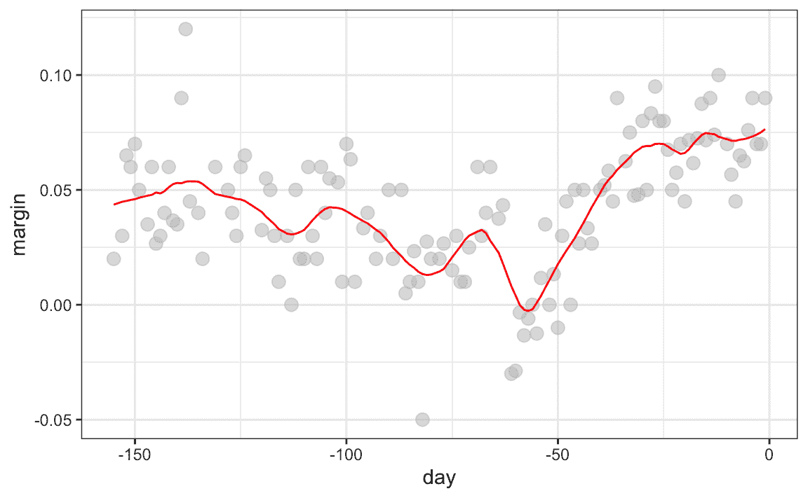

不同的跨度给出了不同的估计。我们可以看到不同的窗口大小如何导致不同的估计：

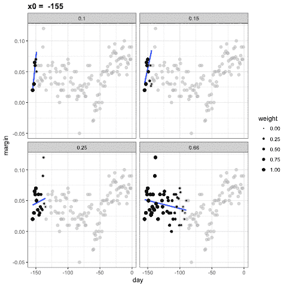

这里是最终的估计：

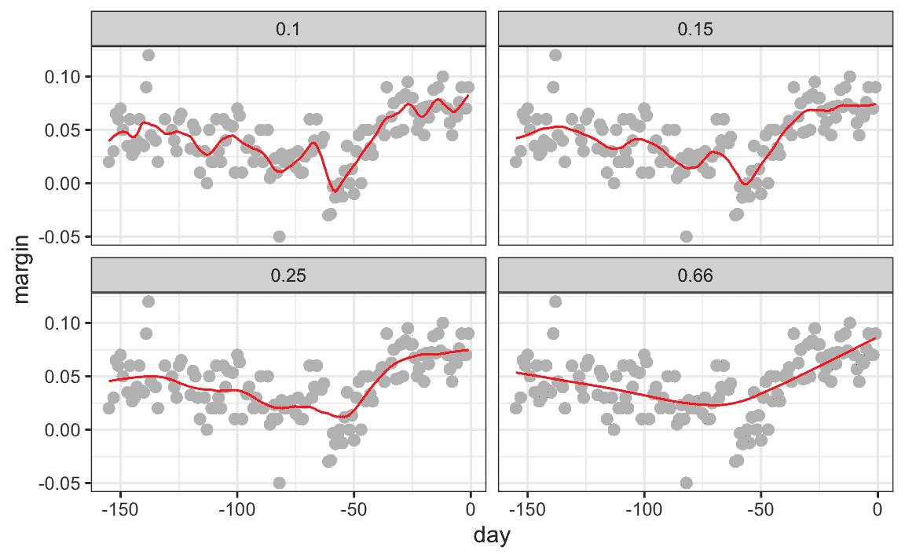

`loess`与典型的二进制平滑器之间有三个其他区别。

1. 与保持箱大小相同不同，`loess` 保持局部拟合中使用的点数相同。这个数字通过 `span` 参数控制，它期望一个比例。例如，如果 `N` 是数据点的数量，且 `span=0.5`，那么对于给定的 $x$，`loess` 将使用 $0.5 * N$ 个最接近 $x$ 的点进行拟合。

2. 当局部拟合线时，`loess` 使用一个**加权**的方法。基本上，我们不是使用最小二乘法，而是最小化一个加权版本：

$$ \sum_{i=1}^N w_0(x_i) \left[Y_i - \left\{\beta_0 + \beta_1 (x_i-x_0)\right\}\right]² $$

然而，与高斯核不同，loess 使用一个称为 Tukey 三重权重的函数：

$$ W(u)= \left( 1 - |u|³\right)³ \mbox{ if } |u| \leq 1 \mbox{ and } W(u) = 0 \mbox{ if } |u| > 1 $$

为了定义权重，我们表示 $2h$ 为窗口大小，并定义：

$$ w_0(x_i) = W\left(\frac{x_i - x_0}{h}\right) $$

这个核函数与高斯核不同，因为它让更多的点获得接近最大值的值：

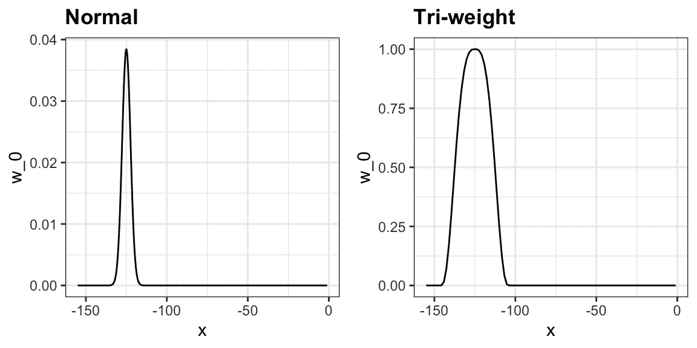

3. `loess` 有一个选项可以**稳健地**拟合局部模型。实现了一个迭代算法，在其中，在每一轮迭代中拟合一个模型后，会检测异常值并将它们在下一轮迭代中降低权重。要使用此选项，我们使用参数 `family="symmetric"`。

### 28.3.1 拟合抛物线

泰勒定理也告诉我们，如果你足够仔细地观察任何数学函数，它看起来就像一个抛物线。该定理还指出，在用抛物线近似时，你不需要像用线近似时那样仔细观察。这意味着我们可以使我们的窗口更大，并拟合抛物线而不是线。

$$ E[Y_i | X_i = x_i ] = \beta_0 + \beta_1 (x_i-x_0) + \beta_2 (x_i-x_0)² \mbox{ if } |x_i - x_0| \leq h $$

这实际上是函数 `loess` 的默认过程。你可能已经注意到，当我们展示了使用 loess 的代码时，我们设置了 `degree = 1`。这告诉 loess 拟合一阶多项式，也就是线的别称。如果你阅读了 loess 的帮助页面，你会看到 `degree` 参数默认为 2。默认情况下，loess 拟合抛物线而不是线。以下是拟合线（红色虚线）和拟合抛物线（橙色实线）的比较：

```r
total_days <- diff(range(polls_2008$day))
span <- 28/total_days
fit_1 <- loess(margin ~ day, degree=1, span = span, data=polls_2008)

fit_2 <- loess(margin ~ day, span = span, data=polls_2008)

polls_2008 |> mutate(smooth_1 = fit_1$fitted, smooth_2 = fit_2$fitted) |>
 ggplot(aes(day, margin)) +
 geom_point(size = 3, alpha = .5, color = "grey") +
 geom_line(aes(day, smooth_1), color="red", lty = 2) +
 geom_line(aes(day, smooth_2), color="orange", lty = 1) 
```


`degree = 2` 给我们带来了更多波动的结果。我们实际上更喜欢 `degree = 1`，因为它不太容易受到这种噪声的影响。

### 28.3.2 小心默认平滑参数

`ggplot` 在其 `geom_smooth` 函数中使用 loess：

```r
polls_2008 |> ggplot(aes(day, margin)) +
 geom_point() + 
 geom_smooth(method = loess)
```


但要注意默认参数，因为它们很少是最优的。然而，你可以方便地更改它们：

```r
polls_2008 |> ggplot(aes(day, margin)) +
 geom_point() + 
 geom_smooth(method = loess, method.args = list(span = 0.15, degree = 1))
```

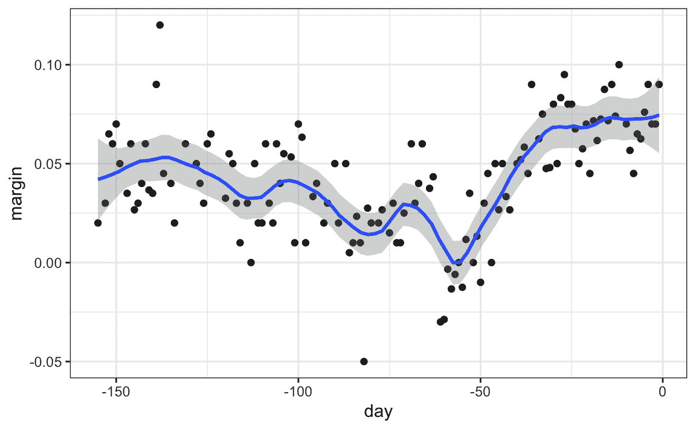

## 28.4 将平滑与机器学习连接

为了通过一个具体的例子了解平滑与机器学习的关系，考虑我们的 27.8 个例子。如果我们定义结果 $Y = 1$ 为数字 7，$Y=0$ 为数字 2，那么我们感兴趣的是估计条件概率：

$$ p(x_1, x_2) = \mbox{Pr}(Y=1 \mid X_1=x_1 , X_2 = x_2). $$ 其中 $X_1$ 和 $X_2$ 是在第 27.8 节中定义的两个预测变量。在这个例子中，我们观察到的 0 和 1 是“噪声”，因为对于某些区域，概率 $p(x_1, x_2)$ 并不接近 0 或 1。因此，我们需要估计 $p(x_1, x_2)$。平滑是完成这一目标的另一种方法。在第 27.8 节中，我们看到了线性回归不足以捕捉 $p(x_1, x_2)$ 的非线性性质，因此平滑方法可能提供改进。在下一章中，我们将描述一个流行的机器学习算法，即基于二分平滑的 k-最近邻算法。

## 28.5 练习

1. 在本书的数据整理部分，我们使用了以下代码来获取 2015-2018 年波多黎各的死亡率。

```r
library(tidyverse)
library(lubridate)
library(purrr)
library(pdftools)
library(dslabs)

fn <- system.file("extdata", "RD-Mortality-Report_2015-18-180531.pdf",
 package="dslabs")
dat <- map_df(str_split(pdf_text(fn), "\n"), function(s){
 s <- str_trim(s)
 header_index <- str_which(s, "2015")[1]
 tmp <- str_split(s[header_index], "\\s+", simplify = TRUE)
 month <- tmp[1]
 header <- tmp[-1]
 tail_index  <- str_which(s, "Total")
 n <- str_count(s, "\\d+")
 out <- c(1:header_index, which(n == 1), 
 which(n >= 28), tail_index:length(s))
 s <- s[-out] |>  str_remove_all("[^\\d\\s]") |> str_trim() |>
 str_split_fixed("\\s+", n = 6) 
 s[,1:5] |> as_tibble() |> 
 setNames(c("day", header)) |>
 mutate(month = month, day = as.numeric(day)) |>
 pivot_longer(-c(day, month), names_to = "year", values_to = "deaths") |>
 mutate(deaths = as.numeric(deaths))
}) |>
 mutate(month = recode(month, 
 "JAN" = 1, "FEB" = 2, "MAR" = 3, 
 "APR" = 4, "MAY" = 5, "JUN" = 6, 
 "JUL" = 7, "AGO" = 8, "SEP" = 9, 
 "OCT" = 10, "NOV" = 11, "DEC" = 12)) |>
 mutate(date = make_date(year, month, day)) |>
 filter(date <= "2018-05-01")
```

使用 `loess` 函数获取预期死亡人数随日期变化的平滑估计。绘制这个结果平滑函数。使跨度大约为两个月。

2. 将平滑估计与一年中的天数绘制在同一张图上，但使用不同的颜色。

3. 假设我们只想使用第二个协变量来预测 `mnist_27` 数据集中的 2 和 7。我们能做到吗？初看数据似乎没有多少预测能力。实际上，如果我们拟合一个常规逻辑回归，`x_2` 的系数并不显著！

```r
library(broom)
library(dslabs)
data("mnist_27")
mnist_27$train |> 
 glm(y ~ x_2, family = "binomial", data = _) |> 
 tidy()
```

由于 `y` 是二进制的，在这里绘制散点图没有意义：

```r
qplot(x_2, y, data = mnist_27$train)
```

将 loess 线拟合到上述数据，并绘制结果。注意，这里存在预测能力，但条件概率不是线性的。

* * *

1.  [`www.flickr.com/photos/49707497@N06/7361631644`](https://www.flickr.com/photos/49707497@N06/7361631644)↩︎

1.  [`www.flickr.com/photos/number10gov/`](https://www.flickr.com/photos/number10gov/)↩︎

1.  [`creativecommons.org/licenses/by/2.0/`](https://creativecommons.org/licenses/by/2.0/)↩︎
