# 第二十九章 交叉验证

> [`rafalab.dfci.harvard.edu/dsbook/cross-validation.html`](https://rafalab.dfci.harvard.edu/dsbook/cross-validation.html)

在本章中，我们介绍了交叉验证，这是机器学习中最重要思想之一。在这里，我们关注概念和数学方面。我们将在下一章的第 30.2 节中描述如何使用 **caret** 包实现交叉验证。为了激发这个概念，我们将使用第 27.8 节中提出的两个预测数字数据，并首次介绍一个实际的机器学习算法：k-最近邻（kNN）。

## 29.1 k-最近邻算法的动机

让我们先加载数据，并展示一个预测因子与结果的彩色图。

```r
library(tidyverse)
library(dslabs)
data("mnist_27")
mnist_27$test |> ggplot(aes(x_1, x_2, color = y)) +  geom_point()
```

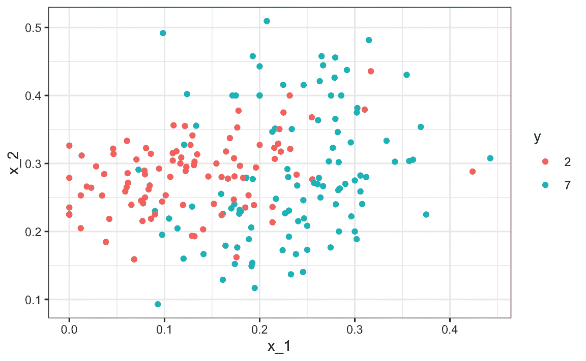

我们将使用这些数据来估计条件概率函数

$$ p(x_1, x_2) = \mbox{Pr}(Y=1 \mid X_1=x_1 , X_2 = x_2). $$ 如第 28.4 节中定义。使用 k-最近邻（kNN）我们以类似于箱式平滑的方式估计 $p(x_1, x_2)$。然而，正如我们将看到的，kNN 更容易适应多个维度。首先，我们根据特征定义所有观测之间的距离。然后，对于任何我们想要估计 $p(x_1, x_2)$ 的点 $(x_1,x_2)$，我们寻找与 $(x_1,x_2)$ 最接近的 $k$ 个点，然后取这些点相关的 0 和 1 的平均值。我们将用于计算平均值的点集称为 *邻域*。由于我们之前描述的与条件期望和条件概率之间的联系，这给我们一个 $\hat{p}(x_1,x_2)$，就像箱式平滑器给出了趋势的估计。与箱式平滑器一样，我们可以通过 $k$ 参数控制我们估计的灵活性：较大的 $k$ 值导致更平滑的估计，而较小的 $k$ 值导致更灵活和更扭曲的估计。

为了实现这个算法，我们可以使用来自 **caret** 包的 `knn3` 函数。查看这个包的帮助文件，我们看到我们可以有两种方式调用它。我们将使用第一种，其中我们指定一个 *公式* 和一个数据框。数据框包含所有要使用的数据。公式形式为 `outcome ~ predictor_1 + predictor_2 + predictor_3` 等等。因此，我们将输入 `y ~ x_1 + x_2`。如果我们打算使用所有预测因子，我们可以使用 `.`，如下所示 `y ~ .`。最终的调用如下所示：

```r
library(caret)
knn_fit <- knn3(y ~ ., data = mnist_27$train)
```

对于这个函数，我们还需要选择一个参数：要包含的邻居数量。让我们从默认的 $k=5$ 开始。

```r
knn_fit <- knn3(y ~ ., data = mnist_27$train, k = 5)
```

在这种情况下，由于我们的数据集是平衡的，我们同样关心敏感度，就像我们关心特异性一样，我们将使用准确率来量化性能。

`knn`的`predict`函数为每个类别产生一个概率。我们将 7 作为估计$\hat{p}(x_1, x_2)$的概率

```r
y_hat_knn <- predict(knn_fit, mnist_27$test, type = "class")
confusionMatrix(y_hat_knn, mnist_27$test$y)$overall["Accuracy"]
#> Accuracy 
#>    0.815
```

在第 27.8 节中，我们使用了线性回归来生成估计。

```r
fit_lm <- mnist_27$train |> 
 mutate(y = ifelse(y == 7, 1, 0)) |> 
 lm(y ~ x_1 + x_2, data = _)
p_hat_lm <- predict(fit_lm, mnist_27$test)
y_hat_lm <- factor(ifelse(p_hat_lm > 0.5, 7, 2))
confusionMatrix(y_hat_lm, mnist_27$test$y)$overall["Accuracy"]
#> Accuracy 
#>    0.775
```

我们看到，使用默认参数的 kNN 已经击败了回归。为了了解为什么会出现这种情况，我们将绘制$\hat{p}(x_1, x_2)$并将其与真实的条件概率$p(x_1, x_2)$进行比较：

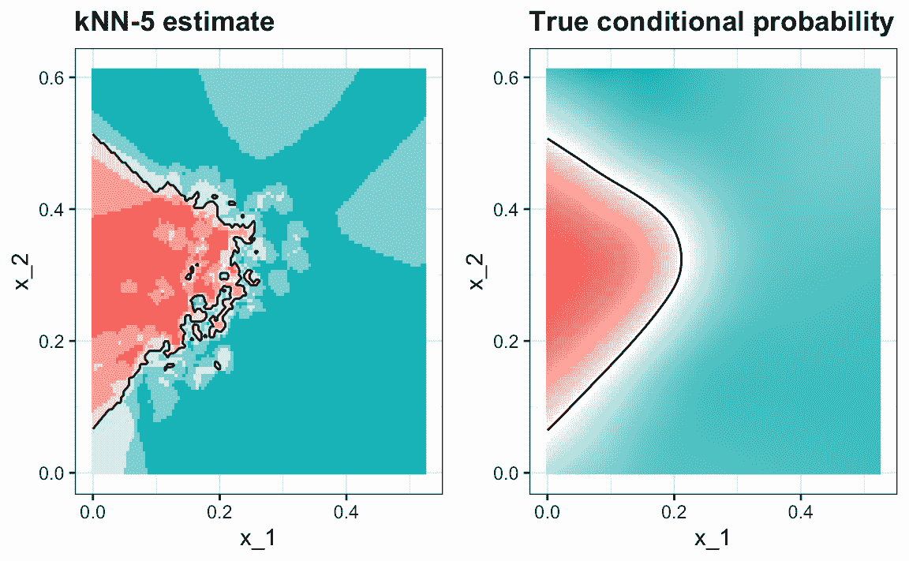

我们看到 kNN 更好地适应了$p(x_1, x_2)$的非线性形状。然而，我们的估计在红色区域中存在一些蓝色的孤岛，这在直观上并不合理。这归因于我们所说的*过度训练*。我们将在下面详细描述过度训练。过度训练是我们训练集比测试集准确率更高的原因：

```r
y_hat_knn <- predict(knn_fit, mnist_27$train, type = "class")
confusionMatrix(y_hat_knn, mnist_27$train$y)$overall["Accuracy"]
#> Accuracy 
#>     0.86

y_hat_knn <- predict(knn_fit, mnist_27$test, type = "class")
confusionMatrix(y_hat_knn, mnist_27$test$y)$overall["Accuracy"]
#> Accuracy 
#>    0.815
```

### 29.1.1 过度训练

当我们设置$k=1$时，过度训练最严重。当$k=1$时，训练集中每个$(x_1, x_2)$的估计仅使用该点的$y$值获得。在这种情况下，如果$(x_1, x_2)$是唯一的，我们将在训练集中获得完美的准确率，因为每个点都用于预测自身。记住，如果预测因子不是唯一的，并且至少有一组预测因子有不同的结果，那么就不可能做出完美的预测。

在这里，我们使用$k=1$拟合 kNN 模型：

```r
knn_fit_1 <- knn3(y ~ ., data = mnist_27$train, k = 1)
y_hat_knn_1 <- predict(knn_fit_1, mnist_27$train, type = "class")
confusionMatrix(y_hat_knn_1, mnist_27$train$y)$overall[["Accuracy"]]
#> [1] 0.991
```

然而，测试集的准确率实际上比回归还要差：

```r
y_hat_knn_1 <- predict(knn_fit_1, mnist_27$test, type = "class")
confusionMatrix(y_hat_knn_1, mnist_27$test$y)$overall["Accuracy"]
#> Accuracy 
#>     0.81
```

我们可以在这张图中看到过度拟合问题。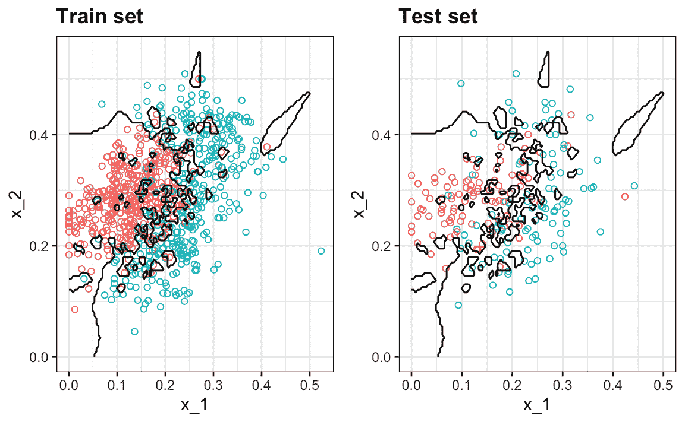

黑色曲线表示决策规则边界。

估计$\hat{p}(x_1, x_2)$过于紧密地遵循训练数据（左）。您可以看到在训练集中，边界被绘制以完美地围绕蓝色海洋中的一个红色点。由于大多数点$(x_1, x_2)$是唯一的，预测结果要么是 1 要么是 0，该点的预测就是其关联的标签。然而，一旦我们引入训练集（右），我们会看到许多这些小岛现在具有相反的颜色，我们最终做出了几个错误的预测。

### 29.1.2 过度平滑

虽然没有前例那么糟糕，但我们看到，当$k=5$时，我们也出现了过度训练。因此，我们应该考虑更大的$k$。例如，我们可以尝试一个更大的数字：$k=401$。

```r
knn_fit_401 <- knn3(y ~ ., data = mnist_27$train, k = 401)
y_hat_knn_401 <- predict(knn_fit_401, mnist_27$test, type = "class")
confusionMatrix(y_hat_knn_401, mnist_27$test$y)$overall["Accuracy"]
#> Accuracy 
#>     0.76
```

这实际上与回归相似：

```r
#> Warning: The following aesthetics were dropped
#> during statistical transformation: fill
#> ℹ This can happen when ggplot fails to
#>   infer the correct grouping structure
#>   in the data.
#> ℹ Did you forget to specify a `group`
#>   aesthetic or to convert a numerical
#>   variable into a factor?
#> The following aesthetics were dropped
#> during statistical transformation: fill
#> ℹ This can happen when ggplot fails to
#>   infer the correct grouping structure
#>   in the data.
#> ℹ Did you forget to specify a `group`
#>   aesthetic or to convert a numerical
#>   variable into a factor?
```

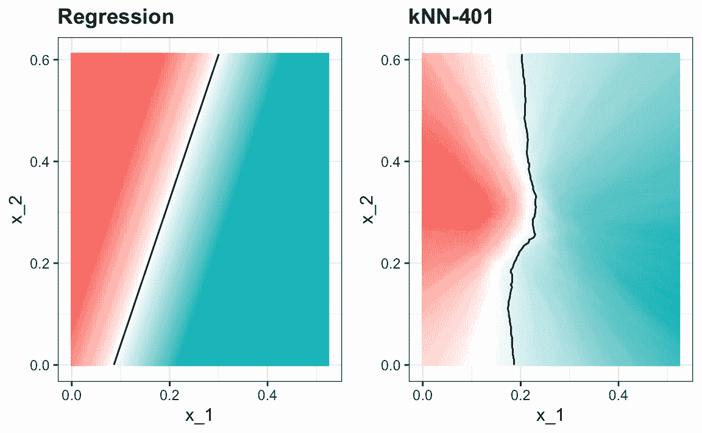

$k$的大小如此之大，以至于它不允许足够的灵活性。我们称之为*过度平滑*。

### 29.1.3 选择 kNN 中的$k$

那么，我们如何选择 $k$ 呢？原则上，我们希望选择最大化准确率或最小化第 27.4.8 中定义的预期 MSE 的 $k$。交叉验证的目标是为任何给定的算法和一组调整参数（如 $k$）估计这些量。为了理解为什么我们需要一个特殊的方法来做这件事，让我们重复上面的操作，但针对不同的 $k$ 值：

```r
ks <- seq(3, 251, 2)
```

我们使用 `map_df` 函数重复上述操作。

```r
library(purrr)
accuracy <- map_df(ks, function(k){
 fit <- knn3(y ~ ., data = mnist_27$train, k = k)

 y_hat <- predict(fit, mnist_27$train, type = "class")
 cm_train <- confusionMatrix(y_hat, mnist_27$train$y)
 train_error <- cm_train$overall["Accuracy"]

 y_hat <- predict(fit, mnist_27$test, type = "class")
 cm_test <- confusionMatrix(y_hat, mnist_27$test$y)
 test_error <- cm_test$overall["Accuracy"]

 tibble(train = train_error, test = test_error)
})
```

注意，我们使用训练集和测试集来估计准确率。现在我们可以为每个 $k$ 值绘制准确率估计图：

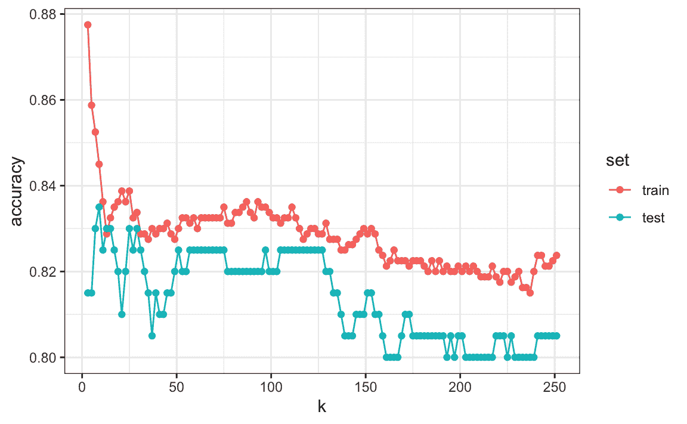

首先，请注意，在训练集上获得的估计通常低于在测试集上获得的估计，对于较小的 $k$ 值，差异更大。这是由于过拟合。此外，准确率与 $k$ 的关系图相当锯齿状。我们不应该期望这种情况，因为 $k$ 的小幅变化不应该对算法的性能影响太大。锯齿状的原因是准确率是在样本上计算的，因此是一个随机变量。这证明了为什么我们更喜欢最小化预期损失，而不是使用一个数据集观察到的损失。

如果我们要使用这些估计来选择最大化准确率的 $k$，我们将使用基于测试数据的估计：

```r
ks[which.max(accuracy$test)]
#> [1] 9
max(accuracy$test)
#> [1] 0.835
```

另一个我们需要更准确估计准确率的原因是，如果我们使用测试集来选择这个 $k$，我们不应该期望伴随的准确率估计可以推广到现实世界。这是因为即使在这里，我们也打破了机器学习的黄金法则：我们使用测试集来选择 $k$。交叉验证也提供了一个考虑了这一点的估计。

## 29.2 交叉验证的数学描述

在第 27.4.8 节中，我们描述了机器学习的常见目标之一是找到一个算法，该算法为结果 $Y$ 生成预测值 $\hat{Y}$，以最小化均方误差（MSE）：

$$ \mbox{MSE} = \mbox{E}\left\{ \frac{1}{N}\sum_{i=1}^N (\hat{Y}_i - Y_i)² \right\} $$ 当我们只有一组数据集可用时，我们可以用观察到的 MSE 如此估计 MSE：

$$ \hat{\mbox{MSE}} = \frac{1}{N}\sum_{i=1}^N (\hat{y}_i - y_i)² $$ 这两个通常被称为“真实误差”和“明显误差”。

我们应该始终记住明显误差的两个重要特征：

1.  由于我们的数据是随机的，明显的误差是一个随机变量。例如，我们拥有的数据集可能是一个更大人群的随机样本。一个算法可能由于运气好而具有比另一个算法更低的明显误差。

1.  如果我们在用于计算明显误差的相同数据集上训练一个算法，我们可能会过度训练。一般来说，当我们这样做时，明显误差将低估真实误差。我们将通过 k 近邻算法看到一个极端的例子。

交叉验证是一种技术，可以让我们减轻这两个问题。为了理解交叉验证，我们可以将真实误差，一个理论量，视为将算法应用于数据集的$B$个新随机样本的平均误差，这些样本都没有用于训练算法。正如前一章所示，我们将真实误差视为：

$$ \frac{1}{B} \sum_{b=1}^B \frac{1}{N}\sum_{i=1}^N \left(\hat{y}_i^b - y_i^b\right)² $$ 其中$B$是一个很大的数，可以认为是实际上的无限大。如前所述，这是一个理论量，因为我们只有一套可用的结果：$y_1, \dots, y_n$。交叉验证基于尽可能模仿上述理论设置的想法，使用我们拥有的数据。为此，我们必须生成一系列不同的随机样本。我们可以使用几种方法，但所有这些方法的一般思想是随机生成较小的数据集，这些数据集不用于训练，而是用于估计真实误差。

## 29.3 K 折交叉验证

我们首先描述的是*K 折交叉验证*。一般来说，一个机器学习挑战从数据集开始（如图下蓝色所示）。我们需要使用这个数据集构建一个算法，这个算法最终将用于完全独立的另一个数据集（黄色）。

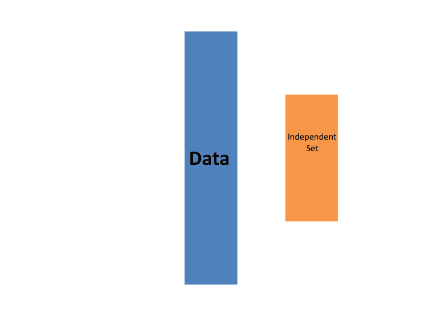

但我们看不到这些独立的数据集。

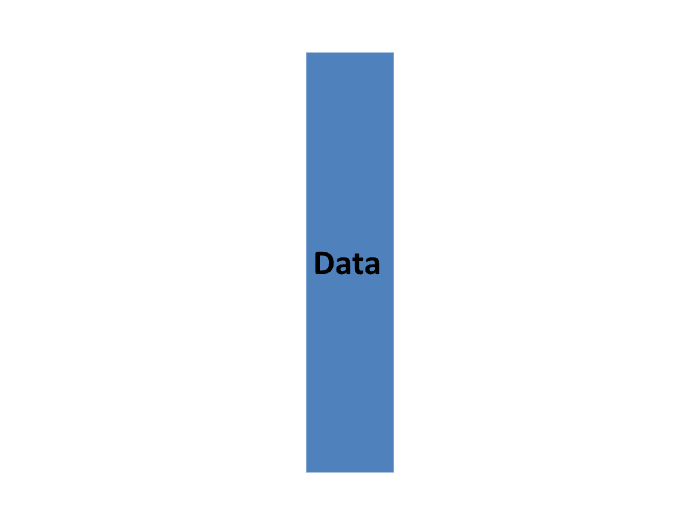

因此，为了模仿这种情况，我们从一个数据集中划分出一部分，并假装它是一个独立的数据集：我们将数据集划分为一个*训练集*（蓝色）和一个*测试集*（红色）。我们将仅在训练集上训练我们的算法，并仅将测试集用于评估目的。

我们通常尝试选择数据集的一小部分，以便我们有尽可能多的数据来训练。然而，我们还想让测试集足够大，以便在没有拟合不切实际数量的模型的情况下获得损失的稳定估计。典型的选择是使用 10%-20%的数据进行测试。

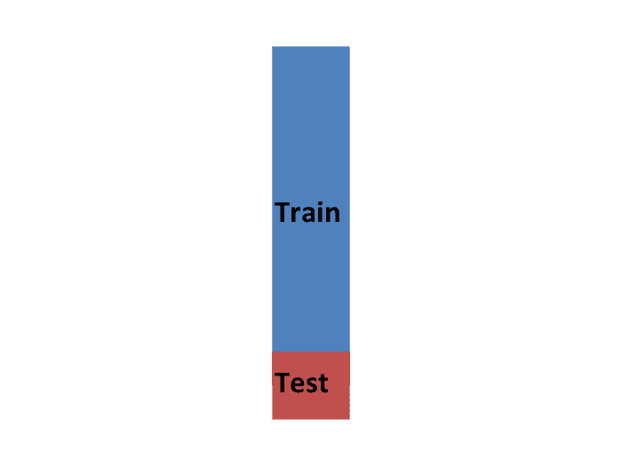

让我们重申，我们绝对不能使用测试集：无论是过滤行，还是选择特征，都不能使用！

现在提出了一个新的问题，因为对于大多数机器学习算法，我们需要选择参数，例如 k-近邻算法中的邻居数量 $k$。在这里，我们将参数集称为 $\lambda$。我们需要在不使用测试集的情况下优化算法参数，并且我们知道如果我们对同一个数据集进行优化和评估，我们将会过度训练。这就是交叉验证最有用的地方。

对于每个正在考虑的算法参数集，我们想要一个 MSE 的估计，然后我们将选择具有最小 MSE 的参数。交叉验证提供了这个估计。

首先，在我们开始交叉验证过程之前，固定所有算法参数是非常重要的。虽然我们将在训练集的集合上训练算法，但参数 $\lambda$ 将在所有训练集中保持相同。我们将使用 $\hat{y}_i(\lambda)$ 来表示当我们使用参数 $\lambda$ 时获得的预测值。

因此，如果我们打算模仿这个定义：

$$ \mbox{MSE}(\lambda) = \frac{1}{B} \sum_{b=1}^B \frac{1}{N}\sum_{i=1}^N \left(\hat{y}_i^b(\lambda) - y_i^b\right)² $$

我们希望考虑可以被视为独立随机样本的数据集，并且我们希望这样做几次。在 K 折交叉验证中，我们这样做 $K$ 次。在卡通中，我们展示了一个使用 $K=5$ 的例子。

我们最终将得到 $K$ 个样本，但让我们先描述如何构建第一个：我们简单地随机选择 $M=N/K$ 个观察值（如果 $M$ 不是一个整数，则进行四舍五入），并将这些视为一个随机样本 $y_1^b, \dots, y_M^b$，其中 $b=1$。我们称这为验证集：

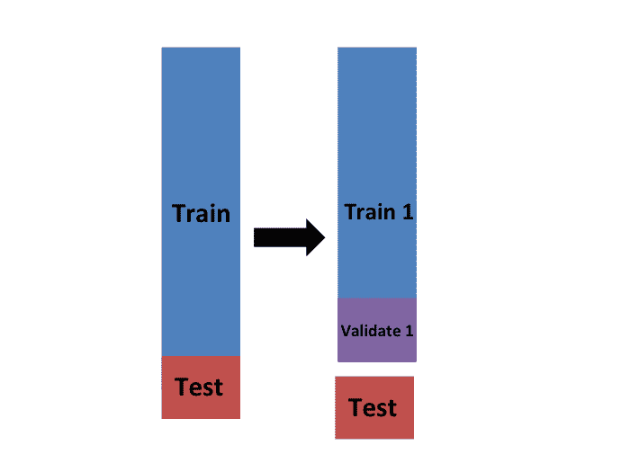

现在，我们可以在训练集中拟合模型，然后在独立集上计算明显的误差：

$$ \hat{\mbox{MSE}}_b(\lambda) = \frac{1}{M}\sum_{i=1}^M \left(\hat{y}_i^b(\lambda) - y_i^b\right)² $$

注意，这只是一个样本，因此将返回一个关于真实错误的噪声估计。这就是为什么我们取 $K$ 个样本，而不是一个。在 K 交叉验证中，我们将观察值随机分成 $K$ 个非重叠的集合：

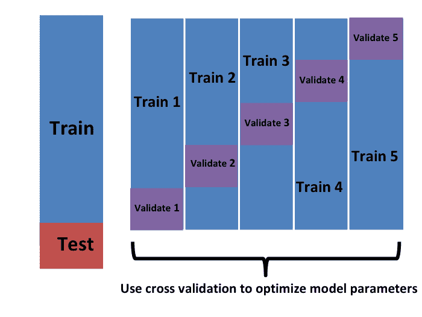

现在，我们为这些集合 $b=1,\dots,K$ 中的每一个重复上述计算，并得到 $\hat{\mbox{MSE}}_1(\lambda),\dots, \hat{\mbox{MSE}}_K(\lambda)$。然后，为了我们的最终估计，我们计算平均值：

$$ \hat{\mbox{MSE}}(\lambda) = \frac{1}{K} \sum_{b=1}^K \hat{\mbox{MSE}}_b(\lambda) $$

并获得我们的损失估计。下一步将是选择使 MSE 最小的 $\lambda$。

我们已经描述了如何使用交叉验证来优化参数。然而，我们现在必须考虑到优化是在训练数据上发生的，因此我们需要一个基于未用于优化选择的数据的最终算法的估计。这就是我们早期分离的测试集发挥作用的地方：

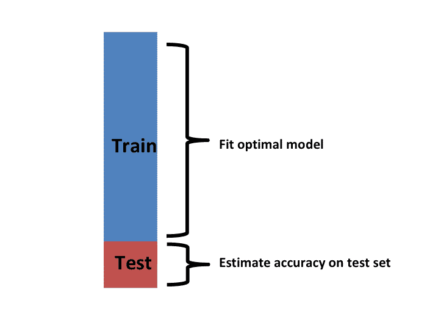

我们可以再次进行交叉验证：

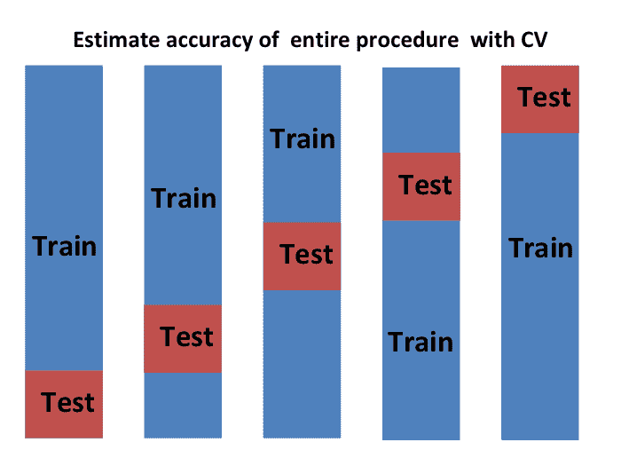

并获得我们预期损失的最终估计。然而，请注意，这意味着我们的整个计算时间会乘以 $K$。你很快就会了解到执行这项任务需要时间，因为我们正在执行许多复杂的计算。因此，我们总是在寻找减少这种时间的方法。对于最终评估，我们通常只使用一个测试集。

一旦我们对这个模型满意并希望将其提供给他人，我们可以在不改变优化参数的情况下，在整个数据集上重新拟合模型。

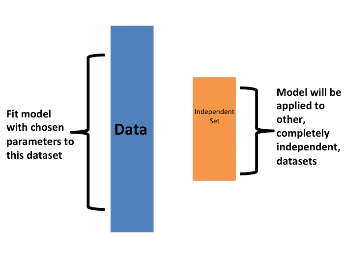

现在我们如何选择交叉验证的 $K$ 值呢？较大的 $K$ 值更可取，因为训练数据更好地模仿原始数据集。然而，较大的 $K$ 值将会有更长的计算时间：例如，100 折交叉验证将比 10 折交叉验证慢 10 倍。因此，$K=5$ 和 $K=10$ 是流行的选择。

我们可以通过取更多的样本来提高最终估计的方差。为此，我们不再需要将训练集划分为非重叠的集合。相反，我们只需随机选择 $K$ 个大小不一的集合。

这种技术的流行版本之一，在每一折中，会随机有放回地选择观测值（这意味着相同的观测值可以出现两次）。这种方法有一些优点（此处未讨论）并且通常被称为 *bootstrap*。实际上，这是 **caret** 包的默认方法。我们将在下一章中描述如何使用 **caret** 包实现交叉验证。在下一节中，我们将解释 bootstrap 的一般工作原理。

## 29.4 练习

生成一组像这样的随机预测变量和结果：

```r
set.seed(1996)
n <- 1000
p <- 10000
x <- matrix(rnorm(n * p), n, p)
colnames(x) <- paste("x", 1:ncol(x), sep = "_")
y <- rbinom(n, 1, 0.5) |> factor()

x_subset <- x[ ,sample(p, 100)]
```

1. 因为 `x` 和 `y` 完全独立，你不应该能够用 `x` 预测 `y` 的准确率超过 0.5。通过使用逻辑回归来拟合模型并运行交叉验证来确认这一点。由于我们有这么多预测变量，我们选择了一个随机样本 `x_subset`。在训练模型时使用这个子集。提示：使用 caret 的 `train` 函数。`train` 函数输出的 `results` 组件会显示准确率。忽略警告。

2. 现在，我们将不再随机选择预测变量，而是寻找那些对结果最有预测性的变量。我们可以通过比较每个预测变量的 $y=1$ 组和 $y=0$ 组的值，使用 t-test 来实现这一点。你可以这样执行这一步：

```r
devtools::install_bioc("genefilter")
install.packages("genefilter")
library(genefilter)
tt <- colttests(x, y)
```

创建一个包含 p 值的向量，并将其命名为 `pvals`。

3. 创建一个索引 `ind`，包含与 `y` “统计上显著”相关的预测变量的列号。使用 0.01 的 p 值截止值来定义“统计上显著”。有多少个预测变量通过了这个截止值？

4. 再次运行交叉验证，但这次在重新定义`x_subset`为与`y`有“统计显著”关联的列定义的`x`的子集之后。现在的准确率是多少？

5. 再次运行交叉验证，但这次使用 kNN。尝试以下调整参数网格：`k = seq(101, 301, 25)`。绘制结果的准确率图。

6. 在练习 3 和 4 中，我们看到尽管`x`和`y`完全独立，我们还是能够以超过 70%的准确率预测`y`。那么我们一定是做错了什么。是什么？

1.  函数`train`在算法使用的相同数据上估计准确率。

1.  我们通过包含 100 个预测因子来过度拟合模型。

1.  我们使用整个数据集来选择模型中使用的列。这一步需要作为算法的一部分包含。交叉验证是在这一选择之后进行的。

1.  高准确率仅仅是由于随机变异性。

7. 高级。重新进行交叉验证，但这次将选择步骤包含在交叉验证中。现在准确率应该接近 50%。

8. 加载`tissue_gene_expression`数据集。使用`train`函数根据基因表达预测组织。使用 kNN。哪个`k`效果最好？

## 29.5 自举

假设你的人口收入分布如下：

```r
set.seed(1995)
n <- 10⁶
income <- 10^(rnorm(n, log10(45000), log10(3)))
qplot(log10(income), bins = 30, color = I("black"))
```

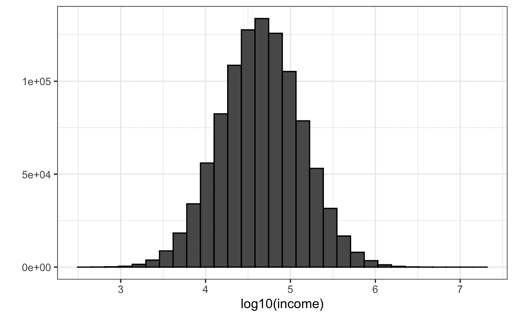

总体中位数是：

```r
m <- median(income)
m
#> [1] 44939
```

假设我们无法访问整个总体，但想估计中位数$m$。我们抽取一个 100 个样本，并用样本中位数$M$估计总体中位数$m$：

```r
N <- 100
X <- sample(income, N)
median(X)
#> [1] 38461
```

我们能构建一个置信区间吗？$M$的分布是什么？

因为我们在模拟数据，我们可以使用蒙特卡洛模拟来学习$M$的分布。

```r
library(gridExtra)
B <- 10⁴
M <- replicate(B, {
 X <- sample(income, N)
 median(X)
})
p1 <- qplot(M, bins = 30, color = I("black"))
p2 <- qplot(sample = scale(M), xlab = "theoretical", ylab = "sample") + 
 geom_abline()
grid.arrange(p1, p2, ncol = 2)
```

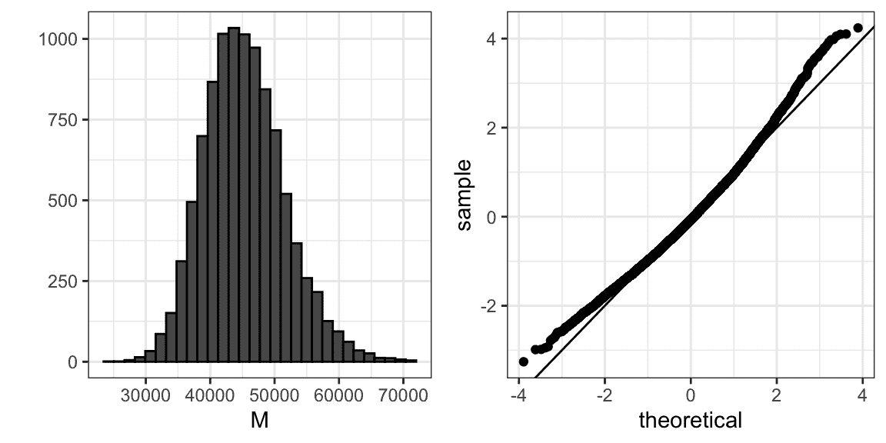

如果我们知道这个分布，我们可以构建一个置信区间。问题在于，正如我们已经描述的，在实践中我们没有访问到这个分布。过去，我们使用了中心极限定理，但我们所研究的 CLT 适用于平均值，而这里我们感兴趣的是中位数。我们可以看到，基于 CLT 的 95%置信区间

```r
median(X) + 1.96 * sd(X) / sqrt(N) * c(-1, 1)
#> [1] 21018 55905
```

与如果我们知道$M$的实际分布，我们会生成的置信区间

```r
quantile(M, c(0.025, 0.975))
#>  2.5% 97.5% 
#> 34438 59050
```

自举允许我们在无法访问整个分布的情况下近似蒙特卡洛模拟。一般思路相对简单。我们假设观察到的样本是总体。然后我们（有放回地）抽取与原始数据集相同大小的数据集。然后在这些*自举样本*上计算汇总统计量，在这种情况下是中位数。

理论告诉我们，在许多情况下，使用自举样本获得的统计量的分布近似于我们实际统计量的分布。这就是我们构建自举样本和近似分布的方法：

```r
B <- 10⁴
M_star <- replicate(B, {
 X_star <- sample(X, N, replace = TRUE)
 median(X_star)
})
```

注意，使用自举构建的置信区间与使用理论分布构建的置信区间非常接近：

```r
quantile(M_star, c(0.025, 0.975))
#>  2.5% 97.5% 
#> 30253 56909
```

关于自举的更多信息，包括可以应用以改进这些置信区间的更正，请参阅 Efron, B.和 Tibshirani, R. J.所著的《自举入门》一书。

*注意，我们可以使用与交叉验证中自举类似的想法：而不是将数据分成相等的部分，我们只是多次进行自举。*

## 29.6 练习题

1. 可以使用`createResample`函数来创建自举样本。例如，我们可以像这样为`mnist_27`数据集创建 10 个自举样本：

```r
set.seed(1995)
indexes <- createResample(mnist_27$train$y, 10)
```

在第一次重采样索引中，`3`、`4`和`7`各出现了多少次？

2. 我们看到一些数字出现了不止一次，而另一些数字一次也没有出现。对于每个数据集都必须是这样的，以确保数据集的独立性。对所有的重采样索引重复此练习。

3. 生成一个类似这样的随机数据集：

```r
y <- rnorm(100, 0, 1)
```

估计第 75 百分位数，我们知道它是：

```r
qnorm(0.75)
```

使用样本分位数：

```r
quantile(y, 0.75)
```

运行蒙特卡洛模拟以学习这个随机变量的期望值和标准误差。

4. 在实践中，我们无法运行蒙特卡洛模拟，因为我们不知道是否使用了`rnorm`来模拟数据。使用自举仅使用初始样本`y`来估计标准误差。使用 10 个自举样本。

5. 重新做第 4 题，但使用 10,000 个自举样本。
