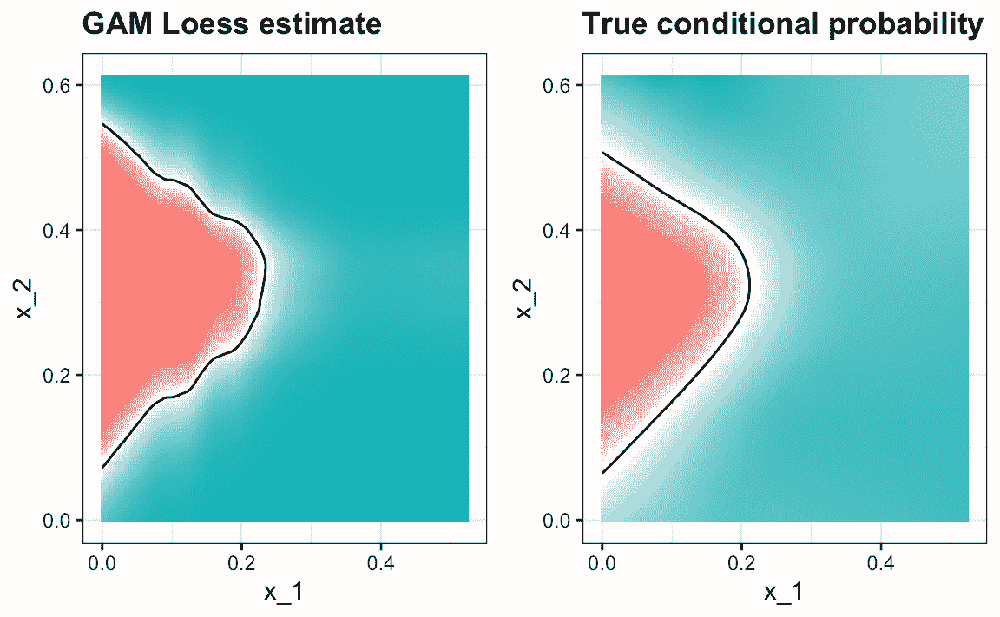

# 第三十章 caret 包

> 原文：[`rafalab.dfci.harvard.edu/dsbook/caret.html`](https://rafalab.dfci.harvard.edu/dsbook/caret.html)

我们已经学习了回归和 kNN 作为机器学习算法。在后面的章节中，我们将学习几个其他的算法，这仅仅是所有算法中的一小部分。许多这些算法都在 R 中实现。然而，它们是通过不同的包、由不同的作者开发的，并且通常使用不同的语法。**caret**包试图统一这些差异并提供一致性。它目前包括 237 种不同的方法，这些方法在**caret**包手册中进行了总结⁹⁸。请记住，**caret**不包括所需的包，要通过**caret**实现一个包，你仍然需要安装库。每种方法的所需包在包手册中进行了描述。

**caret**包还提供了一个为我们执行交叉验证的函数。这里我们提供了一些示例，展示了我们如何使用这个极其有用的包。我们将使用 2 或 7 的示例来演示：

```r
library(tidyverse)
library(dslabs)
data("mnist_27")
```

## 30.1 caret `train`函数

**caret**的`train`函数让我们可以使用类似的语法来训练不同的算法。所以，例如，我们可以输入：

```r
library(caret)
train_glm <- train(y ~ ., method = "glm", data = mnist_27$train)
train_knn <- train(y ~ ., method = "knn", data = mnist_27$train)
```

为了进行预测，我们可以直接使用该函数的输出，而无需查看`predict.glm`和`predict.knn`的具体细节。相反，我们可以学习如何从`predict.train`获取预测。

两种方法的代码看起来是一样的：

```r
y_hat_glm <- predict(train_glm, mnist_27$test, type = "raw")
y_hat_knn <- predict(train_knn, mnist_27$test, type = "raw")
```

这使我们能够快速比较算法。例如，我们可以这样比较准确度：

```r
confusionMatrix(y_hat_glm, mnist_27$test$y)$overall[["Accuracy"]]
#> [1] 0.775
confusionMatrix(y_hat_knn, mnist_27$test$y)$overall[["Accuracy"]]
#> [1] 0.835
```

## 30.2 交叉验证

当一个算法包含一个调整参数时，`train` 会自动使用交叉验证来决定几个默认值。要找出哪些参数或参数被优化，你可以阅读手册 ⁹⁹ 或研究以下输出的内容：

```r
getModelInfo("knn")
```

我们也可以使用这样的快速查找：

```r
modelLookup("knn")
```

如果我们使用默认值运行它：

```r
train_knn <- train(y ~ ., method = "knn", data = mnist_27$train)
```

你可以快速使用`ggplot`函数看到交叉验证的结果。`highlight`参数突出显示最大值：

```r
ggplot(train_knn, highlight = TRUE)
```


默认情况下，交叉验证是通过取 25 个包含 25%观测值的 bootstrap 样本来执行的。对于`kNN`方法，默认值是尝试$k=5,7,9$。我们可以使用`tuneGrid`参数来改变这个值。值网格必须由一个数据框提供，其中参数名称与`modelLookup`输出中指定的名称相匹配。

在这里，我们提供了一个例子，我们尝试了 9 到 67 之间的 30 个值。要使用**caret**做到这一点，我们需要定义一个名为`k`的列，所以我们使用这个：`data.frame(k = seq(9, 67, 2))`。

注意，当我们运行此代码时，我们在 25 个自助样本上拟合了 30 个 kNN 版本。由于我们拟合了$30 \times 25 = 750$个 kNN 模型，运行此代码将需要几秒钟。我们设置种子是因为交叉验证是一个随机过程，我们希望确保这里的结果是可重复的。

```r
set.seed(2008)
train_knn <- train(y ~ ., method = "knn", 
 data = mnist_27$train,
 tuneGrid = data.frame(k = seq(9, 71, 2)))
ggplot(train_knn, highlight = TRUE)
```


要访问最大化准确度的参数，可以使用以下方法：

```r
train_knn$bestTune
#>     k
#> 27 61
```

以及最佳性能的模型如下：

```r
train_knn$finalModel
#> 61-nearest neighbor model
#> Training set outcome distribution:
#> 
#>   2   7 
#> 401 399
```

函数`predict`将使用这个最佳性能的模型。以下是当应用于测试集时最佳模型的准确度，我们还没有使用过测试集，因为交叉验证是在训练集上进行的：

```r
confusionMatrix(predict(train_knn, mnist_27$test, type = "raw"),
 mnist_27$test$y)$overall["Accuracy"]
#> Accuracy 
#>    0.825
```

如果我们想要改变交叉验证的方式，可以使用`trainControl`函数。我们可以通过使用，例如，10 折交叉验证来使上面的代码运行得更快。这意味着我们有 10 个样本，每个样本使用 10%的观测值。我们使用以下代码来完成这个任务：

```r
control <- trainControl(method = "cv", number = 10, p = .9)
train_knn_cv <- train(y ~ ., method = "knn", 
 data = mnist_27$train,
 tuneGrid = data.frame(k = seq(9, 71, 2)),
 trControl = control)
ggplot(train_knn_cv, highlight = TRUE)
```


我们注意到准确度估计的变异性更大，这是预期的，因为我们改变了用于估计准确度的样本数量。

注意，`train`输出的`results`组件包括与交叉验证估计变异性相关的几个汇总统计量：

```r
names(train_knn$results)
#> [1] "k"          "Accuracy"   "Kappa"      "AccuracySD" "KappaSD"
```

## 30.3 示例：使用 loess 进行拟合

最佳拟合的 kNN 模型近似真实的条件概率：

```r
#> Warning: The following aesthetics were dropped
#> during statistical transformation: fill
#> ℹ This can happen when ggplot fails to
#>   infer the correct grouping structure
#>   in the data.
#> ℹ Did you forget to specify a `group`
#>   aesthetic or to convert a numerical
#>   variable into a factor?
```


然而，我们确实看到边界线有些曲折。这是因为 kNN，就像基本的二进制平滑器一样，不使用核。为了改进这一点，我们可以尝试使用 loess。通过阅读手册中可用的模型部分¹⁰⁰，我们看到我们可以使用`gamLoess`方法。在手册¹⁰¹中，我们还看到如果尚未安装，我们需要安装**gam**包：

```r
install.packages("gam")
```

然后，我们看到我们有两个参数需要优化：

```r
modelLookup("gamLoess")
#>      model parameter  label forReg forClass probModel
#> 1 gamLoess      span   Span   TRUE     TRUE      TRUE
#> 2 gamLoess    degree Degree   TRUE     TRUE      TRUE
```

我们将坚持使用 1 次方。但为了尝试不同的 span 值，我们仍然需要在表中包含一个名为`degree`的列，以便我们可以这样做：

```r
grid <- expand.grid(span = seq(0.15, 0.65, len = 10), degree = 1)
```

我们将使用默认的交叉验证控制参数。

```r
train_loess <- train(y ~ ., 
 method = "gamLoess", 
 tuneGrid=grid,
 data = mnist_27$train)
ggplot(train_loess, highlight = TRUE)
```


我们可以看到这种方法与 kNN 的性能相似：

```r
confusionMatrix(data = predict(train_loess, mnist_27$test), 
 reference = mnist_27$test$y)$overall["Accuracy"]
#> Accuracy 
#>     0.83
```

并产生条件概率的更平滑估计：



* * *

1.  [`topepo.github.io/caret/available-models.html`](https://topepo.github.io/caret/available-models.html)↩︎

1.  [`topepo.github.io/caret/available-models.html`](http://topepo.github.io/caret/available-models.html)↩︎

1.  [`topepo.github.io/caret/available-models.html`](https://topepo.github.io/caret/available-models.html)↩︎

1.  [`topepo.github.io/caret/train-models-by-tag.html`](https://topepo.github.io/caret/train-models-by-tag.html)↩︎
