```r
library(tidyverse)
library(dslabs)
library(caret)
data("mnist_27")
```

```r
library(HistData)

set.seed(1983)
galton_heights <- GaltonFamilies |>
 filter(gender == "male") |>
 group_by(family) |>
 sample_n(1) |>
 ungroup() |>
 select(father, childHeight) |>
 rename(son = childHeight)
```

```r
y <- galton_heights$son
test_index <- createDataPartition(y, times = 1, p = 0.5, list = FALSE)

train_set <- galton_heights |> slice(-test_index)
test_set <- galton_heights |> slice(test_index)
```

```r
m <- mean(train_set$son)
m
#> [1] 69.2
```

```r
sqrt(mean((m - test_set$son)²))
#> [1] 2.77
```

```r
fit <- lm(son ~ father, data = train_set)
fit$coef
#> (Intercept)      father 
#>      35.976       0.482
```

```r
y_hat <- fit$coef[1] + fit$coef[2]*test_set$father
sqrt(mean((y_hat - test_set$son)²))
#> [1] 2.54
```

```r
y_hat <- predict(fit, test_set)
```

```r
y_hat <- predict(fit, test_set)
sqrt(mean((y_hat - test_set$son)²))
#> [1] 2.54
```

`predict`并不总是返回相同类型的对象；这取决于发送给它的对象类型。要了解具体细节，你需要查看特定于所使用的拟合对象类型的帮助文件。`predict`实际上是 R 中的一种特殊类型的函数（称为通用函数），它根据接收到的对象类型调用其他函数。所以如果`predict`接收来自`lm`函数的对象，它将调用`predict.lm`。如果它接收来自`glm`函数的对象，它将调用`predict.glm`。这两个函数相似但不同。你可以通过阅读帮助文件了解更多关于它们差异的信息：

```r
?predict.lm
?predict.glm
```

有许多其他版本的`predict`，许多机器学习算法都有一个`predict`函数。

## 31.2 练习

1. 使用以下代码创建数据集。

```r
n <- 100
Sigma <- 9*matrix(c(1.0, 0.5, 0.5, 1.0), 2, 2)
dat <- MASS::mvrnorm(n = 100, c(69, 69), Sigma) |>
 data.frame() |> setNames(c("x", "y"))
```

使用**caret**包将数据集划分为大小相等的测试集和训练集。训练一个线性模型并报告 RMSE。重复此练习 100 次，并绘制 RMSE 的直方图，报告平均值和标准差。提示：像这样修改前面显示的代码：

```r
y <- dat$y
test_index <- createDataPartition(y, times = 1, p = 0.5, list = FALSE)
train_set <- dat |> slice(-test_index)
test_set <- dat |> slice(test_index)
fit <- lm(y ~ x, data = train_set)
y_hat <- fit$coef[1] + fit$coef[2]*test_set$x
sqrt(mean((y_hat - test_set$y)²))
```

并将其放入对`replicate`的调用中。

2. 现在我们将重复上述操作，但使用更大的数据集。重复练习 1，但对于`n <- c(100, 500, 1000, 5000, 10000)`的数据集。保存 100 次重复的平均 RMSE 和标准差。提示：使用`sapply`或`map`函数。

3. 当数据集的大小增加时，用 RMSE 描述你所观察到的现象。

1.  平均而言，当`n`增大时，RMSE 变化不大，而 RMSE 的变异性确实会减小。

1.  由于大数定律，RMSE 会减小：数据越多，估计越精确。

1.  `n = 10000`并不足够大。为了看到 RMSE 的下降，我们需要将其做得更大。

1.  RMSE 不是一个随机变量。

4. 现在重复练习 1，但这次通过改变`Sigma`来使`x`和`y`之间的相关性更大，如下所示：

```r
n <- 100
Sigma <- 9*matrix(c(1, 0.95, 0.95, 1), 2, 2)
dat <- MASS::mvrnorm(n = 100, c(69, 69), Sigma) |>
 data.frame() |> setNames(c("x", "y"))
```

重复练习，并注意现在 RMSE 发生了什么变化。

5. 以下哪个选项最好地解释了为什么练习 4 中的 RMSE 比练习 1 低得多。

1.  这只是运气。如果我们再试一次，它可能会更大。

1.  中心极限定理告诉我们 RMSE 是正态分布的。

1.  当我们增加`x`和`y`之间的相关性时，`x`具有更强的预测能力，从而为`y`提供更好的估计。这种相关性对 RMSE 的影响比`n`大得多。大的`n`只是为我们提供了更精确的线性模型系数的估计。

1.  这两个都是回归的例子，所以 RMSE 必须相同。

6. 使用以下代码创建数据集：

```r
n <- 1000
Sigma <- matrix(c(1, 3/4, 3/4, 3/4, 1, 0, 3/4, 0, 1), 3, 3)
dat <- MASS::mvrnorm(n = 100, c(0, 0, 0), Sigma) |>
 data.frame() |> setNames(c("y", "x_1", "x_2"))
```

注意，`y`与`x_1`和`x_2`都相关，但这两个预测变量彼此独立。

```r
cor(dat)
```

使用**caret**包将数据集划分为大小相等的测试集和训练集。比较仅使用`x_1`、仅使用`x_2`以及同时使用`x_1`和`x_2`时的 RMSE，并训练一个线性模型并报告 RMSE。

7. 重复第 6 个练习，但现在创建一个 `x_1` 和 `x_2` 高度相关的示例。

```r
n <- 1000
Sigma <- matrix(c(1.0, 0.75, 0.75, 0.75, 1.0, 0.95, 0.75, 0.95, 1.0), 3, 3)
dat <- MASS::mvrnorm(n = 100, c(0, 0, 0), Sigma) |>
 data.frame() |> setNames(c("y", "x_1", "x_2"))
```

使用 **caret** 包将数据集划分为大小相等的测试集和训练集。比较仅使用 `x_1`、仅使用 `x_2` 和同时使用 `x_1` 和 `x_2` 的 RMSE。训练一个线性模型并报告 RMSE。

8. 比较第 6 和第 7 的结果，并选择你同意的陈述：

1.  添加额外的预测变量可以显著提高 RMSE，但不是当它们与其他预测变量高度相关时。

1.  添加额外的预测变量在两个练习中都同样提高了预测。

1.  添加额外的预测变量会导致过拟合。

1.  除非我们包括所有预测变量，否则我们没有任何预测能力。

## 31.3 逻辑回归

回归方法可以扩展到分类数据。在本节中，我们首先说明，对于二元数据，我们可以简单地给结果 $y$ 分配 0 和 1 的数值，并像处理连续数据一样应用回归。然后我们将指出这种方法的一个局限性，并介绍 *逻辑回归* 作为解决方案。逻辑回归是一组 *广义线性模型* 的特例。为了说明逻辑回归，我们将将其应用于第 27.4.1 节中定义的先前预测性别示例。

如果我们将结果 $Y$ 定义为女性为 1，男性为 0，并将 $X$ 定义为身高，我们感兴趣的则是条件概率：

$$ \mbox{Pr}( Y = 1 \mid X = x) $$

例如，让我们为身高 66 英寸的学生提供一个预测。如果你身高 66 英寸，成为女性的条件概率是多少？在我们的数据集中，我们可以通过四舍五入到最接近的英寸并计算来估计：

```r
train_set |> 
 filter(round(height) == 66) |>
 summarize(y_hat = mean(sex=="Female"))
#>   y_hat
#> 1 0.347
```

构建一个预测算法，我们希望估计对于任何给定的高度 $X=x$ 的女性比例，我们将其写为上述描述的条件概率：$\mbox{Pr}( Y = 1 | X=x)$。让我们看看对于几个 $x$ 的值，这会是什么样子（我们将移除数据点很少的 $x$ 层）：

```r
heights |> 
 mutate(x = round(height)) |>
 group_by(x) |>
 filter(n() >= 10) |>
 summarize(prop = mean(sex == "Female")) |>
 ggplot(aes(x, prop)) +
 geom_point()
```

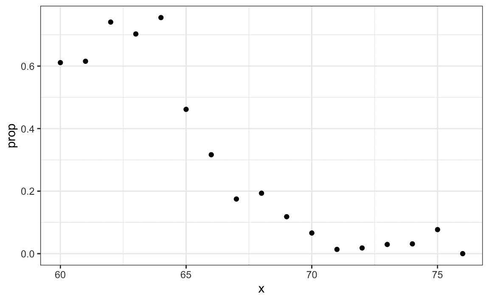

由于上图的结果看起来接近线性，并且这是我们目前唯一知道的方法，我们将尝试回归。我们假设：

$$p(x) = \mbox{Pr}( Y = 1 | X=x) = \beta_0 + \beta_1 x$$

注意：因为 $p_0(x) = 1 - p_1(x)$，我们只估计 $p_1(x)$ 并省略 $_1$ 索引。

如果我们将因素转换为 0 和 1，我们可以用最小二乘法估计 $\beta_0$ 和 $\beta_1$。

```r
lm_fit <- mutate(train_set, y = as.numeric(sex == "Female")) |> 
 lm(y ~ height, data = _)
```

一旦我们有了估计值 $\hat{\beta}_0$ 和 $\hat{\beta}_1$，我们就可以得到一个实际的预测。我们条件概率 $p(x)$ 的估计为：

$$ \hat{p}(x) = \hat{\beta}_0+ \hat{\beta}_1 x $$

为了形成预测，我们定义一个 *决策规则*：如果 $\hat{p}(x) > 0.5$，则预测为女性。我们可以使用以下方法比较我们的预测和结果：

```r
p_hat <- predict(lm_fit, test_set)
y_hat <- ifelse(p_hat > 0.5, "Female", "Male") |> factor()
confusionMatrix(y_hat, test_set$sex)$overall[["Accuracy"]]
#> [1] 0.798
```

我们看到这种方法比猜测要好得多。

### 31.3.1 广义线性模型

函数$\beta_0 + \beta_1 x$可以取任何值，包括负值和大于 1 的值。实际上，在线性回归部分计算出的$\hat{p}(x)$的估计确实变成了负数。

```r
heights |> 
 mutate(x = round(height)) |>
 group_by(x) |>
 filter(n() >= 10) |>
 summarize(prop = mean(sex == "Female")) |>
 ggplot(aes(x, prop)) +
 geom_point() + 
 geom_abline(intercept = lm_fit$coef[1], slope = lm_fit$coef[2])
```

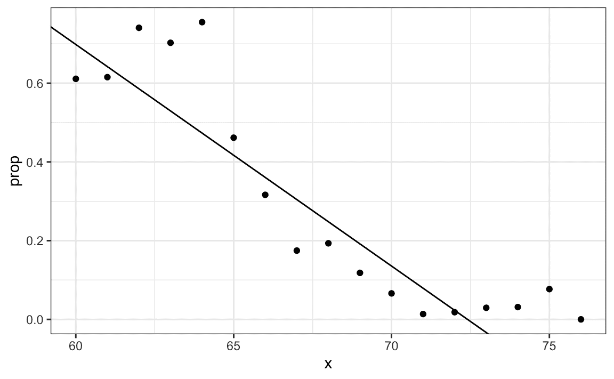

范围是：

```r
range(p_hat)
#> [1] -0.578  1.262
```

但我们是在估计一个概率：$\mbox{Pr}( Y = 1 \mid X = x)$，其值被限制在 0 和 1 之间。

广义线性模型（GLM）的思路是：1）定义一个与可能的输出一致的$Y$的分布；2）找到一个函数$g$，使得$g(\mbox{Pr}( Y = 1 \mid X = x))$可以表示为预测变量的线性组合。逻辑回归是最常用的 GLM。它是线性回归的扩展，确保$\mbox{Pr}( Y = 1 \mid X = x)$的估计值在 0 和 1 之间。这种方法使用了如下定义的*逻辑*变换：

$$ g(p) = \log \frac{p}{1-p}.$$

这种逻辑变换将概率转换为对数几率。正如在数据可视化讲座中讨论的那样，几率告诉我们某事发生的可能性与不发生的可能性相比有多高。$p=0.5$意味着几率是 1 比 1，因此几率是 1。如果$p=0.75$，几率是 3 比 1。这种变换的一个很好的特性是它将概率转换为围绕 0 对称。以下是$g(p)$与$p$的对比图：

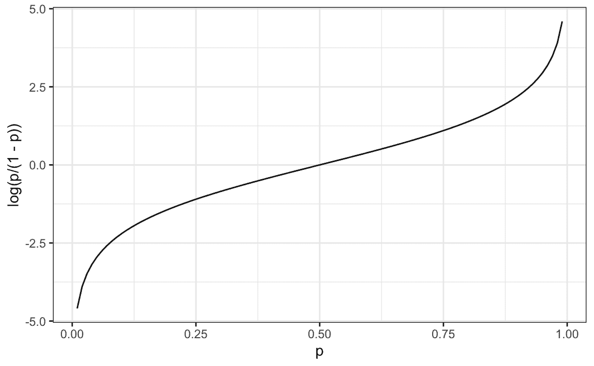

在*逻辑回归*中，我们直接用以下方式对条件概率进行建模：

$$ g\left\{ \mbox{Pr}(Y = 1 \mid X=x) \right\} = \beta_0 + \beta_1 x $$

使用这个模型，我们不能再使用最小二乘法。相反，我们计算*最大似然估计*（MLE）。你可以在统计理论教科书中了解更多关于这个概念的内容¹⁰²。

在 R 中，我们可以使用`glm`函数拟合逻辑回归模型，该函数是广义线性模型。这个函数比逻辑回归更通用，因此我们需要通过`family`参数指定我们想要的模型：

```r
glm_fit <- train_set |> 
 mutate(y = as.numeric(sex == "Female")) |>
 glm(y ~ height, data = _, family = "binomial")
```

我们可以使用 predict 函数进行预测：

```r
p_hat_logit <- predict(glm_fit, newdata = test_set, type = "response")
```

当使用`predict`与`glm`对象一起时，如果我们想得到条件概率，我们必须指定`type="response"`，因为默认返回的是逻辑变换后的值。

这个模型比直线拟合数据略好：

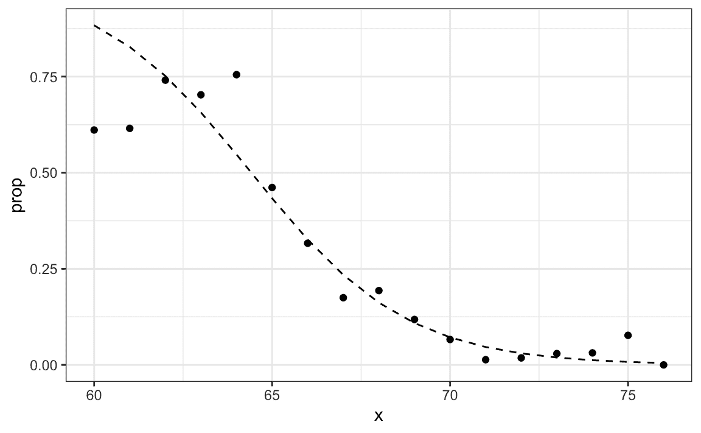

因为有了$\hat{p}(x)$的估计，我们可以得到预测：

```r
y_hat_logit <- ifelse(p_hat_logit > 0.5, "Female", "Male") |> factor()
confusionMatrix(y_hat_logit, test_set$sex)$overall[["Accuracy"]]
#> [1] 0.808
```

得出的预测结果相似。这是因为两个对$p(x)$的估计在 x 的大约相同区域内都大于 1/2：

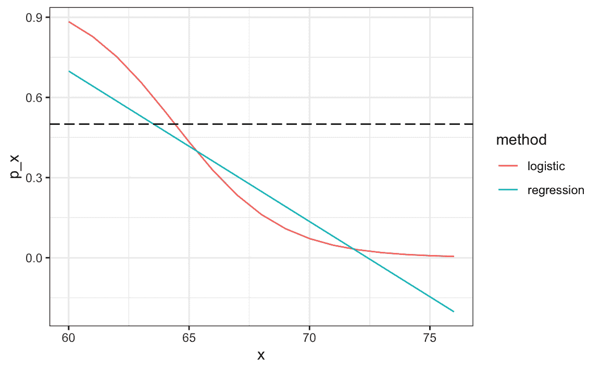

线性和逻辑回归都提供了条件期望的估计：

$$ \mbox{E}(Y \mid X=x) $$ 在二元数据的情况下，这相当于条件概率：

$$ \mbox{Pr}(Y = 1 \mid X = x) $$

### 31.3.2 具有多个预测因子的逻辑回归

在本节中，我们将逻辑回归应用于第 27.8 节中介绍的两个或七个数据。在这种情况下，我们感兴趣的是估计一个依赖于两个变量的条件概率。在这种情况下，标准的逻辑回归模型将假设

$$ g\{p(x_1, x_2)\}= g\{\mbox{Pr}(Y=1 \mid X_1=x_1 , X_2 = x_2)\} = \beta_0 + \beta_1 x_1 + \beta_2 x_2 $$ 其中 $g(p) = \log \frac{p}{1-p}$ 是前一小节中描述的对数逻辑函数。为了拟合模型，我们使用以下代码：

```r
fit_glm <- glm(y ~ x_1 + x_2, data=mnist_27$train, family = "binomial")
p_hat_glm <- predict(fit_glm, mnist_27$test, type="response")
y_hat_glm <- factor(ifelse(p_hat_glm > 0.5, 7, 2))
confusionMatrix(y_hat_glm, mnist_27$test$y)$overall["Accuracy"]
#> Accuracy 
#>    0.775
```

与第 27.8 节中我们得到的结果相比，我们看到逻辑回归的表现与回归相似。这是可以预料的，因为$\hat{p}(x_1, x_2)$的估计看起来也很相似：

```r
p_hat <- predict(fit_glm, newdata = mnist_27$true_p, type = "response")
mnist_27$true_p |> mutate(p_hat = p_hat) |>
 ggplot(aes(x_1, x_2,  z=p_hat, fill=p_hat)) +
 geom_raster() +
 scale_fill_gradientn(colors=c("#F8766D","white","#00BFC4")) +
 stat_contour(breaks=c(0.5), color="black") 
#> Warning: The following aesthetics were dropped
#> during statistical transformation: fill
#> ℹ This can happen when ggplot fails to
#>   infer the correct grouping structure
#>   in the data.
#> ℹ Did you forget to specify a `group`
#>   aesthetic or to convert a numerical
#>   variable into a factor?
```

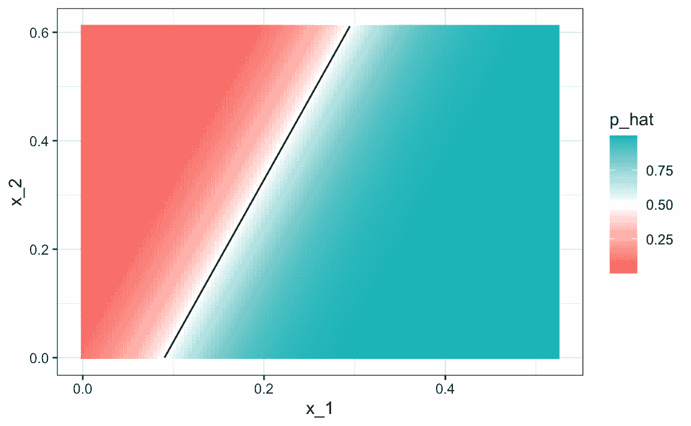

就像回归一样，决策规则是一条线，这一点可以从数学上得到证实，因为

$$ g^{-1}(\hat{\beta}_0 + \hat{\beta}_1 x_1 + \hat{\beta}_2 x_2) = 0.5 \implies \hat{\beta}_0 + \hat{\beta}_1 x_1 + \hat{\beta}_2 x_2 = g(0.5) = 0 \implies x_2 = -\hat{\beta}_0/\hat{\beta}_2 -\hat{\beta}_1/\hat{\beta}_2 x_1 $$

因此，$x_2$是$x_1$的线性函数。这意味着，就像回归一样，我们的逻辑回归方法没有机会捕捉到真实$p(x_1,x_2)$的非线性特性。一旦我们转向更复杂的例子，我们将看到线性回归和广义线性回归是有限的，并且不够灵活，无法用于大多数机器学习挑战。我们学习的新技术本质上是在更灵活的方式下估计条件概率的方法。

## 31.4 练习

1. 定义以下数据集：

```r
make_data <- function(n = 1000, p = 0.5, 
 mu_0 = 0, mu_1 = 2, 
 sigma_0 = 1,  sigma_1 = 1){
 y <- rbinom(n, 1, p)
 f_0 <- rnorm(n, mu_0, sigma_0)
 f_1 <- rnorm(n, mu_1, sigma_1)
 x <- ifelse(y == 1, f_1, f_0)
 test_index <- createDataPartition(y, times = 1, p = 0.5, list = FALSE)
 list(train = data.frame(x = x, y = as.factor(y)) |> 
 slice(-test_index),
 test = data.frame(x = x, y = as.factor(y)) |> 
 slice(test_index))
}
dat <- make_data()
```

注意，我们定义了一个变量`x`，它是二元结果`y`的预测变量。

```r
dat$train |> ggplot(aes(x, color = y)) + geom_density()
```

比较线性回归和逻辑回归的准确率。

2. 将练习 1 中的模拟重复 100 次，并比较每种方法的平均准确率，注意它们给出的答案几乎相同。

3. 生成 25 个不同的数据集，改变两个类之间的差异：`delta <- seq(0, 3, len = 25)`。绘制准确率与`delta`的关系图。

## 31.5 k-最近邻

我们在第 29.1 节中介绍了 kNN 算法，并在第 30.2 节中展示了如何使用交叉验证来选择$k$。在这里，我们简要回顾一下如何使用**caret**包拟合 kNN 模型。在第 30.2 节中，我们介绍了以下代码来拟合 kNN 模型：

```r
train_knn <- train(y ~ ., method = "knn", 
 data = mnist_27$train,
 tuneGrid = data.frame(k = seq(9, 71, 2)))
```

我们看到，最大化估计准确率的参数是：

```r
train_knn$bestTune
#>     k
#> 27 61
```

此模型在准确率上优于回归和逻辑回归：

```r
confusionMatrix(predict(train_knn, mnist_27$test, type = "raw"),
 mnist_27$test$y)$overall["Accuracy"]
#> Accuracy 
#>    0.825
```

估计条件概率的图表显示，kNN 估计足够灵活，确实捕捉到了真实条件概率的形状。

```r
#> Warning: The following aesthetics were dropped
#> during statistical transformation: fill
#> ℹ This can happen when ggplot fails to
#>   infer the correct grouping structure
#>   in the data.
#> ℹ Did you forget to specify a `group`
#>   aesthetic or to convert a numerical
#>   variable into a factor?
#> The following aesthetics were dropped
#> during statistical transformation: fill
#> ℹ This can happen when ggplot fails to
#>   infer the correct grouping structure
#>   in the data.
#> ℹ Did you forget to specify a `group`
#>   aesthetic or to convert a numerical
#>   variable into a factor?
```

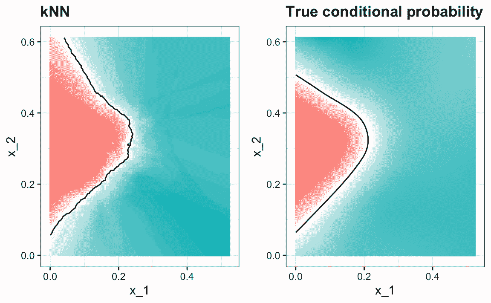

## 31.6 练习

1. 之前我们使用逻辑回归从身高预测性别。使用 kNN 做同样的事情。使用本章中描述的代码选择 $F_1$ 测量值，并将其与 $k$ 对比。与回归获得的约 0.6 的 $F_1$ 值进行比较。

2. 加载以下数据集：

```r
data("tissue_gene_expression")
```

此数据集包括一个矩阵 `x`：

```r
dim(tissue_gene_expression$x)
```

使用在 500 个基因上测量的 189 个生物样本的基因表达，代表七个不同的组织。组织类型存储在 `y` 中：

```r
table(tissue_gene_expression$y)
```

将数据分为训练集和测试集，然后使用 kNN 预测组织类型，并查看你获得的准确率。尝试 $k = 1, 3, \dots, 11$。

## 31.7 生成模型

我们已经描述了在使用平方损失的情况下，条件期望/概率提供了制定决策规则的最佳方法。在二元情况下，我们可以达到的最小真实误差由贝叶斯定理决定，这是一个基于真实条件概率的决策规则：

$$ p(\mathbf{x}) = \mbox{Pr}(Y=1 \mid \mathbf{X}=\mathbf{x}) $$

我们已经描述了几种估计 $p(\mathbf{x})$ 的方法。在这些方法中，我们直接估计条件概率，不考虑预测变量的分布。在机器学习中，这些被称为 *判别* 方法。

然而，贝叶斯定理告诉我们，了解预测变量 $\mathbf{X}$ 的分布可能是有用的。那些对 $Y$ 和 $\mathbf{X}$ 的联合分布进行建模的方法被称为 *生成模型*（我们建模整个数据，$\mathbf{X}$ 和 $Y$ 的生成方式）。我们首先描述最一般的生成模型，朴素贝叶斯，然后继续描述两个具体案例，二次判别分析（QDA）和线性判别分析（LDA）。

### 31.7.1 朴素贝叶斯

回想一下，贝叶斯规则告诉我们我们可以这样重写 $p(\mathbf{x})$：

$$ p(\mathbf{x}) = \mbox{Pr}(Y=1|\mathbf{X}=\mathbf{x}) = \frac{f_{\mathbf{X}|Y=1}(\mathbf{x}) \mbox{Pr}(Y=1)} { f_{\mathbf{X}|Y=0}(\mathbf{x})\mbox{Pr}(Y=0) + f_{\mathbf{X}|Y=1}(\mathbf{x})\mbox{Pr}(Y=1) } $$

其中 $f_{\mathbf{X}|Y=1}$ 和 $f_{\mathbf{X}|Y=0}$ 分别代表预测变量 $\mathbf{X}$ 在两个类别 $Y=1$ 和 $Y=0$ 中的分布函数。该公式意味着如果我们能估计这些预测变量的条件分布，我们就可以制定一个强大的决策规则。然而，这是一个很大的 *如果*。随着我们继续前进，我们将遇到 $\mathbf{X}$ 有许多维度而我们没有太多关于分布信息的情况。在这些情况下，朴素贝叶斯将实际上无法实现。然而，在某些情况下，我们只有少数预测变量（不超过 2 个）和许多类别，在这些情况下，生成模型可以非常强大。我们描述了两个具体例子，并使用我们之前描述的案例研究来展示它们。

让我们从一个非常简单、不有趣但具有说明性的案例开始：与从身高预测性别相关的例子。

```r
library(tidyverse)
library(caret)

library(dslabs)
data("heights")

y <- heights$height
set.seed(1995)
test_index <- createDataPartition(y, times = 1, p = 0.5, list = FALSE)
train_set <- heights |> slice(-test_index)
test_set <- heights |> slice(test_index)
```

在这种情况下，朴素贝叶斯方法特别合适，因为我们知道正态分布是两个类 $Y=1$（女性）和 $Y=0$（男性）在给定性别条件下的条件分布的良好近似。这意味着我们可以通过简单地从数据中估计平均值和标准差来近似条件分布 $f_{X|Y=1}$ 和 $f_{X|Y=0}$：

```r
params <- train_set |> 
 group_by(sex) |> 
 summarize(avg = mean(height), sd = sd(height))
params
#> # A tibble: 2 × 3
#>   sex      avg    sd
#>   <fct>  <dbl> <dbl>
#> 1 Female  64.8  4.14
#> 2 Male    69.2  3.57
```

发病率，我们将用 $\pi = \mbox{Pr}(Y=1)$ 表示，可以从数据中估计出来：

```r
pi <- train_set |> summarize(pi=mean(sex=="Female")) |> pull(pi)
pi
#> [1] 0.212
```

现在，我们可以使用我们对平均数和标准差的估计来得到一个实际的规则：

```r
x <- test_set$height

f0 <- dnorm(x, params$avg[2], params$sd[2])
f1 <- dnorm(x, params$avg[1], params$sd[1])

p_hat_bayes <- f1*pi / (f1*pi + f0*(1 - pi))
```

我们的朴素贝叶斯估计 $\hat{p}(x)$ 与逻辑回归估计非常相似：

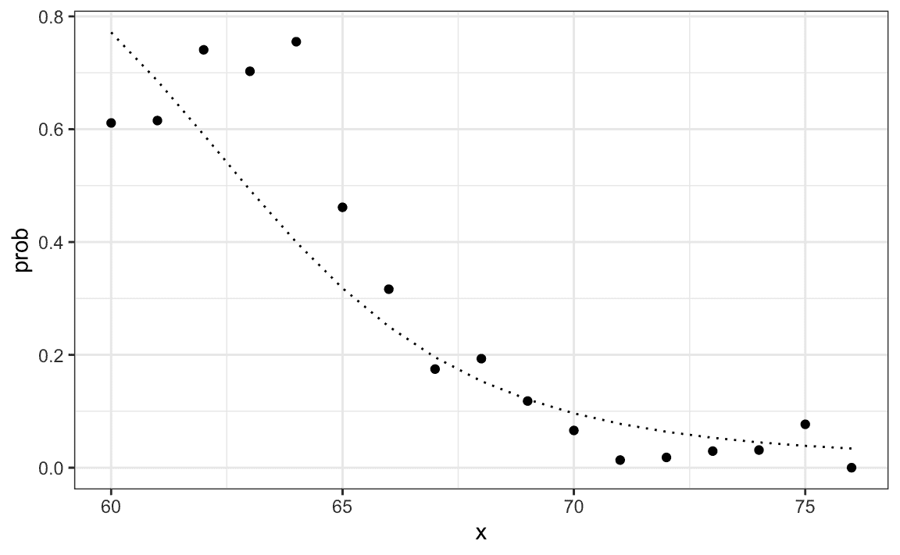

实际上，我们可以证明朴素贝叶斯方法在数学上与逻辑回归预测相似。然而，我们将证明留给更高级的文本，如《统计学习基础》¹⁰³。我们可以通过比较两个结果曲线来观察它们在经验上的相似性。

### 31.7.2 控制发病率

朴素贝叶斯方法的一个有用特性是它包含一个参数来考虑发病率的不同。使用我们的样本，我们估计了 $f_{X|Y=1}$，$f_{X|Y=0}$ 和 $\pi$。如果我们用帽子表示估计值，我们可以将 $\hat{p}(x)$ 写作：

$$ \hat{p}(x)= \frac{\hat{f}_{X|Y=1}(x) \hat{\pi}} { \hat{f}_{X|Y=0}(x)(1-\hat{\pi}) + \hat{f}_{X|Y=1}(x)\hat{\pi} } $$

如我们之前讨论的，我们的样本发病率远低于总体，仅为 0.21。因此，如果我们使用规则 $\hat{p}(x)>0.5$ 来预测女性，由于低灵敏度，我们的准确性将受到影响：

```r
y_hat_bayes <- ifelse(p_hat_bayes > 0.5, "Female", "Male")
sensitivity(data = factor(y_hat_bayes), reference = factor(test_set$sex))
#> [1] 0.213
```

再次，这是因为算法更重视特异性以应对低发病率：

```r
specificity(data = factor(y_hat_bayes), reference = factor(test_set$sex))
#> [1] 0.967
```

这主要是因为 $\hat{\pi}$ 大大低于 0.5，所以我们倾向于更频繁地预测“男性”。在我们的样本中，由于我们确实有较高的男性比例，这合乎逻辑。但是，如果我们将此外推到总体，我们的整体准确性将受到低灵敏度的影响。

朴素贝叶斯方法为我们提供了一种直接纠正这一问题的方法，因为我们只需简单地将 $\hat{\pi}$ 设为我们想要的任何值。因此，为了平衡特异性和灵敏度，我们不必改变决策规则中的截止值，而可以简单地像这样将 $\hat{\pi}$ 改为 0.5：

```r
p_hat_bayes_unbiased <- f1 * 0.5 / (f1 * 0.5 + f0 * (1 - 0.5)) 
y_hat_bayes_unbiased <- ifelse(p_hat_bayes_unbiased> 0.5, "Female", "Male")
```

注意灵敏度上的差异，以获得更好的平衡：

```r
sensitivity(factor(y_hat_bayes_unbiased), factor(test_set$sex))
#> [1] 0.693
specificity(factor(y_hat_bayes_unbiased), factor(test_set$sex))
#> [1] 0.832
```

新规则还给出了一个非常直观的 66-67 之间的截止值，这大约是女性和男性平均身高的中间值：

```r
qplot(x, p_hat_bayes_unbiased, geom = "line") + 
 geom_hline(yintercept = 0.5, lty = 2) + 
 geom_vline(xintercept = 67, lty = 2)
```

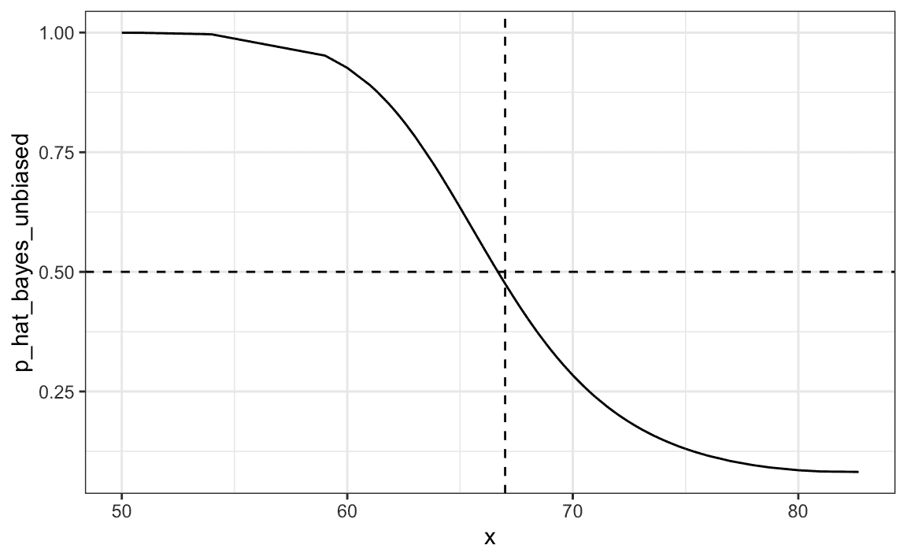

### 31.7.3 二次判别分析

二次判别分析（QDA）是朴素贝叶斯的一种版本，其中我们假设分布 $p_{\mathbf{X}|Y=1}(x)$ 和 $p_{\mathbf{X}|Y=0}(\mathbf{x})$ 是多元正态分布。我们之前章节中描述的简单例子实际上是 QDA。现在让我们看看一个稍微复杂一些的案例：2 或 7 的例子。

```r
data("mnist_27")
```

在这种情况下，我们有两个预测因子，因此我们假设每个都是双变量正态分布。这意味着我们需要为每个案例 $Y=1$ 和 $Y=0$ 估计两个平均值、两个标准差和一个相关性。一旦我们有了这些，我们就可以近似分布 $f_{X_1,X_2|Y=1}$ 和 $f_{X_1, X_2|Y=0}$。我们可以轻松地从数据中估计参数：

```r
params <- mnist_27$train |> 
 group_by(y) |> 
 summarize(avg_1 = mean(x_1), avg_2 = mean(x_2), 
 sd_1= sd(x_1), sd_2 = sd(x_2), 
 r = cor(x_1, x_2))
params
#> # A tibble: 2 × 6
#>   y     avg_1 avg_2   sd_1   sd_2     r
#>   <fct> <dbl> <dbl>  <dbl>  <dbl> <dbl>
#> 1 2     0.136 0.287 0.0670 0.0600 0.415
#> 2 7     0.238 0.290 0.0745 0.104  0.468
```

在这里，我们提供了一种可视化的方法来展示这种方法。我们绘制了数据，并使用等高线图来给出两个估计的正态密度分布的大致形状（我们展示了代表包含 95%点的曲线）：

```r
mnist_27$train |> mutate(y = factor(y)) |> 
 ggplot(aes(x_1, x_2, fill = y, color=y)) + 
 geom_point(show.legend = FALSE) + 
 stat_ellipse(type="norm", lwd = 1.5)
```

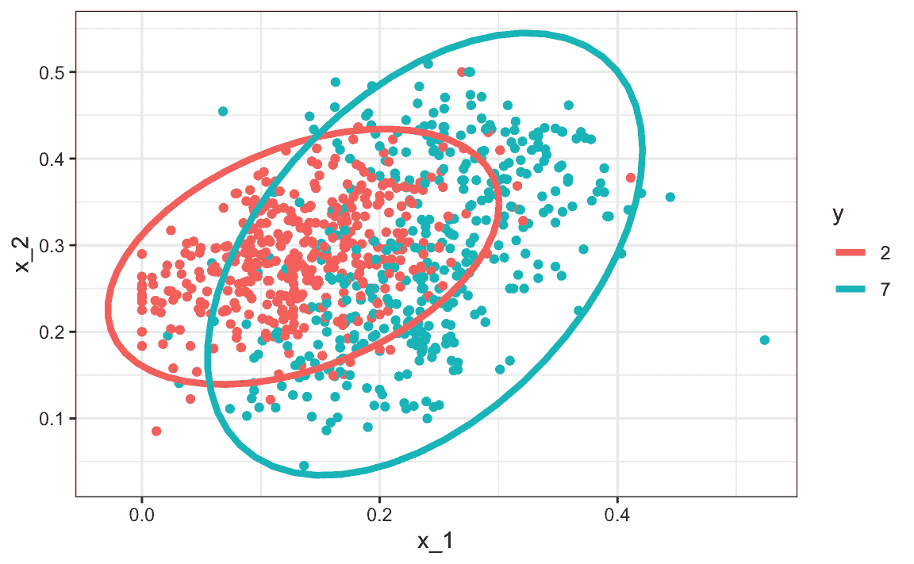

这定义了 $f(x_1, x_2)$ 的以下估计。

我们可以使用 **caret** 包中的 `train` 函数来拟合模型并获得预测因子：

```r
library(caret)
train_qda <- train(y ~ ., method = "qda", data = mnist_27$train)
```

我们看到我们获得了相对较好的准确度：

```r
y_hat <- predict(train_qda, mnist_27$test)
confusionMatrix(y_hat, mnist_27$test$y)$overall["Accuracy"]
#> Accuracy 
#>    0.815
```

估计的条件概率看起来相对较好，尽管它不如核平滑器拟合得那么好：

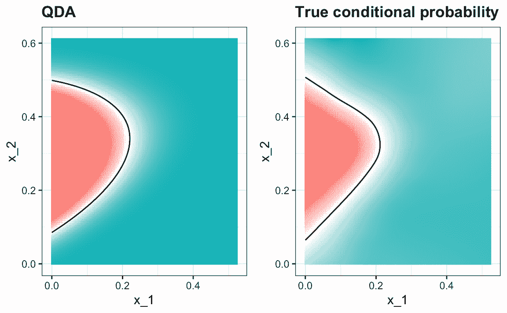

QDA 不如核方法工作得好的一个原因可能是因为正态性的假设并不完全成立。尽管对于 2s 来说似乎是合理的，但对于 7s 来说似乎并不准确。注意 7s 点的轻微曲率：

```r
mnist_27$train |> mutate(y = factor(y)) |> 
 ggplot(aes(x_1, x_2, fill = y, color=y)) + 
 geom_point(show.legend = FALSE) + 
 stat_ellipse(type="norm") +
 facet_wrap(~y)
```

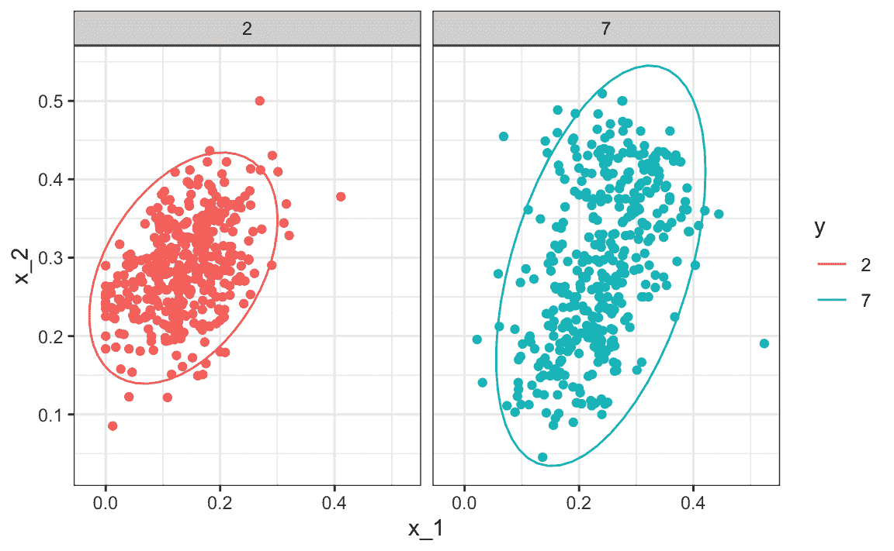

QDA 在这里可以很好地工作，但随着预测因子数量的增加，它变得难以使用。这里我们有 2 个预测因子，不得不计算 4 个均值、4 个标准差和 2 个相关性。如果我们有 10 个预测因子而不是 2 个，我们会有多少个参数？主要问题来自于估计 10 个预测因子的相关性。对于 10 个，我们每个类别有 45 个相关性。一般来说，公式是 $K\times p(p-1)/2$，这会很快变得很大。一旦参数的数量接近数据的大小，由于过拟合，方法变得不切实际。

### 31.7.4 线性判别分析

对于参数过多的问题的一个相对简单的解决方案是假设所有类别的相关结构相同，这减少了我们需要估计的参数数量。

在这种情况下，我们只需计算一对标准差和一个相关性，分布看起来是这样的：

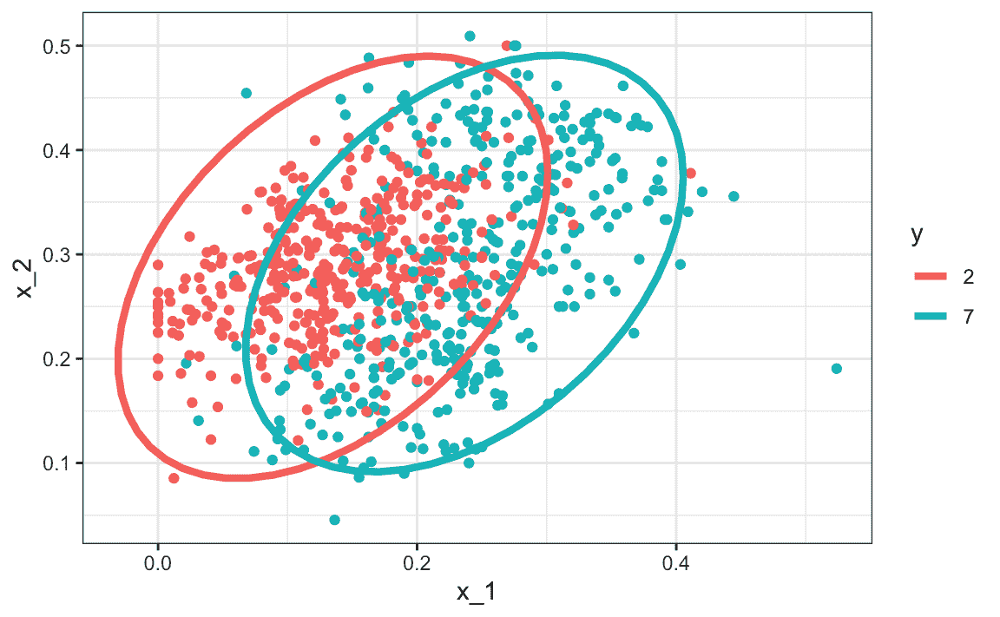

现在椭圆的大小以及角度都是相同的。这是因为它们具有相同的标准差和相关性。

我们可以使用 **caret** 来拟合 LDA 模型：

```r
train_lda <- train(y ~ ., method = "lda", data = mnist_27$train)
y_hat <- predict(train_lda, mnist_27$test)
confusionMatrix(y_hat, mnist_27$test$y)$overall["Accuracy"]
#> Accuracy 
#>    0.775
```

当我们强制这个假设时，我们可以从数学上证明边界是一条线，就像逻辑回归一样。因此，我们称这种方法为*线性判别分析（LDA）*。同样，对于 QDA，我们可以证明边界必须是一个二次函数。

```r
#> Warning: The following aesthetics were dropped
#> during statistical transformation: fill
#> ℹ This can happen when ggplot fails to
#>   infer the correct grouping structure
#>   in the data.
#> ℹ Did you forget to specify a `group`
#>   aesthetic or to convert a numerical
#>   variable into a factor?
#> The following aesthetics were dropped
#> during statistical transformation: fill
#> ℹ This can happen when ggplot fails to
#>   infer the correct grouping structure
#>   in the data.
#> ℹ Did you forget to specify a `group`
#>   aesthetic or to convert a numerical
#>   variable into a factor?
```

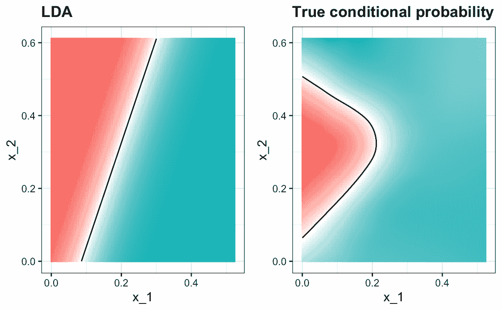

在 LDA 的情况下，缺乏灵活性不允许我们捕捉到真实条件概率函数中的非线性。

### 31.7.5 与距离的关系

正态密度为：

$$ p(x) = \frac{1}{\sqrt{2\pi} \sigma} \exp\left\{ - \frac{(x-\mu)²}{\sigma²}\right\} $$

如果我们移除常数$1/(\sqrt{2\pi} \sigma)$然后取对数，我们得到：

$$ - \frac{(x-\mu)²}{\sigma²} $$

这是对距离平方的负值，并按标准差进行缩放。对于更高维的情况，同样适用，但缩放更复杂，涉及相关性。

## 31.8 案例研究：多于三个类别

我们可以生成一个具有三个类别的示例，如下所示：

```r
if(!exists("mnist")) mnist <- read_mnist()
set.seed(3456)
index_127 <- sample(which(mnist$train$labels %in% c(1,2,7)), 2000)
y <- mnist$train$labels[index_127] 
x <- mnist$train$images[index_127,]
index_train <- createDataPartition(y, p=0.8, list = FALSE)
## get the quadrants
row_column <- expand.grid(row=1:28, col=1:28) 
upper_left_ind <- which(row_column$col <= 14 & row_column$row <= 14)
lower_right_ind <- which(row_column$col > 14 & row_column$row > 14)
## binarize the values. Above 200 is ink, below is no ink
x <- x > 200 
## proportion of pixels in lower right quadrant
x <- cbind(rowSums(x[ ,upper_left_ind])/rowSums(x), 
 rowSums(x[ ,lower_right_ind])/rowSums(x)) 
##save data
train_set <- data.frame(y = factor(y[index_train]),
 x_1 = x[index_train,1], x_2 = x[index_train,2])
test_set <- data.frame(y = factor(y[-index_train]),
 x_1 = x[-index_train,1], x_2 = x[-index_train,2])
```

这里是训练数据：

```r
train_set |> ggplot(aes(x_1, x_2, color=y)) + geom_point()
```

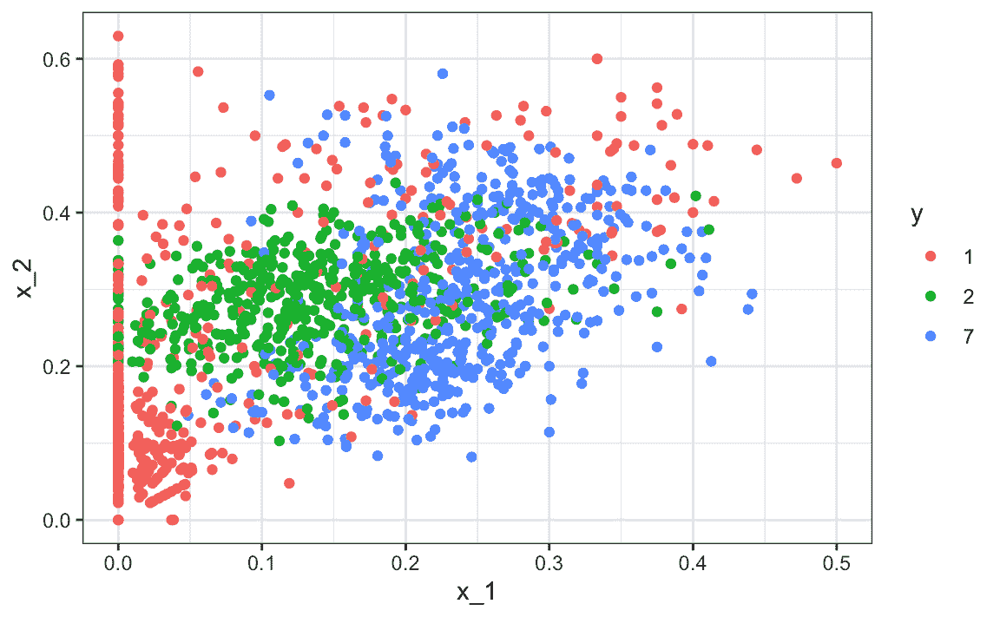

我们可以使用**caret**包来训练 QDA 模型：

```r
train_qda <- train(y ~ ., method = "qda", data = train_set)
```

现在我们估计三个条件概率（尽管它们必须加起来为 1）：

```r
predict(train_qda, test_set, type = "prob") |> head()
#>        1       2       7
#> 1 0.7655 0.23043 0.00405
#> 2 0.2031 0.72514 0.07175
#> 3 0.5396 0.45909 0.00132
#> 4 0.0393 0.09419 0.86655
#> 5 0.9600 0.00936 0.03063
#> 6 0.9865 0.00724 0.00623
```

我们的预测是三个类别之一：

```r
predict(train_qda, test_set) |> head()
#> [1] 1 2 1 7 1 1
#> Levels: 1 2 7
```

因此，混淆矩阵是一个 3x3 的表格：

```r
confusionMatrix(predict(train_qda, test_set), test_set$y)$table
#>           Reference
#> Prediction   1   2   7
#>          1 111   9  11
#>          2  10  86  21
#>          7  21  28 102
```

准确率为 0.749

注意，对于敏感度和特异性，我们为**每个**类别有一对值。为了定义这些术语，我们需要一个二元结果。因此，我们有三个列：一个用于每个类别的阳性，其他两个用于阴性。

为了可视化哪些区域被称为 1、2 和 7，我们现在需要三种颜色：

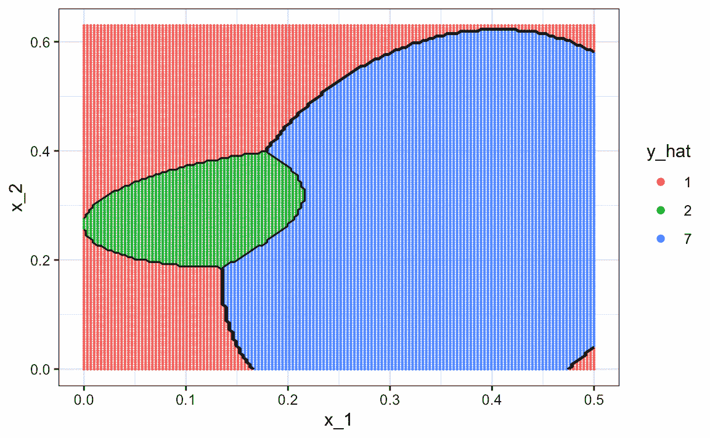

LDA 的准确率（0.629）要差得多，因为模型更僵硬。决策规则看起来是这样的：

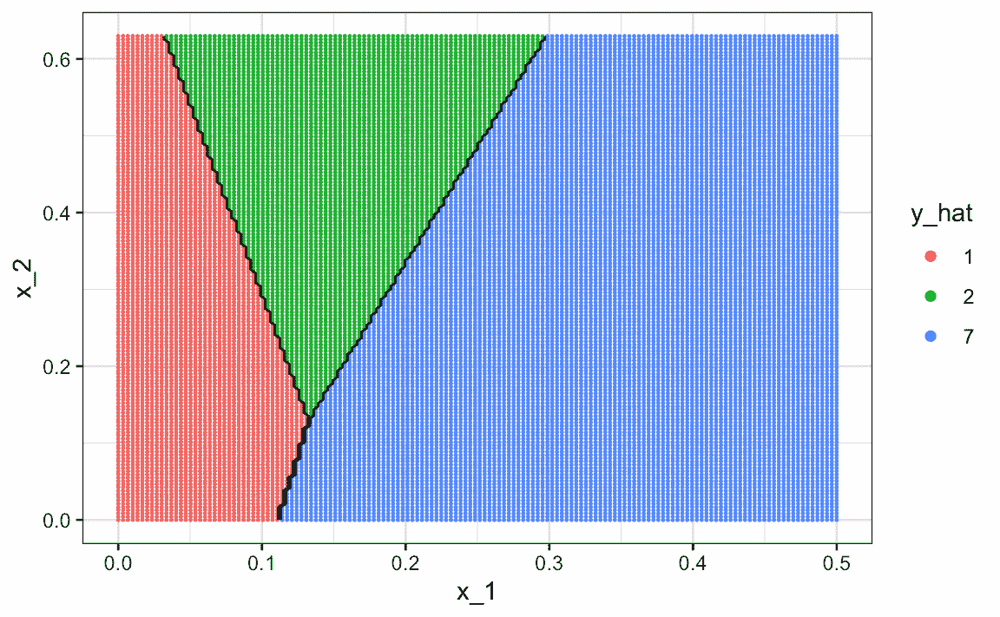

kNN 的结果

```r
train_knn <- train(y ~ ., method = "knn", data = train_set,
 tuneGrid = data.frame(k = seq(15, 51, 2)))
```

准确率更高，为 0.749。决策规则看起来是这样的：

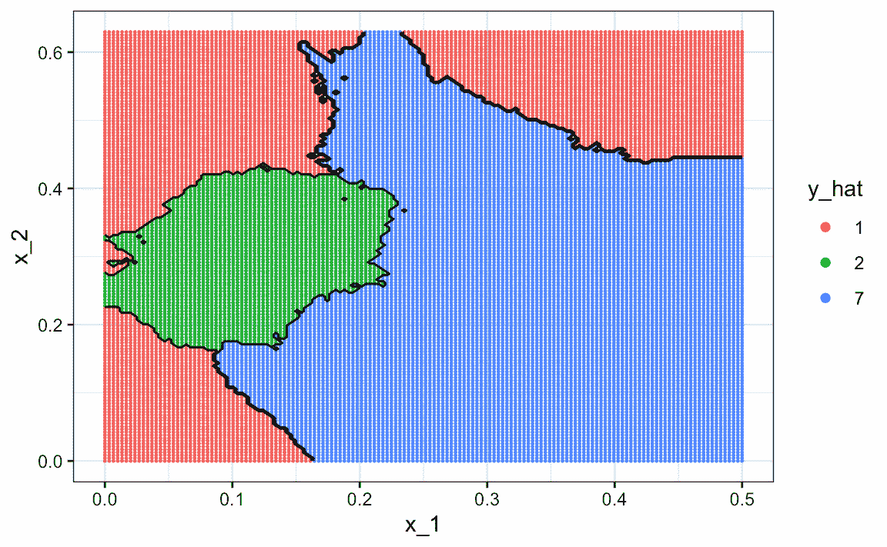

注意，这里生成模型的一个局限性是由于正态假设的拟合不足，特别是对于第 1 类。

```r
train_set |> mutate(y = factor(y)) |> 
 ggplot(aes(x_1, x_2, fill = y, color=y)) + 
 geom_point(show.legend = FALSE) + 
 stat_ellipse(type="norm") 
```

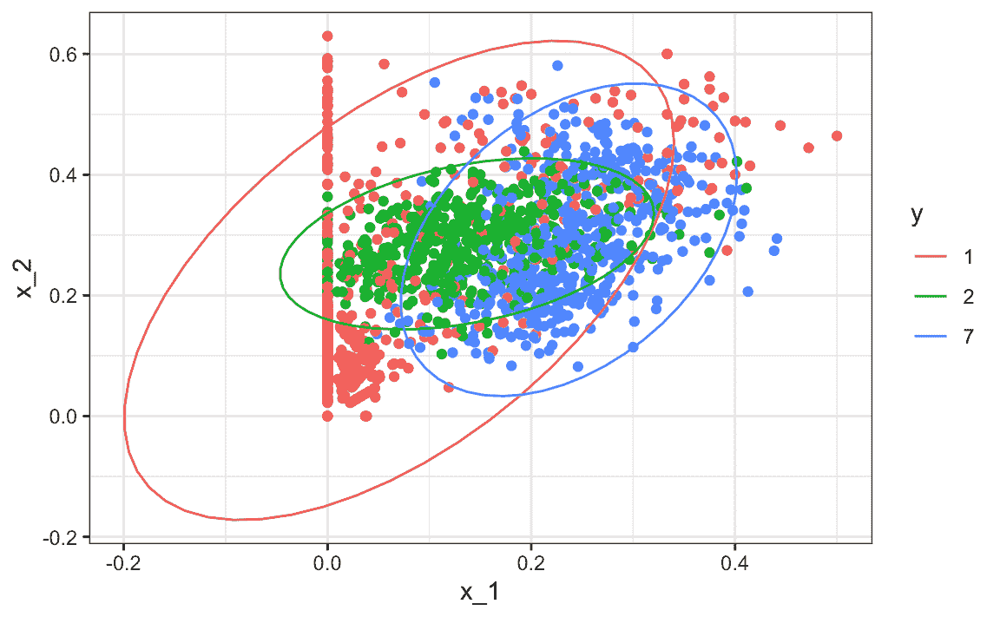

生成模型可以非常强大，但只有当我们能够成功近似每个类别的预测变量的联合分布时。

## 31.9 练习

我们将应用 LDA 和 QDA 到`tissue_gene_expression`数据集。我们将从这个数据集的简单示例开始，然后开发一个现实世界的示例。

1. 创建一个只包含“小脑”和“海马体”（大脑的两个部分）的类别数据集，以及一个包含 10 个随机选择的列的预测矩阵。

```r
set.seed(1993)
data("tissue_gene_expression")
tissues <- c("cerebellum", "hippocampus")
ind <- which(tissue_gene_expression$y %in% tissues)
y <- droplevels(tissue_gene_expression$y[ind])
x <- tissue_gene_expression$x[ind, ]
x <- x[, sample(ncol(x), 10)]
```

使用`train`函数来估计 LDA 的准确性。

2. 在这种情况下，LDA 拟合了两个 10 维正态分布。通过查看 train 的结果的`finalModel`组件来查看拟合的模型。注意有一个名为`means`的组件，其中包含两个分布的估计`means`。将均值向量相互对比，并确定哪些预测因子（基因）似乎在驱动算法。

3. 重复练习 1，使用 QDA。它比 LDA 有更高的准确度吗？

4. 是否是相同的预测因子（基因）驱动算法？制作一个类似于练习 2 的图表。

5. 在之前的图表中，我们看到预测因子的值在两组中都是相关的：一些预测因子在两组中都很低，而其他预测因子在两组中都较高。每个预测因子的平均值 `colMeans(x)` 对于预测没有信息或用途，并且通常在解释目的上，对每个列进行中心化或缩放是有用的。这可以通过`train`中的`preProcessing`参数来实现。重新运行 LDA，将`preProcessing`设置为"scale"。注意准确度没有变化，但看看在练习 4 中制作的图表中是否更容易识别两组之间差异更大的预测因子。

6. 在之前的练习中，我们看到了两种方法都工作得很好。在散点图中绘制两个基因的预测值，这两个基因在两组之间的差异最大，以查看它们似乎遵循 LDA 和 QDA 方法所假设的双变量分布。根据结果着色点。

7. 现在我们将稍微增加挑战的复杂性：我们将考虑所有组织类型。

```r
set.seed(1993)
data("tissue_gene_expression")
y <- tissue_gene_expression$y
x <- tissue_gene_expression$x
x <- x[, sample(ncol(x), 10)]
```

使用 LDA 你能得到多少准确度？

8. 我们看到结果略有下降。使用`confusionMatrix`函数来了解我们正在犯什么类型的错误。

9. 绘制七个 10 维正态分布中心的图像。

## 31.10 分类和回归树（CART）

### 31.10.1 维度诅咒

我们描述了为什么像 LDA 和 QDA 这样的方法不适用于许多预测因子（$p$），因为我们需要估计的参数数量变得过大。例如，在数字示例中 $p=784$，我们会有超过 60 万个参数使用 LDA，而对于 QDA，这个数字会乘以类别的数量。核方法，如 kNN 或局部回归，没有模型参数需要估计。然而，由于所谓的“维度诅咒”，当使用多个预测因子时，它们也面临着挑战。这里的“维度”指的是当我们有 $p$ 个预测因子时，两个观测值之间的距离是在 $p$ 维空间中计算的。

理解“维度诅咒”的一个有用方法是考虑我们需要将跨度/邻域/窗口放大到多大才能包含给定百分比的数据。记住，随着邻域的增大，我们的方法会失去灵活性。

例如，假设我们有一个在[0,1]区间内等间距点的连续预测因子，并且我们想创建包括 1/10th 数据的窗口。那么很容易看出，我们的窗口大小必须是 0.1：

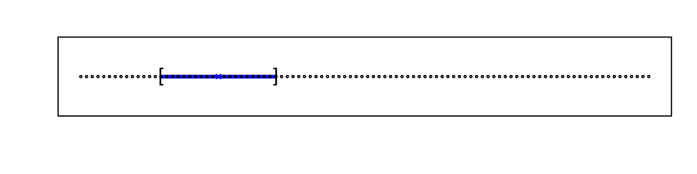

现在，对于两个预测因子，如果我们决定保持邻域大小不变，每个维度为 10%，我们只包括 1 个点。如果我们想包括 10%的数据，那么我们需要将正方形的每一边的大小增加到 $\sqrt{.10} \approx .316$:

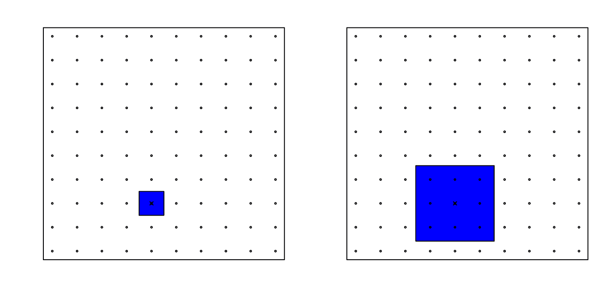

使用相同的逻辑，如果我们想在三维空间中包括 10%的数据，那么每个立方体的边长是 $\sqrt[3]{.10} \approx 0.464$。一般来说，为了在具有 $p$ 维的案例中包括 10%的数据，我们需要一个边长为 $\sqrt[p]{.10}$ 的区间。这个比例很快就会接近 1，如果比例是 1，这意味着我们包括了所有数据，并且不再进行平滑处理。

```r
library(tidyverse)
p <- 1:100
qplot(p, .1^(1/p), ylim = c(0,1))
```

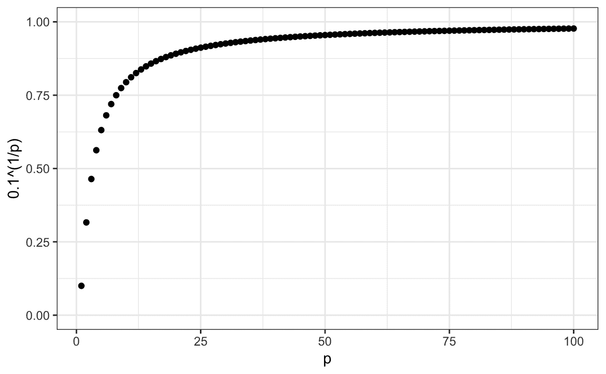

当我们达到 100 个预测因子时，邻域就不再非常局部了，因为每一边几乎覆盖了整个数据集。

在这里，我们研究了一系列优雅且通用的方法，这些方法适应更高维度，并允许这些区域采取更复杂的形状，同时仍然产生可解释的模型。这些方法非常流行，广为人知，并且被广泛研究。我们将专注于回归和决策树及其扩展到随机森林。

### 31.10.2 CART 激励

为了激励本节，我们将使用一个新的数据集，该数据集包括橄榄油成分分解为 8 种脂肪酸的详细情况：

```r
library(tidyverse)
library(dslabs)
data("olive")
names(olive)
#>  [1] "region"      "area"        "palmitic"    "palmitoleic"
#>  [5] "stearic"     "oleic"       "linoleic"    "linolenic" 
#>  [9] "arachidic"   "eicosenoic"
```

为了说明目的，我们将尝试使用脂肪酸组成值作为预测因子来预测地区。

```r
table(olive$region)
#> 
#> Northern Italy       Sardinia Southern Italy 
#>            151             98            323
```

我们移除了`area`列，因为我们不会将其用作预测因子。

```r
olive <- select(olive, -area)
```

让我们快速尝试使用 kNN 来预测地区：

```r
library(caret)
fit <- train(region ~ .,  method = "knn", 
 tuneGrid = data.frame(k = seq(1, 15, 2)), 
 data = olive)
ggplot(fit)
```

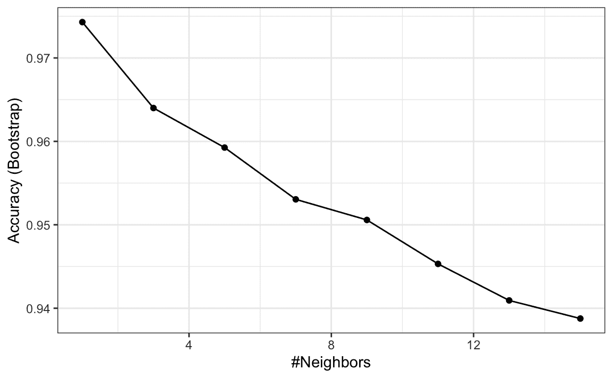

我们看到，仅使用一个邻近点，我们就能相对较好地进行预测。然而，一些数据探索揭示，我们应该能够做得更好。例如，如果我们按地区对每个预测因子的分布进行分层，我们会发现二十碳烯酸只存在于意大利南部，而亚油酸则将意大利北部与撒丁岛分开。

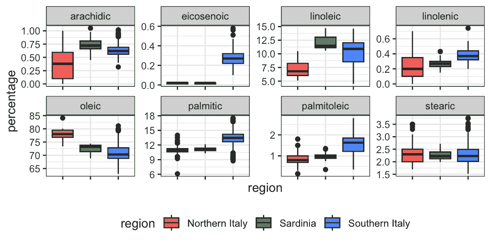

这意味着我们应该能够构建一个完美预测的算法！我们可以通过绘制二十碳烯酸和亚油酸值来清楚地看到这一点。

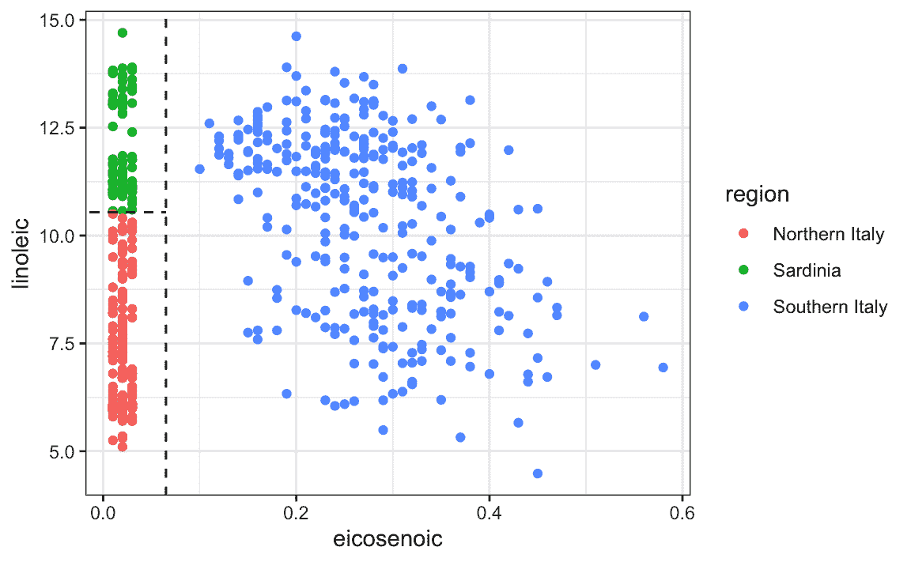

在第 33.3.4 节中，我们定义了预测空间。这里的预测空间由八个维度的点组成，其值在 0 到 100 之间。在上面的图中，我们展示了由两个预测器 eicosenoic 和 linoleic 定义的空间，并且通过目测，我们可以构建一个预测规则，将预测空间划分为每个分区只包含一个类别的结果。这反过来可以用来定义一个具有完美准确性的算法。具体来说，我们定义以下决策规则。如果 eicosenoic 大于 0.065，预测南意大利。如果不，那么如果 linoleic 大于$10.535$，预测撒丁岛，如果更低，预测北意大利。我们可以这样绘制这个决策树：

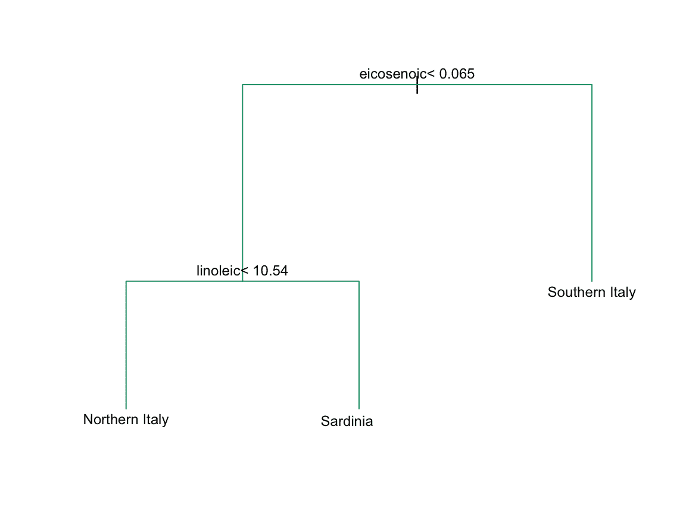

这种决策树在实践中经常被使用。例如，为了决定一个人在心脏病发作后的不良结果风险，医生使用以下方法：

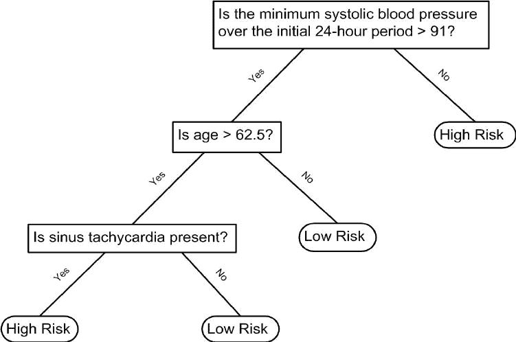

（来源：Walton 2010 非正式逻辑，第 30 卷，第 2 期，第 159-184 页¹⁰⁴。）

树基本上是一个是或否问题的流程图。我们描述的方法的一般思想是定义一个算法，该算法使用数据创建这些在末端具有预测的树，称为*节点*。回归和决策树通过通过分区预测变量来预测结果变量 $Y$。

### 31.10.3 回归树

当结果连续时，我们称这种方法为*回归*树。为了介绍回归树，我们将使用之前章节中使用的 2008 年民意调查数据来描述我们构建这些算法的基本思想。与其他机器学习算法一样，我们将尝试估计条件期望 $f(x) = \mbox{E}(Y | X = x)$，其中 $Y$ 是投票差额，$x$ 是日期。

```r
data("polls_2008")
qplot(day, margin, data = polls_2008)
```

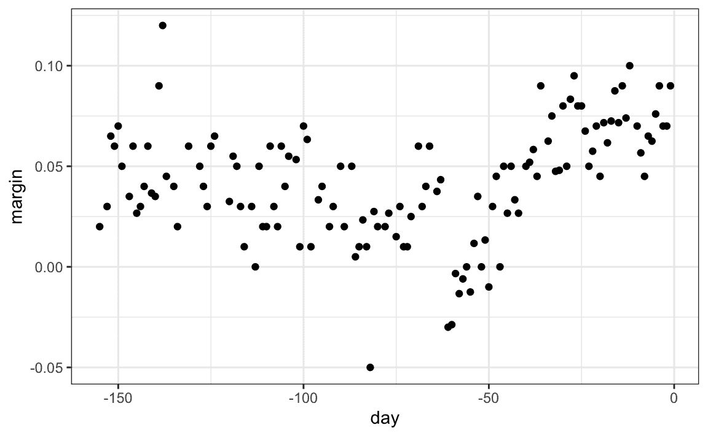

这里的基本思想是构建一个决策树，并在每个*节点*的末尾获得一个预测器 $\hat{y}$。用数学方式描述，可以说我们正在将预测空间划分为 $J$ 个非重叠的区域，$R_1, R_2, \ldots, R_J$，然后对于任何落在区域 $R_j$ 内的预测器 $x$，使用与相关预测器 $x_i$ 也在 $R_j$ 内的训练观察值 $y_i$ 的平均值来估计 $f(x)$。

但我们如何决定分区 $R_1, R_2, \ldots, R_J$ 以及如何选择 $J$ 呢？这正是算法变得有些复杂的地方。

回归树通过递归地创建分区。我们以一个分区开始算法，即整个预测空间。在我们的简单第一个例子中，这个空间是区间[-155, 1]。但第一步之后，我们将有两个分区。第二步后，我们将其中一个分区分成两个，并将有三个分区，然后是四个，然后是五个，以此类推。我们将在后面描述我们如何选择分区以进一步分区，以及何时停止。

一旦我们选择一个分区$\mathbf{x}$进行分割以创建新的分区，我们就会找到一个预测因子$j$和值$s$，这两个值定义了两个新的分区，我们将它们称为$R_1(j,s)$和$R_2(j,s)$，通过询问$x_j$是否大于$s$来分割当前分区中的观测值：

$$ R_1(j,s) = \{\mathbf{x} \mid x_j < s\} \mbox{ 和 } R_2(j,s) = \{\mathbf{x} \mid x_j \geq s\} $$

在我们当前的例子中，我们只有一个预测因子，所以我们将始终选择$j=1$，但在一般情况下，情况并非如此。现在，在我们定义了新的分区$R_1$和$R_2$，并决定停止分割后，我们通过取所有与相关的$\mathbf{x}$在$R_1$和$R_2$中的观测值$y$的平均值来计算预测因子。我们将这些称为$\hat{y}_{R_1}$和$\hat{y}_{R_2}$分别。

但我们如何选择$j$和$s$呢？基本上，我们找到使残差平方和（RSS）最小的那一对：$$ \sum_{i:\, x_i \in R_1(j,s)} (y_i - \hat{y}_{R_1})² + \sum_{i:\, x_i \in R_2(j,s)} (y_i - \hat{y}_{R_2})² $$

然后将此递归应用于新的区域$R_1$和$R_2$。我们稍后描述如何停止，但一旦我们将预测空间分割成区域，在每个区域中，我们都会使用该区域的观测值进行预测。

让我们看看这个算法在 2008 年总统选举民意调查数据上的表现。我们将使用**rpart**包中的`rpart`函数。

```r
library(rpart)
fit <- rpart(margin ~ ., data = polls_2008)
```

在这里，只有一个预测因子。因此，我们不需要决定分割哪个预测因子$j$，我们只需要决定使用什么值$s$进行分割。我们可以直观地看到分割的位置：

```r
plot(fit, margin = 0.1)
text(fit, cex = 0.75)
```

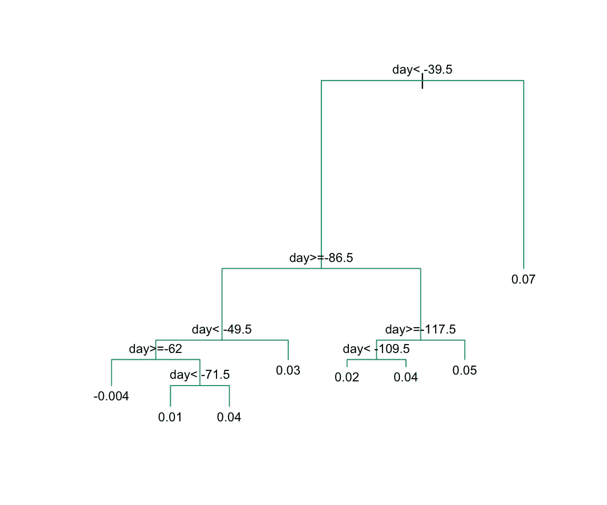

第一次分割发生在第 39.5 天。然后其中一个区域在第 86.5 天再次分割。这两个新产生的分区分别在 49.5 天和 117.5 天进行分割，以此类推。最终我们得到 8 个分区。最终的估计值$\hat{f}(x)$看起来是这样的：

```r
polls_2008 |> 
 mutate(y_hat = predict(fit)) |> 
 ggplot() +
 geom_point(aes(day, margin)) +
 geom_step(aes(day, y_hat), col="red")
```

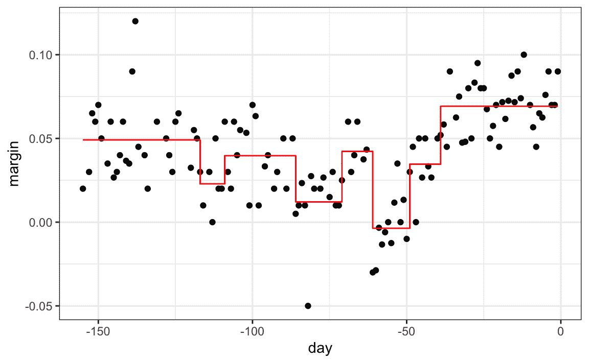

注意，算法在第 8 次分割后停止了。现在我们解释这个决策是如何做出的。

首先，我们需要定义术语*复杂度参数*（cp）。每次我们分割并定义两个新的分区时，我们的训练集 RSS 都会下降。这是因为随着分区的增加，我们的模型有更多的灵活性来适应训练数据。事实上，如果你一直分割直到每个点都是一个分区，那么 RSS 会降至 0，因为一个值的平均值就是那个值本身。为了避免这种情况，算法设置了一个 RSS 必须改善的最小值，以便添加另一个分区。这个参数被称为*复杂度参数*（cp）。RSS 必须改善一个 cp 因子，新的分区才能被添加。因此，大的 cp 值将迫使算法提前停止，从而导致节点更少。

然而，cp 并不是决定我们是否应该对当前分区进行分区的唯一参数。另一个常见的参数是在进一步分区之前，分区中所需的观察值的最小数量。在 `rpart` 函数中使用的参数是 `minsplit`，默认值为 20。回归树的 `rpart` 实现还允许用户确定每个节点中的最小观察值数量。参数是 `minbucket`，默认值为 `round(minsplit/3)`。

如预期的那样，如果我们设置 `cp = 0` 和 `minsplit = 2`，那么我们的预测将尽可能灵活，我们的预测器就是我们的原始数据：

```r
fit <- rpart(margin ~ ., data = polls_2008, 
 control = rpart.control(cp = 0, minsplit = 2))
polls_2008 |> 
 mutate(y_hat = predict(fit)) |> 
 ggplot() +
 geom_point(aes(day, margin)) +
 geom_step(aes(day, y_hat), col="red")
```

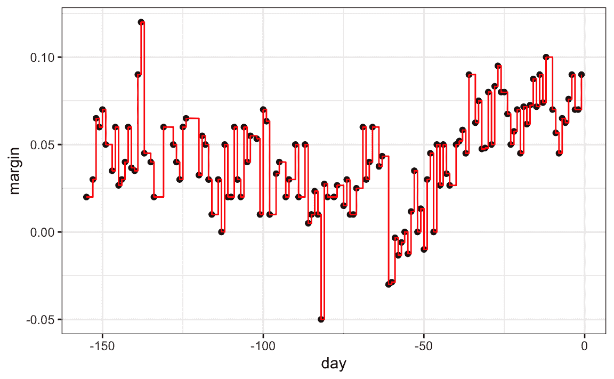

直观地我们知道这不是一个好的方法，因为它通常会导致过拟合。这些 `cp`、`minsplit` 和 `minbucket`，三个参数可以用来控制最终预测器的变异性。这些值越大，用于计算预测器的数据平均就越多，从而减少变异性。缺点是它限制了灵活性。

那么，我们如何选择这些参数呢？我们可以使用交叉验证，如第二十九章节所述，就像任何调整参数一样。这里是一个使用交叉验证来选择 cp 的例子。

```r
library(caret)
train_rpart <- train(margin ~ ., 
 method = "rpart",
 tuneGrid = data.frame(cp = seq(0, 0.05, len = 25)),
 data = polls_2008)
ggplot(train_rpart)
```

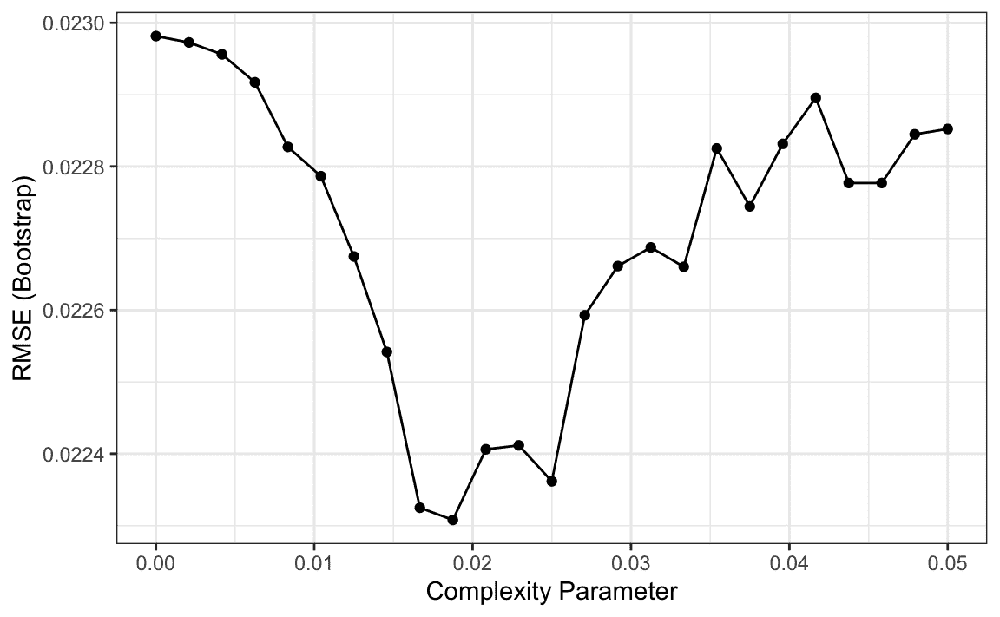

要查看生成的树，我们访问 `finalModel` 并绘制它：

```r
plot(train_rpart$finalModel, margin = 0.1)
text(train_rpart$finalModel, cex = 0.75)
```

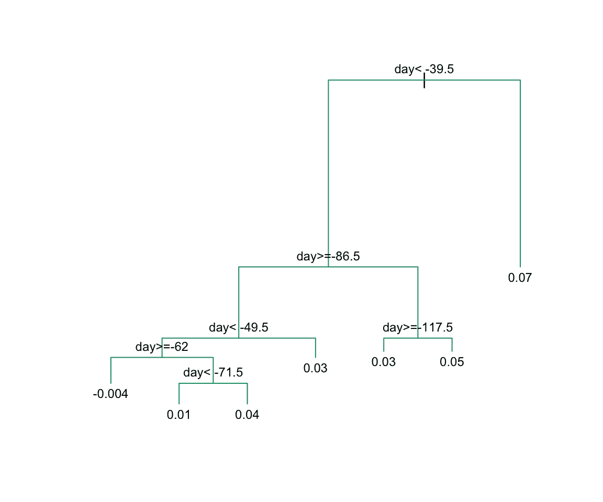

由于我们只有一个预测器，我们实际上可以绘制 $\hat{f}(x)$：

```r
polls_2008 |> 
 mutate(y_hat = predict(train_rpart)) |> 
 ggplot() +
 geom_point(aes(day, margin)) +
 geom_step(aes(day, y_hat), col="red")
```


注意，如果我们已经有一个树并且想要应用更高的 cp 值，我们可以使用 `prune` 函数。我们称这种对树的修剪为 *修剪*，因为我们正在剪掉不符合 `cp` 标准的分区。我们之前创建了一个使用 `cp = 0` 的树并将其保存到 `fit` 中。我们可以这样修剪它：

```r
pruned_fit <- prune(fit, cp = 0.01)
```

### 31.10.4 分类（决策）树

分类树或决策树用于预测问题，其中结果为分类。我们使用相同的分区原则，但有一些不同，以解释我们现在正在处理一个分类结果的事实。

第一个区别在于，我们通过计算在分区内的训练集观测值中哪个类别最常见来形成预测，而不是在每个分区中取平均值（因为我们不能对类别取平均值）。

第二个区别是，我们不能再使用 RSS 来选择分区。虽然我们可以使用寻找最小化训练错误的分区的方法，但更好的方法使用更复杂的指标。其中两个更受欢迎的指标是 *Gini 指数* 和 *熵*。

在一个完美场景中，我们每个分区中的结果都属于同一类别，因为这将允许达到完美的准确度。在这种情况下，*基尼指数*将是 0，并且随着我们偏离这个场景的程度增加而变得更大。为了定义基尼指数，我们定义 $\hat{p}_{j,k}$ 为分区 $j$ 中属于类别 $k$ 的观测值的比例。基尼指数定义为

$$ \mbox{Gini}(j) = \sum_{k=1}^K \hat{p}_{j,k}(1-\hat{p}_{j,k}) $$

如果你仔细研究这个公式，你会看到在上述完美场景中它实际上是 0。

*熵*是一个非常相似的量，定义为

$$ \mbox{entropy}(j) = -\sum_{k=1}^K \hat{p}_{j,k}\log(\hat{p}_{j,k}), \mbox{ with } 0 \times \log(0) \mbox{ defined as }0 $$

让我们通过使用此代码运行算法并绘制结果准确度来查看之前我们考察的数字示例中分类树的表现：

```r
train_rpart <- train(y ~ .,
 method = "rpart",
 tuneGrid = data.frame(cp = seq(0.0, 0.1, len = 25)),
 data = mnist_27$train)
plot(train_rpart)
```

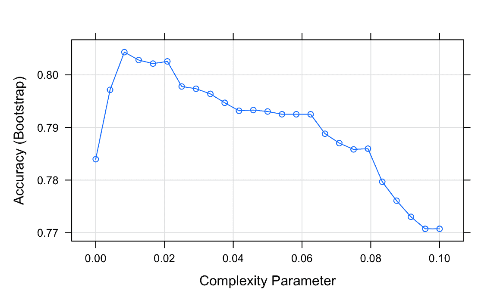

这种方法实现的准确度比回归更好，但不如使用核方法实现的准确度高：

```r
y_hat <- predict(train_rpart, mnist_27$test)
confusionMatrix(y_hat, mnist_27$test$y)$overall["Accuracy"]
#> Accuracy 
#>     0.81
```

估计条件概率的图显示了分类树的局限性：

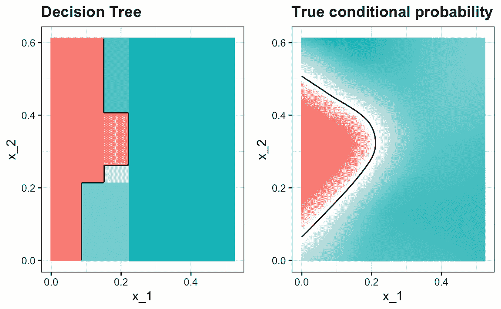

注意，在决策树中，很难使边界平滑，因为每个分区都会创建一个不连续性。

分类树具有某些优势，使它们非常有用。它们的可解释性很高，甚至比线性模型还要高。它们很容易可视化（如果足够小）。最后，它们可以模拟人类的决策过程，并且不需要对分类变量使用虚拟预测因子。另一方面，通过递归分区的方法很容易过拟合，因此比线性回归或 kNN 等更难训练。此外，在准确度方面，它很少是表现最好的方法，因为它不太灵活，并且对训练数据的变化高度不稳定。接下来解释的随机森林改进了这些不足之处。

## 31.11 随机森林

随机森林是一种**非常流行**的机器学习方法，它通过一个巧妙的思想来解决决策树的不足。目标是通过对多个决策树（随机构建的树丛）进行平均来提高预测性能并减少不稳定性。它有两个有助于实现这一目标的特点。

第一步是**自助聚集**或**袋装法**。一般思路是生成许多预测因子，每个预测因子使用回归或分类树，然后根据所有这些树的平均预测形成最终预测。为了确保单个树不相同，我们使用自助法来引入随机性。这两个特点结合起来解释了名称：自助法使单个树**随机**不同，而树的组合就是**森林**。具体步骤如下。

1. 使用训练集构建 $B$ 个决策树。我们将拟合的模型称为 $T_1, T_2, \dots, T_B$。我们稍后解释如何确保它们是不同的。

2. 对于测试集中的每个观测值，使用树 $T_j$ 形成预测 $\hat{y}_j$。

3. 对于连续的结果，使用平均 $\hat{y} = \frac{1}{B} \sum_{j=1}^B \hat{y}_j$ 形成最终预测。对于分类数据的分类，使用多数投票（$\hat{y}_1, \dots, \hat{y}_T$ 中最频繁的类别）来预测 $\hat{y}$。

那么，我们如何从一个单一的训练集中得到不同的决策树呢？为此，我们以两种方式使用随机性，以下步骤中会进行解释。设 $N$ 为训练集中的观测数。为了从训练集中创建 $T_j, \, j=1,\ldots,B$，我们执行以下操作：

1. 通过从训练集中有放回地抽取 $N$ 个观测值来创建一个自助训练集。这是引入随机性的第一种方式。

2. 在机器学习的挑战中，通常会有大量的特征。很多时候，许多特征可以提供信息，但将它们全部包含在模型中可能会导致过拟合。随机森林通过随机选择要包含在每个树构建中的特征来引入随机性的第二种方式。对于每棵树，都会选择一个不同的随机子集。这减少了森林中树之间的相关性，从而提高了预测精度。

为了说明第一步如何导致更平滑的估计，我们将通过将随机森林拟合到 2008 年的民意调查数据来演示。我们将使用 **randomForest** 包中的 `randomForest` 函数：

```r
library(randomForest)
fit <- randomForest(margin~., data = polls_2008) 
```

注意，如果我们将函数 `plot` 应用于存储在 `fit` 中的结果对象，我们会看到随着我们添加树，我们的算法的错误率是如何变化的。

```r
rafalib::mypar()
plot(fit)
```

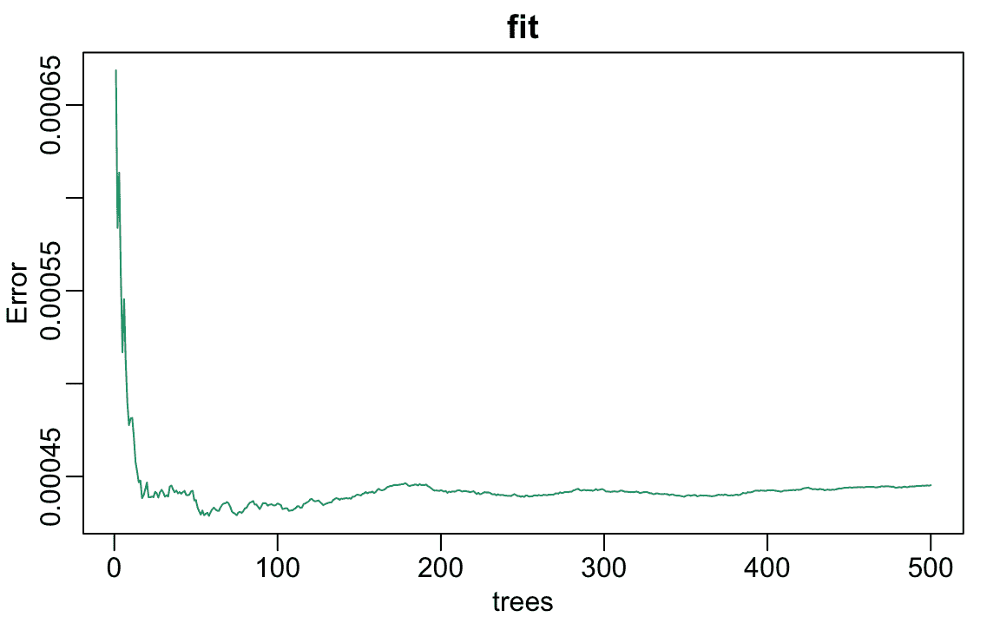

我们可以看到，在这种情况下，随着我们添加更多的树，准确性提高，直到大约 30 棵树时，准确性稳定下来。

对于这个随机森林的结果估计，可以如下所示：

```r
polls_2008 |>
 mutate(y_hat = predict(fit, newdata = polls_2008)) |> 
 ggplot() +
 geom_point(aes(day, margin)) +
 geom_line(aes(day, y_hat), col="red")
```

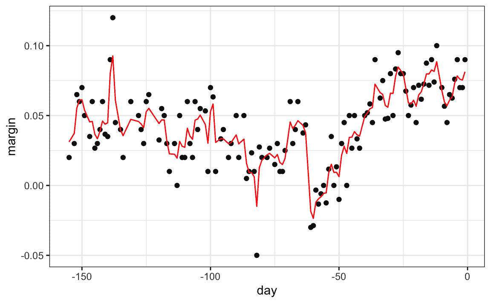

注意，随机森林估计比我们在上一节中使用的回归树要平滑得多。这是因为许多阶跃函数的平均值可以是平滑的。我们可以通过观察随着我们添加更多树，估计如何变化来看到这一点。在下面的图中，你可以看到每个自助样本对于几个 $b$ 值的情况，对于每一个，我们看到用灰色拟合的树，用较浅灰色拟合的前面的树，以及到那个点为止所有估计的树的平均结果。

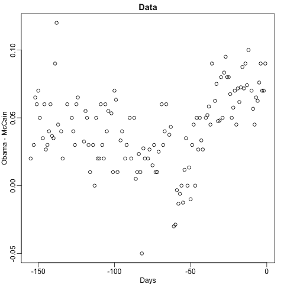

这里是基于两个预测因子的我们的数字示例的随机森林拟合：

```r
library(randomForest)
train_rf <- randomForest(y ~ ., data=mnist_27$train)

confusionMatrix(predict(train_rf, mnist_27$test),
 mnist_27$test$y)$overall["Accuracy"]
#> Accuracy 
#>    0.825
```

这里是条件概率的形状：

```r
#> Warning: The following aesthetics were dropped
#> during statistical transformation: fill
#> ℹ This can happen when ggplot fails to
#>   infer the correct grouping structure
#>   in the data.
#> ℹ Did you forget to specify a `group`
#>   aesthetic or to convert a numerical
#>   variable into a factor?
#> The following aesthetics were dropped
#> during statistical transformation: fill
#> ℹ This can happen when ggplot fails to
#>   infer the correct grouping structure
#>   in the data.
#> ℹ Did you forget to specify a `group`
#>   aesthetic or to convert a numerical
#>   variable into a factor?
```

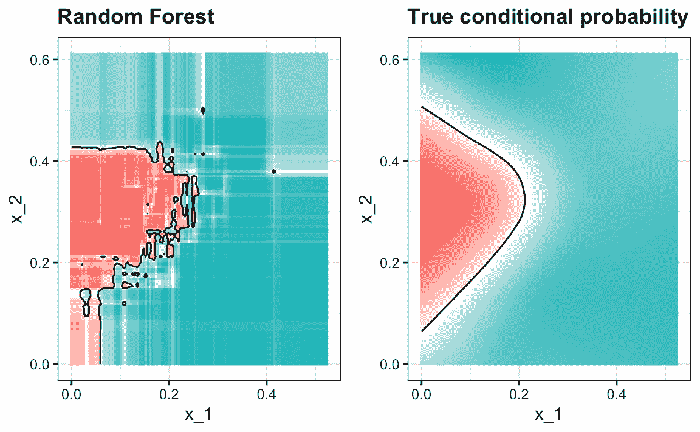

可视化估计显示，尽管我们获得了高准确性，但似乎通过使估计更平滑还有改进的空间。这可以通过改变控制树节点中数据点最小数量的参数来实现。这个最小值越大，最终的估计就越平滑。我们可以训练随机森林的参数。下面，我们使用 **caret** 包来优化最小节点大小。因为这不是 **caret** 包默认优化的参数之一，我们将编写自己的代码：

```r
nodesize <- seq(1, 51, 10)
acc <- sapply(nodesize, function(ns){
 train(y ~ ., method = "rf", data = mnist_27$train,
 tuneGrid = data.frame(mtry = 2),
 nodesize = ns)$results$Accuracy
})
qplot(nodesize, acc)
```

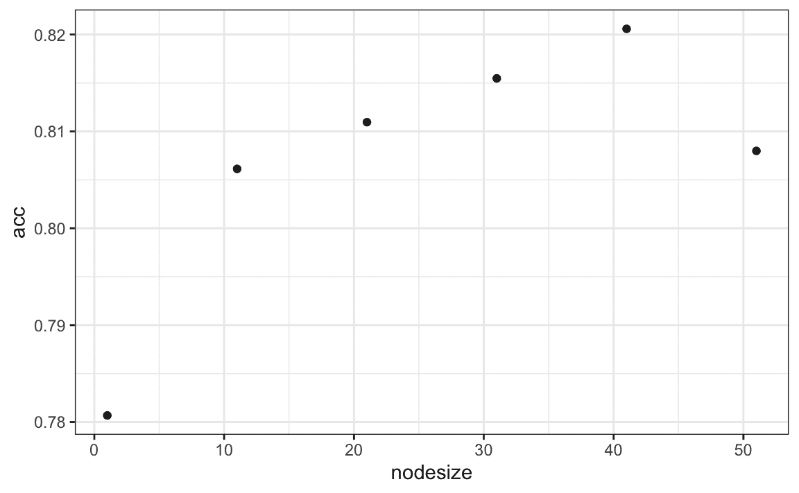

我们现在可以使用优化后的最小节点大小将随机森林拟合到整个训练数据，并在测试数据上评估性能。

```r
train_rf_2 <- randomForest(y ~ ., data=mnist_27$train,
 nodesize = nodesize[which.max(acc)])

confusionMatrix(predict(train_rf_2, mnist_27$test),
 mnist_27$test$y)$overall["Accuracy"]
#> Accuracy 
#>    0.835
```

选定的模型提高了准确性并提供了更平滑的估计。

```r
#> Warning: The following aesthetics were dropped
#> during statistical transformation: fill
#> ℹ This can happen when ggplot fails to
#>   infer the correct grouping structure
#>   in the data.
#> ℹ Did you forget to specify a `group`
#>   aesthetic or to convert a numerical
#>   variable into a factor?
#> The following aesthetics were dropped
#> during statistical transformation: fill
#> ℹ This can happen when ggplot fails to
#>   infer the correct grouping structure
#>   in the data.
#> ℹ Did you forget to specify a `group`
#>   aesthetic or to convert a numerical
#>   variable into a factor?
```

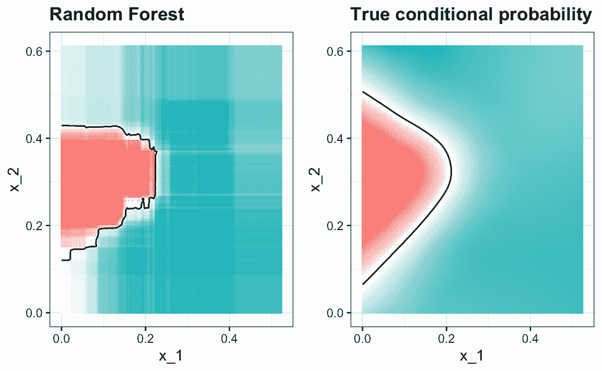

注意，我们可以通过使用 **caret** 手册中描述的其他随机森林实现来避免编写自己的代码¹⁰⁵。

随机森林在我们考虑的所有例子中都表现更好。然而，随机森林的一个缺点是我们失去了可解释性。一个有助于提高可解释性的方法是检查 *变量重要性*。为了定义 *变量重要性*，我们计算预测者在单个树中使用的频率。你可以在高级机器学习书籍中了解更多关于 *变量重要性* 的信息¹⁰⁶。**caret** 包包括 `varImp` 函数，可以从任何实现了计算的模型中提取变量重要性。我们将在下一节中给出如何使用变量重要性的示例。

## 31.12 练习

1. 创建一个简单的数据集，其中结果在预测变量每增加 0.75 个单位时平均增长。

```r
n <- 1000
sigma <- 0.25
x <- rnorm(n, 0, 1)
y <- 0.75 * x + rnorm(n, 0, sigma)
dat <- data.frame(x = x, y = y)
```

使用 `rpart` 拟合回归树并将结果保存到 `fit`。

2. 绘制最终的树形图，以便你可以看到分区发生的位置。

3. 绘制 `y` 与 `x` 的散点图，以及基于拟合的预测值。

4. 现在使用来自 **randomForest** 包的 `randomForest` 来代替回归树进行建模，并重新绘制带有预测线的散点图。

5. 使用 `plot` 函数查看随机森林是否收敛或我们需要更多的树。

6. 看起来随机森林的默认值导致估计过于灵活（不平滑）。重新运行随机森林，但这次将 `nodesize` 设置为 50，将 `maxnodes` 设置为 25。重新绘制图表。

7. 我们看到这产生了更平滑的结果。让我们使用 `train` 函数来帮助我们选择这些值。从 **caret** 手册¹⁰⁷ 我们可以看到我们无法使用 `randomForest` 调整 `maxnodes` 参数或 `nodesize` 参数，因此我们将使用 **Rborist** 包并调整 `minNode` 参数。使用 `train` 函数尝试 `minNode <- seq(5, 250, 25)` 的值。查看哪个值最小化了估计的 RMSE。

8\. 制作一个散点图，并包含最佳拟合模型的预测结果。

9\. 使用`rpart`函数将分类树拟合到`tissue_gene_expression`数据集。使用`train`函数来估计准确度。尝试`cp`值为`seq(0, 0.05, 0.01)`。绘制准确度以报告最佳模型的成果。

10\. 研究最佳拟合分类树的混淆矩阵。对于胎盘，你观察到什么情况？

11\. 注意胎盘通常被称为子宫内膜，而且胎盘的数量只有六个，默认情况下，`rpart`在分裂节点之前需要 20 个观测值。因此，使用这些参数不可能有一个以胎盘为主的节点。重新运行上述分析，但这次允许`rpart`通过使用参数`control = rpart.control(minsplit = 0)`来分裂任何节点。准确度是否提高？再次查看混淆矩阵。

12\. 绘制第 11 个练习中获得的最佳拟合模型的树。

13\. 我们可以看到，仅使用六个基因，我们就能预测组织类型。现在让我们看看是否可以使用随机森林做得更好。使用`train`函数和`rf`方法来训练一个随机森林。尝试`mtry`值从至少`seq(50, 200, 25)`的范围。哪个`mtry`值最大化了准确度？为了允许小的`nodesize`像分类树那样增长，使用以下参数：`nodesize = 1`。这将需要几秒钟才能运行。如果你想测试它，尝试使用更小的`ntree`值。将种子设置为 1990。

14\. 在`train`的输出上使用`varImp`函数，并将其保存到名为`imp`的对象中。

15\. 我们上面运行的`rpart`模型只使用了六个预测因子。提取预测因子名称并不直接，但可以完成。如果调用`train`的输出是`fit_rpart`，我们可以这样提取名称：

```r
ind <- !(fit_rpart$finalModel$frame$var == "<leaf>")
tree_terms <- 
 fit_rpart$finalModel$frame$var[ind] |>
 unique() |>
 as.character()
tree_terms
```

对于这些预测因子，随机森林调用中的变量重要性是什么？它们排名如何？

16\. 高级：根据重要性提取前 50 个预测因子，从`x`中提取这些预测因子的子集，并应用`heatmap`函数来查看这些基因在组织中的行为。我们将在第三十四章介绍`heatmap`函数。

* * *

1.  [`www.amazon.com/Mathematical-Statistics-Analysis-Available-Enhanced/dp/0534399428`](http://www.amazon.com/Mathematical-Statistics-Analysis-Available-Enhanced/dp/0534399428)↩︎

1.  [`web.stanford.edu/~hastie/Papers/ESLII.pdf`](https://web.stanford.edu/~hastie/Papers/ESLII.pdf)↩︎

1.  [`papers.ssrn.com/sol3/Delivery.cfm/SSRN_ID1759289_code1486039.pdf?abstractid=1759289&mirid=1&type=2`](https://papers.ssrn.com/sol3/Delivery.cfm/SSRN_ID1759289_code1486039.pdf?abstractid=1759289&mirid=1&type=2)↩︎

1.  [`topepo.github.io/caret/available-models.html`](http://topepo.github.io/caret/available-models.html)↩︎

1.  [`web.stanford.edu/~hastie/Papers/ESLII.pdf`](https://web.stanford.edu/~hastie/Papers/ESLII.pdf)↩︎

1.  [`topepo.github.io/caret/available-models.html`](https://topepo.github.io/caret/available-models.html)↩︎
