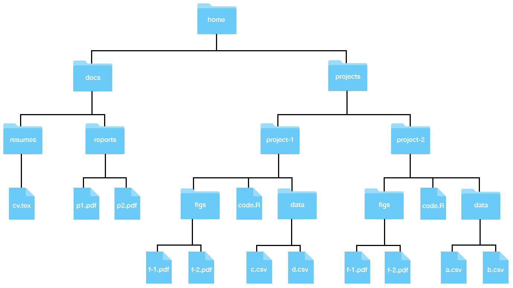
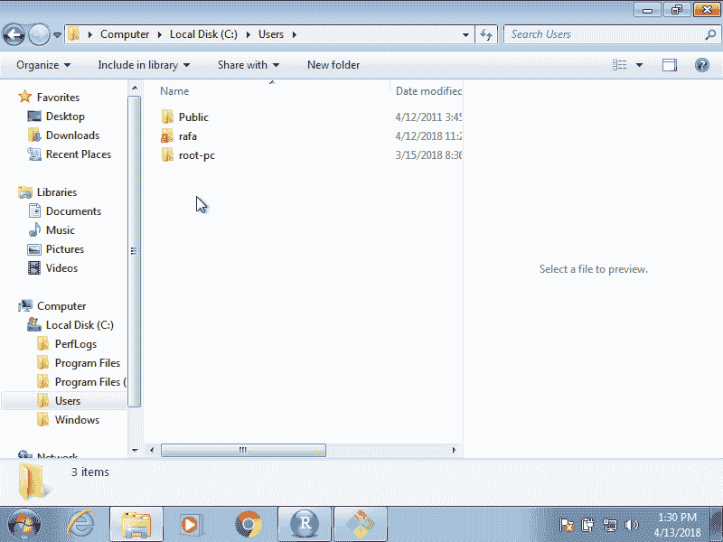
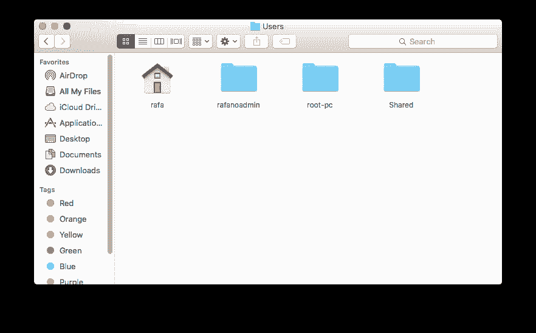
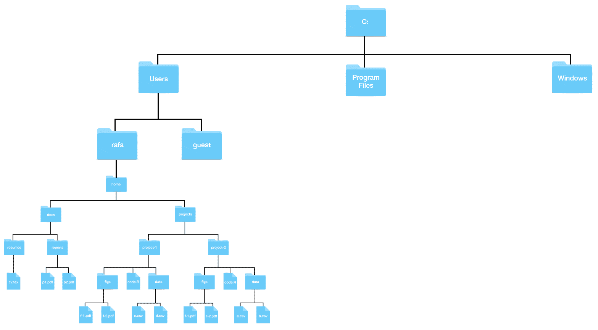
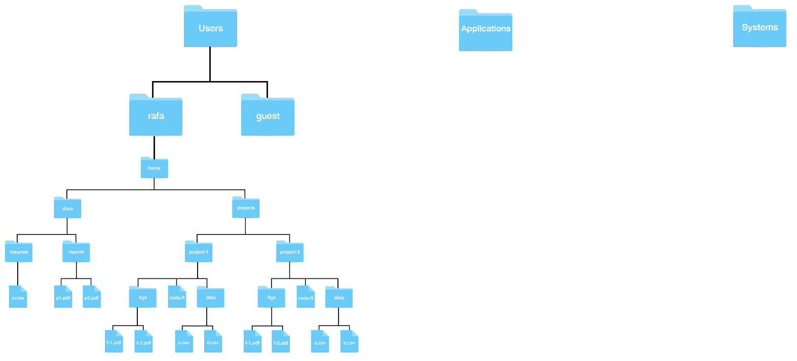
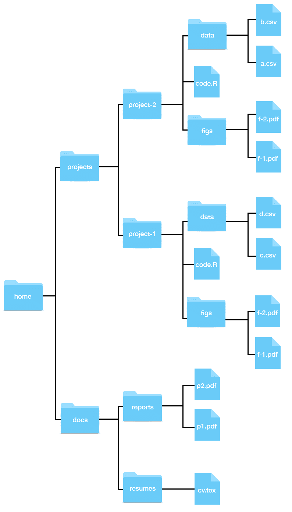

# 第三十八章 使用 Unix 组织

> 原文：[`rafalab.dfci.harvard.edu/dsbook/unix.html`](https://rafalab.dfci.harvard.edu/dsbook/unix.html)

Unix 是数据科学中首选的操作系统。我们将通过一个示例向您介绍 Unix 的思维方式：如何组织数据分析项目。我们将学习一些最常用的命令。然而，我们不会在这里详细介绍。我们强烈建议您进一步学习，尤其是在您发现自己过多使用鼠标或经常执行重复性任务时。在这些情况下，Unix 中可能有一种更有效的方法来完成它。以下是一些基本课程，以帮助您入门：

+   [`www.codecademy.com/learn/learn-the-command-line`](https://www.codecademy.com/learn/learn-the-command-line)

+   [`www.edx.org/course/introduction-linux-linuxfoundationx-lfs101x-1`](https://www.edx.org/course/introduction-linux-linuxfoundationx-lfs101x-1)

+   [`www.coursera.org/learn/unix`](https://www.coursera.org/learn/unix)

此外，还有很多参考书籍¹¹³。Bite Size Linux¹¹⁴和 Bite Size Command Line¹¹⁵是两个特别清晰、简洁且完整的示例。

在搜索 Unix 资源时，请记住，我们在这里学习的内容还可以用其他术语来描述，例如 *Linux*、*shell* 和 *命令行*。基本上，我们学习的是一系列命令和一种思维方式，它有助于在不使用鼠标的情况下组织文件。

为了提供动力，我们将开始使用 Unix 工具和 RStudio 构建目录。

## 38.1 命名规范

在您开始使用 Unix 组织项目之前，您想要选择一个命名规范，您将使用它来系统地命名文件和目录。这将帮助您找到文件并了解它们的内容。

通常，您希望以与文件内容相关的方式命名文件，并指定它们与其他文件的关系。史密森尼数据管理最佳实践¹¹⁶有“文件命名和组织五项原则”，它们是：

> > +   使用一个独特、易于阅读的名称，以给出内容指示。
> > +   
> > +   遵循一个对机器友好的一致模式。
> > +   
> > +   将文件组织到遵循一致模式的目录中（如有必要）。
> > +   
> > +   避免在文件和目录名称中重复语义元素。
> > +   
> > +   文件扩展名应与文件格式匹配（不要更改扩展名！）

对于具体建议，我们强烈推荐您遵循 The Tidyverse 风格指南¹¹⁷。

## 38.2 终端

与点击、拖放来组织我们的文件和文件夹不同，我们将通过终端输入 Unix 命令。我们这样做的方式类似于我们在 R 控制台中输入命令的方式，但与生成图表和统计摘要不同，我们将组织系统上的文件。

你将需要访问一个终端¹¹⁸。一旦打开终端，你就可以开始输入命令。你应该会看到一个闪烁的光标，它将显示你输入的内容。这个位置被称为 *命令行*。一旦你输入了一些内容并在 Windows 上按回车或在 Mac 上按 return，Unix 将尝试执行这个命令。如果你想尝试一个示例，请在你的命令行中输入以下命令：

```r
echo "hello world"
```

命令 `echo` 与 R 中的 `cat` 类似。执行此行应打印出 `hello world`，然后返回到命令行。

注意，你无法使用鼠标在终端中移动。你必须使用键盘。要回到之前输入的命令，你可以使用上箭头键。

注意，上面我们以与之前展示 R 命令相同的方式展示了 Unix 命令的代码块。我们将会确保区分命令是针对 R 还是 Unix。

## 38.3 文件系统

我们将你电脑上的所有文件、文件夹和程序称为 *文件系统*。请记住，文件夹和程序也是文件，但这通常是一个我们不常考虑的技术细节，在这本书中我们忽略了它。我们现在将专注于文件和文件夹，并在稍后的章节中讨论程序，或 *可执行文件*。

### 38.3.1 目录和子目录

要成为 Unix 用户，你需要掌握的第一个概念是文件系统是如何组织的。你应该将其视为一系列嵌套的文件夹，每个文件夹都包含文件、文件夹和可执行文件。

这里是我们所描述结构的视觉表示：



在 Unix 中，我们将文件夹称为 *目录*。位于其他目录内的目录通常被称为 *子目录*。例如，在上面的图中，目录 *docs* 有两个子目录：*reports* 和 *resumes*，而 *docs* 是 *home* 的子目录。

### 38.3.2 主目录

*home* 目录是存放所有东西的地方，与你的计算机附带的系统文件不同，系统文件存放在其他地方。在上面的图中，名为 *home* 的目录代表你的主目录，但这个名字很少被使用。在你的系统中，你的主目录的名称可能与你该系统的用户名相同。以下是在 Windows 和 Mac 上显示主目录的示例，在这种情况下，命名为 *rafa*：



现在，回顾一下显示文件系统的图。假设你正在使用点按系统，并且你想删除文件 *cv.tex*。想象一下，在你的屏幕上你可以看到 *home* 目录。为了删除这个文件，你需要双击 *home* 目录，然后是 *docs*，然后是 *resumes*，最后将 *cv.tex* 拖到垃圾桶里。在这里，你正在体验系统的层次结构：*cv.tex* 是 *resumes* 目录中的一个文件，而 *resumes* 目录是 *docs* 目录的子目录，*docs* 目录又是 *home* 目录的子目录。

现在假设你屏幕上看不到你的主目录。你将需要以某种方式让它出现在屏幕上。一种方法是从所谓的 *root* 目录导航到你的主目录。任何文件系统都会有一个所谓的 *root* 目录，它是包含所有目录的目录。上面图中显示的主目录通常位于根目录的两级或更多级。在 Windows 上，你将有一个类似的结构：



当你在 Mac 上时，它将像这样：



**Windows 用户注意事项：** 典型的 R 安装将使你的 *Documents* 目录成为 R 中的主目录。这可能与 Git Bash 中的主目录不同。通常，当我们讨论主目录时，我们指的是 Unix 主目录，对于 Windows 来说，在这本书中是 Git Bash 的 Unix 目录。

### 38.3.3 工作目录

*当前位置* 的概念是点按体验的一部分：在任何给定时刻，我们都在 *一个文件夹* 中，并看到该文件夹的内容。当你搜索文件时，就像我们上面做的那样，你正在体验 *当前位置* 的概念：一旦你双击一个目录，你改变了位置，现在你就在 *那个文件夹* 中，而不是你之前所在的文件夹。

在 Unix 中，我们没有相同的视觉提示，但 *当前位置* 的概念是必不可少的。我们称这个为 *工作目录*。你打开的每个终端窗口都有一个与之关联的工作目录。

我们如何知道我们的工作目录是什么？为了回答这个问题，我们学习我们的第一个 Unix 命令：`pwd`，它代表 *print working directory*（打印工作目录）。这个命令返回工作目录。

打开一个终端并输入：

```r
pwd
```

我们没有显示运行此命令的结果，因为与其它系统相比，它将非常不同。如果你打开一个终端并输入 `pwd` 作为你的第一个命令，你应该在 Mac 上看到类似 `/Users/yourusername` 的内容，或者在 Windows 上看到类似 `/c/Users/yourusername` 的内容。`pwd` 调用返回的字符串代表你的工作目录。当我们第一次打开终端时，它将开始于我们的主目录，所以在这种情况下，工作目录是主目录。

注意到上述字符串中的正斜杠 `/` 用于分隔目录。例如，位置 `/c/Users/rafa` 表示我们的工作目录名为 `rafa`，它是 `Users` 的子目录，而 `Users` 又是 `c` 的子目录，`c` 是根目录的子目录。因此，根目录仅用一个正斜杠 `/` 表示。

### 38.3.4 路径

我们将 `pwd` 返回的字符串称为工作目录的 *完整路径*。这个名字来源于这个字符串表示了从根目录到达指定目录所需的 *路径*。每个目录都有一个完整路径。稍后，我们将学习关于 *相对路径* 的内容，它告诉我们如何从工作目录到达某个目录。

在 Unix 中，我们使用缩写 `~` 作为您家目录的昵称。例如，如果 `docs` 是您家目录中的一个目录，则 *docs* 的完整路径可以写成这样 `~/docs`。

大多数终端都会在命令行上显示您的工作目录的路径。如果您使用默认设置并在 Mac 上打开终端，您将看到命令行上有一个类似 `computername:~ username` 的东西，其中 `~` 代表您的工作目录，在这个例子中是家目录 `~`。Git Bash 终端也是如此，您将看到类似 `username@computername MINGW64 ~` 的内容，其中工作目录在末尾。当我们更改目录时，我们将在 Mac 和 Windows 上看到这种变化。

## 38.4 Unix 命令

现在，我们将学习一系列 Unix 命令，这些命令将允许我们为数据科学项目准备目录。我们还提供了如果您在终端中输入，将返回错误的命令示例。这是因为我们假设早期图中的文件系统。您的文件系统是不同的。在下一节中，我们将提供您可以输入的示例。

### 38.4.1 `ls`：列出目录内容

在点对点系统中，我们知道目录中有什么，因为我们能看到它。在终端中，我们看不到图标。相反，我们使用 `ls` 命令来列出目录内容。

要查看您家目录的内容，请打开终端并输入：

```r
ls
```

我们很快将看到更多示例。

### 38.4.2 `mkdir` 和 `rmdir`：创建和删除目录

当我们准备数据科学项目时，我们需要创建目录。在 Unix 中，我们可以使用 `mkdir` 命令来创建目录，该命令代表 *创建目录*。

由于您很快将开始处理多个项目，我们强烈建议在您的家目录中创建一个名为 *projects* 的目录。

您可以在您的系统上尝试这个特定的示例。打开终端并输入：

```r
mkdir projects
```

如果您正确执行，则不会有任何操作：没有消息就是好消息。如果目录已存在，您将收到错误消息，并且现有目录将保持不变。

要确认您已创建了这些目录，您可以列出目录：

```r
ls
```

您应该能看到我们刚刚创建的目录列表。也许您还能看到许多预先安装在您计算机上的其他目录。

为了说明目的，让我们再创建几个目录。您可以使用这种方式列出多个目录名：

```r
mkdir docs teaching
```

您可以检查是否创建了三个目录：

```r
ls
```

如果您犯了错误并需要删除目录，您可以使用 `rmdir` 命令来删除它。

```r
mkdir junk
rmdir junk
```

这将删除目录，只要它是空的。如果它不为空，您将收到错误消息，并且目录将保持不变。要删除非空目录，我们将在稍后学习 `rm` 命令。

### 38.4.3 `cd`：通过更改目录在文件系统中导航

接下来，我们希望在已经创建的目录内创建新的目录。我们还想避免通过点击和指向的方式在文件系统中导航。我们将在 Unix 中解释如何使用命令行来完成这项操作。

假设我们打开一个终端，并且我们的工作目录是我们的主目录。我们想要将工作目录更改为 `projects`。我们使用 `cd` 命令来完成这个操作，该命令代表 *更改目录*：

```r
cd projects
```

要检查工作目录是否已更改，我们可以使用之前学过的命令来查看我们的位置：

```r
pwd
```

我们的工作目录现在应该是 `~/projects`。请注意，在您的计算机上，主目录 `~` 可能会被展开为类似 `/c/Users/yourusername` 的路径）。

**重要技巧**：在 Unix 中，您可以通过按 Tab 键来自动完成。这意味着我们可以输入 `cd d` 然后按 Tab。Unix 会自动完成如果 `docs` 是唯一以 `d` 开头的目录/文件，或者显示选项。试试看！不使用自动完成使用 Unix 会让人难以忍受。

使用 `cd` 时，我们可以输入一个完整的路径，它将以 `/` 或 `~` 开头，或者输入一个 *相对路径*。在上面的例子中，我们输入了 `cd projects`，我们使用了相对路径。**如果您输入的路径不以 `/` 或 `~` 开头，Unix 将假设您输入的是相对路径，这意味着它会在我们当前的工作目录中查找该目录**。所以类似以下的内容会给出错误：

```r
cd Users
```

因为在您的工作目录中没有 `Users` 目录。

现在假设我们想要回到 `projects` 是其子目录的目录，即所谓的 *父目录*。我们可以使用父目录的完整路径，但 Unix 提供了一个快捷方式：工作目录的父目录用两个点 `..` 表示，所以要返回，我们只需输入：

```r
cd ..
```

您现在应该回到了主目录，您可以使用 `pwd` 命令来确认。

由于我们可以使用 `cd` 与完整路径，以下命令：

```r
cd ~
```

总是会带我们回到主目录，无论我们在文件系统中的位置如何。

工作目录还有一个别名，即单个 `.`，所以如果您输入

```r
cd .
```

您将不会移动。尽管这种特定用途的`.`并不有用，但这个昵称有时确实很有用。原因与这一节无关，但您仍然应该意识到这个事实。

总结来说，我们学习了在使用`cd`时，我们要么保持原位，要么使用所需的目录名移动到新目录，或者使用`..`移动回父目录。

当输入目录名时，我们可以使用正斜杠来连接目录。所以如果我们想要一个无论在文件系统中的哪个位置都能带我们到`projects`目录的命令，我们可以这样输入：

```r
cd ~/projects
```

这与写出整个路径是等价的。例如，在 Windows 中，我们会写类似

```r
cd /c/Users/yourusername/projects
```

最后两个命令是等价的，在两种情况下我们都在输入完整的路径。

当我们输入想要访问的目录路径时，无论是完整路径还是相对路径，我们都可以使用正斜杠连接目录。我们已经看到，无论我们身处何地，都可以通过输入完整的路径来移动到`projects`目录：

```r
cd ~/projects
```

我们也可以为相对路径连接目录名。例如，如果我们想回到工作目录的父目录的父目录，我们可以输入：

```r
cd ../..
```

这里有一些与`cd`命令相关的最终提示。首先，您可以通过输入以下内容返回到您刚刚离开的目录：

```r
cd -
```

如果您输入了一个非常长的路径，然后意识到您想回到您之前的位置，而且那个位置也有一个非常长的路径，这可能会很有用。

第二，如果您只输入：

```r
cd
```

您将被返回到您的家目录。

## 38.5 一些例子

让我们探索一些使用`cd`的例子。为了帮助可视化，我们将垂直显示我们的文件系统图形表示：



假设我们的工作目录是`~/projects`，我们想要移动到`project-1`中的`figs`。

在这里使用相对路径是方便的：

```r
cd project-1/figs
```

现在假设我们的工作目录是`~/projects`，我们想要移动到`docs`中的`reports`，我们该如何做呢？

一种方法是使用相对路径：

```r
cd ../docs/reports
```

另一种方法是使用完整路径：

```r
cd ~/docs/reports
```

如果您正在您的系统上尝试此操作，请记住使用自动完成。

让我们再考察一个例子。假设我们位于`~/projects/project-1/figs`，并想要切换到`~/projects/project-2`。同样有两种方法。

使用相对路径：

```r
cd ../../proejct-2
```

并且使用完整路径：

```r
cd ~/projects/project-2
```

## 38.6 更多 Unix 命令

### 38.6.1 `mv`：移动文件

在点对点系统中，我们通过拖放将文件从一个目录移动到另一个目录。在 Unix 中，我们使用`mv`命令。

**警告**：如果`mv`命令的结果是覆盖文件，它不会询问“你确定吗？”

现在您已经知道了如何使用完整和相对路径，使用`mv`相对直接。一般形式是：

```r
mv path-to-file path-to-destination-directory
```

例如，如果我们想将文件`cv.tex`从`resumes`移动到`reports`，您可以使用完整的路径这样做：

```r
mv ~/docs/resumes/cv.tex ~/docs/reports/
```

您也可以使用相对路径。所以您可以这样做：

```r
cd ~/docs/resumes
mv cv.tex ../reports/
```

或者这样：

```r
cd ~/docs/reports/
mv ../resumes/cv.tex ./
```

注意到最后一个例子中，我们使用了工作目录快捷方式 `.` 来提供一个相对路径作为目标目录。

我们也可以使用 `mv` 来更改文件名。为此，第二个参数不仅包括目标目录，还包括一个文件名。例如，要将文件名从 `cv.tex` 更改为 `resume.tex`，我们只需输入：

```r
cd ~/docs/resumes
mv cv.tex resume.tex
```

我们还可以将移动和重命名结合起来。例如：

```r
cd ~/docs/resumes
mv cv.tex ../reports/resume.tex
```

我们还可以移动整个目录。要将 `resumes` 目录移动到 `reports`，我们这样做：

```r
mv ~/docs/resumes ~/docs/reports/
```

重要的一点是添加最后的 `/`，以清楚地表明你不想将 `resumes` 目录重命名为 `reports`，而是将其移动到 `reports` 目录中。

### 38.6.2 `cp`：复制文件

命令 `cp` 的行为与 `mv` 类似，除了移动之外，我们复制文件，这意味着原始文件保持不变。

所以在上述所有的 `mv` 示例中，你可以将 `mv` 替换为 `cp`，它们将复制而不是移动，只有一个例外：在不了解参数的情况下，我们无法复制整个目录，我们将在后面学习这些参数。

### 38.6.3 `rm`：删除文件

在点按和点击系统中，我们通过将文件拖放到垃圾桶或使用鼠标的特殊点击来删除文件。在 Unix 中，我们使用 `rm` 命令。

**警告**：与将文件扔进垃圾桶不同，`rm` 是永久删除。请小心！

它的一般工作方式如下：

```r
rm filename
```

你实际上也可以这样列出文件：

```r
rm filename-1 filename-2 filename-3
```

你可以使用完整路径或相对路径。要删除目录，你将需要了解参数，我们将在后面学习这些参数。

### 38.6.4 `less`：查看文件

经常你需要快速查看文件的内容。如果这个文件是文本文件，最快的方式就是使用命令 `less`。要查看 `cv.tex` 文件，你可以这样做：

```r
cd ~/docs/resumes
less cv.tex 
```

要退出查看器，你输入 `q`。如果文件很长，你可以使用箭头键上下移动。在 `less` 中，你可以使用许多其他键盘命令，例如搜索或跳页。你将在后面的章节中了解更多关于这方面的内容。如果你想知道为什么命令叫做 `less`，那是因为原始命令叫做 `more`，就像“显示更多文件内容”。第二个版本被叫做 `less` 是因为“少即是多”的说法。

## 38.7 准备数据科学项目

我们现在准备好为项目准备一个目录。我们将使用美国谋杀案项目¹¹⁹作为一个例子。

你应该首先创建一个目录，你将在其中保存所有项目。我们建议在主目录中创建一个名为 *projects* 的目录。为此，你会输入：

```r
cd ~
mkdir projects
```

我们的项目与枪支暴力谋杀案有关，因此我们将项目目录命名为 `murders`。它将是项目目录下的一个子目录。在 `murders` 目录中，我们将创建两个子目录来存储原始数据和中间数据。我们将分别称之为 `data` 和 `rda`。

打开终端并确保你处于主目录：

```r
cd ~
```

现在运行以下命令来创建我们想要的目录结构。最后，我们使用 `ls` 和 `pwd` 来确认我们在正确的当前工作目录中生成了正确的目录：

```r
cd projects
mkdir murders
cd murders
mkdir data rdas 
ls
pwd
```

注意，我们的 `murders` 数据集的完整路径是 `~/projects/murders`。

因此，如果我们打开一个新的终端并想要进入那个目录，我们输入：

```r
cd projects/murders
```

在第 40.3 节中，我们将描述如何使用 RStudio 组织一个数据分析项目，一旦这些目录被创建。

## 38.8 高级 Unix

大多数 Unix 实现都包含大量强大的工具和实用程序。我们在这里只是学习了非常基础的部分。我们建议您将 Unix 作为主要的文件管理工具。熟悉它需要时间，但当你努力适应时，你会发现自己在通过在互联网上查找解决方案的过程中学习。在本节中，我们简要地覆盖了一些更高级的主题。本节的主要目的是让您了解可用的选项，而不是详细解释所有内容。

### 38.8.1 参数

大多数 Unix 命令都可以带参数运行。参数通常通过使用一个或两个短横线 `-` 或 `--`（取决于命令）后跟一个字母或单词来定义。例如，`rm` 命令后面的 `-r` 参数就是一个参数。`r` 代表递归，结果是文件和目录将被递归删除，这意味着如果你输入：

```r
rm -r directory-name
```

将删除所有文件、子目录、子目录中的文件、子目录中的子目录，等等。这相当于将文件夹放入回收站，但你无法恢复它。一旦删除，它将永久删除。通常，当你删除目录时，你会遇到受保护的文件。在这种情况下，你可以使用 `-f` 参数，它代表 `force`（强制）。

你也可以组合参数。例如，要删除目录而不考虑受保护的文件，你输入：

```r
rm -rf directory-name
```

请记住，一旦删除就无法恢复，所以请非常小心地使用这个命令。

经常与参数一起使用的命令是 `ls`。以下是一些示例：

```r
ls -a 
```

`a` 代表所有。这个参数使得 `ls` 命令显示目录中的所有文件，包括隐藏文件。在 Unix 中，以 `.` 开头的文件都是隐藏的。许多应用程序创建隐藏目录来存储重要信息，而不会干扰你的工作。例如 `git`（我们将在后面深入探讨）。一旦你使用 `git init` 初始化一个目录为 git 目录，就会创建一个名为 `.git` 的隐藏目录。另一个隐藏文件是 `.gitignore` 文件。

使用参数的另一个例子是：

```r
ls -l 
```

`l` 代表长格式，结果就是显示更多关于文件的信息。

按照时间顺序查看文件通常很有用。为此，我们使用：

```r
ls -t 
```

要反转文件显示的顺序，你可以使用：

```r
ls -r 
```

我们可以将所有这些参数组合起来，以逆时间顺序显示所有文件的信息：

```r
ls -lart 
```

每个命令都有不同的参数集。在下一节中，我们将学习如何找出它们各自的作用。

### 38.8.2 获取帮助

如你所注意到的，Unix 使用极端的缩写形式。这使得它非常高效，但很难猜测如何调用命令。为了弥补这一弱点，Unix 包含完整的帮助文件或 *man 页面*（man 是 manual 的缩写）。在大多数系统中，你可以输入 `man` 后跟命令名称来获取帮助。因此，对于 `ls` 命令，我们会输入：

```r
man ls
```

此命令在某些 Unix 的紧凑实现中不可用，例如 Git Bash。在 Git Bash 上获取帮助的替代方法是输入命令后跟 `--help`。对于 `ls` 命令，操作如下：

```r
ls --help
```

### 38.8.3 管道

帮助页面通常很长，如果你输入上面的命令来查看帮助，它会一直滚动到末尾。如果我们能将帮助保存到文件中，然后使用 `less` 来查看它，那就很有用了。管道符号 `|` 的作用类似。它将一个命令的结果传递到管道后面的命令。这类似于我们在 R 中使用的管道 `|>`。因此，要获取更多帮助，我们可以输入：

```r
man ls | less
```

或者，在 Git Bash 中：

```r
ls --help | less 
```

当列出具有许多文件的目录时，这也很有用。我们可以输入：

```r
ls -lart | less 
```

### 38.8.4 通配符

Unix 最强大的功能之一是 *通配符*。假设我们想删除在项目故障排除过程中产生的所有临时 HTML 文件。想象一下有几十个文件。逐个删除它们会非常痛苦。在 Unix 中，我们实际上可以编写一个表达式，表示所有以 `.html` 结尾的文件。为此，我们输入 *通配符*：`*`。正如本书数据处理部分所讨论的，此字符表示任何数量的任何组合字符。具体来说，要列出所有 HTML 文件，我们会输入：

```r
ls *.html
```

要删除目录中的所有 HTML 文件，我们可以输入：

```r
rm *.html
```

另一个有用的通配符是 `?` 符号。这意味着任何单个字符。所以，如果我们想删除的所有文件都具有 `file-001.html` 的形式，数字从 1 到 999，我们可以输入：

```r
rm file-???.html
```

这只会删除具有该格式的文件。

我们可以组合通配符。例如，要删除所有名为 `file-001` 的文件，无论其扩展名如何，我们可以输入：

```r
rm file-001.* 
```

**警告：将 `rm` 与 `*` 通配符结合使用可能很危险。这些命令的组合可能会在不询问“你确定吗？”的情况下删除你的整个文件系统。在使用此通配符与 `rm` 命令之前，请确保你理解它是如何工作的。**

### 38.8.5 环境变量

Unix 有影响你的命令行 *环境* 的设置。这些被称为环境变量。主目录就是其中之一。我们实际上可以更改其中的一些。在 Unix 中，变量通过在前面添加 `$` 来与其他实体区分开来。主目录存储在 `$HOME` 中。

之前我们提到，`echo` 是 Unix 的打印命令。因此，我们可以通过输入以下命令来查看我们的家目录：

```r
echo $HOME 
```

你可以通过输入以下命令来查看它们所有：

```r
env
```

你可以更改一些这些环境变量。但它们的名称在不同的 *Shell* 中是不同的。我们将在下一节中描述 Shell。 

### 38.8.6 Shell

本章中我们使用的大部分内容是所谓的 *Unix Shell* 的一部分。实际上存在不同的 Shell，但它们的区别几乎不明显。它们也很重要，尽管我们在这里没有涉及。你可以通过输入以下命令来查看你正在使用的 Shell：

```r
echo $SHELL
```

最常见的是 `bash`。

一旦你知道了 Shell，你就可以更改环境变量。在 Bash Shell 中，我们使用 `export variable value` 来做这件事。要更改路径（稍后会更详细地描述），输入：(**实际上不要运行这个命令！**）

```r
export PATH = /usr/bin/
```

在每个终端启动之前都会运行一个程序，你可以编辑变量，这样每次调用终端时它们都会改变。这种变化在不同的实现中有所不同，但如果你使用 bash，你可以创建一个名为 `.bashrc`、`.bash_profile`、`.bash_login` 或 `.profile` 的文件。你可能已经有了其中一个。

### 38.8.7 可执行文件

在 Unix 中，所有程序都是文件。它们被称为可执行文件。所以 `ls`、`mv` 和 `git` 都是文件。但这些程序文件在哪里呢？你可以使用 `which` 命令来找出：

```r
which git
#> /usr/bin/git
```

那个目录可能充满了程序文件。目录 `/usr/bin` 通常包含许多程序文件。如果你输入：

```r
ls /usr/bin
```

在你的终端中，你会看到几个可执行文件。

通常还有其他目录用来存放程序文件。例如，Mac 中的应用程序目录或 Windows 中的程序文件目录。

当你输入 `ls` 时，Unix 会知道运行一个存储在其他目录中的可执行程序。那么 Unix 是如何知道在哪里找到它的呢？这个信息包含在环境变量 `$PATH` 中。如果你输入：

```r
echo $PATH
```

你将看到一系列用 `:` 分隔的目录。目录 `/usr/bin` 可能是列表中的第一个。

Unix 会按照这个顺序在这些目录中查找程序文件。虽然我们在这里不教授它，但你实际上可以自己创建可执行文件。然而，如果你将它放在你的工作目录中，而这个目录不在路径上，你仅通过输入命令是无法运行的。你可以通过输入完整路径来解决这个问题。所以如果你的命令叫做 my-ls，你可以输入：

```r
./my-ls
```

一旦你掌握了 Unix 的基础知识，你应该考虑学习编写自己的可执行文件，因为它们可以帮助减轻重复性工作。

### 38.8.8 权限和文件类型

如果你输入：

```r
ls -l
```

在开始时，你会看到一系列这样的符号 `-rw-r--r--`。这个字符串表示文件的类型：普通文件 `-`、目录 `d` 或可执行文件 `x`。这个字符串还表示文件的权限：它是可读的吗？可写的吗？可执行的吗？系统上的其他用户可以读取文件吗？系统上的其他用户可以编辑文件吗？如果文件是可执行的，其他用户可以执行吗？这比我们在这里覆盖的内容更高级，但你可以在 Unix 参考书中学到更多。

### 38.8.9 应该学习的命令

这本书中我们没有教授的命令有很多，但我们想让你了解它们以及它们的功能。它们包括：

+   open/start - 在 Mac 上，`open filename` 会尝试确定 filename 的正确应用程序，并使用该应用程序打开它。这是一个非常有用的命令。在 Git Bash 中，你可以尝试使用 `start filename`。尝试使用 `open` 或 `start` 打开 `R` 或 `Rmd` 文件：它们应该会使用 RStudio 打开。

+   nano - 一个简单的文本编辑器。

+   ln - 创建符号链接。我们不推荐使用它，但你应该熟悉它。

+   tar - 将目录的文件和子目录存档到一个文件中。

+   ssh - 连接到另一台计算机。

+   grep - 在文件中搜索模式。

+   awk/sed - 这两个命令非常强大，允许你在文件中查找特定的字符串并更改它们。

### 38.8.10 R 中的文件操作

我们也可以在 R 中执行文件管理。可以通过查看 `?files` 的帮助文件来了解关键函数。另一个有用的函数是 `unlink`。

虽然通常不推荐这样做，但请注意，你可以使用 `system` 在 R 中运行 Unix 命令。

* * *

1.  [`www.quora.com/Which-are-the-best-Unix-Linux-reference-books`](https://www.quora.com/Which-are-the-best-Unix-Linux-reference-books)↩︎

1.  [`gumroad.com/l/bite-size-linux`](https://gumroad.com/l/bite-size-linux)↩︎

1.  [`jvns.ca/blog/2018/08/05/new-zine--bite-size-command-line/`](https://jvns.ca/blog/2018/08/05/new-zine--bite-size-command-line/)↩︎

1.  [`library.si.edu/sites/default/files/tutorial/pdf/filenamingorganizing20180227.pdf`](https://library.si.edu/sites/default/files/tutorial/pdf/filenamingorganizing20180227.pdf)↩︎

1.  [`style.tidyverse.org/`](https://style.tidyverse.org/)↩︎

1.  [`rafalab.github.io/dsbook/accessing-the-terminal-and-installing-git.html`](https://rafalab.github.io/dsbook/accessing-the-terminal-and-installing-git.html)↩︎

1.  [`github.com/rairizarry/murders`](https://github.com/rairizarry/murders)↩︎
