# 第三十九章 Git 和 GitHub

> 原文：[`rafalab.dfci.harvard.edu/dsbook/git.html`](https://rafalab.dfci.harvard.edu/dsbook/git.html)

在这里，我们提供有关 Git 和 GitHub 的详细信息。然而，我们只是触及了表面。要了解更多关于这个主题的信息，我们强烈推荐以下资源：

+   Codecademy：[`www.codecademy.com/learn/learn-git`](https://www.codecademy.com/learn/learn-git)

+   GitHub 指南：[`guides.github.com/activities/hello-world/`](https://guides.github.com/activities/hello-world/)

+   尝试 Git 教程：[`try.github.io/levels/1/challenges/1`](https://try.github.io/levels/1/challenges/1)

+   享受 Git 和 GitHub 的 useR：[`happygitwithr.com/`](http://happygitwithr.com/)

## 39.1 为什么使用 Git 和 GitHub？

使用 Git 和 GitHub 的三个主要原因。

1.  分享：即使我们不利用高级强大的版本控制功能，我们仍然可以使用 Git 和 GitHub 来分享我们的代码。

1.  协作：一旦您设置了中央仓库，多人可以对代码进行更改并保持版本同步。GitHub 为中央仓库提供免费服务。GitHub 还有一个特殊工具，称为 *拉取请求*，任何人都可以用它来建议对您代码的更改。您可以轻松地接受或拒绝请求。

1.  版本控制：Git 的版本控制功能使我们能够跟踪我们对代码所做的更改。我们还可以回滚到文件的先前版本。Git 还允许我们创建 *分支*，在其中我们可以测试想法，然后决定是否 *合并* 新分支与原始分支。

在这里，我们关注 Git 和 GitHub 的分享方面，并将读者指引到上面的链接以了解更多关于这个强大工具的信息。

## 39.2 GitHub 账户

安装 git¹²⁰ 后，第一步是获取一个 GitHub 账户。基本的 GitHub 账户是免费的。为此，请访问 GitHub，在那里您将看到一个可以注册的框。

您需要仔细选择一个名字。它应该是简短、易于记忆和拼写的，并且与您的名字有些关联，并且专业。这一点很重要，因为您可能会向潜在雇主发送您 GitHub 账户的链接。在下面的例子中，我牺牲了拼写的便利性，以包含我的名字。您的首字母和姓氏通常是不错的选择。如果您有一个非常常见的名字，那么这可能需要考虑。一个简单的解决方案是添加数字或拼写出您名字的一部分。

我用于研究账户的 *rafalab* 与我用于网页¹²¹ 和 Twitter¹²² 的账户是同一个，这使得那些关注我的工作的人容易记住。

一旦您有了 GitHub 账户，您就可以将 Git 和 RStudio 连接到这个账户。

第一步是让 Git 知道我们的身份。这将有助于我们与 GitHub 连接。我们首先在 RStudio 中打开一个终端窗口（记住您可以通过菜单栏中的 *工具* 菜单获取一个终端）。现在我们使用 `git config` 命令来告诉 Git 我们是谁。我们将在终端窗口中输入以下两个命令：

```r
git config --global user.name "Your Name"
git config --global user.mail "your@email.com"
```

您需要使用您用来开通 GitHub 账户的电子邮件账户。RStudio 会话应该看起来像这样：

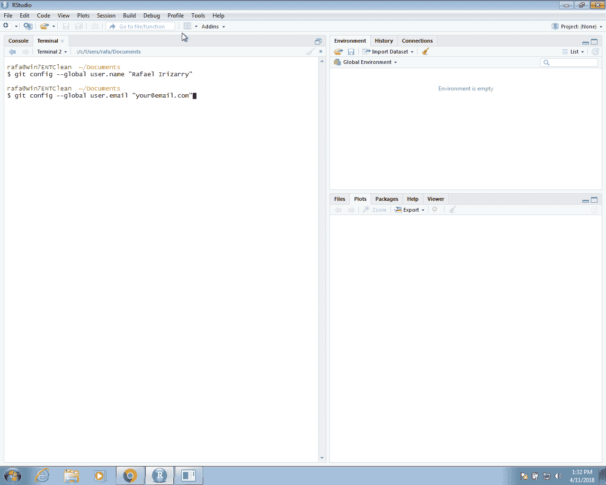

您首先前往 *全局选项*，选择 *Git/SVN*，然后输入我们刚刚安装的 Git 可执行文件的路径。

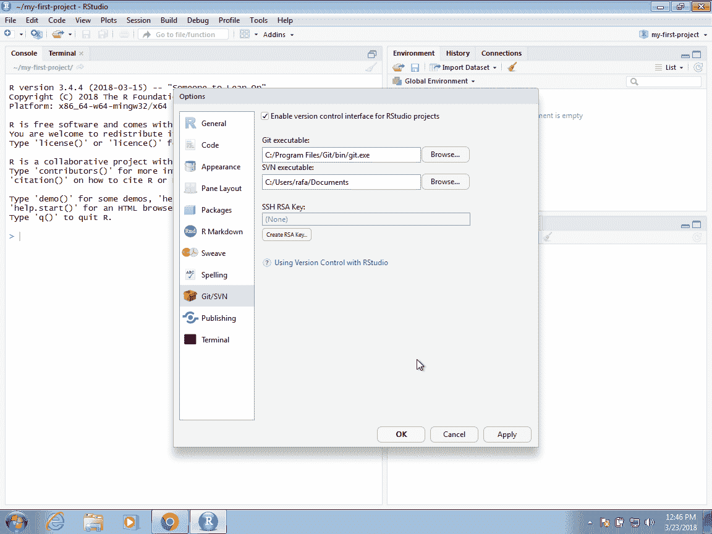

在 Windows 默认安装中，这将是 *C:/Program File/Git/bin/git.exe*，但您应该通过浏览系统来找到它，因为这可能会因系统而异。现在为了避免每次尝试访问我们的仓库时都输入 GitHub 密码，我们将创建一个所谓的 *SSH RSA 密钥*。如果点击 *创建 RSA 密钥* 按钮，RStudio 可以为我们自动完成这项操作：

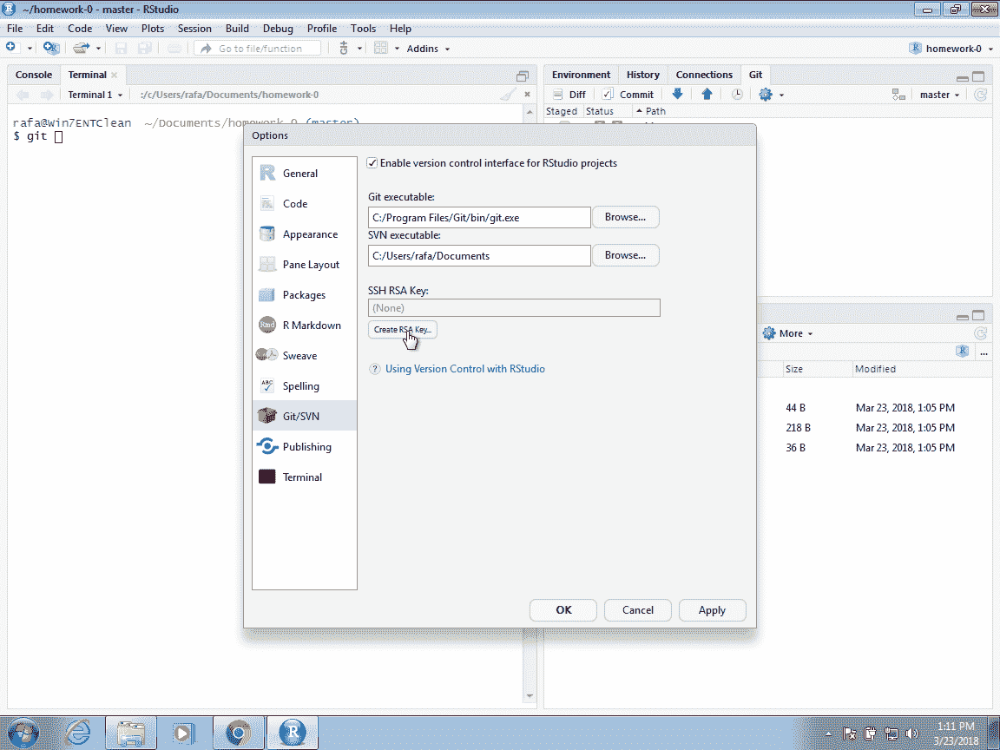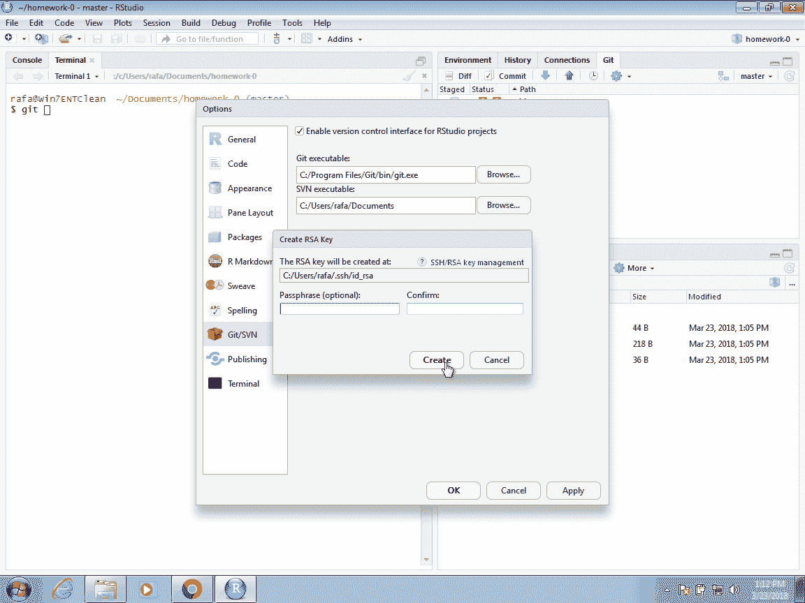

您可以遵循以下默认说明：

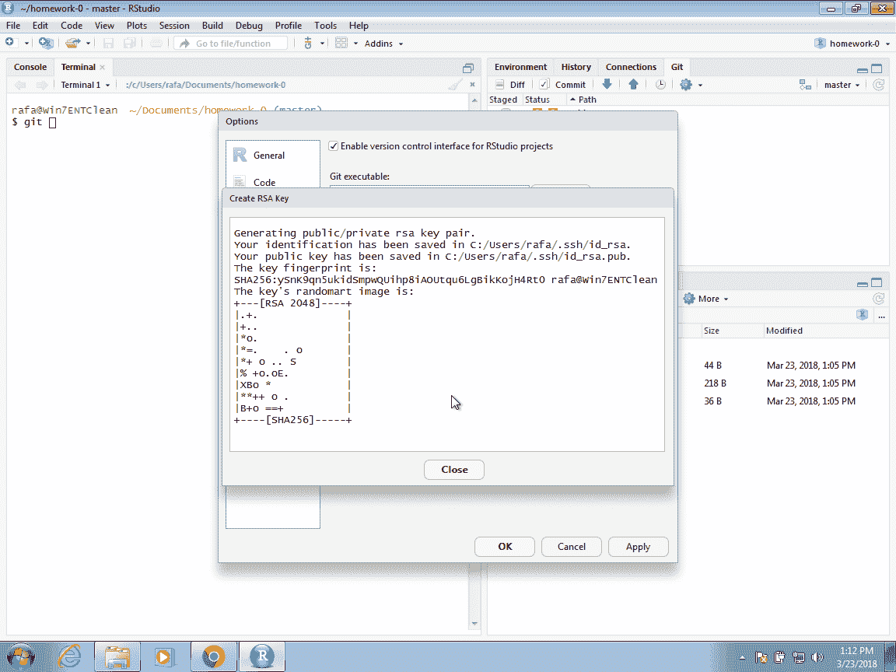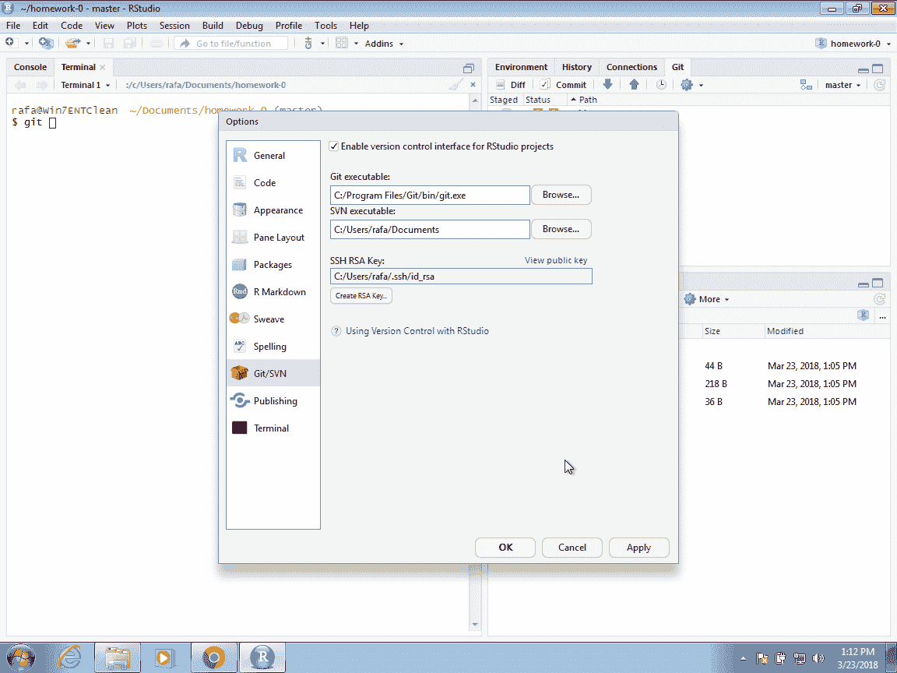

Git、RStudio 和 GitHub 现在应该能够连接，我们就可以创建第一个 GitHub 代码仓库了。

## 39.3 GitHub 仓库

您现在可以创建一个 GitHub 仓库（repo）了。一般而言，您将至少拥有您代码的两个副本：一个在您的电脑上，另一个在 GitHub 上。如果您将协作者添加到这个项目中，那么每个人都会在自己的电脑上有一个副本。GitHub 上的副本通常被认为是*主副本*（之前称为*master*），每个协作者都会将其同步到这个副本。Git 将帮助您保持所有不同副本的同步。

如前所述，将代码保存在 GitHub 仓库中的一个优点是您可以轻松地与对查看您工作示例感兴趣的可能雇主分享。因为许多数据科学公司使用版本控制系统，如 Git，来协作项目，他们可能会对您已经至少掌握了基础知识的技能印象深刻。

为您的代码创建仓库的第一步是在 GitHub 上初始化。因为您已经创建了一个账户，您将在 GitHub 上有一个带有 URL `http://github.com/username` 的页面。

要创建一个仓库，首先通过点击 [`github.com`](http://github.com) 上的 *登录* 按钮登录您的账户。您可能已经登录，在这种情况下，*登录* 按钮将不会显示。如果需要登录，您将需要输入您的用户名和密码。我们建议您设置浏览器记住这些信息，以避免每次都输入。

登录到您的账户后，您可以点击 *仓库*，然后点击 *新建* 来创建一个新的仓库：

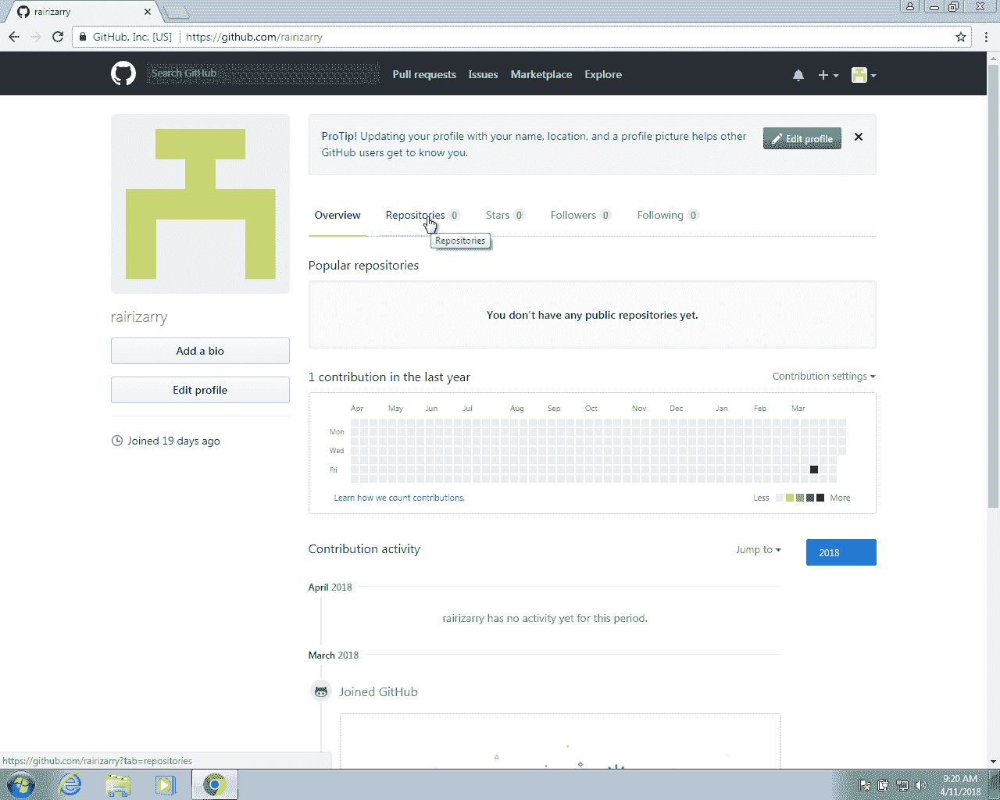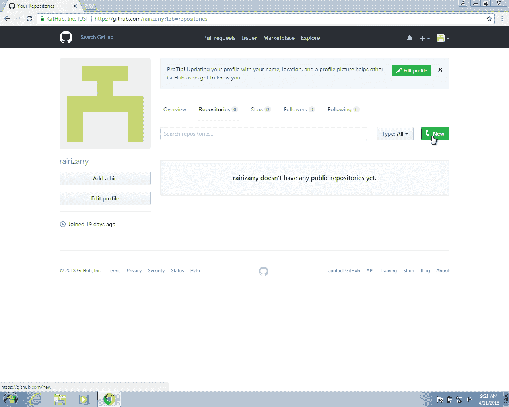

你将需要为项目选择一个良好的描述性名称。将来，你可能有数十个仓库，所以在选择名称时要记住这一点。这里我们将使用 `homework-0`。我们建议你使仓库公开。如果你想保持私有，你将不得不支付每月的费用。

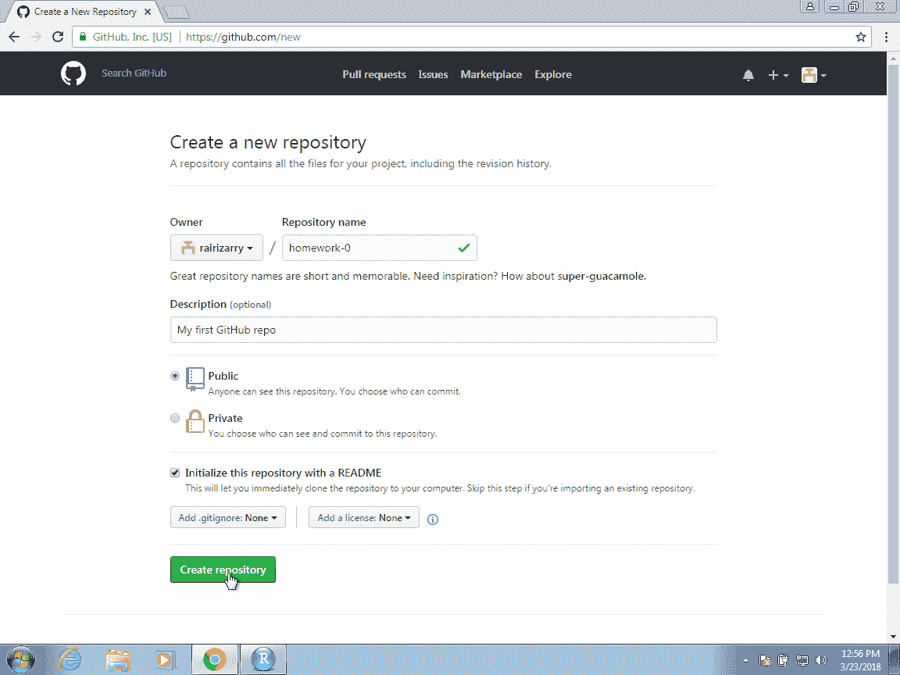

现在，你在 GitHub 上有了你的第一个仓库。下一步将是将其 *克隆* 到你的电脑上，并开始使用 Git 进行编辑和同步。

为了这样做，复制 GitHub 提供的链接以连接到这个仓库，使用 Git 如下所示是很方便的。我们稍后需要复制并粘贴这个链接，所以请确保记住这个步骤。

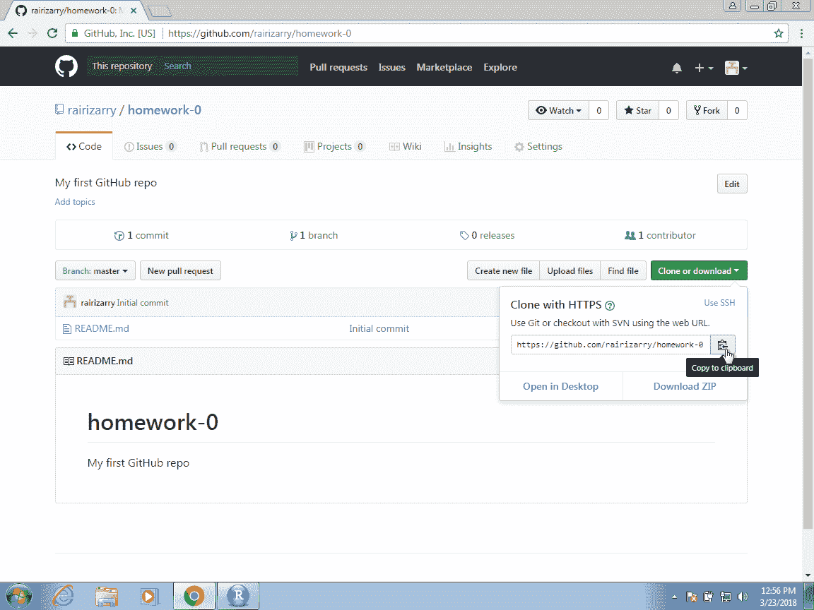

## 39.4 Git 概述

Git 中的主要操作包括：

1.  **从**远程仓库 *拉取* 更改，在这种情况下是 GitHub 仓库

1.  **添加**文件，或者我们用 Git 行话来说，是 *暂存* 文件

1.  **提交**更改到本地仓库

1.  **推送**更改到 *远程* 仓库，在我们的例子中是 GitHub 仓库

为了在 Git 中有效地进行版本控制和协作，文件会在四个不同的区域之间移动：


但这一切是如何开始的呢？有两种方式：我们可以克隆一个现有的仓库或者初始化一个。我们将首先探讨克隆。

### 39.4.1 克隆

我们将 *克隆* 一个现有的 *上游仓库*。你可以在 GitHub 上看到它：[`github.com/rairizarry/murders`](https://github.com/rairizarry/murders)。通过访问这个页面，你可以看到多个文件和目录。这是上游仓库。通过点击绿色的克隆按钮，我们可以复制仓库的 URL `https://github.com/rairizarry/murders.git`。

但 *克隆* 的意思是什么？我们不会将所有这些文件下载到你的电脑上，而是实际上复制整个 Git 结构，这意味着我们将文件和目录添加到每个三个本地阶段：工作目录、暂存区域和本地仓库。当你克隆时，这三个阶段最初都是完全相同的。

你可以通过以下步骤快速查看一个示例。打开终端并输入：

```r
pwd
mkdir git-example
cd git-example
git clone https://github.com/rairizarry/murders.git
cd murders
#> /Users/rafa/myDocuments/teaching/data-science/dsbook
#> Cloning into 'murders'...
```

现在，你已经克隆了一个 GitHub 仓库，并且在你的系统上有一个包含所有文件的 Git 工作目录。

```r
ls
#> README.txt
#> analysis.R
#> data
#> download-data.R
#> murders.Rproj
#> rdas
#> report.Rmd
#> report.md
#> report.qmd
#> report_files
#> wrangle-data.R
```

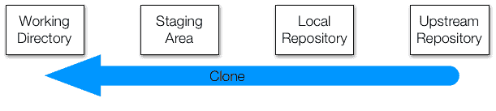

*工作目录* 与你的 Unix 工作目录相同。当你使用像 RStudio 这样的编辑器编辑文件时，你只在这个区域更改文件，并且只在这个区域更改。Git 可以通过 `git status` 命令告诉你这些文件与其他区域文件版本之间的关系：

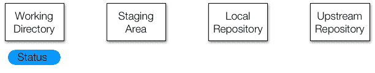

如果你现在检查状态，你会看到没有任何变化，并且你会得到以下消息：

```r
git status
#> On branch master
#> Your branch is up to date with 'origin/master'.
#> 
#> nothing to commit, working tree clean
```

现在我们将对这些文件进行更改。最终，我们希望这些新版本的文件被跟踪并与上游仓库同步。但我们不想跟踪每一个小变化：我们不想同步，直到我们确信这些版本足够最终可以分享。因此，暂存区的编辑不会被版本控制系统保留。

为了演示，我们使用`git add`命令将文件添加到暂存区。以下我们使用 Unix 的`echo`命令创建一个文件，仅作为一个例子（实际上你会使用 RStudio）：

```r
echo "test" >> new-file.txt
```

我们还添加了一个我们根本不想跟踪的临时文件：

```r
echo "temporary" >> tmp.txt
```

现在我们可以暂存我们最终想要添加到我们的仓库的文件：

```r
git add new-file.txt
```

注意现在的状态说明：

```r
git status
#> On branch master
#> Your branch is up to date with 'origin/master'.
#> 
#> Changes to be committed:
#>   (use "git restore --staged <file>..." to unstage)
#>  new file:   new-file.txt
#> 
#> Untracked files:
#>   (use "git add <file>..." to include in what will be committed)
#>  tmp.txt
```

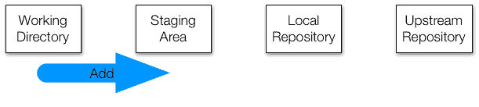

因为`new-file.txt`已经被暂存，所以下次提交时，当前版本的文件将被添加到本地仓库中，我们按照以下步骤操作：

```r
git commit -m "adding a new file" 
#> [master 1abe842] adding a new file
#>  1 file changed, 1 insertion(+)
#>  create mode 100644 new-file.txt
```

我们现在已经更改了本地仓库，你可以使用以下命令来确认：

```r
git status
```

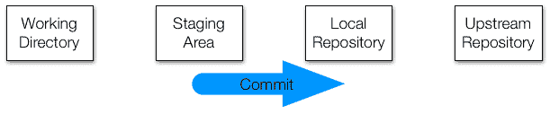

然而，如果我们再次编辑该文件，它只在工作目录中发生变化。为了将其添加到本地仓库，我们需要将其暂存并提交添加到本地仓库的更改：

```r
echo "adding a line" >> new-file.txt
git add new-file.txt
git commit -m "adding a new line to new-file"
#> [master 4727066] adding a new line to new-file
#>  1 file changed, 1 insertion(+)
```

注意，在我们的 Git 使用中，这一步通常是不必要的。如果我们像这样将文件名添加到提交命令中，我们可以跳过暂存部分：

```r
echo "adding a second line" >> new-file.txt
git commit -m "minor change to new-file" new-file.txt
#> [master 804a46f] minor change to new-file
#>  1 file changed, 1 insertion(+)
```

我们可以使用以下命令来跟踪我们所做的所有更改：

```r
git log new-file.txt
#> commit 804a46f999377adf52b7ab636303eee7a7458aae
#> Author: Rafael A Irizarry <rafa@ds.dfci.harvard.edu>
#> Date:   Thu Dec 21 12:35:29 2023 -0500
#> 
#>     minor change to new-file
#> 
#> commit 4727066811cc9b68b0b4848609c6be2866945a62
#> Author: Rafael A Irizarry <rafa@ds.dfci.harvard.edu>
#> Date:   Thu Dec 21 12:35:29 2023 -0500
#> 
#>     adding a new line to new-file
#> 
#> commit 1abe842293c2b4ac7e1434aff1d0c30b89d94165
#> Author: Rafael A Irizarry <rafa@ds.dfci.harvard.edu>
#> Date:   Thu Dec 21 12:35:29 2023 -0500
#> 
#>     adding a new file
```

为了保持一切同步，最后一步是将更改推送到上游仓库。这可以通过`git push`命令来完成，如下所示：

```r
git push
```

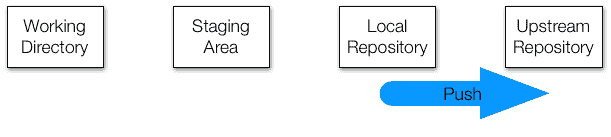

然而，在这个特定的例子中，你将无法这样做，因为你没有权限编辑上游仓库。如果这是你的仓库，你就可以。

如果这是一个协作项目，上游仓库可能会发生变化，与我们版本不同。为了使本地仓库与上游仓库保持一致，我们使用`fetch`命令：

```r
git fetch
```

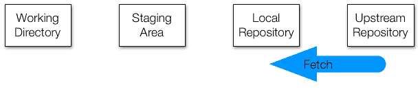

然后为了将这些副本添加到暂存区和工作目录，我们使用以下命令：

```r
git merge
```

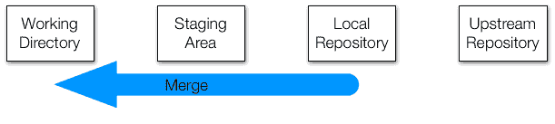

然而，我们通常只想用一个命令同时更改这两个文件。为此，我们使用：

```r
git pull
```

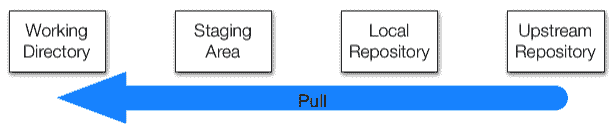

我们将在第 39.6 节学习 RStudio 如何通过按钮完成所有这些操作。这里提供的信息应该能帮助你理解后台发生了什么。

## 39.5 初始化 Git 目录

现在让我们学习第二种启动方式：通过在我们的电脑上初始化目录而不是克隆。

假设我们已经有了一个已填充的本地目录，我们想要将这个目录变成一个协作的 GitHub 仓库。最有效的方法是通过*初始化*本地目录。

为了演示如何做这件事，我们将初始化我们在第 38.7 节中创建的`gun murders`目录。请注意，我们已经在我们的电脑上创建了一个包含几个子目录的目录，但我们还没有一个 Git 本地仓库或 GitHub 上游仓库。

我们首先在我们的 GitHub 页面上创建一个新的仓库。我们点击*新建*按钮：

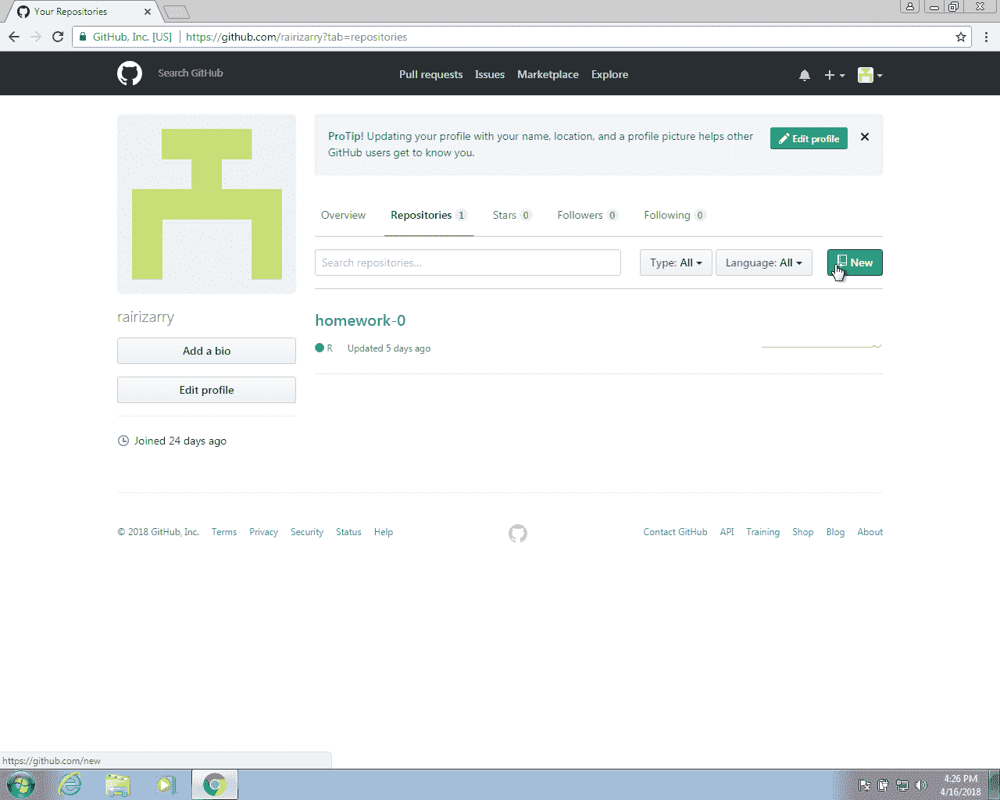

我们在这里将其称为`murders`以匹配我们本地系统上的目录名称。但如果你为另一个项目做这件事，请选择一个合适的名称。

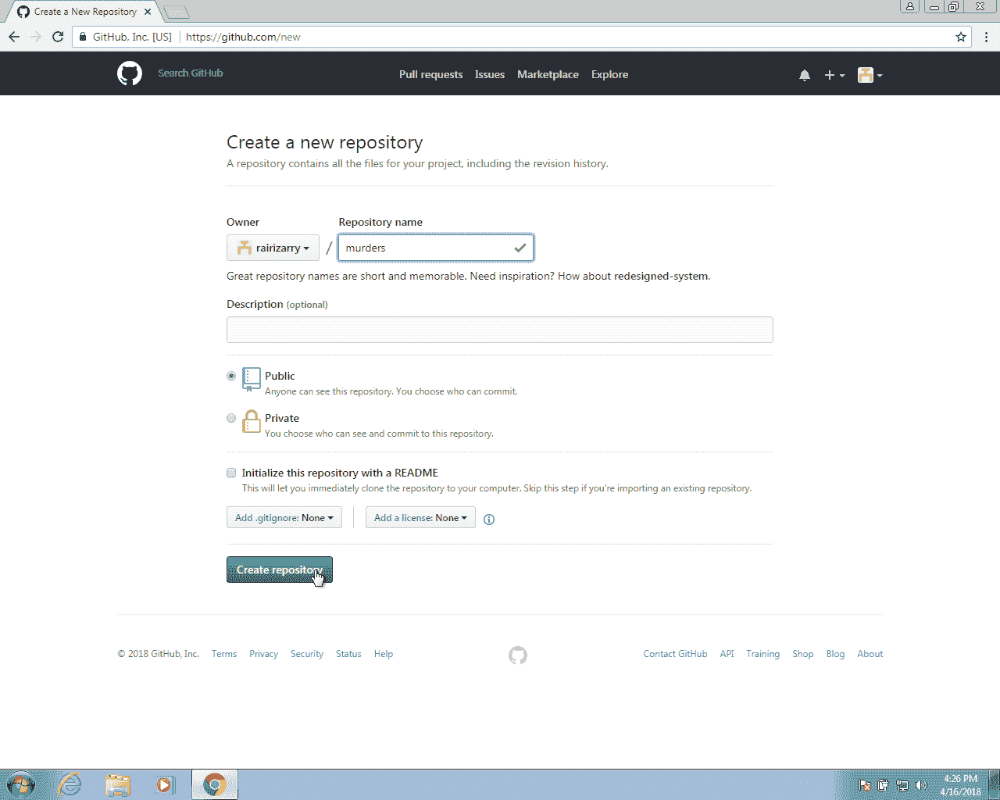

然后，我们会得到一系列如何开始的指导，但我们可以使用我们所学到的知识。我们从这个页面需要的主要东西是复制仓库的 URL，在这个例子中：`https://github.com/rairizarry/murders.git`。

在这个时刻，我们可以打开一个终端并使用`cd`命令进入我们的本地项目目录。在我们的例子中，它会是：

```r
cd ~/projects/murders
```

然后，我们*初始化*这个目录。这会将目录变成一个 Git 目录，Git 开始跟踪：

```r
git init
```

所有的文件现在**只**在我们的工作目录中；没有文件在我们的本地仓库或 GitHub 上。

下一步是将本地仓库与 GitHub 仓库连接起来。在先前的例子中，RStudio 为我们做了这件事。现在我们需要自己来做。我们可以通过添加任何文件并提交它来实现：

```r
git add README.txt
git commit -m "First commit. Adding README.txt file just to get started"
```

现在我们有一个文件在我们的本地仓库中，并且可以将其连接到具有 url: `https://github.com/rairizarry/murders.git`的上游仓库。

为了做到这一点，我们使用命令`git remote add`。

```r
git remote add origin `https://github.com/rairizarry/murders.git`
```

现在我们可以使用`git push`，因为我们已经连接到了一个上游仓库：

```r
git push
```

在第 40.3 节中，我们继续使用这个例子，因为我们演示了如何使用 RStudio 与 Git 一起工作并保持项目在 GitHub 上同步。

## 39.6 在 RStudio 中使用 Git 和 GitHub

虽然命令行 Git 是一个强大且灵活的工具，但当我们刚开始时，它可能会有些令人畏惧。RStudio 提供了一个图形界面，它有助于在数据分析项目的背景下使用 Git。我们在这里描述如何使用这个 RStudio 功能来完成这个任务。

现在我们已经准备好开始一个使用版本控制并存储代码在 GitHub 仓库上的 RStudio 项目。为了做到这一点，我们启动一个项目，但不是选择*新目录*，我们将选择*版本控制*，然后我们将选择*Git*作为我们的版本控制系统：

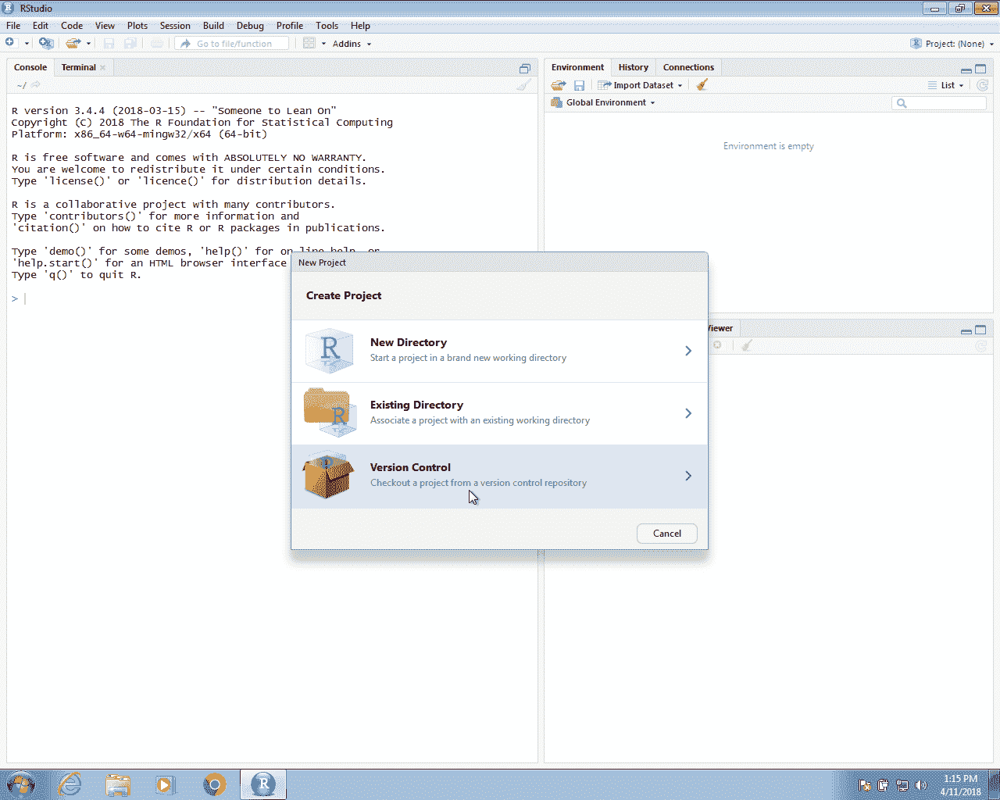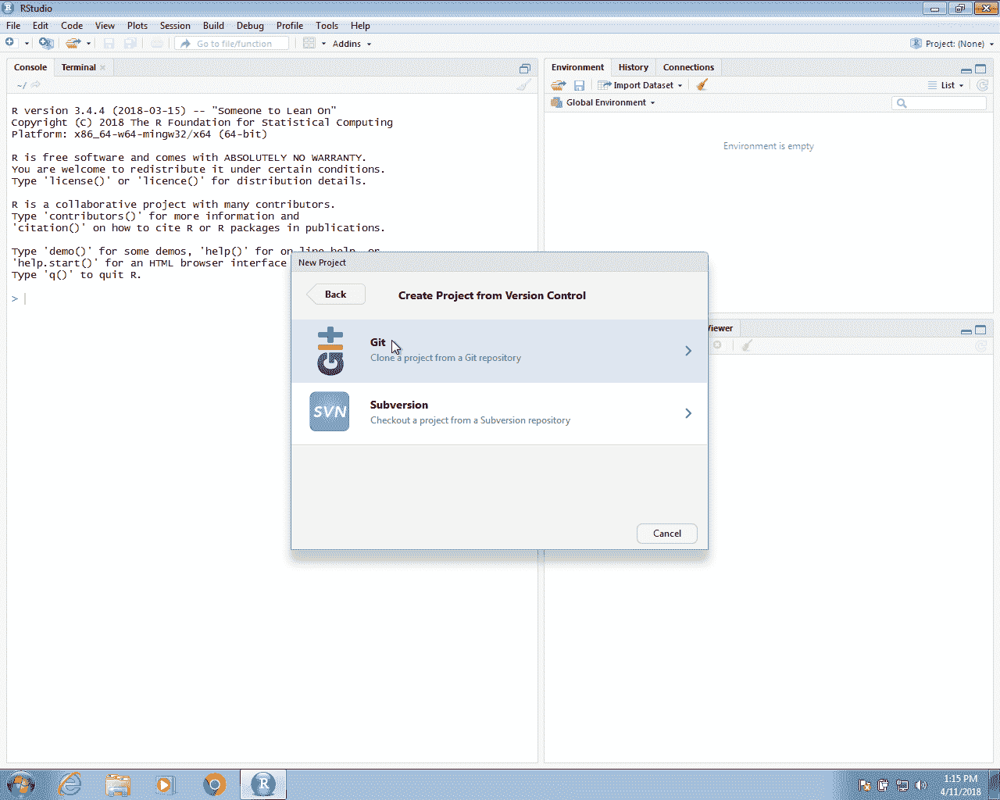

仓库 URL 是你用来克隆的链接。在 39.3 节中，我们使用了 `https://github.com/username/homework-0.git` 作为示例。在项目目录名称中，你需要放入生成的文件夹名称，在我们的示例中，这将是仓库的名称 `homework-0`。这将在你本地系统中创建一个名为 `homework-0` 的文件夹。一旦你这样做，项目就创建完成了，并且它知道与 GitHub 仓库的连接。你将在右上角看到项目的名称和类型，以及右上面板中的一个新标签页，标题为 *Git*。

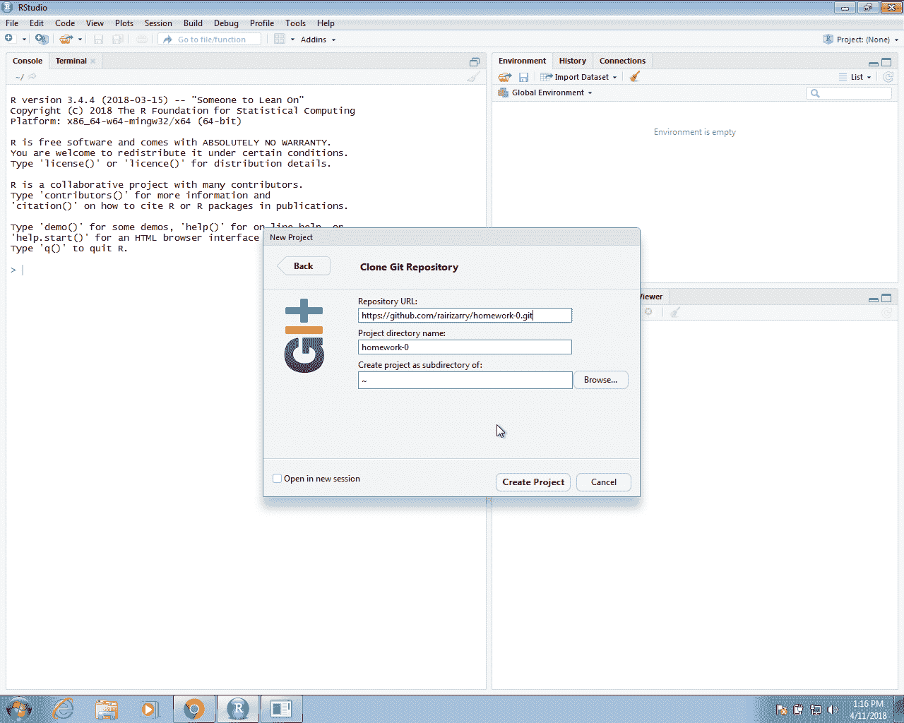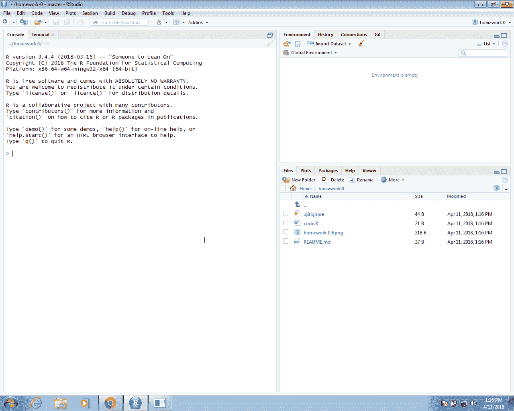

如果你选择这个标签页，它将显示你项目中的文件，并带有一些图标，这些图标会给你提供关于这些文件及其与仓库之间关系的信息。在下面的示例中，我们已经在文件夹中添加了一个名为 *code.R* 的文件，你可以在编辑面板中看到它。

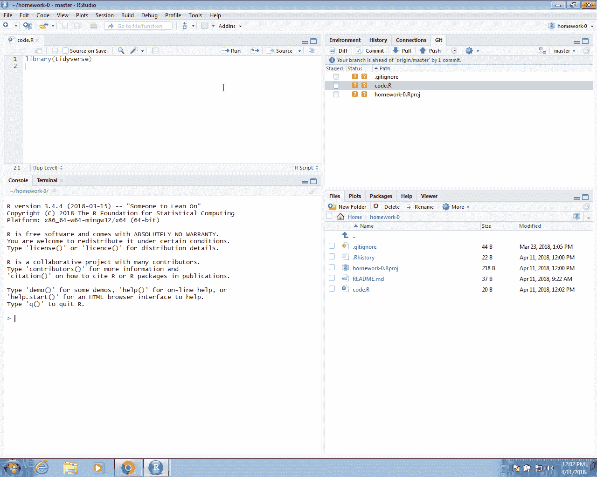

我们现在需要关注 Git 面板。重要的是要知道，**你的本地文件和 GitHub 仓库不会自动同步**。如 39.4 节中所述，当你准备好时，你必须使用 git push 来同步。我们下面会展示你如何通过 RStudio 而不是终端来完成这个操作。

在我们开始一个协作项目之前，通常我们首先要做的是从远程仓库，在我们的例子中是 GitHub 上的仓库，*拉取* 变更。然而，对于这里显示的示例，由于我们从一个空的仓库开始，并且我们是唯一进行更改的人，所以我们不需要从拉取开始。

在 RStudio 中，文件与远程和本地仓库的状态通过带有颜色的状态符号表示。一个黄色的方块表示 Git 对这个文件一无所知。为了与 GitHub 仓库同步，我们需要 *添加* 文件，然后 *提交* 改变到我们的本地 Git 仓库，然后 *推送* 改变到 GitHub 仓库。目前，这个文件只是在我们的电脑上。要使用 RStudio 添加文件，我们点击 *暂存* 框。你会看到状态图标现在变成了绿色的 A。

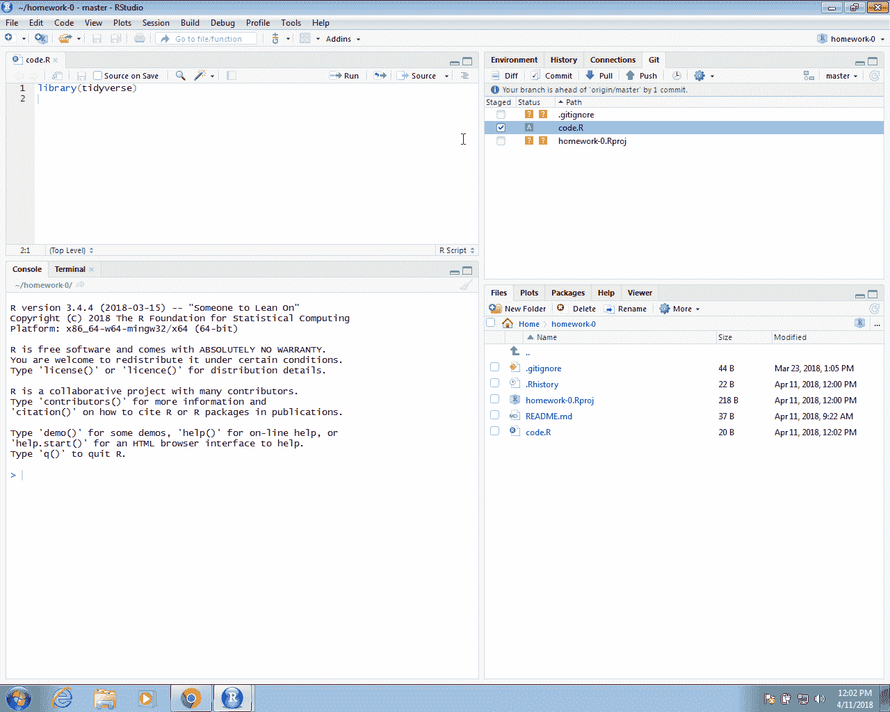

注意：我们只添加 *code.R* 文件。我们不一定需要将本地仓库中的所有文件添加到 GitHub 仓库，只需要我们想要跟踪或想要分享的文件。如果我们的工作产生了我们不希望跟踪的特定类型的文件，我们可以将这些文件的定义后缀添加到 .gitignore 文件中。关于使用 .gitignore 的更多详细信息请参考这里：[`git-scm.com/docs/gitignore`](https://git-scm.com/docs/gitignore)。这些文件将不会出现在你的 RStudio Git 面板中。对于这里显示的示例，我们只会添加 *code.R*。但是，一般来说，对于 RStudio 项目，我们建议添加 .gitignore 和 .Rproj 文件。

现在我们已经准备好将文件提交到我们的本地仓库。在 RStudio 中，我们可以使用*提交*按钮。这将打开一个新的对话框窗口。使用 Git 时，每次提交更改，我们都需要输入一个注释来描述正在*提交*的更改。

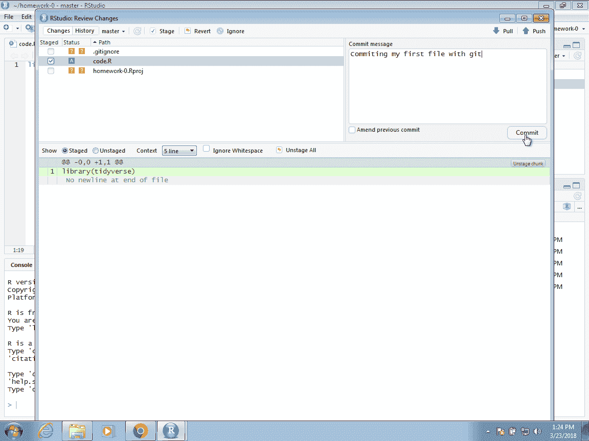

在这种情况下，我们只需简单描述我们在添加一个新的脚本。在这个对话框中，RStudio 还会给你一个总结，说明你正在对 GitHub 仓库进行哪些更改。在这种情况下，因为这是一个新文件，整个文件都被高亮显示为绿色，这突出了更改。

一旦我们点击提交按钮，我们应该看到 Git 发来的一个包含已提交更改摘要的消息。现在我们准备好*推送*这些更改到 GitHub 仓库。我们可以通过点击右上角的*推送*按钮来完成此操作：

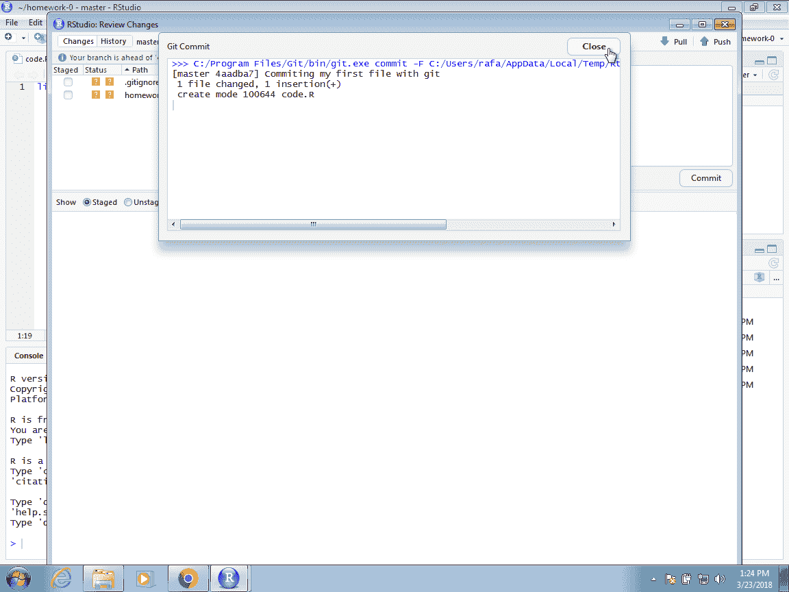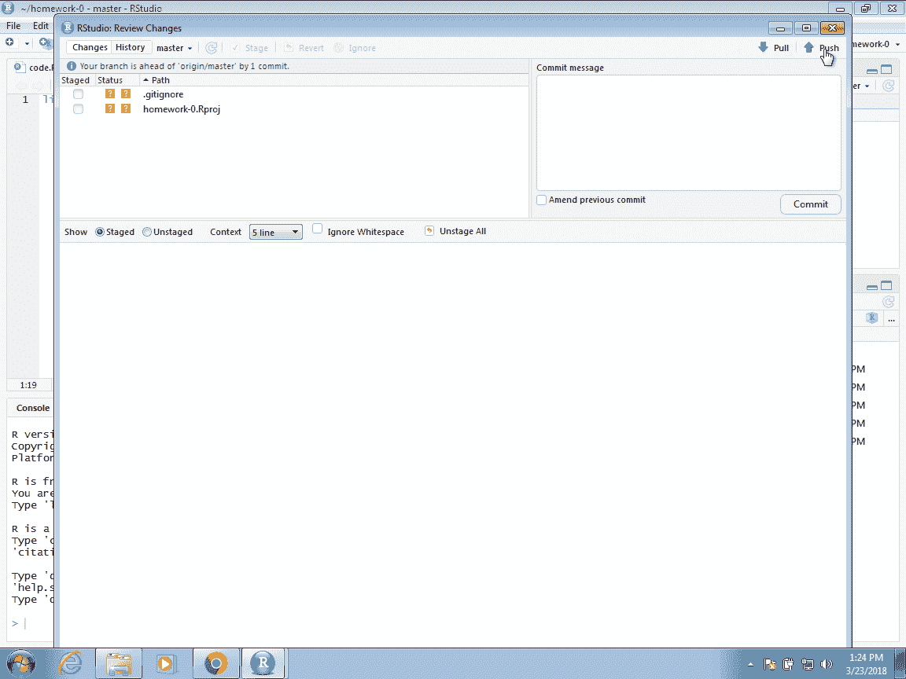

我们现在看到 Git 发来的消息，告知我们推送成功。在弹出窗口中，我们不再看到`code.R`文件。这是因为自我们上次推送以来没有进行任何新的更改。现在我们可以退出这个弹出窗口，继续我们的代码工作。

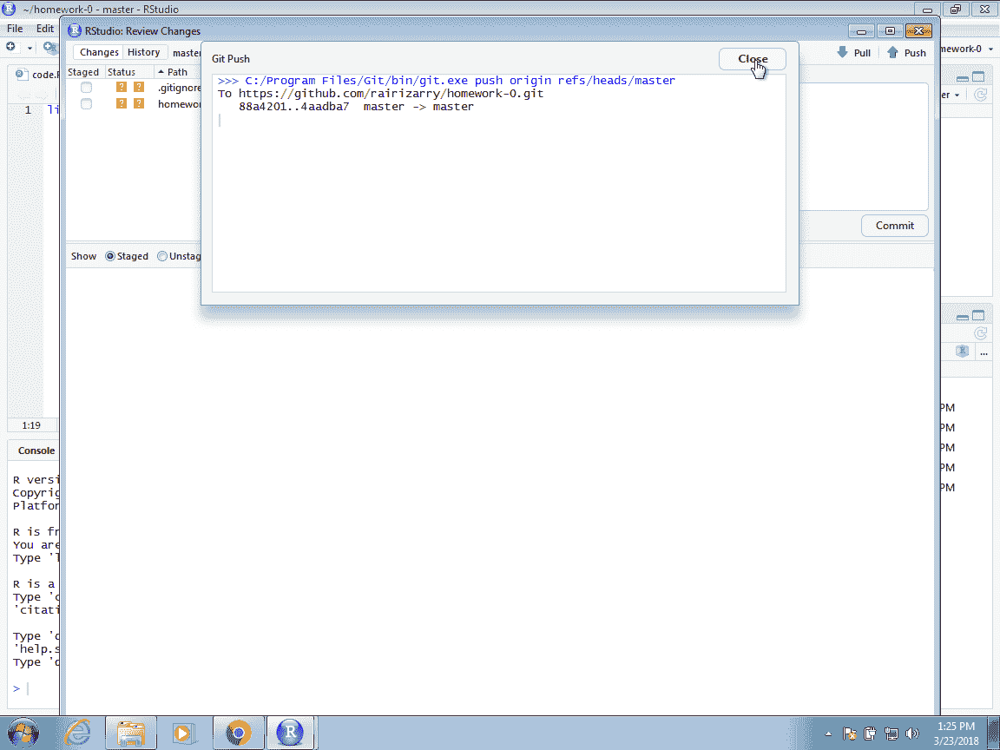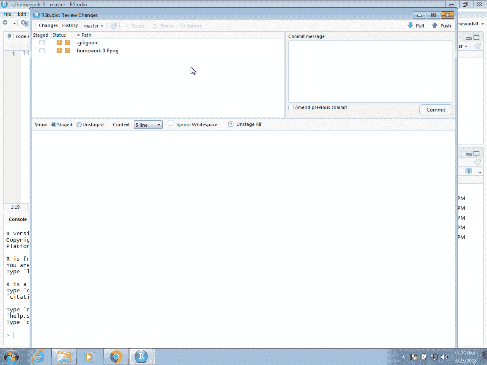

如果我们现在访问我们的仓库在网页上，我们会看到它与我们的本地副本相匹配。

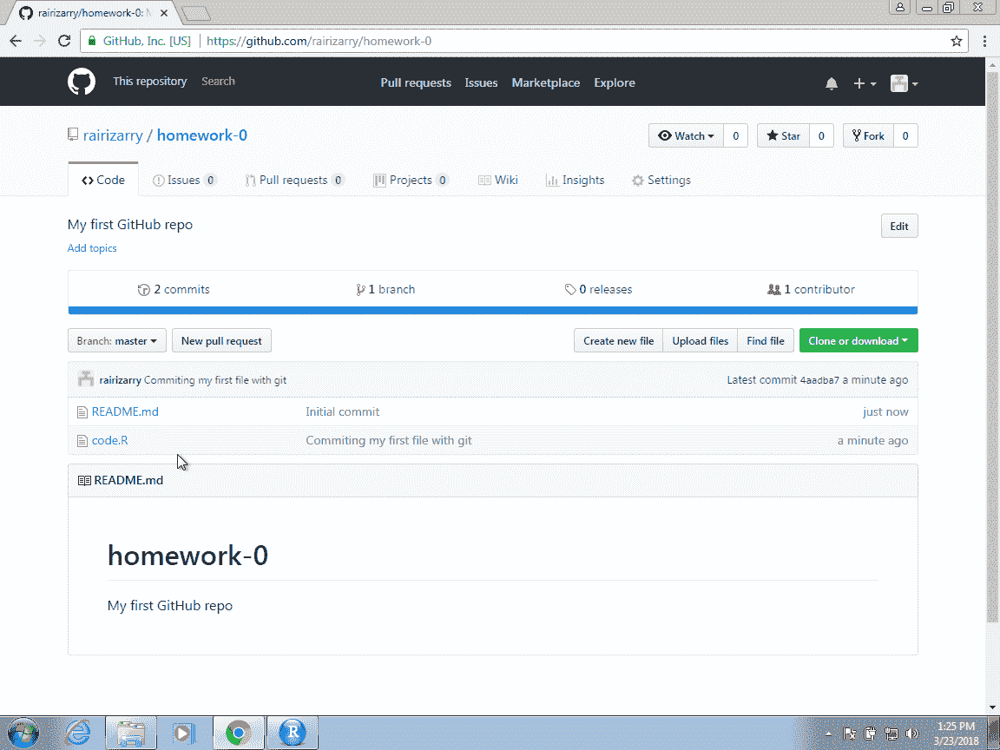

恭喜，你已经在 GitHub 仓库上成功共享了代码！

* * *

1.  [`rafalab.github.io/dsbook/accessing-the-terminal-and-installing-git.html`](https://rafalab.github.io/dsbook/accessing-the-terminal-and-installing-git.html)↩︎

1.  [`rafalab.org`](http://rafalab.org)↩︎

1.  [`twitter.com/rafalab`](http://twitter.com/rafalab)↩︎
