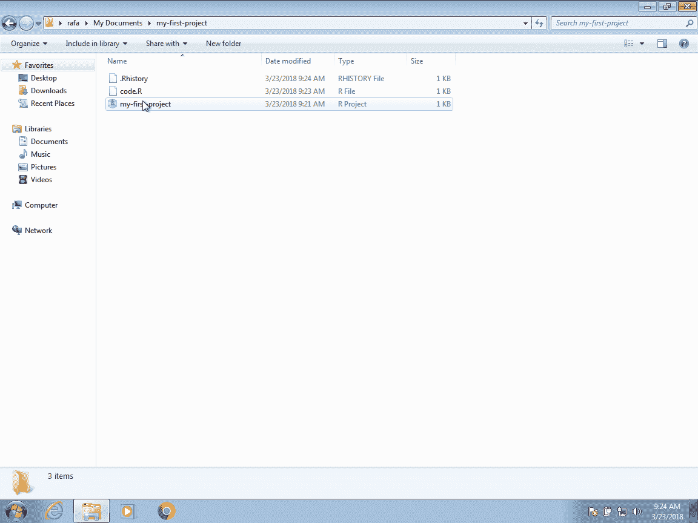
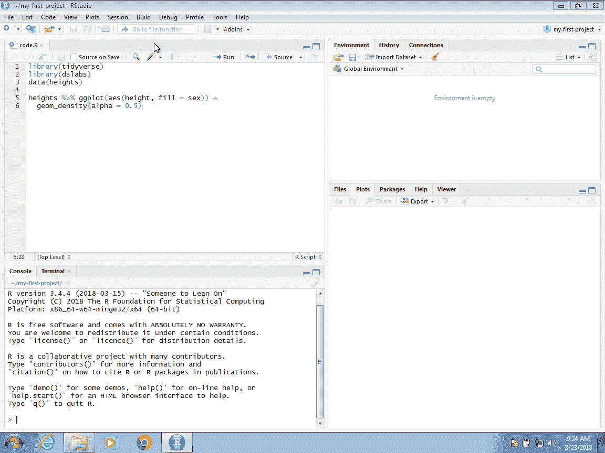
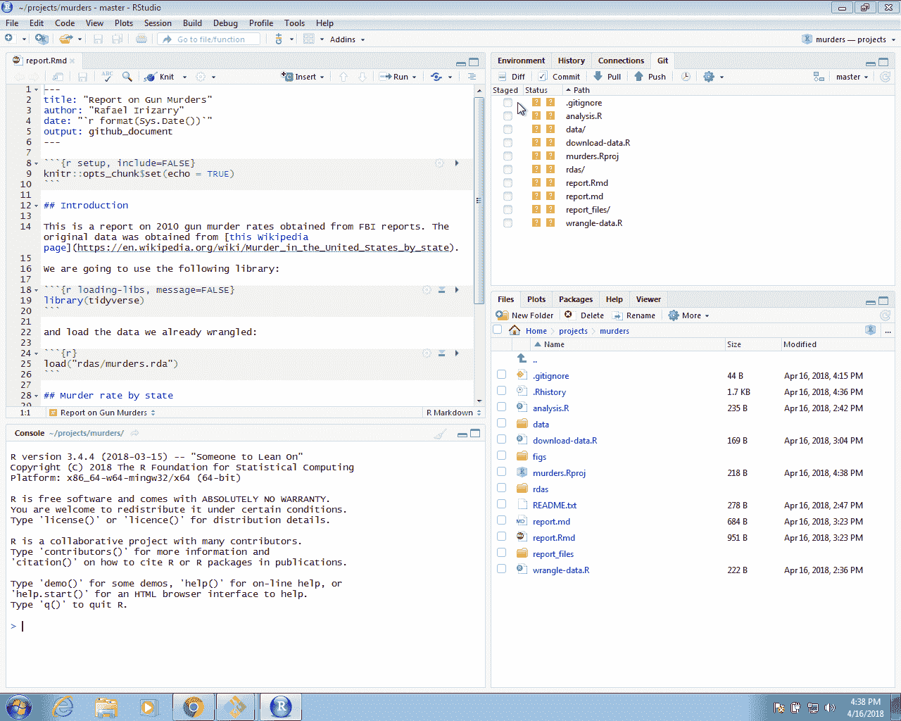
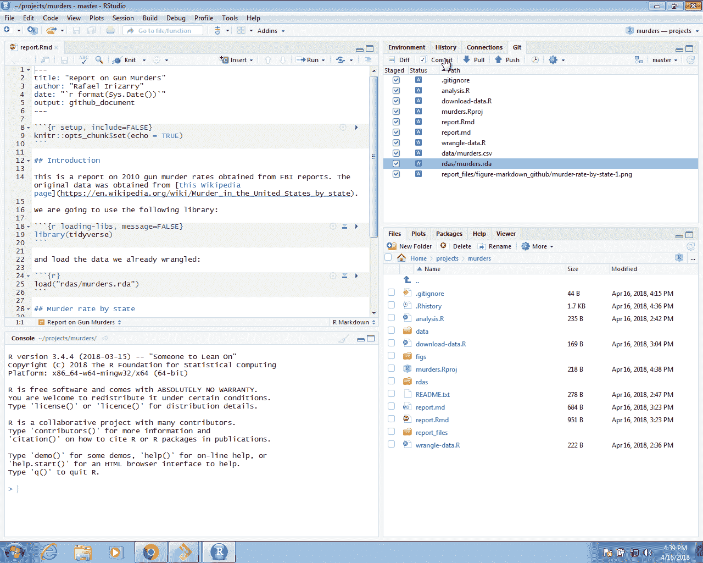
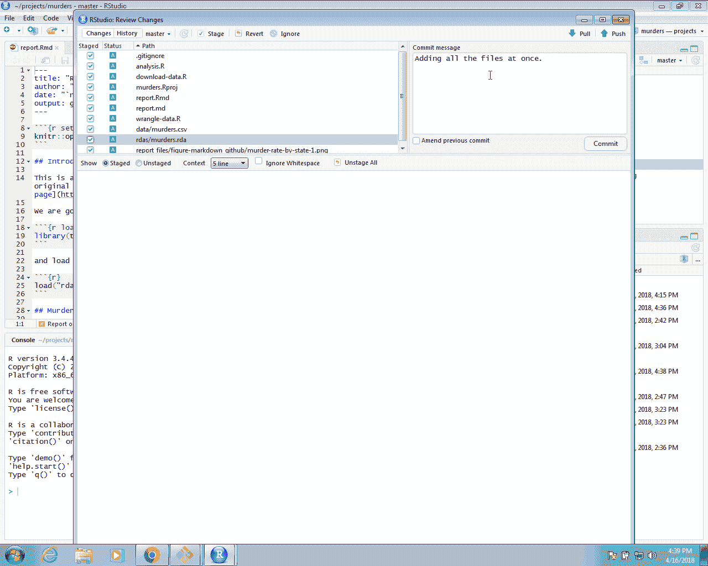

# 第四十章 使用 RStudio 和 R Markdown 进行可重复的项目

> 原文：[`rafalab.dfci.harvard.edu/dsbook/reproducible-projects-with-rstudio-and-r-markdown.html`](https://rafalab.dfci.harvard.edu/dsbook/reproducible-projects-with-rstudio-and-r-markdown.html)

数据分析项目的最终成果通常是一份报告。许多科学出版物可以被视为数据分析的最终报告。基于数据的新闻报道、公司分析报告或数据分析课程讲义也是如此。这些报告通常以纸张或包含分析结果文本描述以及一些图表和表格的 PDF 形式呈现。

想象一下，在你完成分析和报告后，你被告知你得到了错误的数据集，你被发送了一个新的数据集，并要求你使用这个新的数据集运行相同的分析。或者，如果你意识到犯了一个错误并需要重新检查代码、修复错误并重新运行分析怎么办？或者想象一下，你正在培训的人想看看代码并能够重现结果以了解你的方法？

正如刚才描述的情况，对于数据科学家来说实际上是非常常见的。在这里，我们描述了如何使用 RStudio 来组织你的数据科学项目，以便重新运行分析变得简单直接。然后，我们展示了如何使用 R Markdown 和**knitR**包生成可重复的报告，这将极大地帮助以最少的工作重新创建报告。这是由于 R Markdown 文档允许将代码和文本描述组合到同一文档中，并且由代码生成的图表和表格会自动添加到文档中。

## 40.1 RStudio 项目

RStudio 提供了一种方法，可以将数据分析项目的所有组件组织到一个文件夹中，并跟踪有关此项目的信息，例如文件的 Git 状态，在一个文件中。在第 39.6 节中，我们展示了 RStudio 如何通过 RStudio 项目促进 Git 和 GitHub 的使用。在本节中，我们简要演示了如何开始一个新的项目以及一些关于如何保持这些项目组织有序的建议。RStudio 项目还允许你打开多个 RStudio 会话并跟踪每个会话是哪一个。

要开始一个项目，点击*文件*然后*新建项目*。通常我们已经在保存工作的地方创建了一个文件夹，就像我们在第 38.7 节中做的那样，我们选择*现有目录*。在这里，我们展示了一个例子，我们还没有创建文件夹，选择了*新建目录*选项。


那么，对于一个数据分析项目，你通常选择*新建项目*选项：


现在，你必须决定与你的项目关联的文件夹的位置以及文件夹的名称。在选择文件夹名称时，就像文件名一样，确保它是一个有意义的名称，这将帮助你记住项目的内容。与文件一样，我们建议使用小写字母，没有空格，并使用连字符来分隔单词。我们将把这个项目的文件夹命名为 *my-first-project*。这将在这个项目关联的文件夹中生成一个名为 *my-first-project.Rproj* 的 *Rproj* 文件。我们将在下面几行中看到这如何有用。


你将会有选项来决定这个文件夹在你的文件系统中的位置。在这个例子中，我们将将其放置在我们的主文件夹中，但这通常不是好的做法。正如我们在 Unix 章节中的 38.7 节所描述的，你希望按照分层方法组织你的文件系统，并有一个名为 *projects* 的文件夹，其中包含每个项目的文件夹。


当你使用项目启动 RStudio 时，你将在右上角看到项目名称。这将提醒你这个特定的 RStudio 会话属于哪个项目。当你没有项目地打开 RStudio 会话时，它将显示 *项目：无*。

当你在项目上工作时，所有文件都将被保存在与项目关联的文件夹中，并在此文件夹中进行搜索。下面，我们展示了一个我们编写的并命名为 *code.R* 的脚本示例。因为我们为项目使用了有意义的名称，所以在命名文件时我们可以稍微少一些信息。尽管我们在这里没有这样做，但你可以在一次打开多个脚本。你只需点击 *文件*，然后 *新建文件* 并选择你想要编辑的文件类型。


使用项目的主要优势之一是，在关闭 RStudio 后，如果我们希望继续在项目中的工作，我们只需双击或打开我们首次创建 RStudio 项目时保存的文件。在这种情况下，文件被命名为 *my-first-project.Rproj*。如果我们打开这个文件，RStudio 将启动并打开我们正在编辑的脚本。



另一个优势是，如果你点击两个或更多不同的 Rproj 文件，你将为每个文件启动新的 RStudio 和 R 会话。

## 40.2 R markdown

R Markdown 是一种用于*文学编程*文档的格式。它基于*Markdown*，这是一种广泛用于生成 HTML 页面的标记语言。你可以在这里了解更多关于 Markdown 的信息：[`www.markdowntutorial.com/`](https://www.markdowntutorial.com/)。文学编程将指令、文档和详细的注释编织在机器可执行代码之间，产生一个描述程序的文档，这对于人类理解是最好的（Knuth 1984）。与 Microsoft Word 等字处理器不同，在 R Markdown 中，你需要*编译*文档以生成最终报告。R Markdown 文档看起来与最终产品不同。乍一看这似乎是一个缺点，但事实并非如此，因为例如，而不是一个接一个地生成图表并将其插入到字处理文档中，图表会自动添加。

在 RStudio 中，你可以通过点击*文件*，*新建文件*，*R Markdown*来开始一个 R Markdown 文档。然后你将被要求输入文档的标题和作者。我们将准备一份关于枪支谋杀的报告，所以我们将给它一个合适的名字。你也可以决定你想要的最终报告的格式：HTML、PDF 或 Microsoft Word。稍后我们可以轻松更改此设置，但在这里我们选择 html，因为它是调试目的的首选格式：


这将生成一个模板文件：


作为惯例，我们使用`Rmd`后缀为这些文件。

一旦你有了 R Markdown 的经验，你将能够不使用模板，直接从空白模板开始。

在模板中，你会看到一些需要注意的事项。

### 40.2.1 标题

在顶部你看到：

```r
---
title: "Report on Gun Murders"
author: "Rafael Irizarry"
date: "April 16, 2018"
output: html_document
---
```

介于`---`之间的内容是标题。实际上我们不需要标题，但它通常很有用。你可以在标题中定义许多其他内容，而不仅仅是模板中包含的内容。我们在这里不讨论这些内容，但网上有很多信息。我们将强调的一个参数是`output`。通过将其更改为，例如，`pdf_document`，我们可以控制编译时产生的输出类型。

### 40.2.2 R 代码块

在文档的各个地方，我们看到类似这样的内容：

```r
```{r}

summary(pressure)

```r
```

这些是代码块。当你编译文档时，块内的 R 代码，在本例中为`summary(pressure)`，将被评估并包含在最终文档的相应位置。

要添加自己的 R 代码块，你可以在 Mac 上使用快捷键命令-选项-I，在 Windows 上使用 Ctrl-Alt-I 快速输入上述字符。

这也适用于图表；图表将被放置在那个位置。我们可以写一些像这样的内容：

```r
```{r}

绘制压力图

```r
```

默认情况下，代码也会显示出来。为了避免代码显示，您可以使用一个参数。为了避免这种情况，您可以使用参数 `echo=FALSE`。例如：

```r
```{r, echo=FALSE}

summary(pressure)

```r
```

我们建议养成在 R 代码块中添加标签的习惯。这在调试以及其他情况下将非常有用。您可以通过添加一个描述性单词来完成此操作，如下所示：

```r
```{r pressure-summary}

summary(pressure)

```r
```

### 40.2.3 全局选项

其中一个 R 代码块包含一个看起来复杂的调用：

```r
```{r setup, include=FALSE}

knitr::opts_chunk$set(echo = TRUE)

```r
```

我们在这里不会介绍这一点，但随着您对 R Markdown 的经验越来越丰富，您将了解到为编译过程设置全局选项的优势。

### 40.2.4 knitR

我们使用 **knitR** 包来编译 R Markdown 文档。用于编译的具体函数是 `knit` 函数，它接受一个文件名作为输入。RStudio 提供了一个按钮，使得编译文档变得更加容易。对于下面的截图，我们已经编辑了文档，以便生成一份关于枪支谋杀的报告。您可以在以下位置看到该文件：[`raw.githubusercontent.com/rairizarry/murders/master/report.Rmd`](https://raw.githubusercontent.com/rairizarry/murders/master/report.Rmd)。现在您可以点击 `Knit` 按钮：


第一次点击 *Knit* 按钮时，可能会弹出一个对话框，询问您安装所需的包。

安装完包后，点击 *Knit* 将会编译您的 R Markdown 文件，生成的文档将会弹出：

这将生成一个可以在工作目录中看到的 HTML 文档。要查看它，请打开一个终端并列出文件。您可以在浏览器中打开该文件，并使用它来展示您的分析。您还可以通过更改以下内容来生成 PDF 或 Microsoft 文档：

将 `output: html_document` 更改为 `output: pdf_document` 或 `output: word_document`。

我们还可以使用 `output: github_document` 来生成在 GitHub 上渲染的文档。这将生成一个带有 `md` 后缀的 markdown 文件，在 GitHub 上进行渲染。因为我们已经将这些文件上传到 GitHub，所以您可以点击 `md` 文件，您将看到报告作为一个网页：


这是一种方便分享您报告的方法。

### 40.2.5 更多关于 R Markdown

您可以使用 R Markdown 做很多事情。我们强烈建议您在撰写 R 报告的过程中积累更多经验后继续学习。互联网上有许多免费资源，包括：

+   RStudio 的教程：[`rmarkdown.rstudio.com`](https://rmarkdown.rstudio.com)

+   快速参考指南：[`www.rstudio.com/wp-content/uploads/2015/02/rmarkdown-cheatsheet.pdf`](https://www.rstudio.com/wp-content/uploads/2015/02/rmarkdown-cheatsheet.pdf)

+   knitR 书籍：[`yihui.name/knitr/`](https://yihui.name/knitr/)

## 40.3 组织数据科学项目

在本节中，我们将所有内容整合在一起，创建美国谋杀案项目并在 GitHub 上分享。

### 40.3.1 在 Unix 中创建目录

在第 38.7 节中，我们展示了如何使用 Unix 通过一个示例来准备数据科学项目。在这里，我们继续这个示例，并展示如何使用 RStudio。在第 38.7 节中，我们使用 Unix 创建了以下目录：

```r
cd ~
cd projects
mkdir murders
cd murders
mkdir data rdas 
```

### 40.3.2 创建 RStudio 项目

在下一节中，我们将创建一个 RStudio 项目。在 RStudio 中，我们转到 *文件*，然后 *新建项目…*，当给出选项时我们选择 *现有目录*。然后我们写下上面创建的 `murders` 目录的完整路径。


一旦你这样做，你将在 RStudio 的 *文件* 选项卡中看到你创建的 `rdas` 和 `data` 目录。


请记住，当我们在这个项目中时，我们的默认工作目录将是 `~/projects/murders`。你可以通过在 R 会话中输入 `getwd()` 来确认这一点。这很重要，因为它将帮助我们组织代码，当我们需要编写文件路径时。**提示：在数据科学项目中始终使用相对路径。这些应该相对于默认工作目录。**使用完整路径的问题在于，你的代码很可能无法在其他文件系统上工作，因为目录结构将不同。这包括使用主目录 `~` 作为路径的一部分。

### 40.3.3 编辑一些 R 脚本

现在我们编写一个脚本，将文件下载到数据目录中。我们将这个文件命名为 `download-data.R`。

这个文件的内容将是：

```r
url <- "https://raw.githubusercontent.com/rafalab/dslabs/master/inst/
extdata/murders.csv"
dest_file <- "data/murders.csv"
download.file(url, destfile = dest_file)
```

注意到我们正在使用相对路径 `data/murders.csv`。

在 R 中运行此代码，你将看到 `data` 目录中添加了一个文件。

现在我们准备编写一个脚本来读取这些数据并准备一个我们可以用于分析的表格。将文件命名为 `wrangle-data.R`。这个文件的内容将是：

```r
library(tidyverse)
murders <- read_csv("data/murders.csv")
murders <-murders |> mutate(region = factor(region),
 rate = total / population * 10⁵)
save(murders, file = "rdas/murders.rda")
```

再次注意，我们只使用相对路径。

在这个文件中，我们介绍了一个我们之前没有见过的 R 命令：`save`。R 中的 `save` 命令将对象保存到称为 *rda 文件* 的东西中：*rda* 是 R 数据的缩写。我们建议在保存 R 对象的文件上使用 `.rda` 后缀。你会发现 `.RData` 也被使用了。

如果你运行上面的代码，处理后的数据对象将被保存在 `rda` 目录中的一个文件中。尽管这里不是这种情况，但这种方法通常很实用，因为生成我们用于最终分析和绘图的数据对象可能是一个复杂且耗时的过程。所以我们只运行这个过程一次并保存文件。但我们仍然希望能够从原始数据生成整个分析。

现在我们准备编写分析文件。让我们称它为 `analysis.R`。内容应该是以下：

```r
library(tidyverse)
load("rdas/murders.rda")

murders |> mutate(abb = reorder(abb, rate)) |>
 ggplot(aes(abb, rate)) +
 geom_bar(width = 0.5, stat = "identity", color = "black") +
 coord_flip()
```

如果你运行这个分析，你会看到它生成一个图表。

### 40.3.4 使用 Unix 创建更多目录

现在假设我们想要保存生成的图表，以便在报告或演示中使用。我们可以使用**ggplot**命令`ggsave`来完成这个操作。但是，我们应该把图表放在哪里呢？我们应该有系统地组织，所以我们会把图表保存到名为`figs`的目录中。首先，在终端中输入以下命令来创建一个目录：

```r
mkdir figs
```

然后你可以添加以下行：

```r
ggsave("figs/barplot.png")
```

将其添加到你的 R 脚本中。如果你现在运行脚本，一个 png 文件将被保存到`figs`目录中。如果我们想要将这个文件复制到我们正在开发演示的其他目录中，我们可以通过在终端中使用`cp`命令来避免使用鼠标。

### 40.3.5 添加 README 文件

现在，你已经在单个目录中拥有了一个自包含的分析。一个最后的建议是创建一个`README.txt`文件，描述这些文件各自的作用，以便其他人阅读你的代码时受益，包括你未来的自己。这不会是一个脚本，而只是一些笔记。在 RStudio 中打开新文件时提供的选项之一是文本文件。你可以将类似以下内容保存到文本文件中：

```r
We analyze US gun murder data collected by the FBI.

download-data.R - Downloads csv file to data directory

wrangle-data.R - Creates a derived dataset and saves as R object in rdas
directory

analysis.R - A plot is generated and saved in the figs directory.
```

### 40.3.6 初始化 Git 目录

在第 39.5 节中，我们展示了如何初始化 Git 目录并将其连接到 GitHub 上的上游仓库，我们已经在那一节中创建了它。

我们可以在 Unix 终端中这样做：

```r
cd ~/projects/murders
git init
git add README.txt
git commit -m "First commit. Adding README.txt file just to get started"
git remote add origin `https://github.com/rairizarry/murders.git`
git push
```

### 40.3.7 使用 RStudio 添加、提交和推送文件

我们可以继续添加和提交每个文件，但使用 RStudio 可能会更容易。为此，通过打开 Rproj 文件来开始项目。git 图标应该会出现，你可以使用这些图标来添加、提交和推送。



我们现在可以前往 GitHub 并确认我们的文件已经上传。你可以在 GitHub 上看到这个项目的版本，它使用 Unix 目录组织¹²³。你可以通过在终端中使用`git clone`命令将副本下载到你的电脑上。这个命令将在你的工作目录中创建一个名为`murders`的目录，所以请小心选择调用它的位置。

```r
git clone https://github.com/rairizarry/murders.git
```

* * *

1.  [`github.com/rairizarry/murders`](https://github.com/rairizarry/murders)↩︎
