# IBM数据工程专业证书 课程12：《使用Spark进行数据工程和机器学习》｜ 第1部分：Spark结构化流 🚀

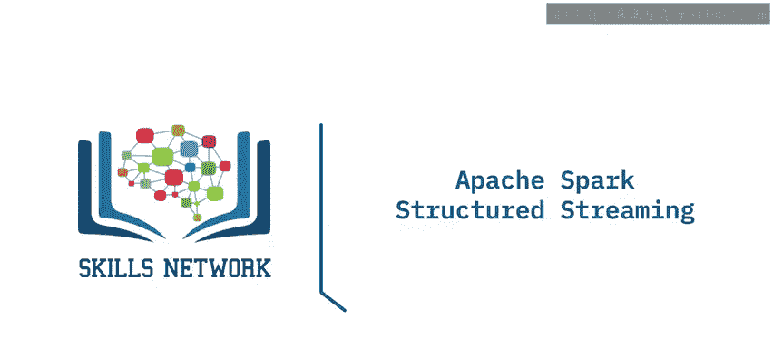

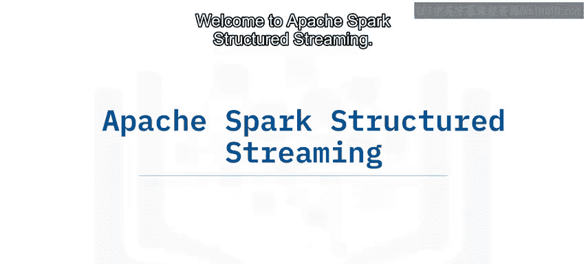

在本节课中，我们将要学习Apache Spark结构化流的核心概念。我们将了解什么是流数据，以及Spark如何利用其强大的SparkSQL引擎来处理这些连续到达的数据。

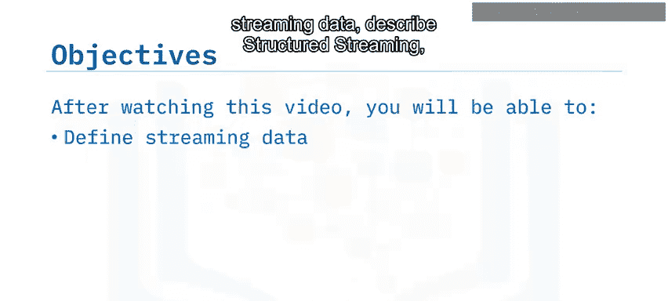

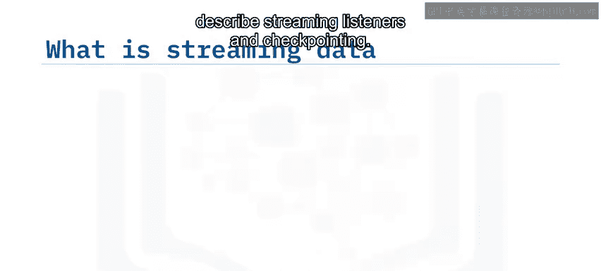

## 概述：什么是流数据？ 💧

流数据是持续生成的数据，通常来自多个源头。它无法作为一个完整的数据集一次性获得，因为数据是持续产生的。由于数据量过大，过去的数据通常无法存储。在处理数据的同时，新的数据不断到达，因此流数据需要增量处理。

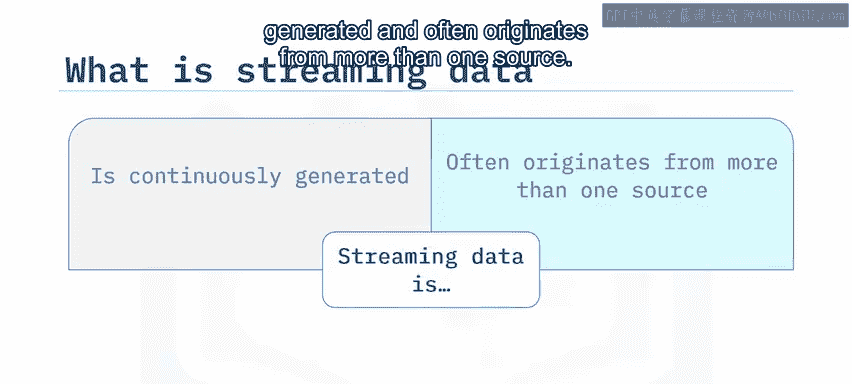

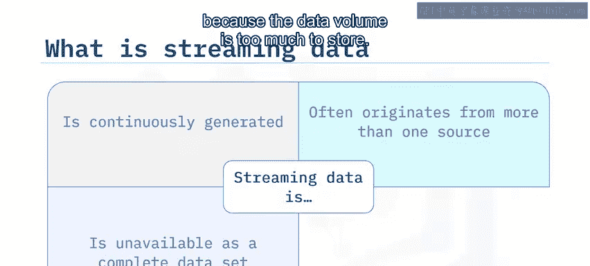

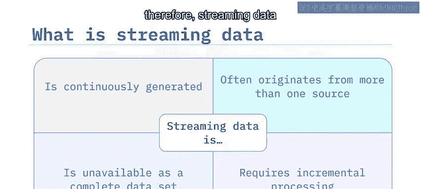

## Spark结构化流简介 ⚙️

Apache Spark结构化流支持使用SparkSQL处理流数据。它使用与批处理相同的数据帧（DataFrame）和数据集（Dataset）API。Spark通过微批处理（micro-batches）或最新的连续处理模式来处理数据。最后，Spark结构化流使用相同的SparkSQL引擎来优化查询。

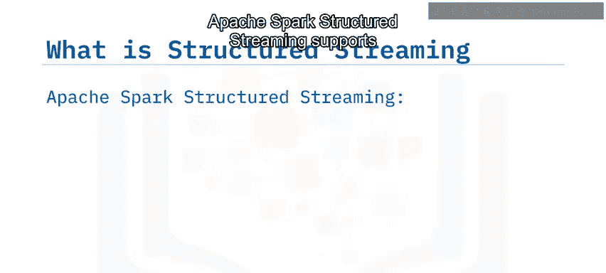

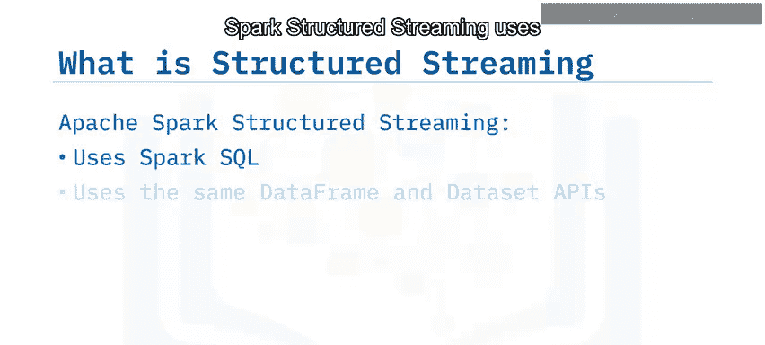

上一节我们介绍了流数据和Spark结构化流的基本概念，本节中我们来看看结构化流中的一些关键术语。

## 核心术语详解 🔑

以下是理解Spark结构化流必须掌握的几个核心术语：

*   **数据源**：定义数据从何而来，即数据的原始位置。
*   **数据接收器**：指定结构化流处理结果的输出位置。
*   **事件时间**：指记录创建的时间戳，即数据点生成的时间。它与数据到达系统的时间或系统处理数据的时间不同。
*   **端到端延迟**：数据从源到接收器完成处理所需的总时间。
*   **水印**：管理迟到数据的过程。水印机制允许在初始数据处理后，包含迟到的数据并更新结果。

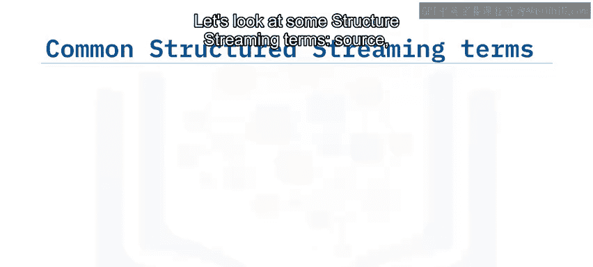

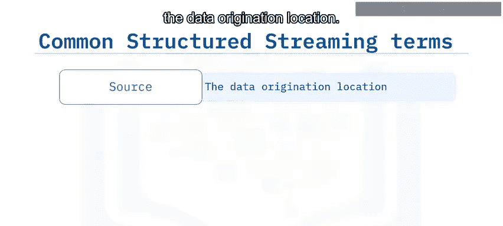

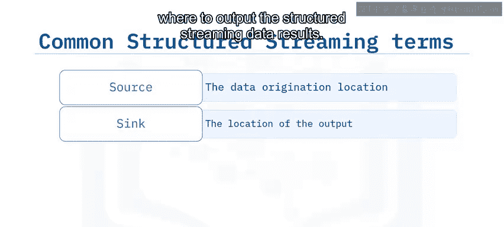

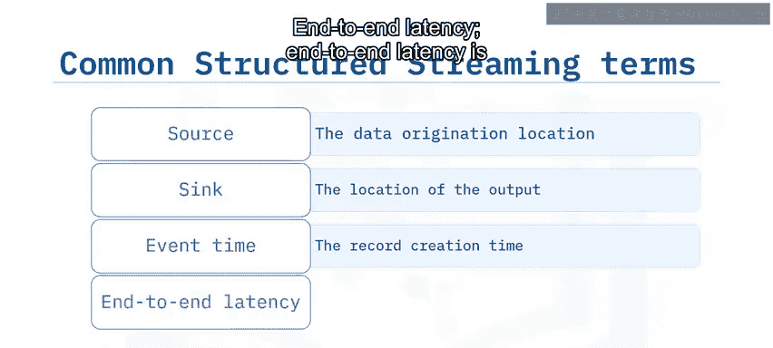

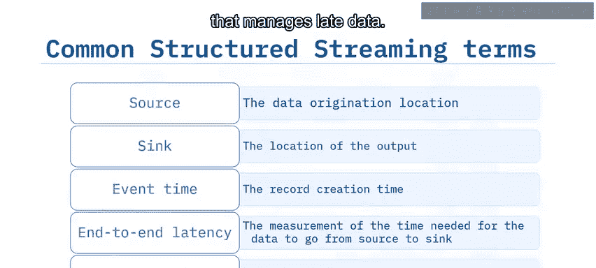

## 支持的数据源与操作 📥

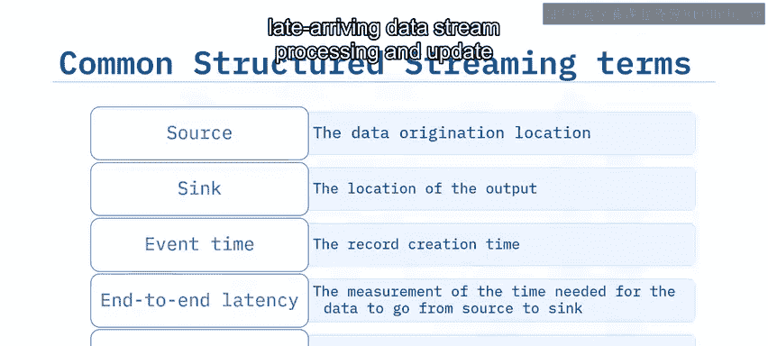

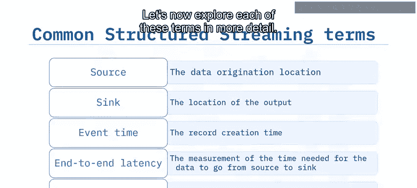

Spark结构化流支持多种数据源，包括文件、Kafka、IP套接字和速率源等。它运行在SparkSQL引擎之上，支持标准的SQL操作，如选择、投影和聚合。特别地，它支持基于事件时间的滑动窗口聚合，你甚至可以将流数据与静态数据帧或其他流进行连接。

## 输出模式 📤

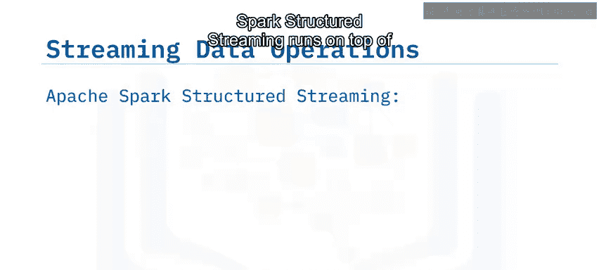

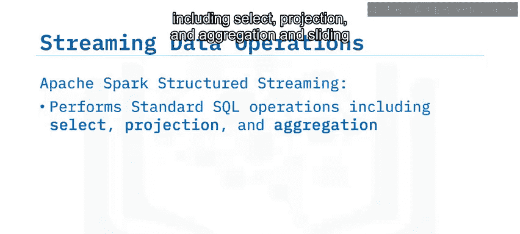

在写入数据时，你可以指定不同的输出模式以满足特定需求：

*   **追加模式**：仅添加新的数据行。
*   **完全模式**：删除目标位置的现有数据，从头开始输出整个结果表。
*   **更新模式**：仅更新发生变化的行。这种模式对于管理迟到数据点特别有用。

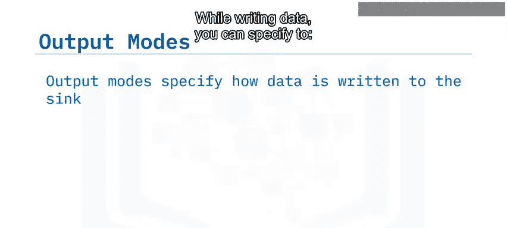

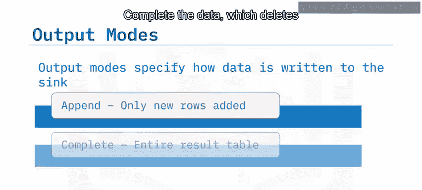

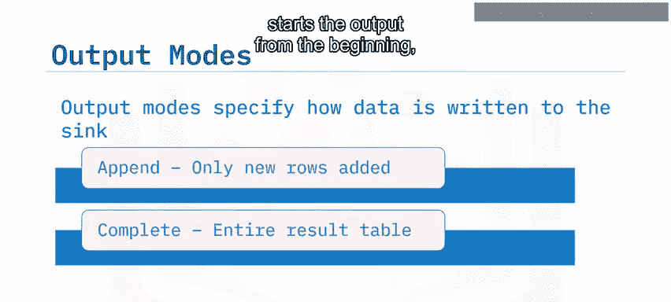

## 支持的数据接收器 📁

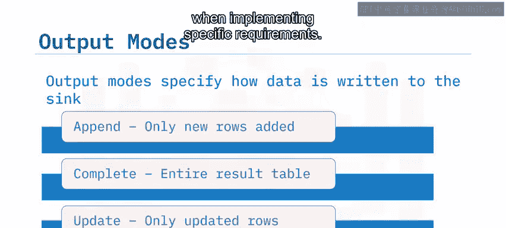

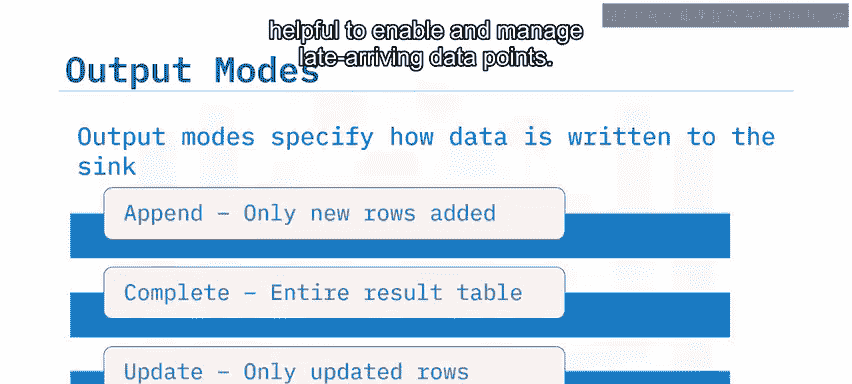

除了已提到的文件（输出到目录）和Kafka（输出到主题）等数据源/接收器，结构化流还支持其他有用的接收器：

*   `foreach` 和 `foreachBatch`：对每条记录或每个批次应用一个函数。
*   `console` 和 `memory`：请注意，控制台和内存接收器仅推荐用于调试，因为它们不具备容错性。

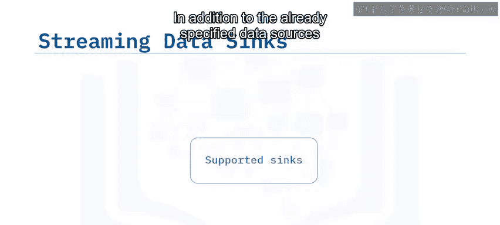

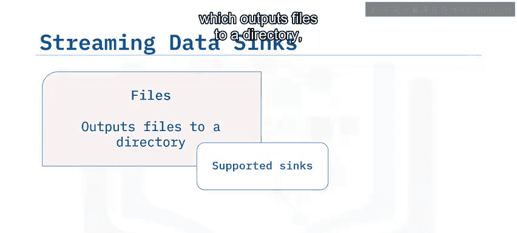

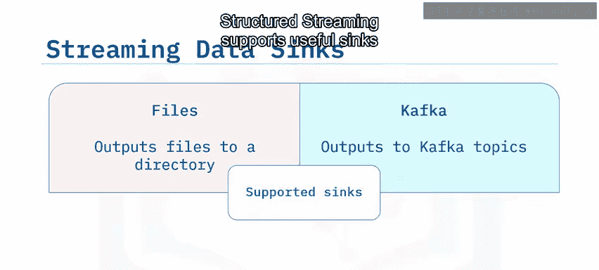

## 高级特性 🛡️

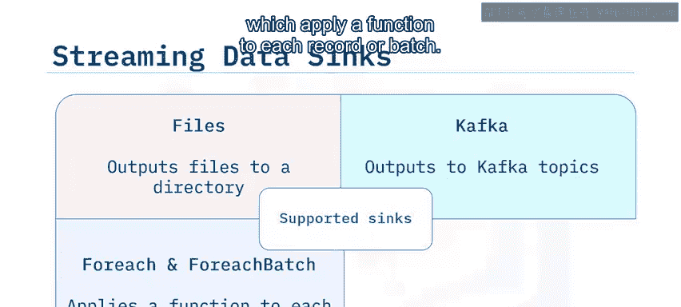

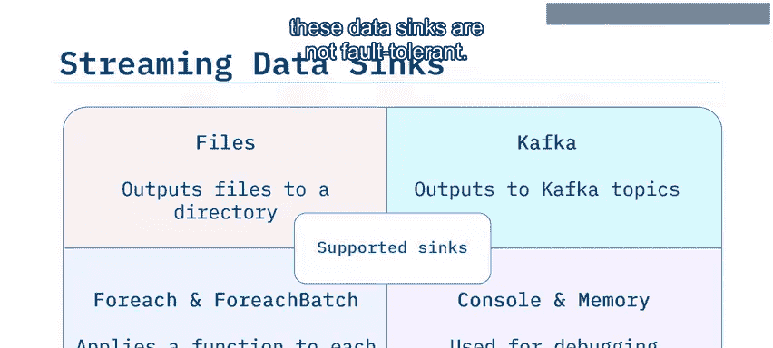

Spark流处理还支持一些高级特性，例如**外部监听器**和**检查点**。

*   **外部监听器**：可以通过外部框架或编程方式工作，作为数据流的监视器来触发事件。
*   **检查点**：为了补偿节点故障，检查点功能可以在失败时恢复查询进度，并将流状态写入磁盘。

## 总结 📝

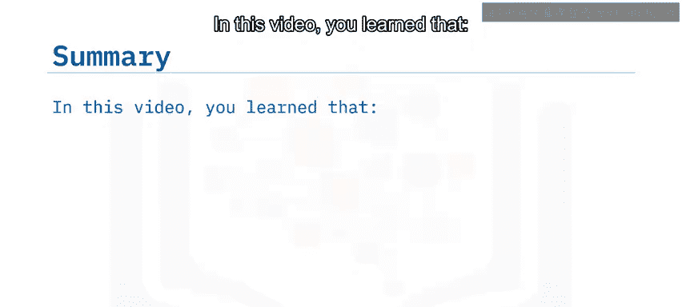

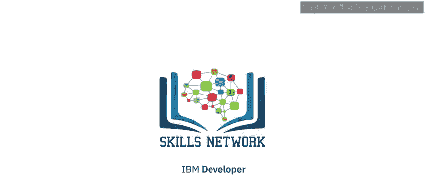

本节课中我们一起学习了Apache Spark结构化流。我们了解到，它使用SparkSQL引擎以及数据帧或数据集API来处理数据流。流的输出模式包括：仅追加新行、完全输出整个结果表以及仅更新已更改的行。Apache Spark结构化流支持标准SQL操作、基于事件时间的窗口操作，以及与静态或流式数据帧的连接。